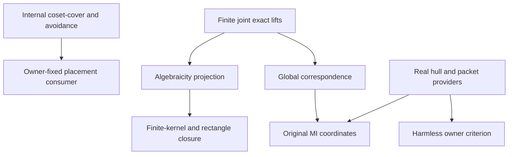

# Real closure, harmless owners and original correspondence coordinates

Generated from `module.json` by `tools/build_formalization_module.py`.

Source `490c3f36d85db5a0b3ced0598e6c431825254ec5`. **Human-expanded proof plan; no Lean code.**

Preparation for OTHER Lean projects. General exact algebraicity projection/finite closed preimages, harmless full invariant owner parameters, original normalized correspondence coordinates and internally proved finite-action avoidance. No maximal-core safe descent, rooted construction or EPPA is imported.

The human article remains unchanged. Additional proof details are in
[PROOF_NOTES.md](PROOF_NOTES.md); the cross-track policy is in
[the formalization guide](../README.md). Source hashes are checked before
the index is regenerated. Graph validation is not proof verification.

## Source premises

**A01: Current actual source.** M is a nonempty countable transitive homogeneous source in a FINITE complete symmetric binary language with semantic homomorphic CCO and equality-inclusive RAW orbitals. Countability is retained from the packaged joint-lifting provider. No SAP or EPPA is assumed.

**A02: Infinite-source branch.** For correspondence coordinates and harmless-owner criteria M is infinite. Finite-class packets F may be nonidentity and NONEXACT. The quotient projection and full-preimage closure lemmas do not need the infinite-source restriction.

**A03: Finite-exact normalization only where required.** The actual source has no nonidentity invariant finite-class FULL RAW EXACT equivalence. This is used for finite-exact intersection, correspondence gluing and original canonical coordinates, not the general harmless-owner or quotient-closure branches.

**A04: Complete minimal-direction list.** E_1,...,E_r enumerate ALL distinct inclusion-minimal infinite invariant equivalences of the current original source. They are exact by the prepared minimal-cut provider. Canonical multi-coordinate conclusions require r>=2; no arbitrary subset may replace this complete list.

**A05: Strong closed safe palette.** S is a set of ORIGINAL diversity atom names with strong amalgamation of finite ABSOLUTELY real-acl-closed induced spans, with each new off-base cross edge in S. Used only by unsafe concentration and its clique consequence, not structural correspondence, closure or harmless-owner criteria.

**A06: Finite common kernel family.** There is a finite indexed family of equivalences K_i on the original carrier with common kernel K=meet_i K_i having finite real classes. For the algebraicity/source claims they are actual FULL RAW EXACT invariant equivalences of M; the pure finite-fibre cardinality argument uses only the stated kernel property. No compatible-tuple or onto finite projection hypothesis is supplied.

**A07: Absolutely closed finite quotient targets.** Each D_i is finite and ABSOLUTELY acl-closed in the actual quotient M/K_i. Full inverse images are intersected in M. For the rectangle instance C meet K=Id and both actual coordinate targets project onto the same finite nonempty owner B; B itself need not be acl-closed.

**A08: Abstract action and finite moving request.** For the generic avoidance result G is any group acting on a set, A and Z are finite, and EVERY a in A has infinite G-orbit. Empty A/Z and nonfaithful actions are allowed. No topology, model theory or source geometry is needed.

**A09: Real finite-orbit algebraicity.** Use real acl as finite orbits of the full pointwise automorphism stabilizer; owner classes are actual quotient imaginaries fixed individually. In the current countable homogeneous finite language, finite real bases have finite acl. Monotonicity, finite-base idempotence and transitivity follow from stabilizer finite-index arguments recalled in N00, not an extra constructional provider.

**A10: Generic commuting equivalence lattice for unary transfer.** For C19 only, a transitive action has a finite lattice of commuting invariant equivalences and a greatest finite-class F; F has a UNIQUE least strict coarsening D. All relevant relative indices are uniform. No exactness, normalization, CCO, countability or safe palette is assumed in this bridge.

**A11: Generic canonical quotient language.** For C35 only, G acts transitively on a nonempty set, K is G-invariant, and the quotient language names ALL actual old-G pair orbitals. The full automorphism group of this named quotient may be larger than the G image. No global surjectivity or group section is assumed.

## Imported theorem contracts

These are named provider obligations for the receiving Lean project,
not new axioms or claims of compiled imports.

| ID and source | Contract | Current provider status |
|---|---|---|
| I01: [`lem:exact-product`](../../sections/exact_foundations/01_full_raw_exact_helly.tex#L284) | Reuse exact RAW multiplication and nonempty meet-product distribution, including identity words, and symmetry-based original commutation. No STRONG/NR2 step. | HUMAN_EXPANDED_NOT_LEAN |
| I02: [`thm:joint-exact`](../../sections/exact_foundations/03_joint_exact_sort_lifting.tex#L127) | Every finite genuine joint real/exact-sort partial isomorphism extends to ONE original automorphism. Retain the current countability premise; no global quotient automorphism section. | HUMAN_EXPANDED_NOT_LEAN |
| I03: [`lem:nested-mixed`](../../sections/exact_foundations/02_exact_quotient_orbital_geometry.tex#L144) | For real/actual exact owner, the mixed pair orbital depends only on the projected owner pair, including quotient diagonals. This validates fixed-real/moving-owner and moving-real/fixed-owner finite requests. | HUMAN_EXPANDED_NOT_LEAN |
| I04: [`thm:exact-sorts-source`](../../sections/exact_foundations/03_joint_exact_sort_lifting.tex#L161) | Every actual exact quotient retains the standing source in its complete old-group canonical orbital language. Full quotient invariant transport is C35. Strict diversity-rank decrease is proved locally in C10/C16 by counting orbital blocks; it is not attributed to an unexported rank clause of this provider. | HUMAN_EXPANDED_NOT_LEAN |
| I05: [`thm:rh-hull`](../../sections/real_hull/05_even_walk_canonical_hull.tex#L27) | For x outside finite nonempty real A, x is algebraic iff the actual intersection of Gamma(col(x,a)) classes through a is finite; Gamma is the FULL generated invariant equivalence, not necessarily exact. Empty parameters are treated separately. | HUMAN_EXPANDED_NOT_LEAN |
| I06: [`cor:rh-acl-bounded-character`](../../sections/real_hull/06_minimal_infinite_directions_acl.tex#L85) | Reuse specifically C11: acl(a)=F[a] and, for an infinite actual source with ONE minimal infinite invariant direction, acl(A)=F[A] for every finite real A. This does NOT imply harmlessness of named owner imaginaries. | HUMAN_EXPANDED_NOT_LEAN |
| I07: [`lem:packetinterval`](../../sections/finite_packets.tex#L56) | Reuse elementary finite-index Sigma/F construction, monotone canonical kappa cores, finite [R:kappa(R)], Sigma(kappa(R))=Sigma(R), and actual word exactness of every core including empty-word Id. No exactness or distributivity of F is inferred. | HUMAN_EXPANDED_NOT_LEAN |
| I08: [`lem:crossingindex`](../../sections/finite_packets.tex#L138) | Reuse C02 finite towers, restriction inequalities and [A join B:B]=[A:A meet B] for commuting invariant equivalences; do not rely on cardinal division for infinite classes. | HUMAN_EXPANDED_NOT_LEAN |
| I09: [`prop:minimalcut`](../../sections/finite_packets.tex#L102) | Every inclusion-minimal infinite invariant equivalence is its nontrivial exact packet core, with no proper infinite refinement. Keep the FULL invariant lattice separate from its exact sublattice. | HUMAN_EXPANDED_NOT_LEAN |
| I10: [`lem:finite-regularization`](../../sections/finite_packets.tex#L207) | Reuse ONLY finite_packets C19/C22: the stabilized product of all F-atom squares is a finite-class exact H0 containing every such square. Current normalization forces H0=Id, hence every F atom has square Id. No thin-bottom conclusion is inferred from a theorem that merely assumes thinness. | HUMAN_EXPANDED_NOT_LEAN |
| I11: [`thm:abstract-exact-crt`](../../sections/exact_lattice_crt.tex#L5) | Use only the two-coordinate commuting-equivalence realization for a full rectangle with C meet K=Id. General finite-kernel closure pullback below does not require compatible tuple surjectivity. | HUMAN_EXPANDED_NOT_LEAN |
| I12: [`lem:acf-exact-distributive`](../../sections/exact_lattice_crt.tex#L52) | The actual exact equivalences form a commuting distributive lattice, discharging I11 for the rectangle. The FULL invariant lattice is not asserted distributive. | HUMAN_EXPANDED_NOT_LEAN |
| I13: [`lem:acf-mixed-exact-join`](../../sections/exact_foundations/02_exact_quotient_orbital_geometry.tex#L95) | For original exact C,K and old atom a, C;a;K=(C join K);a;(C join K). This is separate from rectangle closure and no global group section is asserted. | HUMAN_EXPANDED_NOT_LEAN |

## Definitions

| ID | Definition | Exact meaning | Source |
|---|---|---|---|
| D01 | Full finite packet and generated equivalence | F=Sigma(Id) is the greatest finite-class invariant equivalence, possibly nonexact. Gamma(a) is generated by the actual symmetric orbital a. | [source](../../sections/harmless_exact_owners.tex#L71) |
| D02 | Finite-exact normalized support | No nonidentity FULL RAW exact invariant equivalence has finite classes; this does not force F=Id. | [source](../../sections/rooted_acf_geometry.tex#L42) |
| D03 | Global correspondence cut | For a GIVEN NONIDENTITY actual exact invariant EQUIVALENCE E, R_E is the union of ALL actual RAW atoms a, including equality, for which E meet a squared=Id. It is defined on the whole original carrier. | [source](../../sections/global_correspondence.tex#L7) |
| D04 | Original nonmaximal packet cores | For the complete E_i list set R_i=R_(E_i) and C_i=kappa(R_i). These symbols are NOT redefined by later maximal pseudocomplements hat C_i. | [source](../../sections/rooted_acf_geometry.tex#L78) |
| D05 | Strong closed unsafe clique | An unsafe clique is a finite set all of whose DISTINCT pairs have old atom outside S. Strong closed amalgamation is an input about absolutely closed spans, not arbitrary finite SAP. | [source](../../sections/rooted_acf_geometry.tex#L89) |
| D06 | Full inverse-image intersection | W=intersection_i pi_(K_i)^(-1)(D_i); its joint quotient-map fibres are K-classes. No independent coordinate surjectivity is assumed. | [source](../../sections/maximal_cores/01_maximal_hat_normalisation.tex#L232) |
| D07 | Harmless actual owner classes | A full invariant owner kernel H is harmless if adding any finite collection of its actual classes as imaginary parameters does not change real acl over any finite real A. Mixed finite owner sorts are included. | [source](../../sections/harmless_exact_owners.tex#L14) |
| D08 | Bad neighbour colour for one minimal direction | For a chosen infinite minimal E, p is bad if E meet p squared subset F. In one E-class its p-neighbours of x lie in a single finite F-class. | [source](../../sections/harmless_exact_owners.tex#L74) |
| D09 | Canonical tuple closure target | For finite real A and exact K_i with finite common kernel, membership in real acl(A) is equivalent to every quotient coordinate being algebraic over its projected input. | [source](../../sections/rooted_acf_geometry.tex#L287) |
| D10 | Virtual containment preorder | For subgroups U,V of a group, U preceq V iff [U:U meet V] is finite. Mutual virtual containment is commensurability; choose maximal CLASSES in this finite preorder. | [source](../../sections/finite_orbit_avoidance.tex#L24) |
| D11 | Finite transporter obstruction | For a group action request (a,z), {g:g(a)=z} is empty or one LEFT coset of the point stabilizer. Infinite a-orbit means that stabilizer has infinite index. | [source](../../sections/finite_orbit_avoidance.tex#L21) |

## Proof claims and direct dependencies

Every row has a human proof expansion. Each still needs an actual Lean
statement and proof. Abstract avoidance/full quotient intervals, source closure, normalized correspondence and palette-conditional concentration have distinct premises.

| ID and claim | Scope | Direct providers | Proof note |
|---|---|---|---|
| C01: Virtual containment is a preorder | abstract_group | D10 | N08 in [notes](PROOF_NOTES.md) |
| C02: Finite coset-cover theorem proved internally | abstract_group | C01 | N08 in [notes](PROOF_NOTES.md) |
| C03: One motion avoids every finite forbidden pair | abstract_group | C02, D11 | N08 in [notes](PROOF_NOTES.md) |
| C04: Exact reflexive finite support is identity after normalization | actual_source | A01, A03, D01, I01 | N02 in [notes](PROOF_NOTES.md) |
| C05: The global cut contains identity and all finite packets | actual_source | A01, A03, D03, I10 | N03 in [notes](PROOF_NOTES.md) |
| C06: Only finite thin E edges belong to the cut | actual_source | C05, D03, I10 | N03 in [notes](PROOF_NOTES.md) |
| C07: Each cut colour is functional into a fixed E class | actual_source | D03 | N03 in [notes](PROOF_NOTES.md) |
| C08: The finite real and fixed-owner request is genuine | actual_source | A01, D03, I03 | N03 in [notes](PROOF_NOTES.md) |
| C09: Joint exact lifting makes the global cut transitive | actual_source | C07, C08, I02 | N03 in [notes](PROOF_NOTES.md) |
| C10: Structural gluing dichotomy without EPPA | actual_source | C05, C06, C09, I07, I04, A03 | N03 in [notes](PROOF_NOTES.md) |
| C11: Two-anchor algebraicity test | actual_source | A01, A02, A04, C04, D04, I05 | N04 in [notes](PROOF_NOTES.md) |
| C12: Different minimal directions lie in opposite correspondences | actual_source | A03, A04, D04, I09 | N04 in [notes](PROOF_NOTES.md) |
| C13: An unsafe pair cannot evade both correspondences | actual_source | C11, C12, A05, A09, I01, C09 | N04 in [notes](PROOF_NOTES.md) |
| C14: Two-equivalence rook lemma and exceptional cliques | actual_source | C13 | N04 in [notes](PROOF_NOTES.md) |
| C15: All correspondences meet at F and all original cores at Id | actual_source | C05, C06, C09, A02, A03, A04, D04, I07 | N05 in [notes](PROOF_NOTES.md) |
| C16: Original cores contain every other minimal direction | actual_source | C12, C06, A03, D04, I07, I09, I04, C09 | N05 in [notes](PROOF_NOTES.md) |
| C17: Correspondence has one least strict coarsening | actual_source | C04, C06, A04, D04, I08, C09 | N05 in [notes](PROOF_NOTES.md) |
| C18: Original quotient finite bottom and upper interval | actual_source | C17, C35, I07, I04, D04 | N05 in [notes](PROOF_NOTES.md) |
| C19: A meet-irreducible finite bottom has one minimal infinite direction | abstract_lattice | A10 | N05 in [notes](PROOF_NOTES.md) |
| C20: Canonical old-core unary targets and clique projections | actual_source | C14, C15, C16, C18, C19, I06 | N05 in [notes](PROOF_NOTES.md) |
| C21: Actual exact quotient images of algebraic real points are algebraic | actual_source | A01, A09, I02, I03 | N06 in [notes](PROOF_NOTES.md) |
| C22: Finite common kernel recovers real algebraicity from coordinates | actual_source | A06, A09 | N06 in [notes](PROOF_NOTES.md) |
| C23: General finite-meet real closure pullback | actual_source | C21, C22, D09 | N06 in [notes](PROOF_NOTES.md) |
| C24: Full inverse-image intersection is finite | finite_fibre | A06, A07, D06 | N06 in [notes](PROOF_NOTES.md) |
| C25: That intersection is absolutely acl-closed | actual_source | C21, C24, A07, A09 | N06 in [notes](PROOF_NOTES.md) |
| C26: Full complementary rectangle inherits absolute closure | actual_source | C24, C25, I11, I12, A07 | N06 in [notes](PROOF_NOTES.md) |
| C27: Mixed rectangle orbit identity remains a separate interface | actual_source | I13 | N06 in [notes](PROOF_NOTES.md) |
| C28: Choose one minimal direction for all added owner names | actual_source | A01, A02, A04, A09, D07, I05 | N07 in [notes](PROOF_NOTES.md) |
| C29: Good actual representatives avoid only finite bad fibres | actual_source | C28, D08, D01 | N07 in [notes](PROOF_NOTES.md) |
| C30: Harmlessness for every finite collection of owner sorts | actual_source | C29, I05, A09 | N07 in [notes](PROOF_NOTES.md) |
| C31: Missing one minimal direction creates new real algebraicity | actual_source | A01, A02, A04, I06, D07, I07 | N07 in [notes](PROOF_NOTES.md) |
| C32: Full harmless-owner iff criterion | actual_source | C30, C31 | N07 in [notes](PROOF_NOTES.md) |
| C33: Old-core closure bands | actual_source | C15, C16, C18, C19, I06, C23 | N06 in [notes](PROOF_NOTES.md) |
| C34: Finite diagnostics do not certify source geometry | diagnostic | A11 | N09 in [notes](PROOF_NOTES.md) |
| C35: Canonical quotients transport the FULL invariant interval | abstract_lattice | A11 | N01 in [notes](PROOF_NOTES.md) |

The precise quantified contracts are in `module.json`. Provider-before-consumer
order (including definitions and source premises):

`A01 → A02 → A03 → A04 → A05 → A06 → A07 → A08 → A09 → A10 → A11 → D10 → C01 → C19 → C22 → C34 → C35 → D02 → D03 → D05 → D06 → D07 → D09 → D11 → I01 → I02 → I03 → I04 → I05 → I06 → I07 → I08 → I09 → I10 → I11 → I12 → I13 → C02 → C05 → C07 → C08 → C21 → C24 → C27 → C28 → C31 → D01 → D04 → C03 → C04 → C06 → C09 → C12 → C23 → C25 → D08 → C10 → C11 → C15 → C16 → C17 → C26 → C29 → C13 → C18 → C30 → C14 → C32 → C33 → C20`

This order is one valid linearization; it does not require unrelated
branches to be proved sequentially. The full DAG is the `depends_on`
relation in `module.json`.

## Main proof branches

This is a coarse view of the claim DAG. Edges go from provider to consumer.

The next module imports these general results; no reverse maximal-core dependency is introduced by the physical source order. APJ is selected from maximal_cores/01 here before its independent normalization results are packaged. The coset-cover proof is internal, not an assumed external axiom.

## Article exports

| Existing source result | Sidecar proof claims |
|---|---|
| [`lem:finite-action-avoidance`](../../sections/finite_orbit_avoidance.tex#L6) | C01, C02, C03 |
| [`lem:acf-finite-exact-intersection`](../../sections/rooted_acf_geometry.tex#L48) | C04 |
| [`lem:global-correspondence`](../../sections/global_correspondence.tex#L16) | C05, C06, C07, C08, C09, C10, C35 |
| [`lem:acf-unsafe-concentration`](../../sections/rooted_acf_geometry.tex#L87) | C11, C12, C13, C14 |
| [`lem:acf-canonical-coordinates`](../../sections/rooted_acf_geometry.tex#L207) | C15, C16, C17, C18, C19, C20, C33, C35 |
| [`lem:acf-acl-projects-exact`](../../sections/maximal_cores/01_maximal_hat_normalisation.tex#L137) | C21 |
| [`lem:acf-finite-exact-closed-preimages`](../../sections/maximal_cores/01_maximal_hat_normalisation.tex#L210) | C24, C25 |
| [`lem:acf-rectangle-acl`](../../sections/maximal_cores/01_maximal_hat_normalisation.tex#L302) | C26, C27 |
| [`lem:acf-harmless-owners`](../../sections/harmless_exact_owners.tex#L8) | C28, C29, C30, C31, C32 |

Auxiliary source equations (not additional numbered results):

- [`eq:global-correspondence`](../../sections/global_correspondence.tex#L7): C05, C06, C09
- [`eq:acf-correspondence`](../../sections/rooted_acf_geometry.tex#L78): C05, C06, C09, C15
- [`eq:acf-anchor-test`](../../sections/rooted_acf_geometry.tex#L104): C11
- [`eq:acf-core-meets`](../../sections/rooted_acf_geometry.tex#L214): C15
- [`eq:acf-MI-closure`](../../sections/rooted_acf_geometry.tex#L222): C18, C19, C20
- [`eq:acf-one-free`](../../sections/rooted_acf_geometry.tex#L229): C14, C20
- [`eq:acf-closure-pullback`](../../sections/rooted_acf_geometry.tex#L287): C21, C22, C23
- [`eq:acf-closure-bands`](../../sections/rooted_acf_geometry.tex#L341): C33
- [`eq:acf-acl-projects-exact`](../../sections/maximal_cores/01_maximal_hat_normalisation.tex#L152): C21
- [`eq:acf-finite-exact-closed-preimages`](../../sections/maximal_cores/01_maximal_hat_normalisation.tex#L232): C24, C25
- [`eq:acf-rectangle-mixed-orbit`](../../sections/maximal_cores/01_maximal_hat_normalisation.tex#L373): C27
- [`eq:acf-harmless-hull`](../../sections/harmless_exact_owners.tex#L126): C28, C29, C30

Full result coverage is asserted only for `source_result_files`.
Selected additional results: lem:finite-action-avoidance, lem:acf-acl-projects-exact, lem:acf-finite-exact-closed-preimages, lem:acf-rectangle-acl.
Other results in their provider source files are not claimed covered.

## Internal implementation milestones

These tasks are proof milestones inside larger project assignments;
see the [peer-project allocation](../coordination/BOARD.md).

These are implementation tasks, not additional mathematical assumptions.

| Task | Earlier tasks | Acceptance |
|---|---|---|
| T01: Abstract avoidance and canonical full quotient intervals | — | Reuse proved group/index/coset-cover library APIs when their exact receiving-toolchain contracts fit; otherwise formalize the supplied internal finite subgroup-type proof. No unproved external premise. Prove the full invariant quotient interval without a global section. |
| T02: Normalized correspondence and original coordinate geometry | T01 | Retain exact-equivalence types, source normalization and exhaustive minimal directions; distinguish structural and conditional unsafe-clique conclusions. |
| T03: Exact algebraicity projection and finite closed preimages | T01, T02 | Prove APJ from finite joint lifts, general finite-kernel closure pullback and absolute rectangle closure with arbitrary finite owner B. |
| T04: Harmless imaginary owners and premise controls | T01 | Prove both directions for full invariant owner kernels and every finite mixed collection; no normalization or safe palette is needed. |

## Finite controls

- **R01.** Exhaustive finite equivalence rook and all-pair family concentration tests, with a deliberate three-equivalence union failure.
- **R02.** Actual finite quotient kernels, canonical pair colours and finite-fibre intersections; no finite computation is described as model-theoretic acl certification.
- **R03.** Cartesian-phase full fine-lift pair tables include opposite-coordinate diagonals; existentially safe projected colours differ from full support.

Run `python tools/check_acl_owner_controls.py` from the manuscript directory.
The controls do not prove CCO or the general theorems.

## Return to the human articles

No required mathematical repair was found in this scoped pass. These
optional wording clarifications remain queued for a human article pass:

- **F01** ([source](../../sections/rooted_acf_geometry.tex#L319)): Reverse finite-kernel acl reconstruction uses only finite coordinate-orbit ranges and finite joint fibres; CRT surjectivity is unnecessary. Cite APJ once and retain a general finite-fibre converse, separating it from compatible tuple realization.
- **F02** ([source](../../sections/maximal_cores/01_maximal_hat_normalisation.tex#L310)): Rectangle closure needs absolutely closed coordinate factors but no acl-closed or harmless common owner. Keep this weaker closure contract separate from helper padding in safe descent.
- **F03** ([source](../../sections/global_correspondence.tex#L35)): Global correspondence uses a finite exact-sort map, not a global quotient group lift; handle equality/degenerate endpoints before spelling a map. Make the fixed-middle finite-lift argument explicit and reuse common quotient recognition.
- **F04** ([source](../../sections/harmless_exact_owners.tex#L90)): Good representative choices must exclude x itself so the hull theorem uses genuine diversity spokes. Retain this finite exclusion and the simultaneous SAME minimal direction for all named owner classes.
- **F05** ([source](../../sections/finite_orbit_avoidance.tex#L24)): The previously external Neumann step has a short internal finite-subgroup-type induction. A future self-contained article appendix can include the proof or retain the citation; Lean no longer needs an unproved external assumption.
- **F06** ([source](../../sections/rooted_acf_geometry.tex#L260)): Old core quotients need not be normalized. The bridge from a finite meet-irreducible bottom to a unique minimal infinite direction uses finite-index transposition. Expose that bridge before using the already prepared one-direction closure theorem.

The machine ledger records caller effects and affected claims. The source
review used two independent model review passes and parent synthesis;
it is not independent human or formal certification.
