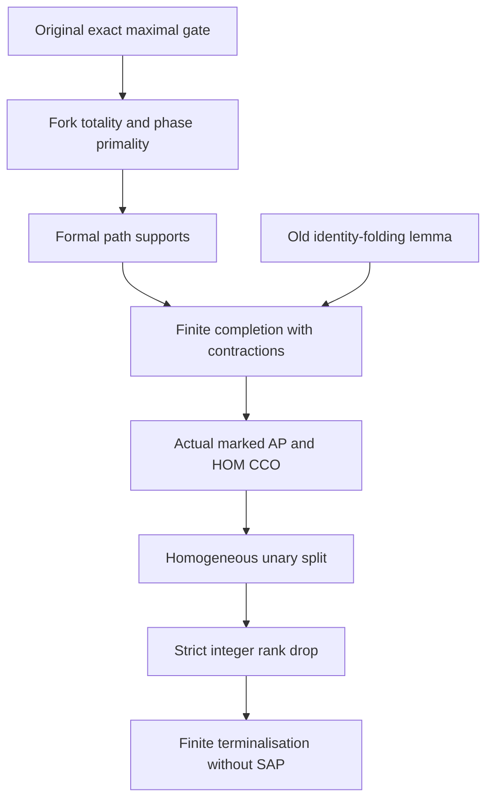

# AP-only exact character completion with identity folding and finite terminalisation

Generated from `module.json` by `tools/build_formalization_module.py`.

Source `490c3f36d85db5a0b3ced0598e6c431825254ec5`. **Human-expanded proof plan; no Lean code.**

Private B044: seven Foundations I results and four auxiliary equations. Actual equality-inclusive RAW products, maximal ORIGINAL exact gates, rigid character masks, formal support induction, finite identity contractions, induced marked AP/JEP/HOM CCO and rank-decreasing unary terminalisation. No SAP, diversity-only convolution, arbitrary quotient exact descent or later terminal Ramsey theorem is used. Human preparation retains all selected source-provider hypotheses, not global certification.

The human article remains unchanged. Additional proof details are in
[PROOF_NOTES.md](PROOF_NOTES.md); the cross-track policy is in
[the formalization guide](../README.md). Source hashes are checked before
the index is regenerated. Graph validation is not proof verification.

## Source premises

**A01: Actual AP and semantic HOM CCO original source.** M is countable ultrahomogeneous complete finite relational binary with finitely many named nonempty transitive original unary sorts. Same-sort orbital relations are symmetric; all original binary atoms are actual full-Aut pair orbitals. Equality is included in represented products, not a diversity edge. Its age has ordinary AP/JEP and semantic homomorphic simple-cycle CCO. No old SAP or triangle-definedness.

**A02: Chosen maximal full exact gate instance.** Choose the reachable even/odd index-two interval Y<X supplied by I02, inclusion-maximal full exact K>=Y with K intersect X=Y, and the connected ACTUAL full exact quotient-functional bridge groupoid rooted at K. I03/I06 supply its original-level maximal gate and transport; I09 supplies a character taking the transported odd involutions to one. Active sorts are reached objects; each inactive sort has one fixed prescribed label. These are provider outputs instantiated on the original source, not arbitrary algebraic masks.

**A03: Actual age and ordinary Fraisse conventions.** Finite marked objects are COMPLETE induced old-age structures equipped with locally legal unary bits. Embeddings are induced old embeddings preserving bits, and AP allows cross-leg collisions. Standard countable finite-language Fraisse construction and uniqueness are used only after HP, AP and JEP; reasonableness gives the extension property of the old reduct. An arbitrary global orbit-seed marking need not itself be homogeneous.

**A04: Independent rank lemma setting.** A homogeneous finite complete binary age has finitely many named transitive current sorts. A genuine expansion whose ENTIRE resulting structure/age is homogeneous adds ONLY unary labels and replaces each active parent a by two NONEMPTY homogeneous child sorts a^0,a^1, retaining all binary atom names. Some realized same-sort diversity colour c_a has phase difference one and is absent inside both children. Inactive sorts and their induced structures are unchanged. No CCO, exactness, AP or SAP is needed for this counting lemma; homogeneity identifies pair orbitals with occurring named colours.

## Imported theorem contracts

These are named provider obligations for the receiving Lean project,
not new axioms or claims of compiled imports.

| ID and source | Contract | Current provider status |
|---|---|---|
| I01: [`thm:full-typed-exact-balls`](../../sections/exact_foundations/01_full_raw_exact_helly.tex#L27) | RAW word 2-Helly, full exact convolution and distribution over finite exact meets with NONEMPTY result; includes top/empty-restriction-list handling. | HUMAN_EXPANDED_NOT_LEAN |
| I02: [`lem:ep-ap-orbital-parity`](../../sections/finite_relative_parity_exact_closure.tex#L18) | SAP-free finite-relative-index parity seed, equality-inclusive even/odd words and index-two layer, inside any current actual homogeneous source. | HUMAN_EXPANDED_NOT_LEAN |
| I03: [`thm:foundational-maximal-parity-gate`](../../sections/finite_relative_parity_exact_closure.tex#L147) | Maximal original full exact K, represented odd relation t=KOK, t;t=K, original exact Z>K contains t and quotient involution. Keep C24 ORIGINAL dominance; no converse exact descent. | HUMAN_EXPANDED_NOT_LEAN |
| I04: [`lem:ep-relative-K-closure`](../../sections/finite_relative_parity_exact_closure.tex#L91) | For symmetric full exact K-bisaturated A,B strictly above K with A intersect B=K, their stable equivalence closures intersect in WHOLE K. No SAP or Hasse input. | HUMAN_EXPANDED_NOT_LEAN |
| I05: [`thm:foundational-rigid-groupoid`](../../sections/rigid_exact_groupoid_foundations.tex#L27) | Actual exact functional bridges with kernels, one reached object per sort, finite connected groupoid, elementary abelian isotropy and FREE actual quotient action. | HUMAN_EXPANDED_NOT_LEAN |
| I06: [`lem:foundational-rigid-gate-transport`](../../sections/rigid_exact_groupoid_foundations.tex#L84) | Bridge conjugation preserves ORIGINAL upper exact-equivalence intervals and transports the odd involution and original maximal gate. No arbitrary old-to-quotient exact descent. | HUMAN_EXPANDED_NOT_LEAN |
| I07: [`lem:foundational-rigid-affine`](../../sections/rigid_exact_groupoid_foundations.tex#L233) | A nonempty full exact endpoint-bisaturated domain supported in a rigid hom-torsor is dS for a full exact isotropy subgroup. Whole rigid quotient orbitals, not fine old atoms; subgroup represented relation is exact. | HUMAN_EXPANDED_NOT_LEAN |
| I08: [`lem:foundational-rigid-factor`](../../sections/rigid_exact_groupoid_foundations.tex#L264) | If the whole nonempty product of two exact inputs lies inside one rigid bridge, inputs factor through compatible rigid bridges. The middle kernel is constructed; if reached already it agrees with its gate. | HUMAN_EXPANDED_NOT_LEAN |
| I09: [`thm:foundational-rigid-character`](../../sections/rigid_exact_groupoid_foundations.tex#L298) | Actual exponent-two character, chi(t_s)=1, free-action orbit seeds, rigid/nonrigid actual pair-orbital classification and finite reduct-surjective marking. This alone gives no AP or CCO. | HUMAN_EXPANDED_NOT_LEAN |
| I10: [`lem:foundational-finite-phase-extension`](../../sections/rigid_exact_groupoid_foundations.tex#L348) | Finite bits extend to ONE global marking iff all pairs in the same free groupoid action orbit have their required character difference. Empty/singleton cases and independent orbit seeds included. | HUMAN_EXPANDED_NOT_LEAN |

**I01 internal proof support:** C01, C02, C03, C05 in `raw_exact`. Use ONLY strict proved ancestors: C01 atomic full-orbit seriality, C02 typed represented composition/top absorption, C03 Peircean rotation and C05 walk/profile semantics. These are existing B001 support, not additional counted source exports or a SAP input.

These are separately extracted proved support claims, not additional
numbered exports or consequences of the named theorem statement.

## Definitions

| ID | Definition | Exact meaning | Source |
|---|---|---|---|
| D01 | Old full typed profiles | A word profile consists of all actual old endpoint pairs realized by its walk. Id may be an OUTPUT, and the empty word is Id; the empty intersection is typed Top. | [source](../../sections/ep_safe_ap_character_completion.tex#L102) |
| D02 | Whole gate and rigid arrow | K_s is the original equivalence inducing quotient identity. A rigid bridge d:s->t obeys dd^op=K_s,d^op d=K_t. One bridge may contain MANY fine old binary atoms. | [source](../../sections/ep_safe_ap_character_completion.tex#L102) |
| D03 | Actual two-bit mask | For active endpoints A_st^(e,h) is the union of rigid arrows of character e+h and all nonrigid atoms. If either endpoint is inactive, its unique label makes every old typed atom allowed. Id is allowed only at the SAME sort and EQUAL labels. | [source](../../sections/ep_safe_ap_character_completion.tex#L102) |
| D04 | Endpoint saturation | For old exact W:s->t set E=K_s;W;K_t. This is a full old represented relation, with nonempty-meet distribution from RAW geometry. | [source](../../sections/ep_safe_ap_character_completion.tex#L102) |
| D05 | Formal lifted support | For a locally allowed specified diversity path set L1={a1} and L_(r+1)=(L_r;{a_(r+1)}) intersect its ACTUAL endpoint-bit mask. This is algebraic, not an assumed marked age product. | [source](../../sections/ep_safe_ap_character_completion.tex#L221) |
| D06 | Identity folding | For missing nonadjacent x,y of same sort and bit, contract x=y only when Id belongs to EVERY old simple x-y path profile. Merge equal incident edge labels; never add a specified Id diversity edge. | [source](../../sections/ep_safe_ap_character_completion.tex#L330) |
| D07 | Completion measure | Use the lexicographic pair (number of formal vertices, number of missing unordered pairs). A contraction drops the first component, even if the second changes. | [source](../../sections/ep_safe_ap_character_completion.tex#L377) |
| D08 | Legal marked age | Objects are actual finite induced original-age structures with pairwise legal prescribed bits, not arbitrary complete atom assignments. Each has a global-marking realization but different objects may use different seed choices. | [source](../../sections/ep_safe_ap_character_completion.tex#L377) |
| D09 | Same-child orbital rank | k_a counts realized nonidentity full pair orbitals. Under homogeneous complete binary unary-only expansions these are exactly the occurring old named diversity colours within that fixed child. | [source](../../sections/ep_safe_ap_character_completion.tex#L543) |
| D10 | Integer terminal potential | Phi=sum_a 3^(k_a). A split replaces one active contribution by at most 2*3^(k_a-1); k_a>=1 for every active parent. | [source](../../sections/ep_safe_ap_character_completion.tex#L543) |

## Proof claims and direct dependencies

Every row has a human proof expansion. Each still needs an actual Lean
statement and proof. Separate original logical Id from whole quotient kernel K, formal lifted supports from actual completions, actual old-age diagrams from arbitrary atom assignments, and a homogeneous Fraisse expansion from an arbitrary global seed marking.

| ID and claim | Scope | Direct providers | Proof note |
|---|---|---|---|
| C01: Choose a reachable two-sheet source layer | gate | A01, I02, I03 | N01 in [notes](PROOF_NOTES.md) |
| C02: Transport the ORIGINAL maximal gate | gate | A01, A02, C01, I05, I06 | N01 in [notes](PROOF_NOTES.md) |
| C03: Construct actual character masks | gate | A02, I05, I09, D03 | N01 in [notes](PROOF_NOTES.md) |
| C04: Literal identity is allowed exactly at matching labels | gate | C03, D02, D03 | N01 in [notes](PROOF_NOTES.md) |
| C05: Compatible nonempty old products have an output | totality | A01, I01, C03 | N02 in [notes](PROOF_NOTES.md) |
| C06: A hypothetical entirely wrong product gives an affine slice | totality | C02, C03, C05, I01, I07, D04 | N02 in [notes](PROOF_NOTES.md) |
| C07: The maximal gate kills the slice subgroup | totality | C02, C06 | N02 in [notes](PROOF_NOTES.md) |
| C08: Rigid product factorisation contradicts the wrong phase | totality | C03, C07, I05, I08 | N02 in [notes](PROOF_NOTES.md) |
| C09: Fork totality including logical identity | totality | C04, C05, C08 | N02 in [notes](PROOF_NOTES.md) |
| C10: Reduce phase primality to active wrong intersection | primality | A01, C03, I09, D01 | N02 in [notes](PROOF_NOTES.md) |
| C11: Saturation preserves the NONEMPTY meet | primality | C02, C07, C10, I01, I07, D04 | N02 in [notes](PROOF_NOTES.md) |
| C12: Every saturated profile properly contains the bridge | primality | C11, I01, I05 | N02 in [notes](PROOF_NOTES.md) |
| C13: Translate the common intersection to WHOLE K | primality | C11, C12, I01, D02 | N02 in [notes](PROOF_NOTES.md) |
| C14: Choose a minimal subfamily with meet K | primality | C12, C13, I01 | N02 in [notes](PROOF_NOTES.md) |
| C15: Relative closure separation contradicts the gate | primality | C02, C14, I04 | N02 in [notes](PROOF_NOTES.md) |
| C16: The one-edge support is its masked old profile | path_support | C03, D05 | N03 in [notes](PROOF_NOTES.md) |
| C17: Forward support inclusion is monotonicity | path_support | C16, I01, D05 | N03 in [notes](PROOF_NOTES.md) |
| C18: Peircean rotation finds a compatible intermediate profile | path_support | C17, I01 | N03 in [notes](PROOF_NOTES.md) |
| C19: Totality makes the rotated profile meet the right mask | path_support | C09, C16, C18, D03 | N03 in [notes](PROOF_NOTES.md) |
| C20: Primality proves reverse inclusion | path_support | C15, C18, C19, I01 | N03 in [notes](PROOF_NOTES.md) |
| C21: Totality proves nonemptiness at every step | path_support | C09, C16, C17, C20 | N03 in [notes](PROOF_NOTES.md) |
| C22: Formal support is not an assumed marked completion | boundary | C21 | N03 in [notes](PROOF_NOTES.md) |
| C23: Identity-containing two-edge paths force duplicate labels equal | identity_fold | A01, I01, D06 | N04 in [notes](PROOF_NOTES.md) |
| C24: The folded graph is a well-defined diversity graph | identity_fold | C23, D06 | N04 in [notes](PROOF_NOTES.md) |
| C25: Cycles avoiding the folded vertex lift unchanged | identity_fold | C24 | N04 in [notes](PROOF_NOTES.md) |
| C26: Cycles using the folded vertex either lift or close one old path | identity_fold | C23, C24, I01 | N04 in [notes](PROOF_NOTES.md) |
| C27: Identity folding preserves all old cycle feasibility | identity_fold | C24, C25, C26 | N04 in [notes](PROOF_NOTES.md) |
| C28: All current missing-pair path profiles have common old output | finite_completion | A01, I01, D01 | N05 in [notes](PROOF_NOTES.md) |
| C29: The common old output can be chosen allowed | finite_completion | C03, C15, C21, C28, I09 | N05 in [notes](PROOF_NOTES.md) |
| C30: Diversity insertion preserves old cycle feasibility | finite_completion | C29, I01 | N05 in [notes](PROOF_NOTES.md) |
| C31: An identity output requires actual contraction | finite_completion | C04, C21, C27, C29 | N05 in [notes](PROOF_NOTES.md) |
| C32: The finite completion process terminates | finite_completion | C30, C31, D07 | N05 in [notes](PROOF_NOTES.md) |
| C33: Original CCO embeds the terminal old complete diagram | finite_completion | A01, C32 | N05 in [notes](PROOF_NOTES.md) |
| C34: Actual quotient points satisfy all finite phase tests | finite_completion | C03, C33, I05, I09 | N05 in [notes](PROOF_NOTES.md) |
| C35: ONE global seed marking realizes every final bit | finite_completion | C31, C33, C34, I10 | N05 in [notes](PROOF_NOTES.md) |
| C36: Actual finite marked completion export | finite_completion | C28, C29, C30, C31, C32, C33, C34, C35 | N05 in [notes](PROOF_NOTES.md) |
| C37: Marked HOM CCO follows by forgetting the marks of each cycle | marked_age | C36 | N06 in [notes](PROOF_NOTES.md) |
| C38: The old AP span union is cycle feasible | marked_age | A01, A03, D08 | N06 in [notes](PROOF_NOTES.md) |
| C39: Completion yields genuine ordinary marked AP | marked_age | C36, C38 | N06 in [notes](PROOF_NOTES.md) |
| C40: Empty-base union gives marked JEP | marked_age | C36, C38, C39 | N06 in [notes](PROOF_NOTES.md) |
| C41: The complete marked objects are exactly locally legal actual old-age diagrams | marked_age | A03, C03, C34, I10, D08 | N06 in [notes](PROOF_NOTES.md) |
| C42: Reasonableness and reduct-surjectivity use orbit seeds | marked_age | A03, C41, I10 | N06 in [notes](PROOF_NOTES.md) |
| C43: Precompactness and hereditary closure | marked_age | A01, A03, C41 | N06 in [notes](PROOF_NOTES.md) |
| C44: Construct the homogeneous marked Fraisse limit | marked_age | A01, A03, C39, C40, C42, C43 | N06 in [notes](PROOF_NOTES.md) |
| C45: The homogeneous marked limit also has semantic HOM CCO | marked_age | C36, C37, C41, C44 | N06 in [notes](PROOF_NOTES.md) |
| C46: Children are homogeneous transitive named sorts | marked_age | A01, C44 | N06 in [notes](PROOF_NOTES.md) |
| C47: The designated odd involution populates both children | marked_age | C01, C02, C03, C41, C44, I09 | N06 in [notes](PROOF_NOTES.md) |
| C48: No SAP conclusion is smuggled into the marked theorem | boundary | C31, C39, C44, C45 | N06 in [notes](PROOF_NOTES.md) |
| C49: Within one child no old named colour can split | rank | A04, D09 | N07 in [notes](PROOF_NOTES.md) |
| C50: Each child loses a realized diversity colour | rank | A04, C49 | N07 in [notes](PROOF_NOTES.md) |
| C51: Base three gives strict decrease even though sorts double | rank | A04, C50, D10 | N07 in [notes](PROOF_NOTES.md) |
| C52: Rank lemma is independent of AP and CCO | boundary | C49, C50, C51 | N07 in [notes](PROOF_NOTES.md) |
| C53: Every residual finite relative interval permits a next split | terminal | A01, I02, C01, C02, C03 | N08 in [notes](PROOF_NOTES.md) |
| C54: The next source retains every required structural premise | terminal | C39, C40, C42, C43, C44, C45, C46, C47 | N08 in [notes](PROOF_NOTES.md) |
| C55: Every actual nontrivial split satisfies the rank hypotheses | terminal | C46, C47, C51, C54 | N08 in [notes](PROOF_NOTES.md) |
| C56: The potential bounds the total number of splits | terminal | C51, C55, D10 | N08 in [notes](PROOF_NOTES.md) |
| C57: Terminal sorts have no distinct finite-relative-index interval | terminal | C53, C54, C56 | N08 in [notes](PROOF_NOTES.md) |
| C58: Finite unary composition preserves expansion properties | terminal | C42, C43, C54, C56 | N08 in [notes](PROOF_NOTES.md) |
| C59: AP-only finite character terminalisation export | terminal | C53, C54, C55, C56, C57, C58 | N08 in [notes](PROOF_NOTES.md) |
| C60: Safe-splitting corollary uses only earlier AP-only results | terminal | C36, C39, C45, C53, C59 | N08 in [notes](PROOF_NOTES.md) |
| C61: Source-provider and equality firewalls remain explicit | boundary | I01, I02, I03, I04, I05, I06, I07, I08, I09, I10, C48, C60 | N09 in [notes](PROOF_NOTES.md) |
| C62: Finite diagnostics do not certify general marked completion | boundary | C22, C48, C52, C61 | N09 in [notes](PROOF_NOTES.md) |

The precise quantified contracts are in `module.json`. Provider-before-consumer
order (including definitions and source premises):

`A01 → A02 → A03 → A04 → D01 → D02 → D03 → D04 → D05 → D06 → D07 → D08 → D09 → D10 → I01 → I02 → I03 → I04 → I05 → I06 → I07 → I08 → I09 → I10 → C01 → C03 → C23 → C28 → C38 → C49 → C02 → C04 → C05 → C10 → C16 → C24 → C50 → C06 → C17 → C25 → C26 → C51 → C53 → C07 → C18 → C27 → C52 → C08 → C11 → C09 → C12 → C13 → C19 → C14 → C15 → C20 → C21 → C22 → C29 → C30 → C31 → C32 → C33 → C34 → C35 → C41 → C36 → C42 → C43 → C37 → C39 → C40 → C44 → C45 → C46 → C47 → C48 → C54 → C55 → C56 → C57 → C58 → C59 → C60 → C61 → C62`

This order is one valid linearization; it does not require unrelated
branches to be proved sequentially. The full DAG is the `depends_on`
relation in `module.json`.

## Main proof branches

This is a coarse view of the claim DAG. Edges go from provider to consumer.

Seven source results and four equations; last seven Foundations I results.
Original K is the whole represented equivalence; its quotient identity is not logical equality on old points.
An arbitrary global seed marking is used for a finite completion only; homogeneous expansion comes from the legal marked Fraisse age.
No new external published input; selected RAW/parity/rigid support only.

## Article exports

| Existing source result | Sidecar proof claims |
|---|---|
| [`lem:ep-ap-TP`](../../sections/ep_safe_ap_character_completion.tex#L101) | C09, C15 |
| [`lem:ep-ap-path`](../../sections/ep_safe_ap_character_completion.tex#L220) | C21 |
| [`lem:ep-ap-identity-fold`](../../sections/ep_safe_ap_character_completion.tex#L329) | C27 |
| [`thm:ep-ap-marked-completion`](../../sections/ep_safe_ap_character_completion.tex#L376) | C36, C39, C40, C41, C42, C43, C44, C45 |
| [`lem:exact-character-rank-drop`](../../sections/ep_safe_ap_character_completion.tex#L542) | C50, C51 |
| [`thm:ap-finite-character-elimination`](../../sections/ep_safe_ap_character_completion.tex#L595) | C59 |
| [`cor:ep-ap-safe-splitting`](../../sections/ep_safe_ap_character_completion.tex#L654) | C60 |

Auxiliary source equations (not additional numbered results):

- [`eq:ep-ap-source-gate`](../../sections/ep_safe_ap_character_completion.tex#L57): C01, C02
- [`eq:ep-ap-mask`](../../sections/ep_safe_ap_character_completion.tex#L84): C03, C04
- [`eq:ep-ap-path-normal-form`](../../sections/ep_safe_ap_character_completion.tex#L248): C21
- [`eq:exact-character-rank-drop`](../../sections/ep_safe_ap_character_completion.tex#L570): C51

## Internal implementation milestones

These tasks are proof milestones inside larger project assignments;
see the [peer-project allocation](../coordination/BOARD.md).

These are implementation tasks, not additional mathematical assumptions.

| Task | Earlier tasks | Acceptance |
|---|---|---|
| T01: Original maximal gate, actual masks and TP | — | Retain actual full represented products, whole original K gate and nonempty RAW meets. Formal path support is not a marked realization. Contract actual Id outputs and prove old-cycle invariant. Build the legal finite marked age before Fraisse homogeneity; AP permits cross-leg collisions. Interpret complete old diagrams as actual old-age diagrams. Prove same-child orbital/colour recognition before rank decrease. No SAP, arbitrary global marking homogeneity, later terminal Ramsey or new provider axiom. |
| T02: Formal path supports with converse rotation | T01 | Retain actual full represented products, whole original K gate and nonempty RAW meets. Formal path support is not a marked realization. Contract actual Id outputs and prove old-cycle invariant. Build the legal finite marked age before Fraisse homogeneity; AP permits cross-leg collisions. Interpret complete old diagrams as actual old-age diagrams. Prove same-child orbital/colour recognition before rank decrease. No SAP, arbitrary global marking homogeneity, later terminal Ramsey or new provider axiom. |
| T03: Independent old identity-folding lemma | — | Retain actual full represented products, whole original K gate and nonempty RAW meets. Formal path support is not a marked realization. Contract actual Id outputs and prove old-cycle invariant. Build the legal finite marked age before Fraisse homogeneity; AP permits cross-leg collisions. Interpret complete old diagrams as actual old-age diagrams. Prove same-child orbital/colour recognition before rank decrease. No SAP, arbitrary global marking homogeneity, later terminal Ramsey or new provider axiom. |
| T04: Finite completion, contractions and one global phase extension | T01, T02, T03 | Retain actual full represented products, whole original K gate and nonempty RAW meets. Formal path support is not a marked realization. Contract actual Id outputs and prove old-cycle invariant. Build the legal finite marked age before Fraisse homogeneity; AP permits cross-leg collisions. Interpret complete old diagrams as actual old-age diagrams. Prove same-child orbital/colour recognition before rank decrease. No SAP, arbitrary global marking homogeneity, later terminal Ramsey or new provider axiom. |
| T05: Actual marked age, ordinary AP and homogeneous reduct | T04 | Retain actual full represented products, whole original K gate and nonempty RAW meets. Formal path support is not a marked realization. Contract actual Id outputs and prove old-cycle invariant. Build the legal finite marked age before Fraisse homogeneity; AP permits cross-leg collisions. Interpret complete old diagrams as actual old-age diagrams. Prove same-child orbital/colour recognition before rank decrease. No SAP, arbitrary global marking homogeneity, later terminal Ramsey or new provider axiom. |
| T06: Independent orbital counting and integer potential | — | Retain actual full represented products, whole original K gate and nonempty RAW meets. Formal path support is not a marked realization. Contract actual Id outputs and prove old-cycle invariant. Build the legal finite marked age before Fraisse homogeneity; AP permits cross-leg collisions. Interpret complete old diagrams as actual old-age diagrams. Prove same-child orbital/colour recognition before rank decrease. No SAP, arbitrary global marking homogeneity, later terminal Ramsey or new provider axiom. |
| T07: Current-source iteration and finite terminalisation | T05, T06 | Retain actual full represented products, whole original K gate and nonempty RAW meets. Formal path support is not a marked realization. Contract actual Id outputs and prove old-cycle invariant. Build the legal finite marked age before Fraisse homogeneity; AP permits cross-leg collisions. Interpret complete old diagrams as actual old-age diagrams. Prove same-child orbital/colour recognition before rank decrease. No SAP, arbitrary global marking homogeneity, later terminal Ramsey or new provider axiom. |
| T08: Provider/equality/source-scope acceptance | T01, T02, T03, T04, T05, T06, T07 | Retain actual full represented products, whole original K gate and nonempty RAW meets. Formal path support is not a marked realization. Contract actual Id outputs and prove old-cycle invariant. Build the legal finite marked age before Fraisse homogeneity; AP permits cross-leg collisions. Interpret complete old diagrams as actual old-age diagrams. Prove same-child orbital/colour recognition before rank decrease. No SAP, arbitrary global marking homogeneity, later terminal Ramsey or new provider axiom. |

## Finite controls

- **K01.** Bounded actual character-mask products/path supports, identity contraction and completion invariants, active/inactive and nonrigid boundaries; no general CCO certification.
- **K02.** Integer potential/rank decrease, ordinary-AP versus SAP boundaries and explicit equality-inclusive guards.

Run `python tools/check_ap_character_controls.py` from the manuscript directory.
The controls do not prove CCO or the general theorems.

## Return to the human articles

No required mathematical repair was found in this scoped pass. These
optional wording clarifications remain queued for a human article pass:

- **F01** ([source](../../sections/ep_safe_ap_character_completion.tex#L389)): Complete old diagrams means actual old-age diagrams, not arbitrary full atom assignments. A global orbit-seed marking realizes a finite object; its homogeneity is not automatic. Fraisse constructs the homogeneous marked source separately. Repeat actual old-age in the complete-diagram sentence, and explicitly separate finite global marking realizations from the homogeneous marked Fraisse limit. Add same-child pair-orbital/colour recognition at rank counting.

The machine ledger records caller effects and affected claims. The source
review used two independent model review passes and parent synthesis;
it is not independent human or formal certification.
