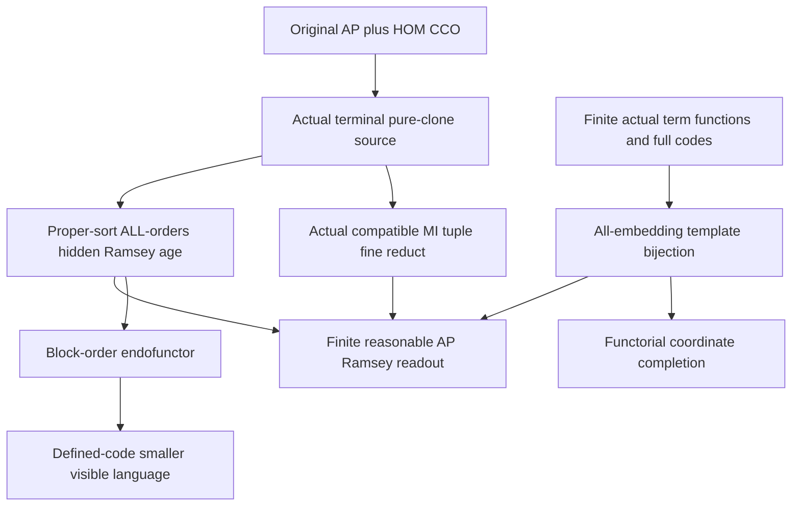

# AP clone Ramsey readout, coordinate completion and the smaller visible language

Generated from `module.json` by `tools/build_formalization_module.py`.

Source `490c3f36d85db5a0b3ced0598e6c431825254ec5`. **Human-expanded proof plan; no Lean code.**

Private B061: the FIVE remaining Ramsey III results of ramsey_ap_from_clones.tex, with 11 definitions, 62 human claims and eight tasks. Bind the original AP+HOM-CCO source to a NEW actual terminal pure-clone source, restrict the whole ALL-orders hidden Ramsey age to its unary-closed proper sorts, and transfer through the exact marked ALL-embeddings code. Prove finite coordinate completion, actual block normalization and definitional smaller signature. ALL coordinate-source finite term FUNCTIONS and same-root/cross-root equality/order codes are retained. No cofinality, EP, EPPA, original SAP, F-MI hypothesis or real-hull input enters the main theorem. The ancillary MI specialization remains separately proved in B060; this module does not depend on it.

The human article remains unchanged. Additional proof details are in
[PROOF_NOTES.md](PROOF_NOTES.md); the cross-track policy is in
[the formalization guide](../README.md). Source hashes are checked before
the index is regenerated. Graph validation is not proof verification.

## Source premises

**A01: Original AP homomorphic-CCO source.** Q is countably infinite transitive homogeneous in a finite complete symmetric relational binary language of ACTUAL pair orbitals. Age(Q) has ordinary AP and semantic HOM simple-cycle CCO. No original SAP, triangle-definedness, MI finite-packet assumption, EP or EPPA is assumed. Logical equality is separate from diversity atoms.

**A02: Bound actual terminal pure-clone instance.** For the parameterized readout lemmas Mdagger=Qdagger x N is an actual finite-sorted homogeneous FULL triangle-defined symmetric binary SAP+HOM-CCO source with every FULL invariant-equivalence cover of infinite relative index, including Top covers. Its unary labels are clone constant; Qdagger is a finite reasonable reduct-surjective unary expansion of its original Q, and each nonempty Qdagger sort is infinite. The actual hidden signature contains represented proper MI quotients, all actual mixed cylinders and equivariant unary upward/transition maps with inverses; functions are total on prescribed sorts and undefined off-sort. There is no proper-quotient-to-real map. This is a BOUND intermediate instance, discharged from A01 for the main theorem in C05/C33.

**A03: Bound finite actual MI charts.** For each clone sort s choose finitely many DISTINCT proper represented MI equivalences J_s,i>=K_s with meet K_s. Here K_s is the actual exact pure-clone congruence, Id union c_s; it is proper. Each root is the literal tagged ordered coordinate tuple, with no quotient of tuples and no point-dependent choice. All coordinate data are interpreted in the SAME actual terminal source.

**A04: Independent block-normalizer setting.** For the generic block lemma H< is an isomorphism-closed hereditary Ramsey class of finite hidden structures with finitely many disjoint named sorts partitioning its universe and ALL global strict linear orders over each allowed unordered reduct. Fix a priority of SORT SYMBOLS. Changing only the order is legal in this class. This independent setting does not assume a clone source, CCO, SAP or term bounds.

**A05: Separate finite original source.** ONLY for the ancillary finite-source branch, Qfin is finite homogeneous in the given relational binary language. It need not satisfy the countably infinite A01 premise. Label all its finitely many individual points and take the hereditary age of that actual finite labelled structure.

## Imported theorem contracts

These are named provider obligations for the receiving Lean project,
not new axioms or claims of compiled imports.

| ID and source | Contract | Current provider status |
|---|---|---|
| I01: [`lem:cco-triangle-fullness`](../../sections/triangle_fullness.tex#L2) | Ordinary original AP plus semantic HOM CCO gives complete-diagram triangle fullness, including actual unary/pair admissibility. No old SAP or equality-extended CCO black box. | HUMAN_EXPANDED_NOT_LEAN |
| I02: [`thm:internal-clone-sap`](../../sections/ramsey_clone_sap.tex#L3) | The actual infinite pure-clone source of a homogeneous AP+HOM-CCO Q is homogeneous SAP+HOM CCO; with old triangle fullness it is FULL triangle-defined. K=Id union c=c;c is exact in FULL RAW semantics and the owner quotient is precisely Q. | HUMAN_EXPANDED_NOT_LEAN |
| I03: [`lem:ramsey-clone-stability`](../../sections/ramsey_ap_from_clones.tex#L60) | The genuine safe terminalisation stays pure-clone Mdagger=Qdagger x N with reasonable finite unary Qdagger labels, infinite nonempty quotient sorts and proper exact K_s. It uses the actual phase table, not arbitrary independent unary labels. | HUMAN_EXPANDED_NOT_LEAN |
| I04: [`lem:ramsey-mi-domain`](../../sections/ramsey_ap_from_clones.tex#L113) | A tagged tuple of the fixed MI coordinates is valid exactly when its actual classes meet pairwise, equivalently c_s lies in every pair spectrum; the common intersection is exactly one actual K_s class. This is a qf domain in the existing hidden language, valid also for actual orphan-only hidden hosts. | HUMAN_EXPANDED_NOT_LEAN |
| I05: [`lem:ramsey-singleton-recovery`](../../sections/ramsey_ap_from_clones.tex#L168) | On compatible tuples the intersection of ALL actual mixed spectra is exactly the original typed fine atom, and the equal-visible-root case returns the clone atom c_s interpreted as visible equality. Diagonal coordinate spectra are full J-diversity supports, not off-diagonal predicates. Class CRT alone is insufficient. | HUMAN_EXPANDED_NOT_LEAN |
| I06: [`lem:typed-unary-closure-bound`](../../sections/v27/10_typed_unary_terms_return.tex#L66) | Actual hidden singleton closures are uniformly bounded. Select strict proved ancestor C12 for finitely many actual unary term FUNCTIONS on EACH proper-coordinate source sort; normalize compositions with identical sort domains and values, including identity. | HUMAN_EXPANDED_NOT_LEAN |
| I07: [`lem:no-real-algebraic-transition`](../../sections/v27/07_typed_raw_strong_transition.tex#L572) | No actual proper quotient-coordinate sort has a unary upward or transition map into an original real sort. Thus the pure-imaginary selected sorts are unary-functionally closed. | HUMAN_EXPANDED_NOT_LEAN |
| I08: [`thm:internal-ramsey-terminal`](../../sections/v27/18_unary_hn_transfer.tex#L1) | Instantiate the terminal theorem at the SAME actual Mdagger. Its proved C30 gives the ENTIRE hereditary actual hidden SAP age, and C36 gives that entire age with ALL global strict linear orders as Ramsey. Retain its inherited HN/forest receiving obligations and the unchanged GLOBAL six-entry manifest (whose two HKN entries belong to the separate EPPA track); do not duplicate or add an external binding. | HUMAN_EXPANDED_NOT_LEAN |
| I09: [`lem:foundational-ramsey-sort-restriction`](../../sections/reset_midpoint_order_ep.tex#L13) | The full induced restriction to named sorts with no outgoing unary map remains hereditary Ramsey; JEP/SAP pass if supplied. All outside sorts remain empty in the retained full language. No representative selection or real ordering is involved. | HUMAN_EXPANDED_NOT_LEAN |
| I10: [`lem:foundational-full-code-embeddings`](../../sections/full_code_tuple_ep_transfer.tex#L52) | Complete marked tuple-term codes reconstruct the induced unary-generated support and give the natural bijection of ALL visible embeddings with hidden support embeddings. Retain all same-root/cross-root equalities, function domains/values and order codes. | HUMAN_EXPANDED_NOT_LEAN |
| I11: [`thm:ramsey-tuple-readout`](../../sections/full_code_tuple_ep_transfer.tex#L103) | A hereditary hidden embedding-Ramsey class transfers to the hereditary full-code age of ALL valid tagged tuples through the exact natural embedding bijection. The Ramsey host may have orphan points; neither EP nor cofinal enlargement is required. | HUMAN_EXPANDED_NOT_LEAN |
| I12: [`lem:foundational-ramsey-normalization`](../../sections/reset_midpoint_order_ep.tex#L69) | A strict idempotent endofunctor on induced embeddings preserving each universe and vertex map has a hereditary Ramsey fixed-object class; no surjectivity on embedding sets or generic SAP inheritance is assumed. | HUMAN_EXPANDED_NOT_LEAN |
| I13: [`thm:finite-cover-elimination`](../../sections/v27/06_legacy_finite_covers.tex#L574) | Apply the actual maximal-character safe splitting to the FULL symmetric clone SAP+HOM-CCO source. It terminates in a finite reasonable precompact reduct-surjective unary terminal expansion preserving actual homogeneity, SAP, CCO, triangle fullness and current full pair orbitals. Retain its actual-sector/FULL-versus-STRONG qualifications. | HUMAN_EXPANDED_NOT_LEAN |

**I04 internal proof support:** C24, C25, C26, C27 in `clone_tuple_geometry`. Use precisely strict proved ancestors C24/C25 for existence of a NONEMPTY finite distinct represented proper-MI family with meet the actual K_s, and C26/C27 for the canonical owner-to-tuple map and injection. These discharge A03 in C04/C05 and distinguish literal tagged roots in C18; they are existing proof support, not additional source theorem exports.

These are separately extracted proved support claims, not additional
numbered exports or consequences of the named theorem statement.

**I06 internal proof support:** C12 in `unary_terms_return`. Use C12 on ALL selected proper-coordinate input sorts, rather than merely the real-source specialization. It gives a finite complete function list and exact composition representatives for the tuple code and its uniform signature; finite image size at one point is not substituted for this theorem.

These are separately extracted proved support claims, not additional
numbered exports or consequences of the named theorem statement.

**I08 internal proof support:** C30, C36 in `terminal_hidden_hn`. Use strict proved support C30/C36 for hereditary hidden SAP (hence JEP over empty base) and the ALL-orders hidden Ramsey conclusion before any real-root readout. These are parameters discharged on Mdagger, not assertions that the original AP-only Q is SAP or terminal.

These are separately extracted proved support claims, not additional
numbered exports or consequences of the named theorem statement.

## Definitions

| ID | Definition | Exact meaning | Source |
|---|---|---|---|
| D01 | Pure-imaginary age | H_im< is the full induced unary-closed proper-quotient-sort restriction of the actual ordered hidden age; clone-real sorts are empty. | [source](../../sections/ramsey_ap_from_clones.tex#L236) |
| D02 | Literal compatible roots | N(D) consists of ALL tagged ordered MI tuples in D satisfying delta_s from I04. The root carrier is not a quotient and does not introduce hidden cell vertices. | [source](../../sections/ramsey_ap_from_clones.tex#L210) |
| D03 | Finite coordinate-term function list | For each proper input sort fix one representative of every actual unary term function, including identity, with identical domains and values. Coordinate terms first select a root position and then apply such a representative. | [source](../../sections/ramsey_ap_from_clones.tex#L227) |
| D04 | Exact hereditary full-code age | K* consists exactly of finite selected induced root subsets of the complete N(D) codes, over all finite D in H_im<. Retain tags and ALL unary/binary, equality, function-domain/value and order codes, including same-root instances. | [source](../../sections/ramsey_ap_from_clones.tex#L212) |
| D05 | Marked generated template | Presentations (a,j,t) evaluate the coordinate term t on position j of selected root a. Identify presentations iff their actual values agree; h(A*) is their actual induced unary-closed hidden support, marked by those root coordinates. | [source](../../sections/ramsey_ap_from_clones.tex#L219) |
| D06 | Finite coordinate completion | C(A*)=N(h(A*)) with its full code, on the SAME marked support. It adds all compatible tuples available in that support. | [source](../../sections/ramsey_ap_from_clones.tex#L280) |
| D07 | Sort-block endofunctor | B replaces a global order by the concatenation, in fixed sort-symbol priority, of its unchanged within-sort restrictions. It changes no other data and acts as the identity on vertex maps. | [source](../../sections/ramsey_ap_from_clones.tex#L302) |
| D08 | Reduced visible language | Retain original fine colours, genuine safe unary labels and coordinate-term order comparisons. Delete only codes proved qf definable in that retained language. | [source](../../sections/ramsey_ap_from_clones.tex#L318) |
| D09 | Hidden target sort comparison criterion | A comparison C_tau,sigma(x,y) concerns the HIDDEN target sorts of tau and sigma. These may coincide even for roots of different visible tags; source visible tags alone do not make their relative order forced. | [source](../../sections/ramsey_ap_from_clones.tex#L337) |
| D10 | Order-code diagnostics | Order-code diagnostics distinguish a singleton tuple with two hidden coordinates by a diagonal comparison. A separate GENERIC UNORDERED reconstruction example uses two roots sharing a coordinate and no other hidden relations/functions. Distinct visible tags may evaluate into the same hidden target sort; equality minimality in the actual ALL-order signature is not asserted. | [source](../../sections/ramsey_ap_from_clones.tex#L213) |
| D11 | Uniform MI/MR scope | The construction uses any nonempty finite distinct proper MI family with meet K. Specializing to one coordinate requires actual K to be MI; the separate real-hull/phase-algebraicity argument is not a premise of the general Ramsey readout. | [source](../../sections/ramsey_ap_from_clones.tex#L343) |

## Proof claims and direct dependencies

Every row has a human proof expansion. Each still needs an actual Lean
statement and proof. The main theorem applies parameterized terminal and readout results to the actual safely terminalized CLONE source, not to the original AP-only structure. Hidden targets, literal tagged tuples and all diagonal codes are substantive.

| ID and claim | Scope | Direct providers | Proof note |
|---|---|---|---|
| C01: Original triangle fullness is derived before cloning | source_application | A01, I01 | N01 in [notes](PROOF_NOTES.md) |
| C02: Pure clones discharge the FULL SAP+CCO source | source_application | A01, I02, C01 | N01 in [notes](PROOF_NOTES.md) |
| C03: Apply genuine finite safe terminalisation to this clone source | source_application | C02, I13 | N01 in [notes](PROOF_NOTES.md) |
| C04: The terminal expansion still descends to Qdagger | source_application | C02, C03, I03, I04 | N01 in [notes](PROOF_NOTES.md) |
| C05: Discharge the bound intermediate instance for the general theorem | source_application | C02, C03, C04 | N01 in [notes](PROOF_NOTES.md) |
| C06: Qdagger is homogeneous in its finite binary and unary language | readout | A02 | N01 in [notes](PROOF_NOTES.md) |
| C07: Qdagger automorphisms lift and act on all actual imaginary terms | readout | A02, A03, C06 | N01 in [notes](PROOF_NOTES.md) |
| C08: Proper hidden sorts form an actual induced closed class | template | A02, I07, D01 | N02 in [notes](PROOF_NOTES.md) |
| C09: Choose all actual coordinate-source term functions | template | A02, I06, D03 | N02 in [notes](PROOF_NOTES.md) |
| C10: These lists are exact partial-function normal forms on finite hosts | template | A02, C08, C09 | N02 in [notes](PROOF_NOTES.md) |
| C11: The interpreted objects are exactly the hereditary full-code age | template | A02, A03, I04, D02, D04, C10 | N02 in [notes](PROOF_NOTES.md) |
| C12: Marked presentations give a finite actual generated support | template | C09, C10, D05 | N02 in [notes](PROOF_NOTES.md) |
| C13: Full codes reconstruct every hidden datum on that support | template | I10, C10, C11, C12 | N02 in [notes](PROOF_NOTES.md) |
| C14: A visible full-code embedding extends to an induced hidden map | template | I10, C13 | N02 in [notes](PROOF_NOTES.md) |
| C15: Every hidden support embedding sends roots to valid tuples | template | I10, I04, C13 | N02 in [notes](PROOF_NOTES.md) |
| C16: Both constructions are inverse and natural on ALL embeddings | template | I10, C14, C15 | N02 in [notes](PROOF_NOTES.md) |
| C17: Template and all-embedding source export | template | C13, C16 | N02 in [notes](PROOF_NOTES.md) |
| C18: Every arbitrary imaginary host has an actual fine reduct | ramsey | A02, A03, I04, I05, C11 | N03 in [notes](PROOF_NOTES.md) |
| C19: Fine readout is independent of realization and functorial | ramsey | I05, C16, C18 | N03 in [notes](PROOF_NOTES.md) |
| C20: The proper-sort ALL-orders age is hereditary Ramsey and JEP | ramsey | A02, I08, I09, C08 | N03 in [notes](PROOF_NOTES.md) |
| C21: The entire readout class agrees with these imaginary codes | ramsey | C11, C18, C19 | N03 in [notes](PROOF_NOTES.md) |
| C22: Discharge the tuple-Ramsey application | ramsey | I11, C17, C20, C21 | N03 in [notes](PROOF_NOTES.md) |
| C23: Readout is reduct-surjective over the original finite age | output | A02, I04, I05, C09, C18 | N04 in [notes](PROOF_NOTES.md) |
| C24: Extend the specified safe unary labels along the original embedding | output | A02, C23 | N04 in [notes](PROOF_NOTES.md) |
| C25: Original labelled embeddings canonically lift to the unexpanded templates | output | C06, C07, C09, C13, C24 | N04 in [notes](PROOF_NOTES.md) |
| C26: A finite chosen template order extends along this map | output | C12, C25 | N04 in [notes](PROOF_NOTES.md) |
| C27: The full readout expansion is reasonable | output | C16, C24, C25, C26 | N04 in [notes](PROOF_NOTES.md) |
| C28: The expansion language is finite and precompact | output | A02, C09, C11, C12 | N04 in [notes](PROOF_NOTES.md) |
| C29: Hidden JEP supplies visible JEP | output | C16, C20, C21 | N04 in [notes](PROOF_NOTES.md) |
| C30: Every finite expanded visible member is rigid | output | C16, C12 | N04 in [notes](PROOF_NOTES.md) |
| C31: Optional visible AP follows by a direct Ramsey coloring argument | output | C22, C29 | N04 in [notes](PROOF_NOTES.md) |
| C32: Parameterized terminal clone readout conclusion | output | C22, C23, C27, C28, C29, C30 | N04 in [notes](PROOF_NOTES.md) |
| C33: Apply the parameterized conclusion to the NEW terminal clone instance | source_application | C05, C32 | N04 in [notes](PROOF_NOTES.md) |
| C34: General AP Ramsey source export | source_application | C33 | N04 in [notes](PROOF_NOTES.md) |
| C35: Every selected root embeds in its coordinate completion | completion | C11, D06 | N05 in [notes](PROOF_NOTES.md) |
| C36: Coordinate completion preserves the SAME generated support | completion | C09, C12, C35 | N05 in [notes](PROOF_NOTES.md) |
| C37: Coordinate completion is strictly idempotent on this host | completion | C11, C36 | N05 in [notes](PROOF_NOTES.md) |
| C38: Every expanded embedding extends naturally through completion | completion | C16, C35, C36, D06 | N05 in [notes](PROOF_NOTES.md) |
| C39: Both finite completion size bounds are explicit | completion | A03, C09, C12, D06 | N05 in [notes](PROOF_NOTES.md) |
| C40: Functorial finite coordinate-completion source export | completion | C35, C36, C37, C38, C39 | N05 in [notes](PROOF_NOTES.md) |
| C41: Block normalization is a legal object operation | block | A04, D07 | N06 in [notes](PROOF_NOTES.md) |
| C42: The same vertex maps form an actual block endofunctor | block | A04, C41 | N06 in [notes](PROOF_NOTES.md) |
| C43: The block endofunctor is strictly idempotent | block | C41 | N06 in [notes](PROOF_NOTES.md) |
| C44: The full class of block-fixed objects is hereditary | block | I12, C42, C43 | N06 in [notes](PROOF_NOTES.md) |
| C45: Pullback of an embedding coloring proves normalized Ramsey | block | A04, I12, C42, C43 | N06 in [notes](PROOF_NOTES.md) |
| C46: Functorial sort-block source export | block | C41, C42, C43, C44, C45 | N06 in [notes](PROOF_NOTES.md) |
| C47: Every non-order code is invariant under actual Qdagger automorphisms | smaller_language | C07, C09, D08 | N07 in [notes](PROOF_NOTES.md) |
| C48: These invariant codes are finite unions of original atomic types | smaller_language | C06, C47 | N07 in [notes](PROOF_NOTES.md) |
| C49: Delete defined non-order codes without changing any embedding set | smaller_language | C48, D08 | N07 in [notes](PROOF_NOTES.md) |
| C50: The actual imaginary age admits the generic block theorem | smaller_language | C20, C46 | N07 in [notes](PROOF_NOTES.md) |
| C51: Read out the block class with the SAME full-code method | smaller_language | I11, C17, C21, C50 | N07 in [notes](PROOF_NOTES.md) |
| C52: Only different HIDDEN target-sort comparisons become forced | smaller_language | C41, D09 | N07 in [notes](PROOF_NOTES.md) |
| C53: Within-target comparisons remain explicitly retained | smaller_language | C52, D09 | N07 in [notes](PROOF_NOTES.md) |
| C54: The final reduced code has the same embedding sets as its block full code | smaller_language | C49, C52, C53 | N07 in [notes](PROOF_NOTES.md) |
| C55: Block reasonableness preserves the full prescribed source expansion | smaller_language | C24, C25, C26, C41, C54 | N07 in [notes](PROOF_NOTES.md) |
| C56: Smaller visible signature source export | smaller_language | C51, C54, C55, C23, C28 | N07 in [notes](PROOF_NOTES.md) |
| C57: Diagonal and shared-coordinate codes have real boundary witnesses | boundary | D10 | N08 in [notes](PROOF_NOTES.md) |
| C58: Different visible tags do not justify deleting a comparison | boundary | D09 | N08 in [notes](PROOF_NOTES.md) |
| C59: The separate finite original case has a reasonable Ramsey labeling | finite_case | A05 | N08 in [notes](PROOF_NOTES.md) |
| C60: The MI special case is ancillary to the uniform tuple proof | boundary | D11 | N08 in [notes](PROOF_NOTES.md) |
| C61: No expansion property or EPPA follows from these Ramsey arrows | boundary | C34, C56 | N08 in [notes](PROOF_NOTES.md) |
| C62: Finite controls certify code and functor fidelity only | boundary | C17, C40, C46, C56, C57, C58 | N08 in [notes](PROOF_NOTES.md) |

The precise quantified contracts are in `module.json`. Provider-before-consumer
order (including definitions and source premises):

`A01 → A02 → A03 → A04 → A05 → D01 → D02 → D03 → D04 → D05 → D06 → D07 → D08 → D09 → D10 → D11 → I01 → I02 → I03 → I04 → I05 → I06 → I07 → I08 → I09 → I10 → I11 → I12 → I13 → C01 → C06 → C08 → C09 → C41 → C57 → C58 → C59 → C60 → C02 → C07 → C10 → C20 → C42 → C43 → C52 → C03 → C11 → C12 → C44 → C45 → C47 → C53 → C04 → C13 → C18 → C28 → C35 → C39 → C46 → C48 → C05 → C14 → C15 → C23 → C36 → C49 → C50 → C16 → C24 → C37 → C54 → C17 → C19 → C25 → C30 → C38 → C21 → C26 → C40 → C22 → C27 → C29 → C51 → C55 → C31 → C32 → C56 → C33 → C62 → C34 → C61`

This order is one valid linearization; it does not require unrelated
branches to be proved sequentially. The full DAG is the `depends_on`
relation in `module.json`.

## Main proof branches

This is a coarse view of the claim DAG. Edges go from provider to consumer.

The template/completion branch needs no Ramsey, cofinality or EP input. Proper-coordinate term functions are finite as FUNCTIONS, not just at one image.
The original AP-only source is replaced before terminal HN is instantiated; actual clone stability is supplied by B060. No original SAP is silently assumed.
Different hidden TARGET sorts, rather than different visible tags, determine which comparisons become forced after block normalization.
The source-specific MI/real-hull specialization is separate from the general tuple construction. All six already exposed external receiving obligations remain; no new external record is added.

## Article exports

| Existing source result | Sidecar proof claims |
|---|---|
| [`thm:ramsey-general-ap`](../../sections/ramsey_ap_from_clones.tex#L30) | C34 |
| [`lem:ramsey-template-bijection`](../../sections/ramsey_ap_from_clones.tex#L218) | C17 |
| [`unlabelled:sections/ramsey_ap_from_clones.tex:corollary:1`](../../sections/ramsey_ap_from_clones.tex#L279) | C40 |
| [`lem:ramsey-block-retract`](../../sections/ramsey_ap_from_clones.tex#L298) | C46 |
| [`cor:ramsey-small-language`](../../sections/ramsey_ap_from_clones.tex#L318) | C56 |

Auxiliary source equations (not additional numbered results):

- [`eq:ramsey-embeddings`](../../sections/ramsey_ap_from_clones.tex#L221): C16

Full result coverage is asserted only for `source_result_files`.
Selected additional results: thm:ramsey-general-ap, lem:ramsey-template-bijection, unlabelled:sections/ramsey_ap_from_clones.tex:corollary:1, lem:ramsey-block-retract, cor:ramsey-small-language.
Other results in their provider source files are not claimed covered.

## Internal implementation milestones

These tasks are proof milestones inside larger project assignments;
see the [peer-project allocation](../coordination/BOARD.md).

These are implementation tasks, not additional mathematical assumptions.

| Task | Earlier tasks | Acceptance |
|---|---|---|
| T01: Original AP to the actual terminal clone source and quotient homogeneity | — | Retain exact original AP versus clone SAP scopes and instantiate terminal providers on the NEW Mdagger. Use finite actual unary term FUNCTIONS on every proper input sort, all marked same-root/cross-root equality and order codes, actual qf tuple domains and singleton fine recognition. Ramsey uses ALL embedding maps without cofinality/EP. Block normalization is a legal same-universe strict idempotent endofunctor; remove only defined non-order or different-HIDDEN-target comparisons. The MI branch is separate; no EPPA/EP or Lean certificate follows from finite controls. |
| T02: Finite proper-coordinate templates and the ALL-embeddings bijection | — | Retain exact original AP versus clone SAP scopes and instantiate terminal providers on the NEW Mdagger. Use finite actual unary term FUNCTIONS on every proper input sort, all marked same-root/cross-root equality and order codes, actual qf tuple domains and singleton fine recognition. Ramsey uses ALL embedding maps without cofinality/EP. Block normalization is a legal same-universe strict idempotent endofunctor; remove only defined non-order or different-HIDDEN-target comparisons. The MI branch is separate; no EPPA/EP or Lean certificate follows from finite controls. |
| T03: Actual fine readout and proper-sort Ramsey application | T02 | Retain exact original AP versus clone SAP scopes and instantiate terminal providers on the NEW Mdagger. Use finite actual unary term FUNCTIONS on every proper input sort, all marked same-root/cross-root equality and order codes, actual qf tuple domains and singleton fine recognition. Ramsey uses ALL embedding maps without cofinality/EP. Block normalization is a legal same-universe strict idempotent endofunctor; remove only defined non-order or different-HIDDEN-target comparisons. The MI branch is separate; no EPPA/EP or Lean certificate follows from finite controls. |
| T04: Reasonableness and the general AP Ramsey expansion | T01, T02, T03 | Retain exact original AP versus clone SAP scopes and instantiate terminal providers on the NEW Mdagger. Use finite actual unary term FUNCTIONS on every proper input sort, all marked same-root/cross-root equality and order codes, actual qf tuple domains and singleton fine recognition. Ramsey uses ALL embedding maps without cofinality/EP. Block normalization is a legal same-universe strict idempotent endofunctor; remove only defined non-order or different-HIDDEN-target comparisons. The MI branch is separate; no EPPA/EP or Lean certificate follows from finite controls. |
| T05: Functorial same-support coordinate completion | T02 | Retain exact original AP versus clone SAP scopes and instantiate terminal providers on the NEW Mdagger. Use finite actual unary term FUNCTIONS on every proper input sort, all marked same-root/cross-root equality and order codes, actual qf tuple domains and singleton fine recognition. Ramsey uses ALL embedding maps without cofinality/EP. Block normalization is a legal same-universe strict idempotent endofunctor; remove only defined non-order or different-HIDDEN-target comparisons. The MI branch is separate; no EPPA/EP or Lean certificate follows from finite controls. |
| T06: Independent same-map sort-block endofunctor | — | Retain exact original AP versus clone SAP scopes and instantiate terminal providers on the NEW Mdagger. Use finite actual unary term FUNCTIONS on every proper input sort, all marked same-root/cross-root equality and order codes, actual qf tuple domains and singleton fine recognition. Ramsey uses ALL embedding maps without cofinality/EP. Block normalization is a legal same-universe strict idempotent endofunctor; remove only defined non-order or different-HIDDEN-target comparisons. The MI branch is separate; no EPPA/EP or Lean certificate follows from finite controls. |
| T07: Definitional smaller language and block reasonableness | T01, T02, T03, T04, T06 | Retain exact original AP versus clone SAP scopes and instantiate terminal providers on the NEW Mdagger. Use finite actual unary term FUNCTIONS on every proper input sort, all marked same-root/cross-root equality and order codes, actual qf tuple domains and singleton fine recognition. Ramsey uses ALL embedding maps without cofinality/EP. Block normalization is a legal same-universe strict idempotent endofunctor; remove only defined non-order or different-HIDDEN-target comparisons. The MI branch is separate; no EPPA/EP or Lean certificate follows from finite controls. |
| T08: Finite source, MI/MR and diagnostic scope boundaries | T02, T04, T05, T06, T07 | Retain exact original AP versus clone SAP scopes and instantiate terminal providers on the NEW Mdagger. Use finite actual unary term FUNCTIONS on every proper input sort, all marked same-root/cross-root equality and order codes, actual qf tuple domains and singleton fine recognition. Ramsey uses ALL embedding maps without cofinality/EP. Block normalization is a legal same-universe strict idempotent endofunctor; remove only defined non-order or different-HIDDEN-target comparisons. The MI branch is separate; no EPPA/EP or Lean certificate follows from finite controls. |

## Finite controls

- **K01.** Independent finite three-sort partial-unary hosts with actual inverse transition maps enumerate ALL visible full-code embeddings and hidden support embeddings, including shared coordinates, diagonal order codes, selected root subsets, empty roots and orphan host coordinates; compare maps exactly.
- **K02.** All-valid-root coordinate completion checks same-host support equality, strict idempotence, natural extensions and bounds. Exhaustive small global orders and closed restrictions test legal block normalization, same-map embedding preservation and different-visible/same-hidden-target comparison boundaries. No unbounded Ramsey theorem is certified.

Run `python tools/check_ap_ramsey_readout_finite.py` from the manuscript directory.
The controls do not prove CCO or the general theorems.

## Return to the human articles

The five scoped source results need no mathematical statement repair after retaining the precise actual-provider contracts below. These proof and scope clarifications are queued for the human article pass; frozen TeX is unchanged.

- **F01** ([source](../../sections/ramsey_ap_from_clones.tex#L227)): The tuple-code list needs finitely many actual unary term FUNCTIONS on every proper-coordinate source sort, not merely finite singleton closures or the earlier real-source specialization. Cite the strict finite-function argument of typed-unary closure explicitly, retaining every same-root/cross-root equality and order comparison.
- **F02** ([source](../../sections/ramsey_ap_from_clones.tex#L267)): The compressed reasonable-expansion argument uses actual Qdagger homogeneity and the clone lift to produce a canonical unexpanded template embedding before extending the order. Insert the one-clone-per-owner descent proof and extend the chosen finite order on the complete generated support, including nonselected term values.
- **F03** ([source](../../sections/ramsey_ap_from_clones.tex#L343)): The one-coordinate F-MI specialization uses the separate original real-hull and all-finite-base safe-phase algebraicity-preservation argument. The uniform Ramsey theorem does not use that branch. Point explicitly to the independently expanded ancillary MI branch of clone_tuple_geometry; retain its source-specific hypotheses and keep it outside the main readout dependency chain.

The machine ledger records caller effects and affected claims. The source
review used two independent model review passes and parent synthesis;
it is not independent human or formal certification.
