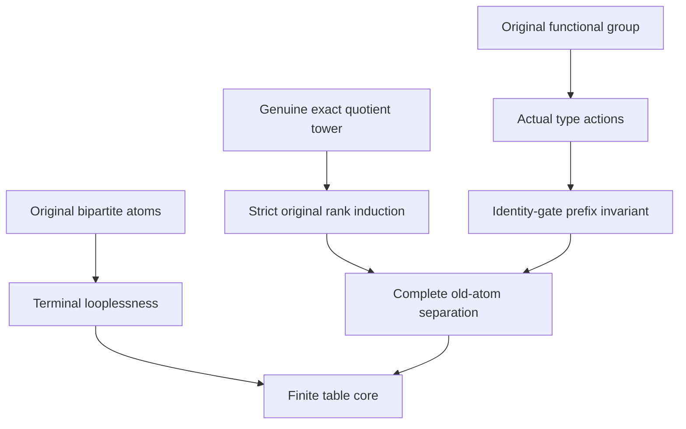

# Original bipartite separation and the automatic terminal label core

Generated from `module.json` by `tools/build_formalization_module.py`.

Source `490c3f36d85db5a0b3ced0598e6c431825254ec5`. **Human-expanded proof plan; no Lean code.**

Private B063: all FOUR automatic-core source results, 10 definitions, 62 expanded human claims, five equations and eight tasks. Genuine terminal maximal-exact-character towers over ONE original transitive symmetric AP+HOM-CCO source have an ORIGINAL bipartite atom between every two different terminal types. A rank induction uses genuine full-age exact quotient towers, with an explicit original-identity-gate branch and a finite functional-group action on TYPE supports. No original/quotient SAP, Ramsey, EP or pre-existing core theorem is assumed. Exact least F is not a least arbitrary invariant equivalence or the greatest finite-packet relation.

The human article remains unchanged. Additional proof details are in
[PROOF_NOTES.md](PROOF_NOTES.md); the cross-track policy is in
[the formalization guide](../README.md). Source hashes are checked before
the index is regenerated. Graph validation is not proof verification.

## Source premises

**A01: Actual one-original-sort symmetric AP+HOM CCO source.** M is nonempty countable (possibly finite), transitive and homogeneous in a finite complete symmetric relational binary language of ACTUAL old diversity pair orbitals, with logical equality separate. Its finite age has ordinary AP and semantic HOM simple-cycle CCO. No original SAP, infinite-source premise, pre-existing Ramsey/EP/core theorem or several-original-sort extension is assumed.

**A02: One genuine finite maximal-character tower.** Use an actual finite safe tower of the proved AP-only maximal FULL-EXACT-complement, FULL rigid-groupoid character construction. Every prefix is its actual homogeneous realized marked age, identified with the preceding old reduct using reasonableness. Every connected step uses its original canonical maximal gate; current labels refine old atoms only by their endpoint sorts. The actual character is additive, the selected odd loop has value one, and no arbitrary global marking or nonmaximal safe-looking orientation is substituted.

**A03: Terminal FULL invariant equivalences.** On every nonempty final transitive sort EVERY strict cover in the FULL actual invariant-equivalence lattice has infinite relative index, including Top covers. This is not merely terminality in the represented exact sublattice. The finite tower may have zero steps and M may be finite.

## Imported theorem contracts

These are named provider obligations for the receiving Lean project,
not new axioms or claims of compiled imports.

| ID and source | Contract | Current provider status |
|---|---|---|
| I01: [`lem:ep-phi-support`](../../sections/expansion_property_exact_geometry.tex#L250) | Actual prefix support Phi preserves unions, converse, logical identity and represented composition; on original full exact equivalences it preserves finite meets. An actual E-class meets exactly ALL types in its Phi(E)-occupancy class. Empty or arbitrary atomic meet preservation is not asserted. | HUMAN_EXPANDED_NOT_LEAN |
| I02: [`lem:ep-old-gate`](../../sections/expansion_property_exact_geometry.tex#L198) | A current odd pivot is an ORIGINAL bipartite atom. Its original parity relations restrict to the current ones, and the canonical largest old lift of the chosen current gate is an ORIGINAL maximal full exact complement to its original even/connectivity interval. | HUMAN_EXPANDED_NOT_LEAN |
| I03: [`lem:ep-single-old-gate`](../../sections/expansion_property_exact_geometry.tex#L291) | Every connected full character step has ONE original canonical gate G. Current full exact bridges are precisely nonempty traces of ALL original G-quotient functional correspondences; conversely all such correspondences whose traces occur belong to the selected connected full groupoid. | HUMAN_EXPANDED_NOT_LEAN |
| I04: [`prop:ep-common-kernel`](../../sections/expansion_property_exact_geometry.tex#L327) | For original gates G_i, the intersection of Phi_m(G_i) is the literal identity relation on ALL realized final types. The common original exact kernel is the largest exact equivalence whose classes preserve every final label. | HUMAN_EXPANDED_NOT_LEAN |
| I05: [`thm:ep-quotient-tower`](../../sections/expansion_property_exact_geometry.tex#L362) | For each original full exact E, actual occupancy labels are T_j/Phi_j(E). The projected sequence is a GENUINE full admissible maximal-character tower after removing EXACTLY E-not<=G_i steps. A removed step does not refine the actual quotient occupancy partition; retained steps have canonical gate G_i/E after objectwise phase correction. A terminal original tower gives terminality for ALL invariant quotient equivalences. Quotients are actual homogeneous AP+HOM-CCO sources, with no SAP assertion. | HUMAN_EXPANDED_NOT_LEAN |
| I06: [`eq:ep-graph-offsets`](../../sections/expansion_property_exact_geometry.tex#L478) | For a retained step E<=G, each active old Phi_j(E)-class C has precisely two new occupancy classes {p_(b+gamma_p):p in C}; each projects BIJECTIVELY to C. Inactive classes have one unchanged lift. The offsets are coherent actual identity-bridge characters, not independently chosen child signs. | HUMAN_EXPANDED_NOT_LEAN |
| I07: [`prop:lattice-interface`](../../sections/ramsey_preferred_support.tex#L90) | On any actual homogeneous transitive symmetric finite-orbital sort, FULL invariant equivalences form a finite lattice of orbital unions; literal intersection is meet and represented composition is their join. This branch needs no SAP, CCO or clone construction. | HUMAN_EXPANDED_NOT_LEAN |
| I08: [`cor:typed-exact-quotient-towers`](../../sections/simultaneous_typed_exact_quotients.tex#L441) | In an actual homogeneous exact quotient, every quotient atom is a nonempty union of old atoms and no old atom splits. A nonidentity kernel absorbs an old diversity atom into quotient equality, so the finite original diversity rank strictly decreases. Use the ONE-stage, ONE-original-sort instance; no mixed reverse exact descent or group section. | HUMAN_EXPANDED_NOT_LEAN |

**I05 internal proof support:** C76 in `exact_ep_geometry`. Use the strict proved discarded-step support C76: EVERY actual E-class meets both children in an active parent when E is not<=G. Together with actual occupancy labels and the removed-step conclusion this supplies C49 ONE new occupancy class containing ALL children, not only an abstract equality of cardinalities.

These are separately extracted proved support claims, not additional
numbered exports or consequences of the named theorem statement.

## Definitions

| ID | Definition | Exact meaning | Source |
|---|---|---|---|
| D01 | Original diversity rank | k is the number of original old diversity pair orbitals, excluding the logical real diagonal. Rank is reset at each actual original quotient source, not measured by tower length. | [source](../../sections/expansion_property_automatic_core.tex#L135) |
| D02 | The unfiltered old-atom template | T_j is the finite set of ALL realized full unary prefix types; T=T_m. The terminal template has relations R_a=Phi_m(a) for ORIGINAL diversity atom names and has NO predicate naming each new individual phase label. | [source](../../sections/expansion_property_automatic_core.tex#L25) |
| D03 | Actual prefix support and occupancy | Phi_j(D) consists of type pairs admitting one actual old D-pair. Phi_j(Id)=Id_Tj uses real equality; a diversity support loop means two DISTINCT real points of the same type. | [source](../../sections/expansion_property_automatic_core.tex#L25) |
| D04 | Original bipartite atoms | BP is the set of old diversity atoms whose actual undirected old graph is bipartite. Odd walks of all lengths matter, not merely the absence of a monochromatic triangle. | [source](../../sections/expansion_property_automatic_core.tex#L32) |
| D05 | Original equivariant functional group | H is the group of ALL permutations of the original point set commuting with Aut(M). Its original graph is denoted Gamma_h; the action h_j on types is defined by Phi_j(Gamma_h), not by assuming h preserves marked unary predicates. | [source](../../sections/expansion_property_automatic_core.tex#L58) |
| D06 | A bound quotient separator witness | E>Id is original FULL exact. Distinct Phi_m(E)-classes C,D contain types s,t, and an original quotient bipartite diversity orbital b occurs between the occupancy classes. This is the conditional input of the separator-lift lemma, not an axiom that such b always exists. | [source](../../sections/expansion_property_automatic_core.tex#L107) |
| D07 | Least nonidentity exact equivalence in the identity-gate branch | Only after an original gate equals Id, F is the finite intersection of all original FULL EXACT equivalences strictly above Id. Its nonidentity and exactness will be proved. It is not automatically the greatest finite-class equivalence or a least arbitrary full invariant equivalence. | [source](../../sections/expansion_property_automatic_core.tex#L208) |
| D08 | The functional subgroup inside F | H_F={h in H:Gamma_h subset F}. It will be a nontrivial normal subgroup under the identity-gate construction. | [source](../../sections/expansion_property_automatic_core.tex#L216) |
| D09 | Prefix orbit-occupancy invariant | P(j) says H_F acts TRANSITIVELY on each Phi_j(F)-class of realized prefix types. Actions at different prefixes commute with the actual forgetful projections. | [source](../../sections/expansion_property_automatic_core.tex#L226) |
| D10 | Explicit nonmaximal negative control | The old source I x F_2 x N has atoms c (same block/bit, distinct clones), b (same block, opposite bits), r (different blocks, same bit) and s (different blocks, opposite bits). Nonmaximal first clone-gate orientation lambda=bit+epsilon_block followed by the maximal sheet split mu=bit gives four terminal labels and a proper old-atom-table retraction. | [source](../../sections/expansion_property_automatic_core.tex#L326) |

## Proof claims and direct dependencies

Every row has a human proof expansion. Each still needs an actual Lean
statement and proof. Type-table loops for original diversity atoms mean two distinct real points of one label. The template retains original atom names but does not individually name the new labels. The theorem is one-original-sort and genuinely maximal-character only.

| ID and claim | Scope | Direct providers | Proof note |
|---|---|---|---|
| C01: Terminal full lattices exclude all finite proper intervals | loopless | A01, A02, A03, I07 | N01 in [notes](PROOF_NOTES.md) |
| C02: A nonempty diagonal restriction is a serial symmetric invariant graph | loopless | A01, A02, D04 | N01 in [notes](PROOF_NOTES.md) |
| C03: Even-walk and connectivity relations are actual invariant equivalences | loopless | C02, I07 | N01 in [notes](PROOF_NOTES.md) |
| C04: The bipartite interval has relative index two | loopless | C03 | N01 in [notes](PROOF_NOTES.md) |
| C05: A terminal sort has no original bipartite diagonal edge | loopless | C01, C04 | N01 in [notes](PROOF_NOTES.md) |
| C06: All original bipartite type supports are globally loopless | loopless | C05, D02, D03 | N01 in [notes](PROOF_NOTES.md) |
| C07: The two diagonal conventions remain separate | boundary | D02, D03 | N01 in [notes](PROOF_NOTES.md) |
| C08: Terminal bipartite-loopless source export | loopless | C06, C07 | N01 in [notes](PROOF_NOTES.md) |
| C09: Equivariant permutations form a group | functional | A01, D05 | N02 in [notes](PROOF_NOTES.md) |
| C10: Each functional graph is one old orbital and is free off identity | functional | A01, C09 | N02 in [notes](PROOF_NOTES.md) |
| C11: Symmetry forces exponent two | functional | C10 | N02 in [notes](PROOF_NOTES.md) |
| C12: The original functional group is finite elementary abelian | functional | C09, C10, C11 | N02 in [notes](PROOF_NOTES.md) |
| C13: Each nonidentity functional atom is original bipartite | functional | C10, C11, D04 | N02 in [notes](PROOF_NOTES.md) |
| C14: Functional supports square to literal type identity | prefix_action | A02, C11, I01 | N02 in [notes](PROOF_NOTES.md) |
| C15: Total symmetric square-identity support is a unique involution | prefix_action | C14, D03 | N02 in [notes](PROOF_NOTES.md) |
| C16: These supports form an actual group action on every type set | prefix_action | C09, C15, I01 | N02 in [notes](PROOF_NOTES.md) |
| C17: Every nonidentity original functional permutation acts freely terminally | functional | C06, C13, C16 | N02 in [notes](PROOF_NOTES.md) |
| C18: Type actions are not marked-source automorphism claims | boundary | C15, C16 | N02 in [notes](PROOF_NOTES.md) |
| C19: Type actions commute with prefix forgetful projections | prefix_action | C15, C16, A02 | N02 in [notes](PROOF_NOTES.md) |
| C20: Original functional involution source export | functional | C12, C13, C16, C17, C18, C19 | N02 in [notes](PROOF_NOTES.md) |
| C21: Take one actual quotient separator pair | lifting | A01, A02, D06 | N03 in [notes](PROOF_NOTES.md) |
| C22: Occupancy supplies the prescribed real endpoint types | lifting | C21, I01 | N03 in [notes](PROOF_NOTES.md) |
| C23: The entire original atom lies in one saturated pullback | lifting | A01, C22 | N03 in [notes](PROOF_NOTES.md) |
| C24: Pull back the quotient bipartition | lifting | C23, D04, D03 | N03 in [notes](PROOF_NOTES.md) |
| C25: Bipartite quotient separator source export | lifting | C21, C22, C23, C24 | N03 in [notes](PROOF_NOTES.md) |
| C26: Every nonidentity original exact quotient has strictly lower rank | rank | A01, I05, I08, D01 | N04 in [notes](PROOF_NOTES.md) |
| C27: Set up strong original-diversity-rank induction | rank | A01, A02, A03, D01 | N04 in [notes](PROOF_NOTES.md) |
| C28: The rank-zero and zero-step cases separate no pair | rank | A01, A02, C27 | N04 in [notes](PROOF_NOTES.md) |
| C29: If every original gate is nonidentity a gate separates the two types | core | C27, I04 | N04 in [notes](PROOF_NOTES.md) |
| C30: The selected quotient is a new valid induction source | rank | C26, C29, I05 | N04 in [notes](PROOF_NOTES.md) |
| C31: The all-nonidentity-gate case yields an original separator | core | C25, C27, C30 | N04 in [notes](PROOF_NOTES.md) |
| C32: An original identity gate has an original parity pivot | identity_gate | A01, A02, I02, I03 | N05 in [notes](PROOF_NOTES.md) |
| C33: That original pivot squares to identity | identity_gate | A01, C32 | N05 in [notes](PROOF_NOTES.md) |
| C34: The pivot is a selected original functional involution | identity_gate | C10, C11, C13, C33, A02 | N05 in [notes](PROOF_NOTES.md) |
| C35: Original identity-gate maximality puts u inside every positive exact equivalence | identity_gate | C32, C34 | N05 in [notes](PROOF_NOTES.md) |
| C36: The least nonidentity original exact F exists | identity_gate | C35, I07, D07 | N05 in [notes](PROOF_NOTES.md) |
| C37: The subgroup H_F is nontrivial and normal | functional | C12, C34, C36, D08 | N05 in [notes](PROOF_NOTES.md) |
| C38: All original gates are identity or contain F | identity_gate | C36, I03 | N05 in [notes](PROOF_NOTES.md) |
| C39: Bind the prefix orbit-occupancy assertion | prefix_action | C16, C37, D09, I01 | N06 in [notes](PROOF_NOTES.md) |
| C40: The initial prefix assertion is immediate | prefix_action | A01, C39 | N06 in [notes](PROOF_NOTES.md) |
| C41: A nonidentity-gate step has two bijective F-occupancy graph lifts | prefix_action | C38, C39, I06 | N06 in [notes](PROOF_NOTES.md) |
| C42: H_F preserves each new occupancy class and projection is equivariant | prefix_action | C15, C19, C37, C41, I01 | N06 in [notes](PROOF_NOTES.md) |
| C43: Transitivity passes through the bijective lifts | prefix_action | C39, C41, C42 | N06 in [notes](PROOF_NOTES.md) |
| C44: An identity-gate connected step acts on one original H-orbit of parents | identity_gate | C10, C15, I03 | N06 in [notes](PROOF_NOTES.md) |
| C45: An old F-occupancy class is wholly active or wholly inactive | prefix_action | C37, C39, C44 | N06 in [notes](PROOF_NOTES.md) |
| C46: At the source parent the selected original u fixes its old type | identity_gate | C15, C32, C34, C35, C36 | N06 in [notes](PROOF_NOTES.md) |
| C47: The SAME original u fixes every active parent and stays odd | identity_gate | C12, C16, C44, C46, A02 | N06 in [notes](PROOF_NOTES.md) |
| C48: That same u exchanges the two children over every active parent | prefix_action | C15, C47, A02 | N06 in [notes](PROOF_NOTES.md) |
| C49: The identity-gate step has one new F-occupancy class over each old one | prefix_action | C36, C45, I05 | N06 in [notes](PROOF_NOTES.md) |
| C50: Parent movement plus the child swap proves transitivity in the discarded case | prefix_action | C19, C39, C46, C48, C49 | N06 in [notes](PROOF_NOTES.md) |
| C51: The prefix H_F-transitivity invariant holds at every stage | prefix_action | C40, C43, C45, C50 | N06 in [notes](PROOF_NOTES.md) |
| C52: Different terminal F-occupancy classes separate through a lower-rank quotient | core | C25, C26, C27, C36, I05 | N07 in [notes](PROOF_NOTES.md) |
| C53: Equal terminal F-occupancy classes supply an original functional map | core | C16, C51 | N07 in [notes](PROOF_NOTES.md) |
| C54: That nonidentity functional map is the original bipartite separator | core | C13, C53, D03 | N07 in [notes](PROOF_NOTES.md) |
| C55: Complete original bipartite separation follows by strong rank induction | core | C28, C31, C52, C54 | N07 in [notes](PROOF_NOTES.md) |
| C56: Every endomorphism of the old-atom table is injective | core | C06, C55, D02 | N07 in [notes](PROOF_NOTES.md) |
| C57: Finite injective relational endomorphisms are automorphisms | core | C56, D02 | N07 in [notes](PROOF_NOTES.md) |
| C58: Automatic complete separation and core source export | core | C55, C56, C57, C08 | N07 in [notes](PROOF_NOTES.md) |
| C59: The induction category and exact F must not be strengthened or confused | boundary | C26, C30, C36, C52 | N08 in [notes](PROOF_NOTES.md) |
| C60: A nonmaximal safe orientation really can give a noncore terminal table | boundary | D10 | N08 in [notes](PROOF_NOTES.md) |
| C61: No multioriginal-sort, preferred tower or EP conclusion is inferred | boundary | C58, C60 | N08 in [notes](PROOF_NOTES.md) |
| C62: Finite controls test the actual semantic interfaces and negative boundary | boundary | C20, C25, C58, C60 | N08 in [notes](PROOF_NOTES.md) |

The precise quantified contracts are in `module.json`. Provider-before-consumer
order (including definitions and source premises):

`A01 → A02 → A03 → D01 → D02 → D03 → D04 → D05 → D06 → D07 → D08 → D09 → D10 → I01 → I02 → I03 → I04 → I05 → I06 → I07 → I08 → C01 → C02 → C07 → C09 → C21 → C26 → C27 → C32 → C60 → C03 → C10 → C22 → C28 → C29 → C33 → C04 → C11 → C23 → C30 → C05 → C12 → C13 → C14 → C24 → C06 → C15 → C25 → C34 → C08 → C16 → C31 → C35 → C44 → C17 → C18 → C19 → C36 → C20 → C37 → C38 → C46 → C52 → C39 → C47 → C59 → C40 → C41 → C45 → C48 → C42 → C49 → C43 → C50 → C51 → C53 → C54 → C55 → C56 → C57 → C58 → C61 → C62`

This order is one valid linearization; it does not require unrelated
branches to be proved sequentially. The full DAG is the `depends_on`
relation in `module.json`.

## Main proof branches

This is a coarse view of the claim DAG. Edges go from provider to consumer.

All four source results are covered. Main core proof uses AP-only exact quotients, not a SAP quotient assumption.
Outer induction is on ORIGINAL diversity orbitals; the H_F argument is a separate inner induction on tower prefixes.
Logical real equality, diversity loops on types and identity-gate quotient identities are distinct.
No Ramsey, EP, HN/HKN or forest theorem is imported or duplicated by this module.

## Article exports

| Existing source result | Sidecar proof claims |
|---|---|
| [`lem:ep-bp-loopless`](../../sections/expansion_property_automatic_core.tex#L40) | C08 |
| [`lem:ep-original-functional`](../../sections/expansion_property_automatic_core.tex#L57) | C20 |
| [`lem:ep-lift-separator`](../../sections/expansion_property_automatic_core.tex#L106) | C25 |
| [`thm:ep-automatic-core`](../../sections/expansion_property_automatic_core.tex#L134) | C58 |

Auxiliary source equations (not additional numbered results):

- [`eq:ep-template`](../../sections/expansion_property_automatic_core.tex#L25): C07
- [`eq:ep-bp-separation`](../../sections/expansion_property_automatic_core.tex#L143): C55
- [`eq:ep-least-F`](../../sections/expansion_property_automatic_core.tex#L208): C36
- [`eq:ep-HF`](../../sections/expansion_property_automatic_core.tex#L216): C37
- [`eq:ep-HF-transitive`](../../sections/expansion_property_automatic_core.tex#L226): C51

## Internal implementation milestones

These tasks are proof milestones inside larger project assignments;
see the [peer-project allocation](../coordination/BOARD.md).

These are implementation tasks, not additional mathematical assumptions.

| Task | Earlier tasks | Acceptance |
|---|---|---|
| T01: Loopless original bipartite diagonal | — | Keep FULL invariant terminality distinct from exact maximal gates; use original diversity rank and actual full-age quotient sources. Original equivariant maps act on type supports, not as automorphisms fixing every phase predicate. Preserve the same odd u across an identity-gate component. The finite old-atom table has no individual new-label predicates. Retain the explicit nonmaximal four-label retraction and do not infer EP/Ramsey or a several-original-sort theorem. |
| T02: Functional graphs and all-prefix type actions | T01 | Keep FULL invariant terminality distinct from exact maximal gates; use original diversity rank and actual full-age quotient sources. Original equivariant maps act on type supports, not as automorphisms fixing every phase predicate. Preserve the same odd u across an identity-gate component. The finite old-atom table has no individual new-label predicates. Retain the explicit nonmaximal four-label retraction and do not infer EP/Ramsey or a several-original-sort theorem. |
| T03: Quotient separators and actual rank drop | — | Keep FULL invariant terminality distinct from exact maximal gates; use original diversity rank and actual full-age quotient sources. Original equivariant maps act on type supports, not as automorphisms fixing every phase predicate. Preserve the same odd u across an identity-gate component. The finite old-atom table has no individual new-label predicates. Retain the explicit nonmaximal four-label retraction and do not infer EP/Ramsey or a several-original-sort theorem. |
| T04: Strong rank induction and nonidentity-gate branch | T03 | Keep FULL invariant terminality distinct from exact maximal gates; use original diversity rank and actual full-age quotient sources. Original equivariant maps act on type supports, not as automorphisms fixing every phase predicate. Preserve the same odd u across an identity-gate component. The finite old-atom table has no individual new-label predicates. Retain the explicit nonmaximal four-label retraction and do not infer EP/Ramsey or a several-original-sort theorem. |
| T05: Identity pivot, least exact F and H_F | T02 | Keep FULL invariant terminality distinct from exact maximal gates; use original diversity rank and actual full-age quotient sources. Original equivariant maps act on type supports, not as automorphisms fixing every phase predicate. Preserve the same odd u across an identity-gate component. The finite old-atom table has no individual new-label predicates. Retain the explicit nonmaximal four-label retraction and do not infer EP/Ramsey or a several-original-sort theorem. |
| T06: Full prefix H_F-transitivity induction | T02, T05 | Keep FULL invariant terminality distinct from exact maximal gates; use original diversity rank and actual full-age quotient sources. Original equivariant maps act on type supports, not as automorphisms fixing every phase predicate. Preserve the same odd u across an identity-gate component. The finite old-atom table has no individual new-label predicates. Retain the explicit nonmaximal four-label retraction and do not infer EP/Ramsey or a several-original-sort theorem. |
| T07: Complete separation and finite core conclusion | T01, T02, T03, T04, T06 | Keep FULL invariant terminality distinct from exact maximal gates; use original diversity rank and actual full-age quotient sources. Original equivariant maps act on type supports, not as automorphisms fixing every phase predicate. Preserve the same odd u across an identity-gate component. The finite old-atom table has no individual new-label predicates. Retain the explicit nonmaximal four-label retraction and do not infer EP/Ramsey or a several-original-sort theorem. |
| T08: Actual nonmaximal countermodel and scope | T07 | Keep FULL invariant terminality distinct from exact maximal gates; use original diversity rank and actual full-age quotient sources. Original equivariant maps act on type supports, not as automorphisms fixing every phase predicate. Preserve the same odd u across an identity-gate component. The finite old-atom table has no individual new-label predicates. Retain the explicit nonmaximal four-label retraction and do not infer EP/Ramsey or a several-original-sort theorem. |

## Finite controls

- **K01.** Actual finite elementary-abelian coloured sources test every original functional graph, all-prefix functional support actions, composition, terminal freeness, complete bipartite pair separation and ALL table endomorphisms.
- **K02.** A concrete old four-atom coordinate/clone window compares original bipartite graphs, maximal exact gate candidates, quotient separator pullbacks and actual terminal old-atom support tables.
- **K03.** Enumerate ALL endomorphisms of the nonmaximal four-label table and the maximal two-label table; verify the explicit proper retraction (lambda,mu)->(mu,mu) and negative complete-separation pair. Finite windows certify no unbounded AP/CCO theorem.

Run `python tools/check_automatic_ep_core_finite.py` from the manuscript directory.
The controls do not prove CCO or the general theorems.

## Return to the human articles

No required mathematical repair was found in this scoped pass. These
optional wording clarifications remain queued for a human article pass:

- **F01** ([source](../../sections/expansion_property_automatic_core.tex#L50)): The terminal bipartite obstruction uses actual FULL invariant even-walk/connectivity equivalences, with finite orbital stabilization; exactness is not needed. Spell out seriality, Id subset a^2, stabilization of even powers and the full index-two interval.
- **F02** ([source](../../sections/expansion_property_automatic_core.tex#L65)): An original equivariant h need not fix marked unary predicates. The actual Phi_j graph and represented composition supply its type action and equivariant forgetful projections. Keep the square-identity/totality proof and explicitly record projection equivariance before the H_F prefix argument.
- **F03** ([source](../../sections/expansion_property_automatic_core.tex#L208)): F in the identity-gate branch is least positive FULL EXACT, may equal Top, and is unrelated by definition to the greatest finite-class equivalence also denoted F elsewhere. Use a local distinguishing name such as F_exact and retain the exact-family qualifier throughout.
- **F04** ([source](../../sections/expansion_property_automatic_core.tex#L237)): A G>Id step preserves each new F-occupancy class because every H_F graph lies in F. The bijective projection then transfers transitivity; at G=Id the SAME original u is used over every active parent. Retain both mechanisms and the actual discarded F-quotient partition in the prefix induction, rather than infer arbitrary permutations of children.

The machine ledger records caller effects and affected claims. The source
review used two independent model review passes and parent synthesis;
it is not independent human or formal certification.
