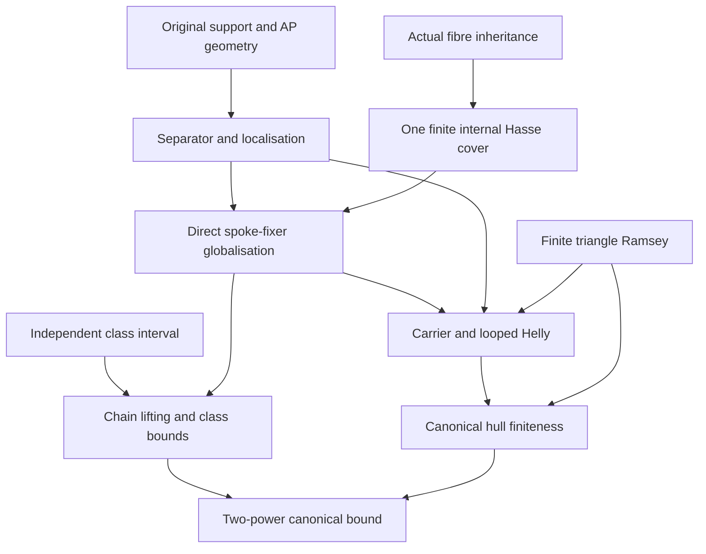

# Actual finite fibres, invariant classes and the canonical real hull

Generated from `module.json` by `tools/build_formalization_module.py`.

Source `490c3f36d85db5a0b3ced0598e6c431825254ec5`. **Human-expanded proof plan; no Lean code.**

Preparation for OTHER Lean projects. Five full real_hull files give eighteen numbered results; the selected actual-fibre CCO lemma is the nineteenth export. RAW word-exact calculus, exact CRT, arbitrary imaginary CCO and SAP are not prerequisites. Other results in cco_finite_fibres.tex and real_hull/06–07 are not covered.

The human article remains unchanged. Additional proof details are in
[PROOF_NOTES.md](PROOF_NOTES.md); the cross-track policy is in
[the formalization guide](../README.md). Source hashes are checked before
the index is regenerated. Graph validation is not proof verification.

## Source premises

**A01: Elementary original real source.** One inhabited transitive ultrahomogeneous complete finite named symmetric binary source, actual represented products, and separate logical equality. No CCO, SAP or word-exactness follows from this assumption alone.

**A02: Original age amalgamation.** The actual age has AP. Wherever complete-diagram triangle fullness is needed it is supplied by the separate named I01 contract, not by SAP.

**A03: Original semantic homomorphic CCO.** Finite partial diversity diagrams whose specified simple cycles map to the original source have a homomorphism. Used directly for actual fibre/class inheritance, not for arbitrary imaginaries.

**A04: Elementary finite combinatorics.** Classical finite pigeonhole, finite selection and finite cardinal reasoning. A sufficient finite triangle Ramsey bound is proved internally; no infinite Ramsey theorem is imported.

## Imported theorem contracts

These are named provider obligations for the receiving Lean project,
not new axioms or claims of compiled imports.

| ID and source | Contract | Current provider status |
|---|---|---|
| I01: [`lem:cco-triangle-fullness`](../../sections/triangle_fullness.tex#L2) | A finite complete original diagram whose induced diagrams on at most three vertices belong to the age belongs to the age. Available from hereditary age AP plus original semantic CCO; source proof is supplied. Consumers may take this exact law explicitly. | HUMAN_SUPPORT_PROOF_NOT_LEAN |
| I02: [`thm:full-relative-Hasse`](../../sections/finite_relative_parity_exact_closure.tex#L59) | In an actual homogeneous transitive finite symmetric binary CCO source, all full invariant-equivalence covers of finite relative index have index two. The source may be finite. Instantiate only after inherited fibre/class hypotheses are proved; no exactness of endpoints. | HUMAN_EXPANDED_NOT_LEAN |

## Definitions

| ID | Definition | Exact meaning | Source |
|---|---|---|---|
| D01 | Original elementary source | Inhabited transitive ultrahomogeneous complete finite symmetric binary source. Original atom names are actual pair orbitals, with logical equality separate. | [source](../../sections/real_hull/01_relative_separator_and_folding.tex#L7) |
| D02 | RAW squares and guarded H | All products are equality-inclusive represented composition. A_p=(p;p) minus logical equality; H(a,b)=(a;b) intersect diversity, so H(a,a)=A_a. H is not an associative replacement algebra. | [source](../../sections/real_hull/01_relative_separator_and_folding.tex#L25) |
| D03 | Global invariant supports and generated closure | R is a diversity-name set with R^+={Id} union R composition-closed. It represents any original invariant equivalence, not necessarily word-exact. <S> is its least generated support. | [source](../../sections/real_hull/01_relative_separator_and_folding.tex#L29) |
| D04 | Support orbits and fixedness | O_R(u)=(R^+;u) intersect diversity; these support-calculus classes partition the palette. R-fixed p means R^+;p={p}, forcing p outside R. These are not Aut-orbits on literal colour names. | [source](../../sections/real_hull/01_relative_separator_and_folding.tex#L34) |
| D05 | Actual realised new-point fibre | For finite complete real A and realised q(x/A) with x outside A, Z is its actual realization set, one stabilizer orbit; nonempty A gives diversity spokes p_i. The formula T=intersect A_pi is proved, not assumed. | [source](../../sections/cco_finite_fibres.tex#L2) |
| D06 | Fibre-closed support (source exact for Z) | A global invariant equivalence support R whose whole classes meeting actual Z lie in Z. The source also records R subset its palette T. This is NOT a word-exactness assumption. | [source](../../sections/real_hull/02_global_finite_fibre_fixer.tex#L12) |
| D07 | Canonical spoke-fixer | For a nonempty actual spoke-name set P, R_P={d:p;d={p} for every p in P}. T_P=intersect A_p is the palette candidate. | [source](../../sections/real_hull/02_global_finite_fibre_fixer.tex#L118) |
| D08 | Actual invariant class | For an arbitrary original invariant equivalence E=R^+, C is one actual class. R can be empty (singleton C) or nonexact. | [source](../../sections/real_hull/03_invariant_class_packets.tex#L3) |
| D09 | Full internal invariant interval | InvEq(C) means invariance under FULL Aut(C), compared with original [Id,E]. No onto restriction homomorphism or lattice distributivity is assumed. | [source](../../sections/real_hull/03_invariant_class_packets.tex#L57) |
| D10 | Looped colours and fixed-family pseudocomplement | L={r:r in A_r}. For nonempty R-fixed P set S=intersect A_p and W_R(P)={a:A_a intersect S subset R}; all are diversity support sets. | [source](../../sections/real_hull/04_relative_pseudocomplement_carrier.tex#L3) |
| D11 | Carrier insertion data | A realised finite star with nonempty P and additional spoke b; S=intersect A_p, C=S intersect A_b. Generated supports use the full invariant support closure. | [source](../../sections/real_hull/04_relative_pseudocomplement_carrier.tex#L79) |
| D12 | Connectivity and even connectivity | Gamma(p)=<{p}>, B(p)=<A_p>. B(p)^+ has a positive even-word presentation; Gamma(p)^+ need not be RAW word-exact. | [source](../../sections/real_hull/05_even_walk_canonical_hull.tex#L3) |
| D13 | Real algebraicity and canonical class | Real acl over finite A means finite orbit under Aut(M/A). For x outside A use J=intersect Gamma(col(x,a)) and the intersection of the corresponding anchored classes. Empty A uses universal support; parameter x in A is a separate equality case. | [source](../../sections/real_hull/05_even_walk_canonical_hull.tex#L29) |
| D14 | Finite triangle Ramsey number | For k>=1, R_k(3) is the least sufficient size. Existence is proved by f(0)=1, f(t+1)=k f(t)+1 and k+1 pivots plus one final vertex; no infinite Ramsey input. | [source](../../sections/real_hull/05_even_walk_canonical_hull.tex#L32) |

## Proof claims and direct dependencies

Every row has a human proof expansion. Each still needs an actual Lean
statement and proof. Fibre-closed (source exact for Z) is separate from RAW word exactness. Canonical hull, actual orbit and global class have distinct contracts.

| ID and claim | Scope | Direct providers | Proof note |
|---|---|---|---|
| C01: Elementary finite triangle Ramsey | finite_combinatorics | D14 | N02 in [notes](PROOF_NOTES.md) |
| C02: Original RAW support algebra | orbital | D01, D02, D03, D04 | N01 in [notes](PROOF_NOTES.md) |
| C03: Actual fibre palette and triangle fullness | actual_fibres | D05, I01 | N05 in [notes](PROOF_NOTES.md) |
| C04: Relative separator | ap_triangles | C02, A02, I01 | N03 in [notes](PROOF_NOTES.md) |
| C05: Rectangle criterion and folding | ap_triangles | C02, A02 | N03 in [notes](PROOF_NOTES.md) |
| C06: Mixed orbit collapse | ap_triangles | C02, C04 | N04 in [notes](PROOF_NOTES.md) |
| C07: Self-side collapse | ap_triangles | C06, C02 | N04 in [notes](PROOF_NOTES.md) |
| C08: Minimal-blocker square avoidance | ap_triangles | C04, C05, C02 | N04 in [notes](PROOF_NOTES.md) |
| C09: Fibre stabilizer orbit and homogeneity | actual_fibres | D05 | N05 in [notes](PROOF_NOTES.md) |
| C10: Actual fibre CCO | cco_fibres | C09, A03 | N05 in [notes](PROOF_NOTES.md) |
| C11: Spoke fixedness from whole-class containment | actual_fibres | D06, C02 | N06 in [notes](PROOF_NOTES.md) |
| C12: Original spoke-square localisation | ap_triangles | C07, C08, D04 | N04 in [notes](PROOF_NOTES.md) |
| C13: Canonical spoke-fixer equivalence and maximality | actual_fibres | D07, C02 | N06 in [notes](PROOF_NOTES.md) |
| C14: Spoke-fixer classes stay in the fibre | actual_fibres | C13, C03 | N06 in [notes](PROOF_NOTES.md) |
| C15: Finite internal Hasse and sizes before globalisation | finite_globalisation | C09, C10, I02 | N07 in [notes](PROOF_NOTES.md) |
| C16: One-cover square transfer forces equality | finite_globalisation | C15, C14, C12, I01 | N07 in [notes](PROOF_NOTES.md) |
| C17: Finite-fibre global equivalence including boundaries | finite_globalisation | C16, C14, D05 | N07 in [notes](PROOF_NOTES.md) |
| C18: Globalise all internal chains after existence | finite_globalisation | C17, C21, C15 | N08 in [notes](PROOF_NOTES.md) |
| C19: Spoke-set criterion and uniform conjugacy | finite_globalisation | C14, C03, C17, C15 | N08 in [notes](PROOF_NOTES.md) |
| C20: Elementary class palette/homogeneity | invariant_classes | D08, A01 | N08 in [notes](PROOF_NOTES.md) |
| C21: Generic full internal interval isomorphism | invariant_classes | C20, D09 | N08 in [notes](PROOF_NOTES.md) |
| C22: Class triangle fullness and CCO | cco_fibres | C20, I01, A03 | N09 in [notes](PROOF_NOTES.md) |
| C23: Full finite-class interval covers | invariant_classes | D08, A03, I02 | N09 in [notes](PROOF_NOTES.md) |
| C24: Two-power class size with atom bound | invariant_classes | C23, C20 | N09 in [notes](PROOF_NOTES.md) |
| C25: Fixed-family outside-R saturation | loop_geometry | D10, C02 | N10 in [notes](PROOF_NOTES.md) |
| C26: Pseudocomplement square closure | loop_geometry | C25, C04, C05 | N10 in [notes](PROOF_NOTES.md) |
| C27: Pseudocomplement mixed closure | loop_geometry | C26, C25, C04, C05 | N10 in [notes](PROOF_NOTES.md) |
| C28: Carrier fibre and finite loop-free bound | loop_geometry | D11, C03, C01, A02 | N11 in [notes](PROOF_NOTES.md) |
| C29: Carrier insertion | loop_geometry | C28, C17, C11, C27 | N11 in [notes](PROOF_NOTES.md) |
| C30: Looped diagonal Helly | loop_geometry | C29, C02 | N11 in [notes](PROOF_NOTES.md) |
| C31: Even connectivity and the odd-sheet obstruction | orbital | D12, C02 | N12 in [notes](PROOF_NOTES.md) |
| C32: Finite fibre excludes every looped colour | canonical_hull | C03 | N12 in [notes](PROOF_NOTES.md) |
| C33: Every canonical J-class is uniformly small | canonical_hull | C31, C30, C32, C01, D13 | N12 in [notes](PROOF_NOTES.md) |
| C34: Canonical hull is the actual J-class | canonical_hull | C33, C09, D13 | N12 in [notes](PROOF_NOTES.md) |
| C35: Empty-base and parameter conventions | canonical_hull | C32, C01, C09 | N12 in [notes](PROOF_NOTES.md) |
| C36: Two-power canonical hull bound | canonical_hull | C34, C35, C24 | N12 in [notes](PROOF_NOTES.md) |

The precise quantified contracts are in `module.json`. Provider-before-consumer
order (including definitions and source premises):

`A01 → A02 → A03 → A04 → I01 → I02 → D01 → D14 → C01 → D02 → D05 → C03 → C09 → D03 → C10 → C32 → D04 → D06 → D08 → D12 → C02 → C15 → C20 → C23 → C35 → D07 → D09 → D10 → D13 → C04 → C05 → C11 → C13 → C21 → C22 → C24 → C25 → C31 → D11 → C06 → C08 → C14 → C26 → C28 → C07 → C27 → C12 → C16 → C17 → C18 → C19 → C29 → C30 → C33 → C34 → C36`

This order is one valid linearization; it does not require unrelated
branches to be proved sequentially. The full DAG is the `depends_on`
relation in `module.json`.

## Main proof branches

This is a coarse view of the claim DAG. Edges go from provider to consumer.

Generic class interval is proved without fibre globalisation; only its application comes after existence.
Full Hasse is instantiated on actual fibres or finite original intervals. No RAW exact Helly, exact CRT or SAP is imported.

## Article exports

| Existing source result | Sidecar proof claims |
|---|---|
| [`lem:fibreCCO`](../../sections/cco_finite_fibres.tex#L11) | C03, C09, C10 |
| [`lem:rh-separator`](../../sections/real_hull/01_relative_separator_and_folding.tex#L40) | C04 |
| [`lem:rh-fold`](../../sections/real_hull/01_relative_separator_and_folding.tex#L70) | C05 |
| [`lem:rh-collapse`](../../sections/real_hull/01_relative_separator_and_folding.tex#L103) | C06, C07, C08 |
| [`lem:rh-spokefixed`](../../sections/real_hull/02_global_finite_fibre_fixer.tex#L15) | C11 |
| [`lem:rh-spoke-square-localisation`](../../sections/real_hull/02_global_finite_fibre_fixer.tex#L39) | C12 |
| [`lem:rh-direct-spoke-fixer`](../../sections/real_hull/02_global_finite_fibre_fixer.tex#L104) | C13, C14, C16 |
| [`thm:rh-globalise`](../../sections/real_hull/02_global_finite_fibre_fixer.tex#L286) | C17, C18 |
| [`cor:rh-fibre-spoke-set-uniformity`](../../sections/real_hull/02_global_finite_fibre_fixer.tex#L370) | C19 |
| [`lem:rh-class-inherits`](../../sections/real_hull/03_invariant_class_packets.tex#L1) | C20, C22 |
| [`lem:rh-invariant-class-interval`](../../sections/real_hull/03_invariant_class_packets.tex#L41) | C21 |
| [`cor:rh-finite-invariant-interval-index-two`](../../sections/real_hull/03_invariant_class_packets.tex#L178) | C23 |
| [`cor:rh-class-2power`](../../sections/real_hull/03_invariant_class_packets.tex#L314) | C24 |
| [`lem:rh-pseudo`](../../sections/real_hull/04_relative_pseudocomplement_carrier.tex#L7) | C25, C26, C27 |
| [`lem:rh-carrier`](../../sections/real_hull/04_relative_pseudocomplement_carrier.tex#L78) | C28, C29 |
| [`lem:rh-loophelly`](../../sections/real_hull/04_relative_pseudocomplement_carrier.tex#L133) | C30 |
| [`lem:rh-evenwalk`](../../sections/real_hull/05_even_walk_canonical_hull.tex#L8) | C31 |
| [`thm:rh-hull`](../../sections/real_hull/05_even_walk_canonical_hull.tex#L27) | C32, C33, C34, C35 |
| [`cor:rh-hull-2power`](../../sections/real_hull/05_even_walk_canonical_hull.tex#L92) | C36 |

Full result coverage is asserted only for `source_result_files`.
Selected additional results: lem:fibreCCO.
Other results in their provider source files are not claimed covered.

## Internal implementation milestones

These tasks are proof milestones inside larger project assignments;
see the [peer-project allocation](../coordination/BOARD.md).

These are implementation tasks, not additional mathematical assumptions.

| Task | Earlier tasks | Acceptance |
|---|---|---|
| T01: Finite Ramsey and elementary actual fibre/class geometry | — | Prove finite Ramsey, source support algebra, actual fibre inheritance and generic class interval independently of globalisation. |
| T02: Relative separator and localisation | T01 | Prove AP/triangle separator, rectangle/folding, collapse and square localisation, retaining all logical-identity branches. |
| T03: Direct finite-fibre globalisation | T01, T02 | Construct R_P before finiteness, use one internal cover and three-new-point transfer, then apply the independent class interval for chain lifting and uniformity. |
| T04: Finite original class bounds | T01 | Apply full original Hasse in finite-class intervals and count old atom additions; no exact-lattice distributivity. |
| T05: Pseudocomplement and looped insertion | T01, T02, T03 | Prove W closure, finite carrier insertion and looped diagonal Helly without RAW exact Helly or infinite Ramsey. |
| T06: Canonical real hull | T01, T04, T05 | Separate even connectivity, finite-fibre loop exclusion, Ramsey canonical finiteness and subsequent two-power bound; retain boundary and orbit/hull distinctions. |

## Finite controls

- **R01.** Infinite-block F2² packet algebra: full finite packet interval M3, nonexact connectivity and packet equivalences, with all finite interval covers index two.
- **R02.** Nested two-bit packet model: 28 realised anchored types, spoke-fixer/palette equality, uniform sizes, and strict distinction between the two-point fibre and four-point canonical hull.
- **R03.** Relative separator, rectangle/folding, minimal blockers, pseudocomplement closure and looped Helly on represented packet/ultrametric palettes.
- **R04.** Tiny gain-labelled diagrams for the two source examples: cycle tests match simultaneous homomorphic completion; finite snapshots are not claimed globally CCO.
- **R05.** Finite triangle Ramsey on all 32768 two-colourings of K6, plus recurrence bounds and the unrestricted-lift uniqueness counterexample.

Run `python tools/check_canonical_hull_controls.py` from the manuscript directory.
The controls do not prove CCO or the general theorems.

## Return to the human articles

No source theorem conclusion was changed. One proof phrase needs its intended interval scope; the remaining items are presentation clarifications for a later human article pass:

- **F01** ([source](../../sections/real_hull/02_global_finite_fibre_fixer.tex#L334)): Uniqueness is among original lifts below E_T, equivalently fibre-closed for Z. Unrestricted global uniqueness is false because E_T and Top both restrict to internal Top_Z. Write unique lift in [Id,E_T]; theorem conclusions stay unchanged.
- **F02** ([source](../../sections/real_hull/02_global_finite_fibre_fixer.tex#L12)): Exact for Z means whole-class containment, not RAW word-exactness. Internal lifted equivalences may be nonexact word relations. Use a distinct formal name FibreClosed; optionally explain the distinction in human terminology.
- **F03** ([source](../../sections/real_hull/04_relative_pseudocomplement_carrier.tex#L119)): Finite triangle Ramsey already bounds a loop-free fibre below R_k(3); infinite Ramsey is unnecessary. Replace the infinite Ramsey sentence with the finite bound when revising the article.
- **F04** ([source](../../sections/real_hull/05_even_walk_canonical_hull.tex#L3)): Even connectivity has a positive even-word presentation, but Gamma connectivity need not be RAW exact. Canonical hull can strictly exceed the actual one-point fibre. Keep Gamma as a full invariant support, not an exact quotient kernel; retain the two-bit control.
- **F05** ([source](../../sections/real_hull/03_invariant_class_packets.tex#L82)): The generic interval proof uses only elementary class homogeneity/atomicity and does not use inherited CCO or globalisation. Keep elementary class and CCO inheritance interfaces separate in formalization.

The machine ledger records caller effects and affected claims. The source
review used two independent model review passes and parent synthesis;
it is not independent human or formal certification.
