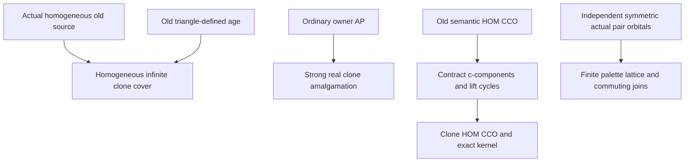

# Pure-clone SAPification and the actual symmetric palette lattice

Generated from `module.json` by `tools/build_formalization_module.py`.

Source `490c3f36d85db5a0b3ced0598e6c431825254ec5`. **Human-expanded proof plan; no Lean code.**

Private B045: two selected Ramsey source results and the JC equation. Infinite pure clones convert ordinary old AP into real SAP, preserve homogeneity, triangle-definedness and semantic HOM CCO, and have exact kernel K=Id union c=c;c with actual quotient Q. Expand c-component obstruction/cycle lifting locally, with no equality-extended CCO black box. Independently prove the finite palette lattice interface and permutability by a same-sort two-point swap. No new external provider, later Ramsey theorem or old SAP is assumed.

The human article remains unchanged. Additional proof details are in
[PROOF_NOTES.md](PROOF_NOTES.md); the cross-track policy is in
[the formalization guide](../README.md). Source hashes are checked before
the index is regenerated. Graph validation is not proof verification.

## Source premises

**A01: Actual homogeneous old binary source.** Q is a nonempty countable homogeneous complete relational binary structure in a finite atomic colour language, with one or finitely many named NONEMPTY transitive original sorts. Same-sort atoms are symmetric; mixed-sort atoms have paired converses. Colours are ACTUAL occurring induced pair types, logical equality separate. There are no extra unnamed structure/functions/higher-arity relations. Q may be finite. Empty/unrealized named sorts are omitted.

**A02: Actual infinite pure clone construction.** For every real q in Q take the fibre {q} x N. Distinct clones of the same owner receive a new sort-specific diversity colour c; distinct owners retain their old Q colour. Original unary sort labels are pulled back. Clone identities are logical diagonals, never specified diversity edges. Each fibre has arbitrarily many fresh indices.

**A03: Optional old triangle-definedness.** The finite age of Q consists of complete old diagrams whose singleton/pair types and every triangle are actual permitted old types. Include actual unary/pair admissibility for diagrams with fewer than three points; triangle-only vacuity does not create unrealized atoms.

**A04: Optional ordinary old amalgamation.** Age(Q) has ordinary AP over finite complete induced bases; cross-leg owner identifications are allowed. No old strong amalgamation is assumed. Embeddings preserve/reflect original complete induced binary types and unary sorts.

**A05: Optional old semantic HOM CCO.** Every finite typed old diversity partial graph whose specified simple cycles map homomorphically into Q has a homomorphism of the entire partial graph into Q. Nonadjacent vertices may collide. Source cycle feasibility is homomorphic, not injective; equality-labelled graphs are not taken as an additional black-box input.

**A06: Independent actual symmetric palette setting.** For the palette interface, M is ONE nonempty named transitive sort of a homogeneous complete binary structure with FINITELY many actual occurring symmetric diversity colours. Complete two-point induced isomorphisms extend to full structure automorphisms. Countability, AP/SAP, CCO, triangle-definedness and the clone construction are NOT assumed in this independent setting. Parameter-free definability is in the given named language.

## Definitions

| ID | Definition | Exact meaning | Source |
|---|---|---|---|
| D01 | Clone carrier and owner map | Qhat is the actual sorted set Q x N with projection pi(q,i)=q and colours prescribed by A02. | [source](../../sections/ramsey_clone_sap.tex#L3) |
| D02 | Full clone kernel | K(x,y) means pi(x)=pi(y); this is Id union c on each original sort. A c;c product uses an actual intermediate clone and includes possible equal endpoints. | [source](../../sections/ramsey_clone_sap.tex#L3) |
| D03 | Finite owner diagram | For an actual finite induced clone object B, quotient B by K and keep every old colour between different owner classes; this is the actual finite induced Q diagram on pi(B). | [source](../../sections/ramsey_clone_sap.tex#L3) |
| D04 | Locally legal clone triangles | Use actual one/two-point clone types and the actual permitted triples. In particular two c-edges force the third edge c; one c-edge to an external point forces the two old colours equal in typed orientation. | [source](../../sections/ramsey_clone_sap.tex#L3) |
| D05 | Partial graph and c-components | A finite typed diversity partial graph has at most one atomic label per unordered pair, with paired converse orientation. Its c-components are the connected components of the specified c-edge subgraph, including isolated vertices. | [source](../../sections/ramsey_clone_sap.tex#L3) |
| D06 | Contracted owner graph | Collapse every c-component of a partial graph. Keep old diversity edge labels between components after proving there are no internal old edges and conflicting parallel labels. No equality edge is added to the old diversity graph. | [source](../../sections/ramsey_clone_sap.tex#L3) |
| D07 | Palette equivalences | For X a subset of the actual same-sort diversity palette L, E_X is logical equality union the X-coloured pairs. Lambda comprises X for which E_X is an equivalence; empty palette represents equality. | [source](../../sections/ramsey_preferred_support.tex#L91) |
| D08 | Full represented composition and relative indices | E;F consists of actual pairs with an actual intermediate witness, including logical equality. For E<=F, relative index is the number of E-classes in an F-class, uniform by transitivity; the lattice proof does not require this number finite. | [source](../../sections/ramsey_preferred_support.tex#L91) |

## Proof claims and direct dependencies

Every row has a human proof expansion. Each still needs an actual Lean
statement and proof. Separate infinite clone indices from finite/countable old Q, ordinary owner AP from real clone SAP, logical identity outputs from diversity edges, partial-diagram homomorphisms from induced complete embeddings, and the independent symmetric one-sort lattice result from all clone/CCO assumptions.

| ID and claim | Scope | Direct providers | Proof note |
|---|---|---|---|
| C01: The clone language is an actual complete atomic code | clone_geometry | A01, A02, D01, D02 | N01 in [notes](PROOF_NOTES.md) |
| C02: Owner quotients of finite induced objects are induced old diagrams | clone_geometry | C01, D03 | N01 in [notes](PROOF_NOTES.md) |
| C03: A finite clone partial isomorphism induces one old partial isomorphism | homogeneity | C01, C02 | N01 in [notes](PROOF_NOTES.md) |
| C04: Old homogeneity and independent fibre bijections extend the map | homogeneity | A01, A02, C03 | N01 in [notes](PROOF_NOTES.md) |
| C05: Every clone automorphism projects to an old automorphism | homogeneity | C01, C02 | N01 in [notes](PROOF_NOTES.md) |
| C06: A locally legal complete clone diagram has a clone equivalence | triangles | A01, A02, D04 | N02 in [notes](PROOF_NOTES.md) |
| C07: Old labels are uniform between clone classes | triangles | C06, D04 | N02 in [notes](PROOF_NOTES.md) |
| C08: The collapsed complete diagram has permitted original types | triangles | C06, C07, A03 | N02 in [notes](PROOF_NOTES.md) |
| C09: Old triangle-definedness realizes the clone complete diagram | triangles | A02, A03, C08 | N02 in [notes](PROOF_NOTES.md) |
| C10: Triangle-definedness also reflects back to the quotient | triangles | A01, A02, D04 | N02 in [notes](PROOF_NOTES.md) |
| C11: A clone AP span descends to an ordinary owner AP span | strong_amalgamation | A04, C02 | N03 in [notes](PROOF_NOTES.md) |
| C12: Fresh clone indices separate every real off-base vertex | strong_amalgamation | A02, C11 | N03 in [notes](PROOF_NOTES.md) |
| C13: The resulting real amalgam is strong | strong_amalgamation | C02, C11, C12 | N03 in [notes](PROOF_NOTES.md) |
| C14: Components for CCO lie in one original sort | clone_CCO | A01, A02, D05 | N04 in [notes](PROOF_NOTES.md) |
| C15: An old edge inside one c-component creates an infeasible simple cycle | clone_CCO | C01, C14, D05 | N04 in [notes](PROOF_NOTES.md) |
| C16: Conflicting old edges between two components create an infeasible simple cycle | clone_CCO | C01, C14, D05 | N04 in [notes](PROOF_NOTES.md) |
| C17: Contraction yields a genuine old diversity partial graph | clone_CCO | C14, C15, C16, D06 | N04 in [notes](PROOF_NOTES.md) |
| C18: Every old quotient simple cycle lifts to a simple clone cycle | clone_CCO | C14, C17 | N04 in [notes](PROOF_NOTES.md) |
| C19: Original semantic CCO solves the quotient owner graph | clone_CCO | A05, C17, C18 | N04 in [notes](PROOF_NOTES.md) |
| C20: Infinite fibres lift the owner solution to the whole clone graph | clone_CCO | A02, C19 | N04 in [notes](PROOF_NOTES.md) |
| C21: Clone semantic HOM CCO follows | clone_CCO | C14, C15, C16, C17, C18, C19, C20 | N04 in [notes](PROOF_NOTES.md) |
| C22: Clone semantic CCO implies old semantic CCO | clone_CCO | A01, A02, C01 | N04 in [notes](PROOF_NOTES.md) |
| C23: Every two-step c walk stays in one owner fibre | kernel | A02, D01, D02 | N05 in [notes](PROOF_NOTES.md) |
| C24: A third clone witnesses every pair in K | kernel | A02, D01, D02 | N05 in [notes](PROOF_NOTES.md) |
| C25: The clone kernel is an exact full relation with quotient Q | kernel | C02, C23, C24 | N05 in [notes](PROOF_NOTES.md) |
| C26: Pure-clone SAPification source export | clone_geometry | C04, C09, C13, C21, C25 | N05 in [notes](PROOF_NOTES.md) |
| C27: Actual named colours are exactly the full pair orbitals | palette_lattice | A06, D07 | N06 in [notes](PROOF_NOTES.md) |
| C28: Every invariant equivalence has one definable palette | palette_lattice | A06, C27, D07 | N06 in [notes](PROOF_NOTES.md) |
| C29: The palette order is finite with intersection as meet | palette_lattice | A06, C28, D07 | N06 in [notes](PROOF_NOTES.md) |
| C30: Degenerate composition witnesses already reverse | palette_lattice | A06, D08 | N06 in [notes](PROOF_NOTES.md) |
| C31: A symmetric two-point swap proves permutability | palette_lattice | A06, C30, D08 | N06 in [notes](PROOF_NOTES.md) |
| C32: The commuting product is an equivalence | palette_lattice | C31, D08 | N06 in [notes](PROOF_NOTES.md) |
| C33: The product is exactly the palette join | palette_lattice | C28, C29, C32, D08 | N06 in [notes](PROOF_NOTES.md) |
| C34: Symmetry cannot be dropped from the palette product theorem | boundary | D08 | N07 in [notes](PROOF_NOTES.md) |
| C35: Finite clone windows test but do not replace infinite fibres | boundary | A02, D02, C23, C24 | N07 in [notes](PROOF_NOTES.md) |
| C36: Small cases, actual sorts and certification boundaries | boundary | A01, A02, D04, D05 | N07 in [notes](PROOF_NOTES.md) |

The precise quantified contracts are in `module.json`. Provider-before-consumer
order (including definitions and source premises):

`A01 → A02 → A03 → A04 → A05 → A06 → D08 → C30 → C34 → D01 → D05 → D07 → C14 → C27 → C31 → D02 → D04 → D06 → C01 → C06 → C10 → C23 → C24 → C28 → C32 → C36 → D03 → C02 → C07 → C15 → C16 → C22 → C29 → C35 → C03 → C05 → C08 → C11 → C17 → C25 → C33 → C04 → C09 → C12 → C18 → C13 → C19 → C20 → C21 → C26`

This order is one valid linearization; it does not require unrelated
branches to be proved sequentially. The full DAG is the `depends_on`
relation in `module.json`.

## Main proof branches

This is a coarse view of the claim DAG. Edges go from provider to consumer.

Two selected results and JC; the remaining assumptions/notation in preferred_support are not additional result exports.
Infinite clone fibres supply fresh real points even when an ordinary old amalgam identifies off-base owners.
The quotient CCO proof is local and uses no equality-labelled CCO black box or later Ramsey theorem.
Palette permutability comes from extending the same-sort endpoint swap, independent of all clone/CCO hypotheses.

## Article exports

| Existing source result | Sidecar proof claims |
|---|---|
| [`thm:internal-clone-sap`](../../sections/ramsey_clone_sap.tex#L3) | C26 |
| [`prop:lattice-interface`](../../sections/ramsey_preferred_support.tex#L90) | C28, C29, C31, C33 |

Auxiliary source equations (not additional numbered results):

- [`eq:join-composition`](../../sections/ramsey_preferred_support.tex#L99): C29, C33

Full result coverage is asserted only for `source_result_files`.
Selected additional results: thm:internal-clone-sap, prop:lattice-interface.
Other results in their provider source files are not claimed covered.

## Internal implementation milestones

These tasks are proof milestones inside larger project assignments;
see the [peer-project allocation](../coordination/BOARD.md).

These are implementation tasks, not additional mathematical assumptions.

| Task | Earlier tasks | Acceptance |
|---|---|---|
| T01: Actual clone owners and homogeneous extension | — | Keep actual old/clone colours, nonempty original sorts and infinite fresh clone indices. Prove internal-edge and duplicate-component-label obstructions by genuine simple cycles before quotient lifting. Use ordinary owner AP only; distinguish globally injective partial homomorphism from an induced complete embedding. Palette lattice uses independent same-sort symmetry/homogeneity and logical diagonals, no CCO/SAP. Finite controls certify no unbounded theorem or compiled Lean. |
| T02: Triangle quotient and ordinary-owner to real-strong AP | T01 | Keep actual old/clone colours, nonempty original sorts and infinite fresh clone indices. Prove internal-edge and duplicate-component-label obstructions by genuine simple cycles before quotient lifting. Use ordinary owner AP only; distinguish globally injective partial homomorphism from an induced complete embedding. Palette lattice uses independent same-sort symmetry/homogeneity and logical diagonals, no CCO/SAP. Finite controls certify no unbounded theorem or compiled Lean. |
| T03: Component obstructions, simple cycle lifting and semantic CCO | T01 | Keep actual old/clone colours, nonempty original sorts and infinite fresh clone indices. Prove internal-edge and duplicate-component-label obstructions by genuine simple cycles before quotient lifting. Use ordinary owner AP only; distinguish globally injective partial homomorphism from an induced complete embedding. Palette lattice uses independent same-sort symmetry/homogeneity and logical diagonals, no CCO/SAP. Finite controls certify no unbounded theorem or compiled Lean. |
| T04: Exact clone kernel, source assembly and finite boundaries | T01, T02, T03 | Keep actual old/clone colours, nonempty original sorts and infinite fresh clone indices. Prove internal-edge and duplicate-component-label obstructions by genuine simple cycles before quotient lifting. Use ordinary owner AP only; distinguish globally injective partial homomorphism from an induced complete embedding. Palette lattice uses independent same-sort symmetry/homogeneity and logical diagonals, no CCO/SAP. Finite controls certify no unbounded theorem or compiled Lean. |
| T05: Independent finite palette lattice and oriented boundary | — | Keep actual old/clone colours, nonempty original sorts and infinite fresh clone indices. Prove internal-edge and duplicate-component-label obstructions by genuine simple cycles before quotient lifting. Use ordinary owner AP only; distinguish globally injective partial homomorphism from an induced complete embedding. Palette lattice uses independent same-sort symmetry/homogeneity and logical diagonals, no CCO/SAP. Finite controls certify no unbounded theorem or compiled Lean. |

## Finite controls

- **K01.** Bounded actual two-owner clone models: partial graph homomorphism search versus independent cycle criterion and c-component quotient; owner-AP collision versus strong real clone separation; actual finite partial automorphism extension.
- **K02.** Full c;c kernels in finite clone windows, including two-clone failure; finite symmetric palette equivalence products/joins and directed S3 noncommuting boundary.

Run `python tools/check_clone_sap_controls.py` from the manuscript directory.
The controls do not prove CCO or the general theorems.

## Return to the human articles

No required mathematical repair was found in this scoped pass. These
optional wording clarifications remain queued for a human article pass:

- **F01** ([source](../../sections/ramsey_clone_sap.tex#L37)): Before applying original diversity-only CCO to the c-component quotient, explicitly rule out an internal old edge and conflicting old parallel component labels by shortest/simple c-path cycles. Quotient simple cycles then lift through distinct components. Expand the two obstruction cases and allow zero-length internal connecting paths when two old edges share an endpoint. This gives a direct proof without treating equality-extended CCO as a new input.
- **F02** ([source](../../sections/ramsey_preferred_support.tex#L110)): The allowed swapped triangle can be transported by extending the induced two-point endpoint swap. This directly proves equivalence permutability in the actual symmetric homogeneous sort, without a separate Fraisse one-point extension API. Optionally replace the one-point-extension sentence by the endpoint-swap automorphism proof and state actual occurring atom/unary-pair admissibility conventions.

The machine ledger records caller effects and affected claims. The source
review used two independent model review passes and parent synthesis;
it is not independent human or formal certification.
