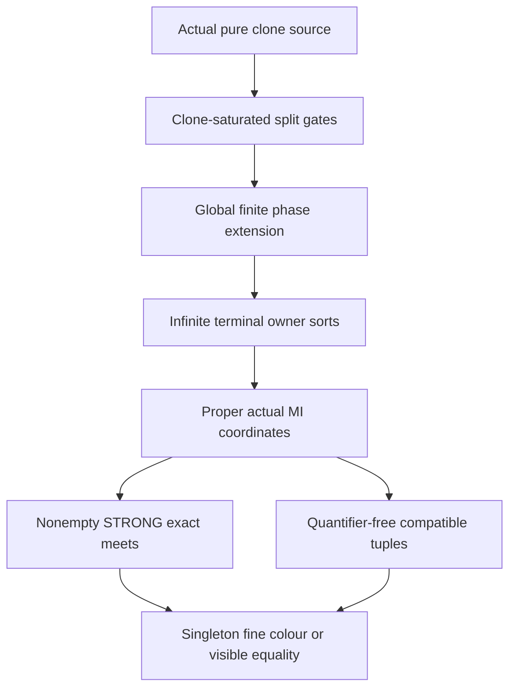

# Clone-stable terminalisation and compatible MI-tuple fine-colour geometry

Generated from `module.json` by `tools/build_formalization_module.py`.

Source `490c3f36d85db5a0b3ced0598e6c431825254ec5`. **Human-expanded proof plan; no Lean code.**

Private B060: FOUR selected Ramsey III geometry results, twelve definitions, 76 human proof claims, four auxiliary equations and nine tasks. Actual safe finite character splits preserve pure infinite clone fibres and leave every terminal owner unary type infinite. Proper actual MI coordinates above the clone kernel give quantifier-free compatible tuples; their complete mixed semantic spectra recover ONE original fine atom, including hidden-coordinate diagonal cases and visible tuple equality. This is human proof preparation, not Lean or a Ramsey/HN/EPPA certificate. A separately scoped auxiliary proof establishes all-finite-base owner algebraicity preservation and the original-F-MI one-coordinate branch, with no ancestry into any of the four selected exports.

The human article remains unchanged. Additional proof details are in
[PROOF_NOTES.md](PROOF_NOTES.md); the cross-track policy is in
[the formalization guide](../README.md). Source hashes are checked before
the index is regenerated. Graph validation is not proof verification.

## Source premises

**A01: Original countably infinite homogeneous AP+HOM CCO source.** Q is countably infinite, transitive and homogeneous in a finite complete symmetric binary language with actual occurring diversity pair orbitals. Its finite age has ordinary AP and semantic homomorphic CCO. Logical equality is separate. No old SAP, finite-exact Ramsey lift, real-hull theorem or EPPA is assumed.

**A02: Specific actual maximal-character safe split construction.** At every stage use the genuine maximal-exact-character construction of the imported safe split theorem: its actual connected rigid groupoid gates, full character masks, age of finite restrictions of GLOBAL character-compatible markings and homogeneous marked Fraisse limit. Gate bits are pulled back from their actual quotient classes; inactive labels are fixed. This specifies the provider construction, not an extra theorem about arbitrary unary expansions.

**A03: Independent terminal typed exact-domain input for the distributivity export.** For the independent lem:ramsey-typed-distributivity branch, M can be ANY actual homogeneous finite complete named-sorted relational source with SAP and semantic HOM CCO, symmetric same-sort diversity atoms and paired typed converses. Nonempty STRONG exact domains have finite positive reachable-profile presentations; products and nonempty evaluated meets have compatible endpoint sorts. This abstract branch needs neither clones nor terminal NR2.

**A04: OPTIONAL original greatest finite-class equivalence is proper MI.** ONLY for the auxiliary MI-side conclusion, let F be the greatest actual finite-class invariant equivalence of the ORIGINAL Q; assume F is proper meet-irreducible in its FULL invariant lattice. F need not be exact, thin or equal to the later clone kernel. All four selected source exports remain independent of this assumption.

## Imported theorem contracts

These are named provider obligations for the receiving Lean project,
not new axioms or claims of compiled imports.

| ID and source | Contract | Current provider status |
|---|---|---|
| I01: [`lem:cco-triangle-fullness`](../../sections/triangle_fullness.tex#L2) | Actual hereditary complete binary AP+HOM CCO ages are triangle constrained, retaining actual unary/pair legality. This discharges the pure-clone source triangle premise from A01. | HUMAN_EXPANDED_NOT_LEAN |
| I02: [`thm:internal-clone-sap`](../../sections/ramsey_clone_sap.tex#L3) | For the actual original AP+HOM CCO triangle-constrained Q, the pure cover Q x N is homogeneous SAP+HOM CCO with old owner quotient Q and represented clone kernel K=Id union c=c;c. The c;c product here is FULL, including possible equality OUTPUT. | HUMAN_EXPANDED_NOT_LEAN |
| I03: [`thm:safe-exact-split`](../../sections/v27/06_legacy_finite_covers.tex#L548) | The SAME actual maximal-character split of a homogeneous SAP+HOM CCO source is a reasonable reduct-surjective finite unary expansion, with genuine homogeneous marked source, SAP and HOM CCO. Arbitrary abstract three-sector phase properties are insufficient. | HUMAN_EXPANDED_NOT_LEAN |
| I04: [`thm:finite-cover-elimination`](../../sections/v27/06_legacy_finite_covers.tex#L574) | Finitely many genuine safe splits give reasonable precompact unary terminalisation; every strict cover of the FULL original equivalence lattice on each current transitive sort has infinite relative index. This includes Top covers, and does not merely name a represented sublattice. | HUMAN_EXPANDED_NOT_LEAN |
| I05: [`thm:ep-ap-marked-completion`](../../sections/ep_safe_ap_character_completion.tex#L376) | Finite actual old complete objects with locally legal phase bits are exactly restrictions of global character-compatible markings. Their marked homogeneous limit has unchanged old reduct; reasonableness extends the SAME old embedding. An arbitrary single global marking need not be that homogeneous limit. | HUMAN_EXPANDED_NOT_LEAN |
| I06: [`thm:foundational-rigid-character`](../../sections/rigid_exact_groupoid_foundations.tex#L298) | The actual connected groupoid acts freely on quotient points. Each rigid graph is ONE whole original quotient orbital, its phase difference is chi(R), and a nonrigid quotient orbital has endpoints in different action orbits. | HUMAN_EXPANDED_NOT_LEAN |
| I07: [`lem:foundational-finite-phase-extension`](../../sections/rigid_exact_groupoid_foundations.tex#L348) | On a finite set of actual quotient points, prescribed bits extend to one global character marking iff every pair in the same free action orbit has its required character difference. Independent action orbits have independent seed choices. | HUMAN_EXPANDED_NOT_LEAN |
| I08: [`prop:lattice-interface`](../../sections/ramsey_preferred_support.tex#L90) | On each actual homogeneous transitive symmetric named sort, FULL invariant equivalences form a finite lattice of actual orbital unions, with literal intersection as meet. No distributivity is needed for the finite MI separation argument. | HUMAN_EXPANDED_NOT_LEAN |
| I09: [`lem:typed-terminal-all-equivalences-exact`](../../sections/terminal_invariant_raw_exact.tex#L87) | FULL original no-index-two implies every invariant equivalence has one RAW atomic word; Id alone may need the empty word. With original CCO the exact and FULL invariant lattices coincide. Do not infer this from the represented lattice alone. | HUMAN_EXPANDED_NOT_LEAN |
| I10: [`cor:rh-sap-infinite-exact-helly`](../../sections/real_hull/07_sap_mi_intersection_geometry.tex#L158) | In an infinite homogeneous symmetric SAP+HOM CCO source with FULL NR2, EVERY finite pairwise-intersecting family of actual nonidentity invariant-equivalence classes has nonempty common intersection. The family need not contain all MI coordinates. | HUMAN_EXPANDED_NOT_LEAN |
| I11: [`lem:typed-exact-products`](../../sections/typed_strong_domains.tex#L311) | On ANY actual homogeneous typed SAP+HOM CCO source, nonempty STRONG exact products distribute over finite exact meets with NONEMPTY evaluation; factors and products have compatible original endpoint types. Empty-list Top conventions are handled by the provider. | HUMAN_EXPANDED_NOT_LEAN |
| I12: [`lem:typed-set-pasch`](../../sections/typed_strong_domains.tex#L48) | Actual homogeneous typed SAP sources have associative STRONG composition and the Peircean laws, with logical real equality excluded from all diversity palettes. | HUMAN_EXPANDED_NOT_LEAN |
| I13: [`lem:typed-cylinder-realisation`](../../sections/v27/07_typed_raw_strong_transition.tex#L913) | On actual proper quotient sorts, complete mixed semantic spectra equal (J;a;L) restricted to old real diversity, equivalently J^circ*{a}*L^circ for nonzero exteriors. The off-diagonal named cylinder omits ONLY the diagonal of the SAME hidden sort. | HUMAN_EXPANDED_NOT_LEAN |
| I14: [`lem:typed-raw-strong-saturation`](../../sections/v27/07_typed_raw_strong_transition.tex#L25) | Original relational SAP permits pinned diversity path support and gives RAW kernel saturation off the real diagonal equal to STRONG exterior products. True Id exteriors are omitted; they are never replaced by an empty diversity factor. | HUMAN_EXPANDED_NOT_LEAN |
| I15: [`lem:typed-equivalence-reproduction`](../../sections/v27/09_typed_equivalence_and_profiles.tex#L1) | For an actual nonzero invariant equivalence J in an old SAP source, every nonempty old palette P contained in J^circ has J^circ*P*J^circ=J^circ. This supports the coincident-coordinate case, with no CCO/NR2 needed once P and J are given. | HUMAN_EXPANDED_NOT_LEAN |
| I16: [`lem:packetinterval`](../../sections/finite_packets.tex#L56) | The original FULL finite commuting invariant lattice has its greatest finite-class equivalence F=Sigma(Id); actual uniform relative indices satisfy transposition/tower formulas, without exactness or distributivity. | HUMAN_EXPANDED_NOT_LEAN |
| I17: [`lem:acf-canonical-coordinates`](../../sections/rooted_acf_geometry.tex#L207) | Use ONLY the abstract-lattice C19 branch under its generic A10: a greatest finite-class F with a least strict coarsening in the finite commuting invariant lattice implies exactly one minimal infinite invariant equivalence. No normalized/exact-owner premises from the other source branches are used. | HUMAN_EXPANDED_NOT_LEAN |
| I18: [`lem:consolidated-unary-closure`](../../sections/direct_owner_closure.tex#L2) | Use ONLY the original real-closure C07 branch: an infinite actual homogeneous symmetric AP+HOM CCO source with one minimal infinite invariant direction has acl_Q(A)=F[A] for EVERY finite real A including empty A. No thin-owner naming, normalization or EPPA conclusion is imported. | HUMAN_EXPANDED_NOT_LEAN |

**I14 internal proof support:** C01 in `transition_closure`. Use the proved strict ancestor C01 ONLY to separate all positions of one nonempty RAW atomic word while pinning its already DISTINCT old endpoints. It proves positivity of J^circ from the RAW word; it introduces no new STRONG associativity assumption.

These are separately extracted proved support claims, not additional
numbered exports or consequences of the named theorem statement.

**I16 internal proof support:** C01, C02 in `finite_packets`. Use precisely the strict proved ancestors C01/C02 of C03: actual full equivalence commutation, finite orbital lattice and uniform class-count index transposition/tower formulas. Do not import finite-exact normalization or packet naming.

These are separately extracted proved support claims, not additional
numbered exports or consequences of the named theorem statement.

## Definitions

| ID | Definition | Exact meaning | Source |
|---|---|---|---|
| D01 | Pure clone and owner projection | M=Q x N, pi(q,n)=q; c relates distinct points with the same owner, and K=ker(pi)=Id union c. Different-owner pair colours are the original Q atoms. | [source](../../sections/ramsey_ap_from_clones.tex#L60) |
| D02 | Clone-saturated unary type | A unary type is clone-saturated when it is pi^{-1}(U) for an owner type U; all independent permutations inside each whole N-fibre preserve it. | [source](../../sections/ramsey_ap_from_clones.tex#L60) |
| D03 | Actual split gates and character points | L_* is the source gate containing the finite-index lower endpoint Y; reached target gates are L_t=R^op R, with L_* R=R. Phase bits are actual gate-class bits in the same rigid character groupoid. | [source](../../sections/ramsey_ap_from_clones.tex#L60) |
| D04 | Monochromatic owner clique | An infinite subset of distinct current owners with all fine pair colours the same atom a outside K. It is taken from the ACTUAL infinite parent owner type, by infinite Ramsey on its finite symmetric pair palette. | [source](../../sections/ramsey_ap_from_clones.tex#L60) |
| D05 | Fixed MI coordinate symbol list | A fixed family of distinct proper FULL invariant MI equivalences J>=K_s is meet-representing if its meet is K_s. C24 proves that taking all such MI is one available choice; any meet-representing subfamily is permitted. Its list is fixed by symbols, not by choosing a representative for each point. | [source](../../sections/ramsey_ap_from_clones.tex#L113) |
| D06 | Actual representative spectrum with a diagonal clause | For actual quotient vertices b in M_s/J,d in M_t/L, Spec(b,d) is the set of old diversity atoms realized by DISTINCT representatives. For b=d in the SAME quotient sort, define it by the actual equality case Spec(b,b)=J^circ. | [source](../../sections/ramsey_ap_from_clones.tex#L113) |
| D07 | Compatible MI tuple domain | delta_s(b_1,...,b_r) consists of the correct fixed coordinate sort tags and c_s in Spec(b_i,b_j) for every i<j. Each such tuple is to represent ONE K_s-class. | [source](../../sections/ramsey_ap_from_clones.tex#L113) |
| D08 | Nonempty STRONG exact meet | A nonempty typed diversity domain is a finite intersection of positive reachable profiles. Products use original typed distinct formal path positions and never adjoin real equality as a diversity atom. | [source](../../sections/ramsey_ap_from_clones.tex#L145) |
| D09 | Owner coordinate map | eta_s(q)=([x]_J_i)_i for ANY clone x over owner q. Independence of x and injection are proved from the kernel meet, not a selected section. | [source](../../sections/ramsey_ap_from_clones.tex#L113) |
| D10 | Fine-colour or equality reconstruction | For compatible tuples u,v, intersect ALL actual spectra Spec(u_i,v_j), including equality clauses. A singleton original atom a represents fine colour; singleton c_s on equal visible tuples represents VISIBLE EQUALITY. | [source](../../sections/ramsey_ap_from_clones.tex#L168) |
| D11 | Real owner algebraic closure | For a finite actual owner base A in a homogeneous quotient source P, acl_P(A) is the set of owner points with finite orbit under the FULL actual Aut(P/A). Complete one-point types are actual orbits by quotient homogeneity. | [source](../../sections/ramsey_ap_from_clones.tex#L350) |
| D12 | Original finite packet restricted to one terminal sort | Fbar_s is the pullback of the ORIGINAL owner equivalence F restricted to terminal clone sort s. It contains K_s and each Fbar_s-class has at most |F-class| distinct owner K_s-classes; it is not assumed originally exact. | [source](../../sections/ramsey_ap_from_clones.tex#L350) |

## Proof claims and direct dependencies

Every row has a human proof expansion. Each still needs an actual Lean
statement and proof. Original AP is upgraded only by the actual pure-clone source; terminalisation is the specific maximal-character marked age, not arbitrary unary labels. FULL represented clone kernels and STRONG diversity products are separate. No hidden cells, hidden SAP, readout or expansion property is proved here.

| ID and claim | Scope | Direct providers | Proof note |
|---|---|---|---|
| C01: Original AP+CCO supplies the clone source triangle premise | clones | A01, I01, I02 | N01 in [notes](PROOF_NOTES.md) |
| C02: Pure cover has the represented clone kernel | clones | C01, D01 | N01 in [notes](PROOF_NOTES.md) |
| C03: Independent fibre permutations survive clone-saturated labels | clones | C02, D02 | N01 in [notes](PROOF_NOTES.md) |
| C04: Current clone kernel is invariant | clones | C03 | N01 in [notes](PROOF_NOTES.md) |
| C05: K is the least nonidentity invariant equivalence | clones | C03, C04 | N01 in [notes](PROOF_NOTES.md) |
| C06: A finite-index lower endpoint cannot be real equality | clones | C04, C05 | N02 in [notes](PROOF_NOTES.md) |
| C07: The source split gate contains clone classes | clones | A02, C06, D03 | N02 in [notes](PROOF_NOTES.md) |
| C08: Every reached target gate contains its clone kernel | clones | C03, C07, D03 | N02 in [notes](PROOF_NOTES.md) |
| C09: All new labels are clone-saturated | clones | A02, C07, C08 | N02 in [notes](PROOF_NOTES.md) |
| C10: The homogeneous marked source is again a pure cover | clones | C02, C09, I03, I05 | N02 in [notes](PROOF_NOTES.md) |
| C11: The owner marked age is homogeneous and reasonable | clones | C10, I03, I05 | N02 in [notes](PROOF_NOTES.md) |
| C12: An infinite parent owner type has a looped atom outside K | infinitude | A01, C10, D04 | N03 in [notes](PROOF_NOTES.md) |
| C13: A rigid looped atom has identity gate arrow | infinitude | C12, I06 | N03 in [notes](PROOF_NOTES.md) |
| C14: Nonrigid looped pairs have independent action seeds | infinitude | C12, I06 | N03 in [notes](PROOF_NOTES.md) |
| C15: A constant desired child bit meets every finite pair test | infinitude | C13, C14 | N03 in [notes](PROOF_NOTES.md) |
| C16: The whole clique prefix is globally markable at once | infinitude | C15, I05, I07 | N03 in [notes](PROOF_NOTES.md) |
| C17: Every nonempty child owner type remains infinite | infinitude | C10, C16 | N03 in [notes](PROOF_NOTES.md) |
| C18: Finite actual terminalisation preserves the owner product | infinitude | C11, C17, I04 | N03 in [notes](PROOF_NOTES.md) |
| C19: Each terminal clone kernel is proper nonzero FULL exact | clones | C02, C18, I04 | N03 in [notes](PROOF_NOTES.md) |
| C20: Clone-stable terminalisation source export | clones | C18, C19 | N03 in [notes](PROOF_NOTES.md) |
| C21: The actual terminal invariant lattice is finite | coordinates | C19, I08 | N04 in [notes](PROOF_NOTES.md) |
| C22: A finite lattice has a maximal separator above K | coordinates | C21 | N04 in [notes](PROOF_NOTES.md) |
| C23: Every maximal separator is meet-irreducible | coordinates | C22 | N04 in [notes](PROOF_NOTES.md) |
| C24: All proper MI elements above K meet exactly at K | coordinates | C21, C22, C23, D05 | N04 in [notes](PROOF_NOTES.md) |
| C25: A meet-representing coordinate list exists and is represented | coordinates | C19, C22, C23, C24, I09 | N04 in [notes](PROOF_NOTES.md) |
| C26: eta is independent of the chosen clone | coordinates | C24, C25, D09 | N04 in [notes](PROOF_NOTES.md) |
| C27: eta is injective on old owners | coordinates | C24, C26 | N04 in [notes](PROOF_NOTES.md) |
| C28: The diagonal representative spectrum is the full J diversity support | domain | C18, D06 | N05 in [notes](PROOF_NOTES.md) |
| C29: Two coordinate classes meet exactly when their spectrum contains c | domain | C24, C25, D06 | N05 in [notes](PROOF_NOTES.md) |
| C30: The tuple formula means pairwise class compatibility | domain | C25, C29, D07 | N05 in [notes](PROOF_NOTES.md) |
| C31: Compatible coordinates have exactly one common owner | domain | C18, C19, C24, C30, I04, I10 | N05 in [notes](PROOF_NOTES.md) |
| C32: The compatible domain is quantifier-free | domain | C28, C30, I13 | N05 in [notes](PROOF_NOTES.md) |
| C33: Orphan coordinates use the same actual formula | domain | C31, C32 | N05 in [notes](PROOF_NOTES.md) |
| C34: Quantifier-free compatible MI domain source export | domain | C26, C27, C30, C31, C32, C33 | N05 in [notes](PROOF_NOTES.md) |
| C35: Nonempty diversity meet of the chosen kernels is the clone atom | strong_exact | C19, C24, C25 | N06 in [notes](PROOF_NOTES.md) |
| C36: Every chosen J diversity support has a positive exact presentation | strong_exact | C25, I09, I14 | N06 in [notes](PROOF_NOTES.md) |
| C37: The abstract distributivity source is the correct actual one | strong_exact | A03, I11, I12, D08 | N06 in [notes](PROOF_NOTES.md) |
| C38: Two-sided nonempty meet convolution holds | strong_exact | C37, I11 | N06 in [notes](PROOF_NOTES.md) |
| C39: Repeated products preserve eligible exact presentations | strong_exact | C38, I11, I12 | N06 in [notes](PROOF_NOTES.md) |
| C40: The terminal clone application discharges the abstract source premises | strong_exact | C18, C19, C35, C36, C38, C39 | N06 in [notes](PROOF_NOTES.md) |
| C41: Typed nonempty meet-product distributivity source export | strong_exact | C38, C39 | N06 in [notes](PROOF_NOTES.md) |
| C42: Distinct owners admit distinct clone representatives | singleton | C18, C19, D01 | N07 in [notes](PROOF_NOTES.md) |
| C43: Distinct-coordinate spectra are the actual strong kernel cylinders | singleton | C25, C26, C42, I13, I14 | N07 in [notes](PROOF_NOTES.md) |
| C44: Coincident hidden coordinates satisfy the same formula | singleton | C28, C42, I15 | N07 in [notes](PROOF_NOTES.md) |
| C45: Every coordinate-pair spectrum has one uniform actual formula | singleton | C43, C44 | N07 in [notes](PROOF_NOTES.md) |
| C46: Intersecting all spectra leaves c_s*a*c_t | singleton | C35, C36, C40, C45, I11, I12 | N07 in [notes](PROOF_NOTES.md) |
| C47: Pure clone endpoint shifts fix the literal atom | singleton | C18, C19, C42 | N07 in [notes](PROOF_NOTES.md) |
| C48: Distinct visible owners have singleton original fine colour | singleton | C46, C47 | N07 in [notes](PROOF_NOTES.md) |
| C49: Equal visible tuples return exactly the clone marker | singleton | C27, C46, C47 | N07 in [notes](PROOF_NOTES.md) |
| C50: Original fine relations are quantifier-free on valid tuples | singleton | C27, C32, C48, C49 | N07 in [notes](PROOF_NOTES.md) |
| C51: All compatible tuples coexist in one actual owner source | singleton | C33, C48, C49, C50 | N07 in [notes](PROOF_NOTES.md) |
| C52: Singleton fine-colour source export | singleton | C48, C49, C50, C51 | N07 in [notes](PROOF_NOTES.md) |
| C53: Bare equivalence coordinates need not recover fine colours | boundary | C52 | N08 in [notes](PROOF_NOTES.md) |
| C54: FULL c;c is not the strong product c*c | boundary | C02, C35 | N08 in [notes](PROOF_NOTES.md) |
| C55: Arbitrary unary labels can destroy owner infinitude | boundary | C17 | N08 in [notes](PROOF_NOTES.md) |
| C56: Finite windows are diagnostics rather than unbounded certification | boundary | C52 | N08 in [notes](PROOF_NOTES.md) |
| C57: No empty coordinate family is used in the owner reconstruction | boundary | C19, C25, C27 | N08 in [notes](PROOF_NOTES.md) |
| C58: Nonalgebraic current parent owner types are infinite actual orbits | infinitude | C11, D11 | N09 in [notes](PROOF_NOTES.md) |
| C59: The monochromatic clique argument works over that whole fixed base | infinitude | C12, C58 | N09 in [notes](PROOF_NOTES.md) |
| C60: A realized child type can be copied over the full marked base | infinitude | C13, C14, C59, I05 | N09 in [notes](PROOF_NOTES.md) |
| C61: Simultaneous phase extension realizes arbitrarily many copies over A | infinitude | C10, C11, C60, I05, I07 | N09 in [notes](PROOF_NOTES.md) |
| C62: One actual safe split preserves real owner algebraic closure | infinitude | C58, C61 | N09 in [notes](PROOF_NOTES.md) |
| C63: Finite safe terminalisation preserves all finite-base owner closure | infinitude | C11, C18, C62, I04 | N09 in [notes](PROOF_NOTES.md) |
| C64: Original proper MI F has a least strict coarsening | coordinates | A04, I16 | N10 in [notes](PROOF_NOTES.md) |
| C65: There is one minimal infinite original direction | coordinates | C64, I16, I17 | N10 in [notes](PROOF_NOTES.md) |
| C66: Original owner closure is its finite F hull | coordinates | A01, C65, I18 | N10 in [notes](PROOF_NOTES.md) |
| C67: The terminal owner expansion keeps the original finite F hull | coordinates | C63, C66 | N10 in [notes](PROOF_NOTES.md) |
| C68: The original F restriction is a finite-index original relation above K | coordinates | C18, C19, I16, D12 | N10 in [notes](PROOF_NOTES.md) |
| C69: Terminality forces Fbar_s=K_s | coordinates | C21, C68, I04 | N10 in [notes](PROOF_NOTES.md) |
| C70: A terminal owner sort meets each original F packet at most once | coordinates | C69 | N10 in [notes](PROOF_NOTES.md) |
| C71: A meet-reducible K would descend to two transverse owner equivalences | coordinates | C19, C21, C26 | N10 in [notes](PROOF_NOTES.md) |
| C72: Two other owners would uniquely define an off-base corner | coordinates | C71 | N10 in [notes](PROOF_NOTES.md) |
| C73: The corner is definable in the actual final owner language | coordinates | C11, C18, C21, C72 | N10 in [notes](PROOF_NOTES.md) |
| C74: The corner contradicts preserved finite-packet closure | coordinates | C67, C70, C73 | N10 in [notes](PROOF_NOTES.md) |
| C75: Optional original MI branch permits one proper exact coordinate | coordinates | C19, C24, C25, C52, C74 | N10 in [notes](PROOF_NOTES.md) |
| C76: Terminality and preserved closure are both needed for the MI side branch | boundary | C63, C69, C75 | N10 in [notes](PROOF_NOTES.md) |

The precise quantified contracts are in `module.json`. Provider-before-consumer
order (including definitions and source premises):

`A01 → A02 → A03 → D01 → D02 → D03 → D04 → D05 → D06 → D07 → D08 → D09 → D10 → D11 → D12 → I01 → I02 → I03 → I04 → I05 → I06 → I07 → I08 → I09 → I10 → I11 → I12 → I13 → I14 → I15 → I16 → I17 → I18 → A04 → C01 → C37 → C02 → C38 → C64 → C03 → C39 → C65 → C04 → C41 → C66 → C05 → C06 → C07 → C08 → C09 → C10 → C11 → C12 → C13 → C14 → C58 → C15 → C59 → C16 → C60 → C17 → C61 → C18 → C55 → C62 → C19 → C28 → C63 → C20 → C21 → C42 → C67 → C68 → C22 → C44 → C47 → C69 → C23 → C70 → C24 → C25 → C26 → C29 → C35 → C36 → C27 → C30 → C40 → C43 → C54 → C71 → C31 → C32 → C45 → C57 → C72 → C33 → C46 → C73 → C34 → C48 → C49 → C74 → C50 → C51 → C52 → C53 → C56 → C75 → C76`

This order is one valid linearization; it does not require unrelated
branches to be proved sequentially. The full DAG is the `depends_on`
relation in `module.json`.

## Main proof branches

This is a coarse view of the claim DAG. Edges go from provider to consumer.

Only four Ramsey III geometry results are selected; the AP Ramsey readout is a separate consumer.
Finite lattice MI separation needs no distributivity; class Helly separately uses actual FULL exact kernels.
The generic typed-distributivity export has no clone or terminality ancestry; its application is explicitly re-instantiated on the new terminal source.
Equal hidden coordinates have a full J diversity spectrum; equal visible tuples return c, interpreted as visible equality.

## Article exports

| Existing source result | Sidecar proof claims |
|---|---|
| [`lem:ramsey-clone-stability`](../../sections/ramsey_ap_from_clones.tex#L60) | C20 |
| [`lem:ramsey-mi-domain`](../../sections/ramsey_ap_from_clones.tex#L113) | C34 |
| [`lem:ramsey-typed-distributivity`](../../sections/ramsey_ap_from_clones.tex#L144) | C41 |
| [`lem:ramsey-singleton-recovery`](../../sections/ramsey_ap_from_clones.tex#L168) | C52 |

Auxiliary source equations (not additional numbered results):

- [`eq:ramsey-mi-meet`](../../sections/ramsey_ap_from_clones.tex#L90): C24
- [`eq:ramsey-domain`](../../sections/ramsey_ap_from_clones.tex#L116): C34
- [`eq:ramsey-clone-diversity-meet`](../../sections/ramsey_ap_from_clones.tex#L138): C35
- [`eq:ramsey-singleton`](../../sections/ramsey_ap_from_clones.tex#L171): C48

Full result coverage is asserted only for `source_result_files`.
Selected additional results: lem:ramsey-clone-stability, lem:ramsey-mi-domain, lem:ramsey-typed-distributivity, lem:ramsey-singleton-recovery.
Other results in their provider source files are not claimed covered.

## Internal implementation milestones

These tasks are proof milestones inside larger project assignments;
see the [peer-project allocation](../coordination/BOARD.md).

These are implementation tasks, not additional mathematical assumptions.

| Task | Earlier tasks | Acceptance |
|---|---|---|
| T01: Actual clone symmetry and transported gates | — | Retain actual source/provider hypotheses and all claim dependencies. Use full represented kernels before diversity restriction; no added equality atom, arbitrary local mark extension, hidden cell vertex or omitted same-root equality case. Formalize the finite phase-extension and actual coordinate realization steps, not only the final set equations. |
| T02: Finite phase extension and infinite terminal owner types | T01 | Retain actual source/provider hypotheses and all claim dependencies. Use full represented kernels before diversity restriction; no added equality atom, arbitrary local mark extension, hidden cell vertex or omitted same-root equality case. Formalize the finite phase-extension and actual coordinate realization steps, not only the final set equations. |
| T03: Finite MI separation and owner coordinates | T02 | Retain actual source/provider hypotheses and all claim dependencies. Use full represented kernels before diversity restriction; no added equality atom, arbitrary local mark extension, hidden cell vertex or omitted same-root equality case. Formalize the finite phase-extension and actual coordinate realization steps, not only the final set equations. |
| T04: Actual compatible tuple domain including orphans | T03 | Retain actual source/provider hypotheses and all claim dependencies. Use full represented kernels before diversity restriction; no added equality atom, arbitrary local mark extension, hidden cell vertex or omitted same-root equality case. Formalize the finite phase-extension and actual coordinate realization steps, not only the final set equations. |
| T05: Independent typed exact convolution and its new-source application | T03 | Retain actual source/provider hypotheses and all claim dependencies. Use full represented kernels before diversity restriction; no added equality atom, arbitrary local mark extension, hidden cell vertex or omitted same-root equality case. Formalize the finite phase-extension and actual coordinate realization steps, not only the final set equations. |
| T06: Mixed diagonal spectra and singleton fine-colour recovery | T04, T05 | Retain actual source/provider hypotheses and all claim dependencies. Use full represented kernels before diversity restriction; no added equality atom, arbitrary local mark extension, hidden cell vertex or omitted same-root equality case. Formalize the finite phase-extension and actual coordinate realization steps, not only the final set equations. |
| T07: Boundary examples and finite diagnostics | T06 | Retain actual source/provider hypotheses and all claim dependencies. Use full represented kernels before diversity restriction; no added equality atom, arbitrary local mark extension, hidden cell vertex or omitted same-root equality case. Formalize the finite phase-extension and actual coordinate realization steps, not only the final set equations. |
| T08: All-finite-base owner algebraicity preserved by genuine safe phases | T02 | Use an actual infinite parent orbit over the FULL marked finite base, keep all anchor bits, extend all new same-bit clique points simultaneously by the actual free-character pair test, then align the marked base in the homogeneous marked source. Reasonableness alone is insufficient. |
| T09: Optional original F-MI branch and terminal corner contradiction | T03, T06, T08 | Import only the generic lattice/real-closure branches C19/C07. Use original F, terminal finite-index separation and actual finite pair-type definability. Preserve a firewall so no main four export has optional F-MI or real-hull ancestry. |

## Finite controls

- **K01.** Two-tag finite row/column coordinate pure-clone windows compare actual representative spectra with independently multiplied STRONG kernels for every owner pair and every hidden diagonal; all valid MI tuples and singleton reconstructions are checked.
- **K02.** Enumerate finite reachable exact palette domains and check both-coordinate nonempty-meet distributivity under every compatible type triple. Check represented c;c versus strong c*c and actual quotient class intersections.
- **K03.** Finite elementary-abelian character actions check rigid idempotent loop constraints, finite same-phase seed extension and arbitrarily growing owner-clique prefixes in bounded windows. These are diagnostics only, not infinite SAP/CCO or Lean proofs.

Run `python tools/check_clone_tuple_geometry_finite.py` from the manuscript directory.
The controls do not prove CCO or the general theorems.

## Return to the human articles

No required mathematical repair was found in this scoped pass. These
optional wording clarifications remain queued for a human article pass:

- **F01** ([source](../../sections/ramsey_ap_from_clones.tex#L69)): Minimality of K alone does not cover Y=Id in the finite-index interval sentence. First exclude Y=Id because X>=K has infinite clone fibres, then infer K<=Y from Y>Id.
- **F02** ([source](../../sections/ramsey_ap_from_clones.tex#L81)): The simultaneous same-bit marking of a whole actual clique deserves the global finite-seed test, rather than a suggestion that arbitrary unary labelling is allowed. State that a rigid looped-atom arrow is identity, nonrigid pairs have independent action seeds, and apply finite-phase-extension once on each actual finite clique prefix before passing to the marked age.
- **F03** ([source](../../sections/ramsey_ap_from_clones.tex#L183)): The same-hidden-coordinate diagonal formula uses equivalence reproduction, while visible tuple equality uses a distinct old c-pair. Explicitly cite equivalence reproduction for Spec(b,b)=J^circ and retain c_s as visible equality only after singleton recovery.
- **F04** ([source](../../sections/ramsey_ap_from_clones.tex#L350)): The optional MI paragraph cites preservation of quotient algebraicity without displaying the stronger all-finite-base argument. Expand the actual nonalgebraic parent-type clique over a fixed marked base, extend its same-phase marks globally, then use original acl=F[A], terminal packet separation and the definable off-base corner contradiction to show K_s MI.

The machine ledger records caller effects and affected claims. The source
review used two independent model review passes and parent synthesis;
it is not independent human or formal certification.
