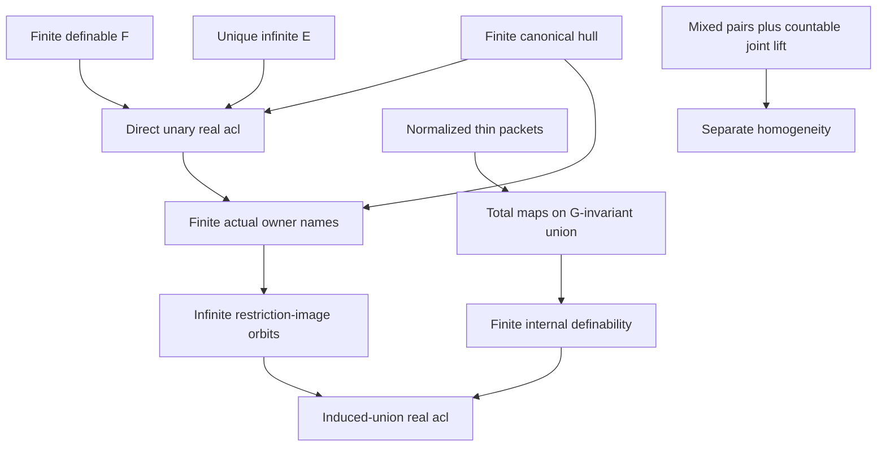

# Direct unary real closure, individually named owners and induced unions

Generated from `module.json` by `tools/build_formalization_module.py`.

Source `490c3f36d85db5a0b3ced0598e6c431825254ec5`. **Human-expanded proof plan; no Lean code.**

Private B031: exactly ONE remaining Foundations II result. Expand the older direct canonical-hull proof of acl_M(A)=F[A], its harmless finite actual E-owner naming, and acl in a G-invariant full owner union. The specialized forward harmless proof is REPEATED LOCALLY to avoid silently deleting countability from the broader packaged B022 type. Main closure branches use no countability, finite-exact normalization except for thin translations, SAP, EPPA, rooted theorem or HKN. Countability and actual joint lifting belong ONLY to separate ancillary owner-named homogeneity. F and Gamma need not be exact; the unique minimal INFINITE E is retained throughout. B025 already uses its independent shorter B012 unary proof and is not assigned a new dependency here.

The human article remains unchanged. Additional proof details are in
[PROOF_NOTES.md](PROOF_NOTES.md); the cross-track policy is in
[the formalization guide](../README.md). Source hashes are checked before
the index is regenerated. Graph validation is not proof verification.

## Source premises

**A01: Infinite actual homogeneous real source.** M is INFINITE nonempty transitive homogeneous in a FINITE complete symmetric binary language of actual equality-inclusive pair orbitals. Invariant binary relations are unions of these atom names and commute. Real acl means finite orbit under FULL Aut(M/A). Neither countability nor real SAP is part of this premise.

**A02: Standing AP and semantic homomorphic CCO.** Retain age AP and semantic homomorphic CCO for the prepared canonical real-hull, packet and actual exact-sort providers. The canonical finite hull contract, rather than an unsupported converse type criterion, is used. No EPPA, safe palette or normalized construction is assumed.

**A03: Unique minimal infinite direction in FULL invariant lattice.** E is the UNIQUE inclusion-minimal invariant equivalence with infinite real classes in the FULL finite invariant-equivalence lattice. It need not be a unique minimal nonidentity equivalence. Greatest finite F may be NONEXACT and intersect E nontrivially. Normalization alone does not replace this uniqueness premise.

**A04: Finite original real parameter set.** A is any finite real subset of M, possibly empty. In the owner-union conclusion A is additionally contained in N_B; no original real representatives of the named imaginary owner classes are fixed as parameters.

**A05: Optional finite-exact-normalized source.** ONLY for the thin-function/owner-union branch, M has no nonidentity finite-class FULL RAW EXACT invariant equivalence. This yields thin F atoms; thinness is not assumed to imply normalization. Unique minimal infinite E from A03 is still required.

**A06: Finitely many actual owners named individually.** B is any FINITE set of ACTUAL E-equivalence classes of M, possibly empty. Each member is named individually as an imaginary parameter or unary owner predicate. B is not a chosen set of real representatives and is not merely preserved setwise.

**A07: Optional entire thin-owner invariant set.** ONLY in the normalized owner-union branch B is invariant under the induced action of the full finite thin group G on M/E. The real G action is regular on F-packets; its owner action may be nonfaithful or nonfree. No full Aut(B), EPPA, packet closure in M/E or group section is assumed.

**A08: Optional current joint-lifting countability.** ONLY for the ancillary N_B homogeneity branch retain countability from the existing RAW joint-exact lifting API. None of the three closure conclusions invokes that API or this assumption.

## Imported theorem contracts

These are named provider obligations for the receiving Lean project,
not new axioms or claims of compiled imports.

| ID and source | Contract | Current provider status |
|---|---|---|
| I01: [`lem:packetinterval`](../../sections/finite_packets.tex#L56) | Select ONLY finite_packets C03: finite-index coarsenings in the finite commuting equivalence lattice are finite-join closed, constructing F=Sigma(Id). F is a definable union of original atom names, reflexive and finite-class; no exactness of F is supplied. | HUMAN_EXPANDED_NOT_LEAN |
| I02: [`thm:rh-hull`](../../sections/real_hull/05_even_walk_canonical_hull.tex#L27) | Select canonical_hull C34: if x is algebraic over finite real A and x notin A, its anchored intersection of Gamma(col(x,a)) classes is FINITE. Only this implication and its contrapositive are used; Gamma need not be exact. The source AP/CCO scope is retained. | HUMAN_EXPANDED_NOT_LEAN |
| I03: [`lem:finite-regularization`](../../sections/finite_packets.tex#L207) | Select ONLY C22: a nonthin F atom yields a NONIDENTITY finite-class FULL RAW EXACT kernel by the explicit finite-regularization powers. Contradict A05 LOCALLY to prove thin F. Do not import the countability-bundled normalization chain C24/C25. | HUMAN_EXPANDED_NOT_LEAN |
| I04: [`lem:thin-bottom`](../../sections/finite_packets.tex#L339) | Under an EXPLICIT thin-F hypothesis, C26-C28 give one total 0-definable unique-neighbour map t_g per F atom including Id, their finite elementary abelian group, regularity on each real F-packet and original-global automorphism/centrality. A t_g may permute individually named owners and is NOT thereby an automorphism of owner-named N_B. | HUMAN_EXPANDED_NOT_LEAN |
| I05: [`prop:minimalcut`](../../sections/finite_packets.tex#L102) | Select C11/C12: in the standing source E=kappa(E) is actual full RAW exact. Its quotient-source inheritance and EPPA are not needed. This exactness is used ONLY in the optional mixed-map/joint-lifting branch, not in the direct closure proof. | HUMAN_EXPANDED_NOT_LEAN |
| I06: [`lem:nested-mixed`](../../sections/exact_foundations/02_exact_quotient_orbital_geometry.tex#L144) | RAW C17 for Id<=E: Id;a;E=a;E=E;a;E, including actual equality. The actual real/owner orbital is determined by the quotient pair orbital, so an owner-preserving real map plus identity on ALL B preserves every mixed pair. | HUMAN_EXPANDED_NOT_LEAN |
| I07: [`thm:joint-exact`](../../sections/exact_foundations/03_joint_exact_sort_lifting.tex#L127) | RAW C23: a genuine finite joint original-real/full-exact-owner partial isomorphism is induced by ONE ambient original automorphism. Keep the current countability scope A08; no global action section or surjectivity of full restriction groups is assumed. | HUMAN_EXPANDED_NOT_LEAN |

## Definitions

| ID | Definition | Exact meaning | Source |
|---|---|---|---|
| D01 | Actual F and its finite hull | F=Sigma(Id) is the greatest finite-class invariant equivalence; F[A]=union_(a in A)F[a]. It is finite for finite A, includes A and is A-definable. Empty A gives the empty union. | [source](../../sections/direct_owner_closure.tex#L3) |
| D02 | Canonical Gamma and anchored intersection | For genuine diversity atom p, Gamma(p) is the least ACTUAL invariant equivalence containing p, possibly NONEXACT. For x outside A define J_A=meet_(a in A)Gamma(col(x,a)); its x-class equals the intersection of the displayed a-classes. Empty meet is Top. | [source](../../sections/direct_owner_closure.tex#L3) |
| D03 | Three different stabilizer actions | G_A=FULL Aut(M/A), H_A,B=Aut(M/A, EACH actual E-class in B), and K_A=FULL Aut(N_B/A) in the induced owner-named language. H is an ambient subgroup; its RESTRICTION IMAGE is a subgroup of K, but need not be equal to K or faithful. | [source](../../sections/direct_owner_closure.tex#L3) |
| D04 | Full induced owner union and its exact language | N_B=pi_E^-1(B) is the ENTIRE union of named E-classes, with all literal old fine colours and one predicate for EACH owner. Only definitional expansions by existing thin graphs/functions are allowed, not arbitrary new predicates that destroy the restriction action. B empty gives the empty carrier, treated separately from nonempty source APIs. | [source](../../sections/direct_owner_closure.tex#L3) |
| D05 | Bad colours for one infinite E-class | For the specialized harmless argument, p is bad when E intersect(p;p) is contained in F. For any E-class C and fixed x, all p-neighbours in C then lie in one finite F-packet. Actual p;p includes equality. | [source](../../sections/direct_owner_closure.tex#L3) |
| D06 | Literal thin group and induced owner action | Under A05, G is the finite group of maps t_g from I04, including identity; F[a]={t_g(a):g in G}. Each original-global t_g preserves E and hence acts on actual M/E. Owner action is allowed nonfaithful; no origins in packets are chosen. | [source](../../sections/direct_owner_closure.tex#L3) |
| D07 | Total definable functions versus named automorphisms | On G-invariant N_B every t_g restricts to a TOTAL 0-definable function by its unique original colour graph. It may permute B owner predicates, so function definability does not place it in Aut(N_B) with all owners individually named. | [source](../../sections/direct_owner_closure.tex#L3) |
| D08 | Actual owner-extended finite map | For the ancillary homogeneity proof p is an owner-preserving finite original fine-colour partial isomorphism on N_B. Extend p by identity on the ENTIRE actual quotient set B, merging duplicate actual owner values. Mixed real/owner pairs require I06 before I07 may be applied. | [source](../../sections/direct_owner_closure.tex#L3) |

## Proof claims and direct dependencies

Every row has a human proof expansion. Each still needs an actual Lean
statement and proof. Original real closure, finite imaginary parameters, full-packet union definability and optional countable homogeneity have separate premise branches.

| ID and claim | Scope | Direct providers | Proof note |
|---|---|---|---|
| C01: Finite definable packets give the lower real inclusion | real_closure | D01, A01 | N01 in [notes](PROOF_NOTES.md) |
| C02: Empty real base has no algebraic point | real_closure | A01, D01 | N01 in [notes](PROOF_NOTES.md) |
| C03: An outside-packet point has only genuine diversity spokes | real_closure | D01, D02, A04 | N02 in [notes](PROOF_NOTES.md) |
| C04: Every spoke equivalence is infinite-class | real_closure | C03, I01 | N02 in [notes](PROOF_NOTES.md) |
| C05: The SAME unique E lies in every spoke | real_closure | C04, A03, D02 | N02 in [notes](PROOF_NOTES.md) |
| C06: Canonical hull contrapositive excludes outside points | real_closure | C03, C05, I02 | N02 in [notes](PROOF_NOTES.md) |
| C07: Direct unary real closure for EVERY finite A | real_closure | C01, C02, C06 | N02 in [notes](PROOF_NOTES.md) |
| C08: Naming owners retains the finite lower closure | named_owner_closure | C01, D03 | N03 in [notes](PROOF_NOTES.md) |
| C09: Every bad-colour neighbour set is finite | named_owner_closure | D05, I01, A01, A06 | N04 in [notes](PROOF_NOTES.md) |
| C10: Choose genuine good representatives for ALL finite owners | named_owner_closure | C09, A03, A06 | N04 in [notes](PROOF_NOTES.md) |
| C11: Good representative spokes contain E | named_owner_closure | C10, D02, I01, A03 | N04 in [notes](PROOF_NOTES.md) |
| C12: An infinite hull survives the added REAL representatives | named_owner_closure | C05, C10, C11, I02, C02 | N04 in [notes](PROOF_NOTES.md) |
| C13: Finite actual owner naming is harmless for REAL acl | named_owner_closure | C12, C08, C07, D03 | N04 in [notes](PROOF_NOTES.md) |
| C14: Normalized packets supply the finite literal G | thin_definability | A05, I03, I04 | N05 in [notes](PROOF_NOTES.md) |
| C15: Thin translations induce a genuine possibly nonfaithful owner action | thin_definability | C14, A03, D06 | N05 in [notes](PROOF_NOTES.md) |
| C16: G-invariant B is exactly full-F saturation of its entire union | thin_definability | C15, D04, A07 | N05 in [notes](PROOF_NOTES.md) |
| C17: Finite packet hull is definable INSIDE the induced union | union_closure | C14, C16, D07, A04 | N05 in [notes](PROOF_NOTES.md) |
| C18: Ambient named stabilizer has a restriction IMAGE subgroup | union_closure | D03, D04, C16, C14 | N06 in [notes](PROOF_NOTES.md) |
| C19: Outside-packet points keep infinite induced-union orbits | union_closure | C13, C18 | N06 in [notes](PROOF_NOTES.md) |
| C20: Exact real acl of the G-invariant owner union | union_closure | C17, C19, C13 | N06 in [notes](PROOF_NOTES.md) |
| C21: Empty bases, empty owner unions and closed packet unions | union_closure | C20, C02, D04 | N06 in [notes](PROOF_NOTES.md) |
| C22: Check EVERY mixed pair in the ancillary joint request | ancillary_homogeneity | D08, I05, I06 | N07 in [notes](PROOF_NOTES.md) |
| C23: One countable joint lift preserves the whole owner union | ancillary_homogeneity | C22, I07, D04 | N07 in [notes](PROOF_NOTES.md) |
| C24: Separate ancillary owner-named homogeneity | ancillary_homogeneity | C23, D04 | N07 in [notes](PROOF_NOTES.md) |
| C25: Consolidated unary closure with branch-scoped hypotheses | scoped_assembly | C07, C13, C20, C21 | N08 in [notes](PROOF_NOTES.md) |

The precise quantified contracts are in `module.json`. Provider-before-consumer
order (including definitions and source premises):

`A01 → A02 → A03 → A04 → A05 → A06 → A07 → A08 → D02 → D03 → D04 → I01 → I02 → I03 → I04 → I05 → C14 → D01 → D05 → D06 → D08 → I06 → I07 → C01 → C02 → C03 → C09 → C15 → C22 → D07 → C04 → C08 → C10 → C16 → C23 → C05 → C11 → C17 → C18 → C24 → C06 → C12 → C07 → C13 → C19 → C20 → C21 → C25`

This order is one valid linearization; it does not require unrelated
branches to be proved sequentially. The full DAG is the `depends_on`
relation in `module.json`.

## Main proof branches

This is a coarse view of the claim DAG. Edges go from provider to consumer.

Gamma and F belong to the FULL invariant-equivalence lattice and need not be exact.
The specialized forward harmless proof is locally expanded; the broader countable provider type is not silently weakened.
A thin t_g can permute individually named owner predicates; definability is sufficient and named automorphism membership is not asserted.
The restriction image is a subgroup with the same point orbit as the ambient stabilizer. Neither injectivity nor surjectivity of restriction is needed.
B025 already uses its independent B012 route. This package completes one frozen Foundations II result without changing that dependency DAG.

## Article exports

| Existing source result | Sidecar proof claims |
|---|---|
| [`lem:consolidated-unary-closure`](../../sections/direct_owner_closure.tex#L2) | C07, C13, C20, C25 |

## Internal implementation milestones

These tasks are proof milestones inside larger project assignments;
see the [peer-project allocation](../coordination/BOARD.md).

These are implementation tasks, not additional mathematical assumptions.

| Task | Earlier tasks | Acceptance |
|---|---|---|
| T01: Finite packets and direct canonical real hull | — | Implement exact finite-orbit and actual imaginary parameter contracts. Keep F/Gamma possibly nonexact, unique minimal infinite E explicit, t_g definability distinct from named automorphisms, and restriction IMAGE distinct from full induced group. Main closure must remain independent of homogeneity and countability. Do not introduce EPPA/HKN or a B025 dependency. |
| T02: Local forward harmless proof with actual imaginary owners | T01 | Implement exact finite-orbit and actual imaginary parameter contracts. Keep F/Gamma possibly nonexact, unique minimal infinite E explicit, t_g definability distinct from named automorphisms, and restriction IMAGE distinct from full induced group. Main closure must remain independent of homogeneity and countability. Do not introduce EPPA/HKN or a B025 dependency. |
| T03: Thin maps and entire full-packet owner saturation | T01 | Implement exact finite-orbit and actual imaginary parameter contracts. Keep F/Gamma possibly nonexact, unique minimal infinite E explicit, t_g definability distinct from named automorphisms, and restriction IMAGE distinct from full induced group. Main closure must remain independent of homogeneity and countability. Do not introduce EPPA/HKN or a B025 dependency. |
| T04: Restriction-image orbit argument and empty cases | T01, T02, T03 | Implement exact finite-orbit and actual imaginary parameter contracts. Keep F/Gamma possibly nonexact, unique minimal infinite E explicit, t_g definability distinct from named automorphisms, and restriction IMAGE distinct from full induced group. Main closure must remain independent of homogeneity and countability. Do not introduce EPPA/HKN or a B025 dependency. |
| T05: Separate mixed-map and joint-lift homogeneity | — | Implement exact finite-orbit and actual imaginary parameter contracts. Keep F/Gamma possibly nonexact, unique minimal infinite E explicit, t_g definability distinct from named automorphisms, and restriction IMAGE distinct from full induced group. Main closure must remain independent of homogeneity and countability. Do not introduce EPPA/HKN or a B025 dependency. |
| T06: Scoped source export and receiving consumer | T01, T02, T03, T04, T05 | Implement exact finite-orbit and actual imaginary parameter contracts. Keep F/Gamma possibly nonexact, unique minimal infinite E explicit, t_g definability distinct from named automorphisms, and restriction IMAGE distinct from full induced group. Main closure must remain independent of homogeneity and countability. Do not introduce EPPA/HKN or a B025 dependency. |

## Finite controls

- **K01.** Bounded finite permutation orbit containment and restriction image checks, including nonfaithful restriction and strict subgroup/full-group differences.
- **K02.** Finite literal translation saturation, G-invariant owner sets, total definable function readouts and counterexamples to partial-packet unions/named-automorphism assumptions. These finite tests do not prove infinite acl, CCO or canonical hulls.

Run `python tools/check_direct_owner_closure_controls.py` from the manuscript directory.
The controls do not prove CCO or the general theorems.

## Return to the human articles

No required mathematical repair was found in this scoped pass. These
optional wording clarifications remain queued for a human article pass:

- **F01** ([source](../../sections/direct_owner_closure.tex#L39)): The acl_N argument needs only the restriction IMAGE of the ambient individually named-owner stabilizer, not joint lifting or homogeneity of N_B. The latter is a separate statement requiring a full mixed-orbit check before joint lifting. Move the homogeneity sentence after the acl argument and spell out p union Id on ALL named owners for the optional homogeneity proof.
- **F02** ([source](../../sections/direct_owner_closure.tex#L43)): The t_g are total 0-definable functions on a G-invariant union, but may move individually named owner predicates. They need not be automorphisms of the owner-named structure. Full normalization alone also does not replace unique minimal infinite E. Specify definability/totality and retain the one-direction hypothesis in the union clause; do not use named automorphism membership of t_g.

The machine ledger records caller effects and affected claims. The source
review used two independent model review passes and parent synthesis;
it is not independent human or formal certification.
