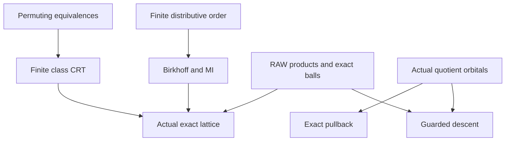

# Exact CRT, finite lattice coordinates and guarded quotient descent

Generated from `module.json` by `tools/build_formalization_module.py`.

Source `490c3f36d85db5a0b3ced0598e6c431825254ec5`. **Human-expanded proof plan; no Lean code.**

Preparation for OTHER Lean projects: five source results and two auxiliary equations. Abstract commuting-equivalence CRT and finite order arguments are separate from the actual CCO exact instance and guarded typed descent. No Lean code.

The human article remains unchanged. Additional proof details are in
[PROOF_NOTES.md](PROOF_NOTES.md); the cross-track policy is in
[the formalization guide](../README.md). Source hashes are checked before
the index is regenerated. Graph validation is not proof verification.

## Source premises

**A01: Abstract represented equivalences.** Inhabited X and a sublattice of actual equivalences with pairwise represented commutation. Only finite families are considered; no ambient Id/Top membership, action, finiteness, SAP or CCO assumption.

**A02: Finite distributive order setting.** Finite inhabited distributive lattice for Birkhoff and source MI lemma. The finite-list MI argument itself uses only distributivity. No CCO, group action or exactness.

**A03: Original one-sort source.** Actual inhabited transitive homogeneous finite complete symmetric binary CCO source, original logical identity and represented RAW products. Exact equivalences are only a sublattice of the full invariant lattice. No SAP or Hasse input.

**A04: Typed original source.** Actual homogeneous source with finitely many named inhabited individually transitive sorts, finite binary palettes, symmetric same-sort orbitals and cross-sort converse. Use the explicit full RAW exact provider; no SAP, NR2 or mixed-sort commutation.

## Imported theorem contracts

These are named provider obligations for the receiving Lean project,
not new axioms or claims of compiled imports.

| ID and source | Contract | Current provider status |
|---|---|---|
| I01: [`lem:exact-product`](../../sections/exact_foundations/01_full_raw_exact_helly.tex#L284) | Original RAW exact product closure and distribution over finite exact intersections with NONEMPTY RESULT. Same-sort actual composition, not STRONG multiplication. | HUMAN_EXPANDED_NOT_LEAN |
| I02: [`lem:exact-balls`](../../sections/exact_foundations/01_full_raw_exact_helly.tex#L311) | Original same-sort different-centre finite exact-ball Helly, including equality-bearing exact equivalence balls. | HUMAN_EXPANDED_NOT_LEAN |
| I03: [`lem:exact-quotient-colour-meet`](../../sections/exact_foundations/02_exact_quotient_orbital_geometry.tex#L12) | For actual exact quotient kernels, the fine orbital block at the meet is the intersection of their coarse orbital blocks; equality atoms retained. | HUMAN_EXPANDED_NOT_LEAN |
| I04: [`thm:full-typed-exact-balls`](../../sections/exact_foundations/01_full_raw_exact_helly.tex#L27) | Full typed equality-inclusive exact convolution, nonempty-result meet distributivity and serial/Top laws; no mixed-sort commutation is part of the contract. | HUMAN_EXPANDED_NOT_LEAN |

## Definitions

| ID | Definition | Exact meaning | Source |
|---|---|---|---|
| D01 | Permuting equivalence sublattice | An inhabited X with a sublattice of actual equivalences closed under ambient binary meet/join; every pair permutes. Neither X nor the sublattice need be finite; ambient Id/Top need not belong. | [source](../../sections/exact_lattice_crt.tex#L7) |
| D02 | Finite class Helly | Every finite pairwise-intersecting family E_i[x_i] intersects. Repeated relations and centres are allowed; empty family means X. | [source](../../sections/exact_lattice_crt.tex#L12) |
| D03 | Finite compatible tuple CRT | For a finite nonempty list E_i, kernel K=meet E_i; tuples of X/E_i agree in each X/(E_i join E_j). The natural map from X/K is the object studied. | [source](../../sections/exact_lattice_crt.tex#L14) |
| D04 | Actual exact invariant lattice | All equality-inclusive word-exact invariant equivalences of the original one-sort finite symmetric CCO source; distinct from the full invariant lattice. | [source](../../sections/exact_lattice_crt.tex#L54) |
| D05 | Finite Birkhoff poset | For a finite inhabited distributive lattice Lambda, P consists of NONZERO join-irreducibles with inherited order; Down(P) is its downset lattice. | [source](../../sections/exact_lattice_crt.tex#L56) |
| D06 | Selected MI coordinates | A finite nonempty list J_i in a distributive lattice, K=meet J_i, and meet-irreducible L>=K. Properness of actual quotient coordinate L is separate; selected J_i need not themselves be MI. | [source](../../sections/exact_lattice_crt.tex#L70) |
| D07 | Actual quotients and two-factor fibre product | Actual quotients of equivalences on a common inhabited carrier. For E,J let K=E meet J and Q=E join J; use the natural maps X/E -> X/Q and X/J -> X/Q. Commutation is a separate premise of the two-factor bijection. | [source](../../sections/exact_gluing_geometry.tex#L2) |
| D08 | Same-sort saturated source relation | Actual exact equivalence J and nonempty invariant exact Q>=J with J;Q;J=Q. Preserve the source containment hypothesis; never use it alone as a saturation proof for a general relation. | [source](../../sections/exact_gluing_geometry.tex#L27) |
| D09 | Typed original kernels and actual quotient colours | Named original transitive sorts and full RAW exact invariant kernels E_s on every visited sort. Name all actual quotient pair orbitals of the original group action. | [source](../../sections/exact_gluing_geometry.tex#L56) |
| D10 | Presentation-local intertwining | Nonempty full exact D:s->t satisfies E_s;D;E_t=D and has a finite word presentation in which every occurring atom a:u->v obeys E_u;a=a;E_v. Empty restriction list means Top. | [source](../../sections/exact_gluing_geometry.tex#L62) |

## Proof claims and direct dependencies

Every row has a human proof expansion. Each still needs an actual Lean
statement and proof. Set-level CRT, fine-colour readout and descent are distinct exports; no ambient automorphism lift or full-lattice distributivity is inferred.

| ID and claim | Scope | Direct providers | Proof note |
|---|---|---|---|
| C01: Join/product and class compatibility | abstract_crt | D01 | N01 in [notes](PROOF_NOTES.md) |
| C02: Three-class Helly implies distributivity | abstract_crt | C01, D02 | N02 in [notes](PROOF_NOTES.md) |
| C03: Distributivity implies finite class Helly | abstract_crt | C01, D02 | N02 in [notes](PROOF_NOTES.md) |
| C04: Natural coordinate map and exact kernel | abstract_crt | D03, C01 | N03 in [notes](PROOF_NOTES.md) |
| C05: Compatibility is pairwise class intersection | abstract_crt | C01, D03 | N03 in [notes](PROOF_NOTES.md) |
| C06: Helly gives finite CRT surjectivity | abstract_crt | C04, C05 | N03 in [notes](PROOF_NOTES.md) |
| C07: Finite CRT gives class Helly | abstract_crt | C05, A01 | N03 in [notes](PROOF_NOTES.md) |
| C08: Nonzero join-irreducibles are join-prime | finite_order | D05 | N04 in [notes](PROOF_NOTES.md) |
| C09: Finite join-irreducible decomposition | finite_order | D05 | N04 in [notes](PROOF_NOTES.md) |
| C10: Birkhoff downset isomorphism | finite_order | C08, C09 | N04 in [notes](PROOF_NOTES.md) |
| C11: Exact equivalences form a finite bounded sublattice | original_exact | D04, I01 | N05 in [notes](PROOF_NOTES.md) |
| C12: Class Helly from exact balls | original_exact | D04, I02 | N05 in [notes](PROOF_NOTES.md) |
| C13: Actual exact distributivity and finite CRT | original_exact | C02, C03, C04, C06, C11, C12 | N05 in [notes](PROOF_NOTES.md) |
| C14: Actual exact Birkhoff representation | original_exact | C10, C13 | N05 in [notes](PROOF_NOTES.md) |
| C15: Finite selected-MI cofinality | finite_order | D06 | N06 in [notes](PROOF_NOTES.md) |
| C16: Upward quotient-coordinate image | abstract_crt | C15, D07 | N06 in [notes](PROOF_NOTES.md) |
| C17: Two-factor fibre-product set bijection | abstract_crt | C01, C04, D07 | N07 in [notes](PROOF_NOTES.md) |
| C18: Separate two-factor fine-colour readout | original_exact | D04, I03 | N07 in [notes](PROOF_NOTES.md) |
| C19: Actual typed orbital blocks and composition pullback | typed_pullback | D09 | N08 in [notes](PROOF_NOTES.md) |
| C20: Full exact quotient pullback without intertwining | typed_pullback | C19, I04 | N08 in [notes](PROOF_NOTES.md) |
| C21: Same-sort projected word identity | same_descent | D08, C19 | N09 in [notes](PROOF_NOTES.md) |
| C22: Same-sort exact descent | same_descent | C21, I01 | N09 in [notes](PROOF_NOTES.md) |
| C23: Intertwining removes intermediate kernels | typed_descent | D10, C19 | N10 in [notes](PROOF_NOTES.md) |
| C24: Typed exact descent from a TI presentation | typed_descent | C23, I04 | N10 in [notes](PROOF_NOTES.md) |

The precise quantified contracts are in `module.json`. Provider-before-consumer
order (including definitions and source premises):

`A01 → A02 → A03 → A04 → D07 → I01 → I02 → I03 → I04 → D01 → D04 → D05 → D06 → D08 → D09 → C01 → C08 → C09 → C11 → C12 → C15 → C18 → C19 → D02 → D03 → D10 → C02 → C03 → C04 → C05 → C10 → C16 → C20 → C21 → C23 → C06 → C07 → C17 → C22 → C24 → C13 → C14`

This order is one valid linearization; it does not require unrelated
branches to be proved sequentially. The full DAG is the `depends_on`
relation in `module.json`.

## Main proof branches

This is a coarse view of the claim DAG. Edges go from provider to consumer.

Two-factor set reconstruction needs only commutation; fine-colour recovery has a separate RAW provider.
No Hasse/parity or selector provider is used. Typed descent requires intertwining only in the chosen presentation; pullback does not.

## Article exports

| Existing source result | Sidecar proof claims |
|---|---|
| [`thm:abstract-exact-crt`](../../sections/exact_lattice_crt.tex#L5) | C01, C02, C03, C04, C05, C06, C07 |
| [`lem:acf-exact-distributive`](../../sections/exact_lattice_crt.tex#L52) | C11, C12, C13, C14 |
| [`lem:foundational-MI-coordinate-cofinal`](../../sections/exact_lattice_crt.tex#L68) | C15, C16 |
| [`lem:exact-descent`](../../sections/exact_gluing_geometry.tex#L25) | C20, C21, C22 |
| [`lem:typed-intertwining-exact-descent`](../../sections/exact_gluing_geometry.tex#L53) | C19, C20, C23, C24 |

Auxiliary source equations (not additional numbered results):

- [`eq:fibreproduct`](../../sections/exact_gluing_geometry.tex#L7): C17
- [`eq:colour-meet`](../../sections/exact_gluing_geometry.tex#L15): C18

## Internal implementation milestones

These tasks are proof milestones inside larger project assignments;
see the [peer-project allocation](../coordination/BOARD.md).

These are implementation tasks, not additional mathematical assumptions.

| Task | Earlier tasks | Acceptance |
|---|---|---|
| T01: Abstract finite CRT | — | Prove permuting-equivalence compatibility, Helly/distributivity equivalence, the finite tuple map and two-factor bijection without model-theoretic hypotheses. |
| T02: Finite order representation and MI | — | Prove or reuse an exact finite Birkhoff contract; retain nonzero join-irreducibles and nonempty MI coordinate lists, then actual quotient maps. |
| T03: Actual exact-lattice and colour instance | T01, T02 | Use distinct RAW products, exact-ball Helly and colour-readout imports; do not conflate the set CRT with pair-colour reconstruction. |
| T04: Actual quotient blocks and pullback | — | Prove original-action block inverse images and word/exact pullback, preserving intermediate kernels and quotient identity. |
| T05: Same-sort and guarded typed descent | T04 | Prove same-sort commutation and presentation-local typed intertwining routes; keep explicit endpoint saturation and empty-word/restriction cases. |

## Finite controls

- **R01.** All equivalence pairs on a four-point set: two-factor compatibility surjectivity exactly tracks represented commutation.
- **R02.** Boolean coordinate CRT succeeds; F2² full M3 lattice defeats commutation-only CRT; a distributive noncommuting diamond defeats distributivity-only CRT.
- **R03.** Finite downset lattices: Birkhoff inverse maps and MI meet-primality, including the one-element lattice and empty-poset case.
- **R04.** Actual typed F2 source: endpoint saturation alone does not justify factorwise word projection; TI examples and quotient pullback retain their precise scope.
- **R05.** Nontrivial kernels distinguish quotient equality from real Id, empty-family ambient Top from a sublattice top, and containment from saturation of arbitrary relations.

Run `python tools/check_exact_crt_controls.py` from the manuscript directory.
The controls do not prove CCO or the general theorems.

## Return to the human articles

No required mathematical repair was found in this scoped pass. These
optional wording clarifications remain queued for a human article pass:

- **F01** ([source](../../sections/exact_lattice_crt.tex#L7)): The abstract sublattice need not contain ambient Id/Top; CRT families are nonempty and finite. Optionally spell out binary-sublattice and finite-family conventions.
- **F02** ([source](../../sections/exact_lattice_crt.tex#L56)): Birkhoff uses nonzero join-irreducibles, not necessarily atoms; source MI coordinates are a different notion. Keep the internal proof in preparation; name the poset when a human exposition needs it.
- **F03** ([source](../../sections/exact_gluing_geometry.tex#L27)): Q>=J does not replace explicit saturation for a general relation. The proof only needs nonempty exact saturated Q, but the source export retains containment. Optionally state the weaker general premise later; no required theorem repair.
- **F04** ([source](../../sections/exact_gluing_geometry.tex#L62)): Intertwining is local to a chosen presentation and each visited sort needs its own kernel. Endpoint saturation alone does not give the factorwise word identity. Retain the sufficient-criterion qualification; keep the diagnostic typed model in proof notes.

The machine ledger records caller effects and affected claims. The source
review used two independent model review passes and parent synthesis;
it is not independent human or formal certification.
