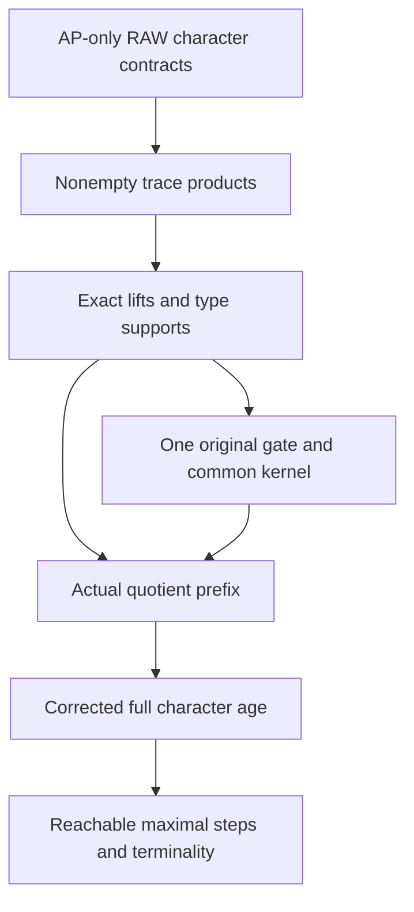

# Exact trace geometry, canonical old gates and AP-only quotient safe towers

Generated from `module.json` by `tools/build_formalization_module.py`.

Source `490c3f36d85db5a0b3ced0598e6c431825254ec5`. **Human-expanded proof plan; no Lean code.**

Private B062: all EIGHT exact-trace-geometry source results, THIRTEEN auxiliary equations, fourteen definitions, 112 expanded human claims and twelve implementation tasks. Actual AP+HOM CCO full-character towers preserve nonempty RAW exact trace products, exact-equivalence lifts and finite type supports. Connected steps have ONE canonical ORIGINAL gate; their meet is the largest exact label kernel. Every original exact quotient carries the genuine full admissible safe tower, with precisely the E-not-below-G steps discarded, objectwise character correction on retained occupancy graphs, full finite-age converse, reachable maximal projected gates and terminality. No quotient SAP, arbitrary mixed reverse exact descent, or EP inherited from an arbitrary quotient is assumed. One required RAW-provider citation correction is exposed; no formula or hypothesis is changed.

The human article remains unchanged. Additional proof details are in
[PROOF_NOTES.md](PROOF_NOTES.md); the cross-track policy is in
[the formalization guide](../README.md). Source hashes are checked before
the index is regenerated. Graph validation is not proof verification.

## Source premises

**A01: One original actual symmetric AP+HOM CCO source.** M is a nonempty countable transitive homogeneous source in a finite complete named symmetric binary language of actual orbitals. Its age has ordinary AP and semantic HOM simple-cycle CCO. Every invariant old relation is a finite orbital union; logical identity is included in RAW products and is never a diversity edge. No SAP is imposed.

**A02: Specified genuine finite safe tower.** Choose a finite succession of the ACTUAL maximal-exact-complement FULL connected rigid-groupoid character constructions of the AP-only provider. Each prefix is its genuine homogeneous marked-age limit, identified over its old reduct by reasonableness. All allowed finite markings, not an arbitrary single seed marking or one selected orbit, are retained. Active masks/gates and inactive fixed labels are the actual provider construction.

**A03: Optional terminal starting tower.** ONLY for the last terminality implication, every strict cover in the FULL invariant-equivalence lattice on each final nonempty parent sort has infinite relative index. This concerns all invariant equivalences, not only exact ones.

**A04: Bound original exact quotient kernel.** For the quotient theorem choose any ORIGINAL full exact invariant equivalence E, including Id or Top. Quotient points are actual E-classes and quotient atoms are their actual saturated original orbital blocks. No SAP, section of automorphism groups, or arbitrary mixed reverse exact descent is supplied by this parameter.

**A05: Optional nonidentity kernel for strict rank.** ONLY for the auxiliary diversity-rank observation assume E>Id on the original carrier. This is not required for the quotient-tower theorem.

## Imported theorem contracts

These are named provider obligations for the receiving Lean project,
not new axioms or claims of compiled imports.

| ID and source | Contract | Current provider status |
|---|---|---|
| I01: [`thm:full-typed-exact-balls`](../../sections/exact_foundations/01_full_raw_exact_helly.tex#L27) | The equality-inclusive RAW exact calculus closes nonempty exact domains under represented convolution and distributes exact factors over finite exact meets with NONEMPTY evaluation. In particular E;D;E=intersection_r E;P_r;E for a nonempty exact presentation D=intersection_r P_r. This is the required AP-only RAW provider, not the STRONG-only lemma sharing an old saturation citation. | HUMAN_EXPANDED_NOT_LEAN |
| I02: [`lem:ep-ap-TP`](../../sections/ep_safe_ap_character_completion.tex#L101) | For the genuine AP-only full-character step, actual allowed atomic forks satisfy (T), and nonempty old exact profile intersections satisfy mask primality (P). Logical identity outputs and relative-K closures are handled by the proved provider; no SAP saturation is used. | HUMAN_EXPANDED_NOT_LEAN |
| I03: [`thm:ep-ap-marked-completion`](../../sections/ep_safe_ap_character_completion.tex#L376) | An ACTUAL old finite complete object has legal pair masks iff its bits extend to a global character marking. Reasonableness lifts the SAME embedding. Its genuine marked Fraisse age is homogeneous with unchanged old reduct and HOM CCO. An arbitrary global seed marking is not itself assumed homogeneous. | HUMAN_EXPANDED_NOT_LEAN |
| I04: [`cor:ep-ap-safe-splitting`](../../sections/ep_safe_ap_character_completion.tex#L654) | The actual AP-only maximal-character split exists for a finite relative interval; its marked AP/JEP/HOM CCO iteration terminates. This binds the specified safe tower construction at every actual prefix without assuming SAP of exact quotients. | HUMAN_EXPANDED_NOT_LEAN |
| I05: [`prop:lattice-interface`](../../sections/ramsey_preferred_support.tex#L90) | In the independent finite symmetric original-sort setting, invariant equivalences form a finite FULL lattice with actual intersection and represented commuting product as join. This independent branch assumes no clones, SAP or CCO; its source parameters are discharged by A01 or each actual prefix sort. | HUMAN_EXPANDED_NOT_LEAN |
| I06: [`lem:ep-ap-orbital-parity`](../../sections/finite_relative_parity_exact_closure.tex#L18) | Actual symmetric orbital walk powers stabilize; a finite-index-separated atom has nonempty exact even/odd profiles Y,O with X=Y union O and [X:Y]=2. X need not be exact. Products include the logical diagonal; no extra identity-coloured diversity edges occur. | HUMAN_EXPANDED_NOT_LEAN |
| I07: [`thm:foundational-maximal-parity-gate`](../../sections/finite_relative_parity_exact_closure.tex#L147) | For a maximal full exact complement K of a reachable Y<X of index two, the WHOLE selected odd K-quotient involution t lies in every full exact equivalence strictly above K. Its real relation need not be functional; only t/K is. Quotient word inverse images are full exact. | HUMAN_EXPANDED_NOT_LEAN |
| I08: [`thm:foundational-rigid-character`](../../sections/rigid_exact_groupoid_foundations.tex#L298) | The actual connected rigid quotient groupoid is free. Rigid arrows are whole quotient orbitals, every other orbital joins different free-action orbits, and the full character sends the selected odd involution to one. No preferred seed or generic higher-owner action is provided. | HUMAN_EXPANDED_NOT_LEAN |
| I09: [`lem:foundational-finite-phase-extension`](../../sections/rigid_exact_groupoid_foundations.tex#L348) | On finitely many ACTUAL groupoid quotient points, prescribed bits extend to ONE global marking iff all same-action-orbit pair differences equal the character. Duplicate quotient points must receive the same bit; independent action orbits have independent seeds. | HUMAN_EXPANDED_NOT_LEAN |
| I10: [`lem:typed-simultaneous-blocks`](../../sections/simultaneous_typed_exact_quotients.tex#L38) | Actual quotient atoms pull back to nonempty exact saturated orbital blocks. Pullback preserves converse, intersections and compatible RAW composition; quotient equality pulls back to the WHOLE kernel. Quotient exact words pull back exact, including empty-word kernel rather than old Id. No arbitrary mixed reverse descent is asserted. | HUMAN_EXPANDED_NOT_LEAN |
| I11: [`lem:foundational-rigid-quotient-bridge`](../../sections/rigid_exact_groupoid_foundations.tex#L154) | If exact quotient kernels e_p refine the proposed gate kernels K_p and the projected gate kernels are already proved FULL exact, full exact K-bridges descend and EVERY full exact projected gate bridge pulls back. Correspondence preserves all compatible compositions and inverses. This is precise bridge-specific exact descent, not arbitrary typed saturated word descent; C82 establishes the projected-gate exactness before C83 applies this provider. | HUMAN_EXPANDED_NOT_LEAN |
| I12: [`lem:one-original-sort-exact-descent`](../../sections/simultaneous_typed_exact_quotients.tex#L141) | A nonempty E-bisaturated full exact relation in ONE ORIGINAL SYMMETRIC sort descends to a quotient full exact relation; exact equivalences containing E do so in particular. The proof uses original one-sort commutation, and is not a theorem for independently quotiented original sorts. | HUMAN_EXPANDED_NOT_LEAN |
| I13: [`thm:typed-simultaneous-exact-quotients`](../../sections/simultaneous_typed_exact_quotients.tex#L312) | For a homogeneous finite NAMED-SORTED actual AP+HOM CCO source with independently chosen nonempty full exact kernels, the simultaneously interpreted typed quotients have actual finite orbital language, triangle fullness, countable joint homogeneity/AP/JEP and semantic HOM CCO. This is applied to the NEW many-parent prefix M_j, not the older ONE_ORIGINAL_SORT exact-sorts-source theorem. No quotient SAP, group section or arbitrary mixed reverse exact descent is supplied. | HUMAN_EXPANDED_NOT_LEAN |

## Definitions

| ID | Definition | Exact meaning | Source |
|---|---|---|---|
| D01 | RAW exact domains | An exact domain is a finite intersection of reachable RAW endpoint profiles with nonempty evaluation; empty restriction list is typed Top and empty word is logical Id. Products use actual existential witnesses with compatible named endpoints. | [source](../../sections/expansion_property_exact_geometry.tex#L31) |
| D02 | Genuine safe prefix | M_j is the actual homogeneous output of the preceding full-character stages, with all current unary types and the original old atom names retained. | [source](../../sections/expansion_property_exact_geometry.tex#L25) |
| D03 | Literal trace | tr_uv(D)=D intersect (u x v) as a real relation; its represented composition quantifies its middle point inside the DISPLAYED current sort v. | [source](../../sections/expansion_property_exact_geometry.tex#L62) |
| D04 | Actual mask contracts | A_uv is the allowed old atomic mask. (T) is lifted fork totality, (P) nonempty-profile primality, and (R) actual old-age pair/triangle realization with coherent marks. | [source](../../sections/expansion_property_exact_geometry.tex#L38) |
| D05 | Exact restriction map | rho_p sends each original full exact equivalence H to H restricted to p squared, on the actual nonempty current sort. | [source](../../sections/expansion_property_exact_geometry.tex#L150) |
| D06 | Largest original exact lift | L_p(F) is the finite join of ALL original exact-equivalence lifts having trace F; it is not an arbitrary old predecessor. | [source](../../sections/expansion_property_exact_geometry.tex#L186) |
| D07 | Original orbital parity | For original bipartite c, Y_c,O_c are the stable even/odd RAW walk profiles and X_c=Y_c union O_c has index two over Y_c; X_c need not be exact. | [source](../../sections/expansion_property_exact_geometry.tex#L208) |
| D08 | Finite type support | Phi_j(D) relates actual prefix types s,t iff some actual x in s,y in t satisfy old D. For Id it is literal type identity; a diversity loop uses DISTINCT points. | [source](../../sections/expansion_property_exact_geometry.tex#L243) |
| D09 | One connected old gate | G_i is the common canonical largest ORIGINAL exact lift of the active current gates in one connected full-character step. | [source](../../sections/expansion_property_exact_geometry.tex#L292) |
| D10 | Common exact label kernel | Kcom is the intersection of the finitely many original step gates G_i, with Top for no steps. | [source](../../sections/expansion_property_exact_geometry.tex#L338) |
| D11 | Exact quotient occupancy | An E-class is labelled by the Phi_j(E)-class of precisely the prefix unary types it meets; the current quotient label set is T_j/Phi_j(E). | [source](../../sections/expansion_property_exact_geometry.tex#L368) |
| D12 | Objectwise phase correction | For occupancy C choose p_C; the whole identity G-bridge I_pq has character cocycle. gamma_p=chi(I_pC,p), and zeta(X)=bit(x)+gamma_p for x in X intersect p. | [source](../../sections/expansion_property_exact_geometry.tex#L470) |
| D13 | Full finite quotient age | Every pair-locally allowed new marked quotient diagram whose old PREFIX diagram is legal is realized in the actual new homogeneous quotient prefix, not only in one chosen global seed marking. | [source](../../sections/expansion_property_exact_geometry.tex#L554) |
| D14 | Original diversity rank | Count original diversity orbitals before choosing any safe labels. A nonidentity exact quotient merges at least one old diversity orbital into equality and splits no old orbital. | [source](../../sections/expansion_property_exact_geometry.tex#L716) |

## Proof claims and direct dependencies

Every row has a human proof expansion. Each still needs an actual Lean
One ORIGINAL symmetric transitive source supplies commutation of all old invariant relations. Prefix sorts and quotient occupancy sorts are actual homogeneous named carriers. Products are equality-inclusive RAW represented relations; middle trace sorts are literal and both input traces are nonempty.

| ID and claim | Scope | Direct providers | Proof note |
|---|---|---|---|
| C01: Actual step contracts are provided in AP-only semantics | trace | A01, A02, I02, I03, I04, D01, D02, D04 | N01 in [notes](PROOF_NOTES.md) |
| C02: Old symmetry supplies represented commutation | lift | A01, I05 | N01 in [notes](PROOF_NOTES.md) |
| C03: Every finite prefix is an actual allowed homogeneous source | trace | C01, I03, I04 | N01 in [notes](PROOF_NOTES.md) |
| C04: Set traces retain their literal types | trace | C03, D03 | N02 in [notes](PROOF_NOTES.md) |
| C05: Actual complete pair and triangle legality includes equality cases | trace | C01, C04, I03 | N02 in [notes](PROOF_NOTES.md) |
| C06: Nonempty exact presentations and Top are fixed | trace | C01, I01, D01, D03 | N02 in [notes](PROOF_NOTES.md) |
| C07: Flatten the presentations of all input domains | trace | C06 | N02 in [notes](PROOF_NOTES.md) |
| C08: Every flattened constituent meets the same allowed mask | trace | C04, C07 | N02 in [notes](PROOF_NOTES.md) |
| C09: Mask primality gives a common traced atom | trace | I02, C05, C07, C08 | N02 in [notes](PROOF_NOTES.md) |
| C10: Nonempty exact-meet trace source export | trace | C07, C08, C09 | N02 in [notes](PROOF_NOTES.md) |
| C11: Trace-product forward containment | trace | D03 | N03 in [notes](PROOF_NOTES.md) |
| C12: Fix an actual allowed endpoint orbital | trace | C04, C06 | N03 in [notes](PROOF_NOTES.md) |
| C13: First Peirce intersection is nonempty | trace | C12, I01 | N03 in [notes](PROOF_NOTES.md) |
| C14: The first auxiliary exact factor meets the required mask | trace | C01, C12, C13, I02 | N03 in [notes](PROOF_NOTES.md) |
| C15: First primality chooses a with its correct phase | trace | C10, C13, C14 | N03 in [notes](PROOF_NOTES.md) |
| C16: The second Peirce intersection remains nonempty | trace | C15, I01 | N03 in [notes](PROOF_NOTES.md) |
| C17: The second factor meets the other required mask | trace | C01, C12, C15, C16, I02 | N03 in [notes](PROOF_NOTES.md) |
| C18: Second primality chooses b with its correct phase | trace | C10, C16, C17 | N03 in [notes](PROOF_NOTES.md) |
| C19: The chosen old triple is an actual old diagram | trace | C05, C15, C18 | N03 in [notes](PROOF_NOTES.md) |
| C20: Actual marking legality realizes this labelled triangle | trace | C01, C19, I03 | N03 in [notes](PROOF_NOTES.md) |
| C21: Homogeneity aligns the complete endpoint pair | trace | C03, C05, C12, C20 | N03 in [notes](PROOF_NOTES.md) |
| C22: Actual exact trace-product source export | trace | C11, C21 | N03 in [notes](PROOF_NOTES.md) |
| C23: Choose a realized old word and read its prefix types | lift | C03, C04, D01 | N04 in [notes](PROOF_NOTES.md) |
| C24: A nonempty old word trace is one current word profile | lift | C22, C23 | N04 in [notes](PROOF_NOTES.md) |
| C25: Old nonempty exact traces are current exact | lift | C06, C24 | N04 in [notes](PROOF_NOTES.md) |
| C26: Forgetting a current word gives an original profile | lift | C22, C24 | N04 in [notes](PROOF_NOTES.md) |
| C27: Every current exact domain has an original exact lift | lift | C25, C26 | N04 in [notes](PROOF_NOTES.md) |
| C28: The same assertions iterate across arbitrary prefixes | lift | C22, C25, C27 | N04 in [notes](PROOF_NOTES.md) |
| C29: Exact-equivalence restriction preserves meets and bounds | lift | C04, C25, I05, D05 | N04 in [notes](PROOF_NOTES.md) |
| C30: Exact-equivalence joins commute with restriction | lift | C02, C28, C29, I05 | N04 in [notes](PROOF_NOTES.md) |
| C31: A lift of a current exact equivalence contains original Id | lift | C02, C27, C28 | N04 in [notes](PROOF_NOTES.md) |
| C32: Stable powers produce an old exact equivalence with the same trace | lift | C02, C28, C31, I01 | N04 in [notes](PROOF_NOTES.md) |
| C33: Exact-domain and equivalence trace-surjectivity source export | lift | C25, C27, C28, C29, C30, C32 | N04 in [notes](PROOF_NOTES.md) |
| C34: The full fiber join is the largest exact lift | lift | C30, C33, D06 | N04 in [notes](PROOF_NOTES.md) |
| C35: Largest-lift adjunction is proved in both directions | lift | C30, C34 | N04 in [notes](PROOF_NOTES.md) |
| C36: The right adjoint preserves all finite meets | lift | C35, I05 | N04 in [notes](PROOF_NOTES.md) |
| C37: The canonical lift uses only exact-equivalence data | lift | C34, C35, C36 | N04 in [notes](PROOF_NOTES.md) |
| C38: All restricted pivot powers are nonempty | parity | C03, C28 | N05 in [notes](PROOF_NOTES.md) |
| C39: An originally nonbipartite atom cannot become a current pivot | parity | C28, C38 | N05 in [notes](PROOF_NOTES.md) |
| C40: All even odd and connectivity relations are literal traces | parity | C28, C38, C39, I06, D07 | N05 in [notes](PROOF_NOTES.md) |
| C41: The canonical lifted gate contains original even parity | gate | C35, C40 | N05 in [notes](PROOF_NOTES.md) |
| C42: The lifted gate is an original complement | gate | C40, C41, I06 | N05 in [notes](PROOF_NOTES.md) |
| C43: Original pivot and maximal-gate source export | gate | C35, C39, C40, C41, C42, I07 | N05 in [notes](PROOF_NOTES.md) |
| C44: Type support preserves union converse and identity | type_support | C03, D08 | N06 in [notes](PROOF_NOTES.md) |
| C45: Type support preserves represented composition | type_support | C03, C44 | N06 in [notes](PROOF_NOTES.md) |
| C46: Equivalence type images are equivalences | type_support | C44, C45 | N06 in [notes](PROOF_NOTES.md) |
| C47: Nonempty old exact intersections commute with type support | type_support | C10, C28, C44 | N06 in [notes](PROOF_NOTES.md) |
| C48: Exact-equivalence type meets always satisfy the guard | type_support | C29, C47 | N06 in [notes](PROOF_NOTES.md) |
| C49: Every actual class has its complete occupancy class | type_support | C03, C46 | N06 in [notes](PROOF_NOTES.md) |
| C50: Finite support and occupancy source export | type_support | C44, C45, C46, C47, C48, C49 | N06 in [notes](PROOF_NOTES.md) |
| C51: Lift a current full exact bridge to original exact D | gate | C02, C33 | N07 in [notes](PROOF_NOTES.md) |
| C52: The old square has current kernel trace and contains Id | gate | C02, C28, C51 | N07 in [notes](PROOF_NOTES.md) |
| C53: Its stable exact equivalence closure lies below G_p | gate | C28, C32, C34, C52 | N07 in [notes](PROOF_NOTES.md) |
| C54: Saturating D produces a whole old G_p correspondence | gate | C02, C53, I01 | N07 in [notes](PROOF_NOTES.md) |
| C55: The same old gate lifts the target current kernel | gate | C28, C54 | N07 in [notes](PROOF_NOTES.md) |
| C56: Canonical old gates agree throughout the connected component | gate | C34, C55 | N07 in [notes](PROOF_NOTES.md) |
| C57: All and only nonempty old G correspondences trace to full bridges | gate | C28, C33, C54, C56, I08 | N07 in [notes](PROOF_NOTES.md) |
| C58: One original gate per connected step source export | gate | C51, C52, C53, C54, C55, C56, C57 | N07 in [notes](PROOF_NOTES.md) |
| C59: The finite common old gate meet is exact | gate | C58, I01, D10 | N08 in [notes](PROOF_NOTES.md) |
| C60: The common kernel preserves every prefix label | gate | C28, C58, C59 | N08 in [notes](PROOF_NOTES.md) |
| C61: A final label-preserving exact E preserves every prefix | gate | A02 | N08 in [notes](PROOF_NOTES.md) |
| C62: Such E restricts below each active phase gate | gate | C29, C30, C61, I07 | N08 in [notes](PROOF_NOTES.md) |
| C63: The adjunction proves largest original label kernel | gate | C35, C59, C60, C62 | N08 in [notes](PROOF_NOTES.md) |
| C64: Common-kernel and type-meet source export | gate | C48, C59, C60, C63 | N08 in [notes](PROOF_NOTES.md) |
| C65: Bind the actual exact quotient and stage induction | quotient | A04, C03, C50, D11 | N09 in [notes](PROOF_NOTES.md) |
| C66: Representative parent sorts cover every occupancy object | quotient | C49, C65 | N09 in [notes](PROOF_NOTES.md) |
| C67: Joint exact quotients supply the actual current source | quotient | C03, C33, C66, I13 | N09 in [notes](PROOF_NOTES.md) |
| C68: Saturated actual orbital traces obey E7 | quotient | C28, C66, C67, I10 | N09 in [notes](PROOF_NOTES.md) |
| C69: Original quotient atoms plus occupancy labels are complete | quotient | C66, C68, I10 | N09 in [notes](PROOF_NOTES.md) |
| C70: Reverse exact descent has its precise one-sort scope | quotient | C02, A04, I01, I10, I12 | N09 in [notes](PROOF_NOTES.md) |
| C71: Use only the earlier quotient prefix when taking a trace | quotient | C65, C67, C69, C70 | N09 in [notes](PROOF_NOTES.md) |
| C72: Logical quotient identities retain their whole kernels | quotient | C66, C68, I10, D12, C58 | N09 in [notes](PROOF_NOTES.md) |
| C73: A discarded step is nonrefining on every active parent | quotient | A04, C35, C58, C65 | N10 in [notes](PROOF_NOTES.md) |
| C74: Its strict current exact join contains the whole odd relation | quotient | C30, C73, I07 | N10 in [notes](PROOF_NOTES.md) |
| C75: Every individual E-class meets both new children | quotient | C02, C74, I05 | N10 in [notes](PROOF_NOTES.md) |
| C76: Discarded occupancy classes lift once and keep ALL children | quotient | C49, C73, C75 | N10 in [notes](PROOF_NOTES.md) |
| C77: Retained occupancy objects are wholly active or inactive | quotient | A04, C49, C57, C58 | N10 in [notes](PROOF_NOTES.md) |
| C78: Identity G transports are whole current gate bridges | quotient | C28, C49, C57, C77 | N10 in [notes](PROOF_NOTES.md) |
| C79: Choose a coherent objectwise character coboundary | quotient | C78, I08, D12 | N10 in [notes](PROOF_NOTES.md) |
| C80: The adjusted phase is well defined on each actual E-class | quotient | C77, C78, C79 | N10 in [notes](PROOF_NOTES.md) |
| C81: The two retained occupancy classes are exact offset graphs | quotient | C49, C77, C79, C80 | N10 in [notes](PROOF_NOTES.md) |
| C82: Projected gates are exact before using the next step | quotient | C28, C33, C58, C70, C71, C77, I12 | N10 in [notes](PROOF_NOTES.md) |
| C83: The entire projected gate groupoid is obtained bijectively | quotient | C77, C82, I11 | N10 in [notes](PROOF_NOTES.md) |
| C84: Normalize every arrow on the chosen representative objects | quotient | C79, C83 | N11 in [notes](PROOF_NOTES.md) |
| C85: The corrected character is coherent and its gate identities have zero | quotient | C72, C79, C84 | N11 in [notes](PROOF_NOTES.md) |
| C86: No arrows collapse after fixing normalized object endpoints | quotient | C83, C84, C85, I08 | N11 in [notes](PROOF_NOTES.md) |
| C87: Rigid status is compared with this same full groupoid | quotient | C69, C83, C86, I08 | N11 in [notes](PROOF_NOTES.md) |
| C88: Projected local masks are exactly the corrected character rule | quotient | C69, C80, C84, C85, C87 | N11 in [notes](PROOF_NOTES.md) |
| C89: Realize an arbitrary legal unmarked QUOTIENT PREFIX diagram first | quotient | C65, C67, C71, C88 | N11 in [notes](PROOF_NOTES.md) |
| C90: Choose actual real representatives of every quotient vertex | quotient | C49, C66, C79, C89 | N11 in [notes](PROOF_NOTES.md) |
| C91: Every same-orbit seed pair satisfies the actual character equation | quotient | C69, C83, C84, C88, C90, I08 | N11 in [notes](PROOF_NOTES.md) |
| C92: Duplicate gate points define one consistent finite prescription | quotient | C72, C85, C91 | N11 in [notes](PROOF_NOTES.md) |
| C93: One global character marking extends all prescriptions | quotient | C90, C91, C92, I09 | N11 in [notes](PROOF_NOTES.md) |
| C94: Each prescribed projected bit is recovered from that marking | quotient | C77, C79, C80, C90, C93 | N11 in [notes](PROOF_NOTES.md) |
| C95: A finite real witness puts P into the GENUINE marked output age | quotient | C03, C69, C90, C93, C94, I03 | N11 in [notes](PROOF_NOTES.md) |
| C96: The full admissible marked quotient age is proved in both directions | quotient | C88, C89, C90, C91, C92, C93, C94, C95 | N11 in [notes](PROOF_NOTES.md) |
| C97: The projected odd pivot is one actual diversity atom | quotient | C40, C77, C82, I10 | N12 in [notes](PROOF_NOTES.md) |
| C98: Projected walk powers are the corresponding saturated old powers | quotient | C02, C40, C97, I10 | N12 in [notes](PROOF_NOTES.md) |
| C99: Even and odd images stay disjoint with relative index two | quotient | C40, C77, C98, I05, I07 | N12 in [notes](PROOF_NOTES.md) |
| C100: The projected proposed gate is a complement | quotient | C82, C98, C99, I05 | N12 in [notes](PROOF_NOTES.md) |
| C101: Projected complement maximality follows by exact pullback | quotient | C99, C100, I07, I10 | N12 in [notes](PROOF_NOTES.md) |
| C102: The proposed original quotient gate is the LARGEST old lift | quotient | C34, C58, C70, C71, C82, I10 | N12 in [notes](PROOF_NOTES.md) |
| C103: Retained steps are genuine safe steps and the induction closes | quotient | C65, C71, C76, C81, C82, C83, C84, C85, C86, C87, C88, C96, C97, C98, C99, C100, C101, C102 | N12 in [notes](PROOF_NOTES.md) |
| C104: Terminality pulls back ALL invariant finite intervals | quotient | A03, C66, C103 | N12 in [notes](PROOF_NOTES.md) |
| C105: Exact quotient-tower source export | quotient | C65, C66, C67, C68, C69, C70, C71, C72, C73, C74, C75, C76, C77, C78, C79, C80, C81, C82, C83, C84, C85, C86, C87, C88, C89, C90, C91, C92, C93, C94, C95, C96, C97, C98, C99, C100, C101, C102, C103, C104 | N12 in [notes](PROOF_NOTES.md) |
| C106: A nonidentity original exact kernel absorbs a diversity orbital | rank | A01, A05, I10, D14 | N13 in [notes](PROOF_NOTES.md) |
| C107: Old orbital blocks cannot split into finer quotient orbitals | rank | C106, I10 | N13 in [notes](PROOF_NOTES.md) |
| C108: The strict rank is ORIGINAL diversity count | rank | C107 | N13 in [notes](PROOF_NOTES.md) |
| C109: Both nonempty trace inputs are necessary | boundary | D03 | N13 in [notes](PROOF_NOTES.md) |
| C110: Finite type support does not preserve disjoint atomic meets | boundary | C47, D08 | N13 in [notes](PROOF_NOTES.md) |
| C111: Kernel and descent scope shortcuts remain forbidden | boundary | C70, C72, C83 | N13 in [notes](PROOF_NOTES.md) |
| C112: Finite controls test interfaces rather than unbounded theorems | boundary | C22, C33, C43, C50, C58, C64, C105, C109, C110, C111 | N13 in [notes](PROOF_NOTES.md) |

The precise quantified contracts are in `module.json`. Provider-before-consumer
order (including definitions and source premises):

`A01 → A02 → A03 → A04 → D01 → D02 → D03 → D04 → D05 → D06 → D07 → D08 → D09 → D10 → D11 → D12 → D13 → D14 → I01 → I02 → I03 → I04 → I05 → I06 → I07 → I08 → I09 → I10 → I11 → I12 → I13 → A05 → C01 → C02 → C109 → C11 → C61 → C03 → C06 → C106 → C70 → C04 → C07 → C107 → C44 → C05 → C08 → C108 → C12 → C23 → C45 → C09 → C13 → C46 → C10 → C14 → C49 → C15 → C16 → C17 → C18 → C19 → C20 → C21 → C22 → C24 → C25 → C26 → C27 → C29 → C28 → C30 → C31 → C38 → C47 → C110 → C32 → C39 → C48 → C62 → C33 → C40 → C50 → C34 → C51 → C65 → C35 → C52 → C66 → C36 → C41 → C53 → C67 → C37 → C42 → C54 → C68 → C43 → C55 → C69 → C56 → C71 → C57 → C58 → C59 → C72 → C73 → C77 → C60 → C74 → C78 → C82 → C102 → C63 → C75 → C79 → C83 → C97 → C111 → C64 → C76 → C80 → C84 → C98 → C81 → C85 → C99 → C100 → C86 → C101 → C87 → C88 → C89 → C90 → C91 → C92 → C93 → C94 → C95 → C96 → C103 → C104 → C105 → C112`

This order is one valid linearization; it does not require unrelated
branches to be proved sequentially. The full DAG is the `depends_on`
relation in `module.json`.

## Main proof branches

This is a coarse view of the claim DAG. Edges go from provider to consumer.

All exact products are RAW and include logical equality. Both displayed input traces must be nonempty.
Original one-sort symmetry is essential to the old bridge saturation; typed quotient sources themselves need no SAP.
Every retained step is proved over its already constructed quotient prefix, and full finite age is obtained by finite marked witnesses in the genuine homogeneous output.

## Article exports

| Existing source result | Sidecar proof claims |
|---|---|
| [`lem:ep-exact-meet-prime`](../../sections/expansion_property_exact_geometry.tex#L70) | C10 |
| [`thm:ep-trace-product`](../../sections/expansion_property_exact_geometry.tex#L88) | C22 |
| [`prop:ep-exact-trace-surj`](../../sections/expansion_property_exact_geometry.tex#L139) | C33 |
| [`lem:ep-old-gate`](../../sections/expansion_property_exact_geometry.tex#L198) | C43 |
| [`lem:ep-phi-support`](../../sections/expansion_property_exact_geometry.tex#L250) | C50 |
| [`lem:ep-single-old-gate`](../../sections/expansion_property_exact_geometry.tex#L291) | C58 |
| [`prop:ep-common-kernel`](../../sections/expansion_property_exact_geometry.tex#L327) | C64 |
| [`thm:ep-quotient-tower`](../../sections/expansion_property_exact_geometry.tex#L362) | C105 |

Auxiliary source equations (not additional numbered results):

- [`eq:ep-tower`](../../sections/expansion_property_exact_geometry.tex#L15): C03
- [`eq:ep-tp`](../../sections/expansion_property_exact_geometry.tex#L99): C22
- [`eq:ep-rho`](../../sections/expansion_property_exact_geometry.tex#L150): C33
- [`eq:ep-old-largest`](../../sections/expansion_property_exact_geometry.tex#L186): C34
- [`eq:ep-adjunction`](../../sections/expansion_property_exact_geometry.tex#L192): C35
- [`eq:ep-parity-trace`](../../sections/expansion_property_exact_geometry.tex#L208): C40
- [`eq:ep-Phi`](../../sections/expansion_property_exact_geometry.tex#L243): C50
- [`eq:ep-common-kernel`](../../sections/expansion_property_exact_geometry.tex#L338): C64
- [`eq:ep-sat-quotient`](../../sections/expansion_property_exact_geometry.tex#L394): C68
- [`eq:ep-gamma`](../../sections/expansion_property_exact_geometry.tex#L470): C80
- [`eq:ep-graph-offsets`](../../sections/expansion_property_exact_geometry.tex#L478): C81
- [`eq:ep-projected-character`](../../sections/expansion_property_exact_geometry.tex#L523): C84
- [`eq:ep-quotient-parity`](../../sections/expansion_property_exact_geometry.tex#L650): C99

## Internal implementation milestones

These tasks are proof milestones inside larger project assignments;
see the [peer-project allocation](../coordination/BOARD.md).

These are implementation tasks, not additional mathematical assumptions.

| Task | Earlier tasks | Acceptance |
|---|---|---|
| T01: Actual AP-only contracts and nonempty trace primality | — | Prove every listed claim with its literal hypotheses and actual source application; preserve RAW equality, nonempty traces and the scope firewalls. |
| T02: Two Peircean choices and actual trace products | T01 | Prove every listed claim with its literal hypotheses and actual source application; preserve RAW equality, nonempty traces and the scope firewalls. |
| T03: Exact trace lifts and largest-lift adjunction | T01, T02 | Prove every listed claim with its literal hypotheses and actual source application; preserve RAW equality, nonempty traces and the scope firewalls. |
| T04: Original bipartite pivots and maximal complements | T01, T03 | Prove every listed claim with its literal hypotheses and actual source application; preserve RAW equality, nonempty traces and the scope firewalls. |
| T05: Finite type supports and actual occupancy | T01, T03 | Prove every listed claim with its literal hypotheses and actual source application; preserve RAW equality, nonempty traces and the scope firewalls. |
| T06: One canonical original gate per full component | T01, T03 | Prove every listed claim with its literal hypotheses and actual source application; preserve RAW equality, nonempty traces and the scope firewalls. |
| T07: Largest common exact label kernel | T03, T05, T06 | Prove every listed claim with its literal hypotheses and actual source application; preserve RAW equality, nonempty traces and the scope firewalls. |
| T08: Actual quotient prefixes and retained occupancy graphs | T01, T03, T05, T06 | Prove every listed claim with its literal hypotheses and actual source application; preserve RAW equality, nonempty traces and the scope firewalls. |
| T09: Full corrected character age via finite witnesses | T01, T05, T08 | Prove every listed claim with its literal hypotheses and actual source application; preserve RAW equality, nonempty traces and the scope firewalls. |
| T10: Projected reachable maximal steps and terminality | T01, T03, T04, T06, T08, T09 | Prove every listed claim with its literal hypotheses and actual source application; preserve RAW equality, nonempty traces and the scope firewalls. |
| T11: Strict original diversity rank | — | Prove every listed claim with its literal hypotheses and actual source application; preserve RAW equality, nonempty traces and the scope firewalls. |
| T12: Boundary diagnostics and source review | T02, T03, T04, T05, T06, T07, T08, T10 | Prove every listed claim with its literal hypotheses and actual source application; preserve RAW equality, nonempty traces and the scope firewalls. |

## Finite controls

- **F1.** Enumerate RAW profiles/exact domains in actual finite hierarchical symmetric orbital relations and verify every nonempty trace product with its displayed middle type.
- **F2.** Enumerate exact-equivalence restriction fibers, largest old lifts and their adjunction; check Phi supports, nonempty exact meets and actual class occupancies.
- **F3.** For actual finite E-class quotients check atom blocks/diagonal kernels, original diversity drop and kept/discarded occupancy partitions with coherent nonzero objectwise offsets.
- **F4.** Independently enumerate all finite quotient phase assignments satisfying full local constraints and compare them with images of global original phase markings, including duplicate gate points.
- **F5.** Retain explicit failures when a trace-input hypothesis is dropped or Phi is asked to preserve an empty old atomic intersection. Finite hosts are not unbounded AP/CCO certificates.

Run `python tools/check_exact_ep_geometry_finite.py` from the manuscript directory.
The controls do not prove CCO or the general theorems.

## Return to the human articles

One required provider-citation repair is recorded: the AP-only RAW saturation/intersection step must cite the proved RAW calculus, not the STRONG-only lemma currently referenced there. Its mathematical equality and stated hypotheses remain valid. Other entries expand precise source applications; frozen TeX is unchanged.

- **F01** ([source](../../sections/expansion_property_exact_geometry.tex#L417)): The displayed AP-only E-bisaturated exact descent invokes lem:exact-saturation-intersection, whose prepared export is STRONG-only and SAP-scoped. Replace that citation by the equality-inclusive full-typed-exact RAW meet-product theorem and the one-original-sort exact-descent lemma. Do not add SAP to the quotient theorem.
- **F02** ([source](../../sections/expansion_property_exact_geometry.tex#L554)): A legal unmarked quotient diagram must be realized in the already constructed QUOTIENT PREFIX with its occupancy labels, before the next new bits are prescribed. State this prefix explicitly, and distinguish the induction full-age conclusion from a realization in bare M/E without labels.
- **F03** ([source](../../sections/expansion_property_exact_geometry.tex#L622)): An arbitrary global seed marking is not necessarily the genuine homogeneous marked output. Take finitely many real representatives of all active and inactive quotient vertices, embed their complete globally marked finite diagram in the genuine marked-age limit, and use E/orbital-union invariance to preserve the quotient diagram and corrected bits.
- **F04** ([source](../../sections/expansion_property_exact_geometry.tex#L537)): Cross-parent identity transports are intentionally identified by occupancy contraction; injectivity concerns arrows after fixing normalized representative objects. Say that explicitly and identify the projected groupoid identity as the full gate K_p/e_p, not logical identity on real quotient classes.
- **F05** ([source](../../sections/expansion_property_exact_geometry.tex#L310)): The common-original-gate argument commutes ALL invariant original relations, beyond mere equivalence commutation. Spell out that finite complete same-sort symmetry makes every old invariant relation and product symmetric; converse reversal then gives commutation on ONE original carrier.
- **F06** ([source](../../sections/expansion_property_exact_geometry.tex#L396)): Equation E7 and completeness of quotient orbitals concern realized old atomic traces only. Retain the a-prime representative argument; do not require every old atom to occur on arbitrary occupancy parents.
- **F07** ([source](../../sections/expansion_property_exact_geometry.tex#L387)): The new prefix M_j has many current parent sorts with independently chosen E_p kernels; the receiving source theorem must be the fully NAMED-SORTED simultaneous exact quotient theorem. Cite thm:typed-simultaneous-exact-quotients explicitly at this application, keeping the older ONE-original-sort source theorem separate.

The machine ledger records caller effects and affected claims. The source
review used two independent model review passes and parent synthesis;
it is not independent human or formal certification.
