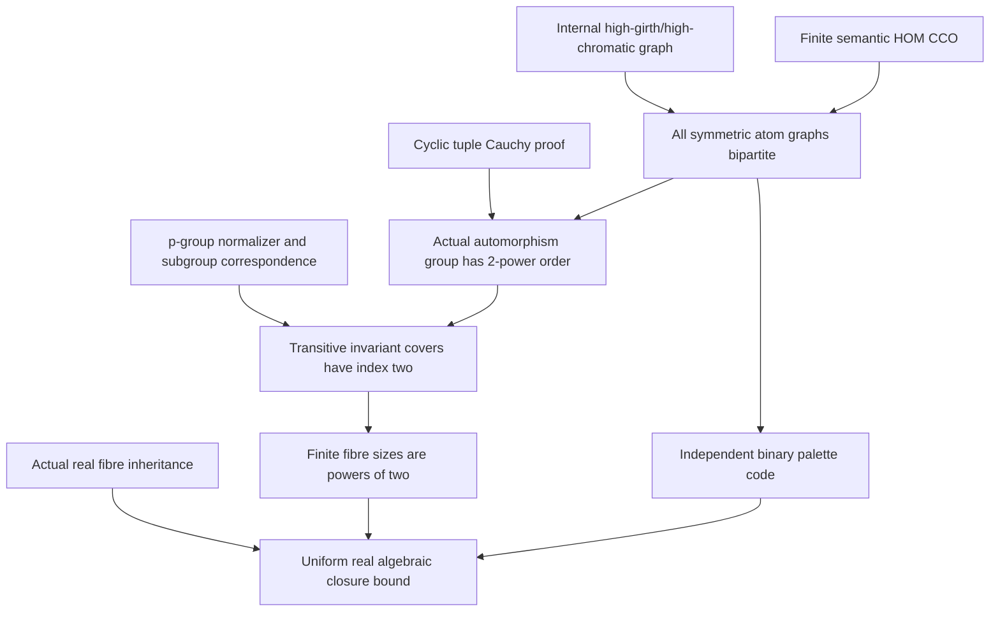

# Finite symmetric CCO targets, automorphism 2-groups and uniform real algebraicity

Generated from `module.json` by `tools/build_formalization_module.py`.

Source `490c3f36d85db5a0b3ced0598e6c431825254ec5`. **Human-expanded proof plan; no Lean code.**

Private B042: FOUR selected new Foundations I results, twelve definitions, 50 human claims and eight tasks, with NO auxiliary equations. The existing actual-fibre inheritance lemma remains a precisely selected canonical_hull C09/C10 import, not duplicate coverage or a circular Hasse input. Derive atom bipartiteness using internal high-girth graphs; expand Cauchy, finite p-group normalizer/maximal-index and subgroup/equivalence correspondence locally. Obtain finite Aut(F) a 2-group, transitive finite Hasse covers of index two, power-of-two real fibre sizes and a uniform real acl bound. Symmetry is retained by both short corollaries. No SAP, arbitrary imaginary CCO, elementary-abelian conclusion or new external published theorem. An independent bipartition bit-code proves |F|<=2^(number of occurring diversity colours) without transitivity/homogeneity as internal support.

The human article remains unchanged. Additional proof details are in
[PROOF_NOTES.md](PROOF_NOTES.md); the cross-track policy is in
[the formalization guide](../README.md). Source hashes are checked before
the index is regenerated. Graph validation is not proof verification.

## Source premises

**A01: Finite symmetric complete atomic target.** F is a FINITE one-sort complete atomic binary structure. Each ordered distinct pair has exactly one named irreflexive diversity atom and every atom is SYMMETRIC. Equality is logical, separate from diversity; unused relation names do not affect atom graphs. No transitivity, homogeneity, SAP or finite bound on unused names is assumed for bipartiteness or the automorphism 2-group theorem. The signature is this atomic colour code (plus constant sort/unary data), with no extra nonconstant unary predicates, functions or higher-arity relations.

**A02: Finite-target semantic HOMOMORPHIC CCO.** Every finite partial diversity diagram whose specified simple cycles admit colour-preserving homomorphisms into F has a homomorphism of the WHOLE diagram into F. Nonadjacent vertices may collide. In the monochromatic argument all specified edges have one symmetric irreflexive atom. No injective completion is assumed.

**A03: Optional transitivity for finite Hasse/cardinality.** For Hasse covers and power-of-two target cardinality, F is NONEMPTY and FULL Aut(F) is transitive on F. Empty F has no proper invariant-equivalence cover and is handled separately. This premise is NOT used for atom bipartiteness or Aut(F) being a 2-group.

**A04: Optional finite-target homogeneity for colour/orbit recognition.** For the source chain-to-palette bound, F is ultrahomogeneous in its complete atomic binary signature. Then two ordered distinct pairs of the same named colour are in one FULL Aut(F) orbit; diagonal is one orbit using A03. This premise is NOT used by bipartiteness, the 2-group theorem or Hasse index two. The independent bit-code palette bound does not need it either.

**A05: Actual inhabited original real source and finite palette.** M is an INHABITED transitive ultrahomogeneous original one-sort complete symmetric binary source with FINITE named diversity palette D, d=|D|, and semantic homomorphic CCO. A finite real base A is a complete induced subset; realized one-point qf types of points outside A are given by their spokes and inequalities. Real acl means full-Aut(M/A) finite orbits (equivalent to usual algebraicity via the definable realized qf orbit). No SAP or arbitrary imaginary inheritance is assumed; countability is not needed by these local arguments.

**A06: Independent finite-group counting setting.** K is an arbitrary FINITE group and p is prime. Cauchy is a CONDITIONAL conclusion when p divides |K|. Use explicit finite products, cyclic tuple rotation and coset/orbit counting; no Cauchy theorem is imported or assumed. The group can be noncommutative and need not act faithfully on an auxiliary set.

**A07: Independent finite p-group subgroup setting.** L is a finite group of order p^k for a prime p, and H<L is a proper subgroup. For the maximal-index conclusion H is additionally maximal proper. Orbit sizes are computed by elementary coset partitions; the normalizer condition and index-p theorem are proved locally, not imported.

**A08: Independent transitive action for subgroup correspondence.** G is ANY group acting transitively on a NONEMPTY finite set Omega, possibly NONFAITHFULLY. Fix x in Omega and consider actual G-invariant equivalences U,V. The subgroup/equivalence correspondence and relative index bijections are elementary action statements; the cover premise is used only conditionally for maximality. No CCO, symmetry, p-group or homogeneous structure is needed for this correspondence.

## Imported theorem contracts

These are named provider obligations for the receiving Lean project,
not new axioms or claims of compiled imports.

| ID and source | Contract | Current provider status |
|---|---|---|
| I01: [`cor:high-girth-high-chromatic`](../../sections/sparse_labelled_graphs.tex#L68) | For positive q,g choose a finite simple H with girth>g and chromatic number>q. Select ONLY the internally proved finite graph export C05, with its probability/sparsening ancestry; no original Hasse/CCO or RAW exact theorem from that module is imported. Connectedness is unnecessary here; no new Erdos axiom. | HUMAN_EXPANDED_NOT_LEAN |
| I02: [`lem:fibreCCO`](../../sections/cco_finite_fibres.tex#L11) | Over a complete finite ACTUAL REAL base, each realized outside one-point fibre is its full pointwise-stabilizer orbit, nonempty transitive and induced homogeneous, and inherits semantic HOM CCO. Real orbit algebraicity agrees with usual algebraicity because this realized qf orbit is definable. Select C09/C10 ONLY: neither C03 triangle fullness nor canonical_hull Hasse imports are used, avoiding a circular Hasse dependency. | HUMAN_EXPANDED_NOT_LEAN |

## Definitions

| ID | Definition | Exact meaning | Source |
|---|---|---|---|
| D01 | Actual undirected atom graph | For each named diversity atom a use the finite simple graph with vertices F and edges {x,y} where a(x,y). Symmetry makes it undirected; irreflexivity forbids loops. An unused atom gives an edgeless graph. | [source](../../sections/cco_finite_fibres.tex#L61) |
| D02 | Cycle homomorphism as a closed atom walk | A colour-preserving map from a formal m-cycle to the a-graph is a closed a-walk of length m; repeated target vertices/backtracking are allowed. A simple odd target cycle has odd length r>=3. | [source](../../sections/cco_finite_fibres.tex#L61) |
| D03 | High-girth obstruction request | Given an odd a-cycle of length r, take q=|F| and g=r in I01. Its existence implies |F|>=r>=3, discharging positivity. Colour EVERY H edge a without requiring other pair colours in the partial input. | [source](../../sections/cco_finite_fibres.tex#L61) |
| D04 | Cyclic p-tuples with product identity | T_p(K)={(g1,...,gp):g1...gp=1}. The last entry is determined by the first p-1, so |T_p(K)|=|K|^(p-1). Rotate coordinates cyclically; product-one is preserved by conjugation even in nonabelian K. | [source](../../sections/cco_finite_fibres.tex#L78) |
| D05 | Normalizer and finite p-group maximality | N_L(H)={g:g^-1 H g=H}; H acts by left multiplication on left cosets L/H. Fixed cosets correspond exactly to N_L(H)/H. Prove proper H<N_L(H) by orbit counting before invoking maximality. | [source](../../sections/cco_finite_fibres.tex#L94) |
| D06 | Base stabilizer interval | For actual invariant U on Omega put H_U={g:gx U x}, containing G_x. Conversely for G_x<=H<=G, identify Omega with G/G_x and take the kernel of G/G_x->G/H. No normality or faithfulness is required. | [source](../../sections/cco_finite_fibres.tex#L94) |
| D07 | Relative cover index and saturated chain | [V:U] counts U-classes inside one V-class, uniform in a transitive action. A Hasse cover is a strict inclusion of invariant equivalences with nothing between. A saturated finite chain from Id to top includes only Hasse covers; singleton carrier has a zero-step chain. | [source](../../sections/cco_finite_fibres.tex#L94) |
| D08 | Occurring finite target diversity palette | D_F is the finite set of actually occurring diversity colours in F, with d_F=|D_F|. It is finite because F has finitely many ordered pairs, even if the signature has unused names. Identifying each colour with one full pair orbital is a further homogeneous conclusion C31. | [source](../../sections/cco_finite_fibres.tex#L123) |
| D09 | Actual outside-real one-point fibre | For finite A subset M and realized q(x/A) of x outside A, X_q is exactly the points having the prescribed diversity spokes to every anchor and all inequalities x!=a. It is an ACTUAL real subset, not an arbitrary quotient/tuple imaginary. | [source](../../sections/cco_finite_fibres.tex#L123) |
| D10 | Real finite-orbit algebraicity | acl_M(A) is the set of real points with finite full-Aut(M/A) orbit. Every anchor is fixed. I02 identifies outside orbits with definable realized qf fibres, so this agrees with usual real model-theoretic algebraicity. | [source](../../sections/cco_finite_fibres.tex#L123) |
| D11 | One-point spoke vector over nonempty real A | Fix an enumeration of |A|=n>=1 anchors. Every outside point gives one vector in D^n; complete original binarity makes this vector determine its entire one-point qf type over the fixed base. No equality spoke occurs, and no 0^0 convention is used. | [source](../../sections/cco_finite_fibres.tex#L123) |
| D12 | Independent bipartition bit code | Choose an arbitrary proper 2-colouring c_a of each occurring atom graph, with no invariance/canonicality requirement. Code x by (c_a(x))_(a in D_F). Different components can be flipped independently; completeness will force distinct vertices to have distinct bit codes. | [source](../../sections/cco_finite_fibres.tex#L61) |

## Proof claims and direct dependencies

Every row has a human proof expansion. Each still needs an actual Lean
statement and proof. Separate faithful actual Aut(F) from generic nonfaithful actions, arbitrary finite symmetric CCO targets from transitive/homogeneous specializations, and real one-point fibres from imaginaries. Use only the finite graph part of parity_hasse and C09/C10 of fibreCCO; no imported Hasse theorem.

| ID and claim | Scope | Direct providers | Proof note |
|---|---|---|---|
| C01: An odd atom cycle is the only obstruction to bipartiteness | atom_graphs | A01, D01, D02 | N01 in [notes](PROOF_NOTES.md) |
| C02: Choose an H of girth greater than r and chromatic number greater than F | atom_graphs | C01, D03, I01 | N01 in [notes](PROOF_NOTES.md) |
| C03: Every even specified H-cycle folds onto one a-edge | atom_graphs | C01, D02 | N01 in [notes](PROOF_NOTES.md) |
| C04: Every odd H-cycle maps to the given odd cycle with backtracks | atom_graphs | C01, C02, D02 | N01 in [notes](PROOF_NOTES.md) |
| C05: All specified H simple cycles are homomorphically feasible | atom_graphs | C02, C03, C04 | N01 in [notes](PROOF_NOTES.md) |
| C06: HOM CCO would yield an impossible proper F-colouring of H | atom_graphs | A02, C02, C05, D01 | N01 in [notes](PROOF_NOTES.md) |
| C07: Every finite symmetric CCO atom graph is bipartite | atom_graphs | C01, C06 | N01 in [notes](PROOF_NOTES.md) |
| C08: A bipartition bit code bounds F by 2 to the occurring palette size | finite_palette_size | C07, D08, D12 | N01 in [notes](PROOF_NOTES.md) |
| C09: Product-one p-tuples have the explicit finite count | finite_group_support | A06, D04 | N02 in [notes](PROOF_NOTES.md) |
| C10: Cyclic rotation gives the Cauchy fixed-point congruence | finite_group_support | A06, C09, D04 | N02 in [notes](PROOF_NOTES.md) |
| C11: Local Cauchy proof produces an element of order p | finite_group_support | A06, C09, C10 | N02 in [notes](PROOF_NOTES.md) |
| C12: A positive finite group order not a power of two has an odd prime divisor | finite_group_support | A06 | N02 in [notes](PROOF_NOTES.md) |
| C13: A nontrivial order-p AUTOMORPHISM has a moved p-orbit | automorphism_2groups | A01, C11, C12 | N02 in [notes](PROOF_NOTES.md) |
| C14: That p-orbit is a monochromatic simple odd cycle | automorphism_2groups | A01, C13 | N02 in [notes](PROOF_NOTES.md) |
| C15: The full finite automorphism group has power-of-two order | automorphism_2groups | C07, C11, C12, C13, C14 | N02 in [notes](PROOF_NOTES.md) |
| C16: A subgroup acting on p-group cosets has p-power orbit sizes | finite_group_support | A07, D05 | N03 in [notes](PROOF_NOTES.md) |
| C17: Fixed cosets are exactly normalizer cosets | finite_group_support | A07, D05, C16 | N03 in [notes](PROOF_NOTES.md) |
| C18: The finite p-group normalizer condition follows by counting | finite_group_support | A07, C16, C17 | N03 in [notes](PROOF_NOTES.md) |
| C19: A maximal proper subgroup of a finite p-group is normal | finite_group_support | A07, C18 | N03 in [notes](PROOF_NOTES.md) |
| C20: A maximal proper finite p-group subgroup has index p | finite_group_support | A07, C11, C19 | N03 in [notes](PROOF_NOTES.md) |
| C21: An invariant equivalence gives a subgroup above the point stabilizer | transitive_actions | A08, D06 | N04 in [notes](PROOF_NOTES.md) |
| C22: Coset kernels give the inverse invariant-equivalence correspondence | transitive_actions | A08, C21, D06 | N04 in [notes](PROOF_NOTES.md) |
| C23: Relative class counts equal subgroup indices uniformly | transitive_actions | A08, C21, C22, D07 | N04 in [notes](PROOF_NOTES.md) |
| C24: An invariant Hasse cover makes the two subgroups a maximal pair | transitive_actions | A08, C22, D07 | N04 in [notes](PROOF_NOTES.md) |
| C25: Apply the correspondence to the ACTUAL transitive finite target | finite_Hasse | A01, A02, A03, C15, C21, C24 | N04 in [notes](PROOF_NOTES.md) |
| C26: The maximal-subgroup index is exactly the relative Hasse index | finite_Hasse | C20, C23, C25 | N04 in [notes](PROOF_NOTES.md) |
| C27: Finite transitive symmetric CCO Hasse-cover source export | finite_Hasse | C25, C26 | N04 in [notes](PROOF_NOTES.md) |
| C28: Small targets do not require contradictory graph/group requests | boundary | C07, C15, C27 | N07 in [notes](PROOF_NOTES.md) |
| C29: Actual real fibres are exactly definable full-stabilizer orbits | actual_real_fibres | A05, I02, D09, D10 | N06 in [notes](PROOF_NOTES.md) |
| C30: Every finite actual fibre has precisely the required finite CCO structure | actual_real_fibres | A05, I02, D09 | N06 in [notes](PROOF_NOTES.md) |
| C31: Homogeneous target pair orbitals are its occurring named colours | finite_palette_size | A01, A03, A04, D08 | N05 in [notes](PROOF_NOTES.md) |
| C32: Choose a finite saturated chain of all invariant equivalences | finite_palette_size | A01, A03, D07 | N05 in [notes](PROOF_NOTES.md) |
| C33: Index-two covers make target cardinality a power of two | finite_palette_size | C27, C32 | N05 in [notes](PROOF_NOTES.md) |
| C34: Each strict homogeneous chain step consumes a new occurring colour | finite_palette_size | C31, C32, D08 | N05 in [notes](PROOF_NOTES.md) |
| C35: Finite homogeneous transitive target size is 2^m with m<=its palette | finite_palette_size | C33, C34 | N05 in [notes](PROOF_NOTES.md) |
| C36: There are at most d^n outside real one-point types over A | uniform_real_acl | A05, D11 | N06 in [notes](PROOF_NOTES.md) |
| C37: Real acl is the anchors plus the disjoint finite actual fibres | uniform_real_acl | A05, C29, C30, C35, D10 | N06 in [notes](PROOF_NOTES.md) |
| C38: Summing fibre sizes proves the uniform real closure bound | uniform_real_acl | C36, C37 | N06 in [notes](PROOF_NOTES.md) |
| C39: For an empty base in infinite transitive M there is no real algebraicity | uniform_real_acl | A05, D10 | N06 in [notes](PROOF_NOTES.md) |
| C40: For an empty base in finite inhabited M the same chain gives a bounded power of two | uniform_real_acl | A05, C35, D10 | N06 in [notes](PROOF_NOTES.md) |
| C41: Uniform real algebraic-closure source export | uniform_real_acl | C30, C35, C37, C38, C39, C40 | N06 in [notes](PROOF_NOTES.md) |
| C42: The zero-palette and singleton conventions require no 0^0 | boundary | A05, C38, C39, C40 | N06 in [notes](PROOF_NOTES.md) |
| C43: The bit-code route independently bounds the power-of-two exponent | finite_palette_size | C08, C33 | N05 in [notes](PROOF_NOTES.md) |
| C44: Symmetry is essential: directed mod-three difference colours are outside scope | boundary |  | N07 in [notes](PROOF_NOTES.md) |
| C45: Without transitivity relative cover counts need not be uniform | boundary | D07 | N07 in [notes](PROOF_NOTES.md) |
| C46: A finite 2-group conclusion is not an elementary-abelian or regular-action claim | boundary | C15, C27 | N07 in [notes](PROOF_NOTES.md) |
| C47: The complete one-colour triangle is not HOM CCO | boundary | C03, C04, C07 | N07 in [notes](PROOF_NOTES.md) |
| C48: Actual real fibres are not arbitrary imaginary or owner-kernel sorts | boundary | I02, C41 | N07 in [notes](PROOF_NOTES.md) |
| C49: The type count depends on complete original binarity and the finite palette | boundary | C36, C38 | N07 in [notes](PROOF_NOTES.md) |
| C50: An infinite palette can have infinite real acl despite symmetric HOM CCO | boundary |  | N07 in [notes](PROOF_NOTES.md) |

The precise quantified contracts are in `module.json`. Provider-before-consumer
order (including definitions and source premises):

`A01 → A02 → A03 → A04 → A05 → A06 → A07 → A08 → C44 → C50 → D07 → I01 → C12 → C32 → C45 → D01 → D04 → D05 → D06 → D08 → D09 → D10 → D11 → I02 → C09 → C16 → C21 → C29 → C30 → C31 → C36 → C39 → D02 → D03 → D12 → C01 → C10 → C17 → C22 → C34 → C02 → C03 → C11 → C18 → C23 → C24 → C04 → C13 → C19 → C05 → C14 → C20 → C06 → C07 → C08 → C15 → C47 → C25 → C26 → C27 → C28 → C33 → C46 → C35 → C43 → C37 → C40 → C38 → C41 → C42 → C49 → C48`

This order is one valid linearization; it does not require unrelated
branches to be proved sequentially. The full DAG is the `depends_on`
relation in `module.json`.

## Main proof branches

This is a coarse view of the claim DAG. Edges go from provider to consumer.

There are no new external published inputs: high-girth graphs were already proved internally, and Cauchy/maximal-index support is expanded here.
Symmetry is retained by both short source corollaries; directed mod-three colours give a boundary example.
The actual fibre import selects C09/C10 only; no earlier Hasse/triangle-fullness claim is smuggled into the finite proof.
Full-Aut fibre pair orbitals equal occurring named colours; this justifies the source chain-to-palette count.
The independent bipartition bit code gives the same palette bound with fewer hypotheses; it is internal support, not another numbered source result.
The result concerns actual real acl; arbitrary imaginaries and infinite palettes remain outside the conclusion.

## Article exports

| Existing source result | Sidecar proof claims |
|---|---|
| [`lem:bip`](../../sections/cco_finite_fibres.tex#L61) | C07 |
| [`cor:twogroup`](../../sections/cco_finite_fibres.tex#L78) | C13, C14, C15 |
| [`cor:hasse`](../../sections/cco_finite_fibres.tex#L94) | C25, C26, C27 |
| [`cor:fibre-uniform-acl`](../../sections/cco_finite_fibres.tex#L122) | C35, C37, C38, C39, C40, C41 |

Full result coverage is asserted only for `source_result_files`.
Selected additional results: lem:bip, cor:twogroup, cor:hasse, cor:fibre-uniform-acl.
Other results in their provider source files are not claimed covered.

## Internal implementation milestones

These tasks are proof milestones inside larger project assignments;
see the [peer-project allocation](../coordination/BOARD.md).

These are implementation tasks, not additional mathematical assumptions.

| Task | Earlier tasks | Acceptance |
|---|---|---|
| T01: Monochromatic cycles, high girth and bipartition codes | — | Retain symmetric atomic scope. Bipartiteness/Aut2group do not assume transitivity; Hasse/cardinality do. Prove elementary Cauchy and p-group index facts locally or bind proved library APIs with matching hypotheses. Actual Aut(F) is faithful, generic subgroup correspondence need not be. Import only highgirthC05 and fibreC09/C10, never a circular Hasse provider. Keep actualreal fibres, palette-orbit recognition, n>=1 spoke counting and separate inhabited empty-base cases. Finite diagnostics are not Lean/global proofs. |
| T02: Internal finite-group Cauchy proof | — | Retain symmetric atomic scope. Bipartiteness/Aut2group do not assume transitivity; Hasse/cardinality do. Prove elementary Cauchy and p-group index facts locally or bind proved library APIs with matching hypotheses. Actual Aut(F) is faithful, generic subgroup correspondence need not be. Import only highgirthC05 and fibreC09/C10, never a circular Hasse provider. Keep actualreal fibres, palette-orbit recognition, n>=1 spoke counting and separate inhabited empty-base cases. Finite diagnostics are not Lean/global proofs. |
| T03: Odd automorphism cycles and the 2-group conclusion | T01, T02 | Retain symmetric atomic scope. Bipartiteness/Aut2group do not assume transitivity; Hasse/cardinality do. Prove elementary Cauchy and p-group index facts locally or bind proved library APIs with matching hypotheses. Actual Aut(F) is faithful, generic subgroup correspondence need not be. Import only highgirthC05 and fibreC09/C10, never a circular Hasse provider. Keep actualreal fibres, palette-orbit recognition, n>=1 spoke counting and separate inhabited empty-base cases. Finite diagnostics are not Lean/global proofs. |
| T04: Internal p-group normalizer and maximal index | T02 | Retain symmetric atomic scope. Bipartiteness/Aut2group do not assume transitivity; Hasse/cardinality do. Prove elementary Cauchy and p-group index facts locally or bind proved library APIs with matching hypotheses. Actual Aut(F) is faithful, generic subgroup correspondence need not be. Import only highgirthC05 and fibreC09/C10, never a circular Hasse provider. Keep actualreal fibres, palette-orbit recognition, n>=1 spoke counting and separate inhabited empty-base cases. Finite diagnostics are not Lean/global proofs. |
| T05: Actual invariant covers via possibly nonfaithful actions | T03, T04 | Retain symmetric atomic scope. Bipartiteness/Aut2group do not assume transitivity; Hasse/cardinality do. Prove elementary Cauchy and p-group index facts locally or bind proved library APIs with matching hypotheses. Actual Aut(F) is faithful, generic subgroup correspondence need not be. Import only highgirthC05 and fibreC09/C10, never a circular Hasse provider. Keep actualreal fibres, palette-orbit recognition, n>=1 spoke counting and separate inhabited empty-base cases. Finite diagnostics are not Lean/global proofs. |
| T06: Finite target chain, named colour rank and alternate palette bound | T01, T05 | Retain symmetric atomic scope. Bipartiteness/Aut2group do not assume transitivity; Hasse/cardinality do. Prove elementary Cauchy and p-group index facts locally or bind proved library APIs with matching hypotheses. Actual Aut(F) is faithful, generic subgroup correspondence need not be. Import only highgirthC05 and fibreC09/C10, never a circular Hasse provider. Keep actualreal fibres, palette-orbit recognition, n>=1 spoke counting and separate inhabited empty-base cases. Finite diagnostics are not Lean/global proofs. |
| T07: Actual real fibres and uniform algebraic-closure bounds | T06 | Retain symmetric atomic scope. Bipartiteness/Aut2group do not assume transitivity; Hasse/cardinality do. Prove elementary Cauchy and p-group index facts locally or bind proved library APIs with matching hypotheses. Actual Aut(F) is faithful, generic subgroup correspondence need not be. Import only highgirthC05 and fibreC09/C10, never a circular Hasse provider. Keep actualreal fibres, palette-orbit recognition, n>=1 spoke counting and separate inhabited empty-base cases. Finite diagnostics are not Lean/global proofs. |
| T08: Scope, symmetry, empty cases and palette boundaries | T01, T02, T03, T04, T05, T06, T07 | Retain symmetric atomic scope. Bipartiteness/Aut2group do not assume transitivity; Hasse/cardinality do. Prove elementary Cauchy and p-group index facts locally or bind proved library APIs with matching hypotheses. Actual Aut(F) is faithful, generic subgroup correspondence need not be. Import only highgirthC05 and fibreC09/C10, never a circular Hasse provider. Keep actualreal fibres, palette-orbit recognition, n>=1 spoke counting and separate inhabited empty-base cases. Finite diagnostics are not Lean/global proofs. |

## Finite controls

- **K01.** Finite symmetric atom-cycle walks, concrete K3 HOM CCO failure, actual automorphism odd-prime cycles, cyclic tuple counts, small p-group normalizers/maximal subgroups and nonfaithful action index bijections.
- **K02.** Full finite homogeneous fibre/orbit/palette/acl calculations, bipartition bit-code injection, transitivity/symmetry/palette scope guards. No unbounded high-girth, CCO/SAP or Lean proof is certified.

Run `python tools/check_finite_fibres_controls.py` from the manuscript directory.
The controls do not prove CCO or the general theorems.

## Return to the human articles

No required mathematical repair was found in this scoped pass. These
optional wording clarifications remain queued for a human article pass:

- **F01** ([source](../../sections/cco_finite_fibres.tex#L79)): The short 2-group and Hasse corollaries inherit the preceding SYMMETRIC complete atomic context. Directed difference colours on Z/3 have HOM CCO and full group C3, so symmetry cannot be dropped. Repeat the inherited symmetric complete-atomic qualifier in the short corollary statements; keep transitivity only for the Hasse result. Cauchy and maximal finite p-group index support is expanded in the prep notes.
- **F02** ([source](../../sections/cco_finite_fibres.tex#L143)): The chain/palette bound uses that full Aut(X_q) pair orbitals are exactly its occurring old named colours, which follows from induced fibre homogeneity. An alternate direct bound codes vertices by atom-graph bipartitions and does not need homogeneity or transitivity. Insert the two-point homogeneity/orbital sentence before counting chain steps. Optionally mention the independent injection into {0,1}^d as a shorter cardinal-bound check. Keep n>=1 and separate the empty-base cases.

The machine ledger records caller effects and affected claims. The source
review used two independent model review passes and parent synthesis;
it is not independent human or formal certification.
