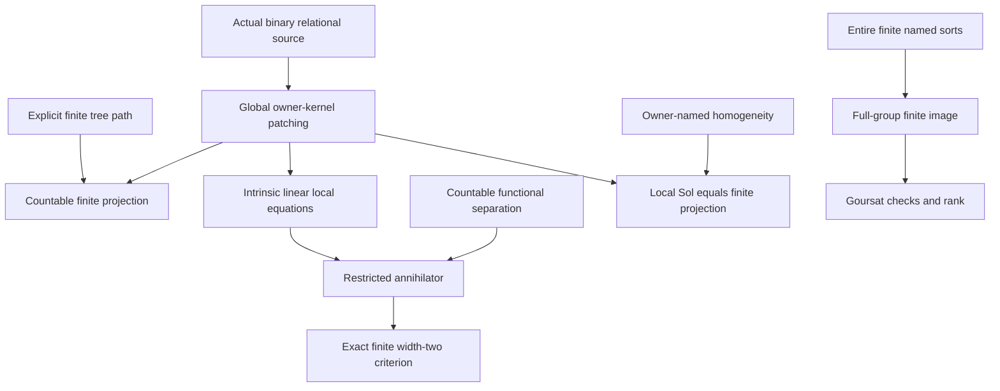

# Finite-fibre kernels, hidden projections and named-axis Goursat codes

Generated from `module.json` by `tools/build_formalization_module.py`.

Source `490c3f36d85db5a0b3ced0598e6c431825254ec5`. **Human-expanded proof plan; no Lean code.**

Preparation for OTHER Lean projects. The three kernel/CSP/relative-homogeneity/duality results remaining in finite_packet_kernel_constraints.tex and the two selected entire-named-axis results give five exports and eight auxiliary equations. The affine translate lemma from the kernel file is already prepared in rigid_groupoid and is not re-exported. Other simultaneous-quotient results remain outside scope.

The human article remains unchanged. Additional proof details are in
[PROOF_NOTES.md](PROOF_NOTES.md); the cross-track policy is in
[the formalization guide](../README.md). Source hashes are checked before
the index is regenerated. Graph validation is not proof verification.

## Source premises

**A01: Relational arity at most two.** An actual structure X in a relational language, possibly infinite, whose relations have arity at most two. Unary predicates, binary loops and both ordered cross directions are included; nullary relations impose no permutation constraint. No functions or named constants are added. No homogeneity, CCO, symmetry, SAP or exactness is assumed.

**A02: Invariant finite-fibre partition of the whole universe.** F is an Aut(X)-invariant equivalence partition of ALL points into finite classes C. The classes are nonempty as quotient classes, but the class family may be empty if X is empty. Individual classes may be unnamed and may move under automorphisms.

**A03: Countability for finite exhaustion and separation.** X is countable. Its family of nonempty finite classes and the direct sum of their finite duals are countable. Used for the explicit finite-solution tree and the explicit countable linear-functional extension. Global binary patching and homogeneity-based finite extensions do not need it.

**A04: Optional relative owner homogeneity.** The expansion X^own naming EVERY F-class by its own unary predicate is homogeneous. This is an extra hypothesis, not a consequence of original homogeneity or merely adding the predicates.

**A05: Elementary abelian INTRINSIC groups.** Each full intrinsic H_C=Aut(X restricted to C) is identified with a finite F2-vector space V_C. Do not replace V_C by the actual binding image B_C without proof. The local H_CD need not be subdirect.

**A06: Entire finite named sorts in a homogeneous source.** For the separate entire-axis results, X is homogeneous and has pairwise disjoint entire finite named sorts P_i. They need not exhaust the universe; other named sorts may be infinite. The acting group is FULL Aut(X), not the possibly smaller image of an earlier finer source.

**A07: Elementary abelian named-sort intrinsic groups.** Only for the Goursat/rank branch, each R_i=Aut(X restricted to the entire named P_i) is a finite F2-vector space V_i. Flat transport for graph pair groups only needs the general full-group image and graph-isomorphism hypotheses.

**A08: Elementary finite algebra and classical choices.** Finite permutations, groups, subspaces, finite-dimensional annihilators and rank-nullity. The finite tree path and countable functional-extension arguments are proved in the notes; no external compactness, Konig or algebraic separation theorem is left unexpanded.

## Definitions

| ID | Definition | Exact meaning | Source |
|---|---|---|---|
| D01 | Actual relational source and full group | Gamma=Aut(X) consists of actual bijections preserving every relation in both directions. | [source](../../sections/finite_packet_kernel_constraints.tex#L17) |
| D02 | Owner class action and kernel | Gamma permutes F-classes by invariance. N is the kernel of that action: it fixes every class setwise, not every real point. | [source](../../sections/finite_packet_kernel_constraints.tex#L18) |
| D03 | Intrinsic local motion groups | H_C is the full automorphism group of the finite induced fibre. H_CD consists of pairs whose union is an induced automorphism of C union D fixing each fibre setwise. These are not presumed actual global projections. | [source](../../sections/finite_packet_kernel_constraints.tex#L20) |
| D04 | Finite local solutions | Sol(S) consists of H_C-tuples on finite S satisfying every H_CD condition for different fibres; the union acts on the finite full fibre union. | [source](../../sections/finite_packet_kernel_constraints.tex#L29) |
| D05 | Restriction representation and actual marginals | rho:N->product H_C restricts each actual owner-kernel automorphism to all fibres. B_C=pr_C rho(N), P_CD=pr_CD rho(N). Set equalities with product families mean equality under this specified group isomorphism. | [source](../../sections/finite_packet_kernel_constraints.tex#L84) |
| D06 | Owner-named expansion | X^own adds a separate unary predicate for EVERY F-class. Its automorphism group is exactly N; homogeneity is a separate A04 premise. | [source](../../sections/finite_packet_kernel_constraints.tex#L140) |
| D07 | Finite-support test space and local row span | D is direct sum V_C*, embedded as finitely supported linear tests on the full product. R is the span of annihilator rows defining the actual H_CD; unary-supported rows must be valid local equations, not freely added restrictions. | [source](../../sections/finite_packet_kernel_constraints.tex#L170) |
| D08 | Restricted support tests and annihilators | D_S is the finite direct sum on S, included into D by zero extension. Ann(pr_S N) is viewed in D_S and compared to R intersect D_S in that precise embedding. | [source](../../sections/finite_packet_kernel_constraints.tex#L185) |
| D09 | Entire named-sort restrictions | For A06, R_i is the intrinsic automorphism group on P_i and P_ij the ACTUAL pair image of full Gamma. No finite-fibre F partition is needed in this branch. | [source](../../sections/simultaneous_typed_exact_quotients.tex#L503) |
| D10 | Finite Goursat check map | For finite S and elementary abelian R_i, choose common quotient spaces W_ij for each actual subdirect pair group. Phi_S has pair components pi_ij(x_i)+rho_ij(x_j), with one chosen orientation for each finite pair. | [source](../../sections/simultaneous_typed_exact_quotients.tex#L557) |
| D11 | Hidden parity and moving-owner controls | Use the actual binary orbital structures of the four-fibre parity-shift group and of left-regular S3. The former is nonhomogeneous; the latter is homogeneous but its individually owner-named expansion is not. Neither is declared an exact CCO source. | [source](../../sections/finite_packet_kernel_constraints.tex#L232) |

## Proof claims and direct dependencies

Every row has a human proof expansion. Each still needs an actual Lean
statement and proof. Intrinsic groups, actual binding marginals and finite projections are different objects; no CCO, SAP, symmetry, exactness, owner homogeneity or finite projection is assumed implicitly.

| ID and claim | Scope | Direct providers | Proof note |
|---|---|---|---|
| C01: Invariant owner action and normal kernel | binary_kernel | D01, D02 | N01 in [notes](PROOF_NOTES.md) |
| C02: Local intrinsic and pair groups | binary_kernel | D03, A08 | N01 in [notes](PROOF_NOTES.md) |
| C03: Finite solution groups and restrictions | binary_kernel | C02, D04 | N02 in [notes](PROOF_NOTES.md) |
| C04: Global binary patching gives the actual restriction isomorphism | binary_kernel | C01, C02, D05 | N02 in [notes](PROOF_NOTES.md) |
| C05: Actual binding marginals are globally subdirect and reconstruct N | binary_kernel | C04, D05 | N02 in [notes](PROOF_NOTES.md) |
| C06: Countable exhaustion and nonempty finite solution levels | countable_projection | A03, C03 | N03 in [notes](PROOF_NOTES.md) |
| C07: Explicit finite-continuation path construction | countable_projection | C06, A08 | N03 in [notes](PROOF_NOTES.md) |
| C08: Compact projection exact quantifiers | countable_projection | C07, C04 | N03 in [notes](PROOF_NOTES.md) |
| C09: Relative owner homogeneity removes hidden finite constraints | relative_homogeneity | A04, D06, C04, C03 | N04 in [notes](PROOF_NOTES.md) |
| C10: Finite pair annihilators define the global kernel | linear_kernel | A05, D07, C04, A08 | N05 in [notes](PROOF_NOTES.md) |
| C11: Countable linear-functional separation without compactness | linear_kernel | A03, D07, A08 | N05 in [notes](PROOF_NOTES.md) |
| C12: Algebraic dual of finite-support tests is the full product | linear_kernel | D07, A08 | N05 in [notes](PROOF_NOTES.md) |
| C13: Double annihilator and restricted projection formula | linear_kernel | C10, C11, C12, D08 | N06 in [notes](PROOF_NOTES.md) |
| C14: Finite marginal constraints span their exact test rows | linear_kernel | C13, A08 | N06 in [notes](PROOF_NOTES.md) |
| C15: Width-two criterion iff actual finite projection has only marginal constraints | linear_kernel | C14, C13 | N06 in [notes](PROOF_NOTES.md) |
| C16: Full restriction to an entire named finite sort is onto | entire_named_axes | D09, A08 | N04 in [notes](PROOF_NOTES.md) |
| C17: Strong finite projection on entire named sorts | entire_named_axes | C16, A01, A06 | N04 in [notes](PROOF_NOTES.md) |
| C18: Linear Goursat representation of actual subdirect pairs | entire_named_linear | C16, A07, A08 | N04 in [notes](PROOF_NOTES.md) |
| C19: Named finite image equals check-map kernel and rank count | entire_named_linear | C17, C18, D10, A08 | N04 in [notes](PROOF_NOTES.md) |
| C20: Flat graph transport from actual full-group lifts | entire_named_axes | C16, C17 | N04 in [notes](PROOF_NOTES.md) |
| C21: Actual hidden-parity binary countercontrol | examples | D11, A08 | N07 in [notes](PROOF_NOTES.md) |
| C22: Homogeneous moving-owner countercontrol with intrinsic/binding gap | examples | D11, A08 | N07 in [notes](PROOF_NOTES.md) |

The precise quantified contracts are in `module.json`. Provider-before-consumer
order (including definitions and source premises):

`A01 → A02 → A03 → A04 → A05 → A06 → A07 → A08 → D01 → D09 → D11 → C16 → C21 → C22 → D02 → D10 → C01 → C17 → C18 → D03 → D06 → C02 → C19 → C20 → D04 → D05 → D07 → C03 → C04 → C11 → C12 → D08 → C05 → C06 → C09 → C10 → C07 → C13 → C08 → C14 → C15`

This order is one valid linearization; it does not require unrelated
branches to be proved sequentially. The full DAG is the `depends_on`
relation in `module.json`.

## Main proof branches

This is a coarse view of the claim DAG. Edges go from provider to consumer.

Global binary patching never implies the finite projected pair formula without its extra criterion.
Relative owner homogeneity and full homogeneous entire named sorts are separate hypotheses, not consequences of naming owners.
The countable tree and countable separation are expanded internally; no CCO or phase-seed provider is imported.

## Article exports

| Existing source result | Sidecar proof claims |
|---|---|
| [`thm:finite-fibre-kernel-csp`](../../sections/finite_packet_kernel_constraints.tex#L63) | C01, C02, C03, C04, C05, C06, C07, C08 |
| [`cor:finite-kernel-relative-homogeneity`](../../sections/finite_packet_kernel_constraints.tex#L138) | C09 |
| [`thm:finite-kernel-linear-width-two`](../../sections/finite_packet_kernel_constraints.tex#L164) | C10, C11, C12, C13, C14, C15 |
| [`lem:typed-finite-entire-axis-projection`](../../sections/simultaneous_typed_exact_quotients.tex#L497) | C16, C17 |
| [`cor:typed-finite-linear-goursat`](../../sections/simultaneous_typed_exact_quotients.tex#L543) | C18, C19, C20 |

Auxiliary source equations (not additional numbered results):

- [`eq:finite-kernel-binary`](../../sections/finite_packet_kernel_constraints.tex#L70): C04
- [`eq:finite-kernel-projection`](../../sections/finite_packet_kernel_constraints.tex#L81): C08
- [`eq:finite-kernel-actual-pairs`](../../sections/finite_packet_kernel_constraints.tex#L90): C05
- [`eq:finite-kernel-strong-projection`](../../sections/finite_packet_kernel_constraints.tex#L147): C09
- [`eq:finite-kernel-dual`](../../sections/finite_packet_kernel_constraints.tex#L182): C10, C13
- [`eq:finite-kernel-width-two`](../../sections/finite_packet_kernel_constraints.tex#L196): C15
- [`eq:typed-finite-strong-projection`](../../sections/simultaneous_typed_exact_quotients.tex#L515): C17
- [`eq:typed-finite-goursat-rank`](../../sections/simultaneous_typed_exact_quotients.tex#L566): C19

Full result coverage is asserted only for `source_result_files`.
Selected additional results: thm:finite-fibre-kernel-csp, cor:finite-kernel-relative-homogeneity, thm:finite-kernel-linear-width-two, lem:typed-finite-entire-axis-projection, cor:typed-finite-linear-goursat.
Other results in their provider source files are not claimed covered.

## Internal implementation milestones

These tasks are proof milestones inside larger project assignments;
see the [peer-project allocation](../coordination/BOARD.md).

These are implementation tasks, not additional mathematical assumptions.

| Task | Earlier tasks | Acceptance |
|---|---|---|
| T01: Actual owner action and global binary patching | — | Implement the actual restriction maps, quantified finite projection and subgroup/dual interfaces; verify intrinsic vs binding and full-source vs finer-image boundaries. These are internal milestones of one substantial project package. |
| T02: Countable finite projections and relative owner homogeneity | T01 | Implement the actual restriction maps, quantified finite projection and subgroup/dual interfaces; verify intrinsic vs binding and full-source vs finer-image boundaries. These are internal milestones of one substantial project package. |
| T03: Intrinsic linear tests and exact width-two criterion | T01 | Implement the actual restriction maps, quantified finite projection and subgroup/dual interfaces; verify intrinsic vs binding and full-source vs finer-image boundaries. These are internal milestones of one substantial project package. |
| T04: Entire named axes and linear Goursat/rank consumers | — | Implement the actual restriction maps, quantified finite projection and subgroup/dual interfaces; verify intrinsic vs binding and full-source vs finer-image boundaries. These are internal milestones of one substantial project package. |
| T05: Actual hidden parity and homogeneous moving-owner examples | — | Implement the actual restriction maps, quantified finite projection and subgroup/dual interfaces; verify intrinsic vs binding and full-source vs finer-image boundaries. These are internal milestones of one substantial project package. |

## Finite controls

- **R01.** Actual hidden-parity binary structure: local Sol versus actual automorphism projections and finite obstructions.
- **R02.** Homogeneous moving-owner S3 source: intrinsic/binding gap, nonsubdirect local pairs and broken owner homogeneity.
- **R03.** Positive homogeneous entire-named-sort projections, including empty finite sets.
- **R04.** Finite Gaussian duality, projected annihilators and width-two checks for exhaustive small binary-generated rowspaces.

Run `python tools/check_finite_kernel_controls.py` from the manuscript directory.
The controls do not prove CCO or the general theorems.

## Return to the human articles

No required mathematical repair was found in this scoped pass. These
optional wording clarifications remain queued for a human article pass:

- **F01** ([source](../../sections/finite_packet_kernel_constraints.tex#L65)): The displayed product equality is via the explicit restriction isomorphism rho:N->product H_C; the inverse assembles one global permutation. Give that identification before writing equality with tuple families.
- **F02** ([source](../../sections/finite_packet_kernel_constraints.tex#L120)): The countable compact projection can use an explicit finite-continuation branch proof, with no new external compactness provider. Keep the short named lemma in the human article if preferred; put the full tree construction in formalization.
- **F03** ([source](../../sections/finite_packet_kernel_constraints.tex#L212)): Countable D allows a direct successive extension of f from R+<ell>, avoiding an unexpanded algebraic separation import. Expose the countable extension construction and the finite-bidual evaluation map.
- **F04** ([source](../../sections/finite_packet_kernel_constraints.tex#L93)): A six-point homogeneous S3 canonical binary source has moving two-point owners with B_C trivial and intrinsic H_C=C2. Its owner-named expansion is not homogeneous. Optionally add this small genuine source example beside the existing hidden-parity example.
- **F05** ([source](../../sections/simultaneous_typed_exact_quotients.tex#L519)): Entire named finite-sort projection and its Goursat rank consumer concern full Aut(X), not an earlier finer-action image or arbitrary moving owners. Retain this firewall beside each downstream owner application.

The machine ledger records caller effects and affected claims. The source
review used two independent model review passes and parent synthesis;
it is not independent human or formal certification.
