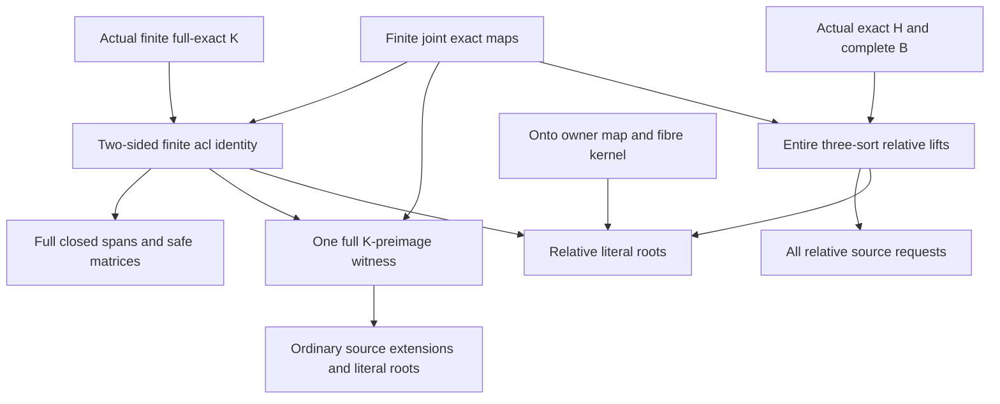

# Finite exact reconstruction with literal roots and conditional full-owner actions

Generated from `module.json` by `tools/build_formalization_module.py`.

Source `490c3f36d85db5a0b3ced0598e6c431825254ec5`. **Human-expanded proof plan; no Lean code.**

Private B029: exactly ONE new source result, finite exact rooted reconstruction, and its finite-acl identity. The earlier prescribed-owner point lemma is already prepared by B018 and is outside this new export; its unused context creates no module dependency. Closure, closed-safe descent and ordinary reconstruction precede and do not require the stronger relative owner hypotheses. One FULL finite K-preimage serves all source requests, unsafe cliques and selected roots. No EPPA(Q), normalized/thin F, general exactness of F, owner master, global group section or independent fibre permutations is assumed or concluded.

The human article remains unchanged. Additional proof details are in
[PROOF_NOTES.md](PROOF_NOTES.md); the cross-track policy is in
[the formalization guide](../README.md). Source hashes are checked before
the index is regenerated. Graph validation is not proof verification.

## Source premises

**A01: Actual original symmetric binary source.** Q is a nonempty transitive homogeneous structure in a FINITE complete symmetric binary language naming all actual equality-inclusive RAW pair orbitals. Invariant original endorelations commute and are unions of these fine atom names. Finite induced maps preserve these named relations. No SAP, safe palette, EPPA or finite-exact normalization is included.

**A02: Current actual exact-provider hypotheses.** Q has semantic homomorphic CCO and the countability retained by the prepared RAW joint exact-sort lifting/source-inheritance providers. No ordinary EPPA theorem or coherent lift is supplied.

**A03: One actual finite-class full exact kernel.** K is an ACTUAL invariant FULL RAW EXACT equivalence of Q, with finite real classes. K=Id is allowed; K need not be the greatest finite equivalence F_Q and no exactness of F_Q is assumed.

**A04: Finite real input.** A0 is an arbitrary finite real subset of Q, possibly empty in the closure identity. Both rooted witness applications explicitly require A0 NONEMPTY.

**A05: Given original strong absolute closed-safe amalgamation.** S_Q is a set of ORIGINAL diversity atom names such that every finite induced ABSOLUTELY acl_Q-closed span has a strong age amalgam with all new off-base cross edges in S_Q. The amalgam need not itself be closed. No raw SAP is assumed.

**A06: Supplied ordinary rooted quotient witness.** For the ORDINARY branch A0 is NONEMPTY and barD is ONE finite induced subset of barQ=Q/K containing acl_barQ(pi_K A0), extending EVERY partial automorphism of pi_K A0, and having rooted barS-ACF over pi_K A0. This is a supplied finite witness, not an age-level EPPA premise on Q or a global rooted theorem.

**A07: Stronger actual full exact original owner.** Only for the RELATIVE branch H is an ACTUAL invariant FULL RAW EXACT equivalence of Q. No nesting of K and H is required. Put J=K join H and barH=J/K, so the coarse owner source is T=Q/J.

**A08: Supplied relative witness and complete finite owner packet.** For the RELATIVE branch A0 is NONEMPTY. barD is ONE finite induced relative rooted barS-ACF witness over pi_K A0; in particular it CONTAINS acl_barQ(pi_K A0). Its image under barH is exactly a finite induced barB subset Q/J. It extends EVERY compatible pair (barp,bargamma), including (empty,bargamma), for barp a partial automorphism of pi_K A0 and bargamma in FULL Aut(barB). Its rooted transports are relative automorphisms with their actual induced barB actions. B is the COMPLETE inverse image of barB under Q/H -> Q/J, in the actual canonical owner language. Finiteness of B is proved from finite K; no independent arbitrary finite owner subset may replace it.

**A09: Actual onto owner map and fibre-transitive kernel.** Only for RELATIVE ROOT transport, the ACTUAL projection-equivariant homomorphism rho:FULL Aut(B)->FULL Aut(barB), induced on the ENTIRE complete B by Q/H -> Q/J, is onto and ker(rho) is transitive on each owner-cover fibre. The map itself and finite B are justified locally; onto/kernel-transitivity are substantive additional hypotheses, not consequences of K being finite exact.

## Imported theorem contracts

These are named provider obligations for the receiving Lean project,
not new axioms or claims of compiled imports.

| ID and source | Contract | Current provider status |
|---|---|---|
| I01: [`lem:exact-product`](../../sections/exact_foundations/01_full_raw_exact_helly.tex#L284) | Nonempty RAW exact relations are closed under relational composition. In particular exact equivalences K,H have exact J=K;H=K join H; this uses the elementary commuting-equivalence identity, not distributivity of the full invariant lattice. | HUMAN_EXPANDED_NOT_LEAN |
| I02: [`lem:acf-mixed-exact-join`](../../sections/exact_foundations/02_exact_quotient_orbital_geometry.tex#L95) | RAW C16: K;a;H=J;a;J=J;a=a;J for J=K join H and EVERY old atom a INCLUDING equality. Mixed K/H orbitals are determined by common J-quotient pair orbitals. Exactness is for ambient lifting, not the algebraic identity. | HUMAN_EXPANDED_NOT_LEAN |
| I03: [`lem:nested-mixed`](../../sections/exact_foundations/02_exact_quotient_orbital_geometry.tex#L144) | RAW C17: if E<=L are actual full exact kernels, E;a;L=L;a;L=a;L, including Id and equality. Real/owner orbitals factor through the displayed projection, provided the entire projected real domain is covered by the named owner map. | HUMAN_EXPANDED_NOT_LEAN |
| I04: [`thm:joint-exact`](../../sections/exact_foundations/03_joint_exact_sort_lifting.tex#L127) | RAW C23: every genuine finite partial isomorphism of the actual real/full-exact quotient orbital language is induced by ONE original automorphism of Q. All displayed sort maps, mixed pairs and coincident-sort agreements must first be checked. No global section is inferred. | HUMAN_EXPANDED_NOT_LEAN |
| I05: [`thm:exact-sorts-source`](../../sections/exact_foundations/03_joint_exact_sort_lifting.tex#L161) | Select RAW C28: the actual exact quotient, with all old-Aut(Q) canonical pair orbitals named, is countable, nonempty, transitive and homogeneous in a finite complete symmetric binary language, with the inherited standing source properties. Its FULL automorphism group may exceed the original image; finite lifting does not require surjectivity of the full ambient group map. | HUMAN_EXPANDED_NOT_LEAN |
| I06: [`lem:prescribed-action-point-lifting`](../../sections/typed_invariant_quotient_transport.tex#L185) | Shared B001 support: an equivariant onto point map and a surjective group homomorphism with fibre-transitive kernel allow any compatible prescribed target action and point motion. The elementary one-lift plus kernel-correction proof is expanded locally. This is not a new B029 export or an invented B018 provider claim. | HUMAN_SUPPORT_PROOF_NOT_LEAN |

## Definitions

| ID | Definition | Exact meaning | Source |
|---|---|---|---|
| D01 | Actual finite exact quotient | pi=pi_K:Q->barQ=Q/K; all canonical pair orbitals are actual old-Aut(Q) orbitals. For a representative old atom a the corresponding quotient pair predicate pulls back to K;a;K, a union of fine RAW atom names. K membership itself is such a union. | [source](../../sections/rooted_mi/04_owner_point_and_finite_lift.tex#L35) |
| D02 | Finite-orbit real closure and distinguished stabilizers | acl_Q(A) means points having finite orbit under FULL Aut(Q/A), while acl_barQ(pi A) uses FULL Aut(barQ/pi A). The image of Aut(Q/A) lies inside the latter stabilizer, but equality/surjectivity of these groups is NOT assumed. | [source](../../sections/rooted_mi/04_owner_point_and_finite_lift.tex#L35) |
| D03 | Uniform full-matrix safe quotient palette | For a diversity quotient atom q, Lambda_K(q) is the set of fine colours on C×Cprime for ANY actual distinct K-classes (C,Cprime) in q. Actual Aut(Q)-orbital transport makes this independent of the pair. barS={q:Lambda_K(q) subset S_Q}; one safe entry is insufficient. | [source](../../sections/rooted_mi/04_owner_point_and_finite_lift.tex#L35) |
| D04 | Full lifted closed span | A quotient closed span barL<-barC->barR is a span of finite ABSOLUTELY acl_barQ-closed induced structures. Lift its maps by finite K-sort joint ambient maps, take full finite K-preimages and retain abstract factor copies identified only on their full common base. Actual overlaps outside the base do not change this abstract span. | [source](../../sections/rooted_mi/04_owner_point_and_finite_lift.tex#L35) |
| D05 | One full reconstructed finite set | For ANY finite induced Tbar subset barQ write D(Tbar)=pi^-1(Tbar), the ENTIRE finite K-preimage, with its original induced fine-coloured structure. No single representative per class, fibre chart or trimmed alternative is chosen. | [source](../../sections/rooted_mi/04_owner_point_and_finite_lift.tex#L35) |
| D06 | Ordinary rooted finite witness contract | A finite induced W over nonempty A contains acl(A), extends every partial automorphism of A, and for each nonempty unsafe Z subset W and selected z in Z has one automorphism carrying Z into acl(A) and z literally into A. These extensions need not be coherent. A06 instantiates this contract in barQ. | [source](../../sections/rooted_mi/04_owner_point_and_finite_lift.tex#L35) |
| D07 | Unsafe projection as a set of distinct classes | An S_Q-unsafe Z is nonempty and every edge between distinct points has colour outside S_Q. pi(Z) is a SET of distinct K-classes; internal K-edges disappear. A singleton image remains unsafe vacuously. | [source](../../sections/rooted_mi/04_owner_point_and_finite_lift.tex#L35) |
| D08 | Actual owner cover and common quotient | For relative H set J=K join H, T=Q/J and r:Q/H->T. Its fibres are collections of H-classes. Since K;H=J, every real K-class over c meets EVERY H-class in r^-1(c). This incidence, not independent fibre permutations, supplies owner completeness. | [source](../../sections/rooted_mi/04_owner_point_and_finite_lift.tex#L35) |
| D09 | Entire relative owner actions and requests | barD->barB is the supplied relative witness; B=r^-1(barB) is complete. A real request (p,gamma) has p:A0 partial original automorphism and gamma in FULL Aut(B), with pi_H p=gamma pi_H on dom(p), including every empty-real request. rho(gamma) is its ACTUAL induced entire barB action. Relative transports are automorphisms of the same D with their induced exact B actions. | [source](../../sections/rooted_mi/04_owner_point_and_finite_lift.tex#L35) |
| D10 | Finite joint-map and coincident-sort convention | All finite maps name their ENTIRE displayed quotient sets. When exact kernels coincide, identify their actual sorts and require the supplied maps to agree there. Id sort is the real sort; duplicate maps are merged. Compatibility proves agreement in K=Id,H=Id,K=H; common quotient Top is a singleton. No extra independent action on two copies of the same actual sort is allowed. | [source](../../sections/rooted_mi/04_owner_point_and_finite_lift.tex#L35) |

## Proof claims and direct dependencies

Every row has a human proof expansion. Each still needs an actual Lean
statement and proof. The actual finite exact kernel, finite closure, given strong closed-safe palette, supplied ordinary quotient witness and stronger actual full-exact relative owner input have separate dependency branches.

| ID and claim | Scope | Direct providers | Proof note |
|---|---|---|---|
| C01: Actual quotient source and finite closures | closure | D01, I05 | N01 in [notes](PROOF_NOTES.md) |
| C02: Uniform finite K-fibres | closure | A01, D01 | N02 in [notes](PROOF_NOTES.md) |
| C03: Finite quotient orbit implies finite real orbit | closure | A04, D02, C02 | N02 in [notes](PROOF_NOTES.md) |
| C04: Finite joint request fixing EACH real parameter | closure | A04, D02 | N02 in [notes](PROOF_NOTES.md) |
| C05: Infinitely many joint lifts witness nonalgebraicity | closure | C04, I03, I04, D10 | N02 in [notes](PROOF_NOTES.md) |
| C06: Two-sided finite exact algebraic-closure identity | closure | C01, C03, C05 | N02 in [notes](PROOF_NOTES.md) |
| C07: Uniform full-matrix safety | safe_descent | D03, A01 | N03 in [notes](PROOF_NOTES.md) |
| C08: Lift the abstract closed span with consistent full base | safe_descent | D04, C06, I04 | N03 in [notes](PROOF_NOTES.md) |
| C09: Strong real amalgam has full and separate K-class images | safe_descent | C08, A05, A01, C02 | N03 in [notes](PROOF_NOTES.md) |
| C10: Strong closed full-matrix safety descends | safe_descent | C09, C07 | N03 in [notes](PROOF_NOTES.md) |
| C11: Every finite original partial map descends recognizably | finite_recognition | D01, A01, D10 | N04 in [notes](PROOF_NOTES.md) |
| C12: Every finite reconstructed automorphism descends | finite_recognition | D05, C11 | N04 in [notes](PROOF_NOTES.md) |
| C13: One full preimage contains the actual closure | finite_recognition | D05, C06, C02 | N04 in [notes](PROOF_NOTES.md) |
| C14: Two-sort finite lift on the ENTIRE quotient witness | finite_exact | D05, I03, I04, D10 | N04 in [notes](PROOF_NOTES.md) |
| C15: Ordinary source extensions on the same full witness | ordinary_witness | A06, D06, C11, C14 | N05 in [notes](PROOF_NOTES.md) |
| C16: Unsafe cliques project to unsafe distinct classes | ordinary_witness | D07, C07 | N05 in [notes](PROOF_NOTES.md) |
| C17: Ordinary transport keeps the root literally in A0 | ordinary_witness | A06, C16, C14, C06, A01 | N05 in [notes](PROOF_NOTES.md) |
| C18: Ordinary finite exact rooted reconstruction | ordinary_witness | C13, C15, C17 | N05 in [notes](PROOF_NOTES.md) |
| C19: Exact common quotient and finite complete owner cover | relative_owner | D08, I01, I02, C02 | N06 in [notes](PROOF_NOTES.md) |
| C20: Actual finite owner homomorphism and exact reconstructed image | relative_owner | D09, C19, C11, D05 | N06 in [notes](PROOF_NOTES.md) |
| C21: Three-sort lift with exact ENTIRE owner action | relative_owner | C20, I02, I03, I04, D10 | N07 in [notes](PROOF_NOTES.md) |
| C22: Project every compatible relative source request | relative_owner | D09, C11, C20, A08 | N07 in [notes](PROOF_NOTES.md) |
| C23: Relative source extensions need no owner-kernel hypothesis | relative_owner | C22, C21 | N07 in [notes](PROOF_NOTES.md) |
| C24: Correct a prescribed owner lift at one actual owner | abstract_point | I06, A09, C20 | N08 in [notes](PROOF_NOTES.md) |
| C25: Relative root transport with literal real target | relative_owner | A08, C16, C24, C21, C06, A01 | N08 in [notes](PROOF_NOTES.md) |
| C26: Stronger relative finite exact rooted reconstruction | relative_owner | C13, C20, C23, C25 | N08 in [notes](PROOF_NOTES.md) |
| C27: Full finite-lift source theorem with scoped conclusions | finite_exact | C06, C10, C18, C26 | N09 in [notes](PROOF_NOTES.md) |

The precise quantified contracts are in `module.json`. Provider-before-consumer
order (including definitions and source premises):

`A01 → A02 → A03 → A04 → A05 → A06 → A07 → A08 → A09 → I06 → D01 → D06 → D10 → I01 → I02 → I03 → I04 → I05 → C01 → C02 → C11 → D02 → D03 → D04 → D05 → D07 → D08 → C03 → C04 → C07 → C12 → C14 → C19 → D09 → C05 → C15 → C16 → C20 → C06 → C21 → C22 → C24 → C08 → C13 → C17 → C23 → C25 → C09 → C18 → C26 → C10 → C27`

This order is one valid linearization; it does not require unrelated
branches to be proved sequentially. The full DAG is the `depends_on`
relation in `module.json`.

## Main proof branches

This is a coarse view of the claim DAG. Edges go from provider to consumer.

Closure and absolute closed-safe descent do not assume a witness, owner H or owner kernel conditions.
Ordinary reconstruction uses one supplied quotient witness; the rank-restoration consumer needs only this nonrelative branch.
Relative source extension uses the already prescribed gamma; onto/kernel transitivity is used only to choose gamma for a rooted transport.
The already-prepared B018 point lemma is outside this module; shared B001 point lifting is support, not a new export. No source TeX, owner master or global EPPA proof is changed.

## Article exports

| Existing source result | Sidecar proof claims |
|---|---|
| [`lem:acf-finite-lift`](../../sections/rooted_mi/04_owner_point_and_finite_lift.tex#L34) | C06, C10, C18, C26, C27 |

Auxiliary source equations (not additional numbered results):

- [`eq:acf-finite-acl`](../../sections/rooted_mi/04_owner_point_and_finite_lift.tex#L40): C06

Full result coverage is asserted only for `source_result_files`.
Selected additional results: lem:acf-finite-lift.
Other results in their provider source files are not claimed covered.

## Internal implementation milestones

These tasks are proof milestones inside larger project assignments;
see the [peer-project allocation](../coordination/BOARD.md).

These are implementation tasks, not additional mathematical assumptions.

| Task | Earlier tasks | Acceptance |
|---|---|---|
| T01: Finite quotient source and both closure directions | — | Implement exact quantified contracts using prepared providers. Preserve distinct pointwise stabilizers, full finite K-preimages, all matrix entries, actual whole-owner maps, duplicate-sort agreement and literal selected roots. Keep ordinary restoration independent of relative H/master and use owner onto/kernel only for relative root transport. |
| T02: Abstract closed spans and full-matrix safe descent | T01 | Implement exact quantified contracts using prepared providers. Preserve distinct pointwise stabilizers, full finite K-preimages, all matrix entries, actual whole-owner maps, duplicate-sort agreement and literal selected roots. Keep ordinary restoration independent of relative H/master and use owner onto/kernel only for relative root transport. |
| T03: Finite recognition and entire two-sort lifts | T01 | Implement exact quantified contracts using prepared providers. Preserve distinct pointwise stabilizers, full finite K-preimages, all matrix entries, actual whole-owner maps, duplicate-sort agreement and literal selected roots. Keep ordinary restoration independent of relative H/master and use owner onto/kernel only for relative root transport. |
| T04: One ordinary full witness and literal roots | T01, T02, T03 | Implement exact quantified contracts using prepared providers. Preserve distinct pointwise stabilizers, full finite K-preimages, all matrix entries, actual whole-owner maps, duplicate-sort agreement and literal selected roots. Keep ordinary restoration independent of relative H/master and use owner onto/kernel only for relative root transport. |
| T05: Actual full owners and all relative source requests | T01, T03 | Implement exact quantified contracts using prepared providers. Preserve distinct pointwise stabilizers, full finite K-preimages, all matrix entries, actual whole-owner maps, duplicate-sort agreement and literal selected roots. Keep ordinary restoration independent of relative H/master and use owner onto/kernel only for relative root transport. |
| T06: Kernel root correction and scoped source assembly | T01, T02, T03, T04, T05 | Implement exact quantified contracts using prepared providers. Preserve distinct pointwise stabilizers, full finite K-preimages, all matrix entries, actual whole-owner maps, duplicate-sort agreement and literal selected roots. Keep ordinary restoration independent of relative H/master and use owner onto/kernel only for relative root transport. |

## Finite controls

- **K01.** Bounded finite group/action models for full finite preimages, distinct stabilizers, actual projection recognition and closure-orbit counting.
- **K02.** Bounded full-matrix safe descent, unsafe projection, literal-root lifting and owner kernel correction. Finite diagnostics do not certify infinite-source CCO, strong closed-S, joint exact homogeneity or global EPPA.

Run `python tools/check_finite_lift_controls.py` from the manuscript directory.
The controls do not prove CCO or the general theorems.

## Return to the human articles

No required mathematical repair was found in this scoped pass. These
optional wording clarifications remain queued for a human article pass:

- **F01** ([source](../../sections/rooted_mi/04_owner_point_and_finite_lift.tex#L141)): Abstract quotient base embeddings require consistent full real base embeddings before strong closed-S is applied; a real strong amalgam projects strongly only after proving each finite full K-class image is full. Expand the finite K-sort lift of each base embedding, use abstract factor copies over the full base and state the equal finite-class-size argument.
- **F02** ([source](../../sections/rooted_mi/04_owner_point_and_finite_lift.tex#L181)): Finite p and FULL Aut(D) descend because K and all quotient orbital pullbacks are recognizable unions of original fine colours. The stronger owner onto/kernel condition is unnecessary for source requests and is used only for relative rooted correction. Make finite recognizability and the two relative dependency branches explicit; retain actual FULL exact H and complete B.

The machine ledger records caller effects and affected claims. The source
review used two independent model review passes and parent synthesis;
it is not independent human or formal certification.
