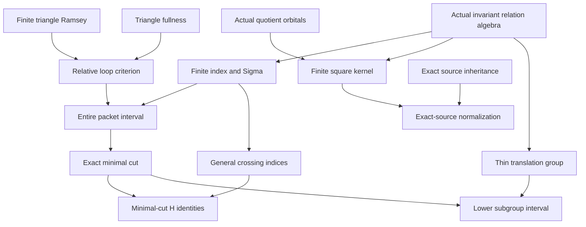

# Finite-index packets, minimal cuts and exact-kernel normalization

Generated from `module.json` by `tools/build_formalization_module.py`.

Source `490c3f36d85db5a0b3ced0598e6c431825254ec5`. **Human-expanded proof plan; no Lean code.**

Preparation for OTHER Lean projects. All eight numbered results of finite_packets.tex, four auxiliary equations and the twin-cell example are expanded. General index algebra, triangle-law packet geometry, elementary square regularization, source-preserving normalization and thin-group transport are separated. No SAP, NR2, selectors or owner groupoid is introduced.

The human article remains unchanged. Additional proof details are in
[PROOF_NOTES.md](PROOF_NOTES.md); the cross-track policy is in
[the formalization guide](../README.md). Source hashes are checked before
the index is regenerated. Graph validation is not proof verification.

## Source premises

**A01: Actual symmetric original source.** An inhabited transitive homogeneous complete finite symmetric binary original source, possibly finite. Logical equality is separate from the finite diversity palette. All relations are actual original automorphism-invariant pair-orbital unions. Same-sort invariant endorelations commute, without CCO or SAP.

**A02: Original AP and semantic homomorphic CCO.** The actual original age has AP and semantic homomorphic CCO. Used through I01 triangle fullness and I02 exact quotient-source inheritance. Never infer source inheritance for arbitrary nonexact kernels.

**A03: Elementary cardinal and finite combinatorics.** Finite choices, finite-set counting, powers in a finite palette, finite pigeonhole, finite groups and their elementary abelian identification. Relative indices are cardinalities of actual class quotients, possibly infinite; a natural-number cardinal is used only after proving finiteness. A sufficient finite triangle Ramsey bound is expanded internally.

**A04: Optional thin finite bottom.** For the translation-group branch all atomic orbitals contained in the greatest finite-class invariant equivalence F are thin. This does not imply absence of nonidentity finite-class exact kernels.

**A05: Countable original source for the current inheritance provider.** For C13/C24/C25 retain the pinned exact-quotient source provider's countability premise. Initial M is countable and each actual quotient is countable as an image. The elementary index, regularizer and thin-group branches do not require countability; no uncountable joint-lifting extension is claimed.

## Imported theorem contracts

These are named provider obligations for the receiving Lean project,
not new axioms or claims of compiled imports.

| ID and source | Contract | Current provider status |
|---|---|---|
| I01: [`lem:cco-triangle-fullness`](../../sections/triangle_fullness.tex#L2) | Original complete-diagram triangle fullness follows from age AP and original semantic homomorphic CCO. Loop arguments consume only this triangle law, not SAP or arbitrary imaginary inheritance. | HUMAN_SUPPORT_PROOF_NOT_LEAN |
| I02: [`thm:exact-sorts-source`](../../sections/exact_foundations/03_joint_exact_sort_lifting.tex#L161) | For the COUNTABLE current original source, an actual quotient by an original FULL RAW exact invariant equivalence is again homogeneous, transitive, symmetric, triangle-defined AP and semantic-homomorphic-CCO in its actual binary orbital language. No arbitrary nonexact quotient is included. | HUMAN_EXPANDED_NOT_LEAN |
| I03: [`lem:foundational-orbital-pullback`](../../sections/typed_invariant_quotient_transport.tex#L216) | For actual equivariant quotient maps of a transitive group action, the pullback of the orbital of a quotient pair is kernel;old orbital;kernel. This elementary group-action law does not require quotient homogeneity, SAP, CCO or exactness. | HUMAN_SUPPORT_PROOF_NOT_LEAN |
| I04: [`lem:rh-evenwalk`](../../sections/real_hull/05_even_walk_canonical_hull.tex#L8) | Even connectivity of a symmetric diversity atom is one actual positive even RAW word profile. If the atom is looped, even connectivity equals full Gamma connectivity. No CCO or SAP is needed for this elementary represented-word law. | HUMAN_EXPANDED_NOT_LEAN |

## Definitions

| ID | Definition | Exact meaning | Source |
|---|---|---|---|
| D01 | Full invariant-equivalence lattice | All original invariant equivalences on the real sort, ordered by inclusion; actual Top and Id, meets by intersection and joins by represented commuting composition. | [source](../../sections/finite_packets.tex#L6) |
| D02 | Actual relative class index | For J<=K, [K:J] is the uniform cardinality of J-classes contained in one K-class. Uniformity follows from original transitivity; finite claims carry a finiteness guard. | [source](../../sections/finite_packets.tex#L10) |
| D03 | Finite-index closure Sigma and F | Sigma(J) is the greatest K>=J with finite [K:J]; C03 constructs it. F=Sigma(Id) is the greatest finite-class original equivalence, not necessarily exact. | [source](../../sections/finite_packets.tex#L16) |
| D04 | Looped atoms and packet core | A looped DIVERSITY atom has an actual monochromatic triangle. Gamma(a) is its full connectivity equivalence. Kappa(J) is the join of Gamma(a) for looped a<=J; empty join is actual Id. | [source](../../sections/finite_packets.tex#L21) |
| D05 | Minimal infinite cut and finite part H | When the source is infinite, E is inclusion-minimal among original equivalences with infinite classes and H=E meet F. E may be Top, and no E<Sigma(E) condition is imposed. | [source](../../sections/finite_packets.tex#L96) |
| D06 | Finite square regularizer H0 | For all diversity atoms a_i<=F set P=product a_i², with empty product Id, and let H0 be a stabilized positive power of P. Identity is real equality, not a diversity letter. | [source](../../sections/finite_packets.tex#L220) |
| D07 | Actual quotient orbitals | On actual classes M/K use the original group action; each quotient pair orbital has pullback K;a;K. A pullback can contain several old atoms and is not itself declared an old single atom. | [source](../../sections/finite_packets.tex#L229) |
| D08 | Thin atom and unique-neighbour permutation | A thin atomic relation has exactly one neighbour at every point; symmetry makes its unique-neighbour map an involution. Equality is allowed as the neutral thin relation. | [source](../../sections/finite_packets.tex#L344) |
| D09 | Thin translation group and subgroup relation | Thin atoms within F, including equality, form a finite group by represented composition. A subgroup H corresponds to the union of its thin orbital graphs, not a choice of packet origins. | [source](../../sections/finite_packets.tex#L342) |
| D10 | Palette rank for normalization | The nonnegative integer number of diversity orbitals in the CURRENT actual quotient source. Every nonidentity quotient kernel removes at least one diversity orbital into quotient equality. | [source](../../sections/finite_packets.tex#L269) |

## Proof claims and direct dependencies

Every row has a human proof expansion. Each still needs an actual Lean
statement and proof. Actual quotient-orbital algebra is weaker than full quotient-source inheritance; thin finite packets need not be free of nonidentity exact kernels.

| ID and claim | Scope | Direct providers | Proof note |
|---|---|---|---|
| C01: Elementary symmetric lattice calculus | elementary | D01 | N01 in [notes](PROOF_NOTES.md) |
| C02: Index transposition and finite tower bounds | elementary | C01, D02, A03 | N01 in [notes](PROOF_NOTES.md) |
| C03: Existence and closure properties of Sigma | elementary | C02, D03 | N01 in [notes](PROOF_NOTES.md) |
| C04: Elementary finite triangle Ramsey | finite_combinatorics | A03 | N02 in [notes](PROOF_NOTES.md) |
| C05: Relative loop criterion | triangle_law | C04, D04, D02, I01 | N02 in [notes](PROOF_NOTES.md) |
| C06: Core monotonicity and finite refinement | triangle_law | C05, D04 | N02 in [notes](PROOF_NOTES.md) |
| C07: Core and member have the same closure | triangle_law | C06, C03 | N02 in [notes](PROOF_NOTES.md) |
| C08: Entire packet is its closed interval | triangle_law | C07, C03, C02 | N02 in [notes](PROOF_NOTES.md) |
| C09: Loop connectivity is a positive atomic word | elementary | I04, C01, D04 | N02 in [notes](PROOF_NOTES.md) |
| C10: Core word exactness with the identity boundary | elementary | C09, C01 | N02 in [notes](PROOF_NOTES.md) |
| C11: Elementary geometry below a minimal infinite cut | elementary | D05, C03, C02 | N03 in [notes](PROOF_NOTES.md) |
| C12: Minimal cut equals its exact core | triangle_law | C06, C10, C11 | N03 in [notes](PROOF_NOTES.md) |
| C13: Actual minimal-cut quotient inherits the full source | exact_source | C12, I02 | N03 in [notes](PROOF_NOTES.md) |
| C14: Finite restriction across the cut | elementary | C02, C11 | N04 in [notes](PROOF_NOTES.md) |
| C15: Modular path rerouting | elementary | C01 | N04 in [notes](PROOF_NOTES.md) |
| C16: Crossing meet can replace E by H | elementary | C14, C15 | N04 in [notes](PROOF_NOTES.md) |
| C17: General actual finite-index factorization | elementary | C02, C15 | N04 in [notes](PROOF_NOTES.md) |
| C18: Sigma crossing identity | elementary | C03, C16, C02 | N04 in [notes](PROOF_NOTES.md) |
| C19: Finite exact square kernel construction | elementary | C03, C01, D06, A03 | N05 in [notes](PROOF_NOTES.md) |
| C20: Actual quotient atom pullbacks | elementary | C19, I03, D07 | N05 in [notes](PROOF_NOTES.md) |
| C21: The finite quotient packet has thin atoms | elementary | C20, C19 | N05 in [notes](PROOF_NOTES.md) |
| C22: Thin and nonthin initial branches | elementary | C19, C21 | N05 in [notes](PROOF_NOTES.md) |
| C23: Nonidentity quotients strictly lower the palette | elementary | I03, D10, C01, A03 | N06 in [notes](PROOF_NOTES.md) |
| C24: Finite source-preserving exact normalization | exact_source | I02, C23 | N06 in [notes](PROOF_NOTES.md) |
| C25: Terminal exact-kernel-free source has thin F | exact_source | C24, C22 | N06 in [notes](PROOF_NOTES.md) |
| C26: Thin maps are equivariant involutions | thin_group | A04, D08, C03 | N07 in [notes](PROOF_NOTES.md) |
| C27: Finite elementary abelian group regular on packets | thin_group | C26, C01, D09, A03 | N07 in [notes](PROOF_NOTES.md) |
| C28: Single-atom colour transport and central automorphisms | thin_group | C27, C01 | N07 in [notes](PROOF_NOTES.md) |
| C29: Lower interval is a subgroup lattice plus cut | thin_group | C27, C28, C11 | N08 in [notes](PROOF_NOTES.md) |
| C30: Twin-cell source has homogeneous AP and CCO age | examples | A03 | N08 in [notes](PROOF_NOTES.md) |
| C31: Thin F can still be a nontrivial finite exact kernel | examples | C30 | N08 in [notes](PROOF_NOTES.md) |

The precise quantified contracts are in `module.json`. Provider-before-consumer
order (including definitions and source premises):

`A01 → A02 → A03 → A04 → A05 → C04 → C30 → D01 → D08 → I01 → I02 → I03 → I04 → C01 → C31 → D02 → D04 → D07 → C02 → C05 → C09 → C15 → D03 → D10 → C03 → C06 → C10 → C17 → C23 → D05 → D06 → D09 → C07 → C11 → C19 → C24 → C26 → C08 → C12 → C14 → C20 → C27 → C13 → C16 → C21 → C28 → C18 → C22 → C29 → C25`

This order is one valid linearization; it does not require unrelated
branches to be proved sequentially. The full DAG is the `depends_on`
relation in `module.json`.

## Main proof branches

This is a coarse view of the claim DAG. Edges go from provider to consumer.

General crossing index factorization does not need minimality, CCO or full-lattice distributivity.
Square regularization and thin-group transport do not need CCO; normalization of the source does.
Thin F and absence of nonidentity finite-class exact kernels are distinct conditions.

## Article exports

| Existing source result | Sidecar proof claims |
|---|---|
| [`lem:loopcrit`](../../sections/finite_packets.tex#L37) | C04, C05 |
| [`lem:packetinterval`](../../sections/finite_packets.tex#L56) | C03, C06, C07, C08, C09, C10 |
| [`prop:minimalcut`](../../sections/finite_packets.tex#L102) | C11, C12, C13 |
| [`lem:crossingindex`](../../sections/finite_packets.tex#L138) | C14, C15, C16, C17, C18 |
| [`lem:finite-regularization`](../../sections/finite_packets.tex#L207) | C19, C20, C21, C22 |
| [`lem:finite-exact-normalization-geometric`](../../sections/finite_packets.tex#L246) | C23, C24, C25 |
| [`lem:thin-bottom`](../../sections/finite_packets.tex#L339) | C26, C27, C28 |
| [`cor:lower-subgroups`](../../sections/finite_packets.tex#L380) | C29 |

Auxiliary source equations (not additional numbered results):

- [`eq:crossing-intersect`](../../sections/finite_packets.tex#L142): C16
- [`eq:crossing-index`](../../sections/finite_packets.tex#L144): C17
- [`eq:sigma-crossing`](../../sections/finite_packets.tex#L148): C18
- [`eq:thin-transport`](../../sections/finite_packets.tex#L349): C28

## Internal implementation milestones

These tasks are proof milestones inside larger project assignments;
see the [peer-project allocation](../coordination/BOARD.md).

These are implementation tasks, not additional mathematical assumptions.

| Task | Earlier tasks | Acceptance |
|---|---|---|
| T01: Finite indices, loop criterion and entire packet intervals | — | Prove the precise contracts, with actual class quotient/cardinality witnesses and source export mapping. Keep full-lattice, exact-kernel, thinness and empty-word boundaries separate. |
| T02: Minimal infinite cut and general crossing index calculus | T01 | Prove the precise contracts, with actual class quotient/cardinality witnesses and source export mapping. Keep full-lattice, exact-kernel, thinness and empty-word boundaries separate. |
| T03: Elementary finite square-kernel regularization | T01 | Prove the precise contracts, with actual class quotient/cardinality witnesses and source export mapping. Keep full-lattice, exact-kernel, thinness and empty-word boundaries separate. |
| T04: Palette-decreasing exact quotient normalization | T03 | Prove the precise contracts, with actual class quotient/cardinality witnesses and source export mapping. Keep full-lattice, exact-kernel, thinness and empty-word boundaries separate. |
| T05: Thin finite group and lower subgroup intervals | T01, T02 | Prove the precise contracts, with actual class quotient/cardinality witnesses and source export mapping. Keep full-lattice, exact-kernel, thinness and empty-word boundaries separate. |
| T06: Independent twin-cell sharpness source | — | Prove the precise contracts, with actual class quotient/cardinality witnesses and source export mapping. Keep full-lattice, exact-kernel, thinness and empty-word boundaries separate. |

## Finite controls

- **R01.** Computed product-source loops, full supports, Sigma/kappa and entire packet intervals.
- **R02.** Actual finite-class index transpositions, modular paths and crossing identities.
- **R03.** Square kernels, actual quotient orbitals, thin quotient packets and palette reduction.
- **R04.** Thin elementary-abelian subgroup intervals and the twin-cell thin-but-exact control.

Run `python tools/check_finite_packet_controls.py` from the manuscript directory.
The controls do not prove CCO or the general theorems.

## Return to the human articles

No required mathematical repair was found in this scoped pass. These
optional wording clarifications remain queued for a human article pass:

- **F01** ([source](../../sections/finite_packets.tex#L51)): Only finitely many representative classes, enough for a triangle Ramsey bound, are needed. Replace the infinite Ramsey invocation with the prepared finite pivot argument.
- **F02** ([source](../../sections/finite_packets.tex#L49)): The packet-interval converse needs both inclusions for Sigma(L), using finite tower indices, not just maximality in one direction. Expand the two finite-index comparisons in formalization; human text may keep a short parenthetical justification.
- **F03** ([source](../../sections/finite_packets.tex#L173)): The crossing index product is a general theorem for commuting equivalences; minimal-cut hypotheses enter only the H-intersection clauses. Expose general class transposition and tower counting once, then instantiate.
- **F04** ([source](../../sections/finite_packets.tex#L231)): Square-kernel quotient orbital/uniqueness arguments need only actual ambient group-action pullbacks; quotient source inheritance is separate. Use the elementary foundational orbital pullback here; retain full exact-source inheritance for actual normalization steps.
- **F05** ([source](../../sections/finite_packets.tex#L280)): Thin F does not imply absence of finite exact kernels, even in an actual AP+CCO source. Retain the twin-cell countercontrol when applying normalization or conditional-bijection machinery.
- **F06** ([source](../../sections/finite_packets.tex#L266)): The pinned full exact-source inheritance route uses countable joint lifting. Countability is explicit for the two source-inheritance consumers and is preserved by quotienting. Retain the standing countable-source convention at these provider applications; do not silently claim uncountable joint lifting.

The machine ledger records caller effects and affected claims. The source
review used two independent model review passes and parent synthesis;
it is not independent human or formal certification.
