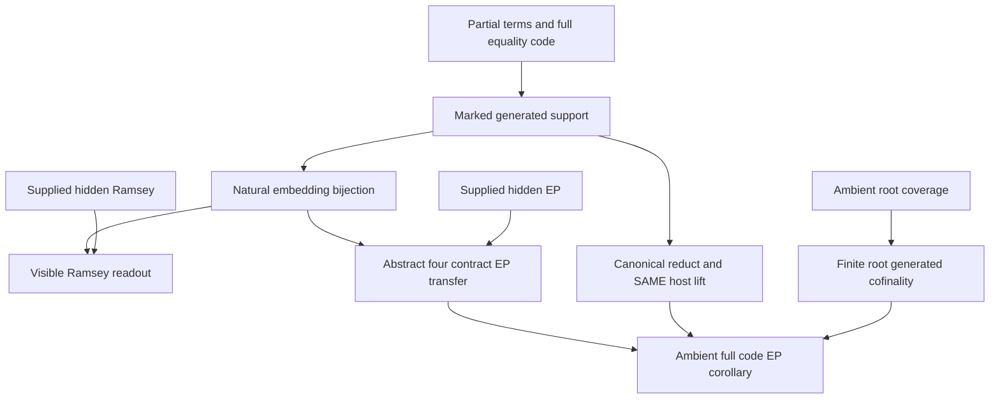

# Full unary-term tuple codes, Ramsey readout and fixed-host EP transfer

Generated from `module.json` by `tools/build_formalization_module.py`.

Source `490c3f36d85db5a0b3ced0598e6c431825254ec5`. **Human-expanded proof plan; no Lean code.**

Private B035: SIX Foundations III source results and TWO equations. Reconstruct actual partial-unary generated supports from COMPLETE finite tagged tuple codes, including definedness, within-root/cross-root equality and all unary/binary relations. Prove the natural bijection of ALL embeddings and transfer a supplied hidden Ramsey property without EP or root cofinality. Independently prove ambient root-cover cofinality and SAME-unexpanded-host lifting with explicit canonical-support/reduct-commutation hypotheses. Transfer a supplied hidden EP through the abstract four-contract interface; then discharge its contracts for an ambient root-covered full-code interpretation. No CCO/SAP/EPPA, MI/MR geometry, concrete fine-code definability or external Ramsey theorem is assumed as a provider. Hidden Ramsey and hidden EP are separate conditional INPUTS, not proved here.

The human article remains unchanged. Additional proof details are in
[PROOF_NOTES.md](PROOF_NOTES.md); the cross-track policy is in
[the formalization guide](../README.md). Source hashes are checked before
the index is regenerated. Graph validation is not proof verification.

## Source premises

**A01: Hereditary typed partial-unary hidden class.** H^o is an isomorphism-closed hereditary class of finite induced structures in a finite many-sorted language with ONLY unary partial functions and positive unary/binary relations, including any hidden order. There are NO nullary symbols or higher-arity functions. Induced embeddings preserve and reflect function domains/values and all relations; induced substructures are unary-closed. Empty structures/sorts use the usual induced restriction convention.

**A02: Uniform finite normal forms as PARTIAL functions.** For each hidden input sort fix finitely many well-typed unary-term normal forms, including identity, and a choice of representative for every unary term. A term and its representative have IDENTICAL domains and values in EVERY H^o member. In particular NF(F composed with t) records each named unary extension, including nowhere-defined composites. The finite lists need not contain syntactically every composition.

**A03: All valid tagged tuples without a quotient.** Finitely many visible tags s have finite typed coordinate tuples and quantifier-free compatibility formulas delta_s. N(D^o) contains ALL valid tagged tuples of D^o; no tuple quotient or representative choice is taken. Coordinate terms select a root coordinate then apply a unary normal form. Zero-coordinate tuples, if admitted, are unique per tag and their nullary-free compatibility is constant.

**A04: Exact hereditary FULL-code visible age.** V^o consists precisely of hereditary finite induced root subsets of full N(D^o) codes, up to isomorphism. The code retains tags, all applicable normal-form term equalities and definedness, every hidden unary/binary relation and order comparison, including same-root instances. There are no additional freely interpreted visible predicates. A fixed source A^o retains its root-coordinate presentations even though the unmarked hidden support alone need not determine which root subset was selected.

**A05: Optional hidden embedding Ramsey input.** ONLY for Ramsey readout, H^o is Ramsey for EMBEDDINGS: for finite hidden X,Y and positive integer k there is finite D^o with D^o -> (Y)^X_k. Every k-coloring of Emb(X,D^o) is constant on g composed Emb(X,Y) for some g in Emb(Y,D^o). No hidden EP or root-cover condition is part of this input.

**A06: Optional ambient root-cover input.** ONLY for ambient cofinality, P is a possibly infinite hidden partial-unary structure with the same valid-root interpretation and uniformly finite term normal forms on root-coordinate sorts. H is the hereditary age of finite unary-closed induced substructures embeddable in P. EVERY point of P is a defined coordinate-term value of some valid root tuple in N(P). No Ramsey, EP, CCO or SAP is assumed.

**A07: Compatible hidden and visible expansion setting.** For the later SAME-HOST/EP statements H^o->H is hereditary and V^o->V is its corresponding full-code expansion over a chosen unexpanded fine visible age. Tags and delta formulas are fixed in the UNEXPANDED hidden language, so the root carrier N(E) is determined before an expansion is chosen. Unexpanded visible fine data canonically determine generated supports over root-coordinate presentations, and forgetting each allowed expanded generated support gives that SAME canonical unexpanded support. Added functions require this explicit commutation; relational expansions retaining functions satisfy the function part automatically.

**A08: BOUND full-root-generated host for the same-host lemma.** In the same-host lemma choose ANY finite E in H with h(N(E))=E, let B be its full unexpanded visible interpretation, and retain its canonical unexpanded coordinate-template identification. All allowed expansions of B are hereditary FULL codes of hidden expanded hosts, with the reduct compatibility in A07. These are bound lemma inputs for each E, not a cofinality or EP axiom.

**A09: Reasonable precompact expansions for EP statements.** ONLY for the EP transfer/corollary, the hidden and visible expansions are reasonable, reduct-surjective and precompact over their hereditary unexpanded ages. Reasonableness lifts any chosen unexpanded embedding X->Y and allowed X^o to some allowed Y^o with that SAME map an expanded embedding. This is used to normalize an EP witness to its OLD-root-generated part when extra unary functions are present. The proof constructs one fixed unexpanded host before any competing expansion; these class conditions are not used for reconstruction/Ramsey or the local same-host lemma.

**A10: Optional hidden EP input with its exact quantifiers.** Hidden EP means: for EVERY finite expanded X^o in H^o there exists a finite UNEXPANDED D in H such that EVERY allowed expansion D^o contains an expanded embedding X^o->D^o. This is the source convention in sections/expansion_property_unfiltered.tex; no preferred single expansion may replace the universal quantifier. Hidden Ramsey is not assumed in this branch.

**A11: Abstract four-contract EP interface.** For the abstract transfer: (i) unexpanded visible A canonically determines h(A), and each A^o gives a compatible hidden expansion; (ii) every finite hidden D embeds into some finite E with h(N(E))=E; (iii) EVERY allowed expansion of N(E), for such E, lifts to the SAME underlying unexpanded E preserving the full code; (iv) visible embeddings extend uniquely to generated supports, valid root tuples are transported correctly, and the full tuple code recovers all original fine visible binary atoms. The reverse hidden-to-visible embedding construction of the full-code setting is retained. These are explicit conditional inputs, not conclusions from hidden Ramsey alone.

**A12: Ambient root-covered corollary inputs.** For the final corollary use reasonable precompact expansions with hidden EP, a source age represented by finite unary-closed induced substructures of one ambient P, ambient root coverage and finite normal forms as in A06. Complete unexpanded fine codes reconstruct canonical supports AND original fine atoms; expanded support reducts commute over the SAME presentations. Allowed expanded visible objects/embeddings are EXACTLY hereditary full hidden codes. These premises will discharge the abstract four-contract interface, with bound E inputs instantiated in the same-host lemma.

## Definitions

| ID | Definition | Exact meaning | Source |
|---|---|---|---|
| D01 | Partial term evaluation and normalization | A typed unary term is a composable chain of named unary partial maps, including identity. Evaluation is undefined if ANY required step is undefined. NF preserves both domain and value, not merely equality where both terms happen to be defined. | [source](../../sections/full_code_tuple_ep_transfer.tex#L53) |
| D02 | Marked valid roots and coordinate terms | A root a has its tag and ordered coordinate tuple eta(a). A presentation (a,j,t) applies a normal form t to coordinate j of a, when defined. Distinct tags always give distinct roots; equal tags use literal ordered tuple equality. | [source](../../sections/full_code_tuple_ep_transfer.tex#L53) |
| D03 | Complete finite code predicates | For applicable coordinate terms tau,sigma retain E_tau,sigma(a,b) iff both defined and equal, U_tau(a) iff defined and U holds, and R_tau,sigma(a,b) iff both defined and R holds, for ALL hidden unary/binary/order symbols. All same-root instances are retained. E_tau,tau(a,a) records definedness. Tags and normal-form indices make this a finite unary/binary signature. | [source](../../sections/full_code_tuple_ep_transfer.tex#L53) |
| D04 | Generated support as a marked presentation quotient | h(A^o) is the actual induced unary closure of the root coordinates in a realizing hidden host. Equivalently take the finite DEFINED presentations and quotient by the full equality codes. Keep the map from each marked source root coordinate to its class; do not infer the selected root subset from the unmarked quotient alone. | [source](../../sections/full_code_tuple_ep_transfer.tex#L53) |
| D05 | Two embedding constructions | For visible f define bar(f)(tau(a))=tau(f(a)). For hidden g define root(g)(a) by applying g to each coordinate, keeping its tag. Their validity, inducedness, inverses and naturality are proof obligations, not assumed bijections. | [source](../../sections/full_code_tuple_ep_transfer.tex#L53) |
| D06 | Embedding Ramsey arrow | D^o -> (Y^o)^(X^o)_k means every k-coloring of ALL embeddings X^o->D^o admits g:Y^o->D^o constant on g composed Emb(X^o,Y^o). It is not a coloring only of isomorphism types or unmarked copies. | [source](../../sections/full_code_tuple_ep_transfer.tex#L104) |
| D07 | Full-root-generated unexpanded host | Finite E is full-root-generated when the induced unary support h(N(E)) is EXACTLY E. It need not be true for arbitrary hidden hosts: points not generated by any valid root may be orphans. Cofinality says every finite hidden D embeds in SOME such E. | [source](../../sections/full_code_tuple_ep_transfer.tex#L130) |
| D08 | Canonical reduct identification | For fixed visible unexpanded B, its canonical h(B) has marked root-coordinate presentations. For allowed B^o the reduct of h(B^o) identifies with h(B) over those SAME marks; it is not merely some isomorphic unmarked structure with a different root incidence. | [source](../../sections/full_code_tuple_ep_transfer.tex#L183) |
| D09 | Same-host lift | A lift of B^o, where B=N(E) and E is full-root-generated, is an allowed E^o on the EXACT underlying unexpanded E whose code on the fixed root carrier B is precisely B^o. Uniqueness is relative to the chosen marked identification, not a claim of arbitrary canonical labelling. | [source](../../sections/full_code_tuple_ep_transfer.tex#L183) |
| D10 | Expansion property with a fixed unexpanded host | EP is forall finite A^o exists finite unexpanded B forall allowed B^o exists expanded embedding A^o->B^o. B, its root carrier and the embedding D0->E used to construct it must be chosen before B^o. D0 is the OLD-root-generated normalization of a hidden EP witness D. This is the fixed-expanded-source convention stated in the frozen source. | [source](../../sections/full_code_tuple_ep_transfer.tex#L242) |
| D11 | Abstract EP interface and its concrete discharge | The four A11 contracts are used conditionally by the abstract transfer. The corollary discharges cofinality with ambient root coverage, same-host lifting with full canonical code, and embedding/fine-atom faithfulness with reconstruction. Bound local host inputs are instantiated for the E already chosen. | [source](../../sections/full_code_tuple_ep_transfer.tex#L242) |
| D12 | Original fine-atom faithfulness | Any original unexpanded visible fine binary atom must be recoverable from the retained tuple code, uniformly enough that code embeddings preserve and reflect it. This is an explicit application contract; the abstract full-code theorem does not prove definability for a particular MI/MR interpretation or justify freely adding visible relations. | [source](../../sections/full_code_tuple_ep_transfer.tex#L242) |

## Proof claims and direct dependencies

Every row has a human proof expansion. Each still needs an actual Lean
Reconstruction needs neither hidden Ramsey nor EP. Ramsey readout needs no root cover or fixed-host lifting. The abstract EP theorem uses its explicit four contracts, not the later concrete proofs as extra hypotheses; the corollary instantiates those conditional interfaces. All root tuples and their coordinate presentations remain marked data.

| ID and claim | Scope | Direct providers | Proof note |
|---|---|---|---|
| C01: Partial unary embeddings transport term domains and values | partial_terms | D01, A01 | N01 in [notes](PROOF_NOTES.md) |
| C02: Quantifier-free root validity is preserved and reflected | partial_terms | C01, A03 | N01 in [notes](PROOF_NOTES.md) |
| C03: Defined normal-form presentations equal the finite generated support | reconstruction | D01, D02, A02 | N02 in [notes](PROOF_NOTES.md) |
| C04: Diagonal equality codes record exactly which presentations exist | reconstruction | D03, C03 | N02 in [notes](PROOF_NOTES.md) |
| C05: Full equality gives the exact presentation equivalence relation | reconstruction | C03, C04, D04 | N02 in [notes](PROOF_NOTES.md) |
| C06: The quotient recovers all unary and binary relation diagrams | reconstruction | C05, D03 | N02 in [notes](PROOF_NOTES.md) |
| C07: Normal-form composition recovers every partial function graph | reconstruction | C03, C04, C05, D01 | N02 in [notes](PROOF_NOTES.md) |
| C08: Marked generated support is reconstructed uniquely | reconstruction | C03, C05, C06, C07, D04 | N02 in [notes](PROOF_NOTES.md) |
| C09: Visible maps induce well-defined injective presentation maps | embedding_bijection | D05, C04, C05 | N03 in [notes](PROOF_NOTES.md) |
| C10: The extended map is an induced hidden embedding | embedding_bijection | C06, C07, C09 | N03 in [notes](PROOF_NOTES.md) |
| C11: Hidden maps transport tagged tuples to valid roots | embedding_bijection | D05, C02, C03, A03 | N03 in [notes](PROOF_NOTES.md) |
| C12: The induced root map preserves and reflects the entire code | embedding_bijection | C01, C11, D03 | N03 in [notes](PROOF_NOTES.md) |
| C13: The two embedding constructions are inverse | embedding_bijection | C09, C10, C11, C12, C03 | N03 in [notes](PROOF_NOTES.md) |
| C14: Support extension is unique and natural under composition | embedding_bijection | C08, C10, C12, C13 | N03 in [notes](PROOF_NOTES.md) |
| C15: Natural bijection of ALL visible and hidden embeddings | embedding_bijection | C08, C10, C12, C13, C14 | N03 in [notes](PROOF_NOTES.md) |
| C16: A visible coloring pulls back through the exact bijection | Ramsey_readout | C15, A01, D06 | N04 in [notes](PROOF_NOTES.md) |
| C17: Choose the supplied hidden Ramsey witness | Ramsey_readout | C16, A05 | N04 in [notes](PROOF_NOTES.md) |
| C18: Naturality gives the visible monochromatic copy | Ramsey_readout | C12, C14, C15, C17, A04 | N04 in [notes](PROOF_NOTES.md) |
| C19: Empty supports, zero-coordinate roots and host orphans are harmless | Ramsey_readout | C11, C15, C18, A03 | N04 in [notes](PROOF_NOTES.md) |
| C20: Conditional hidden-to-visible Ramsey readout | Ramsey_readout | C16, C17, C18, C19 | N04 in [notes](PROOF_NOTES.md) |
| C21: Choose finitely many covering roots over an embedded D | root_cofinality | A06, D02 | N05 in [notes](PROOF_NOTES.md) |
| C22: Close exactly those chosen coordinates inside P | root_cofinality | C21, A06, D01 | N05 in [notes](PROOF_NOTES.md) |
| C23: Chosen roots remain valid in that same finite E | root_cofinality | C22, C01, C02 | N05 in [notes](PROOF_NOTES.md) |
| C24: Every point of E is generated by a retained valid root | root_cofinality | C22, C23, D07 | N05 in [notes](PROOF_NOTES.md) |
| C25: Ambient root coverage yields finite root-generated cofinality | root_cofinality | C21, C22, C23, C24 | N05 in [notes](PROOF_NOTES.md) |
| C26: Represent an arbitrary allowed expansion by an actual hidden host | same_host | A08, A07, A04, C08, C15 | N06 in [notes](PROOF_NOTES.md) |
| C27: Forgetting that support gives the fixed canonical E | same_host | C26, A07, A08, D08 | N06 in [notes](PROOF_NOTES.md) |
| C28: Transport the expanded structure onto the existing E | same_host | C26, C27, A01, D09 | N06 in [notes](PROOF_NOTES.md) |
| C29: The transported full root code is exactly the competing B expansion | same_host | C28, C12, A07, A08 | N06 in [notes](PROOF_NOTES.md) |
| C30: Lift uniqueness follows from complete code and full root generation | same_host | C08, C27, C29, A08 | N06 in [notes](PROOF_NOTES.md) |
| C31: Every competing expansion has the required SAME-host realization | same_host | C26, C27, C28, C29, C30 | N06 in [notes](PROOF_NOTES.md) |
| C32: Fix the expanded source and its compatible hidden support | EP_transfer | A07, A11, D11 | N07 in [notes](PROOF_NOTES.md) |
| C33: Hidden EP selects D before any competing visible expansion | EP_transfer | C32, A10, A09 | N07 in [notes](PROOF_NOTES.md) |
| C34: Cofinality selects E above the normalized witness and fixes B | EP_transfer | C33, C50, A11, A07 | N07 in [notes](PROOF_NOTES.md) |
| C35: Universal same-host contract handles an arbitrary B expansion | EP_transfer | C34, A11 | N07 in [notes](PROOF_NOTES.md) |
| C36: Restrict legally to the normalized witness and apply its EP | EP_transfer | C34, C35, C50, C51, A07, A01 | N07 in [notes](PROOF_NOTES.md) |
| C37: Use the reverse FCODE direction and fine-atom faithfulness | EP_transfer | C36, C11, C12, C14, A11, D12 | N07 in [notes](PROOF_NOTES.md) |
| C38: The fixed host satisfies the universal visible EP quantifier | EP_transfer | C32, C33, C34, C35, C36, C37, D10 | N07 in [notes](PROOF_NOTES.md) |
| C39: Abstract cofinal EP transfer with exactly four contracts | EP_transfer | C38, A09, A10, D11 | N07 in [notes](PROOF_NOTES.md) |
| C40: The ambient corollary discharges cofinality contract ii | EP_transfer | A12, C25 | N08 in [notes](PROOF_NOTES.md) |
| C41: The corollary discharges SAME-host contract iii for every chosen E | EP_transfer | A12, A07, C40, C31 | N08 in [notes](PROOF_NOTES.md) |
| C42: Canonical full codes discharge source and embedding contracts i and iv | EP_transfer | A12, A07, C15 | N08 in [notes](PROOF_NOTES.md) |
| C43: Apply the conditional abstract transfer to the discharged contracts | EP_transfer | C39, C40, C41, C42, A12 | N08 in [notes](PROOF_NOTES.md) |
| C44: Missing domain/equality/comparison codes break exact reconstruction | boundary | C04, C05, C07, C15 | N09 in [notes](PROOF_NOTES.md) |
| C45: Orphans show root-generation and same-host claims are substantive | boundary | C24, C30, C31 | N09 in [notes](PROOF_NOTES.md) |
| C46: Added functions need reduct commutation even with finite normal forms | boundary | C07, C27, C31, D08 | N09 in [notes](PROOF_NOTES.md) |
| C47: EP order of quantifiers and conditional inputs remain explicit | boundary | C20, C34, C35, C38 | N09 in [notes](PROOF_NOTES.md) |
| C48: Normalize D using ONLY OLD unary functions and all its valid roots | EP_transfer | C01, C02, A07, A11, D07 | N07 in [notes](PROOF_NOTES.md) |
| C49: Reasonableness extends EVERY normalized expansion to D | EP_transfer | C48, A09 | N07 in [notes](PROOF_NOTES.md) |
| C50: The normalized D0 retains the required hidden EP witness property | EP_transfer | C32, C33, C48, C49, C01, C02, A07, A11 | N07 in [notes](PROOF_NOTES.md) |
| C51: Full-code reduct commutation proves normalized image expanded closure | EP_transfer | C34, C35, C48, C01, C02, C03, A07, A11 | N07 in [notes](PROOF_NOTES.md) |

The precise quantified contracts are in `module.json`. Provider-before-consumer
order (including definitions and source premises):

`A01 → A02 → A03 → A04 → A05 → A06 → A07 → A08 → A09 → A10 → A11 → A12 → D01 → D06 → D07 → D08 → D10 → D11 → D12 → C01 → C32 → D02 → D09 → C02 → C03 → C21 → C33 → D03 → C04 → C22 → C48 → D04 → C05 → C23 → C49 → D05 → C06 → C07 → C09 → C11 → C24 → C50 → C08 → C10 → C12 → C25 → C34 → C13 → C35 → C40 → C14 → C51 → C15 → C36 → C16 → C26 → C37 → C42 → C44 → C17 → C27 → C38 → C18 → C28 → C39 → C19 → C29 → C20 → C30 → C31 → C47 → C41 → C45 → C46 → C43`

This order is one valid linearization; it does not require unrelated
branches to be proved sequentially. The full DAG is the `depends_on`
relation in `module.json`.

## Main proof branches

This is a coarse view of the claim DAG. Edges go from provider to consumer.

All six results are conditional elementary transfers with no mathematical provider imports or external theorem calls.
Full code retains partial definedness, within-root/cross-root equality, every hidden unary/binary relation and comparisons. Roots are literal tagged tuples, with no tuple quotient.
The marked source root set is retained; the unmarked hidden support alone need not recover which roots were selected.
Hidden Ramsey readout permits orphan host points and requires neither root cofinality nor EP.
Same-host lifting requires exact canonical unexpanded support, explicit expanded-support reduct commutation and a full-root-generated E.
With ADDED functions, EP first normalizes D to OLD-root-generated D0, retaining its witness property by reasonableness. Support-reduct commutation then proves j(D0) expanded-closed before restriction.
D0, its embedding in E and B=N(E) are fixed BEFORE the universally quantified B^o. The reverse hidden-to-visible step uses the actual FCODE construction.

## Article exports

| Existing source result | Sidecar proof claims |
|---|---|
| [`lem:foundational-full-code-embeddings`](../../sections/full_code_tuple_ep_transfer.tex#L52) | C08, C15 |
| [`thm:ramsey-tuple-readout`](../../sections/full_code_tuple_ep_transfer.tex#L103) | C20 |
| [`lem:foundational-root-cover-cofinal`](../../sections/full_code_tuple_ep_transfer.tex#L129) | C24, C25 |
| [`lem:foundational-same-host-code`](../../sections/full_code_tuple_ep_transfer.tex#L182) | C31 |
| [`thm:foundational-cofinal-tuple-EP`](../../sections/full_code_tuple_ep_transfer.tex#L241) | C38, C39 |
| [`cor:foundational-root-covered-full-code-EP`](../../sections/full_code_tuple_ep_transfer.tex#L320) | C43 |

Auxiliary source equations (not additional numbered results):

- [`eq:foundational-full-code-embeddings`](../../sections/full_code_tuple_ep_transfer.tex#L62): C15
- [`eq:foundational-root-cover`](../../sections/full_code_tuple_ep_transfer.tex#L144): C24, C25

## Internal implementation milestones

These tasks are proof milestones inside larger project assignments;
see the [peer-project allocation](../coordination/BOARD.md).

These are implementation tasks, not additional mathematical assumptions.

| Task | Earlier tasks | Acceptance |
|---|---|---|
| T01: Partial-term transport and marked quotient reconstruction | — | Implement genuine typed partial-function domains, finite NF composition and FULL same-root/cross-root tuple codes. Construct both directions of the embedding bijection and its naturality. Keep hidden Ramsey separate from hidden EP. EP normalizes D to OLD-root-generated D0 using reasonableness, fixes the unexpanded host before arbitrary competing expansions, and proves expanded closure by support reduct commutation BEFORE restriction. The corollary discharges all four application contracts. No concrete CCO/MI/MR encoding or external theorem is supplied. |
| T02: Both embedding constructions, inverses and naturality | T01 | Implement genuine typed partial-function domains, finite NF composition and FULL same-root/cross-root tuple codes. Construct both directions of the embedding bijection and its naturality. Keep hidden Ramsey separate from hidden EP. EP normalizes D to OLD-root-generated D0 using reasonableness, fixes the unexpanded host before arbitrary competing expansions, and proves expanded closure by support reduct commutation BEFORE restriction. The corollary discharges all four application contracts. No concrete CCO/MI/MR encoding or external theorem is supplied. |
| T03: Conditional hidden Ramsey readout | T01, T02 | Implement genuine typed partial-function domains, finite NF composition and FULL same-root/cross-root tuple codes. Construct both directions of the embedding bijection and its naturality. Keep hidden Ramsey separate from hidden EP. EP normalizes D to OLD-root-generated D0 using reasonableness, fixes the unexpanded host before arbitrary competing expansions, and proves expanded closure by support reduct commutation BEFORE restriction. The corollary discharges all four application contracts. No concrete CCO/MI/MR encoding or external theorem is supplied. |
| T04: Ambient finite root-generated cofinality | T01 | Implement genuine typed partial-function domains, finite NF composition and FULL same-root/cross-root tuple codes. Construct both directions of the embedding bijection and its naturality. Keep hidden Ramsey separate from hidden EP. EP normalizes D to OLD-root-generated D0 using reasonableness, fixes the unexpanded host before arbitrary competing expansions, and proves expanded closure by support reduct commutation BEFORE restriction. The corollary discharges all four application contracts. No concrete CCO/MI/MR encoding or external theorem is supplied. |
| T05: Canonical reduct and universal SAME-host lifting | T01, T02 | Implement genuine typed partial-function domains, finite NF composition and FULL same-root/cross-root tuple codes. Construct both directions of the embedding bijection and its naturality. Keep hidden Ramsey separate from hidden EP. EP normalizes D to OLD-root-generated D0 using reasonableness, fixes the unexpanded host before arbitrary competing expansions, and proves expanded closure by support reduct commutation BEFORE restriction. The corollary discharges all four application contracts. No concrete CCO/MI/MR encoding or external theorem is supplied. |
| T06: Abstract four-contract EP transfer with fixed host | T01, T02 | Implement genuine typed partial-function domains, finite NF composition and FULL same-root/cross-root tuple codes. Construct both directions of the embedding bijection and its naturality. Keep hidden Ramsey separate from hidden EP. EP normalizes D to OLD-root-generated D0 using reasonableness, fixes the unexpanded host before arbitrary competing expansions, and proves expanded closure by support reduct commutation BEFORE restriction. The corollary discharges all four application contracts. No concrete CCO/MI/MR encoding or external theorem is supplied. |
| T07: Ambient corollary discharges the four contracts | T01, T02, T04, T05, T06 | Implement genuine typed partial-function domains, finite NF composition and FULL same-root/cross-root tuple codes. Construct both directions of the embedding bijection and its naturality. Keep hidden Ramsey separate from hidden EP. EP normalizes D to OLD-root-generated D0 using reasonableness, fixes the unexpanded host before arbitrary competing expansions, and proves expanded closure by support reduct commutation BEFORE restriction. The corollary discharges all four application contracts. No concrete CCO/MI/MR encoding or external theorem is supplied. |
| T08: Domain, alias, orphan and EP quantifier counterchecks | T01, T02, T03, T04, T05, T06, T07 | Implement genuine typed partial-function domains, finite NF composition and FULL same-root/cross-root tuple codes. Construct both directions of the embedding bijection and its naturality. Keep hidden Ramsey separate from hidden EP. EP normalizes D to OLD-root-generated D0 using reasonableness, fixes the unexpanded host before arbitrary competing expansions, and proves expanded closure by support reduct commutation BEFORE restriction. The corollary discharges all four application contracts. No concrete CCO/MI/MR encoding or external theorem is supplied. |

## Finite controls

- **K01.** Independent bounded partial-unary structures and tagged tuple presentations: exact hidden/visible embedding sets, generated supports, full definedness/equality/relations, inverse maps and composition.
- **K02.** Finite ambient root-cover closure, SAME-host/full-code transport and explicit missing-code, orphan, added-function/reduct and EP quantifier negatives. Bounds are diagnostics, not all-size Ramsey/EP or Lean certificates.

Run `python tools/check_full_code_controls.py` from the manuscript directory.
The controls do not prove CCO or the general theorems.

## Return to the human articles

No required mathematical repair was found in this scoped pass. These
optional wording clarifications remain queued for a human article pass:

- **F01** ([source](../../sections/full_code_tuple_ep_transfer.tex#L55)): The reconstruction is unique over MARKED root-coordinate presentations; the unmarked hidden support need not determine which subset of all valid roots A selected. Partial-term domain transport and same-root equality/definedness are essential. Make the marked-source convention and a short partial-term/qf transport induction explicit before defining the two inverse embedding maps.
- **F02** ([source](../../sections/full_code_tuple_ep_transfer.tex#L295)): Fixed root compatibility and explicit support-reduct commutation ensure an arbitrary competing B^o lifts on the SAME unexpanded E. Added unary functions can enlarge a generated support even with finite normal forms. Retain the reduct-commutation warning and name the marked transport identifying E; optionally include the idempotent added-function example to explain why the condition is substantive.
- **F03** ([source](../../sections/full_code_tuple_ep_transfer.tex#L312)): The final EP step needs the hidden-to-visible direction of FCODE with fine-atom faithfulness, not just unique extension of a map already known visible. The source EP convention fixes an expanded A^o and universally quantifies competing expansions of a host chosen first. Cite the reverse embedding construction explicitly and repeat the fixed-host quantifier order at the EP interface. Keep concrete cofinal/same-host proofs separate from the abstract four contracts.
- **F04** ([source](../../sections/full_code_tuple_ep_transfer.tex#L296)): If expansions add unary functions, an arbitrary OLD induced D inside E need not be expanded-closed. The printed restriction step is automatic for relational/function-preserving expansions but needs a genuine argument in the stated general scope. Replace D by D0=h_old(N(D)). Use reasonableness to extend every D0 expansion to D and factor each EP embedding through D0. Then, after embedding D0 in E, use the full code on jN(D0) and coordinate-preserving support/reduct commutation to prove jD0 expanded-closed BEFORE restriction.

The machine ledger records caller effects and affected claims. The source
review used two independent model review passes and parent synthesis;
it is not independent human or formal certification.
