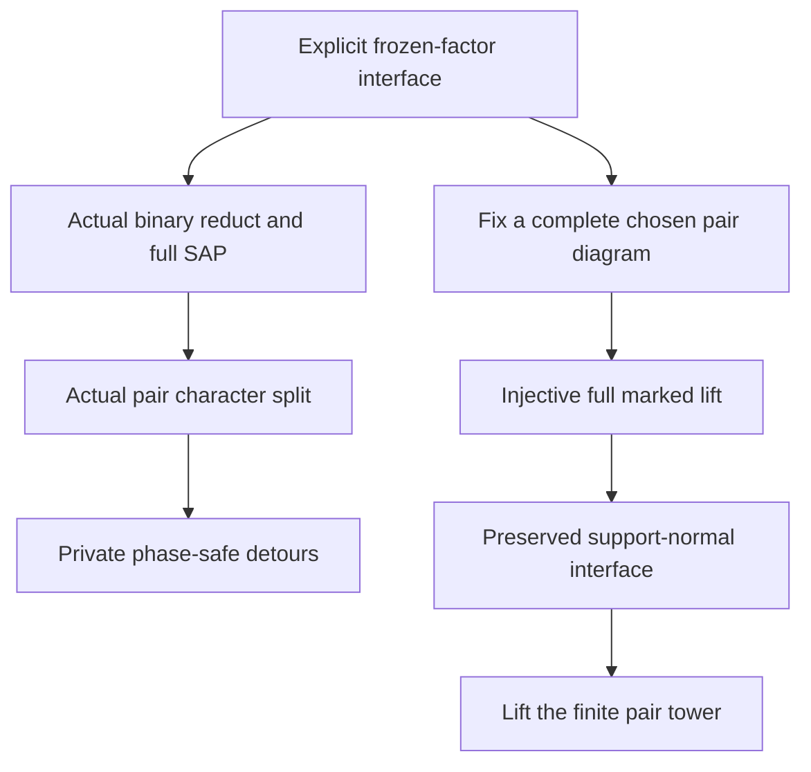

# Private phase detours and conditional full-language finite-cover elimination

Generated from `module.json` by `tools/build_formalization_module.py`.

Source `490c3f36d85db5a0b3ced0598e6c431825254ec5`. **Human-expanded proof plan; no Lean code.**

Private B048: TWO selected Ramsey I results, eight definitions, 34 claims, six tasks and no new equation. Root-free private two/three-edge detours use actual full quotient cylinders and fresh source-gate representatives. Full-language elimination retains the EXPLICIT support-normal frozen-factor completion interface; a simpler complete chosen pair-diagram lift proves full SAP, actual binary-reduct homogeneity and preservation of the interface under unary splitting. No unproved full-old SAP or collision-unfolding is imported; no arbitrary higher-arity theorem, coherent EPPA or new published provider is inferred.

The human article remains unchanged. Additional proof details are in
[PROOF_NOTES.md](PROOF_NOTES.md); the cross-track policy is in
[the formalization guide](../README.md). Source hashes are checked before
the index is regenerated. Graph validation is not proof verification.

## Source premises

**A01: Finite relational homogeneous full age.** C is a hereditary homogeneous finite relational class in a finite signature, with its countable homogeneous realization M (finite realizations allowed when applicable). Name all realized quantifier-free unary and distinct-pair types by a finite definitional expansion. Complete old objects and embeddings retain ALL old relations including repeated-argument tuples. Logical Id is separate from distinct-pair canonical atoms.

**A02: Actual canonical pair-age premises.** The canonical binary pair age has SAP and semantic homomorphic CCO, with symmetric same-sort actual canonical pair types and typed converses. Named realized unary sorts are finite in number and nonempty. This is the pair-age premise only; homogeneity of the actual binary reduct and full-language SAP will be derived from A03, not assumed from full homogeneity alone.

**A03: EXPLICIT support-normal frozen-factor interface.** For every finite CONSISTENT partial canonical full diagram whose specified support>=3 positive/negative tuple data lie inside finitely many distinguished complete induced C-factors, if its canonical pair shadow has a cycle-constrained completion fixing every pair in those factors, there is a full C-completion preserving all specified data and fixing each factor inducedly. A completion may initially be described by a homomorphism-embedding on the factors. This is EXACT source hypothesis (iii), not inferred from A02, irreducibility or SAP. Adding additional chosen support<=2 canonical pair predicates is allowed; it introduces no new support>=3 data.

**A04: OPTIONAL automorphism-preserving support-normal interface.** Only for the conditional automorphism statement: when the pair completion is isomorphism-natural, the A03 lift can simultaneously preserve every automorphism of the partial FULL diagram preserving the distinguished factor family. No such lift is constructed from pair SAP alone; no coherent-EPPA theorem is claimed.

**A05: Actual single character instance for detours.** Fix a genuine maximal-exact character split of the actual canonical pair source after C07. Its source gate K_* contains the nontrivial RAW even equivalence Y of I06. Active gates and full exact bridges, character and globally extendible phase bits are the actual I01/I03-I05 construction. Inactive sorts have the one constant bit. A requested c is a REALIZED DISTINCT-POINT canonical pair type with locally legal endpoint bits, not an Id diversity edge.

## Imported theorem contracts

These are named provider obligations for the receiving Lean project,
not new axioms or claims of compiled imports.

| ID and source | Contract | Current provider status |
|---|---|---|
| I01: [`thm:safe-exact-split`](../../sections/v27/06_legacy_finite_covers.tex#L548) | Actual maximal-exact character split, with legal FULL marked triangle age, SAP/HOM CCO and finite unary labels. Retain its repaired standing-actual-sector proof contract; do not use an abstract three-property unary-sector claim. | HUMAN_EXPANDED_NOT_LEAN |
| I02: [`thm:finite-cover-elimination`](../../sections/v27/06_legacy_finite_covers.tex#L574) | A finite sequence of the actual SAP-preserving pair splits eliminates all finite-relative invariant covers. The same pair-age tower can be lifted stage by stage once full support normality is preserved. | HUMAN_EXPANDED_NOT_LEAN |
| I03: [`thm:foundational-rigid-groupoid`](../../sections/rigid_exact_groupoid_foundations.tex#L27) | Actual bridge equations, quotient-functional bijections, reached objects and FREE groupoid action. Use full represented relations including whole kernel identities, not formal diversity units. | HUMAN_EXPANDED_NOT_LEAN |
| I04: [`thm:foundational-rigid-character`](../../sections/rigid_exact_groupoid_foundations.tex#L298) | Character addition and actual rigid/nonrigid quotient orbital classification: a whole rigid cylinder has its forced phase and a nonrigid cylinder permits both differences. | HUMAN_EXPANDED_NOT_LEAN |
| I05: [`lem:foundational-finite-phase-extension`](../../sections/rigid_exact_groupoid_foundations.tex#L348) | Finite compatible quotient bits extend to one global seed marking, including repeated quotient points and inactive conventions supplied by the instance. | HUMAN_EXPANDED_NOT_LEAN |
| I06: [`thm:orbital-parity`](../../sections/v27/06_legacy_finite_covers.tex#L19) | In an actual visible-SAP pair source the reached RAW even sheet Y is strictly above logical Id; the STRONG diversity slice is nonempty. The chosen source K_* contains Y. | HUMAN_EXPANDED_NOT_LEAN |
| I07: [`lem:typed-injectivisation`](../../sections/typed_strong_domains.tex#L129) | Actual old SAP gives infinite stabilizer orbits outside finite real bases. In particular a nontrivial definable equivalence class contains infinitely many points. Apply to the ACTUAL canonical binary source after C07. | HUMAN_EXPANDED_NOT_LEAN |
| I08: [`lem:typed-injectivisation`](../../sections/typed_strong_domains.tex#L129) | Any finite diversity homomorphism into an ACTUAL homogeneous binary SAP prefix can be made injective. Apply to the chosen B047 homogeneous pair prefix when an interface premise initially gives only a homomorphic pair completion, then take its complete induced pair diagram on the original finite vertices. No higher tuple is changed at this pair-only stage. | HUMAN_EXPANDED_NOT_LEAN |
| I09: [`lem:cco-triangle-fullness`](../../sections/triangle_fullness.tex#L2) | A hereditary complete atomic binary age with ordinary AP/JEP and semantic HOM CCO is defined by its actual unary/pair/triangle diagrams. This discharges the FULL old triangle-age premise of I01 from A02, with no new full-language assumption and no use of collision-unfolding. | HUMAN_EXPANDED_NOT_LEAN |

## Definitions

| ID | Definition | Exact meaning | Source |
|---|---|---|---|
| D01 | Finite canonical unary/pair expansion | A finite relational signature has finitely many atomic formulas on one or two variables, even with repetitions. Name their realized complete qf types. Distinct-pair atoms are irreflexive, exhaustive and retain the entire old two-point induced structure. | [source](../../sections/v27/06_legacy_finite_covers.tex#L693) |
| D02 | Frozen full factors | Distinguished finite induced C-objects retain all positive and negative old tuple data; data of support>=3 occur only inside these factors. Outside such supports higher relations are unspecified, not asserted freely realizable without A03. | [source](../../sections/v27/06_legacy_finite_covers.tex#L693) |
| D03 | Chosen complete pair-diagram lift | On the original finite vertex set choose a strict complete canonical binary target extending the partial pair data. Add ALL of its pair predicates before invoking A03; all higher-support data remain exactly in the frozen factors. | [source](../../sections/v27/06_legacy_finite_covers.tex#L693) |
| D04 | Whole semantic cylinder | For an actual old pair atom c:s->t set C(c)=K_s;c;K_t as the whole represented quotient-orbital cylinder. Its distinct-endpoint part is used for STRONG path outputs. No reachable/exact presentation of C(c) is assumed. | [source](../../sections/v27/06_legacy_finite_covers.tex#L623) |
| D05 | Private detour | W(c,epsilon) has unspecified root pair xy, realized complete canonical two-point edge structures along x-u-v-y (active) or x-z-y (inactive), private internal vertices and no tuple support>=3. | [source](../../sections/v27/06_legacy_finite_covers.tex#L623) |
| D06 | Legal full marked class | C* consists of actual full C-objects with unary bits whose canonical pair reduct belongs to the actual I01 marked pair class. This definition needs no homogeneous choice of global marking of full M. | [source](../../sections/v27/06_legacy_finite_covers.tex#L693) |
| D07 | Inherited support-normality | The A03 implication in the new signature uses complete marked full factors and a marked pair completion. Forgetting only the new unary labels preserves all old frozen higher-support data. | [source](../../sections/v27/06_legacy_finite_covers.tex#L693) |
| D08 | Conditional equivariant lift | When a natural fixed-vertex pair completion is supplied, apply A04 to its old full partial diagram and restrict to the image of the original vertex set; every source automorphism has its original prescribed permutation there. | [source](../../sections/v27/06_legacy_finite_covers.tex#L693) |

## Proof claims and direct dependencies

Every row has a human proof expansion. Each still needs an actual Lean
statement and proof. Pair-shadow SAP alone is not full-language support normality. Complete canonical pair diagrams force injectivity, while induced reflection of higher data is retained on the frozen factors. Optional automorphism preservation is a separate conditional source gate.

| ID and claim | Scope | Direct providers | Proof note |
|---|---|---|---|
| C01: The canonical expansion is finite and definitional | canonical | A01, D01 | N01 in [notes](PROOF_NOTES.md) |
| C02: Complete old factors are irreducible in the canonical expansion | canonical | C01, D02 | N01 in [notes](PROOF_NOTES.md) |
| C03: Support normality remains an actual conditional premise | interface | A03, D02 | N01 in [notes](PROOF_NOTES.md) |
| C04: Adding the chosen complete pair diagram preserves the interface premises | full_lift | A02, A03, D02, D03 | N02 in [notes](PROOF_NOTES.md) |
| C05: A full lift of a complete pair diagram is globally injective | full_lift | C03, C04 | N02 in [notes](PROOF_NOTES.md) |
| C06: The old full age already has SAP under its explicit interface | interface | A01, A02, C05 | N02 in [notes](PROOF_NOTES.md) |
| C07: The ACTUAL binary reduct is homogeneous by the frozen-factor interface | interface | A01, C01, C05 | N02 in [notes](PROOF_NOTES.md) |
| C08: The actual pair safe-split theorem is now applicable | interface | A02, C07, I01, I09 | N02 in [notes](PROOF_NOTES.md) |
| C09: Source-gate classes are infinite | detour | A05, C07, I06, I07 | N03 in [notes](PROOF_NOTES.md) |
| C10: Choose one realized allowed root pair and marking | detour | A05, C08, I04, I05 | N03 in [notes](PROOF_NOTES.md) |
| C11: Choose fresh source representatives for active endpoints | detour | C09, C10, I03 | N03 in [notes](PROOF_NOTES.md) |
| C12: The active three-edge path really permits the chosen c | detour | C11, D05 | N03 in [notes](PROOF_NOTES.md) |
| C13: The whole cylinder has one rigid phase or is wholly nonrigid | detour | A05, I03, I04, D04 | N03 in [notes](PROOF_NOTES.md) |
| C14: All outputs of the active path stay in that cylinder | detour | C12, C13, I03, D04 | N03 in [notes](PROOF_NOTES.md) |
| C15: Inactive endpoints admit a two-edge detour | detour | A05, C07, C10, I07, D05 | N03 in [notes](PROOF_NOTES.md) |
| C16: Detours have precisely the required support | detour | C12, C15, D01, D05 | N03 in [notes](PROOF_NOTES.md) |
| C17: Root-free phase-safe detour export | detour | C12, C13, C14, C15, C16 | N03 in [notes](PROOF_NOTES.md) |
| C18: Define the full marked age from the actual pair marked age | full_age | A01, C08, I01, D06 | N04 in [notes](PROOF_NOTES.md) |
| C19: Full reasonableness, reduct surjectivity and precompactness | full_age | C18 | N04 in [notes](PROOF_NOTES.md) |
| C20: The full marked pair age is exactly the chosen pair split | full_age | C05, C18, D06 | N04 in [notes](PROOF_NOTES.md) |
| C21: A strict marked pair completion lifts without detours or unfolding | full_lift | C05, C18, C20, D03, D06 | N04 in [notes](PROOF_NOTES.md) |
| C22: The full marked age has SAP | full_age | C08, C21, I01 | N04 in [notes](PROOF_NOTES.md) |
| C23: Construct the homogeneous full marked realization with old reduct C | full_age | A01, C19, C22 | N04 in [notes](PROOF_NOTES.md) |
| C24: Support normality is preserved at the next prefix | iteration | C21, C23, D07, I08 | N05 in [notes](PROOF_NOTES.md) |
| C25: The optional automorphism interface is preserved conditionally | conditional_automorphisms | A04, C21, D08 | N05 in [notes](PROOF_NOTES.md) |
| C26: Canonical irreducibility and symmetry persist | iteration | C01, C02, C23 | N05 in [notes](PROOF_NOTES.md) |
| C27: Actual binary-reduct homogeneity persists too | iteration | C07, C23, C24 | N05 in [notes](PROOF_NOTES.md) |
| C28: Lift the finite pair safe-split tower stage by stage | iteration | C19, C20, C22, C23, C24, C26, C27, I02 | N06 in [notes](PROOF_NOTES.md) |
| C29: Terminal finite-relative covers transfer through the canonical pair age | iteration | C01, C20, C23, C27, C28, I02 | N06 in [notes](PROOF_NOTES.md) |
| C30: Finite full unary composition retains expansion properties | iteration | C19, C22, C28, I01 | N06 in [notes](PROOF_NOTES.md) |
| C31: Conditional full-language elimination export | iteration | C28, C29, C30 | N06 in [notes](PROOF_NOTES.md) |
| C32: The support-normal premise cannot be dropped | boundary |  | N07 in [notes](PROOF_NOTES.md) |
| C33: The complete-pair proof removes a potentially circular unfolding step | boundary | C06, C17, C21 | N07 in [notes](PROOF_NOTES.md) |
| C34: Finite diagnostics and source gates remain visible | boundary | C17, C25, C31, C32, C33 | N07 in [notes](PROOF_NOTES.md) |

The precise quantified contracts are in `module.json`. Provider-before-consumer
order (including definitions and source premises):

`A01 → A02 → A03 → A04 → A05 → C32 → D01 → D02 → D03 → D04 → D05 → D06 → D07 → D08 → I01 → I02 → I03 → I04 → I05 → I06 → I07 → I08 → I09 → C01 → C03 → C04 → C13 → C02 → C05 → C06 → C07 → C08 → C09 → C10 → C18 → C11 → C15 → C19 → C20 → C12 → C21 → C14 → C16 → C22 → C25 → C17 → C23 → C24 → C26 → C33 → C27 → C28 → C29 → C30 → C31 → C34`

This order is one valid linearization; it does not require unrelated
branches to be proved sequentially. The full DAG is the `depends_on`
relation in `module.json`.

## Main proof branches

This is a coarse view of the claim DAG. Edges go from provider to consumer.

The full theorem is conditional on its substantial source interface; canonical pair naming alone does not establish it.
A complete chosen pair diagram makes the full lifting proof simpler than the source detour/unfolding route.
The actual binary reduct is shown homogeneous using frozen-factor extension, not inferred from full-language homogeneity.
The optional automorphism-preserving form is separate and no coherent EPPA theorem is exported.

## Article exports

| Existing source result | Sidecar proof claims |
|---|---|
| [`lem:root-free-phase-safe`](../../sections/v27/06_legacy_finite_covers.tex#L622) | C17 |
| [`thm:full-language-elimination`](../../sections/v27/06_legacy_finite_covers.tex#L692) | C31 |

Full result coverage is asserted only for `source_result_files`.
Selected additional results: lem:root-free-phase-safe, thm:full-language-elimination.
Other results in their provider source files are not claimed covered.

## Internal implementation milestones

These tasks are proof milestones inside larger project assignments;
see the [peer-project allocation](../coordination/BOARD.md).

These are implementation tasks, not additional mathematical assumptions.

| Task | Earlier tasks | Acceptance |
|---|---|---|
| T01: Canonical pair expansion and explicit frozen-factor interface | — | Retain source hypothesis (iii) with complete induced frozen factors and every higher-support constraint. Derive actual binary-reduct homogeneity using the interface; full homogeneity alone is insufficient. A complete chosen pair target forces global injectivity and fixes all pairtypes; this proves full SAP and preservation under unary labels without a circular unfolding premise. Detours use actual whole semantic cylinders, no invented reachable/exact domain. Optional automorphism gate remains conditional and does not imply coherent EPPA. |
| T02: Private active/inactive detours | T01 | Retain source hypothesis (iii) with complete induced frozen factors and every higher-support constraint. Derive actual binary-reduct homogeneity using the interface; full homogeneity alone is insufficient. A complete chosen pair target forces global injectivity and fixes all pairtypes; this proves full SAP and preservation under unary labels without a circular unfolding premise. Detours use actual whole semantic cylinders, no invented reachable/exact domain. Optional automorphism gate remains conditional and does not imply coherent EPPA. |
| T03: Complete chosen pair diagrams lift full marked ages | T01 | Retain source hypothesis (iii) with complete induced frozen factors and every higher-support constraint. Derive actual binary-reduct homogeneity using the interface; full homogeneity alone is insufficient. A complete chosen pair target forces global injectivity and fixes all pairtypes; this proves full SAP and preservation under unary labels without a circular unfolding premise. Detours use actual whole semantic cylinders, no invented reachable/exact domain. Optional automorphism gate remains conditional and does not imply coherent EPPA. |
| T04: Preserve support normality and optional naturality | T03 | Retain source hypothesis (iii) with complete induced frozen factors and every higher-support constraint. Derive actual binary-reduct homogeneity using the interface; full homogeneity alone is insufficient. A complete chosen pair target forces global injectivity and fixes all pairtypes; this proves full SAP and preservation under unary labels without a circular unfolding premise. Detours use actual whole semantic cylinders, no invented reachable/exact domain. Optional automorphism gate remains conditional and does not imply coherent EPPA. |
| T05: Lift finite pair tower and terminal equivalences | T04 | Retain source hypothesis (iii) with complete induced frozen factors and every higher-support constraint. Derive actual binary-reduct homogeneity using the interface; full homogeneity alone is insufficient. A complete chosen pair target forces global injectivity and fixes all pairtypes; this proves full SAP and preservation under unary labels without a circular unfolding premise. Detours use actual whole semantic cylinders, no invented reachable/exact domain. Optional automorphism gate remains conditional and does not imply coherent EPPA. |
| T06: Conditional boundaries and finite controls | T02, T05 | Retain source hypothesis (iii) with complete induced frozen factors and every higher-support constraint. Derive actual binary-reduct homogeneity using the interface; full homogeneity alone is insufficient. A complete chosen pair target forces global injectivity and fixes all pairtypes; this proves full SAP and preservation under unary labels without a circular unfolding premise. Detours use actual whole semantic cylinders, no invented reachable/exact domain. Optional automorphism gate remains conditional and does not imply coherent EPPA. |

## Finite controls

- **K01.** Bounded actual active/inactive detours, private roots, whole represented cylinders and distinct source representatives.
- **K02.** Finite free higher-relation toy lifts with chosen complete pair targets, induced frozen data, canonical equivariance and explicit K4^(3)-free support-normal boundary; no general interface certification.

Run `python tools/check_full_phase_lift_controls.py` from the manuscript directory.
The controls do not prove CCO or the general theorems.

## Return to the human articles

No required mathematical repair was found in this scoped pass. These
optional wording clarifications remain queued for a human article pass:

- **F01** ([source](../../sections/v27/06_legacy_finite_covers.tex#L747)): A source use of full collision-unfolding hides its full-old SAP premise. The literal support-normal interface already implies full-old SAP, and a chosen complete pair diagram makes every completion map injective before any unfolding. Replace the full-language gadget/unfolding step by adding the complete chosen pair target before invoking (iii). Explicitly prove full SAP, actual binary-reduct homogeneity, and preservation of (iii) under each unary split. Keep detours as an independent optional lemma.

The machine ledger records caller effects and affected claims. The source
review used two independent model review passes and parent synthesis;
it is not independent human or formal certification.
