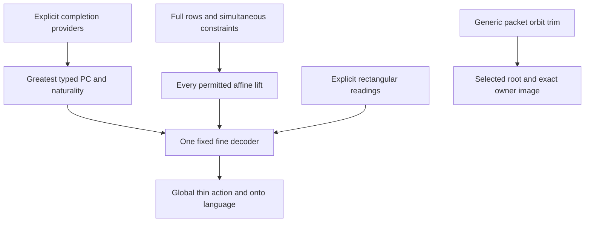

# One fixed full-row R07 decoder and rooted packet controls

Generated from `module.json` by `tools/build_formalization_module.py`.

Source `490c3f36d85db5a0b3ced0598e6c431825254ec5`. **Human-expanded proof plan; no Lean code.**

Preparation for OTHER Lean projects. Expand the complete fixed-universe R07 decoder, exact simultaneous row compatibility, canonical PC/naturality, all legal lift automorphisms, global thin translations, recorded-clique zeroing, invariant packet trim and full-support language readout. The HKN reservoir is expanded in hkn_reservoir with explicit published HKN providers and a pending local Lean encoding bridge. There is no remaining unexpanded local constructor import. Rectangular readings are expanded in safe_readings; packet collision and the full-owner transversal are expanded in owner_transversal. This is not a proof of the normalized relative MI theorem, safe all-row constructor or global EPPA.

The human article remains unchanged. Additional proof details are in
[PROOF_NOTES.md](PROOF_NOTES.md); the cross-track policy is in
[the formalization guide](../README.md). Source hashes are checked before
the index is regenerated. Graph validation is not proof verification.

## Source premises

**A01: Actual standing source.** Q is a nonempty countable transitive homogeneous structure in a FINITE complete symmetric binary language, with actual equality-inclusive RAW orbitals and semantic homomorphic CCO. Actual triangle fullness is supplied by the existing RAW provider. Countability is retained in that packaged specialization, not imposed on abstract finite claims.

**A02: Actual residual thin-packet setting.** For the actual R07 instance Q is infinite and has no nonidentity finite-class exact equivalence (as in the retained residual source context). F is the greatest finite-class invariant equivalence, its atoms are thin, G is the actual finite regular elementary abelian 2-group of thin translations, E is the actual unique minimal infinite exact direction and R_E=F. Work over N=pi_E^{-1}(B). Relative acl, named-owner SAP/transversal and injective packet separation are named upstream conclusions, not extra unnamed facts or fresh axioms.

**A03: Actual full fine-owner set and language action.** B is a fixed finite G-invariant set of ACTUAL E-owner labels, and Gamma<=Aut(B) consists of genuine quotient automorphisms fixing literal original fine-colour names. Gamma contains the induced diagonal thin-owner image rho(G). That action need not be faithful or free. Every source request retains its ENTIRE prescribed language component, including empty real domain; the full nonempty source A is packet-closed.

**A04: Abstract finite row data.** I is finite, G is a finite elementary abelian 2-group, R is a symmetric irreflexive recorded-pair graph on I. A structural packet map has sigma in Sym(I), b_i in G and s(i,z)=(sigma i,z+b_i). When owner or record preservation is asserted, supply the typed owners beta_i, commuting G/Gamma actions with beta_(sigma i)=b_i gamma(beta_i), and an actual record-preserving structural s. Neither equation on owners nor owner-stabilizer cosets determine the real b_i.

**A05: Finite typed triangle algebra for PC.** Each ordered endpoint type has a finite palette, converse is bijective, and strong product is monotone in both arguments with triangle semantics. Original exact menus include full palettes and singletons, are closed under nonempty meets/products, and all genuine endpoint switches/pure language permutations bijectively preserve typed triangle witnesses, intersection and converse. The actual exact-menu closure is I03; abstract greatestness uses only finite monotone contraction. No PC-equals-global-spectrum claim is required.

**A06: Independent finite regular-packet action for trim.** D0 is any finite complete original-language structure, F is a K-invariant packet equivalence, and G<=K<=Aut(D0) acts regularly on EVERY actual F-packet and preserves each packet setwise. A0 is a fixed nonempty subset. For the image formula pi:D0->B is K-equivariant. No CCO, source infinitude, EPPA, centrality, thin action on owners or full Aut(D0) equality is assumed.

**A07: Independent full-support semilinear group.** U is a finite owner-label set, Gamma_tilde<=Sym(U), D0 realizes EVERY label in U, and semilinear automorphisms are pairs (gamma,alpha) satisfying own(alpha v)=gamma own(v) and preserving literal original fine colours. K is their underlying permutation IMAGE. Do not identify K with FULL Aut(D0), and do not assume that a later trim retains U support.

## Imported theorem contracts

These are named provider obligations for the receiving Lean project,
not new axioms or claims of compiled imports.

| ID and source | Contract | Current provider status |
|---|---|---|
| I01: [`thm:completable-reservoir`](../../sections/hkn_packet_reservoir.tex#L39) | For the fixed complete nonempty full-packet source A and ALL required compatible Gamma requests, supply ONE finite partial reservoir B0. Its packets are literal regular G-packets, every recorded pair has a complete non-F fine matrix and every other pair is a hole. B0 has one injective completion C0 in N fixing A, all requests extend structurally, and irreducible faithfulness is supplied for later consumers. No arbitrary completion is asserted invariant. | HUMAN_EXPANDED_NOT_LEAN |
| I02: [`lem:packet-collision`](../../sections/hkn_packet_reservoir.tex#L85) | A finite literal packet diagram with complete non-F recorded matrices and an owner-preserving packetwise injective homomorphism into N can be injectivized preserving all records and fixing a protected complete packet base. The base may be empty. This theorem uses relative closure/avoidance and must be proved, not replaced by arbitrary pointwise cloning. | HUMAN_EXPANDED_NOT_LEAN |
| I03: [`lem:typed-exact-products`](../../sections/typed_strong_domains.tex#L311) | Nonempty original strong exact menus are closed under strong products and nonempty-result meets. For the actual owner transversal the typed source hypotheses are supplied by I04. Reuse C08, without adding equality to a same-sort diversity palette. | HUMAN_EXPANDED_NOT_LEAN |
| I04: [`thm:joint-transversal`](../../sections/owner_transversal_direct.tex#L159) | The actual owner-typed transversal consists of origins in pairwise DISTINCT full F-packets; its palettes contain only non-F diversity colours, even for repeated owner labels. It is triangle-defined, SAP and CCO, with the actual pure Gamma action and full G-packet inflation recovering the named-owner age of N. The statement also supplies primitive sorts; this module does not reprove its closure/anchored-completion argument. Its inflation identifies N with the homogeneous named-owner source, allowing a realized finite zero-row source to be aligned with its specified actual copy. | HUMAN_EXPANDED_NOT_LEAN |
| I05: [`prop:moving-readings`](../../sections/owner_covariant_readings.tex#L250) | Supply h^u_st on EVERY original exact menu: conservative, survivor-hereditary, converse compatible, pure-Gamma covariant, satisfying h^(u+v)_(vs,t)(vD)=v h^u_st(D), and yielding a legal triangle for INDEPENDENT parameters on the three coordinates of every PC triple. Endpoint types move separately. This contract is actually proved upstream from the covariant selector; it is not an independent choice of pair readings. Safe augmented readings can later implement the SAME contract. | HUMAN_EXPANDED_NOT_LEAN |
| I06: [`lem:thin-bottom`](../../sections/finite_packets.tex#L339) | The actual thin maps form a central elementary abelian 2-group of original automorphisms, act regularly on real F-packets, and translate fine cross atoms by the sum of endpoint shifts. The induced action on owner labels may have a nontrivial stabilizer. | HUMAN_EXPANDED_NOT_LEAN |
| I07: [`thm:exact-sorts-source`](../../sections/exact_foundations/03_joint_exact_sort_lifting.tex#L161) | Reuse selected RAW support C24/C28 for triangle fullness and actual source inheritance, including Id as an actual quotient when needed. Prescribed actual owner realizations and packet inflation still require I04; original untyped triangle fullness alone does not restore owner names. | HUMAN_EXPANDED_NOT_LEAN |

## Definitions

| ID | Definition | Exact meaning | Source |
|---|---|---|---|
| D01 | Structural packets and full real offsets | Structural vertices are (i,z); b_i is the unique coordinate of s(i,0) in the packet sigma i. Record graph R concerns distinct STRUCTURAL indices. | [source](../../sections/full_rows_pc_decoder.tex#L38) |
| D02 | Actual full-row packets | Rows are ALL functions f:I->G; actual packets are p=(i,f), each with real vertices (i,f,z). Structural projection q forgets f, and the source occupies zero rows. | [source](../../sections/full_rows_pc_decoder.tex#L53) |
| D03 | Legal correction and affine lift | C:I x I->G is legal iff C_ij=C_ji on DISTINCT UNRECORDED pairs only. alpha_C(i,f,z)=(sigma i,f_prime,z+b_i), f_prime(sigma j)=f(j)+C_ij+b_i. | [source](../../sections/full_rows_pc_decoder.tex#L78) |
| D04 | Prescribed actual rows | T_i is any finite set of full source functions f and r_(i,f) is a full target row at sigma i. A_(i,f)(j)=r_(i,f)(sigma j)+f(j)+b_i; touched means T_i nonempty. | [source](../../sections/full_rows_pc_decoder.tex#L173) |
| D05 | One initial actual-packet network | On distinct p=(i,f),q=(j,k), D0_pq is the recorded singleton if {i,j} in R, otherwise the full typed diversity palette. i=j with f!=k is a HOLE. | [source](../../sections/full_rows_pc_decoder.tex#L338) |
| D06 | Greatest strong-PC refinement | Run contracting updates D_pq<-D_pq intersect(D_pr*D_rq) for all pairwise distinct ACTUAL packets, with converse symmetry. Greatestness is in coordinatewise inclusion below the fixed D0. | [source](../../sections/full_rows_pc_decoder.tex#L357) |
| D07 | Independent origin gauge | For delta_p in G change types to delta_p s_p and transport edge menus by delta_p+delta_q. A pure language action instead fixes raw fine names. | [source](../../sections/full_rows_pc_decoder.tex#L394) |
| D08 | Vertex domains | For x=(i,f,z), y=(j,k,w) in DISTINCT actual packets, D_xy=(z+w)D_pq at types (z beta_i,w beta_j), which must be kept separately. | [source](../../sections/full_rows_pc_decoder.tex#L442) |
| D09 | Effective row and reading parameter | chi_x(j)=z+f(j); u(x,y)=chi_x(j)+chi_y(i), including i=j for distinct actual packets. | [source](../../sections/full_rows_pc_decoder.tex#L493) |
| D10 | Fixed fine decoder | Different actual packets get d(x,y)=h^u(x,y)_own(x),own(y)(D_xy); one packet keeps its original thin colours. Universe, menus and this colouring precede every chosen correction matrix. | [source](../../sections/full_rows_pc_decoder.tex#L503) |
| D11 | Invariant packet-orbit trim | F[A0] is the full packet union meeting A0 and D=union_(beta in K) beta(F[A0]). This is an induced substructure, not a choice of new cross colours. | [source](../../sections/rooted_mi/02_packet_orbit_trim_and_owner_language.tex#L11) |
| D12 | Forgetful semilinear image | K is the image of the semilinear group under (gamma,alpha)->alpha, not the full untyped automorphism group. Recover gamma only when every U label is realized. | [source](../../sections/rooted_mi/02_packet_orbit_trim_and_owner_language.tex#L63) |

## Proof claims and direct dependencies

Every row has a human proof expansion. Each still needs an actual Lean
statement and proof. Generic row arithmetic, finite PC and orbit-trim branches do not inherit the actual countable-source or HKN assumptions.

| ID and claim | Scope | Direct providers | Proof note |
|---|---|---|---|
| C01: Real structural coordinates and unique offsets | generic_finite | A04, D01 | N01 in [notes](PROOF_NOTES.md) |
| C02: Finite full-row carrier and literal packet structure | generic_finite | D02 | N02 in [notes](PROOF_NOTES.md) |
| C03: Necessity of the exact simultaneous row criterion | generic_finite | D04 | N03 in [notes](PROOF_NOTES.md) |
| C04: Sufficiency by completing all constrained matrix entries | generic_finite | C03 | N03 in [notes](PROOF_NOTES.md) |
| C05: Sharp finite failures of independent zeroing | diagnostic | D04, C03, C04 | N03 in [notes](PROOF_NOTES.md) |
| C06: Every affine full-row lift is a permutation | generic_finite | C01, C02, D03 | N04 in [notes](PROOF_NOTES.md) |
| C07: Every structural record survives every correction | generic_finite | C06 | N04 in [notes](PROOF_NOTES.md) |
| C08: Simultaneous zero-row source extensions including empties | generic_finite | C04, C06, C07 | N04 in [notes](PROOF_NOTES.md) |
| C09: Simultaneous zeroing of a recorded clique of actual rows | generic_finite | C04, C06 | N11 in [notes](PROOF_NOTES.md) |
| C10: Injectivizing the row-forgetting completion map | actual_source | A01, A02, A03, C02, I01, I02 | N02 in [notes](PROOF_NOTES.md) |
| C11: Injective origin certificate for the actual initial domains | actual_source | C10, D05, I04 | N02 in [notes](PROOF_NOTES.md) |
| C12: Every supplied atomic solution survives each PC update | generic_finite | A05, D06 | N05 in [notes](PROOF_NOTES.md) |
| C13: Finite termination and greatestness independent of fair order | generic_finite | A05, D06 | N05 in [notes](PROOF_NOTES.md) |
| C14: Actual terminal nonempty exact menus and unchanged singletons | actual_source | C11, C12, C13, I03 | N05 in [notes](PROOF_NOTES.md) |
| C15: Typed gauge product identity | generic_finite | A05, D07 | N06 in [notes](PROOF_NOTES.md) |
| C16: Gauge naturality of the greatest PC family | generic_finite | C13, C15 | N06 in [notes](PROOF_NOTES.md) |
| C17: Pure owner-language naturality of PC | generic_finite | A05, C13 | N06 in [notes](PROOF_NOTES.md) |
| C18: Vertex-domain covariance under arbitrary full-row lifts | generic_finite | D08, C06, C07, C16, C17 | N07 in [notes](PROOF_NOTES.md) |
| C19: Effective rows and symmetric reading parameter | generic_finite | D09 | N08 in [notes](PROOF_NOTES.md) |
| C20: Decoder symmetry and full cross-matrix thin law | actual_source | D10, C19, I05 | N08 in [notes](PROOF_NOTES.md) |
| C21: Legal three-actual-packet triangles | actual_source | C14, C16, D10, I05 | N08 in [notes](PROOF_NOTES.md) |
| C22: All remaining triangle cases | actual_source | C20, I06 | N08 in [notes](PROOF_NOTES.md) |
| C23: Actual owner-typed age membership and induced zero-row source | actual_source | C20, C21, C22, C14, I04, I07 | N08 in [notes](PROOF_NOTES.md) |
| C24: Row covariance for every correction matrix | generic_finite | C06, D09 | N09 in [notes](PROOF_NOTES.md) |
| C25: Every legal lift preserves this same decoded fine colouring | actual_source | C23, C18, C24, I05, C07 | N09 in [notes](PROOF_NOTES.md) |
| C26: One finite relative witness for all prescribed source requests | actual_source | C25, C08, I01, C02 | N09 in [notes](PROOF_NOTES.md) |
| C27: Global actual diagonal thin action survives unchanged | actual_source | C25, I06, A03 | N10 in [notes](PROOF_NOTES.md) |
| C28: Generic invariant full-packet orbit trim | finite_action | A06, D11 | N12 in [notes](PROOF_NOTES.md) |
| C29: Generic selected-root correction with one global translation | finite_action | C28 | N12 in [notes](PROOF_NOTES.md) |
| C30: Exact owner image after trim | finite_action | C28 | N12 in [notes](PROOF_NOTES.md) |
| C31: Full owner support recovers the semilinear language component | finite_action | A07, D12 | N13 in [notes](PROOF_NOTES.md) |
| C32: Onto language action from all empty structural requests | actual_source | C31, C26 | N13 in [notes](PROOF_NOTES.md) |
| C33: Finite controls and their exact scope | diagnostic | A04, A05 | N10 in [notes](PROOF_NOTES.md) |

The precise quantified contracts are in `module.json`. Provider-before-consumer
order (including definitions and source premises):

`A01 → A02 → A03 → A04 → A05 → A06 → A07 → C33 → D01 → D02 → D11 → D12 → I01 → I02 → I04 → I06 → I07 → C01 → C02 → C28 → C31 → D03 → D05 → D09 → I03 → I05 → C06 → C10 → C19 → C29 → C30 → D04 → D06 → C03 → C07 → C11 → C12 → C13 → C24 → D07 → D08 → C04 → C14 → C15 → C17 → C05 → C08 → C09 → C16 → D10 → C18 → C20 → C21 → C22 → C23 → C25 → C26 → C27 → C32`

This order is one valid linearization; it does not require unrelated
branches to be proved sequentially. The full DAG is the `depends_on`
relation in `module.json`.

## Main proof branches

This is a coarse view of the claim DAG. Edges go from provider to consumer.

Completion and readings remain explicit upstream proof obligations, not new axioms. The recorded-clique zeroing export combines generic row arithmetic with the independently proved universal decoder automorphism. Generic trim and full-support forgetful injectivity have no source dependencies. No unsafe multi-packet transport or complete normalized MI theorem is exported.

## Article exports

| Existing source result | Sidecar proof claims |
|---|---|
| [`thm:R07-relative-eppa`](../../sections/full_rows_pc_decoder.tex#L95) | C02, C06, C07, C08, C10, C11, C12, C13, C14, C15, C16, C17, C18, C19, C20, C21, C22, C23, C24, C25, C26 |
| [`lem:R07-W-completable`](../../sections/full_rows_pc_decoder.tex#L134) | C10, C11 |
| [`lem:R07-row-compatibility-iff`](../../sections/full_rows_pc_decoder.tex#L159) | C03, C04 |
| [`lem:R07-zero-row`](../../sections/full_rows_pc_decoder.tex#L291) | C06, C07, C08 |
| [`lem:R07-PC`](../../sections/full_rows_pc_decoder.tex#L363) | C12, C13, C14 |
| [`lem:R07-PC-gauge`](../../sections/full_rows_pc_decoder.tex#L404) | C15, C16, C17 |
| [`lem:R07-domain-covariance`](../../sections/full_rows_pc_decoder.tex#L449) | C18 |
| [`lem:R07-global-diagonal-thin`](../../sections/full_rows_pc_decoder.tex#L594) | C27 |
| [`lem:acf-recorded-row-zeroing`](../../sections/rooted_mi/01_packet_zeroing_and_multipacket_root.tex#L26) | C09, C25 |
| [`lem:acf-invariant-packet-orbit-trim`](../../sections/rooted_mi/02_packet_orbit_trim_and_owner_language.tex#L1) | C28, C29, C30 |
| [`lem:acf-full-owner-language-faithfulness`](../../sections/rooted_mi/02_packet_orbit_trim_and_owner_language.tex#L50) | C31, C32 |

Auxiliary source equations (not additional numbered results):

- [`eq:R07-structural`](../../sections/full_rows_pc_decoder.tex#L38): C01
- [`eq:R07-W`](../../sections/full_rows_pc_decoder.tex#L53): C02
- [`eq:R07-size`](../../sections/full_rows_pc_decoder.tex#L60): C02
- [`eq:R07-correction`](../../sections/full_rows_pc_decoder.tex#L78): C03, C04
- [`eq:R07-lift`](../../sections/full_rows_pc_decoder.tex#L85): C06
- [`eq:R07-row-compatibility-shift`](../../sections/full_rows_pc_decoder.tex#L173): C03, C04
- [`eq:R07-row-compatibility-edge`](../../sections/full_rows_pc_decoder.tex#L193): C03, C04
- [`eq:R07-PC`](../../sections/full_rows_pc_decoder.tex#L357): C12, C13, C14
- [`eq:R07-gauge-product`](../../sections/full_rows_pc_decoder.tex#L410): C15
- [`eq:R07-raw-domain-invariance`](../../sections/full_rows_pc_decoder.tex#L454): C18
- [`eq:R07-effective`](../../sections/full_rows_pc_decoder.tex#L493): C19
- [`eq:R07-reading-parameter`](../../sections/full_rows_pc_decoder.tex#L498): C19
- [`eq:R07-row-covariance`](../../sections/full_rows_pc_decoder.tex#L560): C24
- [`eq:R07-global-diagonal-thin`](../../sections/full_rows_pc_decoder.tex#L611): C27
- [`eq:acf-packet-orbit-trim`](../../sections/rooted_mi/02_packet_orbit_trim_and_owner_language.tex#L11): C28
- [`eq:acf-packet-orbit-root`](../../sections/rooted_mi/02_packet_orbit_trim_and_owner_language.tex#L19): C29
- [`eq:acf-full-owner-language-faithfulness`](../../sections/rooted_mi/02_packet_orbit_trim_and_owner_language.tex#L63): C31, C32

Full result coverage is asserted only for `source_result_files`.
Selected additional results: lem:acf-recorded-row-zeroing.
Other results in their provider source files are not claimed covered.

## Internal implementation milestones

These tasks are proof milestones inside larger project assignments;
see the [peer-project allocation](../coordination/BOARD.md).

These are implementation tasks, not additional mathematical assumptions.

| Task | Earlier tasks | Acceptance |
|---|---|---|
| T01: Actual rows, legal matrices and simultaneous constraints | — | Prove RC1/RC2 iff for full functions, including conflicting multiple rows, untouched/diagonal entries and empty requests. Separate bijections/record preservation from fine decoder automorphisms. |
| T02: Completion certificate and greatest typed PC family | T01 | Discharge named packet-collision/completable-reservoir/owner-transversal contracts using proved upstream APIs before claiming actual exports. Prove solution survival, greatestness and gauge/pure naturality without claiming PC equals global spectra. |
| T03: One decoder and every universal lift | T01, T02 | Use the ENTIRE joint rectangular reading contract and actual typed age to prove legality and all permitted automorphisms before choosing request matrices. Include same-structural-index distinct actual packets and constant diagonal thin translation. |
| T04: Generic orbit trim and full-support semilinear readout | T03 | Keep generic trim/support independent of source imports, preserve a selected original root by ONE global group element and assert isomorphism only onto K image. Empty structural requests give onto action on full-support D0; trimming need retain only the stated owner image. |

## Finite controls

- **K01.** Compare the full actual-row iff criterion against independently enumerated legal correction matrices over all F2 recorded graphs on 1..3 indices, including same-index conflicts and empty requests.
- **K02.** Check full-row lift bijections, q-intertwining, effective rows, same-index holes, transported fine records and true global diagonal action; include F2^2 and nonfaithful owner actions.
- **K03.** On represented finite relation triangles check solution survival, all candidate greatest fixed refinements, fair-schedule independence and endpoint gauge naturality. A non-CCO finite CSP has nonempty PC without global solutions.

Run `python tools/check_full_rows_controls.py` from the manuscript directory.
The controls do not prove CCO or the general theorems.

## Return to the human articles

No required mathematical repair was found in this scoped pass. These
optional wording clarifications remain queued for a human article pass:

- **F01** ([source](../../sections/full_rows_pc_decoder.tex#L53)): Keep structural i separate from actual packet (i,f). Distinct rows above the SAME i are holes and require no diagonal correction constraint; 2C_ii=0 handles their covariance. Keep this contract explicit in a later human edit; current TeX/source pin is unchanged.
- **F02** ([source](../../sections/full_rows_pc_decoder.tex#L117)): Retain named in-manuscript completion/transversal/reading providers plus published HKN applicability. Local decoder proof is fully expanded relative to those contracts; it does not certify their end-to-end construction or global EPPA. Keep this contract explicit in a later human edit; current TeX/source pin is unchanged.
- **F03** ([source](../../sections/rooted_mi/02_packet_orbit_trim_and_owner_language.tex#L63)): The forgetful map identifies the semilinear group with its underlying IMAGE K, not FULL Aut(D0). Full U support is used before trim. After trim exact B support is sufficient and need not retain U-level faithfulness. Keep this contract explicit in a later human edit; current TeX/source pin is unchanged.
- **F04** ([source](../../sections/rooted_mi/01_packet_zeroing_and_multipacket_root.tex#L27)): Source and clique corrections share one exact finite row-compatibility theorem; cite it once and preserve the different target conditions. A clique correction does not promise unrelated zero-row source fixing. Keep this contract explicit in a later human edit; current TeX/source pin is unchanged.

The machine ledger records caller effects and affected claims. The source
review used two independent model review passes and parent synthesis;
it is not independent human or formal certification.
