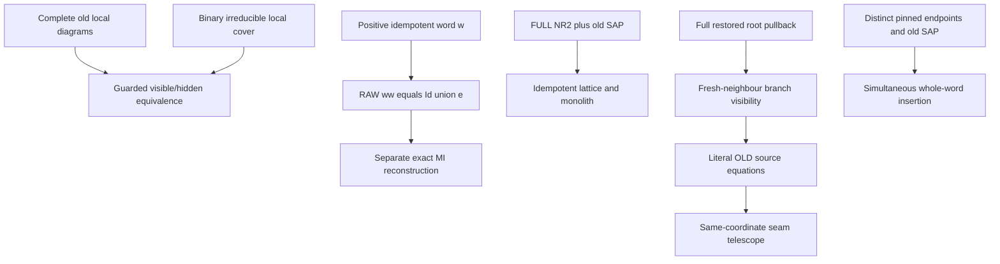

# Guarded lift equivalence, exact idempotent envelopes and literal OLD seams

Generated from `module.json` by `tools/build_formalization_module.py`.

Source `490c3f36d85db5a0b3ced0598e6c431825254ec5`. **Human-expanded proof plan; no Lean code.**

Private B057: EIGHT source15 results, EIGHT equations with the explicitly CORRECTED TV1 guarded/RAW formula, eleven definitions, 72 human claims and nine tasks. Global guarded completion equivalence is proved via actual one-/two-generated reflection and binary irreducible local cover. Literal OLD term equations telescope before any completion. A nonempty strong idempotent has direct RAW envelope R_w;R_w=Id union e represented by ww, without CCO or NR2; MI reconstruction is separate. CCO-free full idempotent lattice/monolith is distinguished from its CCO distributive specialization. Branch visibility is repaired because a STRONG diversity menu is not literally RAW bisaturated when real diagonal pairs can be added: use its full restored pullback and guarded saturation, then fresh SAP neighbours. The desired kernel/old-equation conclusions remain valid. Higher-support clauses retain separate scope.

The human article remains unchanged. Additional proof details are in
[PROOF_NOTES.md](PROOF_NOTES.md); the cross-track policy is in
[the formalization guide](../README.md). Source hashes are checked before
the index is regenerated. Graph validation is not proof verification.

## Source premises

**A01: Actual original finite typed homogeneous source.** M is countable homogeneous and complete in a finite binary relational language, with nonempty transitive named real sorts, finite actual pair orbitals, symmetric same-sort atoms and typed converses. All invariant same-sort relations are symmetric unions of actual old orbitals. Logical equality is separate from diversity.

**A02: Original visible SAP.** The original finite complete age has SAP over every complete old base. It gives pinned positive-word injectivisation, infinite old neighbour fibres, distinct representative splitting and fresh private interiors. No hidden SAP or CCO is inferred from SAP alone.

**A03: Separate semantic CCO input.** Original semantic homomorphic CCO supplies the prior exact-ball/finite distributive exact-lattice calculus and its full terminal specialization when used. It is NOT a premise of the direct ww envelope or the CCO-free idempotent lattice branch.

**A04: FULL original NR2 terminal input.** On each named real sort every proper original invariant relative index is infinite; in particular no index-two interval exists. This is checked on the FULL invariant lattice. It supplies prior RAW words and terminal named MI coordinates; no assumption that all generic invariant quotients are named is made.

**A05: Actual MI-only hidden signature.** The actual hidden interpretation has original real sorts and proper NONZERO represented MI quotient sorts, all actual complete pair orbitals and named projections/upward maps/quotient transitions/inverses. Functions are actual equivariant quotient maps and only unary. Relation arities are positive and at most two in the binary core; no nullary generators or quotient-to-real functions.

**A06: Admissible partial source with actual joined support tests.** C is finite, unary-functionally closed and unary-admissible. Its one-generated diagrams and every ACTUALLY joined irreducible old endpoint-pair support used by the guarded lift are full actual completed induced members. All constraints on one pair arise from that SAME support, as B056. The construction reaches a nonempty exact menu for each issued pair; no global completion is assumed.

**A07: Optional higher-support interface.** The binary conclusions are unconditional under their displayed inputs. An original finite-arity extension additionally freezes complete canonical old higher-support factors and assumes the separate support-normal completion/reflection interface. Binary pair closure and anchors alone do not imply higher-tuple reflection.

**A08: Abstract literal unary seam context.** Independently C is functionally closed under the named total unary maps. Every displayed macro-side equation is already a literal equality of OLD source term values. At a shared root both incident readings use the SAME canonical coordinate term, or an already literal named transition equality. No accidental equality of distinct completion images may be used as a seam.

## Imported theorem contracts

These are named provider obligations for the receiving Lean project,
not new axioms or claims of compiled imports.

| ID and source | Contract | Current provider status |
|---|---|---|
| I01: [`lem:typed-one-source-support-per-guarded-pair`](../../sections/v27/14_guarded_source_positive.tex#L346) | Every constrained pair is supported by ONE actually irreducible locally completed old closure and has one actual common fine atom in ALL its profiles. No global C completion or Helly manufacturing of that witness. | HUMAN_EXPANDED_NOT_LEAN |
| I02: [`lem:typed-two-root-complete-reflection`](../../sections/v27/14_guarded_source_positive.tex#L652) | EVERY actual fine diversity atom in the menu realizes the COMPLETE induced joined two-generated hidden diagram, including all unary term equalities, distinctness and binary relation reflection. No complete test on unjoined real ancestors. | HUMAN_EXPANDED_NOT_LEAN |
| I03: [`lem:typed-real-sort-splitting`](../../sections/v27/13_actual_hidden_sap_readings.tex#L152) | A finite HE completion can be placed inside a full hidden expansion over a finite old visible carrier and split real collision fibres while retaining actual proper quotient data and all binary hidden readings. All designated real witnesses can be distinct. | HUMAN_EXPANDED_NOT_LEAN |
| I04: [`lem:typed-binary-irreducible-local-cover`](../../sections/binary_unary_irreducible_local_cover.tex#L5) | In a binary/total-unary partial source, actual singleton and displayed two-endpoint closed supports cover every pair of vertices in a NONEMPTY irreducible; induced embeddings on these supports give HE on every irreducible, with the explicit empty/nullary convention. A05 positive arities discharge the empty gate. | HUMAN_EXPANDED_NOT_LEAN |
| I05: [`lem:typed-cylinder-realisation`](../../sections/v27/07_typed_raw_strong_transition.tex#L913) | Named cylinders are exact actual representative spectra and partition compatible hidden pairs; membership forces the corresponding semantic relation. Real equality exteriors are omitted. | HUMAN_EXPANDED_NOT_LEAN |
| I06: [`lem:typed-transition-cylinder`](../../sections/v27/07_typed_raw_strong_transition.tex#L961) | Nontrivial actual transition graphs have their saturated identity-free cylinder profile. Strict ancestor C45 identifies the actual kernels/maps of a fine atom and every quotient-functional relation containing it. | HUMAN_EXPANDED_NOT_LEAN |
| I07: [`lem:typed-identity-transport-redundant`](../../sections/v27/07_typed_raw_strong_transition.tex#L618) | A RAW relation containing old logical Id induces the existing unary coordinate identity; no synthetic STRONG equality atom is inserted. | HUMAN_EXPANDED_NOT_LEAN |
| I08: [`lem:typed-branch-atomic-transport`](../../sections/v27/07_typed_raw_strong_transition.tex#L1053) | A quotient-functional identity-free positive branch has the same actual quotient map as ANY fine atom inside it; terminal proper MI targets are existing named coordinates, separately using FULL RAW representation and old SAP noncollapse. | HUMAN_EXPANDED_NOT_LEAN |
| I09: [`lem:typed-raw-strong-saturation`](../../sections/v27/07_typed_raw_strong_transition.tex#L25) | Old nonzero exterior saturation and equivalence joins agree with actual STRONG diversity products. Strict C01 support converts every whole positive old word RAW walk with distinct pinned endpoints to a fully injective realization, without CCO. | HUMAN_EXPANDED_NOT_LEAN |
| I10: [`lem:acf-exact-distributive`](../../sections/exact_lattice_crt.tex#L52) | Under original exact-ball calculus, represented FULL exact equivalences form a finite distributive bounded lattice with actual meet/joins and finite MI/Birkhoff reconstruction. This is a separate CCO-dependent input AFTER direct ww exactness. | HUMAN_EXPANDED_NOT_LEAN |
| I11: [`lem:typed-all-invariant-equivalences-raw-word`](../../sections/terminal_invariant_raw_exact.tex#L5) | FULL no-index-two gives one actual RAW atomic word for EVERY original invariant equivalence, including genuine empty-word Id. This provider needs no SAP/CCO for its word representation. | HUMAN_EXPANDED_NOT_LEAN |
| I12: [`lem:rh-sap-invariant-monolith`](../../sections/real_hull/07_sap_mi_intersection_geometry.tex#L1) | Old SAP gives infinite off-base orbits, nonidentity finite meet classes and the unique least nonidentity FULL invariant equivalence L_a. | HUMAN_EXPANDED_NOT_LEAN |
| I13: [`lem:typed-equivalence-reproduction`](../../sections/v27/09_typed_equivalence_and_profiles.tex#L1) | For nonidentity old E, its diversity E^circ reproduces every nonempty profile inside E; in particular E^circ*E^circ=E^circ. This uses old SAP only. | HUMAN_EXPANDED_NOT_LEAN |
| I14: [`lem:typed-terminal-all-equivalences-exact`](../../sections/terminal_invariant_raw_exact.tex#L87) | Under extra original CCO and FULL terminality, the FULL original invariant lattice is RAW exact and distributive. Only the optional final distributivity specialization uses this provider. | HUMAN_EXPANDED_NOT_LEAN |
| I15: [`lem:typed-quotient-transport`](../../sections/typed_invariant_quotient_transport.tex#L15) | For nonempty actual R with RRop subset J, canonical transported J^R=Rop;J;R is an invariant equivalence and induces the actual quotient bijection. Generic FULL interval transport is separate from named terminal membership. | HUMAN_EXPANDED_NOT_LEAN |
| I16: [`lem:typed-private-theta-cycle`](../../sections/v27/14_guarded_source_positive.tex#L490) | Every traversed private branch has its two ACTUAL OLD hidden source endpoints; no private interior becomes an old generator or a new completion-only seam. | HUMAN_EXPANDED_NOT_LEAN |

**I06 internal proof support:** C45 in `transition_closure`. Use strict proved ancestor C45 only for pointwise equality of canonical quotient maps/kernels of a common atomic witness and direct/branch relations in the root signature. It does not identify the fine binary relation with the larger relation.

These are separately extracted proved support claims, not additional
numbered exports or consequences of the named theorem statement.

**I09 internal proof support:** C01 in `transition_closure`. Use strict proved ancestor C01 for whole-word old binary SAP injectivisation with its actual complete exterior pair preserved and aligned; no exact-domain/Set-Pasch or hidden SAP premise is added.

These are separately extracted proved support claims, not additional
numbered exports or consequences of the named theorem statement.

## Definitions

| ID | Definition | Exact meaning | Source |
|---|---|---|---|
| D01 | Actual guarded visible lift | G_typ(C) has one designated real witness per old hidden vertex, private positive theta bundles for nonempty actual pair menus, and full named root signatures. A visible completion here is induced/injective on this whole formal visible graph. | [source](../../sections/v27/15_guarded_reflection_old_seams.tex#L2) |
| D02 | Whole irreducible source reflection | A hidden completion is a homomorphism that embeds every induced closed irreducible source subobject. It need not be globally injective on reducible C. | [source](../../sections/v27/15_guarded_reflection_old_seams.tex#L2) |
| D03 | Literal shared OLD seam | At consecutive macro sides both incident coordinates are the same value of one canonical OLD source unary term at the shared formal root. Target coincidences of different source vertices are not seams. | [source](../../sections/v27/15_guarded_reflection_old_seams.tex#L177) |
| D04 | Strong idempotent and its envelope | e is a nonempty same-sort diversity-only positive word profile with e*e=e. E_e=Id union e is the actual reflexive relation; e itself is not an equivalence. | [source](../../sections/v27/15_guarded_reflection_old_seams.tex#L155) |
| D05 | Equality-inclusive whole word relation | R_w is the actual RAW endpoint relation of ONE fixed positive original atomic word. Its off-diagonal part is e; it may or may not contain the whole old diagonal. | [source](../../sections/v27/15_guarded_reflection_old_seams.tex#L286) |
| D06 | Represented exact MI reconstruction | MI is taken in the finite lattice of represented FULL RAW exact equivalences when reconstructing E_e, not in an arbitrary unproved invariant subfamily. Empty meet means Top. | [source](../../sections/v27/15_guarded_reflection_old_seams.tex#L311) |
| D07 | Idempotent lattice and monolith | I_a contains nonempty positive same-sort strong idempotents. L_a is the actual least nonidentity original invariant equivalence; e0=L_a^circ. Its unit action is asserted only on I_a. | [source](../../sections/v27/15_guarded_reflection_old_seams.tex#L422) |
| D08 | Full restored menu versus diversity guard | For the complete local hidden pattern let Dhat be its actual FULL representative-pair pullback, intersecting all actual term-comparison relations before deleting real Id. D=Dhat restricted to distinct original endpoints. Dhat is H_b,H_c-bisaturated; D generally is NOT literally RAW bisaturated. | [source](../../sections/v27/15_guarded_reflection_old_seams.tex#L582) |
| D09 | Visible root coordinate | H_b=Id for a real old root, or its proper represented MI kernel for a quotient old root. If H_b<=J, the J-coordinate is the real projection F_J or the named upward map from b. | [source](../../sections/v27/15_guarded_reflection_old_seams.tex#L569) |
| D10 | Old source branch equation | A quotient-functional positive branch P containing D induces an existing named atomic quotient transition, and its coordinate equation is reflected from ONE actual embedding of the same complete old source support. | [source](../../sections/v27/15_guarded_reflection_old_seams.tex#L679) |
| D11 | Private whole-word obligation | An obligation is ONE particular original atomic word with prescribed DISTINCT old endpoints whose actual fine pair atom is in its genuine strong profile; all its internal formal positions must be fresh. | [source](../../sections/v27/15_guarded_reflection_old_seams.tex#L818) |

## Proof claims and direct dependencies

Every row has a human proof expansion. Each still needs an actual Lean
statement and proof. D is a diversity-only menu; Dhat is its actual full root pullback and may contain real Id. TV1 is exported only with its recorded repair. Strong e is irreflexive; the equivalence is E_e=Id union e. Source16 old-gap certificates and factorisation forests are not imported.

| ID and claim | Scope | Direct providers | Proof note |
|---|---|---|---|
| C01: A completed root atom lies in EVERY private branch profile | lift_equivalence | A06, D01 | N01 in [notes](PROOF_NOTES.md) |
| C02: Positive profile membership forces all primitive hidden data | lift_equivalence | A05, I05, I06, I07, C01 | N01 in [notes](PROOF_NOTES.md) |
| C03: Common atom and whole relations compute the SAME root signature | lift_equivalence | I06, C01 | N01 in [notes](PROOF_NOTES.md) |
| C04: Functional closure preserves all stored signature consequences | lift_equivalence | A05, C03 | N01 in [notes](PROOF_NOTES.md) |
| C05: Place a hidden completion in one finite old visible expansion | lift_equivalence | A05, D02 | N01 in [notes](PROOF_NOTES.md) |
| C06: Split real images and representatives while retaining hidden readings | lift_equivalence | A02, A06, I01, I02, I03, C05 | N01 in [notes](PROOF_NOTES.md) |
| C07: Insert all private paths over their complete pinned old pair | lift_equivalence | A01, A02, C01, C06 | N01 in [notes](PROOF_NOTES.md) |
| C08: Hidden completion gives a visible completion of the lift | lift_equivalence | C04, C06, C07 | N01 in [notes](PROOF_NOTES.md) |
| C09: A visible completion canonically defines the source hidden map | lift_equivalence | A05, C02, C04, D02 | N01 in [notes](PROOF_NOTES.md) |
| C10: One-generated valid diagrams embed in the canonical interpretation | lift_equivalence | A01, A05, A06, C09 | N01 in [notes](PROOF_NOTES.md) |
| C11: Joined two-root supports embed for EVERY chosen target atom | lift_equivalence | A06, I02, C01, C09 | N01 in [notes](PROOF_NOTES.md) |
| C12: Binary local cover upgrades the small checks to every irreducible | lift_equivalence | A05, I04, C09, C10, C11 | N01 in [notes](PROOF_NOTES.md) |
| C13: The canonical map is a hidden HE completion | lift_equivalence | C09, C12, D02 | N01 in [notes](PROOF_NOTES.md) |
| C14: Guarded lift equivalence and root forcing source export | lift_equivalence | C04, C08, C13 | N01 in [notes](PROOF_NOTES.md) |
| C15: Every OLD term equation has values inside C | literal_seams | A08, D03 | N02 in [notes](PROOF_NOTES.md) |
| C16: The intermediate seam is one literal coordinate value | literal_seams | A08, C15 | N02 in [notes](PROOF_NOTES.md) |
| C17: Finite substitution telescopes the OLD equations | literal_seams | C15, C16 | N02 in [notes](PROOF_NOTES.md) |
| C18: No shared real vertex or amalgamation of supports is needed | literal_seams | C17 | N02 in [notes](PROOF_NOTES.md) |
| C19: Target coincidence of distinct old vertices cannot supply a seam | literal_seams | A08, D03 | N02 in [notes](PROOF_NOTES.md) |
| C20: Literal OLD-seam telescope source export | literal_seams | C17, C18, C19 | N02 in [notes](PROOF_NOTES.md) |
| C21: Id union a strong idempotent is an ACTUAL equivalence | raw_envelope | A01, D04 | N03 in [notes](PROOF_NOTES.md) |
| C22: The whole RAW word has precisely e as diversity part | raw_envelope | A01, A02, I09, D05 | N03 in [notes](PROOF_NOTES.md) |
| C23: The RAW whole word is symmetric and nontrivially serial | raw_envelope | A01, C22 | N03 in [notes](PROOF_NOTES.md) |
| C24: Every true diagonal lies in the RAW square | raw_envelope | C23 | N03 in [notes](PROOF_NOTES.md) |
| C25: All off-diagonal RAW-square outputs stay in e | raw_envelope | C21, C22 | N03 in [notes](PROOF_NOTES.md) |
| C26: Strong idempotence supplies every e atom to the RAW square | raw_envelope | A01, C22, D04 | N03 in [notes](PROOF_NOTES.md) |
| C27: The direct RAW identity is represented by the literal word ww | raw_envelope | C24, C25, C26 | N03 in [notes](PROOF_NOTES.md) |
| C28: Direct idempotent-envelope subexport has no CCO or NR2 premise | raw_envelope | C21, C27 | N03 in [notes](PROOF_NOTES.md) |
| C29: Apply the SEPARATE finite exact-lattice reconstruction theorem | raw_envelope | A03, I10, C27, D06 | N04 in [notes](PROOF_NOTES.md) |
| C30: Idempotent RAW exact-envelope source export | raw_envelope | C28, C29 | N04 in [notes](PROOF_NOTES.md) |
| C31: The envelope map is injective and order preserving | idempotent_lattice | C21 | N05 in [notes](PROOF_NOTES.md) |
| C32: Every nonidentity invariant equivalence has one positive diversity word | idempotent_lattice | A01, A02, A04, I09, I11 | N05 in [notes](PROOF_NOTES.md) |
| C33: Equivalence reproduction makes that diversity word idempotent | idempotent_lattice | A02, I13, C32 | N05 in [notes](PROOF_NOTES.md) |
| C34: Nonzero meets stay nonzero by the original SAP monolith | idempotent_lattice | A02, I12, C33 | N05 in [notes](PROOF_NOTES.md) |
| C35: The idempotent join is the actual strong product | idempotent_lattice | I09, C33 | N05 in [notes](PROOF_NOTES.md) |
| C36: The full idempotent family is a finite lattice | idempotent_lattice | A01, C31, C33, C34, C35 | N05 in [notes](PROOF_NOTES.md) |
| C37: Its unique least nonzero element is the SAP monolith diversity | idempotent_lattice | I12, C33, C36 | N05 in [notes](PROOF_NOTES.md) |
| C38: The monolith diversity is a unit INSIDE the idempotent lattice | idempotent_lattice | C35, C37 | N05 in [notes](PROOF_NOTES.md) |
| C39: CCO-free lattice and monolith conclusions are complete | idempotent_lattice | C31, C33, C34, C35, C36, C37, C38 | N05 in [notes](PROOF_NOTES.md) |
| C40: Distributivity is the separate extra-CCO specialization | idempotent_lattice | A03, I14, C34, C39 | N05 in [notes](PROOF_NOTES.md) |
| C41: Restore the FULL actual root-pullback relation before saturation | branch_visibility | A05, A06, D08, D09 | N06 in [notes](PROOF_NOTES.md) |
| C42: Correct TV1 is guarded saturation, not a false RAW equality | branch_visibility | C41 | N06 in [notes](PROOF_NOTES.md) |
| C43: Every nonempty old diversity relation has infinite neighbour fibres | branch_visibility | A01, A02 | N06 in [notes](PROOF_NOTES.md) |
| C44: Fresh neighbours repair the source-kernel visibility proof | branch_visibility | C41, C43 | N06 in [notes](PROOF_NOTES.md) |
| C45: Fresh predecessors repair target-kernel visibility | branch_visibility | I15, C41, C43 | N06 in [notes](PROOF_NOTES.md) |
| C46: The visible coordinates and branch map are ALREADY named terms | branch_visibility | A04, A05, I08, C44, C45, D09 | N06 in [notes](PROOF_NOTES.md) |
| C47: The checked complete old factor reflects its branch equation | branch_visibility | A06, I01, I03, I15, C46 | N06 in [notes](PROOF_NOTES.md) |
| C48: Branch-root visibility source export WITH TV1 repair | branch_visibility | C42, C44, C45, C46, C47 | N06 in [notes](PROOF_NOTES.md) |
| C49: Each branch under discussion has ACTUAL OLD source endpoints | old_equations | A06, I16 | N07 in [notes](PROOF_NOTES.md) |
| C50: A total exact meet inside P is sufficient for branch visibility | old_equations | C48, C49 | N07 in [notes](PROOF_NOTES.md) |
| C51: Use one full local realization for the ENTIRE pair menu | old_equations | A06, I01, I03, C49 | N07 in [notes](PROOF_NOTES.md) |
| C52: Canonical quotient transport forces the branch equation there | old_equations | I08, I15, C50, C51 | N07 in [notes](PROOF_NOTES.md) |
| C53: Induced old-support embedding reflects equality of named term values | old_equations | A06, C52 | N07 in [notes](PROOF_NOTES.md) |
| C54: Original-source branch equation source export | old_equations | C50, C53 | N07 in [notes](PROOF_NOTES.md) |
| C55: Distinct endpoints select e rather than real Id | reinsertion | D04, D11 | N08 in [notes](PROOF_NOTES.md) |
| C56: Realize the EXACT original word at its pinned fine pair | reinsertion | A01, C55 | N08 in [notes](PROOF_NOTES.md) |
| C57: SAP makes the private interior fresh over the whole complete base | reinsertion | A02, C56 | N08 in [notes](PROOF_NOTES.md) |
| C58: Off-diagonal idempotent reinsertion source export | reinsertion | C57 | N08 in [notes](PROOF_NOTES.md) |
| C59: Each obligation has one simple complete OLD word witness | word_insertion | A01, D11 | N09 in [notes](PROOF_NOTES.md) |
| C60: Align its complete endpoint pair without changing any old atom | word_insertion | A01, C59 | N09 in [notes](PROOF_NOTES.md) |
| C61: Sequential SAP preserves the entire old base and all previous words | word_insertion | A02, C60 | N09 in [notes](PROOF_NOTES.md) |
| C62: Finite induction gives one simultaneous finite complete extension | word_insertion | C59, C60, C61 | N09 in [notes](PROOF_NOTES.md) |
| C63: Simultaneous original-word insertion source export | word_insertion | C62 | N09 in [notes](PROOF_NOTES.md) |
| C64: Printed TV1 fails even for a basic projection equality | boundary | D08 | N10 in [notes](PROOF_NOTES.md) |
| C65: FULL restored pullbacks and guarded menus must not be conflated | boundary | C41, C42, C44, C45 | N10 in [notes](PROOF_NOTES.md) |
| C66: A diversity idempotent is not a reflexive equivalence | boundary | C21, C27, C55 | N10 in [notes](PROOF_NOTES.md) |
| C67: Monolith unit need not act on arbitrary reachable profiles | boundary |  | N10 in [notes](PROOF_NOTES.md) |
| C68: Completion coincidences do not create literal OLD seams | boundary | C19 | N10 in [notes](PROOF_NOTES.md) |
| C69: A nonexact invariant need not equal its represented-MI meet | boundary | C27, C29 | N10 in [notes](PROOF_NOTES.md) |
| C70: Whole words and complete old bases are essential to reinsertion | boundary | C58, C63 | N10 in [notes](PROOF_NOTES.md) |
| C71: Higher-support and empty/nullary gates remain explicit | boundary | A05, A07, I04, C14 | N10 in [notes](PROOF_NOTES.md) |
| C72: Receiving status and finite diagnostics stay separate | boundary | C14, C20, C30, C40, C48, C54, C58, C63 | N10 in [notes](PROOF_NOTES.md) |

The precise quantified contracts are in `module.json`. Provider-before-consumer
order (including definitions and source premises):

`A01 → A02 → A03 → A04 → A05 → A06 → A07 → A08 → C67 → D01 → D02 → D03 → D04 → D05 → D06 → D07 → D08 → D09 → D10 → D11 → I01 → I02 → I03 → I04 → I05 → I06 → I07 → I08 → I09 → I10 → I11 → I12 → I13 → I14 → I15 → I16 → C01 → C05 → C15 → C19 → C21 → C22 → C32 → C41 → C43 → C49 → C55 → C59 → C64 → C02 → C03 → C06 → C16 → C23 → C25 → C26 → C31 → C33 → C42 → C44 → C45 → C51 → C56 → C60 → C68 → C04 → C07 → C17 → C24 → C34 → C35 → C46 → C57 → C61 → C65 → C08 → C09 → C18 → C27 → C36 → C47 → C58 → C62 → C10 → C11 → C20 → C28 → C29 → C37 → C48 → C63 → C66 → C12 → C30 → C38 → C50 → C69 → C70 → C13 → C39 → C52 → C14 → C40 → C53 → C54 → C71 → C72`

This order is one valid linearization; it does not require unrelated
branches to be proved sequentially. The full DAG is the `depends_on`
relation in `module.json`.

## Main proof branches

This is a coarse view of the claim DAG. Edges go from provider to consumer.

Eight source15 results/eight equations, with one explicit mathematical formula repair: printed TV1 RAW equality is false on diversity-only menus.
Branchvisibility/old equations remain valid after full restored pullback plus guarded saturation and fresh SAP neighbours; no stronger raw-saturation premise is imposed.
Direct ww RAW exactness and CCO-free idempotent lattice have firewalls excluding CCO/hidden completion; MI reconstruction and distributivity are separate.
No source16 old-gap certificate, forest theorem or bounded-obstruction conclusion is imported.

## Article exports

| Existing source result | Sidecar proof claims |
|---|---|
| [`lem:typed-guarded-lift-equivalence`](../../sections/v27/15_guarded_reflection_old_seams.tex#L1) | C14 |
| [`lem:typed-old-seam-telescope`](../../sections/v27/15_guarded_reflection_old_seams.tex#L176) | C20 |
| [`lem:typed-idempotent-raw-exact`](../../sections/v27/15_guarded_reflection_old_seams.tex#L285) | C30 |
| [`lem:typed-strong-idempotent-lattice-monolith`](../../sections/v27/15_guarded_reflection_old_seams.tex#L421) | C40 |
| [`lem:typed-branch-root-visibility`](../../sections/v27/15_guarded_reflection_old_seams.tex#L568) | C48 |
| [`lem:typed-old-source-branch-equation`](../../sections/v27/15_guarded_reflection_old_seams.tex#L655) | C54 |
| [`lem:typed-idempotent-reinsert`](../../sections/v27/15_guarded_reflection_old_seams.tex#L786) | C58 |
| [`lem:typed-simultaneous-word-insertion`](../../sections/v27/15_guarded_reflection_old_seams.tex#L817) | C63 |

Auxiliary source equations (not additional numbered results):

- [`eq:typed-guarded-root-colour`](../../sections/v27/15_guarded_reflection_old_seams.tex#L21): C01
- [`eq:typed-idempotent-equivalence`](../../sections/v27/15_guarded_reflection_old_seams.tex#L155): C21
- [`eq:typed-old-seam-telescope`](../../sections/v27/15_guarded_reflection_old_seams.tex#L209): C20
- [`eq:typed-idempotent-MI-meet`](../../sections/v27/15_guarded_reflection_old_seams.tex#L311): C29
- [`eq:typed-strong-idempotent-lattice`](../../sections/v27/15_guarded_reflection_old_seams.tex#L453): C39, C40
- [`eq:typed-anchored-bisaturation`](../../sections/v27/15_guarded_reflection_old_seams.tex#L582): C41, C42
- [`eq:typed-branch-visible-kernels`](../../sections/v27/15_guarded_reflection_old_seams.tex#L593): C44, C45
- [`eq:typed-old-source-branch-equation`](../../sections/v27/15_guarded_reflection_old_seams.tex#L679): C54

## Internal implementation milestones

These tasks are proof milestones inside larger project assignments;
see the [peer-project allocation](../coordination/BOARD.md).

These are implementation tasks, not additional mathematical assumptions.

| Task | Earlier tasks | Acceptance |
|---|---|---|
| T01: Guarded visible/hidden completion equivalence | — | Keep literal OLD seam equalities separate from target coincidences. D is diversity-only; restore Dhat before RAW saturation, or guard the result, then use fresh old SAP neighbours to prove branchkernel inclusions. Direct ww exactness precedes separate represented-MI reconstruction. Only extra CCO gives distributivity; monolith unit is restricted to idempotents. Global HE uses actual binary local support cover, and all reinsertions retain the EXACT original word over one complete old base. No unqualified export of printed TV1 or higher-support binary shortcut. |
| T02: Literal OLD-coordinate seam telescope | — | Keep literal OLD seam equalities separate from target coincidences. D is diversity-only; restore Dhat before RAW saturation, or guard the result, then use fresh old SAP neighbours to prove branchkernel inclusions. Direct ww exactness precedes separate represented-MI reconstruction. Only extra CCO gives distributivity; monolith unit is restricted to idempotents. Global HE uses actual binary local support cover, and all reinsertions retain the EXACT original word over one complete old base. No unqualified export of printed TV1 or higher-support binary shortcut. |
| T03: Direct ww RAW exact envelope and separate MI reconstruction | — | Keep literal OLD seam equalities separate from target coincidences. D is diversity-only; restore Dhat before RAW saturation, or guard the result, then use fresh old SAP neighbours to prove branchkernel inclusions. Direct ww exactness precedes separate represented-MI reconstruction. Only extra CCO gives distributivity; monolith unit is restricted to idempotents. Global HE uses actual binary local support cover, and all reinsertions retain the EXACT original word over one complete old base. No unqualified export of printed TV1 or higher-support binary shortcut. |
| T04: CCO-free idempotent lattice and distributive specialization | T03 | Keep literal OLD seam equalities separate from target coincidences. D is diversity-only; restore Dhat before RAW saturation, or guard the result, then use fresh old SAP neighbours to prove branchkernel inclusions. Direct ww exactness precedes separate represented-MI reconstruction. Only extra CCO gives distributivity; monolith unit is restricted to idempotents. Global HE uses actual binary local support cover, and all reinsertions retain the EXACT original word over one complete old base. No unqualified export of printed TV1 or higher-support binary shortcut. |
| T05: Corrected guarded bisaturation and visible branch kernels | — | Keep literal OLD seam equalities separate from target coincidences. D is diversity-only; restore Dhat before RAW saturation, or guard the result, then use fresh old SAP neighbours to prove branchkernel inclusions. Direct ww exactness precedes separate represented-MI reconstruction. Only extra CCO gives distributivity; monolith unit is restricted to idempotents. Global HE uses actual binary local support cover, and all reinsertions retain the EXACT original word over one complete old base. No unqualified export of printed TV1 or higher-support binary shortcut. |
| T06: Reflect named branch equations into the OLD source | T05 | Keep literal OLD seam equalities separate from target coincidences. D is diversity-only; restore Dhat before RAW saturation, or guard the result, then use fresh old SAP neighbours to prove branchkernel inclusions. Direct ww exactness precedes separate represented-MI reconstruction. Only extra CCO gives distributivity; monolith unit is restricted to idempotents. Global HE uses actual binary local support cover, and all reinsertions retain the EXACT original word over one complete old base. No unqualified export of printed TV1 or higher-support binary shortcut. |
| T07: Off-diagonal whole idempotent interval reinsertion | — | Keep literal OLD seam equalities separate from target coincidences. D is diversity-only; restore Dhat before RAW saturation, or guard the result, then use fresh old SAP neighbours to prove branchkernel inclusions. Direct ww exactness precedes separate represented-MI reconstruction. Only extra CCO gives distributivity; monolith unit is restricted to idempotents. Global HE uses actual binary local support cover, and all reinsertions retain the EXACT original word over one complete old base. No unqualified export of printed TV1 or higher-support binary shortcut. |
| T08: Simultaneous exact original-word insertion | — | Keep literal OLD seam equalities separate from target coincidences. D is diversity-only; restore Dhat before RAW saturation, or guard the result, then use fresh old SAP neighbours to prove branchkernel inclusions. Direct ww exactness precedes separate represented-MI reconstruction. Only extra CCO gives distributivity; monolith unit is restricted to idempotents. Global HE uses actual binary local support cover, and all reinsertions retain the EXACT original word over one complete old base. No unqualified export of printed TV1 or higher-support binary shortcut. |
| T09: Formula repair and scope boundaries | T01, T02, T03, T04, T05, T06, T07, T08 | Keep literal OLD seam equalities separate from target coincidences. D is diversity-only; restore Dhat before RAW saturation, or guard the result, then use fresh old SAP neighbours to prove branchkernel inclusions. Direct ww exactness precedes separate represented-MI reconstruction. Only extra CCO gives distributivity; monolith unit is restricted to idempotents. Global HE uses actual binary local support cover, and all reinsertions retain the EXACT original word over one complete old base. No unqualified export of printed TV1 or higher-support binary shortcut. |

## Finite controls

- **K01.** Actual finite clone-window RAW/STRONG squares, idempotent lattice operations, corrected guarded saturation and fresh-neighbour branchvisibility, with a concrete counterexample to printed TV1.
- **K02.** Literal old-term telescopes versus accidental completion collisions, local irreducible reflection and complete-base private-word insertion bookkeeping. Finite windows are not unbounded SAP/CCO/forest or Lean certificates.

Run `python tools/check_guarded_old_seam_controls.py` from the manuscript directory.
The controls do not prove CCO or the general theorems.

## Return to the human articles

One required mathematical proof-equation repair is recorded below: printed TV1 confuses a STRONG diversity menu with its full RAW saturated pullback. The corrected formula and old-SAP fresh-neighbour proof retain the original desired kernel/OLD-branch conclusions under the existing hypotheses. Frozen TeX remains unchanged pending the human article pass.

- **F01** ([source](../../sections/v27/15_guarded_reflection_old_seams.tex#L582)): The printed H_b;D;H_c=D is false when D is the STRONG diversity menu. Already a real-to-J projection has D=J^circ, H_b=Id,H_c=J and J^circ;J=fullJ including logical identity. The subsequent proof silently uses RAW saturation of this guarded menu. Define the actual full root pullback Dhat (intersection of full term-comparison pullbacks), write H_b;Dhat;H_c=Dhat and D=Dhat^circ, or explicitly use (H_b;D;H_c)^circ=D. For H_b<=J choose an actual D-neighbour avoiding both source points by old SAP, then use full saturation and distinctness to obtain the second D-edge. Do the converse fresh-predecessor argument for H_c<=J^P. Keep TV2 and old-source equation conclusions.

The machine ledger records caller effects and affected claims. The source
review used two independent model review passes and parent synthesis;
it is not independent human or formal certification.
