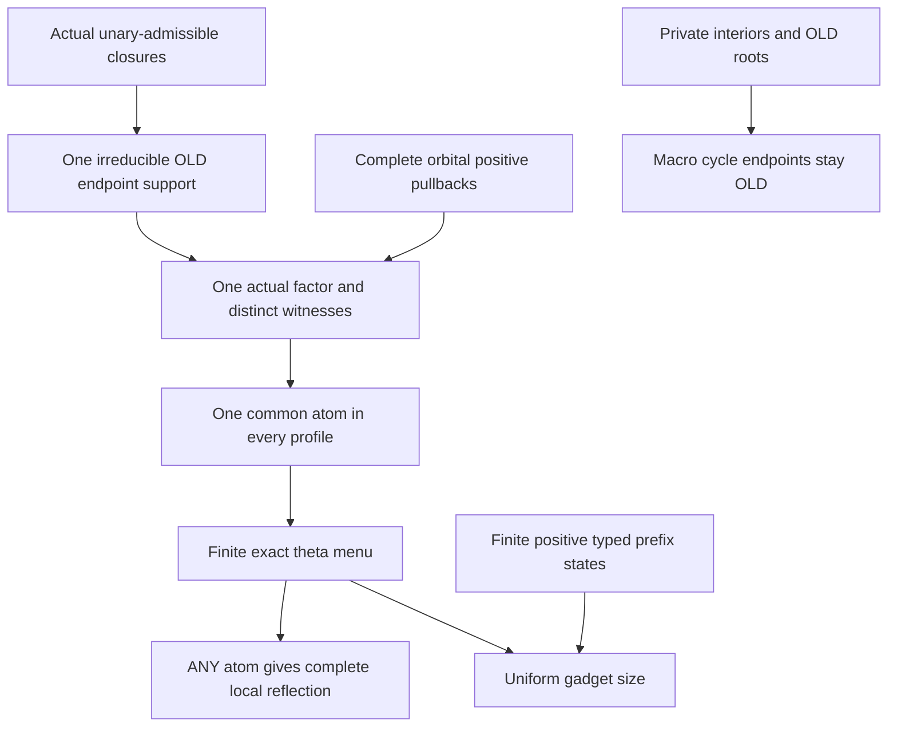

# Guarded old-source pairs, private theta cycles and complete two-root reflection

Generated from `module.json` by `tools/build_formalization_module.py`.

Source `490c3f36d85db5a0b3ced0598e6c431825254ec5`. **Human-expanded proof plan; no Lean code.**

Private B056: all FOUR source14 results, the finite-index G1 diagnostic equation, ten definitions, 61 human claims and seven tasks. Actual unary-admissible local closed supports are tested BEFORE guarded constraints. ONE irreducible OLD endpoint-pair factor supplies a common fine atom for all its positive comparisons, with no Helly or global completion used for that nonempty intersection. Private interiors give old-endpoint macro cycles; finite positive typed prefix states give uniform gadget size; ALL complete term-pair comparisons give reflection for joined local supports only. Hidden SAP by itself supplies no positive quotient diagonal; full original no-finite-index scope remains explicit. No arbitrary missing cross relation or unjoined ancestor pair is completed.

The human article remains unchanged. Additional proof details are in
[PROOF_NOTES.md](PROOF_NOTES.md); the cross-track policy is in
[the formalization guide](../README.md). Source hashes are checked before
the index is regenerated. Graph validation is not proof verification.

## Source premises

**A01: Actual original terminal binary context.** The old source is countable homogeneous, complete in a finite typed binary language with transitive named real sorts, symmetric same-sort atoms, visible SAP and semantic homomorphic CCO. Every FULL strict invariant-equivalence cover, including Top covers, has infinite relative index. This discharges the positive pullback and original strong/exact providers; hidden SAP is not a positivity assumption.

**A02: Actual finite MI-only hidden language.** Real and proper represented nonzero MI quotient sorts carry actual named equivariant projections, upward maps, quotient transitions/inverses, and complete hidden pair orbitals/cylinders. No quotient-to-real maps or nullary vertex generators. All unary term FUNCTIONS are actual functions of one original real representative and obey the prior normal form.

**A03: Unary-admissible partial source and completed local supports.** C is finite, functionally closed and unary-admissible: every FULL one-generated induced hidden diagram is an actual completed member. Every ACTUALLY IRREDUCIBLE joining closed source support used by the construction passes the bounded complete-pattern test, preserving AND reflecting its full induced diagram. No global hidden completion of C is assumed.

**A04: Literal old-source endpoint-pair restriction.** A positive menu on a witness pair for distinct OLD vertices b,c is issued only from their displayed unary/binary joining datum or the full comparisons of the SAME irreducible S_bc=cl_C{b,c}. No menu is moved to arbitrary real ancestors merely because their term values are related. ALL comparisons on one pair come from this ONE locally vetted support. Failed real-identity cases are rejected before positive menus.

**A05: Separate optional higher-support gate.** The main four results are binary. In a finite-arity extension, complete old higher-support factors and their canonical pair shadows are retained, and support>=3 tuple realization/preservation requires the separately supplied support-normal completion interface. Binary pair reflection alone proves no higher tuple reflection.

**A06: Abstract private theta graph input.** For the combinatorial cycle branch, roots form a fixed old vertex set; each theta is a union of internally vertex-disjoint positive paths between its two old roots. Interiors are disjoint across all gadgets and have NO outside incident specified edges. Repeated equal direct branches are merged into one graph edge. This branch makes no semantic completion assertion.

## Imported theorem contracts

These are named provider obligations for the receiving Lean project,
not new axioms or claims of compiled imports.

| ID and source | Contract | Current provider status |
|---|---|---|
| I01: [`lem:typed-unary-closure-bound`](../../sections/v27/10_typed_unary_terms_return.tex#L66) | Actual/unary-admissible singleton closures have uniform size m_typ. Strict proved ancestor C12 separately gives finitely many actual term FUNCTIONS; syntax is not bounded. | HUMAN_EXPANDED_NOT_LEAN |
| I02: [`lem:typed-joined-source-support`](../../sections/v27/13_actual_hidden_sap_readings.tex#L299) | An ACTUALLY irreducible induced closed support on at most k old generators has <=k*m_typ vertices and any hidden HE completion embeds its WHOLE diagram; failure of complete mandatory data is already a bounded noncompletable source defect. Reducible ancestor pairs are excluded. | HUMAN_EXPANDED_NOT_LEAN |
| I03: [`lem:typed-real-sort-splitting`](../../sections/v27/13_actual_hidden_sap_readings.tex#L152) | Within ONE completed local factor choose pairwise distinct old real witness images and designated real representatives of all proper coordinate vertices, preserving all displayed functions, cylinders and old data. Distinct actual quotient vertices/classes are retained; anchors use old SAP, not a global C completion. | HUMAN_EXPANDED_NOT_LEAN |
| I04: [`lem:typed-term-pair-orbit-pullback`](../../sections/v27/13_actual_hidden_sap_readings.tex#L540) | Each ONE complete actual hidden orbital/equality/transition-graph comparison between named real-source term functions with a distinct real witness has exactly ONE nonempty positive old STRONG cylinder profile, with actual kernels. Arbitrary unions are not one profile. | HUMAN_EXPANDED_NOT_LEAN |
| I05: [`lem:typed-term-orbit-diagonal-dichotomy`](../../sections/v27/13_actual_hidden_sap_readings.tex#L390) | The only empty diversity pullback of a complete output orbital is the same-original-real-point graph with BOTH original kernels Id. It is rejected as a bounded joined two-real-root identity defect or tested as a one-root identity; proper quotient diagonals can have nonempty diversity pullbacks. | HUMAN_EXPANDED_NOT_LEAN |
| I06: [`lem:typed-identity-transport-redundant`](../../sections/v27/07_typed_raw_strong_transition.tex#L618) | An actual RAW transition relation containing real Id induces the existing coordinate identity. Distinct source vertices cannot be its different images; no STRONG identity-labelled edge is added. | HUMAN_EXPANDED_NOT_LEAN |
| I07: [`lem:typed-exact-domain-calculus`](../../sections/v27/07_typed_raw_strong_transition.tex#L222) | A nonempty finite meet of positive typed original word profiles is an exact domain, with a finite private theta presentation. Root-signature consistency is proved separately using I11 atomic/whole-map support. Importing this supplies no existence of the intersection. | HUMAN_EXPANDED_NOT_LEAN |
| I08: [`lem:typed-helly`](../../sections/typed_strong_domains.tex#L251) | Original positive profiles are 2-Helly and finite theta exact-domain presentations have their stated endpoint semantics. Use Helly ONLY for a small incompatible-profile certificate, never to replace the direct common-survivor construction. | HUMAN_EXPANDED_NOT_LEAN |
| I09: [`lem:typed-set-pasch`](../../sections/typed_strong_domains.tex#L48) | Only the proved old SAP associative nonempty strong-product algebra in C02 is used for finite TYPED positive profile prefix states. Profiles remember both endpoint sorts. No hidden identity is adjoined and mixed typed factors are not commuted. | HUMAN_EXPANDED_NOT_LEAN |
| I10: [`lem:typed-cylinder-realisation`](../../sections/v27/07_typed_raw_strong_transition.tex#L913) | Complete named semantic cylinders partition actual compatible distinct hidden pairs and equal the full representative spectra, omitting equality exteriors. This gives relation reflection once a complete local comparison is preserved. | HUMAN_EXPANDED_NOT_LEAN |
| I11: [`lem:typed-transition-cylinder`](../../sections/v27/07_typed_raw_strong_transition.tex#L961) | A named nontrivial quotient transition graph has its full saturated positive old cylinder, independent of the fine atomic witness and actual representative choices; real-Id cases reduce separately. | HUMAN_EXPANDED_NOT_LEAN |
| I12: [`lem:typed-coordinate-normal-form`](../../sections/v27/10_typed_unary_terms_return.tex#L149) | A named term on a real representative is real identity or theta F_J with exact kernel J and actual named bijective theta. Terms from a proper coordinate root are read after its actual real projection. Literal maps determine all equalities. | HUMAN_EXPANDED_NOT_LEAN |

**I01 internal proof support:** C12 in `unary_terms_return`. Use proved strict ancestor C12 for finitely many real-source term FUNCTIONS before counting the finite list of all term-pair comparisons and root signatures. A finite singleton image alone would not justify function finiteness without the original transitivity argument. No new export or premise is added.

These are separately extracted proved support claims, not additional
numbered exports or consequences of the named theorem statement.

**I11 internal proof support:** C45 in `transition_closure`. Use strict proved ancestor transition_closure C45 for equality of the actual transported kernels and canonical maps of an atomic t and a quotient-functional R containing t. C16 applies this at each represented common root kernel to direct-domain and branch signatures; fine relations themselves are not asserted equal.

These are separately extracted proved support claims, not additional
numbered exports or consequences of the named theorem statement.

## Definitions

| ID | Definition | Exact meaning | Source |
|---|---|---|---|
| D01 | Locally vetted old support | S_bc=cl_C{b,c} with its FULL actual induced PARTIAL source diagram. It is used only if actually irreducible, not merely if two descendants are related. | [source](../../sections/v27/14_guarded_source_positive.tex#L347) |
| D02 | Old vertices and distinct real witnesses | Each old real vertex gets its own real witness; each proper coordinate b in B_aJ gets a prospective real representative in sort a. Named hidden terms on b are interpreted on that real point after F_J. | [source](../../sections/v27/14_guarded_source_positive.tex#L142) |
| D03 | All-term comparison list | For one joined pair take EVERY ordered pair of unary term values in its complete local factor, with its mandatory equality/inequality, unique cylinder or old atomic colour. Pull the ONE actual orbital back to the SAME real witness pair. | [source](../../sections/v27/14_guarded_source_positive.tex#L142) |
| D04 | Positive guarded exact menu | D_bc is the finite intersection of the positive profiles for that same old pair. Existence is proved by a common actual fine witness before the word exact-domain API is used. | [source](../../sections/v27/14_guarded_source_positive.tex#L347) |
| D05 | Private theta | A finite graph of positive atomic branches between two distinct old root witnesses; all interiors are private with no external incidences. Duplicate direct edges agree and are merged. | [source](../../sections/v27/14_guarded_source_positive.tex#L491) |
| D06 | Typed positive prefix state | A nonempty positive word prefix is represented by (initial sort,current end sort,actual nonempty STRONG profile). The finite set S_typ contains only such positive typed states, not a logical real-Id unit. | [source](../../sections/v27/14_guarded_source_positive.tex#L554) |
| D07 | Uniform pair bound | u=m_typ bounds each source singleton closure; R bounds the finite number of allowed atomic/equality/function comparisons per ordered term-value pair; s=|S_typ| bounds a shortest positive profile word. B_pair bounds a fixed theta and root anchors for every locally admissible joined pair. | [source](../../sections/v27/14_guarded_source_positive.tex#L554) |
| D08 | Complete local reflection | The map on the FULL two-generated joined hidden diagram preserves AND reflects equality, unary functions and every complete named hidden binary relation. No absent relation between distinct irreducible components is forced. | [source](../../sections/v27/14_guarded_source_positive.tex#L653) |
| D09 | Identity-only pullback defect | A complete output comparison whose only preimages have the same original real point has no old diversity profile. For distinct joined real source roots it is impossible for an embedding; for the same source vertex it is a one-root equation. | [source](../../sections/v27/14_guarded_source_positive.tex#L142) |
| D10 | Finite-index coarse-diagonal control | In blocks times F2 times infinite clones, p means same block/bit, q same block/opposite bit, r different blocks; K fixes block+bit and J fixes block. The coarse hidden diagonal pulls back on distinct reals to {p,q}. | [source](../../sections/v27/14_guarded_source_positive.tex#L2) |

## Proof claims and direct dependencies

Every row has a human proof expansion. Each still needs an actual Lean
statement and proof. Roots are ACTUAL OLD hidden source vertices; their chosen real witnesses are formal or actual representatives according to the indicated step. STRONG profiles contain only diversity atoms. Conditional higher-arity factor preservation is kept separate from binary reflection.

| ID and claim | Scope | Direct providers | Proof note |
|---|---|---|---|
| C01: One-generated diagrams must pass their ACTUAL gate first | local_support | A03, I01 | N01 in [notes](PROOF_NOTES.md) |
| C02: A displayed unary join puts both endpoints in one closure | local_support | A03, D01 | N01 in [notes](PROOF_NOTES.md) |
| C03: A binary relation on the ACTUAL endpoint pair forces irreducibility | local_support | A03, A04, D01 | N01 in [notes](PROOF_NOTES.md) |
| C04: The full local pattern has a bounded old-source support | local_support | I01, I02, C01, C02, C03 | N01 in [notes](PROOF_NOTES.md) |
| C05: Do not move a descendant relation to unjoined ancestors | local_support | A04, C03 | N01 in [notes](PROOF_NOTES.md) |
| C06: A completed local test supplies ONE factor for ALL comparisons | common_survivor | A03, A04, C04 | N01 in [notes](PROOF_NOTES.md) |
| C07: Interpret all source terms through actual real representatives | local_support | A02, I01, I12, D02, C01 | N02 in [notes](PROOF_NOTES.md) |
| C08: Each complete comparison has a single actual output orbital | local_support | A02, C06, D03 | N02 in [notes](PROOF_NOTES.md) |
| C09: Reject identity-only real pullbacks before positivity | local_support | I05, C04, C07, C08, D09 | N02 in [notes](PROOF_NOTES.md) |
| C10: RAW identity transition graphs remain existing unary identities | local_support | I06, C01, D09 | N02 in [notes](PROOF_NOTES.md) |
| C11: Nonempty comparisons are positive old profiles with typed kernels | local_support | A01, I04, I11, C07, C08, C09, C10 | N02 in [notes](PROOF_NOTES.md) |
| C12: The list includes complete data rather than only positive primitive joins | local_support | A04, I01, C07, C08, C11, D03 | N02 in [notes](PROOF_NOTES.md) |
| C13: Select distinct real representatives INSIDE that ONE factor | common_survivor | I03, C06, D02 | N03 in [notes](PROOF_NOTES.md) |
| C14: The SAME fine atom satisfies every imposed comparison | common_survivor | C11, C12, C13 | N03 in [notes](PROOF_NOTES.md) |
| C15: Only after existence use exact-domain recognition | common_survivor | I07, C14, D04 | N03 in [notes](PROOF_NOTES.md) |
| C16: Keep full transition-closed root data on the original endpoints | common_survivor | A02, I06, I11, C14, C15 | N03 in [notes](PROOF_NOTES.md) |
| C17: Single-old-support common-survivor source export | common_survivor | C04, C05, C14 | N03 in [notes](PROOF_NOTES.md) |
| C18: Private interior vertices have exactly their path incidences | private_cycles | A06, D05 | N04 in [notes](PROOF_NOTES.md) |
| C19: A cycle using two branches of one theta closes there | private_cycles | C18 | N04 in [notes](PROOF_NOTES.md) |
| C20: Any noninternal traversal uses one WHOLE old-root branch | private_cycles | C18, C19 | N04 in [notes](PROOF_NOTES.md) |
| C21: Contraction preserves literal OLD endpoints and anchors | private_cycles | A06, C20 | N04 in [notes](PROOF_NOTES.md) |
| C22: Private-theta cycle source export | private_cycles | C19, C20, C21 | N04 in [notes](PROOF_NOTES.md) |
| C23: Two-generator closures give a finite comparison count | uniform_size | I01, C01, D07 | N05 in [notes](PROOF_NOTES.md) |
| C24: Positive typed profile states form a finite semigroupoid | uniform_size | A01, I09, D06 | N05 in [notes](PROOF_NOTES.md) |
| C25: A repeated NONEMPTY prefix state gives a shorter positive word | uniform_size | C24, D06 | N05 in [notes](PROOF_NOTES.md) |
| C26: Each reachable profile has a fixed word of length at most s | uniform_size | C25 | N05 in [notes](PROOF_NOTES.md) |
| C27: Finite exact domains permit one fixed theta for each menu | uniform_size | I07, C15, C26 | N05 in [notes](PROOF_NOTES.md) |
| C28: An explicit finite overbound is available | uniform_size | C16, C23, C26, C27, D07 | N05 in [notes](PROOF_NOTES.md) |
| C29: A positive-menu incompatibility has a small pair certificate | uniform_size | I08, C09 | N05 in [notes](PROOF_NOTES.md) |
| C30: Uniform two-root gadget source export | uniform_size | C23, C28, C29 | N05 in [notes](PROOF_NOTES.md) |
| C31: Read target term values via their fixed actual normal forms | reflection | I12, C01, C07 | N06 in [notes](PROOF_NOTES.md) |
| C32: Every listed comparison pulls back to its exact old spectrum | reflection | I04, I10, I11, C11, C12, C31 | N06 in [notes](PROOF_NOTES.md) |
| C33: ANY atom of D preserves ALL complete comparisons at once | reflection | C15, C32, D04 | N06 in [notes](PROOF_NOTES.md) |
| C34: Recorded off-diagonal orbitals give pairwise injectivity | reflection | A02, C08, C12, C33 | N06 in [notes](PROOF_NOTES.md) |
| C35: Unique complete orbital labels give binary relation reflection | reflection | I10, C33, C34, D08 | N06 in [notes](PROOF_NOTES.md) |
| C36: Unary function values are preserved and reflected literally | reflection | A02, C31, C33, C34 | N06 in [notes](PROOF_NOTES.md) |
| C37: Original real pairs and typed converse data are exact | reflection | A02, C12, C33, C34 | N06 in [notes](PROOF_NOTES.md) |
| C38: Two-root complete reflection source export | reflection | A04, A05, C35, C36, C37 | N06 in [notes](PROOF_NOTES.md) |
| C39: Unjoined components need not reflect absent cross relations | boundary | A04, C05, C38 | N06 in [notes](PROOF_NOTES.md) |
| C40: The original finite-index source is a genuine SAP example | boundary | D10 | N07 in [notes](PROOF_NOTES.md) |
| C41: Its semantic CCO is equality plus parity consistency | boundary | C40, D10 | N07 in [notes](PROOF_NOTES.md) |
| C42: Coarse-only hidden SAP has a direct actual amalgamation proof | boundary | C40, D10 | N07 in [notes](PROOF_NOTES.md) |
| C43: The coarse hidden diagonal has diversity spectrum p union q | boundary | C40, D10 | N07 in [notes](PROOF_NOTES.md) |
| C44: An r-free positive word has one fixed parity profile | boundary | C40, D10 | N07 in [notes](PROOF_NOTES.md) |
| C45: Any word containing r has an outside-block diversity witness | boundary | C40, D10 | N07 in [notes](PROOF_NOTES.md) |
| C46: Coarse diagonal positivity does not follow from hidden SAP | boundary | C42, C43, C44, C45 | N07 in [notes](PROOF_NOTES.md) |
| C47: The same coarse equivalence is not FULL RAW exact | boundary | C44, C45, D10 | N07 in [notes](PROOF_NOTES.md) |
| C48: RAW exact quotient lifting is inapplicable to this coarse counterexample | boundary | C40, C47 | N07 in [notes](PROOF_NOTES.md) |
| C49: Private direct edges must agree before being merged | boundary | C14, C15 | N08 in [notes](PROOF_NOTES.md) |
| C50: Typed prefix states cannot forget the current endpoint sort | boundary | C24, C25 | N08 in [notes](PROOF_NOTES.md) |
| C51: A common actual factor is stronger than pairwise menu overlap | boundary | C06, C14 | N08 in [notes](PROOF_NOTES.md) |
| C52: Binary reflection alone does not control higher-arity tuples | boundary | A05, C37 | N08 in [notes](PROOF_NOTES.md) |
| C53: Finite bounds do not extend to malformed unary cycles | boundary | I01, C01, C04 | N08 in [notes](PROOF_NOTES.md) |
| C54: Diagonal pullbacks and unary identity reductions are different tests | boundary | C09, C10, C11 | N08 in [notes](PROOF_NOTES.md) |
| C55: The local root test is independent of future unrecorded pair choices | boundary | C21, C33, C38 | N08 in [notes](PROOF_NOTES.md) |
| C56: All-term reflection uses the complete local test essentially | boundary | C12, C32, C35 | N08 in [notes](PROOF_NOTES.md) |
| C57: General guarded-source consistency is not presumed | boundary | C17, C22, C30, C38 | N08 in [notes](PROOF_NOTES.md) |
| C58: Finite diagnostics exercise structural boundaries | boundary | C17, C22, C30, C38, C46 | N08 in [notes](PROOF_NOTES.md) |
| C59: The reflection statement uses a genuinely joined OLD support | boundary | A04, C05, C38 | N08 in [notes](PROOF_NOTES.md) |
| C60: Root signature coordinates are class-valued actual named objects | boundary | C16, I12 | N08 in [notes](PROOF_NOTES.md) |
| C61: Earlier qualifications and receiving obligations remain unchanged | boundary | C46, C48, C57 | N08 in [notes](PROOF_NOTES.md) |

The precise quantified contracts are in `module.json`. Provider-before-consumer
order (including definitions and source premises):

`A01 → A02 → A03 → A04 → A05 → A06 → D01 → D02 → D03 → D04 → D05 → D06 → D07 → D08 → D09 → D10 → I01 → I02 → I03 → I04 → I05 → I06 → I07 → I08 → I09 → I10 → I11 → I12 → C01 → C02 → C03 → C18 → C24 → C40 → C04 → C05 → C07 → C10 → C19 → C23 → C25 → C41 → C42 → C43 → C44 → C45 → C06 → C20 → C26 → C31 → C46 → C47 → C50 → C53 → C08 → C13 → C21 → C48 → C09 → C22 → C11 → C29 → C12 → C54 → C14 → C32 → C15 → C17 → C51 → C16 → C27 → C33 → C49 → C28 → C34 → C60 → C30 → C35 → C36 → C37 → C38 → C52 → C56 → C39 → C55 → C57 → C58 → C59 → C61`

This order is one valid linearization; it does not require unrelated
branches to be proved sequentially. The full DAG is the `depends_on`
relation in `module.json`.

## Main proof branches

This is a coarse view of the claim DAG. Edges go from provider to consumer.

Four source14 results and finite-index G1 equation; no global guarded completion or hidden HN arrow prepared here.
Direct common-survivor and pure private-graph claims have independent firewalls: no Helly/provider completion is used for existence of each pair menu.
Only actual joined old endpoint supports undergo complete two-root reflection; related descendants do not justify filling a reducible ancestor pair.
The block/bit coarse-only hidden SAP example has no positive old diagonal profile and no FULL RAW exact coarse equivalence, retaining the full finite-index gate.

## Article exports

| Existing source result | Sidecar proof claims |
|---|---|
| [`lem:typed-one-source-support-per-guarded-pair`](../../sections/v27/14_guarded_source_positive.tex#L346) | C17 |
| [`lem:typed-private-theta-cycle`](../../sections/v27/14_guarded_source_positive.tex#L490) | C22 |
| [`lem:typed-two-root-uniform-size`](../../sections/v27/14_guarded_source_positive.tex#L553) | C30 |
| [`lem:typed-two-root-complete-reflection`](../../sections/v27/14_guarded_source_positive.tex#L652) | C38 |

Auxiliary source equations (not additional numbered results):

- [`eq:typed-finite-index-G1-failure`](../../sections/v27/14_guarded_source_positive.tex#L43): C43, C46

## Internal implementation milestones

These tasks are proof milestones inside larger project assignments;
see the [peer-project allocation](../coordination/BOARD.md).

These are implementation tasks, not additional mathematical assumptions.

| Task | Earlier tasks | Acceptance |
|---|---|---|
| T01: Admissible old support and positive comparisons | — | Retain actual unary-admissibility and complete induced local support tests. All profiles on one pair must come from ONE actually irreducible OLD endpoint support, with a directly constructed common fine atom before exact-domain recognition. No Helly/global completion in that step. Count positive TYPED prefix states and keep the real identity case separate. Every target atom in the menu must reflect ALL local term comparisons. Pure private graph cycles, negative Helly certificates and optional higher-support preservation stay separate. |
| T02: One actual local common survivor | T01 | Retain actual unary-admissibility and complete induced local support tests. All profiles on one pair must come from ONE actually irreducible OLD endpoint support, with a directly constructed common fine atom before exact-domain recognition. No Helly/global completion in that step. Count positive TYPED prefix states and keep the real identity case separate. Every target atom in the menu must reflect ALL local term comparisons. Pure private graph cycles, negative Helly certificates and optional higher-support preservation stay separate. |
| T03: Pure private-theta graph cycles | — | Retain actual unary-admissibility and complete induced local support tests. All profiles on one pair must come from ONE actually irreducible OLD endpoint support, with a directly constructed common fine atom before exact-domain recognition. No Helly/global completion in that step. Count positive TYPED prefix states and keep the real identity case separate. Every target atom in the menu must reflect ALL local term comparisons. Pure private graph cycles, negative Helly certificates and optional higher-support preservation stay separate. |
| T04: Uniform positive typed gadget bounds | T01, T02 | Retain actual unary-admissibility and complete induced local support tests. All profiles on one pair must come from ONE actually irreducible OLD endpoint support, with a directly constructed common fine atom before exact-domain recognition. No Helly/global completion in that step. Count positive TYPED prefix states and keep the real identity case separate. Every target atom in the menu must reflect ALL local term comparisons. Pure private graph cycles, negative Helly certificates and optional higher-support preservation stay separate. |
| T05: All-atom complete two-root reflection | T01, T02 | Retain actual unary-admissibility and complete induced local support tests. All profiles on one pair must come from ONE actually irreducible OLD endpoint support, with a directly constructed common fine atom before exact-domain recognition. No Helly/global completion in that step. Count positive TYPED prefix states and keep the real identity case separate. Every target atom in the menu must reflect ALL local term comparisons. Pure private graph cycles, negative Helly certificates and optional higher-support preservation stay separate. |
| T06: Finite-index positivity boundary | — | Retain actual unary-admissibility and complete induced local support tests. All profiles on one pair must come from ONE actually irreducible OLD endpoint support, with a directly constructed common fine atom before exact-domain recognition. No Helly/global completion in that step. Count positive TYPED prefix states and keep the real identity case separate. Every target atom in the menu must reflect ALL local term comparisons. Pure private graph cycles, negative Helly certificates and optional higher-support preservation stay separate. |
| T07: Guarded scope and diagnostic boundaries | T01, T02, T03, T04, T05, T06 | Retain actual unary-admissibility and complete induced local support tests. All profiles on one pair must come from ONE actually irreducible OLD endpoint support, with a directly constructed common fine atom before exact-domain recognition. No Helly/global completion in that step. Count positive TYPED prefix states and keep the real identity case separate. Every target atom in the menu must reflect ALL local term comparisons. Pure private graph cycles, negative Helly certificates and optional higher-support preservation stay separate. |

## Finite controls

- **K01.** Actual coordinate-window all-term spectra/ANY-atom reflection and common local survivor, plus reducible descendant-join free-decomposition guard.
- **K02.** Private theta cycles, typed shortest positive profile words, direct-edge agreement and block/bit RAW/STRONG nonpositive diagonal diagnostics. Bounded controls are not unbounded completion/obstruction or Lean certificates.

Run `python tools/check_guarded_two_root_controls.py` from the manuscript directory.
The controls do not prove CCO or the general theorems.

## Return to the human articles

No required mathematical repair was found in this scoped pass. These
optional wording clarifications remain queued for a human article pass:

- **F01** ([source](../../sections/v27/14_guarded_source_positive.tex#L671)): The reflection premise is governed by the explicit old-source endpoint restriction: S_bc itself is irreducible. A relation merely on descendants can lie in an irreducible proper subpiece while the ancestor two-root closure remains reducible. Repeat S_bc=cl_C{b,c} is actually irreducible in the reflection statement, matching the construction and final unjoined-pair exclusion.
- **F02** ([source](../../sections/v27/14_guarded_source_positive.tex#L614)): Shortest positive typed word shortening must compare NONEMPTY prefix states including their endpoint sorts, with index i>=1. A logical real-Id state is not a positive profile. Spell out positive typed prefix states and merge repeated equal length-one theta branches.

The machine ledger records caller effects and affected claims. The source
review used two independent model review passes and parent synthesis;
it is not independent human or formal certification.
