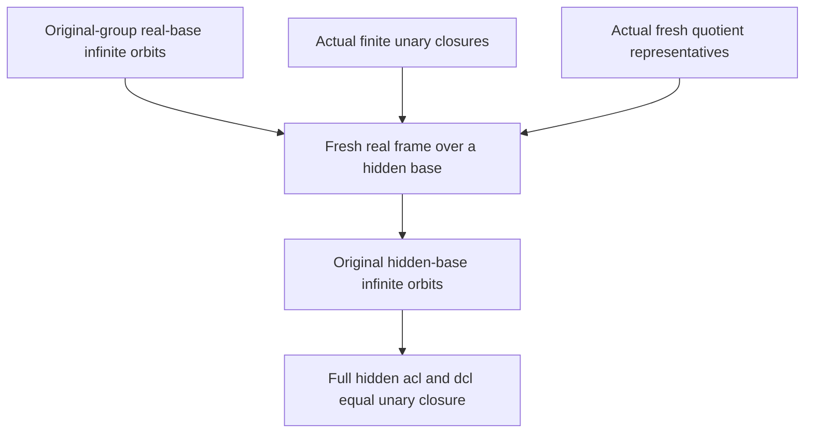

# Original-group hereditary hidden orbit infinitude through fresh real frames

Generated from `module.json` by `tools/build_formalization_module.py`.

Source `490c3f36d85db5a0b3ced0598e6c431825254ec5`. **Human-expanded proof plan; no Lean code.**

Private B054: the ONE source12 orbit result and its named equation, with 30 human proof claims. Transfer actual ORIGINAL-group real-base infinitude to EVERY finite unary-closed hidden base using a fresh real frame. Full hidden acl=dcl=unary closure follows by subgroup orbit inclusion. Hidden homogeneity and hereditary SAP are NOT prerequisites or exports of this package. Source12 examples remain uncounted boundary diagnostics.

The human article remains unchanged. Additional proof details are in
[PROOF_NOTES.md](PROOF_NOTES.md); the cross-track policy is in
[the formalization guide](../README.md). Source hashes are checked before
the index is regenerated. Graph validation is not proof verification.

## Source premises

**A01: Actual interpreted unary terminal signature.** H is the ACTUAL full hidden interpretation of the old typed source M, retaining original real sorts and exactly the named proper represented MI quotient sorts, projections, upward maps and quotient transitions. Named functions are unary and total on their specified sorts; identity terms are allowed and there are NO nullary generators. Relations are actual canonical interpreted relations, not arbitrary independently labelled partial diagrams.

**A02: Standing original terminal source.** The original source is finite-complete binary, homogeneous in its full old language, with finitely many transitive named real sorts, symmetric same-sort pair orbitals, visible SAP and semantic HOM CCO. EVERY strict cover in each FULL original invariant-equivalence lattice has INFINITE relative index, as the literal standing terminal hypothesis A:cover. This implies all proper original relative indices are infinite by a finite cover chain. The source geometry and term/fresh-frame providers retain these original hypotheses; no hidden SAP or hidden homogeneity is assumed.

**A03: Orbit-theoretic closures and elementary group actions.** For any automorphism group K acting on H, finite-orbit closure over T is {u:|K_T.u| finite}, and fixed-point closure is {u:K_T.u={u}}. The acl/dcl conclusions below use these orbit-theoretic closures for FULL Aut(H). Group orbit inclusion and finite unions are elementary; no equality G=Aut(H) or extension of arbitrary hidden partial maps is assumed.

## Imported theorem contracts

These are named provider obligations for the receiving Lean project,
not new axioms or claims of compiled imports.

| ID and source | Contract | Current provider status |
|---|---|---|
| I01: [`lem:typed-unary-closure-bound`](../../sections/v27/10_typed_unary_terms_return.tex#L66) | Every actual singleton hidden unary closure has at most m_typ vertices. With only unary functions and no nullary generators this makes finite closures finite and cl(empty)=empty. Malformed arbitrary total-unary partial sources are excluded. | HUMAN_EXPANDED_NOT_LEAN |
| I02: [`cor:typed-no-real-base-hidden-algebraicity`](../../sections/v27/11_typed_orbits_frames.tex#L207) | For EVERY finite COMPLETE original real D, the finite G_D-orbit vertices in actual H are EXACTLY cl(D), for the ORIGINAL group G=Aut(M); in particular every off-closure vertex has infinite G_D orbit. This retains full old coloured types and literal base alignment. | HUMAN_EXPANDED_NOT_LEAN |
| I03: [`lem:typed-fresh-representatives`](../../sections/v27/11_typed_orbits_frames.tex#L487) | For ANY finite actual induced unary-closed A<=B, choose actual real representatives of all proper quotient vertices of A, with C=A_real, so D=C union X satisfies A subset cl(D) and cl(D) intersect B=A. The source verification retains named forced factors and all proper original relative indices infinite; orphan-only and mixed original-sort bases are included. | HUMAN_EXPANDED_NOT_LEAN |
| I04: [`lem:foundational-real-frame-orbits`](../../sections/unary_fresh_frame_sap.tex#L7) | With G<=Aut(H), real generation, finite unary closures, original real-base infinite G_D orbits, and fresh real-frame separation, every off-base vertex has infinite G_A orbit for EVERY finite unary-closed A. This generic forward transfer needs neither homogeneity nor SAP. | HUMAN_EXPANDED_NOT_LEAN |

## Definitions

| ID | Definition | Exact meaning | Source |
|---|---|---|---|
| D01 | Original induced hidden action | G is Aut of the WHOLE old source M, acting on old real points and actual quotient classes. It is viewed through its induced action as a subgroup of Aut(H); faithfulness is harmless because old real sorts are retained. | [source](../../sections/v27/12_abstract_hidden_sap.tex#L217) |
| D02 | Literal unary term closure | cl(T) is all named unary term values, INCLUDING real and hidden identity terms, on vertices of T. No nullary functions imply cl(empty)=empty. A<=H is an actual induced finite unary-closed subset. | [source](../../sections/v27/12_abstract_hidden_sap.tex#L217) |
| D03 | Fresh real frame | For finite actual closed A<=B, a finite old real D is fresh if A subset cl(D) and cl(D) intersect B=A. This concerns actual quotient representatives, not an abstract transport chart or generated-only common base. | [source](../../sections/v27/12_abstract_hidden_sap.tex#L217) |
| D04 | Two pointwise stabilizers | G_T fixes T in the original induced action. K_T for K=Aut(H) fixes T in the full hidden group. G_T<=K_T, and generally equality is not known or needed. | [source](../../sections/v27/12_abstract_hidden_sap.tex#L217) |
| D05 | Orbit closures | acl_K(T) denotes finite K_T-orbit vertices and dcl_K(T) denotes K_T-fixed vertices. This is the precise orbit interpretation used below; full first-order identification would be a separate model-theoretic convention. | [source](../../sections/v27/12_abstract_hidden_sap.tex#L217) |
| D06 | Boundary signatures | For source12 diagnostics compare the actual MI-only signature with an enlarged signature naming exact NON-MI cell quotient, and compare coarse-only Q_J with the extra fine quotient Q_K over a two-class cover. These are separate model signatures, not allowed new objects in A01. | [source](../../sections/v27/12_abstract_hidden_sap.tex#L276) |

## Proof claims and direct dependencies

Every row has a human proof expansion. Each still needs an actual Lean
statement and proof. G=Aut(M) acts on the ACTUAL interpreted named sorts; Aut(H) may be larger. All bases and closures are literal actual subsets. No hidden homogeneity, arbitrary partial completion, or new imaginary sort is inferred.

| ID and claim | Scope | Direct providers | Proof note |
|---|---|---|---|
| C01: Old automorphisms preserve all actual hidden data | actual_unary | A01, D01 | N01 in [notes](PROOF_NOTES.md) |
| C02: All named hidden vertices have original real generators | actual_unary | A01, D02 | N01 in [notes](PROOF_NOTES.md) |
| C03: Finite term closure retains the empty case | actual_unary | I01, D02 | N01 in [notes](PROOF_NOTES.md) |
| C04: Term equivariance fixes the entire generated frame | actual_unary | C01, D02 | N01 in [notes](PROOF_NOTES.md) |
| C05: The original real-base orbit hypothesis is already supplied | original_group | A02, I02, D01 | N02 in [notes](PROOF_NOTES.md) |
| C06: Fresh representatives supply exactly one finite real frame | frame_transfer | A02, I03, D03 | N02 in [notes](PROOF_NOTES.md) |
| C07: The test extension around one hidden point is finite and closed | frame_transfer | C03, D02 | N02 in [notes](PROOF_NOTES.md) |
| C08: The real frame excludes the specified off-base point | frame_transfer | C06, C07 | N02 in [notes](PROOF_NOTES.md) |
| C09: Real-base infinitude applies to the same actual point | original_group | C05, C08 | N02 in [notes](PROOF_NOTES.md) |
| C10: The frame stabilizer is contained in the hidden-base stabilizer | original_group | C04, C08, D04 | N02 in [notes](PROOF_NOTES.md) |
| C11: Every arbitrary hidden closed-base original orbit is infinite | original_group | C09, C10 | N02 in [notes](PROOF_NOTES.md) |
| C12: The generic frame theorem is applied with all inputs discharged | frame_transfer | C01, C02, C03, C05, C06, I04 | N02 in [notes](PROOF_NOTES.md) |
| C13: An arbitrary finite parameter set has an actual closed hull | frame_transfer | C03, D02 | N03 in [notes](PROOF_NOTES.md) |
| C14: Original stabilizers of parameters and their hull agree | original_group | C04, C13 | N03 in [notes](PROOF_NOTES.md) |
| C15: Every parameter term value is fixed in the original action | original_group | C04, C13 | N03 in [notes](PROOF_NOTES.md) |
| C16: Original finite-orbit closure is exactly the term hull | original_group | C11, C14, C15, D05 | N03 in [notes](PROOF_NOTES.md) |
| C17: Original parameter stabilizers are subgroups of full hidden ones | full_hidden_group | C01, D04 | N03 in [notes](PROOF_NOTES.md) |
| C18: Full hidden off-hull orbits are infinite | full_hidden_group | C16, C17 | N03 in [notes](PROOF_NOTES.md) |
| C19: Named term values remain fixed by every full hidden automorphism | full_hidden_group | A01, C13, D04 | N03 in [notes](PROOF_NOTES.md) |
| C20: Full hidden acl and dcl are the finite term closure | full_hidden_group | C18, C19, D05 | N03 in [notes](PROOF_NOTES.md) |
| C21: Selected source theorem retains the stronger old-group assertion | full_hidden_group | C11, C12, C20 | N03 in [notes](PROOF_NOTES.md) |
| C22: Hidden SAP requires a separate homogeneity step | boundary | C21 | N04 in [notes](PROOF_NOTES.md) |
| C23: An added non-MI cell coordinate is jointly determined outside unary closure | boundary | D06 | N04 in [notes](PROOF_NOTES.md) |
| C24: The same non-MI obstruction occurs over a real-generated base | boundary | C23, D06 | N04 in [notes](PROOF_NOTES.md) |
| C25: Unique off-base meet coordinates forbid strong amalgamation | boundary | C23 | N04 in [notes](PROOF_NOTES.md) |
| C26: Naming a fine quotient can expose a finite algebraic fibre | boundary | D06 | N04 in [notes](PROOF_NOTES.md) |
| C27: A smaller named signature need not require all original NR2 cuts | boundary | C26 | N04 in [notes](PROOF_NOTES.md) |
| C28: Compatible hierarchical quotient incidence is allowed | boundary | D06, C21 | N04 in [notes](PROOF_NOTES.md) |
| C29: Empty hidden bases and parameters are literal | boundary | C03, C05, C11, C20 | N03 in [notes](PROOF_NOTES.md) |
| C30: Finite diagnostics do not prove orbit infinitude | boundary | C21, C23, C26 | N04 in [notes](PROOF_NOTES.md) |

The precise quantified contracts are in `module.json`. Provider-before-consumer
order (including definitions and source premises):

`A01 → A02 → A03 → I01 → I02 → I03 → I04 → D01 → D02 → D06 → C01 → C02 → C03 → C05 → C23 → C26 → D03 → D04 → C04 → C06 → C07 → C13 → C17 → C24 → C25 → C27 → D05 → C08 → C12 → C14 → C15 → C19 → C09 → C10 → C11 → C16 → C18 → C20 → C21 → C29 → C22 → C28 → C30`

This order is one valid linearization; it does not require unrelated
branches to be proved sequentially. The full DAG is the `depends_on`
relation in `module.json`.

## Main proof branches

This is a coarse view of the claim DAG. Edges go from provider to consumer.

The transfer uses the original group as a subgroup of the full hidden automorphism group, not equality of the groups.
Freshness is first established for actual induced closed bases, including orphan-only bases. It is then applied to B=cl(A union {u}).
Hidden homogeneity and hereditary hidden SAP belong to a later package. Naming an exact NON-MI meet quotient can invalidate the real-base/fresh-frame inputs.

## Article exports

| Existing source result | Sidecar proof claims |
|---|---|
| [`lem:typed-hereditary-hidden-orbits`](../../sections/v27/12_abstract_hidden_sap.tex#L216) | C21 |

Auxiliary source equations (not additional numbered results):

- [`eq:typed-hereditary-hidden-orbits`](../../sections/v27/12_abstract_hidden_sap.tex#L226): C11

## Internal implementation milestones

These tasks are proof milestones inside larger project assignments;
see the [peer-project allocation](../coordination/BOARD.md).

These are implementation tasks, not additional mathematical assumptions.

| Task | Earlier tasks | Acceptance |
|---|---|---|
| T01: Actual unary action and real generation | — | Retain the actual original induced group, finite unary closure without nullary generators, literal frame/base intersection and subgroup orbit inclusion in the correct direction. No hidden homogeneity/SAP, added non-MI quotient, or finite-window infinitude may be substituted. |
| T02: Original-group frame transfer over arbitrary closed bases | T01 | Retain the actual original induced group, finite unary closure without nullary generators, literal frame/base intersection and subgroup orbit inclusion in the correct direction. No hidden homogeneity/SAP, added non-MI quotient, or finite-window infinitude may be substituted. |
| T03: Finite parameters and full hidden acl/dcl | T02 | Retain the actual original induced group, finite unary closure without nullary generators, literal frame/base intersection and subgroup orbit inclusion in the correct direction. No hidden homogeneity/SAP, added non-MI quotient, or finite-window infinitude may be substituted. |
| T04: Signature and finite-control boundaries | T03 | Retain the actual original induced group, finite unary closure without nullary generators, literal frame/base intersection and subgroup orbit inclusion in the correct direction. No hidden homogeneity/SAP, added non-MI quotient, or finite-window infinitude may be substituted. |

## Finite controls

- **K01.** Finite clone-window actual group actions, literal fresh-frame intersections, stabilizer containment and original/full-group orbit inclusion; finite windows are diagnostics only, not infinite-orbit or SAP certificates.
- **K02.** Explicit non-MI cross-cell unique incidence and term-visible two-cover boundaries; unary closure misses jointly determined points and the finite quotient obstruction occurs only when the fine quotient is named.

Run `python tools/check_hereditary_hidden_orbit_controls.py` from the manuscript directory.
The controls do not prove CCO or the general theorems.

## Return to the human articles

No required mathematical repair was found in this scoped pass. These
optional wording clarifications remain queued for a human article pass:

The machine ledger records caller effects and affected claims. The source
review used two independent model review passes and parent synthesis;
it is not independent human or formal certification.
