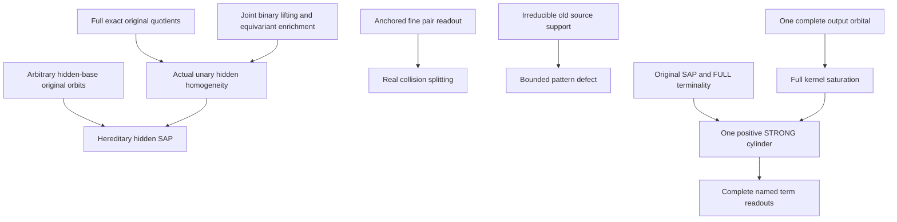

# Actual hereditary hidden SAP, representative splitting and complete-orbital readouts

Generated from `module.json` by `tools/build_formalization_module.py`.

Source `490c3f36d85db5a0b3ced0598e6c431825254ec5`. **Human-expanded proof plan; no Lean code.**

Private B055: all NINE source13 results and TWO equations; ten definitions, 68 human proof claims and eight tasks. Joint exact quotient lifting plus actual equivariant unary enrichment proves hidden homogeneity before hereditary SAP. Completed canonical-language homomorphisms reflect all data; anchored old fine pair types allow real collision splitting with fixed actual quotient vertices. Irreducible OLD source defects remain bounded without filling reducible ancestor pairs. Complete output orbital pullbacks have one positive old STRONG cylinder under original SAP and full terminality WITHOUT CCO; true real identity is the unique possible empty-diversity exception. Binary core is unconditional under its standing source inputs; higher-support clauses retain separate canonical tuple-completion/frozen-factor interfaces.

The human article remains unchanged. Additional proof details are in
[PROOF_NOTES.md](PROOF_NOTES.md); the cross-track policy is in
[the formalization guide](../README.md). Source hashes are checked before
the index is regenerated. Graph validation is not proof verification.

## Source premises

**A01: Actual countable homogeneous finite complete binary old source.** M is countable homogeneous in a finite complete binary relational language with finitely many nonempty transitive named real sorts, symmetric same-sort fine orbitals and paired cross-sort converses. Distinct old pairs carry exactly one diversity atom; true real equality remains logical equality. Every old invariant pair relation is a finite union of named actual Aut(M)-orbitals.

**A02: Original visible SAP.** The actual old finite age has strong amalgamation over every finite COMPLETE induced old base, including empty base. It can duplicate an old point outside that base while preserving the complete finite old factor, and gives infinite nonzero equivalence classes. No hidden SAP is assumed.

**A03: Original semantic homomorphic CCO.** Every finite old typed atomic partial graph whose specified simple cycles have old homomorphisms has ONE old homomorphism. Together with A01 this discharges the original FULL RAW exact-ball calculus and joint quotient lifting. This premise is confined to the hidden homogeneity/SAP branch; positivity and local readout branches do not use it.

**A04: FULL terminal infinite relative indices.** For EACH original real sort, every strict interval of actual Aut(M)-invariant equivalences has INFINITE relative index. The standing infinite FULL-cover hypothesis implies this in the finite lattice. In particular no relative-index-two interval exists; this is checked on the FULL invariant lattice rather than the represented MI sublattice. CCO-free positive pullback uses this original premise.

**A05: Actual completed MI-only hidden language.** H is the actual interpretation consisting of original reals and proper nonidentity represented MI quotient sorts Id<J<Top, their projections, upward maps and equivariant quotient bijections/inverses. ALL actual original-Aut binary orbitals between these sorts are named, with same-sort off-diagonal cylinders and logical equality separately; canonical old pair types are retained. Completed finite hidden members are induced and unary-closed in H. No nullary vertex generators. The added functions are ACTUAL equivariant maps, not arbitrary formal unary interpretations.

**A06: Arbitrary actual equivariant quotient maps for orbital branch.** Independently tau:M_a->Q and sigma:M_b->R are surjective Aut(M)-equivariant maps to transitive actual quotient G-sets; kernels J,K are actual original invariant equivalences, possibly Id or Top. Theta is ONE nonempty COMPLETE output G-orbital. This needs no MI condition or hidden homogeneity; A01 identifies old diversity orbitals with fine atoms.

**A07: Closed partial OLD source and homomorphism-embedding convention.** C is a finite unary-functionally closed PARTIAL hidden source. A homomorphism-embedding is an induced embedding on EVERY irreducible closed source subobject; irreducible means not a free amalgam of two proper closed subobjects. For a bounded k-generated support, singleton closures have size<=m_typ (supplied for unary-admissible sources). A completion target is an ACTUAL completed hidden member. No general completion of C is assumed.

**A08: SEPARATE optional finite-arity frozen-factor interface.** For conditional higher-support clauses ONLY, the old finite language has a finite canonical definitional completion naming every compatible real tuple type up to the maximum arity (including equality/sort patterns), and the supplied SAP/frozen-factor interface preserves complete induced old higher-support factors during clones/completion. The binary anchor lemma controls no arity>=3 tuple by itself. Binary hidden homogeneity/SAP below is not automatically extended to this separate setting.

## Imported theorem contracts

These are named provider obligations for the receiving Lean project,
not new axioms or claims of compiled imports.

| ID and source | Contract | Current provider status |
|---|---|---|
| I01: [`thm:typed-joint-exact-lifting`](../../sections/exact_foundations/03_joint_exact_sort_lifting.tex#L1) | For countable homogeneous complete typed binary old source with FULL exact-ball calculus, finitely chosen FULL exact original equivalences INCLUDING real Id, and ALL actual original-Aut pair orbitals on their quotient sorts, every finite joint binary partial isomorphism lifts to ONE original automorphism. This supplies no SAP/coherent section. | HUMAN_EXPANDED_NOT_LEAN |
| I02: [`cor:typed-joint-exact-equivariant-unary`](../../sections/exact_foundations/03_joint_exact_sort_lifting.tex#L76) | Adding finitely many ACTUAL equivariant unary maps on those same exact sorts preserves homogeneity for finite induced FUNCTIONALLY CLOSED partial isomorphisms, using the same original lift. Applies to the actual projection/upward/transition functions. | HUMAN_EXPANDED_NOT_LEAN |
| I03: [`lem:typed-all-invariant-equivalences-raw-word`](../../sections/terminal_invariant_raw_exact.tex#L5) | Under original same-sort symmetry and FULL no-index-two, every invariant equivalence has one RAW atomic word, Id by the empty word and nonidentity by a positive word after deleting Id letters. This representation branch needs no CCO/SAP/distributivity. | HUMAN_EXPANDED_NOT_LEAN |
| I04: [`lem:typed-unary-closure-bound`](../../sections/v27/10_typed_unary_terms_return.tex#L66) | Actual completed singleton closures have a uniform finite bound m_typ; unary-only closure is their union and no nullary generators give cl(empty)=empty. Arbitrary malformed partial sources are excluded. | HUMAN_EXPANDED_NOT_LEAN |
| I05: [`lem:typed-hereditary-hidden-orbits`](../../sections/v27/12_abstract_hidden_sap.tex#L216) | For EVERY finite actual closed hidden base A, even orphan-only, every u outside A has infinite orbit under the ORIGINAL Aut(M/A), and hence under full hidden stabilisers. Uses real-base orbits plus freshframes, not hidden homogeneity or SAP. | HUMAN_EXPANDED_NOT_LEAN |
| I06: [`lem:unary-homogeneous-sap-criterion`](../../sections/finite_orbit_avoidance.tex#L107) | For a countable homogeneous unary-functional structure with finite closures, infinite FULL-Aut orbits outside every finite closed base imply strong amalgamation of its ENTIRE hereditary unary-closed age. Homogeneity must be supplied separately. | HUMAN_EXPANDED_NOT_LEAN |
| I07: [`lem:typed-cylinder-realisation`](../../sections/v27/07_typed_raw_strong_transition.tex#L913) | Actual mixed real/quotient and quotient/quotient positions have representative-independent semantic spectra, with real Id exteriors omitted; nonempty spectra are disjoint-or-equal and partition compatible distinct hidden vertex pairs. Same-hidden-sort cylinders omit their hidden diagonal. | HUMAN_EXPANDED_NOT_LEAN |
| I08: [`lem:typed-coordinate-normal-form`](../../sections/v27/10_typed_unary_terms_return.tex#L149) | Every real-source term is real identity with Id kernel or theta after a represented nonzero proper MI projection, with theta an actual equivariant quotient bijection/identity. Exact kernel biconditional and stabiliser equality are literal. | HUMAN_EXPANDED_NOT_LEAN |
| I09: [`lem:rh-sap-invariant-monolith`](../../sections/real_hull/07_sap_mi_intersection_geometry.tex#L1) | Original SAP makes every class of a nonidentity original invariant equivalence infinite, by repeated strong copies of a nontrivial pair over one anchor; off-base real stabiliser orbits are infinite. | HUMAN_EXPANDED_NOT_LEAN |
| I10: [`lem:foundational-orbital-pullback`](../../sections/typed_invariant_quotient_transport.tex#L216) | For actual equivariant surjections, full pullback of ONE output orbital is J;O;K for ANY root orbital witness O; after diversity restriction the nonempty parts partition root diversity/orbitals. Empty diversity occurs iff same root sort, both kernels Id, and the unique same-real-point graph. This group-action theorem requires no SAP, CCO or homogeneity. | HUMAN_EXPANDED_NOT_LEAN |
| I11: [`lem:typed-raw-strong-saturation`](../../sections/v27/07_typed_raw_strong_transition.tex#L25) | Off-diagonal J;t;K equals the STRONG full cylinder, with nonzero exterior palettes and true Id exteriors omitted. Its pinned original binary path support also converts one whole RAW atomic word into its STRONG diversity profile without assuming a STRONG associativity theorem. | HUMAN_EXPANDED_NOT_LEAN |
| I12: [`lem:no-real-algebraic-transition`](../../sections/v27/07_typed_raw_strong_transition.tex#L572) | Visible old SAP prevents a nonidentity proper coordinate from transporting to real equality; the actual transition-enriched signature therefore has no equality-coordinate orphan and no quotient-to-real transition. | HUMAN_EXPANDED_NOT_LEAN |

**I11 internal proof support:** C01 in `transition_closure`. Use strict proved ancestor transition_closure C01 ONLY for pinned original binary atomic-path injectivisation: freeze the actual exterior complete fine pair, split all formal walk positions by old relational SAP and align the pair. No Set-Pasch or exact-domain premise is introduced.

These are separately extracted proved support claims, not additional
numbered exports or consequences of the named theorem statement.

## Definitions

| ID | Definition | Exact meaning | Source |
|---|---|---|---|
| D01 | Actual unary-closed hereditary envelope | Age_cl(H) consists of all finite induced functionally closed actual substructures, including those with only orphan quotient vertices. Full point-generated objects are only a subcategory. | [source](../../sections/v27/13_actual_hidden_sap_readings.tex#L2) |
| D02 | Complete hidden pair-orbital language | Every compatible distinct pair has exactly one complete typed binary orbital; same-sort logical equality is separate. An actual equivariant transition graph can itself be one orbital between two named quotient sorts. | [source](../../sections/v27/13_actual_hidden_sap_readings.tex#L33) |
| D03 | Anchored fine-pair readout | A finite complete old frame B excludes p and contains a real representative a_q of every retained hidden q, including all represented proper coordinate values of p. Matching every fine pair pz,pprime z pins their actual quotient classes and mixed cylinders. | [source](../../sections/v27/13_actual_hidden_sap_readings.tex#L63) |
| D04 | Old real collision fibre | For h:C->H and actual old p, the fibre consists of formal old REAL positions mapped to p. The SAP base excludes p and contains every OTHER DISTINCT actual old image, all anchors and previous clones. Formal positions still mapping p are not distinct base points. | [source](../../sections/v27/13_actual_hidden_sap_readings.tex#L153) |
| D05 | Irreducible OLD source support | D=cl_C(B) for <=k actual old source vertices, with induced PARTIAL language. Irreducibility is tested on this entire closed D, not on a nonclosed two-element set or on a relation among arbitrary descendants. | [source](../../sections/v27/13_actual_hidden_sap_readings.tex#L300) |
| D06 | Actual kernel pullback | For equivariant surjections tau,sigma and ONE output orbital Theta, P_Theta={(x,y):Theta(tau(x),sigma(y))}; J=ker tau,K=ker sigma. Take full RAW saturation first, then remove equal OLD real endpoints. | [source](../../sections/v27/13_actual_hidden_sap_readings.tex#L391) |
| D07 | True real-identity exception | The graph of x -> (tau(x),sigma(x)) has empty old diversity pullback exactly when the two source carriers are the SAME original sort and BOTH kernels are actual real Id. Outputs can be different sorts. | [source](../../sections/v27/13_actual_hidden_sap_readings.tex#L391) |
| D08 | Positive STRONG cylinder | For a distinct old witness fine atom t, Cyl_JK(t)=(J;t;K) off the old real diagonal. Nonzero J,K have positive old RAW word presentations; omit genuine Id exteriors and retain the middle diversity atom. | [source](../../sections/v27/13_actual_hidden_sap_readings.tex#L469) |
| D09 | Complete named term comparison | Theta is one complete semantic-cylinder orbital, one equivariant quotient-transition graph orbital, or the equality diagonal on one transitive hidden output sort. Each is verified to be ONE original-group orbital before the positive pullback theorem is applied. | [source](../../sections/v27/13_actual_hidden_sap_readings.tex#L541) |
| D10 | Reducible ancestor-pair diagnostic | In an infinite equivalence source, real roots x,y with quotient values u,v and only the displayed off-diagonal relation u-v give a reducible cl{x,y}: free-amalgamate {x,u,v} and {y,u,v} over {u,v}. No old x-y colour is imposed. | [source](../../sections/v27/13_actual_hidden_sap_readings.tex#L300) |

## Proof claims and direct dependencies

Every row has a human proof expansion. Each still needs an actual Lean
statement and proof. Actual original group and full hidden group are kept distinct. Completion, homogeneity and SAP refer to the ACTUAL MI-only interpreted signature, including orphan-only finite closed bases. Arbitrary partial unary structures are not silently completed.

| ID and claim | Scope | Direct providers | Proof note |
|---|---|---|---|
| C01: Every chosen hidden kernel is a FULL exact original equivalence | hidden_sap | A01, A04, A05, I03 | N01 in [notes](PROOF_NOTES.md) |
| C02: The actual binary hidden reduct meets the joint-lifting signature | hidden_sap | A01, A03, A05, C01, D01, D02 | N01 in [notes](PROOF_NOTES.md) |
| C03: One original lift extends every finite binary hidden partial isomorphism | hidden_sap | I01, C02 | N01 in [notes](PROOF_NOTES.md) |
| C04: Actual equivariant unary enrichment gives hidden homogeneity | hidden_sap | A05, I02, C03 | N01 in [notes](PROOF_NOTES.md) |
| C05: Finite generated closures and countability are explicit | hidden_sap | A01, A05, I04 | N01 in [notes](PROOF_NOTES.md) |
| C06: Original closed-base orbit infinitude survives in the full hidden group | hidden_sap | A05, I05 | N01 in [notes](PROOF_NOTES.md) |
| C07: Every premise of the hereditary unary SAP criterion is discharged | hidden_sap | C04, C05, C06 | N01 in [notes](PROOF_NOTES.md) |
| C08: The resulting strong amalgam separates arbitrary hidden extensions | hidden_sap | I06, C07 | N01 in [notes](PROOF_NOTES.md) |
| C09: Typed hereditary hidden SAP source export | hidden_sap | C08 | N01 in [notes](PROOF_NOTES.md) |
| C10: Sort predicates already separate differently typed vertices | rigidity | A05, D02 | N02 in [notes](PROOF_NOTES.md) |
| C11: Complete real pair colours force injection within every real sort | rigidity | A01, A05, C10 | N02 in [notes](PROOF_NOTES.md) |
| C12: Off-diagonal quotient cylinders force injection within coordinate sorts | rigidity | A05, I07, C10 | N02 in [notes](PROOF_NOTES.md) |
| C13: Complete hidden pair partitions reflect every compatible binary relation | rigidity | A05, I07, C11, C12 | N02 in [notes](PROOF_NOTES.md) |
| C14: Total typed unary functions reflect all graph identities | rigidity | A05, C10, C11, C12 | N02 in [notes](PROOF_NOTES.md) |
| C15: The optional canonical tuple-type completion reflects higher data | rigidity | A08, C11 | N02 in [notes](PROOF_NOTES.md) |
| C16: Completed hidden homomorphisms are embeddings | rigidity | C10, C11, C12, C13, C14 | N02 in [notes](PROOF_NOTES.md) |
| C17: An anchor in each retained coordinate class pins that class | anchored | A01, D03 | N03 in [notes](PROOF_NOTES.md) |
| C18: All named coordinate terms then have exactly the same values | anchored | A05, I08, C17 | N03 in [notes](PROOF_NOTES.md) |
| C19: Each real-to-retained-coordinate cylinder has the same readout | anchored | I07, C17, D03 | N03 in [notes](PROOF_NOTES.md) |
| C20: Coordinate-to-coordinate data remain literal actual data | anchored | A05, C17 | N03 in [notes](PROOF_NOTES.md) |
| C21: Anchored readout is binary and does not commute mixed products | anchored | C17, C18, C19, C20 | N03 in [notes](PROOF_NOTES.md) |
| C22: Anchored fine clone-reading source export | anchored | C21 | N03 in [notes](PROOF_NOTES.md) |
| C23: Each nonzero represented quotient fibre contains arbitrarily many anchors | splitting | A01, A02, A05, I09 | N04 in [notes](PROOF_NOTES.md) |
| C24: Fix ONE complete finite old anchor frame before all real clones | splitting | A01, A05, A07, C23, D04 | N04 in [notes](PROOF_NOTES.md) |
| C25: A direct source relation closes to an irreducible joined support | splitting | A07, D05 | N04 in [notes](PROOF_NOTES.md) |
| C26: No displayed real fine atom lies inside a collision fibre | splitting | A07, C25, D04 | N04 in [notes](PROOF_NOTES.md) |
| C27: The correct complete SAP base omits the actual collided point | splitting | A01, A02, C24, D04 | N04 in [notes](PROOF_NOTES.md) |
| C28: One old SAP duplication supplies a distinct fine-type clone | splitting | A01, A02, C27 | N04 in [notes](PROOF_NOTES.md) |
| C29: Anchors preserve ALL existing hidden quotient values during cloning | splitting | A05, C22, C24, C28 | N04 in [notes](PROOF_NOTES.md) |
| C30: Every displayed binary source datum remains a homomorphism datum | splitting | A05, A07, C26, C28, C29 | N04 in [notes](PROOF_NOTES.md) |
| C31: Finite collision descent terminates with pairwise distinct old real images | splitting | A07, C27, C28, C29, C30 | N04 in [notes](PROOF_NOTES.md) |
| C32: Every old proper coordinate gets a distinct actual representative | splitting | A05, C23, C24, C28, C31 | N04 in [notes](PROOF_NOTES.md) |
| C33: Choose one finite visible extension and retain optional support gate | splitting | A01, A07, C30, C31, C32 | N04 in [notes](PROOF_NOTES.md) |
| C34: Typed representative splitting source export | splitting | A05, I12, C31, C32, C33 | N04 in [notes](PROOF_NOTES.md) |
| C35: A homomorphism-embedding embeds every ACTUALLY irreducible closed support | source_support | A07, D05 | N05 in [notes](PROOF_NOTES.md) |
| C36: The image support is functionally closed and a completed induced member | source_support | A07, C35 | N05 in [notes](PROOF_NOTES.md) |
| C37: Any missing mandatory pattern datum blocks completion | source_support | C36 | N05 in [notes](PROOF_NOTES.md) |
| C38: The old defect support size is at most k times m_typ | source_support | A07, D05 | N05 in [notes](PROOF_NOTES.md) |
| C39: Joined OLD support defect source export | source_support | C35, C36, C37, C38 | N05 in [notes](PROOF_NOTES.md) |
| C40: Full pullback of one output orbital is literal root-kernel saturation | orbital | A01, A06, I10, D06 | N06 in [notes](PROOF_NOTES.md) |
| C41: Distinct-root output witnesses give exactly the nonempty cylinder | orbital | C40, D08 | N06 in [notes](PROOF_NOTES.md) |
| C42: Empty diversity forces same real sort and both kernels identity | orbital | A01, A06, I10, C40, D07 | N06 in [notes](PROOF_NOTES.md) |
| C43: The exceptional orbital is exactly the same-original-point graph | orbital | A01, A06, I10, C42 | N06 in [notes](PROOF_NOTES.md) |
| C44: Joined distinct-real identity requirements are local defects | orbital | A07, C39, C43 | N06 in [notes](PROOF_NOTES.md) |
| C45: Term-orbital diversity dichotomy source export | orbital | C41, C42, C43, C44 | N06 in [notes](PROOF_NOTES.md) |
| C46: Arbitrary actual output kernels are original invariant equivalences | positive_pullback | A01, A06 | N07 in [notes](PROOF_NOTES.md) |
| C47: FULL terminality gives a RAW word for each endpoint kernel | positive_pullback | A01, A04, I03, C46 | N07 in [notes](PROOF_NOTES.md) |
| C48: A diversity witness supplies one positive typed whole word | positive_pullback | C41, C47 | N07 in [notes](PROOF_NOTES.md) |
| C49: Pinned original SAP converts the FULL RAW word to its STRONG profile | positive_pullback | A01, A02, I11, C48 | N07 in [notes](PROOF_NOTES.md) |
| C50: Exterior saturation formula and output partition remain exact | positive_pullback | I10, I11, C41, C43, C49 | N07 in [notes](PROOF_NOTES.md) |
| C51: CCO-free complete-orbital positive pullback source export | positive_pullback | C46, C47, C48, C49, C50 | N07 in [notes](PROOF_NOTES.md) |
| C52: Named real-source terms are equivariant surjections with exact kernels | term_readout | A01, A05, I08 | N08 in [notes](PROOF_NOTES.md) |
| C53: A complete semantic cylinder is ONE actual output orbital | term_readout | A01, A05, I07 | N08 in [notes](PROOF_NOTES.md) |
| C54: Equality and transition graphs are also single orbitals | term_readout | A01, A05, D09 | N08 in [notes](PROOF_NOTES.md) |
| C55: The distinct-real witness selects the positive cylinder alternative | term_readout | A02, A04, C51, C52, C53, C54 | N08 in [notes](PROOF_NOTES.md) |
| C56: Complete named term-pair pullback source export | term_readout | C45, C55 | N08 in [notes](PROOF_NOTES.md) |
| C57: Every old diversity atom belongs to one output-orbital part | partition | A01, A06, I10, C52 | N09 in [notes](PROOF_NOTES.md) |
| C58: Distinct output orbitals have disjoint old atom parts | partition | C57 | N09 in [notes](PROOF_NOTES.md) |
| C59: Each nonempty part is one positive full cylinder with at most one empty part | partition | C43, C51, C57, C58 | N09 in [notes](PROOF_NOTES.md) |
| C60: Exact diversity partition source export | partition | C57, C58, C59 | N09 in [notes](PROOF_NOTES.md) |
| C61: The reducible descendant relation does not join its real ancestors | boundary | A07, D10 | N10 in [notes](PROOF_NOTES.md) |
| C62: A hidden quotient diagonal can have nonempty real diversity preimage | boundary |  | N10 in [notes](PROOF_NOTES.md) |
| C63: Omitting an actual inverse transport can create orphan algebraicity | boundary | C62 | N10 in [notes](PROOF_NOTES.md) |
| C64: An arbitrary union need not be one complete cylinder | boundary | C58, C60 | N10 in [notes](PROOF_NOTES.md) |
| C65: Higher-support claims keep their separate gate | boundary | A08, C09, C15, C22, C33 | N10 in [notes](PROOF_NOTES.md) |
| C66: Functionally closed source bounds are conditional on admissibility | boundary | A07, C38, C61 | N10 in [notes](PROOF_NOTES.md) |
| C67: Finite controls certify bounded pattern identities only | boundary | C09, C16, C34, C39, C51, C60 | N10 in [notes](PROOF_NOTES.md) |
| C68: Inherited receiving and source qualifications remain | boundary | C09, C16, C34, C39, C45, C51, C56, C60 | N10 in [notes](PROOF_NOTES.md) |

The precise quantified contracts are in `module.json`. Provider-before-consumer
order (including definitions and source premises):

`A01 → A02 → A03 → A04 → A05 → A06 → A07 → A08 → C62 → D01 → D02 → D03 → D04 → D05 → D06 → D07 → D08 → D09 → D10 → I01 → I02 → I03 → I04 → I05 → I06 → I07 → I08 → I09 → I10 → I11 → I12 → C01 → C05 → C06 → C10 → C17 → C23 → C25 → C35 → C38 → C40 → C46 → C52 → C53 → C54 → C61 → C63 → C02 → C11 → C12 → C18 → C19 → C20 → C24 → C26 → C36 → C41 → C42 → C47 → C57 → C66 → C03 → C13 → C14 → C15 → C21 → C27 → C37 → C43 → C48 → C58 → C04 → C16 → C22 → C28 → C39 → C49 → C07 → C29 → C44 → C50 → C08 → C30 → C45 → C51 → C09 → C31 → C55 → C59 → C32 → C56 → C60 → C33 → C64 → C34 → C65 → C67 → C68`

This order is one valid linearization; it does not require unrelated
branches to be proved sequentially. The full DAG is the `depends_on`
relation in `module.json`.

## Main proof branches

This is a coarse view of the claim DAG. Edges go from provider to consumer.

All nine source13 results and two equations are prepared.
Hidden homogeneity uses both joint exact binary lifting and the actual equivariant unary enrichment corollary; hereditary SAP then uses independent closed-base orbit infinitude.
Positive complete-orbital pullback is CCO-free; it does not supply hidden SAP or exact quotient Ramsey inheritance.
Source irreducibility concerns the whole closed old support; direct binary joining suffices while a relation among descendants alone does not.
Higher-support rigidity/cloning are conditional on their separate canonical tuple/frozen-factor interfaces.

## Article exports

| Existing source result | Sidecar proof claims |
|---|---|
| [`thm:typed-hidden-sap`](../../sections/v27/13_actual_hidden_sap_readings.tex#L1) | C09 |
| [`lem:typed-hidden-rigidity`](../../sections/v27/13_actual_hidden_sap_readings.tex#L32) | C16 |
| [`lem:typed-anchored-real-clone-readout`](../../sections/v27/13_actual_hidden_sap_readings.tex#L62) | C22 |
| [`lem:typed-real-sort-splitting`](../../sections/v27/13_actual_hidden_sap_readings.tex#L152) | C34 |
| [`lem:typed-joined-source-support`](../../sections/v27/13_actual_hidden_sap_readings.tex#L299) | C39 |
| [`lem:typed-term-orbit-diagonal-dichotomy`](../../sections/v27/13_actual_hidden_sap_readings.tex#L390) | C45 |
| [`lem:typed-complete-orbital-positive-NR2-SAP`](../../sections/v27/13_actual_hidden_sap_readings.tex#L468) | C51 |
| [`lem:typed-term-pair-orbit-pullback`](../../sections/v27/13_actual_hidden_sap_readings.tex#L540) | C56 |
| [`cor:typed-complete-orbital-pullback-partition`](../../sections/v27/13_actual_hidden_sap_readings.tex#L647) | C60 |

Auxiliary source equations (not additional numbered results):

- [`eq:typed-anchor-clone-reading`](../../sections/v27/13_actual_hidden_sap_readings.tex#L79): C22
- [`eq:typed-term-orbital-pullback`](../../sections/v27/13_actual_hidden_sap_readings.tex#L584): C56

## Internal implementation milestones

These tasks are proof milestones inside larger project assignments;
see the [peer-project allocation](../coordination/BOARD.md).

These are implementation tasks, not additional mathematical assumptions.

| Task | Earlier tasks | Acceptance |
|---|---|---|
| T01: Actual exact hidden homogeneity and hereditary SAP | — | Retain the actual full binary orbital language and exact original quotient kernels before using joint lifting; actual unary enrichment is separate. Hidden SAP uses established arbitrary closed-base original-group orbits, not a cyclic hidden completion premise. Clone over the complement of the ACTUAL collided point with all anchors fixed, not formal positions sharing that point. Treat irreducibility on full closed old source supports; related descendants do not join ancestors. Full kernel saturation precedes real diversity restriction; true real Id is the only empty-spectrum exception. Positive pullback must remain CCO-free, with higher-support data only under the separate tuple/frozen-factor interface. |
| T02: Completed-map rigidity and canonical tuple gate | — | Retain the actual full binary orbital language and exact original quotient kernels before using joint lifting; actual unary enrichment is separate. Hidden SAP uses established arbitrary closed-base original-group orbits, not a cyclic hidden completion premise. Clone over the complement of the ACTUAL collided point with all anchors fixed, not formal positions sharing that point. Treat irreducibility on full closed old source supports; related descendants do not join ancestors. Full kernel saturation precedes real diversity restriction; true real Id is the only empty-spectrum exception. Positive pullback must remain CCO-free, with higher-support data only under the separate tuple/frozen-factor interface. |
| T03: Anchored fine-pair quotient readout | — | Retain the actual full binary orbital language and exact original quotient kernels before using joint lifting; actual unary enrichment is separate. Hidden SAP uses established arbitrary closed-base original-group orbits, not a cyclic hidden completion premise. Clone over the complement of the ACTUAL collided point with all anchors fixed, not formal positions sharing that point. Treat irreducibility on full closed old source supports; related descendants do not join ancestors. Full kernel saturation precedes real diversity restriction; true real Id is the only empty-spectrum exception. Positive pullback must remain CCO-free, with higher-support data only under the separate tuple/frozen-factor interface. |
| T04: Visible SAP real collision splitting | T03 | Retain the actual full binary orbital language and exact original quotient kernels before using joint lifting; actual unary enrichment is separate. Hidden SAP uses established arbitrary closed-base original-group orbits, not a cyclic hidden completion premise. Clone over the complement of the ACTUAL collided point with all anchors fixed, not formal positions sharing that point. Treat irreducibility on full closed old source supports; related descendants do not join ancestors. Full kernel saturation precedes real diversity restriction; true real Id is the only empty-spectrum exception. Positive pullback must remain CCO-free, with higher-support data only under the separate tuple/frozen-factor interface. |
| T05: Irreducible old source pattern defects | — | Retain the actual full binary orbital language and exact original quotient kernels before using joint lifting; actual unary enrichment is separate. Hidden SAP uses established arbitrary closed-base original-group orbits, not a cyclic hidden completion premise. Clone over the complement of the ACTUAL collided point with all anchors fixed, not formal positions sharing that point. Treat irreducibility on full closed old source supports; related descendants do not join ancestors. Full kernel saturation precedes real diversity restriction; true real Id is the only empty-spectrum exception. Positive pullback must remain CCO-free, with higher-support data only under the separate tuple/frozen-factor interface. |
| T06: Orbital dichotomy and CCO-free positive pullback | T05 | Retain the actual full binary orbital language and exact original quotient kernels before using joint lifting; actual unary enrichment is separate. Hidden SAP uses established arbitrary closed-base original-group orbits, not a cyclic hidden completion premise. Clone over the complement of the ACTUAL collided point with all anchors fixed, not formal positions sharing that point. Treat irreducibility on full closed old source supports; related descendants do not join ancestors. Full kernel saturation precedes real diversity restriction; true real Id is the only empty-spectrum exception. Positive pullback must remain CCO-free, with higher-support data only under the separate tuple/frozen-factor interface. |
| T07: Named term comparisons and exact diversity partition | T06 | Retain the actual full binary orbital language and exact original quotient kernels before using joint lifting; actual unary enrichment is separate. Hidden SAP uses established arbitrary closed-base original-group orbits, not a cyclic hidden completion premise. Clone over the complement of the ACTUAL collided point with all anchors fixed, not formal positions sharing that point. Treat irreducibility on full closed old source supports; related descendants do not join ancestors. Full kernel saturation precedes real diversity restriction; true real Id is the only empty-spectrum exception. Positive pullback must remain CCO-free, with higher-support data only under the separate tuple/frozen-factor interface. |
| T08: Sharp language/support boundary controls | T01, T02, T03, T04, T05, T06, T07 | Retain the actual full binary orbital language and exact original quotient kernels before using joint lifting; actual unary enrichment is separate. Hidden SAP uses established arbitrary closed-base original-group orbits, not a cyclic hidden completion premise. Clone over the complement of the ACTUAL collided point with all anchors fixed, not formal positions sharing that point. Treat irreducibility on full closed old source supports; related descendants do not join ancestors. Full kernel saturation precedes real diversity restriction; true real Id is the only empty-spectrum exception. Positive pullback must remain CCO-free, with higher-support data only under the separate tuple/frozen-factor interface. |

## Finite controls

- **K01.** Explicit finite actual quotient/orbital permutation windows check complete pair partitions, surjective term kernels, one-output-orbital saturation, hidden diagonal versus real diagonal and arbitrary unions.
- **K02.** Canonical completed homomorphisms reflect data; finite anchored real clones preserve proper coordinates/cylinders; unary-closed direct joining versus reducible descendant relation and bounded positive word readouts. These are diagnostics, not infinite SAP/CCO/Lean certificates.

Run `python tools/check_hidden_sap_reading_controls.py` from the manuscript directory.
The controls do not prove CCO or the general theorems.

## Return to the human articles

No required mathematical repair was found in this scoped pass. These
optional wording clarifications remain queued for a human article pass:

- **F01** ([source](../../sections/v27/13_actual_hidden_sap_readings.tex#L246)): In representative splitting, a literal two-real-point set need not be functionally closed. A displayed direct fine relation instead makes its FULL generated closed source support irreducible. Replace the two-point irreducibility phrase by the closed support cl_C{u,v}; its displayed relation forces both roots and their unary closures into one free-amalgam factor.
- **F02** ([source](../../sections/v27/13_actual_hidden_sap_readings.tex#L9)): The actual hidden signature includes unary functions; the binary joint exact lifting theorem is followed by its explicit equivariant-unary corollary. Cite cor:typed-joint-exact-equivariant-unary alongside thm:typed-joint-exact-lifting and recall actual full pair-orbitals/exact original quotient hypotheses.

The machine ledger records caller effects and affected claims. The source
review used two independent model review passes and parent synthesis;
it is not independent human or formal certification.
