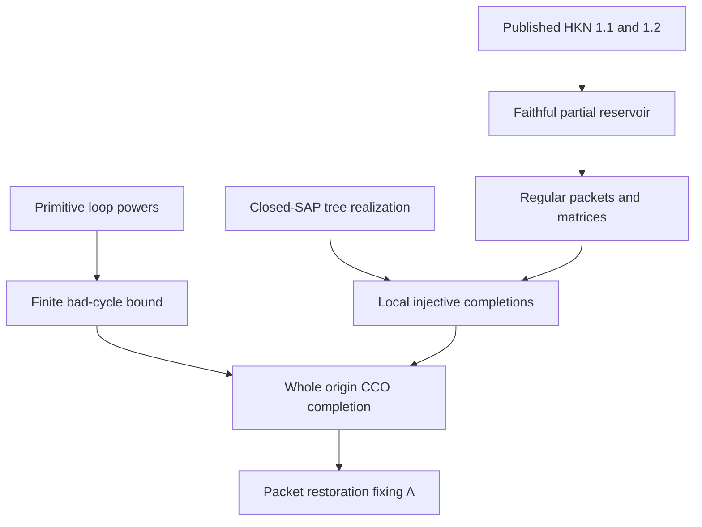

# Finite bad-cycle locality and a completable structural HKN reservoir

Generated from `module.json` by `tools/build_formalization_module.py`.

Source `490c3f36d85db5a0b3ced0598e6c431825254ec5`. **Human-expanded proof plan; no Lean code.**

B027 expands exactly seven new source results: the finite bad-cycle bound and six HKN packet-reservoir results. B025 supplies collision/origin completion and B026 supplies absorption/primitive powers. HKN 1.1/1.2 remain explicitly published external providers; their existing Lean declarations are identified read-only, while the CCO representation/normalization adapter is NOT compiled. No safe selector, valued second HKN stage, normalized MI or ordinary EPPA theorem is proved here.

The human article remains unchanged. Additional proof details are in
[PROOF_NOTES.md](PROOF_NOTES.md); the cross-track policy is in
[the formalization guide](../README.md). Source hashes are checked before
the index is regenerated. Graph validation is not proof verification.

## Source premises

**A01: Actual finite typed SAP triangle algebra.** The origin source has finitely many nonempty diversity palettes P_st, actual homogeneous typed triangle semantics, symmetric original same-sort atoms and SAP. Strong positive products are associative/nonempty and SAP injectivization fixes prescribed complete endpoint edges. Equality is not a strong atom. No CCO or primitivity is part of this premise.

**A02: Primitive individual owner sorts.** Every individual named sort of the origin source is primitive. Together with A01 this gives B026 uniform fullness for every nonempty loop subset, not only exact/word-profile subsets.

**A03: Typed semantic homomorphic CCO.** A finite partial origin diagram maps to the actual typed source whenever every specified simple typed cycle does. This is used only for whole-diagram completion after the cycle checks, not for the acyclic proper-profile bound.

**A04: Actual residual named-owner source and thin data.** N_B=pi_E^{-1}(B) is the actual residual named-owner source with R_E=F, finite nonempty G-closed actual owner set B, regular full F-packets, acl_N(X)=F[X], named-owner homogeneity, and separate compatible ambient lifts for every allowed gamma. G is the actual finite elementary abelian thin group; its named translations are total, commute with owner-preserving automorphisms and obey the literal full fine-matrix law. Retain the existing B025 normalization/exact-owner/countability hypotheses for this supplied actual instance; no section Gamma->Aut(N_B) or original raw SAP is assumed.

**A05: Closed SAP in the actual named-owner age.** Finite complete actual full-packet structures strongly amalgamate over finite complete full-packet closed bases in N_B, including empty base. This closed SAP is distinct from raw SAP of the original real source and from transversal SAP A01.

**A06: Finite HKN signature and pure owner language group.** Use finitely many unary owner predicates O_b, binary original fine atom relations R_a and unary set-valued function symbols t_g. Actual source functions have singleton outputs. Finite Gamma permutes ONLY owner predicate symbols and fixes all fine atom and function names, preserving symbol kind/arity. The unrestricted HKN output is not assumed to have owner exclusivity, total functions, singleton outputs or group equations. There are no nullary functions.

**A07: Finite complete full-packet source and compatible requests.** A is a finite NONEMPTY complete actual full-packet substructure of N_B, closed under all t_g. The finite request set consists of pairs (gamma,p) of compatible original fine-colour partial maps of A and their entire prescribed owner language components. G-saturation is performed on both domain/range. Every empty-real-domain component (gamma,empty) is retained. The identity embedding of A into a normalized witness is a structural convention proved below, not an extra assumption on HKN output. Each p is a PARTIAL ISOMORPHISM of the original complete fine-colour relational reduct: a bijection between induced finite substructures with domain and range inside A, preserving and reflecting every original fine colour, and own(p(x))=gamma own(x) for each domain point. Its inverse is therefore a genuine partial isomorphism; t_g-closedness is obtained by subsequent G-saturation.

## Published external theorem providers

These inputs are not new local proof claims or compiled CCO imports.
Existing Lean APIs still require the explicit representation bridge.

**E01: Unrestricted faithful HKN EPPA.** HKN v4 Theorem 1.1: for a relation/unary-set-function language with an arity/type-preserving Gamma_L and finite A whose relabel orbit is finite, obtain a finite coherent irreducible-structure-faithful Gamma_L EPPA witness W along a distinguished Gamma embedding of A. The witness is unrestricted; no current packet/owner axioms follow without local faithfulness arguments.

[Primary source, 1902.03855v4, 1.1](https://arxiv.org/html/1902.03855v4). Status: `PUBLISHED_THEOREM_LOCAL_BRIDGE_PENDING`.

Existing Lean: `shulda/lean_all_those_eppa_classes` at `cd358cde844d5419fd43f30c441511927e09142f`, module `AllThoseEPPA.MainTheorems`; declarations `AllThoseEPPA.MainTheorems.unrestrictedFaithfulCoherentEPPA`.

The adapter to the current CCO encoding remains a receiving-project obligation.

**E02: Restricted local-tree HKN EPPA.** HKN v4 Theorem 1.2: for finite IRREDUCIBLE A, ANY finite EPPA witness W for A, and integer n>=1, obtain a finite irreducible-structure-faithful EPPA witness B0 for A, a Gamma-homomorphism-embedding B0->W, and for EVERY induced functionally CLOSED C<=B0 with |C|<=n one Gamma-homomorphism-embedding C->D into a finite tree amalgamation of FULL Gamma_L-isomorphic A-copies. Coherence transfers if W is coherent. Local maps have one global language component and need not be globally injective.

[Primary source, 1902.03855v4, 1.2](https://arxiv.org/html/1902.03855v4). Status: `PUBLISHED_THEOREM_LOCAL_BRIDGE_PENDING`.

Existing Lean: `shulda/lean_all_those_eppa_classes` at `cd358cde844d5419fd43f30c441511927e09142f`, module `AllThoseEPPA.MainTheorems`; declarations `AllThoseEPPA.MainTheorems.restrictedLocallyTreeLikeEPPA`.

The adapter to the current CCO encoding remains a receiving-project obligation.

## Imported theorem contracts

These are named provider obligations for the receiving Lean project,
not new axioms or claims of compiled imports.

| ID and source | Contract | Current provider status |
|---|---|---|
| I01: [`lem:locality-absorb`](../../sections/finite_locality.tex#L15) | For all compatible nonempty atomic subsets, multiplication by a full palette gives the full endpoint palette. Reuse B026 C01; no new proof/export of this lemma. | HUMAN_EXPANDED_NOT_LEAN |
| I02: [`lem:locality-positive`](../../sections/finite_locality.tex#L43) | For every nonempty possibly NONEXACT W subset P_tt, W^(2|P_tt|)=P_tt and every later power is full. Reuse B026 C02-C05, requiring SAP and primitivity only. | HUMAN_EXPANDED_NOT_LEAN |
| I03: [`thm:relative-real-closure`](../../sections/owner_transversal_direct.tex#L16) | Under unchanged B025 residual hypotheses, acl_N(X)=F[X], finite full-packet unions are closed, and every compatible finite named-owner map/entire owner language action has an actual original lift. Separate lifts suffice. | HUMAN_EXPANDED_NOT_LEAN |
| I04: [`cor:relative-closed-sap`](../../sections/owner_transversal_direct.tex#L139) | Reuse B025 C26 over complete packet-closed bases; alignment and finite-action avoidance are already proved there. No full-real raw SAP is imported. | HUMAN_EXPANDED_NOT_LEAN |
| I05: [`lem:packet-collision`](../../sections/hkn_packet_reservoir.tex#L85) | An owner/function/record-preserving map of literal regular packets, injective on each packet and embedded on a complete protected base, can be made globally injective by separating only unrecorded collisions. Preserve every entire recorded neighbour matrix and the protected base; absence of records is not reflected. | HUMAN_EXPANDED_NOT_LEAN |
| I06: [`lem:packet-origins`](../../sections/hkn_packet_reservoir.tex#L133) | Origins in distinct actual packets with prescribed owners and every recorded origin colour lift by t_g o_i -> t_g e_i to a full packet completion. Actual homogeneity aligns a complete source base. Owner labels alone do not determine a phase. | HUMAN_EXPANDED_NOT_LEAN |
| I07: [`thm:joint-transversal`](../../sections/owner_transversal_direct.tex#L159) | Reuse B025 actual typed origin palettes/age, SAP, primitive sorts, semantic CCO and its packet-separated injective completion conclusion, plus full inflation identification with N_B. Canonical provider label is thm:joint-transversal, not the unexported alias lem:full-owner-transversal. Existing countability stays in this actual source construction. | HUMAN_EXPANDED_NOT_LEAN |
| I08: [`lem:thin-bottom`](../../sections/finite_packets.tex#L339) | Reuse the total regular G action and literal fine-colour law col(t_g x,t_h y)=(g+h)col(x,y), centrality and possibly nonfaithful owner action. | HUMAN_EXPANDED_NOT_LEAN |
| I09: [`eq:packet-matrix`](../../sections/hkn_packet_reservoir.tex#L133) | Import B025 matrix equation for origin inflation; it is not a new B027 auxiliary export. | HUMAN_EXPANDED_NOT_LEAN |
| I10: [`lem:typed-injectivisation`](../../sections/typed_strong_domains.tex#L129) | A realized positive atomic path can be made injective on formal vertices while its complete actual endpoint edge stays fixed. Used to compare homomorphic cycles with strong profiles; no CCO premise. | HUMAN_EXPANDED_NOT_LEAN |

## Definitions

| ID | Definition | Exact meaning | Source |
|---|---|---|---|
| D01 | Proper-profile automaton | For each starting sort s, states are (t,D) with empty!=D proper subset P_st a positive-word profile. Append a genuine atomic letter only when the resulting profile remains proper. No empty-word state is adjoined; full profiles are absorbing. | [source](../../sections/finite_locality.tex#L108) |
| D02 | Finite HKN source encoding | The concrete A uses O_b, R_a and singleton-valued unary t_g. Gamma changes only owner symbols. Completeness makes A irreducible; finiteness gives a finite relabel orbit. Arbitrary external output still has general set-valued unary outputs. | [source](../../sections/hkn_packet_reservoir.tex#L40) |
| D03 | Closed substructures and irreducibility | A substructure contains complete unary function-value sets of every point. Irreducible means it has no free decomposition into two proper CLOSED substructures. A generated closure may be irreducible even when its generating singleton is not closed. | [source](../../sections/hkn_packet_reservoir.tex#L208) |
| D04 | Literal regular full packet | An input packet is a |G|-element t_g orbit with total singleton outputs, t_0=id, t_g t_h=t_(g+h), free regular orbit and exactly one owner at each point. For arbitrary HKN output these properties must be proved from closed-piece faithfulness. | [source](../../sections/hkn_packet_reservoir.tex#L208) |
| D05 | All-or-nothing recorded packet matrices | For distinct packets choose origins o_i. A recorded pair has exactly the full nonthin matrix col(t_g o_i,t_h o_j)=(g+h)c_ij, with c_ij outside F. An unrecorded pair has NO interpacket fine records. This is a condition on local input diagrams, recovered later for B0. | [source](../../sections/hkn_packet_reservoir.tex#L134) |
| D06 | Protected complete packet base | A_* is a designated COMPLETE full-packet substructure whose map is already an induced embedding into its prescribed actual copy in N_B. The base can be empty. It is not merely a partial recorded subdiagram. | [source](../../sections/hkn_packet_reservoir.tex#L332) |
| D07 | Permitted free tree amalgam | A finite tree amalgamation of FULL Gamma-relabelled A copies in the unary-function category. Overlaps are actual closed substructures of source copies, with matching literal owner/function/colour data. Relabels may differ between copies, while a morphism has just one global language component. | [source](../../sections/hkn_packet_reservoir.tex#L164) |
| D08 | HKN homomorphism-embedding | A pair (gamma,f_V) with one global language action, relational homomorphism conditions and unary-output inclusion globally, whose restriction to EVERY closed irreducible source substructure is an embedding. Such restrictions reflect relations and preserve WHOLE function-value sets by equality; global injectivity is not assumed. | [source](../../sections/hkn_packet_reservoir.tex#L208) |
| D09 | Finite word/cycle bounds | N_s=sum_t(2^|P_st|-2), ell=max_s N_s and b=max(3,ell+1), calculated after the finite owner set/palettes are fixed. A sharper longest proper-prefix bound is optional; there is no uniformity claim across quotient witnesses. | [source](../../sections/finite_locality.tex#L108) |
| D10 | Actual-vertex locality parameter | The numerical HKN parameter is n=b|G|>=1, chosen before the unrestricted witness is constructed. G is the given nonempty finite group and b>=3. This definition assumes NO regularity or matrix axioms for HKN output. The later C18/D11 proof computes k|G| for closed diagrams only AFTER packet recovery or under explicitly supplied regular input-packet premises. | [source](../../sections/hkn_packet_reservoir.tex#L401) |
| D11 | Origin partial diagram | Choose one arbitrary origin o_i in each literal packet and its actual owner beta_i. Record c_ij precisely on recorded packet pairs. No equivariant or canonical choice of origins is required; inflation uses both actual origin owners AND recorded fine colours. | [source](../../sections/hkn_packet_reservoir.tex#L134) |
| D12 | Requests and distinguished source embedding | A request is the pair (gamma,p), keeping gamma even for p empty. A distinguished Gamma embedding psi=(lambda,psi_V):A->W need not initially be a literal inclusion; exact requested components are recovered by global lambda^-1 relabelling and vertex renaming. Each p is a PARTIAL ISOMORPHISM of the original complete fine-colour relational reduct: a bijection between induced finite substructures with domain and range inside A, preserving and reflecting every original fine colour, and own(p(x))=gamma own(x) for each domain point. Its inverse is therefore a genuine partial isomorphism; t_g-closedness is obtained by subsequent G-saturation. | [source](../../sections/hkn_packet_reservoir.tex#L40) |
| D13 | Structural reservoir versus completion certificate | B0 retains its partial records and Gamma automorphisms. An injective completion is only a record-preserving same-vertex complete actual colouring in N_B; it does NOT reflect record absence and is not required equivariant. | [source](../../sections/hkn_packet_reservoir.tex#L40) |

## Proof claims and direct dependencies

Every row has a human proof expansion. Each still needs an actual Lean
statement and proof. Finite HKN representation, typed SAP/primitivity/CCO, actual named-owner closure/homogeneity and closed SAP are separate premises.

| ID and claim | Scope | Direct providers | Proof note |
|---|---|---|---|
| C01: Proper-profile automaton is acyclic | SAP_primitive | D01, I01, I02 | N01 in [notes](PROOF_NOTES.md) |
| C02: Positive-prefix count and uniform finite word bound | SAP_primitive | C01, D09 | N01 in [notes](PROOF_NOTES.md) |
| C03: Strong cycle criterion and coarse bad-cycle bound | SAP_primitive | C02, I10 | N01 in [notes](PROOF_NOTES.md) |
| C04: Bounded short-cycle test plus semantic CCO | SAP_primitive_CCO | C03, A03 | N01 in [notes](PROOF_NOTES.md) |
| C05: Every permitted source relabel is actual | actual_closed_SAP | D02, I03, I08 | N03 in [notes](PROOF_NOTES.md) |
| C06: Tree attachment overlaps are complete closed packet bases | actual_closed_SAP | D07, I03, D04 | N03 in [notes](PROOF_NOTES.md) |
| C07: Finite complete-realization tree induction | actual_closed_SAP | C05, C06, I04, I03 | N03 in [notes](PROOF_NOTES.md) |
| C08: Whole-tree injective realization with protected source node | actual_closed_SAP | C07 | N03 in [notes](PROOF_NOTES.md) |
| C09: Full packets are irreducible closed structures | finite_unary_structure | D03, D04 | N04 in [notes](PROOF_NOTES.md) |
| C10: Recorded two-packet unions are irreducible | finite_unary_structure | C09, D04 | N04 in [notes](PROOF_NOTES.md) |
| C11: Local homomorphism-embeddings preserve entire recorded pieces | finite_Gamma_maps | D08, C09, C10 | N04 in [notes](PROOF_NOTES.md) |
| C12: One global target language normalization | finite_Gamma_maps | D07, D08 | N05 in [notes](PROOF_NOTES.md) |
| C13: Literal protected data before actual alignment | finite_Gamma_maps | C12, D06 | N05 in [notes](PROOF_NOTES.md) |
| C14: An irreducible tree piece lies in one source node | finite_unary_structure | D07, D03 | N06 in [notes](PROOF_NOTES.md) |
| C15: Normalized local tree map gives actual packetwise map | local_HKN_plus_actual_source | C08, C11, C13, C14, I03 | N06 in [notes](PROOF_NOTES.md) |
| C16: Apply existing protected collision provider | local_HKN_plus_actual_source | C15, I05 | N06 in [notes](PROOF_NOTES.md) |
| C17: Same-vertex injective local packet completion | local_HKN_plus_actual_source | C16, D13 | N06 in [notes](PROOF_NOTES.md) |
| C18: Closed short-cycle size and chord retention | finite_unary_structure | D10, D11 | N07 in [notes](PROOF_NOTES.md) |
| C19: One local tree map completes all induced short-cycle records | local_HKN_plus_actual_source | C18, C17, I07 | N07 in [notes](PROOF_NOTES.md) |
| C20: G-saturation of compatible original partial requests | published_HKN_plus_actual_source | D12, I08, I03 | N02 in [notes](PROOF_NOTES.md) |
| C21: Finite source orbit, irreducibility and all empty requests | finite_unary_structure | D02, D03, D12 | N02 in [notes](PROOF_NOTES.md) |
| C22: First external faithful witness along an exact source copy | published_HKN_plus_actual_source | E01, C20, C21 | N02 in [notes](PROOF_NOTES.md) |
| C23: Second external local-tree witness at actual-vertex threshold | published_HKN_plus_actual_source | E02, C22, C21, D10 | N02 in [notes](PROOF_NOTES.md) |
| C24: Every closed one-generated piece is faithful and irreducible | finite_unary_structure | C23, D03 | N08 in [notes](PROOF_NOTES.md) |
| C25: Recover regular packet partition and owner exclusivity | published_HKN_plus_actual_source | C24, D02, D04 | N08 in [notes](PROOF_NOTES.md) |
| C26: Recover all-or-nothing complete nonthin matrices | published_HKN_plus_actual_source | C25, C10, C23, I08 | N08 in [notes](PROOF_NOTES.md) |
| C27: All short specified origin cycles complete | published_HKN_plus_actual_source | C23, C25, C26, C19 | N09 in [notes](PROOF_NOTES.md) |
| C28: Every specified origin cycle completes | published_HKN_plus_actual_source | C27, C03 | N09 in [notes](PROOF_NOTES.md) |
| C29: Whole-origin packet-separated injective completion | published_HKN_plus_actual_source | C28, A03, I07 | N09 in [notes](PROOF_NOTES.md) |
| C30: Restore all packets and fix the designated actual A | published_HKN_plus_actual_source | C29, I06, I09, I03 | N09 in [notes](PROOF_NOTES.md) |
| C31: Retain the structural partial reservoir contract | published_HKN_plus_actual_source | C23, C25, C26, C30, D13 | N09 in [notes](PROOF_NOTES.md) |

The precise quantified contracts are in `module.json`. Provider-before-consumer
order (including definitions and source premises):

`A01 → A02 → A03 → A04 → A05 → A06 → A07 → D02 → D03 → D04 → I01 → I02 → I03 → I04 → I05 → I06 → I07 → I08 → I09 → I10 → C05 → C09 → D01 → D05 → D07 → D08 → D12 → E01 → C01 → C06 → C10 → C12 → C14 → C20 → C21 → D06 → D09 → D11 → D13 → E02 → C02 → C07 → C11 → C13 → C22 → D10 → C03 → C08 → C18 → C23 → C04 → C15 → C24 → C16 → C25 → C17 → C26 → C19 → C27 → C28 → C29 → C30 → C31`

This order is one valid linearization; it does not require unrelated
branches to be proved sequentially. The full DAG is the `depends_on`
relation in `module.json`.

## Main proof branches

This is a coarse view of the claim DAG. Edges go from provider to consumer.

External HKN nodes are published theorem providers with local encoding adapters pending, not human-expanded local claims or new axioms. All finite completion colours stay outside the structural reservoir records. No S, safe selector, ordinary EPPA or rank assembly premise occurs.

## Article exports

| Existing source result | Sidecar proof claims |
|---|---|
| [`thm:locality-bound`](../../sections/finite_locality.tex#L107) | C01, C02, C03, C04 |
| [`thm:completable-reservoir`](../../sections/hkn_packet_reservoir.tex#L39) | C20, C21, C22, C23, C24, C25, C26, C27, C28, C29, C30, C31 |
| [`lem:packet-tree-realisation`](../../sections/hkn_packet_reservoir.tex#L163) | C05, C06, C07, C08 |
| [`lem:hkn-irreducible-packet-control`](../../sections/hkn_packet_reservoir.tex#L207) | C09, C10, C11 |
| [`lem:hkn-global-language-normalisation`](../../sections/hkn_packet_reservoir.tex#L245) | C12, C13 |
| [`lem:hkn-local-tree-packet-injectivisation`](../../sections/hkn_packet_reservoir.tex#L331) | C14, C15, C16, C17 |
| [`lem:hkn-chord-complete-short-cycle`](../../sections/hkn_packet_reservoir.tex#L400) | C18, C19 |

Auxiliary source equations (not additional numbered results):

- [`eq:hkn-global-language-normalisation`](../../sections/hkn_packet_reservoir.tex#L266): C12, C13

Full result coverage is asserted only for `source_result_files`.
Selected additional results: thm:locality-bound, thm:completable-reservoir, lem:packet-tree-realisation, lem:hkn-irreducible-packet-control, lem:hkn-global-language-normalisation, lem:hkn-local-tree-packet-injectivisation, lem:hkn-chord-complete-short-cycle.
Other results in their provider source files are not claimed covered.

## Internal implementation milestones

These tasks are proof milestones inside larger project assignments;
see the [peer-project allocation](../coordination/BOARD.md).

These are implementation tasks, not additional mathematical assumptions.

| Task | Earlier tasks | Acceptance |
|---|---|---|
| T01: Finite proper-profile and short-cycle bound | — | Implement the exact local claims and genuine consumers with all listed source contracts. Retain identity-language protected-base alignment, complete function outputs, and distinction between records and completion colours. |
| T02: Actual closed-packet tree realization | — | Implement the exact local claims and genuine consumers with all listed source contracts. Retain identity-language protected-base alignment, complete function outputs, and distinction between records and completion colours. |
| T03: Irreducible pieces and global language normalization | — | Implement the exact local claims and genuine consumers with all listed source contracts. Retain identity-language protected-base alignment, complete function outputs, and distinction between records and completion colours. |
| T04: Local protected injective packet completion | T02, T03 | Implement the exact local claims and genuine consumers with all listed source contracts. Retain identity-language protected-base alignment, complete function outputs, and distinction between records and completion colours. |
| T05: External theorem representation and requests | T01 | Implement the exact local claims and genuine consumers with all listed source contracts. Adapt the pinned EXISTING AllThoseEPPA.MainTheorems declarations to this CCO representation; prove function-value/Gamma/distingushed-copy normalization interfaces; do not reprove HKN or add axioms. |
| T06: Faithful packet/owner/matrix recovery | T03, T05 | Implement the exact local claims and genuine consumers with all listed source contracts. Retain identity-language protected-base alignment, complete function outputs, and distinction between records and completion colours. |
| T07: Whole reservoir completion and certificate firewall | T01, T04, T05, T06 | Implement the exact local claims and genuine consumers with all listed source contracts. Retain identity-language protected-base alignment, complete function outputs, and distinction between records and completion colours. |

## Finite controls

- **K01.** Bounded proper-profile automata and actual literal cycle completions, including ell=0, the strict word bound and a sharp ell=2/b=3 witness. Finite diagnostics do not prove primitivity or CCO.
- **K02.** Regular C2/C2^2 unary closures, induced matrix reflection, allowed unrecorded packet collapse, full chord-complete k|G| locality domains and S3 global language normalization, including empty-domain components.
- **K03.** Bounded collision-potential patching preserves complete protected bases, even when an unrecorded collision target is protected; this table diagnostic does not prove infinite avoidance/closed SAP or HKN.

Run `python tools/check_hkn_reservoir_controls.py` from the manuscript directory.
The controls do not prove CCO or the general theorems.

## Return to the human articles

No required mathematical repair was found in this scoped pass. These
optional wording clarifications remain queued for a human article pass:

- **F01** ([source](../../sections/hkn_packet_reservoir.tex#L570)): The owner-exclusivity step says singleton irreducible faithfulness, but {v} need not be closed under unary t_g when |G|>1. The actual proof uses its faithful ONE-GENERATED CLOSED PACKET. Replace the loose singleton phrase by faithfulness of each one-generated closed packet, as made explicit in C24/C25. The theorem statement is unchanged.
- **F02** ([source](../../sections/hkn_packet_reservoir.tex#L40)): General HKN providers may use a distinguished Gamma embedding psi=(lambda,psi_V). Exact requested language components need global lambda^-1 normalization and literal source-copy renaming. None required: the local source works with literal A inclusion. Preserve this representation/extension-square proof in receiving notes.

The machine ledger records caller effects and affected claims. The source
review used two independent model review passes and parent synthesis;
it is not independent human or formal certification.
