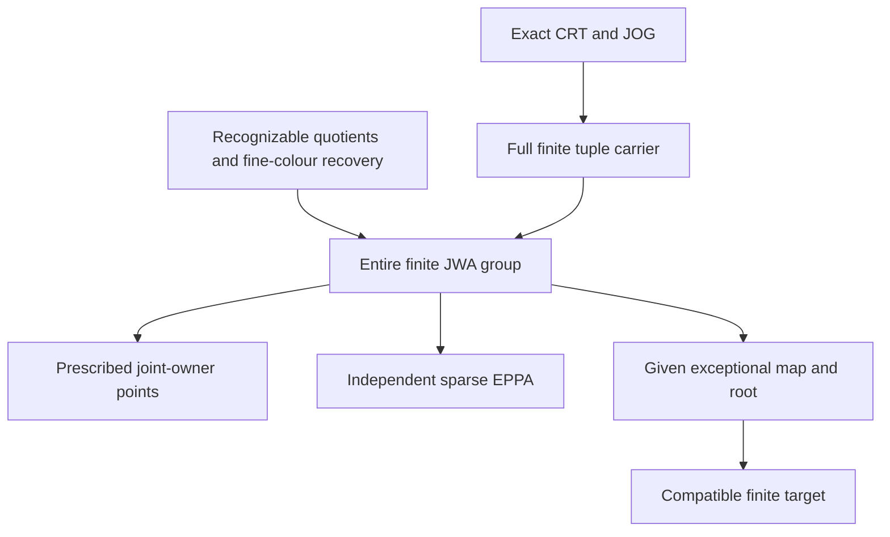

# Joint-owner full tuple actions, sparse EPPA and exceptional-root synchronization

Generated from `module.json` by `tools/build_formalization_module.py`.

Source `490c3f36d85db5a0b3ced0598e6c431825254ec5`. **Human-expanded proof plan; no Lean code.**

Preparation for OTHER Lean projects. Complete expansion of the joint-owner source lemma, including actual finite CRT realization, the ENTIRE finite automorphism pullback, prescribed joint-owner points and an independent sparse-input EPPA clause. A separate conditional support lemma synchronizes a GIVEN exceptional coordinate automorphism for the rank consumer; it does NOT prove that rank theorem.

The human article remains unchanged. Additional proof details are in
[PROOF_NOTES.md](PROOF_NOTES.md); the cross-track policy is in
[the formalization guide](../README.md). Source hashes are checked before
the index is regenerated. Graph validation is not proof verification.

## Source premises

**A01: Finite nonempty coordinate index.** I is a finite NONEMPTY index set; no meet-irreducibility or distinctness of the indexed kernels is assumed. Each finite colour structure names equality and all its specified binary colours. Empty finite carriers are permitted.

**A02: Joint owner diagram with actual images.** B is a finite owner structure, B_i are its projected finite structures, and beta_i:B->B_i are ONTO and jointly injective. For each pair i,j their two maps to a common comparison carrier agree on every b in B. No individual full-group map Aut(B)->Aut(B_i) is required to be onto.

**A03: Full finite owner tuple set.** The tuple map beta:B->product B_i has image EXACTLY the tuples agreeing in every pairwise comparison carrier. Thus no compatible owner tuple is omitted. This is additional finite data, not a consequence of individual projection surjectivity or ambient CRT.

**A04: Full finite coordinate witness over the owner diagram.** Each finite D_i has an ONTO owner map o_i:D_i->B_i. W is ALL tuples (x_i) whose owners have equal pairwise comparison images. The coordinate structures are the declared finite induced structures, never a selected automorphism subgroup.

**A05: Recognizable quotient kernels and pair colours.** For every relevant ONTO map W->D_i, W->B, D_i->B_i and B->B_i, its equality kernel and the pullback of EVERY target binary colour are unions of named source binary colours. When W->B is used, its carrier map is already supplied by full owner compatibility. This is a conditional finite-language datum; it does not assume any lifting of automorphisms.

**A06: Fine-colour reconstruction.** The named W pair colour is determined by the tuple of all D_i pair colours, including coordinate equalities. No choice of free cross colours is allowed. This condition is separate from set-level compatible tuple realization.

**A07: Every prescribed coordinate point motion.** For every i, x_i,y_i in D_i and delta_i in FULL Aut(B_i) with delta_i(o_i(x_i))=o_i(y_i), there is alpha_i in FULL Aut(D_i) inducing EXACTLY delta_i on ALL B_i and taking x_i to y_i. This is not used by the independent sparse-input EPPA branch.

**A08: Actual original source for the source instantiation.** X is a nonempty transitive homogeneous one-sort source in a FINITE complete symmetric binary language with actual equality-inclusive RAW orbitals and homomorphic CCO. RETAIN countability in this actual specialization because the currently packaged RAW provider type includes it; no countability-free provider extraction is asserted. Abstract finite carrier/action/EPPA/support branches do not use countability. No SAP, NR2, global quotient-automorphism lift or group section is assumed.

**A09: Actual finite exact kernel family.** For the source instantiation C_i and H_i are actual full RAW exact invariant equivalences, C_i<=H_i, meet_i C_i=Id. Q_i=X/C_i, O_i=X/H_i, Hstar=meet_i H_i, Omega=X/Hstar. The finite B and D_i are actual induced subsets in these sorts with precisely the maps in A02/A04; the prescribed owner tuples are tested in X/(H_i join H_j).

**A10: Join gate JOG.** For every distinct i,j, C_i join C_j = H_i join H_j. This identifies coordinate CRT comparison quotients with the owner comparison quotients. A witness-local equality of the compatibility tests would suffice for the abstract assembly, but no source theorem weakening is made.

**A11: Independent sparse-input EPPA data.** A0 is a finite induced subset of W; A_B and A_i0 are its actual owner and coordinate images. B extends EVERY partial automorphism of A_B. Each D_i extends EVERY partial automorphism of A_i0 with EVERY prescribed delta_i in Aut(B_i) compatible on that partial domain, inducing delta_i on the ENTIRE B_i. Empty domains are included. Neither point homogeneity nor a coherent extension assignment is part of this branch.

**A12: Conditional exceptional-root consumer data.** For the optional rank-step SUPPORT lemma, choose A0 subset W, A_i0 its images and targets A_i subset D_i containing A_i0. Each D_i has an Aut(D_i)-invariant equivalence F_i and F_i[A_i0] subset A_i. Fix an index e, a nonempty Z subset W and z in Z; every nonexceptional projection pi_j(Z) lies in F_j[z_j]. A GIVEN exceptional alpha_e in FULL Aut(D_e) carries pi_e(Z) into A_e and sends z_e into A_e0. The full map rho_e:Aut(B)->Aut(B_e) is onto with fibre-transitive kernel on beta_e:B->B_e; B is nonempty in this request. These extra inputs are NOT conclusions of the joint source lemma.

## Imported theorem contracts

These are named provider obligations for the receiving Lean project,
not new axioms or claims of compiled imports.

| ID and source | Contract | Current provider status |
|---|---|---|
| I01: [`thm:abstract-exact-crt`](../../sections/exact_lattice_crt.tex#L5) | For a nonempty set with a distributive sublattice of pairwise commuting equivalences, every finite nonempty family identifies X/meet C_i with ALL tuples compatible in X/(C_i join C_j). Includes repeated relations and singleton families. This is set realization only. | HUMAN_EXPANDED_NOT_LEAN |
| I02: [`lem:acf-exact-distributive`](../../sections/exact_lattice_crt.tex#L52) | The full actual exact equivalences of a standing symmetric CCO source form a finite bounded distributive lattice and commute under represented composition. This supplies I01 for the actual C_i family; the entire invariant-equivalence lattice is not asserted distributive. | HUMAN_EXPANDED_NOT_LEAN |
| I03: [`lem:exact-quotient-colour-meet`](../../sections/exact_foundations/02_exact_quotient_orbital_geometry.tex#L12) | For EVERY original RAW atom a including Id, intersection_i(C_i;a;C_i)=K;a;K with K=meet_i C_i. Hence all coordinate pair orbitals determine the K-quotient fine orbital. When K=Id this is the original fine colour, independently of tuple CRT. | HUMAN_EXPANDED_NOT_LEAN |
| I04: [`lem:prescribed-action-point-lifting`](../../sections/typed_invariant_quotient_transport.tex#L185) | Already assigned and accepted with shared B001: for an equivariant ONTO map from NONEMPTY Y, onto group map plus fibre-transitive kernel is equivalent to every compatible point pair with every prescribed target action. No faithfulness or group section. Empty finite systems are handled directly. | HUMAN_SUPPORT_PROOF_NOT_LEAN |

## Definitions

| ID | Definition | Exact meaning | Source |
|---|---|---|---|
| D01 | Actual coordinate and owner sorts | Q_i=X/C_i, O_i=X/H_i, Omega=X/Hstar, with every canonical projection retained as a map. Inclusion C_i<=H_i makes each coordinate owner map well defined. | [source](../../sections/rooted_main/01_joint_owner_homogeneity.tex#L31) |
| D02 | Pairwise owner compatibility | Use equality in X/(H_i join H_j) in the source instance; the abstract diagram uses its specified common comparison maps. Compatibility is a condition on owner coordinates, not equality of coordinate points. | [source](../../sections/rooted_main/01_joint_owner_homogeneity.tex#L43) |
| D03 | Full compatible coordinate carrier | W is every tuple x_i in D_i whose owner coordinates pass all D02 tests. Its owner b is the UNIQUE B point with beta_i(b)=o_i(x_i), when A03 holds. | [source](../../sections/rooted_main/01_joint_owner_homogeneity.tex#L78) |
| D04 | Owner fibres and canonical finite maps | D_i(b_i)=o_i^{-1}(b_i); pi_i:W->D_i is tuple evaluation. The joint owner map q:W->B is defined only after the full-owner carrier argument. | [source](../../sections/rooted_main/01_joint_owner_homogeneity.tex#L88) |
| D05 | Full finite groups and induced owner actions | Gamma=Aut(B), K_i=Aut(D_i), G_i=Aut(B_i); own_i and rho_i are induced maps on the ENTIRE finite targets. Their existence is proved by recognizable quotient descent. | [source](../../sections/rooted_main/01_joint_owner_homogeneity.tex#L90) |
| D06 | Unambiguous matching subgroup | P is the subgroup of Gamma times product K_i consisting of (gamma,(alpha_i)) with own_i(alpha_i)=rho_i(gamma) for every i. Forgetting gamma is injective because the beta_i jointly separate B. | [source](../../sections/rooted_main/01_joint_owner_homogeneity.tex#L108) |
| D07 | Prescribed joint point request | For x,y in W and gamma in FULL Gamma, require gamma(q(x))=q(y); the output must induce that gamma on ALL B, not just at q(x). | [source](../../sections/rooted_main/01_joint_owner_homogeneity.tex#L124) |
| D08 | Sparse projected input and partial maps | For a finite induced A0 subset W, A_B=q(A0), A_i0=pi_i(A0). A partial automorphism projects on its own image domain, using recognition of both kernel and pair colours. These images may omit most compatible tuples. | [source](../../sections/rooted_main/01_joint_owner_homogeneity.tex#L214) |
| D09 | Entire-owner prescribed partial extension | For each partial isomorphism p_i on A_i0 and each compatible delta_i in FULL Aut(B_i), one alpha_i in Aut(D_i) agrees with p_i and induces delta_i on every B_i point. | [source](../../sections/rooted_main/01_joint_owner_homogeneity.tex#L157) |
| D10 | Actual source theorem versus finite assembly | The source theorem identifies W with an induced subset of X by actual CRT and RAW fine colours, then instantiates the abstract carrier/group/point/EPPA conclusions. Its own statement imposes no MI property on the C_i. | [source](../../sections/rooted_main/01_joint_owner_homogeneity.tex#L12) |
| D11 | Exceptional-root synchronization request | An exceptional coordinate automorphism is GIVEN first. Lift its entire owner component together with the joint root-owner pair, then choose the other point motions. The exceptional map must remain exactly the given map. | [source](../../sections/rooted_main/02_rank_relative_rooted_induction.tex#L269) |
| D12 | Compatible target set | T={w in W: pi_i(w) in A_i for every i}. The generic root consumer proves alpha(Z) subset T and alpha(z) in A0. Identifying T with actual acl_X(A0) is a separate later geometry obligation. | [source](../../sections/rooted_main/02_rank_relative_rooted_induction.tex#L240) |

## Proof claims and direct dependencies

Every row has a human proof expansion. Each still needs an actual Lean
statement and proof. Finite carrier/group/point/EPPA branches and actual source realization have distinct premises; source-relative rank providers are not silently imported.

| ID and claim | Scope | Direct providers | Proof note |
|---|---|---|---|
| C01: Commuting owner comparison data | finite_assembly | A02, D02 | N01 in [notes](PROOF_NOTES.md) |
| C02: Simultaneously empty finite system | finite_assembly | A01, A02, A04, D03 | N02 in [notes](PROOF_NOTES.md) |
| C03: Exact owner-fibre description | finite_assembly | C01, D03, A03 | N02 in [notes](PROOF_NOTES.md) |
| C04: Joint owner map is onto | finite_assembly | C03, A01, A04 | N02 in [notes](PROOF_NOTES.md) |
| C05: Every coordinate map is onto without finite owner fullness | finite_assembly | C01, A01, A02, A04, D03 | N02 in [notes](PROOF_NOTES.md) |
| C06: Actual coordinate CRT matches the declared tuple carrier | actual_source | A08, A09, A10, I01, I02, D03 | N03 in [notes](PROOF_NOTES.md) |
| C07: Actual owner coordinates separate the joint owner sort | actual_source | A09, D01 | N03 in [notes](PROOF_NOTES.md) |
| C08: Actual quotient kernels and every pair colour are recognizable | actual_source | A08, A09, C06, C07 | N03 in [notes](PROOF_NOTES.md) |
| C09: All coordinate orbitals recover the original fine colour | actual_source | A08, A09, I03 | N03 in [notes](PROOF_NOTES.md) |
| C10: Recognizable quotient descent for automorphisms and partial maps | finite_assembly | A05 | N04 in [notes](PROOF_NOTES.md) |
| C11: Canonical full owner-action homomorphisms | finite_assembly | C10, A02, A04, D05 | N04 in [notes](PROOF_NOTES.md) |
| C12: Every actual W automorphism gives one matching group element | finite_assembly | C04, C05, C10, C11 | N05 in [notes](PROOF_NOTES.md) |
| C13: The common full owner action is unique | finite_assembly | A02, C11, D06 | N05 in [notes](PROOF_NOTES.md) |
| C14: Matching actions preserve the full carrier with inverse | finite_assembly | C03, C11, D06 | N05 in [notes](PROOF_NOTES.md) |
| C15: Matching coordinate maps preserve all fine colours | finite_assembly | C14, A06 | N05 in [notes](PROOF_NOTES.md) |
| C16: Natural full JWA group isomorphism | finite_assembly | C12, C13, C15, D06 | N05 in [notes](PROOF_NOTES.md) |
| C17: Every prescribed joint-owner point request is realized | finite_assembly | C16, A07, D07 | N06 in [notes](PROOF_NOTES.md) |
| C18: Onto full joint-owner action and fibre-transitive kernel | finite_assembly | C02, C04, C17, I04 | N06 in [notes](PROOF_NOTES.md) |
| C19: Sparse original partial maps project genuinely | finite_assembly | C10, D08 | N07 in [notes](PROOF_NOTES.md) |
| C20: Extend one owner partial map before all coordinate maps | finite_assembly | C11, C19, A11, D09 | N07 in [notes](PROOF_NOTES.md) |
| C21: Independent sparse-input EPPA assembly | finite_assembly | C16, C20 | N07 in [notes](PROOF_NOTES.md) |
| C22: Instantiate the complete original joint-owner source theorem | actual_source | A08, A09, A10, C02, C06, C07, C08, C09, C16, C17, C18, C21 | N08 in [notes](PROOF_NOTES.md) |
| C23: Choose one original target point from the exceptional root | root_consumer | A12, C03, C11, D11 | N09 in [notes](PROOF_NOTES.md) |
| C24: Lift both the given exceptional component and the full root owner | root_consumer | C23, A12, I04 | N09 in [notes](PROOF_NOTES.md) |
| C25: Complete the given exceptional map by other prescribed points | root_consumer | C16, C24, A07 | N09 in [notes](PROOF_NOTES.md) |
| C26: Transport the clique into the compatible finite target | root_consumer | C25, A12, D12 | N09 in [notes](PROOF_NOTES.md) |
| C27: Finite premise diagnostics have bounded scope | diagnostic | A01 | N10 in [notes](PROOF_NOTES.md) |

The precise quantified contracts are in `module.json`. Provider-before-consumer
order (including definitions and source premises):

`A01 → A02 → A03 → A04 → A05 → A06 → A07 → A08 → A09 → A10 → A11 → A12 → I01 → I04 → C10 → C27 → D01 → D02 → D03 → D05 → D09 → D11 → D12 → I02 → I03 → C01 → C02 → C06 → C07 → C09 → C11 → D04 → D06 → D10 → C03 → C05 → C08 → C13 → D07 → D08 → C04 → C14 → C19 → C23 → C12 → C15 → C20 → C24 → C16 → C17 → C21 → C25 → C18 → C26 → C22`

This order is one valid linearization; it does not require unrelated
branches to be proved sequentially. The full DAG is the `depends_on`
relation in `module.json`.

## Main proof branches

This is a coarse view of the claim DAG. Edges go from provider to consumer.

The actual source supplies CRT and fine-colour recovery separately. The finite group identity imports neither an owner master nor a rooted theorem. Point lifting and partial-map EPPA are independent consumers. C23-C26 are conditional support for the rank step, not an export of the full rank theorem.

## Article exports

| Existing source result | Sidecar proof claims |
|---|---|
| [`lem:acf-multi-owner-point-homogeneity`](../../sections/rooted_main/01_joint_owner_homogeneity.tex#L11) | C01, C02, C03, C04, C05, C06, C07, C08, C09, C10, C11, C12, C13, C14, C15, C16, C17, C18, C19, C20, C21, C22 |

Auxiliary source equations (not additional numbered results):

- [`eq:acf-joint-owner-join-gate`](../../sections/rooted_main/01_joint_owner_homogeneity.tex#L29): C06
- [`eq:acf-joint-owner-full-witness`](../../sections/rooted_main/01_joint_owner_homogeneity.tex#L78): C03, C04, C05, C06
- [`eq:acf-joint-owner-automorphisms`](../../sections/rooted_main/01_joint_owner_homogeneity.tex#L108): C12, C13, C14, C15, C16

## Internal implementation milestones

These tasks are proof milestones inside larger project assignments;
see the [peer-project allocation](../coordination/BOARD.md).

These are implementation tasks, not additional mathematical assumptions.

| Task | Earlier tasks | Acceptance |
|---|---|---|
| T01: Full compatible carriers and actual CRT realization | — | Prove the conditional finite carrier lemmas and source geometry separately; retain both onto maps, finite owner fullness, JOG and real equality. |
| T02: Recognizable quotient maps and full finite group identity | T01 | Descend full and partial maps using kernels AND pair colours; prove both directions of JWA and unique full owner component, with group laws. |
| T03: Prescribed points and independent sparse EPPA | T01, T02 | Handle empty owners separately, invoke shared nonempty point criterion, and prove sparse EPPA without point-transitivity assumptions. Instantiate exactly the source lemma. |
| T04: Given exceptional map synchronization and premise controls | T01, T02 | Keep the exceptional automorphism fixed while lifting its full owner component and root; prove the generic compatible-target transfer, without asserting the rank/global theorem. Retain finite diagnostic limits. |

## Finite controls

- **R01.** Actual all-difference finite quotient structures with one through four coordinates, linear changes of basis, repeated kernels, proper induced and empty witnesses; full finite automorphism identity and all compatible point requests.
- **R02.** Sparse induced original inputs and every colour-preserving partial map, entire-owner prescribed extensions and coordinate assembly.
- **R03.** Nonsplit C4->C2 quotient action and all prescribed point requests; no section is assumed.
- **R04.** Deliberately missing JOG, finite owner fullness, full carrier, fine-colour reconstruction, shared owner action and onto local providers produce the specified failures; these are not CCO counterexamples.
- **R05.** Twenty-two conditional exceptional-root transports keep a given nonidentity coordinate automorphism unchanged on its ENTIRE factor, move a two-point set into literal compatible coordinate targets and send its selected root to ONE original input point. No acl identification is tested.

Run `python tools/check_joint_owner_controls.py` from the manuscript directory.
The controls do not prove CCO or the general theorems.

## Return to the human articles

All entries are queued for a later human-article pass; formalization detail stays in this sidecar. The optional rank support claims do not promote the source-relative rooted/global candidate.

- **F01** ([source](../../sections/rooted_main/01_joint_owner_homogeneity.tex#L12)): The title mentions an MI witness, but the proof and hypotheses only require a finite exact kernel family; meet-irreducibility is not used. Describe the reusable assembly theorem for arbitrary finite exact kernels, retaining the current statement as a special reading.
- **F02** ([source](../../sections/rooted_main/01_joint_owner_homogeneity.tex#L41)): Ambient exact CRT does not imply fullness of the CHOSEN finite owner witness. Individual finite projections can be onto while compatible owner tuples are omitted. Keep finite owner fullness adjacent to JOG and distinguish it from ambient CRT.
- **F03** ([source](../../sections/rooted_main/01_joint_owner_homogeneity.tex#L190)): Full Aut descent uses every quotient pair colour as well as its kernel; the same mechanism gives sparse partial-map projection, including diagonals. State the reusable recognizable-quotient contract once and cite it in both group and EPPA branches.
- **F04** ([source](../../sections/rooted_main/01_joint_owner_homogeneity.tex#L96)): The full JWA identity is needed to assemble a preexisting exceptional map in the rank consumer. Point homogeneity alone is not the required replacement API. Keep the full group identity prominent, with the common-owner subgroup as pairs before omitting its unique owner component.
- **F05** ([source](../../sections/rooted_main/01_joint_owner_homogeneity.tex#L150)): The optional sparse EPPA branch requires partial-map providers but no prescribed-point hypothesis. Individual rho_i surjectivity is unnecessary in the core theorem. Separate the EPPA branch from the point-kernel branch in a future concise human rewrite.

The machine ledger records caller effects and affected claims. The source
review used two independent model review passes and parent synthesis;
it is not independent human or formal certification.
