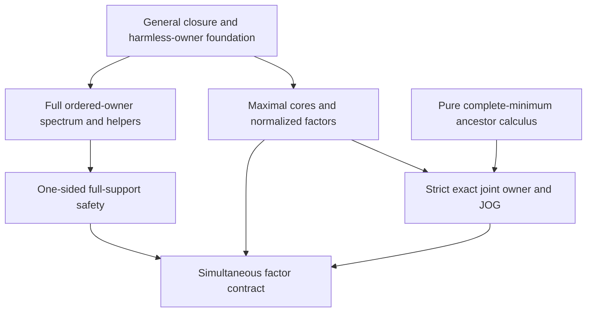

# Maximal exact MI factors and one-sided full-support safety

Generated from `module.json` by `tools/build_formalization_module.py`.

Source `490c3f36d85db5a0b3ced0598e6c431825254ec5`. **Human-expanded proof plan; no Lean code.**

Preparation for OTHER Lean projects. Maximal exact pseudocomplements, all selected normalized quotients, full fine-lift spectrum, recipient-only harmless safe descent and minimum-ancestor strict joint owners. The source factor corollary has EXPLICIT inherited StrongClosedAmalgamation(M,S) on safety/clique clauses. No rooted MI/R07 or global EPPA construction is proved.

The human article remains unchanged. Additional proof details are in
[PROOF_NOTES.md](PROOF_NOTES.md); the cross-track policy is in
[the formalization guide](../README.md). Source hashes are checked before
the index is regenerated. Graph validation is not proof verification.

## Source premises

**A01: Current actual source.** M is a nonempty countable transitive homogeneous source in a FINITE complete symmetric binary language with equality-inclusive RAW orbitals and semantic homomorphic CCO. Retain the current packaged RAW source scope. No original SAP, NR2, EPPA, owner master or rooted theorem is assumed.

**A02: Normalized complete-direction source branch.** For maximal cores M is infinite and finite-exact-normalized. E_1,...,E_r enumerate ALL minimal infinite FULL invariant equivalences; their identification with exactly the atoms of the actual exact lattice is DERIVED in C05, not an additional premise. R_i are the established global correspondences and OLD C_i=kappa(R_i); do not rename the old cores as hat C_i. Nonempty selected I may be arbitrary; multi-factor claims require r>=2.

**A03: Actual exact lattice and quotient scope.** Only the actual FULL RAW EXACT invariant equivalences form the commuting finite distributive lattice used for Birkhoff. Exact quotient interval/descent and source inheritance are imported explicitly. Full finite packet bottoms and harmless owner kernels are not asserted exact.

**A04: Pure ancestor theorem with exhaustive minima.** For C24/C25, P is a finite poset whose ENTIRE minimal-element set is enumerated without repetitions as p_1,...,p_r, r>=2. Anc(q)={i:p_i<=q} is therefore nonempty. The pure lattice branch has no source or palette hypotheses.

**A05: Every nonempty selected-core meet.** For the normalized quotient theorem, I is an arbitrary NONEMPTY subset of the complete direction indices; K_I=meet_(i in I) hat C_i. No omission of the maximal-pseudocomplement premise or replacement by arbitrary smaller cores is allowed.

**A06: General complementary exact split.** For spectrum/one-sided safety, C,K are actual exact invariant equivalences with C meet K=Id; J=C join K, Y=M/C, X=M/K and T=M/J. The source need not be finite-exact-normalized for these general branches.

**A07: Harmless owner naming only in the recipient.** For Y-directed avoidance/safety, adding any finite set of ACTUAL T-classes as imaginary parameters does not enlarge real acl in Y. No harmlessness in the opposite X-factor is assumed. Symmetric X-directed safety has the exchanged premise.

**A08: Original strong closed safe palette.** S is an explicitly GIVEN set of ORIGINAL diversity atom names strongly amalgamating finite ABSOLUTELY real-acl-closed induced spans in M. All safety and unsafe-clique conclusions of the assembled factor corollary retain this premise; pure structure, normalization, owner strictness and acl formulas do not.

**A09: Given full ordered owner-pair spectrum.** For the independent spectrum theorem, B is a finite set of actual T-owners, P subset X is finite induced and onto B, and for EACH ORDERED actual pair (t,t_prime) in B squared P realizes EVERY X-pair orbital possible above that exact pair, including X-diagonal when t=t_prime. Neither absolute closure nor harmlessness is needed for this supplied-spectrum consumer.

**A10: Arbitrary closed quotient span.** For safety start with ANY span A->L,R of finite ABSOLUTELY real-acl-closed induced Y structures, allowing empty base/factors. Owner-complete helpers are constructed later; no closedness of the original owner image is assumed.

**A11: Closed owner helper input.** For the helper construction lemma, B is a GIVEN finite NONEMPTY absolutely acl_T-closed actual owner set. This input is constructed in C14 for the safety application, not an extra preexisting helper or opposite-factor harmlessness premise.

## Imported theorem contracts

These are named provider obligations for the receiving Lean project,
not new axioms or claims of compiled imports.

| ID and source | Contract | Current provider status |
|---|---|---|
| I01: [`lem:global-correspondence`](../../sections/global_correspondence.tex#L16) | R_i are actual equivalences containing F with E_i meet R_i=E_i meet F; this import is structural and uses normalization, not a safe palette. | HUMAN_EXPANDED_NOT_LEAN |
| I02: [`lem:acf-canonical-coordinates`](../../sections/rooted_acf_geometry.tex#L207) | Reuse ONLY C15-C19/C35 supporting the original structural coordinate proof: all R_i meet F, old cores meet Id, other E_j<=C_i, finite [R_i:C_i], Sigma(C_i)=R_i and full quotient finite-bottom transport. The optional unsafe-clique branch is imported separately. | HUMAN_EXPANDED_NOT_LEAN |
| I03: [`lem:acf-exact-distributive`](../../sections/exact_lattice_crt.tex#L52) | Finite actual exact lattice is distributive with the already internally proved Birkhoff representation. Minimal exact atoms are the minimal points of P; no Booleanity is assumed. | HUMAN_EXPANDED_NOT_LEAN |
| I04: [`lem:exact-descent`](../../sections/exact_gluing_geometry.tex#L25) | For an actual exact K, H/K is full RAW exact iff its saturated original pullback H is full exact, and the exact quotient lattice is [K,Top]. Use only the one-original-sort branch. | HUMAN_EXPANDED_NOT_LEAN |
| I05: [`thm:exact-sorts-source`](../../sections/exact_foundations/03_joint_exact_sort_lifting.tex#L161) | Every actual exact quotient has the standing source properties in its canonical old-group orbital language. A one-point quotient is allowed. Strict diversity-rank decrease for nonidentity kernels is proved by the local orbital-block count in C03/C26, not assumed as an unexported clause of this provider. | HUMAN_EXPANDED_NOT_LEAN |
| I06: [`lem:packetinterval`](../../sections/finite_packets.tex#L56) | Reuse finite core/Sigma indices in the FULL invariant lattice, including Sigma(old C_i)=R_i from I02, and monotonicity of kappa. Neither R_i nor F_i must be exact. | HUMAN_EXPANDED_NOT_LEAN |
| I07: [`lem:crossingindex`](../../sections/finite_packets.tex#L138) | Reuse the explicitly exported support C02: class injection/restriction, commuting transposition and finite tower multiplication. The normalized quotient proof uses actual finite class counts, not infinite cardinal division. | HUMAN_EXPANDED_NOT_LEAN |
| I08: [`prop:minimalcut`](../../sections/finite_packets.tex#L102) | In every inherited standing source every inclusion-minimal infinite full invariant equivalence is actual exact. In a finite-exact-normalized source it is precisely an atom of the exact lattice. | HUMAN_EXPANDED_NOT_LEAN |
| I09: [`cor:rh-acl-bounded-character`](../../sections/real_hull/06_minimal_infinite_directions_acl.tex#L85) | Reuse C11 singleton/one-minimal-direction closure: acl_Q(A)=F_Q[A] for finite real A when Q is infinite with exactly one minimal infinite direction. No owner-named-union closure is inferred. | HUMAN_EXPANDED_NOT_LEAN |
| I10: [`lem:acf-acl-projects-exact`](../../sections/maximal_cores/01_maximal_hat_normalisation.tex#L137) | For each actual exact quotient pi, pi(acl(A)) subset acl(pi A), proved by finite joint lifts. This keeps helper closures over an absolutely closed owner B without harmlessness in the opposite factor. | HUMAN_EXPANDED_NOT_LEAN |
| I11: [`lem:acf-finite-exact-closed-preimages`](../../sections/maximal_cores/01_maximal_hat_normalisation.tex#L210) | Finite absolutely closed quotient targets with finite common kernel give a finite absolutely closed intersection of FULL inverse images, without compatible tuples or marginal onto requirements. | HUMAN_EXPANDED_NOT_LEAN |
| I12: [`lem:acf-rectangle-acl`](../../sections/maximal_cores/01_maximal_hat_normalisation.tex#L302) | Two absolutely closed coordinate factors and identity kernel meet give a finite absolutely closed full original rectangle. Common owner B need not be closed or harmless for this closure theorem. | HUMAN_EXPANDED_NOT_LEAN |
| I13: [`lem:exact-quotient-colour-meet`](../../sections/exact_foundations/02_exact_quotient_orbital_geometry.tex#L12) | Every original RAW pair colour, including coordinate equality cases, is determined by all exact quotient pair colours when the common kernel is Id. This is not a set-level CRT theorem. | HUMAN_EXPANDED_NOT_LEAN |
| I14: [`thm:abstract-exact-crt`](../../sections/exact_lattice_crt.tex#L5) | Commuting distributive equivalence geometry realizes EVERY compatible two-coordinate tuple; with C meet K=Id it is one original point. Fine colours are handled separately by I13. | HUMAN_EXPANDED_NOT_LEAN |
| I15: [`lem:acf-harmless-owners`](../../sections/harmless_exact_owners.tex#L8) | In an infinite standing source, finite naming of actual H-classes is harmless for real acl iff H contains ALL minimal infinite invariant directions. Applies simultaneously to finite owner sorts and to each actual inherited quotient. | HUMAN_EXPANDED_NOT_LEAN |
| I16: [`lem:finite-action-avoidance`](../../sections/finite_orbit_avoidance.tex#L6) | One group element moves a finite set of infinite-orbit points away from any finite forbidden set. The finite coset-cover theorem is proved internally in that module, so no external Neumann axiom is imported. | HUMAN_EXPANDED_NOT_LEAN |
| I17: [`lem:acf-unsafe-concentration`](../../sections/rooted_acf_geometry.tex#L87) | Under original StrongClosedAmalgamation(M,S), every unsafe pair belongs to R_i or R_j for EACH index pair. Thus unsafe cliques are unconcentrated in at most one R_i. This is independent of which exact subcore of R_i is later chosen. | HUMAN_EXPANDED_NOT_LEAN |
| I18: [`eq:acf-closure-pullback`](../../sections/rooted_acf_geometry.tex#L287) | Reuse the explicitly exported auxiliary equation: for ANY finite family of actual exact kernels with finite-class common meet, acl(A) equals the intersection of quotient acl preimages. This is not limited to the OLD packet-core family; source fingerprints and its proof claims are validated like numbered imports. | HUMAN_EXPANDED_NOT_LEAN |

## Definitions

| ID | Definition | Exact meaning | Source |
|---|---|---|---|
| D01 | Maximal exact core without renaming old C_i | hat C_i=join{H:H an actual exact invariant EQUIVALENCE and H<=R_i}. This is the largest exact element inside the actual R_i equivalence; old C_i remains kappa(R_i). | [source](../../sections/maximal_cores/01_maximal_hat_normalisation.tex#L11) |
| D02 | Selected-core kernel | K_I=meet_(i in I) hat C_i for each nonempty selected I; all directions of the resulting source must be identified, not only its singleton factors. | [source](../../sections/maximal_cores/01_maximal_hat_normalisation.tex#L47) |
| D03 | Pseudocomplement downsets | The exact atom E_i corresponds to minimal p_i of P; its maximal pseudocomplement corresponds to P minus up(p_i). The complete minimal set matters. | [source](../../sections/maximal_cores/01_maximal_hat_normalisation.tex#L77) |
| D04 | Full-support projected safe palette | S_Y consists of Y DIVERSITY atoms q for which EVERY original fine lift of q belongs to S. Existence of one safe representative is insufficient; quotient diagonal is excluded. | [source](../../sections/maximal_cores/04_one_sided_full_safety.tex#L9) |
| D05 | Complete ordered owner-pair spectrum | For every ordered actual owner pair (t,t_prime), P contains a pair in EVERY realizable X atomic orbital over exactly those owners, including the literal X diagonal when owners coincide. | [source](../../sections/maximal_cores/02_complementary_owner_spectrum.tex#L10) |
| D06 | Owner-complete closed helpers | Choose finite NONEMPTY acl_T-closed B. Construct absolutely closed P in X with complete spectrum and D in Y containing A; both project onto EXACTLY B by APJ. | [source](../../sections/maximal_cores/04_one_sided_full_safety.tex#L77) |
| D07 | Padded closed span over D | After owner-fixed placement of the original L,R away from D outside A, close L union D and R union D and realign the latter over D. Their full closures meet exactly in D while original factors meet in A. | [source](../../sections/maximal_cores/04_one_sided_full_safety.tex#L121) |
| D08 | Common rectangle anchors | For each t in B choose d_t in D above t; the base contains (d_t,p) for EVERY p in P over t. It fixes the actual opposite X-class of every factor point (ell,p). | [source](../../sections/maximal_cores/04_one_sided_full_safety.tex#L185) |
| D09 | Complete minimal ancestor set | For pure finite P with ALL minima p_i, Anc(q)={i:p_i<=q}; every q has a nonempty Anc set. A chosen proper subset of minima does not satisfy this contract. | [source](../../sections/maximal_cores/05_joint_owner_minima.tex#L11) |
| D10 | Common-owner join cuts | J_ij=hat C_i join hat C_j; H_i=meet_(j!=i)J_ij; Hstar=meet_(i<j)J_ij. Hstar>Id gives a strict original quotient, which may be a singleton if Hstar=Top. | [source](../../sections/maximal_cores/05_joint_owner_minima.tex#L24) |
| D11 | Canonical complementary split for factor i | For r>=2 let K=meet_(j!=i)hat C_j and J=hat C_i join K. The split has identity meet; J contains all original minimal directions and all surviving directions in each factor. | [source](../../sections/maximal_cores/05_joint_owner_minima.tex#L178) |
| D12 | Maximal-core real closure target | The target is intersection_i pi_(hat C_i)^(-1)(F_i[pi_(hat C_i)(A)])=intersection_i R_i[A]. It comes from exact finite-kernel closure pullback and established unary quotient closure. | [source](../../sections/maximal_cores/05_joint_owner_minima.tex#L161) |

## Proof claims and direct dependencies

Every row has a human proof expansion. Each still needs an actual Lean
statement and proof. Pure finite ancestors, normalized source geometry and palette-conditional safety are separate branches; signature clarifications are recorded in the feedback ledger.

| ID and claim | Scope | Direct providers | Proof note |
|---|---|---|---|
| C01: Exact EQUIVALENCE pseudocomplement criterion | actual_source | A01, A02, I01, D01 | N01 in [notes](PROOF_NOTES.md) |
| C02: Greatest exact core and all other atoms | actual_source | C01, I02, I03, D01 | N01 in [notes](PROOF_NOTES.md) |
| C03: All maximal cores meet at identity; factors are strict | actual_source | C02, A02, I02, I05 | N01 in [notes](PROOF_NOTES.md) |
| C04: Selected-core quotients have no finite exact kernel | actual_source | C01, A02, A05, I04, I07, D02 | N02 in [notes](PROOF_NOTES.md) |
| C05: Exact atoms coincide with all minimal infinite directions | actual_source | A02, I08, I05, I04, C04 | N02 in [notes](PROOF_NOTES.md) |
| C06: All selected quotient directions from the residual poset | actual_source | C02, C04, C05, I03, I04, D03 | N02 in [notes](PROOF_NOTES.md) |
| C07: Finite relative indices preserve the original packet top | actual_source | C02, I02, I06, I07 | N02 in [notes](PROOF_NOTES.md) |
| C08: One-direction normalized factor has exactly unary real closure | actual_source | C03, C04, C06, C07, I02, I05, I09 | N02 in [notes](PROOF_NOTES.md) |
| C09: Reuse independent algebraicity and rectangle closure | actual_source | I10, I11, I12 | N03 in [notes](PROOF_NOTES.md) |
| C10: Choose a closed complete-spectrum helper without opposite harmlessness | actual_source | A01, A06, I05, I10, D05, A11 | N03 in [notes](PROOF_NOTES.md) |
| C11: Every fine lift occurs at the specified Y pair | actual_source | A01, A06, A09, I13, I14, D05 | N03 in [notes](PROOF_NOTES.md) |
| C12: Opposite-coordinate diagonal and phase counterchecks | diagnostic | D04, D05 | N03 in [notes](PROOF_NOTES.md) |
| C13: Harmless fixed-owner finite avoidance | actual_source | A01, A06, A07, I16 | N04 in [notes](PROOF_NOTES.md) |
| C14: Choose a nonempty absolutely closed common owner set | actual_source | A01, A06, A10, I05 | N04 in [notes](PROOF_NOTES.md) |
| C15: Opposite helper has exactly all chosen owners | actual_source | C10, C14, I10 | N04 in [notes](PROOF_NOTES.md) |
| C16: Recipient helper is closed and owner-complete | actual_source | C14, A10, I10 | N04 in [notes](PROOF_NOTES.md) |
| C17: Place original factors away from the helper and each other | actual_source | C13, C16, A07, A10 | N05 in [notes](PROOF_NOTES.md) |
| C18: Close over the helper and align larger factors strongly | actual_source | C17, C16, I10, I16 | N05 in [notes](PROOF_NOTES.md) |
| C19: The three full rectangles are legitimate closed old spans | actual_source | C18, C15, I11, I12, I14 | N05 in [notes](PROOF_NOTES.md) |
| C20: Common anchors fix all opposite coordinates through the amalgam | actual_source | C19, A08, D08 | N05 in [notes](PROOF_NOTES.md) |
| C21: Projected copies form a strong Y amalgam | actual_source | C20, A06, I13, I14 | N05 in [notes](PROOF_NOTES.md) |
| C22: Every new projected cross colour has ALL fine lifts safe | actual_source | C11, C20, C21, A08, D04 | N05 in [notes](PROOF_NOTES.md) |
| C23: One-sided safety and retained unsafety with correct equality scope | actual_source | C22, C21, D04 | N05 in [notes](PROOF_NOTES.md) |
| C24: Complete minimum-ancestor descriptions | finite_lattice | A04, D09 | N06 in [notes](PROOF_NOTES.md) |
| C25: Pure lattice strict owner and JOG identities | finite_lattice | C24, D10 | N06 in [notes](PROOF_NOTES.md) |
| C26: Actual joint owner is a strict exact quotient | actual_source | C02, C05, C25, I03, I05 | N06 in [notes](PROOF_NOTES.md) |
| C27: Canonical complementary owner cuts are harmless in both factors | actual_source | C03, C06, I05, I15, D11 | N07 in [notes](PROOF_NOTES.md) |
| C28: Canonical full safe palettes and one exceptional projection | actual_source | C23, C27, C07, I17, A08 | N07 in [notes](PROOF_NOTES.md) |
| C29: Maximal-core real closure pullback | actual_source | C03, C08, I02, D12, I18 | N07 in [notes](PROOF_NOTES.md) |
| C30: Complete factor corollary with branch premises visible | actual_source | C26, C27, C28, C29 | N07 in [notes](PROOF_NOTES.md) |
| C31: Finite controls retain the premise boundaries | diagnostic | A04 | N08 in [notes](PROOF_NOTES.md) |

The precise quantified contracts are in `module.json`. Provider-before-consumer
order (including definitions and source premises):

`A01 → A02 → A03 → A04 → A05 → A06 → A07 → A08 → A09 → A10 → A11 → C31 → D01 → D04 → D05 → D06 → D09 → I01 → I02 → I03 → I04 → I05 → I06 → I07 → I08 → I09 → I10 → I11 → I12 → I13 → I15 → I16 → I17 → I18 → C01 → C09 → C10 → C12 → C13 → C14 → C24 → D02 → D03 → D07 → D10 → D12 → I14 → C02 → C04 → C11 → C15 → C16 → C25 → D08 → D11 → C03 → C05 → C07 → C17 → C06 → C18 → C26 → C08 → C19 → C27 → C20 → C29 → C21 → C22 → C23 → C28 → C30`

This order is one valid linearization; it does not require unrelated
branches to be proved sequentially. The full DAG is the `depends_on`
relation in `module.json`.

## Main proof branches

This is a coarse view of the claim DAG. Edges go from provider to consumer.

StrongClosedAmalgamation(M,S) is consumed only by safety and unsafe-clique outputs. The pure ancestor theorem enumerates ALL minima; Hstar may be Top. General APJ/rectangle and group avoidance are proved once in the foundational module, preventing a physical-source-order cycle.

## Article exports

| Existing source result | Sidecar proof claims |
|---|---|
| [`lem:acf-hat-pseudocomplement`](../../sections/maximal_cores/01_maximal_hat_normalisation.tex#L19) | C01, C02, C03 |
| [`lem:acf-hat-normalised`](../../sections/maximal_cores/01_maximal_hat_normalisation.tex#L44) | C04, C05, C06, C07, C08 |
| [`lem:acf-complementary-spectrum`](../../sections/maximal_cores/02_complementary_owner_spectrum.tex#L1) | C09, C10, C11 |
| [`lem:acf-harmless-owner-avoidance`](../../sections/maximal_cores/03_harmless_owner_avoidance.tex#L1) | C13 |
| [`lem:acf-quotient-safety`](../../sections/maximal_cores/04_one_sided_full_safety.tex#L1) | C14, C15, C16, C17, C18, C19, C20, C21, C22, C23 |
| [`lem:acf-joint-owner-minimum-ancestors`](../../sections/maximal_cores/05_joint_owner_minima.tex#L1) | C24, C25, C26 |
| [`cor:acf-hat-factors`](../../sections/maximal_cores/05_joint_owner_minima.tex#L140) | C27, C28, C29, C30 |

Auxiliary source equations (not additional numbered results):

- [`eq:hat-cores`](../../sections/maximal_cores/01_maximal_hat_normalisation.tex#L11): C01, C02, C03
- [`eq:acf-harmless-owner-avoidance`](../../sections/maximal_cores/03_harmless_owner_avoidance.tex#L29): C13
- [`eq:acf-joint-owner-minimum-ancestors`](../../sections/maximal_cores/05_joint_owner_minima.tex#L40): C24
- [`eq:acf-joint-owner-relations`](../../sections/maximal_cores/05_joint_owner_minima.tex#L48): C25, C26

Full result coverage is asserted only for `source_result_files`.
Selected additional results: lem:acf-hat-pseudocomplement, lem:acf-hat-normalised.
Other results in their provider source files are not claimed covered.

## Internal implementation milestones

These tasks are proof milestones inside larger project assignments;
see the [peer-project allocation](../coordination/BOARD.md).

These are implementation tasks, not additional mathematical assumptions.

| Task | Earlier tasks | Acceptance |
|---|---|---|
| T01: Maximal cores and every normalized selected quotient | — | Prove the exact-equivalence criterion, complete atom identification, all nonempty selected-core quotients and finite-index Sigma transport; keep palette assumptions out. |
| T02: Full complementary spectrum and owner-fixed helpers | — | Reuse foundational closure/avoidance; include all ordered owner pairs and diagonals, and require harmlessness only in the recipient. |
| T03: Closed rectangle padding and one-sided full-support safety | T02 | Preserve common base/opposite coordinates through S-amalgamation; prove ALL fine lifts safe and retain the projected distinctness guard. |
| T04: Minimum ancestors and simultaneous admissible factors | T01, T03 | Prove pure exhaustive-minima formulas independently, then instantiate actual strict owner/JOG and palette-conditional factor conclusions; keep constructional MI providers outside. |

## Finite controls

- **R01.** All 243 labelled posets through four points, all downsets and selected-root intervals, complete ancestor formulas and JOG, including non-Boolean shared-ancestor cases.
- **R02.** All finite partitions through four points test class injection and uniform nested index multiplication; infinite-source normalization is not certified by finite classes.
- **R03.** Nonmaximal cores, incomplete minimum lists, M3 nondistributivity, and finite-common-kernel boundaries are explicit negative controls.
- **R04.** The companion check_acl_owner_controls.py supplies the original rook and Cartesian-phase fine-spectrum/diagonal/full-support diagnostics used by the proof.

Run `python tools/check_mi_geometry_controls.py` from the manuscript directory.
The controls do not prove CCO or the general theorems.

## Return to the human articles

Three standalone source signatures need explicit intended premises: H is an exact EQUIVALENCE, p_i enumerate ALL minimal points, and safe/clique factor outputs assume a GIVEN strongly closed-amalgamating S. Omitting those qualifications admits the recorded counterexamples. Receiving contracts retain them explicitly; the pinned human TeX is unchanged and the editorial corrections remain queued. No unconditional strengthening is claimed.

- **F01** ([source](../../sections/maximal_cores/01_maximal_hat_normalisation.tex#L21)): The pseudocomplement criterion needs H to be an exact EQUIVALENCE; a bare exact diversity relation can have empty meet with E. Spell the equivalence type explicitly in the future human statement.
- **F02** ([source](../../sections/maximal_cores/05_joint_owner_minima.tex#L8)): The ancestor lemma requires p_i to enumerate ALL minima. A three-point antichain with only two named minima has an unrepresented point with empty Anc. State exhaustive enumeration before claiming Anc nonempty and the Hstar formula.
- **F03** ([source](../../sections/maximal_cores/05_joint_owner_minima.tex#L155)): The safe-palette and unsafe-clique clauses depend on a GIVEN original palette S with strong closed amalgamation; structural clauses do not. Bind S and its hypothesis explicitly in a standalone corollary; retain unconditional structural clauses separately.
- **F04** ([source](../../sections/maximal_cores/04_one_sided_full_safety.tex#L14)): Only recipient-side harmlessness is needed. Opposite helper closure stays over B by APJ and acl_T(B)=B. Preserve this one-sided hypothesis and distinguish it from the sufficient both-factor canonical application.
- **F05** ([source](../../sections/maximal_cores/04_one_sided_full_safety.tex#L185)): Shared base anchors keep the opposite coordinate classes and pair orbitals fixed through the original S-amalgamation. Keep the anchor argument adjacent to full fine-lift spectrum; do not choose representatives independently afterwards.
- **F06** ([source](../../sections/maximal_cores/02_complementary_owner_spectrum.tex#L17)): An opposite-coordinate diagonal realizes genuine old diversity fine lifts when Y endpoints differ. Retain diagonal entries in every complete ordered owner-pair spectrum and separate full-support from existential safety.
- **F07** ([source](../../sections/maximal_cores/01_maximal_hat_normalisation.tex#L48)): Normalization uses both directions of exact quotient interval transport and full source inheritance. Cite these providers explicitly rather than deriving a full invariant quotient statement from a chosen old automorphism subgroup.

The machine ledger records caller effects and affected claims. The source
review used two independent model review passes and parent synthesis;
it is not independent human or formal certification.
