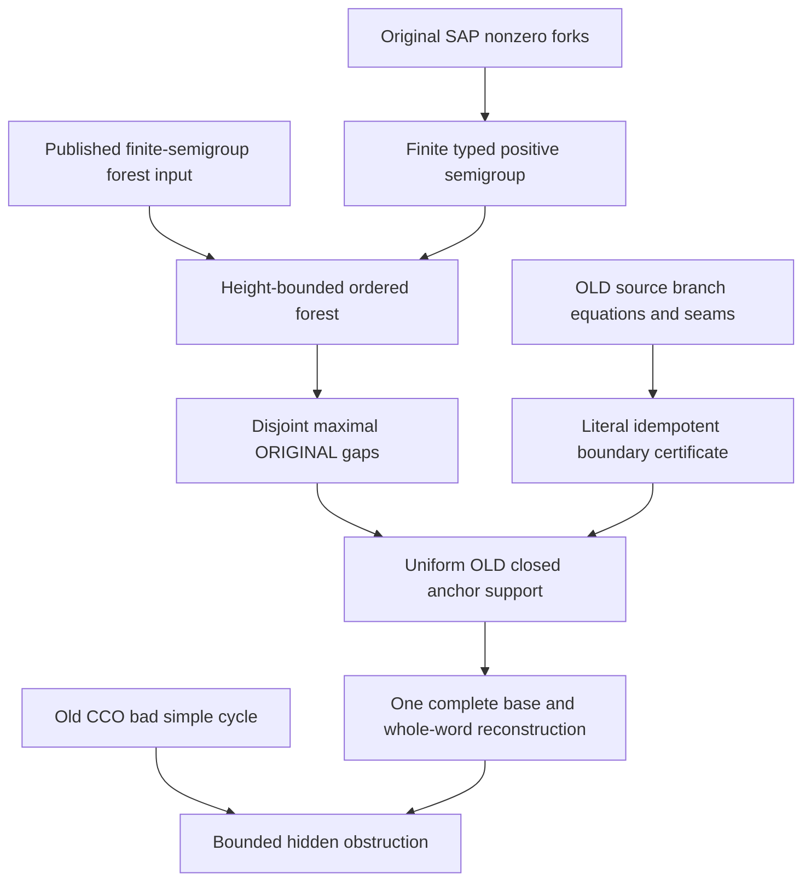

# OLD idempotent boundary certificates, forest pruning and bounded hidden obstructions

Generated from `module.json` by `tools/build_formalization_module.py`.

Source `490c3f36d85db5a0b3ced0598e6c431825254ec5`. **Human-expanded proof plan; no Lean code.**

Private B058: all SIX source16 results, TWO equations, eleven definitions, 74 human claims and eight tasks. Literal OLD coordinate certificates survive deletion of idempotent gaps. A finite typed positive semigroup has no zero on actual composable intervals; a published factorisation-forest input bounds height. Keep first/last children and STOP recursion in deleted middle intervals, producing a disjoint partition of the ORIGINAL branch words. One complete old base and simultaneous whole-word insertion reconstruct the original simple bad cycle. Therefore UNARY-ADMISSIBLE noncompletable partial hidden inputs have bounded OLD closed obstructions. The forest theorem adds one explicit receiving obligation to the five existing HN/HKN bindings; no compiled provider is claimed.

The human article remains unchanged. Additional proof details are in
[PROOF_NOTES.md](PROOF_NOTES.md); the cross-track policy is in
[the formalization guide](../README.md). Source hashes are checked before
the index is regenerated. Graph validation is not proof verification.

## Source premises

**A01: Actual original typed source.** M is countable homogeneous and complete in a finite binary relational language with transitive named real sorts, symmetric same-sort old atoms and paired typed converses. Every occurring old pair atom is an actual orbital, with true real equality separate from diversity.

**A02: Original visible SAP.** The old finite age has SAP over every COMPLETE old finite real base, including empty. It supplies genuine three-distinct forks and pinned positive-word insertion while keeping all chosen base colours fixed.

**A03: Original semantic homomorphic CCO.** An old typed atomic partial graph with individually homomorphically completable specified simple cycles has ONE whole old homomorphism. This is used in the bounded-obstruction bad-cycle extraction, not the purely combinatorial pruning or nonzero-fork branch.

**A04: FULL terminal original index/lattice context.** Every strict FULL invariant cover on every old real sort has infinite relative index, including Top covers. This supplies the terminal named proper-coordinate providers; exact MI reconstruction of an idempotent envelope retains its separately proved exactness/lattice premises.

**A05: Actual hidden MI-only interpretation.** Actual real and proper nonzero represented MI quotient sorts have the finite named unary projections, upward maps and quotient transitions/inverses and complete semantic cylinders. Functions are actual equivariant maps, with no quotient-to-real or nullary vertex generators. No extra non-MI quotient is added.

**A06: Unary-admissible finite partial source.** C is finite and functionally closed; every FULL one-generated induced diagram is an actual completed hidden member. Thus its singleton closures have the uniform m_typ bound and satisfy all actual unary identities. C as a whole need not be completable.

**A07: Locally vetted OLD supported macro path.** For the boundary/path applications, all actual joined irreducible one-/two-root source supports have passed the full local induced-pattern test. Old vertices b_0,...,b_n are pairwise distinct formal source roots, n>=1; each macro P_i is the positive STRONG profile of the EXACT original traversed branch word w_i, with its nonempty original pair menu D_i subset P_i. Only genuine OLD source endpoint pairs issue sides.

**A08: Conditional reconstruction base and anchor.** For reconstruction, A is one finite COMPLETE old base containing distinct chosen representatives of ALL retained old roots. Retained side atoms lie in their original P_i; every deleted-gap pair lies in E_e=Id union e. The fixed ORIGINAL anchor word has its endpoint atom in its OWN strong profile. This last condition is explicit, not inferred from unrelated retained sides.

**A09: Given valid ordered forest for structural pruning.** For the combinatorial partition branch a finite ordered tree has macro-letter leaves in their original order and contiguous interval nodes, no unary internal nodes; each internal node with at least three children has the SAME idempotent nonzero value on all its children. This is a supplied finite tree; its existence/height bound is a separate E01 application.

**A10: Separate optional higher-support gate.** All six results are prepared in the BINARY hidden setting. A finite-arity reading requires its separate support-normal complete frozen-factor completion/reflection interface. Binary SAP/word injection alone does not preserve old arity>=3 factor tuples.

## Published external theorem providers

These inputs are not new local proof claims or compiled CCO imports.
Existing Lean APIs still require the explicit representation bridge.

**E01: Finite-semigroup factorisation forest height.** For any finite semigroup S and evaluation homomorphism from nonempty words, each word admits an ordered factorisation tree of height at most 3|S| (leaves at height zero). Internal nodes have at least two children; at arity at least three every child has the same idempotent image. The pinned existing Lean declaration supplies the stronger 3|S|-1 bound. Its independent receiving build/axiom audit and adapter to the finite typed positive semigroup remain pending; see formalization/FACTORIZATION_FOREST_PROVIDER.md.

[Primary source, Kufleitner, MFCS 2008, LNCS 5162, The Height of Factorization Forests, Theorem 1; use the weaker height bound 3|S| proved explicitly](https://link.springer.com/chapter/10.1007/978-3-540-85238-4_36). Status: `PUBLISHED_THEOREM_LOCAL_BRIDGE_PENDING`.

Existing Lean: `ReemMelamed/algebraic-automata` at `0acb244aaa913c32eeeff48e939cb5df469a3f70`, module `AlgebraicAutomata.FactorizationForest.Tree`; declarations `factorization_forest_classical_bound`.

The adapter to the current CCO encoding remains a receiving-project obligation.

## Imported theorem contracts

These are named provider obligations for the receiving Lean project,
not new axioms or claims of compiled imports.

| ID and source | Contract | Current provider status |
|---|---|---|
| I01: [`lem:typed-set-pasch`](../../sections/typed_strong_domains.tex#L48) | Only the proved associative compatible nonempty STRONG profile multiplication of C02 is used to build the finite zero-completed typed semigroup; no logical identity is added. | HUMAN_EXPANDED_NOT_LEAN |
| I02: [`lem:typed-unary-closure-bound`](../../sections/v27/10_typed_unary_terms_return.tex#L66) | Actual/unary-admissible singleton hidden closures have at most m_typ vertices; unary-only closure of finite B is their union. Arbitrary malformed partial total-unary cycles are excluded. | HUMAN_EXPANDED_NOT_LEAN |
| I03: [`lem:typed-old-seam-telescope`](../../sections/v27/15_guarded_reflection_old_seams.tex#L176) | Compatible successive OLD macro equations use the SAME canonical intermediate represented coordinate and compose literally inside C, even for orphan-only intersections. Completion coincidences are not seams. | HUMAN_EXPANDED_NOT_LEAN |
| I04: [`lem:typed-idempotent-raw-exact`](../../sections/v27/15_guarded_reflection_old_seams.tex#L285) | The actual RAW relation of ww for positive strong idempotent e is E_e=Id union e. It is FULL RAW exact, and equals the meet of represented exact proper MIs above it; empty meet is Top. Direct word identity and separate exact-lattice reconstruction retain different premises. | HUMAN_EXPANDED_NOT_LEAN |
| I05: [`lem:typed-branch-root-visibility`](../../sections/v27/15_guarded_reflection_old_seams.tex#L568) | For a locally complete OLD pair and its actual branch profile P, quotient functionality over J forces the actual root kernels below J and J^P, hence those coordinate readings are named OLD terms. The provider repairs RAW TV1 by restored full comparison versus guarded diversity saturation. | HUMAN_EXPANDED_NOT_LEAN |
| I06: [`lem:typed-old-source-branch-equation`](../../sections/v27/15_guarded_reflection_old_seams.tex#L655) | The actual locally vetted OLD closed support reflects each quotient-functional branch equation as a LITERAL equality of named source term values, not merely an equation in a future target. | HUMAN_EXPANDED_NOT_LEAN |
| I07: [`lem:typed-return-transport`](../../sections/v27/10_typed_unary_terms_return.tex#L244) | A nonempty composable actual RAW closed word inside J has canonical transported represented kernels, adjacent quotient maps and literal identity return holonomy; coarsenings and actual named proper coordinates retain their exact gates. | HUMAN_EXPANDED_NOT_LEAN |
| I08: [`lem:typed-real-sort-splitting`](../../sections/v27/13_actual_hidden_sap_readings.tex#L152) | After a hidden HE completion, choose pairwise distinct old real images and designated real representatives for all retained proper quotient vertices inside a finite visible extension, preserving specified binary hidden data and literal term values. | HUMAN_EXPANDED_NOT_LEAN |
| I09: [`lem:typed-one-source-support-per-guarded-pair`](../../sections/v27/14_guarded_source_positive.tex#L346) | Every guarded side on one old endpoint pair comes from its ONE actual irreducible closed support generated by those two endpoints, of size<=2m_typ. Its nonempty common menu is witnessed directly. | HUMAN_EXPANDED_NOT_LEAN |
| I10: [`lem:typed-private-theta-cycle`](../../sections/v27/14_guarded_source_positive.tex#L490) | A cycle not confined to one private theta traverses whole original branches, with OLD source endpoint witnesses; interiors are private and direct duplicate edges merge. No new completion roots are manufactured. | HUMAN_EXPANDED_NOT_LEAN |
| I11: [`lem:typed-two-root-complete-reflection`](../../sections/v27/14_guarded_source_positive.tex#L652) | ANY fine old atom in a guarded pair menu reflects the complete locally vetted joined two-root hidden diagram. Under HE completion the retained irreducible OLD endpoint support embeds; its ORIGINAL branch profile is therefore preserved. | HUMAN_EXPANDED_NOT_LEAN |
| I12: [`lem:typed-idempotent-reinsert`](../../sections/v27/15_guarded_reflection_old_seams.tex#L786) | For a positive original atomic word with idempotent diversity profile e, distinct endpoints whose pair lies in E_e admit that SAME whole original word with new interiors; use E_e first and distinctness before extracting e. | HUMAN_EXPANDED_NOT_LEAN |
| I13: [`lem:typed-simultaneous-word-insertion`](../../sections/v27/15_guarded_reflection_old_seams.tex#L817) | Given finitely many prescribed positive words with admissible endpoint atoms in ONE complete old base, visible SAP inserts all words simultaneously with pairwise disjoint fresh interiors, preserving every old base pair. | HUMAN_EXPANDED_NOT_LEAN |
| I14: [`lem:typed-two-root-uniform-size`](../../sections/v27/14_guarded_source_positive.tex#L553) | Locally admissible joined two-generated supports have uniformly bounded complete exact theta gadgets/root signatures; actual finite functions and positive typed words, not arbitrary syntax, are bounded. | HUMAN_EXPANDED_NOT_LEAN |
| I15: [`lem:typed-strong-cycle-completion`](../../sections/typed_strong_domains.tex#L187) | Original visible SAP upgrades semantic HOM CCO on genuine old diversity graphs to an injective completion criterion, so visible noncompletion yields one specified simple cycle with no old homomorphism. | HUMAN_EXPANDED_NOT_LEAN |
| I16: [`lem:typed-guarded-lift-equivalence`](../../sections/v27/15_guarded_reflection_old_seams.tex#L1) | After the bounded actual source tests, C has a hidden HE completion iff its guarded visible lift has an injective visible completion. Binary irreducible localcover supplies reflection; higher support remains separately conditional. | HUMAN_EXPANDED_NOT_LEAN |
| I17: [`lem:typed-joined-source-support`](../../sections/v27/13_actual_hidden_sap_readings.tex#L299) | A failed FULL pattern on an ACTUALLY irreducible closed source support generated by at most k old vertices is already a noncompletable source defect of size<=k*m_typ. Reducible ancestor pairs are excluded. | HUMAN_EXPANDED_NOT_LEAN |
| I18: [`lem:typed-raw-strong-saturation`](../../sections/v27/07_typed_raw_strong_transition.tex#L25) | Old RAW/STRONG saturation and strict pinned original path injection support. Use C01 to flatten the ACTUAL macro branch words and identify the off-diagonal RAW product with their STRONG word profile. | HUMAN_EXPANDED_NOT_LEAN |
| I19: [`lem:typed-all-invariant-equivalences-raw-word`](../../sections/terminal_invariant_raw_exact.tex#L5) | Under FULL original terminal no-index-two, EVERY invariant equivalence is represented by one actual RAW word. Hence the represented exact-equivalence lattice equals the FULL invariant lattice, so its proper MIs above E_e>Id are precisely the nonzero named FULL MI coordinates used by return transport. This identification uses no distributivity. | HUMAN_EXPANDED_NOT_LEAN |

**I18 internal proof support:** C01 in `transition_closure`. Use proved strict ancestor C01 for binary positive atomic path injectivisation with the actual endpoint fine pair frozen and aligned. This supports C07 whole-ORIGINAL-word readout, not a new exported theorem or an equality-labelled strong atom.

These are separately extracted proved support claims, not additional
numbered exports or consequences of the named theorem statement.

## Definitions

| ID | Definition | Exact meaning | Source |
|---|---|---|---|
| D01 | OLD composable macro path | P_i=Prof(w_i) is the STRONG profile of its EXACT original positive branch word, between distinct formal OLD roots. Menus D_i are attached to those literal source endpoints and satisfy D_i subset P_i. | [source](../../sections/v27/16_old_idempotent_forest.tex#L2) |
| D02 | Zero-completed typed positive semigroup | S_typ is{0} disjoint union of all nonempty typed reachable profiles, retaining endpoint sort tags. Noncomposable factors multiply to zero; zero absorbs. No STRONG identity unit is adjoined. | [source](../../sections/v27/16_old_idempotent_forest.tex#L295) |
| D03 | Idempotent envelope | For nonempty same-sort e with e*e=e, E_e=Id union e is the FULL RAW exact envelope. e itself is irreflexive and is not an equivalence relation. | [source](../../sections/v27/16_old_idempotent_forest.tex#L2) |
| D04 | Literal boundary certificate | For every represented proper MI J>=E_e, the two boundary OLD roots have equal named J-term values INSIDE C. These equal vertices remain in their unary-closed induced boundary support. | [source](../../sections/v27/16_old_idempotent_forest.tex#L2) |
| D05 | Ordered interval forest | Leaves are original macro-letter indices. A node denotes a contiguous half-open leaf interval; child intervals partition it in order. Height counts edges from a root to a leaf; leaves have height0. | [source](../../sections/v27/16_old_idempotent_forest.tex#L222) |
| D06 | Maximal stopped gap | At a node with>=3 common-idempotent children, keep first/last subtrees, record the ENTIRE intervening original interval once and STOP recursion inside it. Record its original words and boundary roots. | [source](../../sections/v27/16_old_idempotent_forest.tex#L372) |
| D07 | Retained OLD generator set | B consists of endpoints of retained original macro letters, with both old fixed-anchor endpoints added for a cycle. Deleted-gap boundary roots are already among those retained endpoints. | [source](../../sections/v27/16_old_idempotent_forest.tex#L583) |
| D08 | One complete old reconstruction base | A is the induced COMPLETE old visible structure on distinct selected representatives of all retained roots and any fixed old anchors. All insertion requests use this SAME A, not independently chosen root pair colours. | [source](../../sections/v27/16_old_idempotent_forest.tex#L372) |
| D09 | Fixed anchor word | One ORIGINAL whole atomic private branch of the bad cycle is retained separately. Its two OLD root endpoints and complete old pair support are retained; its exact word endpoint profile must be admissible in A. | [source](../../sections/v27/16_old_idempotent_forest.tex#L372) |
| D10 | Uniform source bounds | With s=|S_typ| and h=3s, the pruned tree has<=2^h leaves and<=2^{h+1}-1 nodes; retained roots<=2^{h+1}. A conservative cycle OLD closure bound is m_typ(2^{h+3}+4). | [source](../../sections/v27/16_old_idempotent_forest.tex#L583) |
| D11 | Unary-admissible bounded obstruction | An induced functionally closed OLD substructure of C which has no hidden HE completion, on at most one fixed language-dependent N_typ vertices. The conclusion is NOT for arbitrary partial total-unary inputs. | [source](../../sections/v27/16_old_idempotent_forest.tex#L748) |

## Proof claims and direct dependencies

Every row has a human proof expansion. Each still needs an actual Lean
statement and proof. OLD source terms remain literal after induced restriction; target coincidences are never source seams. Idempotent diversity e is not reflexive: its RAW envelope is E_e=Id union e. Actual distinct representatives are needed before extracting a fine atom in e.

| ID and claim | Scope | Direct providers | Proof note |
|---|---|---|---|
| C01: Every nonempty invariant typed palette is serial and coserial | nonzero | A01 | N01 in [notes](PROOF_NOTES.md) |
| C02: Old SAP makes every compatible STRONG fork genuinely nonempty | nonzero | A01, A02, C01 | N01 in [notes](PROOF_NOTES.md) |
| C03: Every contiguous actual composable interval is nonzero | nonzero | I01, C02, D01, D02 | N01 in [notes](PROOF_NOTES.md) |
| C04: The typed zero completion is a finite associative semigroup | forest | A01, I01, D02 | N01 in [notes](PROOF_NOTES.md) |
| C05: The published forest theorem is instantiated on THIS finite semigroup | forest | E01, C04, D05 | N03 in [notes](PROOF_NOTES.md) |
| C06: High-arity forest nodes have NONZERO same-sort idempotents | forest | C03, C05 | N03 in [notes](PROOF_NOTES.md) |
| C07: Flatten exact branch words before passing from STRONG to RAW | boundary | A01, A02, A07, I18, D01, D03 | N02 in [notes](PROOF_NOTES.md) |
| C08: The envelope is exact before MI reconstruction is used | boundary | A04, A05, I04, I19, C07, D03 | N02 in [notes](PROOF_NOTES.md) |
| C09: Canonical return transport yields compatible named kernels | boundary | A04, A05, I07, C07, C08 | N02 in [notes](PROOF_NOTES.md) |
| C10: Each original source side supplies its OLD branch equation | boundary | A06, A07, I05, I06, C09 | N02 in [notes](PROOF_NOTES.md) |
| C11: The same canonical intermediate coordinate is the actual seam | boundary | I03, C10 | N02 in [notes](PROOF_NOTES.md) |
| C12: Identity holonomy already holds in a valid one-generated source | boundary | A06, C09, C11 | N02 in [notes](PROOF_NOTES.md) |
| C13: The OLD boundary certificate is literal before deletion | boundary | C12, D04 | N02 in [notes](PROOF_NOTES.md) |
| C14: Both boundary term values survive in the induced closed support | boundary | A05, C13, D04 | N02 in [notes](PROOF_NOTES.md) |
| C15: Any hidden completion preserves those term equalities | boundary | C13, C14 | N02 in [notes](PROOF_NOTES.md) |
| C16: The represented MI meet forces E_e in EVERY completion | boundary | C08, C15 | N02 in [notes](PROOF_NOTES.md) |
| C17: Only distinct representatives turn E_e into a diversity atom in e | boundary | A01, C16, D03 | N02 in [notes](PROOF_NOTES.md) |
| C18: OLD gap boundary certificate source export | boundary | C13, C14, C16, C17 | N02 in [notes](PROOF_NOTES.md) |
| C19: Each forest node has one contiguous ORIGINAL interval | partition | A09, D05 | N03 in [notes](PROOF_NOTES.md) |
| C20: Binary nodes keep BOTH recursively pruned children | partition | C19 | N03 in [notes](PROOF_NOTES.md) |
| C21: A high-arity node records one whole middle gap and stops there | partition | A09, C19, D06 | N03 in [notes](PROOF_NOTES.md) |
| C22: Retained leaves and maximal gaps partition every macro edge once | partition | C19, C20, C21 | N03 in [notes](PROOF_NOTES.md) |
| C23: Every deleted-gap boundary is an endpoint of a retained leaf | partition | C20, C21 | N03 in [notes](PROOF_NOTES.md) |
| C24: A positive number of common-idempotent children multiplies to e | partition | A09, D06 | N03 in [notes](PROOF_NOTES.md) |
| C25: The gap retains its WHOLE ORIGINAL atomic word | partition | A07, I01, C22, C24, D01 | N03 in [notes](PROOF_NOTES.md) |
| C26: Actual forest application supplies all structural pruning premises | forest | C05, C06 | N03 in [notes](PROOF_NOTES.md) |
| C27: The purely structural pruning conclusions are explicit | partition | C22, C23, C25 | N03 in [notes](PROOF_NOTES.md) |
| C28: Pruning leaves a binary tree of the SAME bounded height | forest | C05, C20, C21 | N04 in [notes](PROOF_NOTES.md) |
| C29: Twice the leaf count bounds the retained OLD path roots | old_support | C23, C28, D07 | N04 in [notes](PROOF_NOTES.md) |
| C30: Every retained letter support lies in the induced OLD closure | old_support | A07, I09, C29 | N04 in [notes](PROOF_NOTES.md) |
| C31: Every deleted gap retains its literal coordinate certificate | old_support | A06, A07, C18, C23, C24, C26, C29 | N04 in [notes](PROOF_NOTES.md) |
| C32: A hypothetical completion is split over ONE complete old base | reconstruction | A01, A02, A05, I08, C29 | N05 in [notes](PROOF_NOTES.md) |
| C33: Retained side atoms still lie in their ORIGINAL branch profiles | reconstruction | I11, C30, C32 | N05 in [notes](PROOF_NOTES.md) |
| C34: Gap boundaries have the admissible distinct atom required for reinsertion | reconstruction | C16, C17, C31, C32 | N05 in [notes](PROOF_NOTES.md) |
| C35: Insert the entire ORIGINAL retained and gap words simultaneously | reconstruction | I12, I13, C25, C32, C33, C34 | N05 in [notes](PROOF_NOTES.md) |
| C36: Compressed guarded macro path source export | forest | I02, C29, C30, C31, C35 | N04 in [notes](PROOF_NOTES.md) |
| C37: The reconstruction anchor condition is a separate explicit premise | reconstruction | A08, D08, D09 | N05 in [notes](PROOF_NOTES.md) |
| C38: One insertion list includes retained words, maximal gaps AND anchor | reconstruction | A02, A08, I13, C17, C27, C37 | N05 in [notes](PROOF_NOTES.md) |
| C39: The recreated atomic cycle is genuinely SIMPLE and has exact labels | reconstruction | A08, C22, C23, C25, C38 | N05 in [notes](PROOF_NOTES.md) |
| C40: Partition and simultaneous cycle reconstruction source export | reconstruction | C27, C37, C38, C39 | N05 in [notes](PROOF_NOTES.md) |
| C41: A noninternal bad cycle has OLD source macro endpoints | old_support | A07, I10, D09 | N06 in [notes](PROOF_NOTES.md) |
| C42: Add only retained endpoint generators and fixed anchor roots | old_support | C23, C28, C29, C41, D07, D10 | N06 in [notes](PROOF_NOTES.md) |
| C43: Source supports and all term certificates are inside cl_C(B) | old_support | C30, C31, C42 | N06 in [notes](PROOF_NOTES.md) |
| C44: Unary closure yields the stated uniform OLD anchor bound | old_support | A06, I02, C42, C43 | N06 in [notes](PROOF_NOTES.md) |
| C45: Uniform original hidden anchor support source export | old_support | C43, C44 | N06 in [notes](PROOF_NOTES.md) |
| C46: Unary admissibility supplies every singleton gate for the obstruction theorem | bounded_obstruction | A06, I02 | N07 in [notes](PROOF_NOTES.md) |
| C47: A failed local joined complete pattern is already a bounded obstruction | bounded_obstruction | I17, C46 | N07 in [notes](PROOF_NOTES.md) |
| C48: After local tests, each reached pair menu is directly nonempty | bounded_obstruction | I09, C47 | N07 in [notes](PROOF_NOTES.md) |
| C49: Hidden noncompletion transfers to the guarded OLD visible lift | bounded_obstruction | A01, A06, I16, C48 | N07 in [notes](PROOF_NOTES.md) |
| C50: Original HOM CCO plus SAP produces one genuinely bad simple cycle | bounded_obstruction | A01, A02, A03, I15, C49 | N07 in [notes](PROOF_NOTES.md) |
| C51: An internal-template bad cycle has bounded OLD anchor support | bounded_obstruction | I11, I13, I14, C47, C50 | N07 in [notes](PROOF_NOTES.md) |
| C52: A noninternal bad cycle admits the bounded OLD forest support | bounded_obstruction | C05, C41, C45, C50 | N07 in [notes](PROOF_NOTES.md) |
| C53: A hypothetical retained hidden completion has one real covering target | bounded_obstruction | I08, C32, C52 | N07 in [notes](PROOF_NOTES.md) |
| C54: The retained anchor support forces the ORIGINAL anchor profile | bounded_obstruction | I09, I11, C42, C53 | N07 in [notes](PROOF_NOTES.md) |
| C55: All retained and deleted conditions are forced in that SAME base | bounded_obstruction | C16, C33, C43, C53, C54 | N07 in [notes](PROOF_NOTES.md) |
| C56: Reconstruct the EXACT original forbidden cycle to get a contradiction | bounded_obstruction | C39, C40, C50, C55 | N07 in [notes](PROOF_NOTES.md) |
| C57: One fixed N_typ covers every obstruction branch | bounded_obstruction | C47, C51, C52, C56, D11 | N07 in [notes](PROOF_NOTES.md) |
| C58: Typed bounded hidden obstruction source export | bounded_obstruction | C46, C47, C51, C56, C57 | N07 in [notes](PROOF_NOTES.md) |
| C59: Completion coincidences cannot create a deleted-gap seam | scope | C11, C14 | N08 in [notes](PROOF_NOTES.md) |
| C60: Do not replace an idempotent envelope by the SAP monolith | scope | D03, C16, C17 | N08 in [notes](PROOF_NOTES.md) |
| C61: A formal diversity palette is never a reflexive equivalence | scope | D03, C08, C17 | N08 in [notes](PROOF_NOTES.md) |
| C62: Never recurse into a recorded deleted middle interval | scope | C21, C22, C39 | N08 in [notes](PROOF_NOTES.md) |
| C63: Retained root counts may be twice the leaf count | scope | C23, C29 | N08 in [notes](PROOF_NOTES.md) |
| C64: The fixed anchor hypothesis cannot be dropped | scope | C37, C54 | N08 in [notes](PROOF_NOTES.md) |
| C65: Whole ORIGINAL words are required, not interchangeable profiles | scope | C25, C35, C39 | N08 in [notes](PROOF_NOTES.md) |
| C66: One common base is needed for all insertions | scope | I13, C35, C38 | N08 in [notes](PROOF_NOTES.md) |
| C67: Arbitrary total-unary partial sources invalidate the uniform bound | scope | C46, D11 | N08 in [notes](PROOF_NOTES.md) |
| C68: The forest theorem is an exposed external receiving obligation | scope | E01, C05 | N08 in [notes](PROOF_NOTES.md) |
| C69: The literal 2007 citation has a monoid/semigroup wording issue | scope | E01, C04 | N08 in [notes](PROOF_NOTES.md) |
| C70: Finite diagnostics do not prove the published forest theorem | scope | C05, C22, C39, C58 | N08 in [notes](PROOF_NOTES.md) |
| C71: Higher-support realization keeps its separate interface | scope | A10, C58 | N08 in [notes](PROOF_NOTES.md) |
| C72: Empty represented MI families and short paths are covered | scope | C16, C21, C24, C28 | N08 in [notes](PROOF_NOTES.md) |
| C73: Induced OLD restriction is not itself a completion | scope | C14, C45, C56 | N08 in [notes](PROOF_NOTES.md) |
| C74: Earlier source qualifications and public boundaries remain | scope | C18, C58, C68, C71 | N08 in [notes](PROOF_NOTES.md) |

The precise quantified contracts are in `module.json`. Provider-before-consumer
order (including definitions and source premises):

`A01 → A02 → A03 → A04 → A05 → A06 → A07 → A08 → A09 → A10 → D01 → D02 → D03 → D04 → D05 → D06 → D07 → D08 → D09 → D10 → D11 → E01 → I01 → I02 → I03 → I04 → I05 → I06 → I07 → I08 → I09 → I10 → I11 → I12 → I13 → I14 → I15 → I16 → I17 → I18 → I19 → C01 → C04 → C07 → C19 → C24 → C37 → C41 → C46 → C02 → C05 → C08 → C20 → C21 → C47 → C67 → C69 → C03 → C09 → C22 → C23 → C28 → C48 → C68 → C06 → C10 → C25 → C29 → C49 → C11 → C26 → C27 → C30 → C32 → C42 → C50 → C63 → C12 → C33 → C51 → C13 → C14 → C15 → C59 → C16 → C17 → C72 → C18 → C38 → C60 → C61 → C31 → C39 → C34 → C40 → C43 → C62 → C35 → C44 → C36 → C45 → C65 → C66 → C52 → C53 → C54 → C55 → C64 → C56 → C57 → C73 → C58 → C70 → C71 → C74`

This order is one valid linearization; it does not require unrelated
branches to be proved sequentially. The full DAG is the `depends_on`
relation in `module.json`.

## Main proof branches

This is a coarse view of the claim DAG. Edges go from provider to consumer.

All six source16 results and both equations; factorisation-forest theorem is a newly explicit published-provider receiving obligation.
The full RAW E_e envelope is reconstructed from represented MI equalities before actual distinctness yields a diversity atom in e.
Maximal recorded gaps and retained letters partition every original macro edge exactly once; never recurse inside deleted middle subtrees.
The fixed original anchor profile and one complete reconstruction base remain explicit. Global theorem applies only to unary-admissible partial sources.

## Article exports

| Existing source result | Sidecar proof claims |
|---|---|
| [`lem:typed-old-gap-boundary-certificate`](../../sections/v27/16_old_idempotent_forest.tex#L1) | C18 |
| [`lem:typed-factor-path`](../../sections/v27/16_old_idempotent_forest.tex#L221) | C36 |
| [`lem:typed-composable-products-nonzero`](../../sections/v27/16_old_idempotent_forest.tex#L294) | C03 |
| [`lem:typed-pruned-cycle-reconstruction`](../../sections/v27/16_old_idempotent_forest.tex#L371) | C40 |
| [`lem:typed-forest-old-anchor-bound`](../../sections/v27/16_old_idempotent_forest.tex#L582) | C45 |
| [`cor:typed-bounded-hidden`](../../sections/v27/16_old_idempotent_forest.tex#L747) | C58 |

Auxiliary source equations (not additional numbered results):

- [`eq:typed-old-gap-certificate`](../../sections/v27/16_old_idempotent_forest.tex#L61): C13
- [`eq:typed-forest-old-anchor-bound`](../../sections/v27/16_old_idempotent_forest.tex#L640): C44

## Internal implementation milestones

These tasks are proof milestones inside larger project assignments;
see the [peer-project allocation](../coordination/BOARD.md).

These are implementation tasks, not additional mathematical assumptions.

| Task | Earlier tasks | Acceptance |
|---|---|---|
| T01: Positive typed nonzero algebra | — | Use literal OLD coordinate certificates, actual full RAW E_e envelopes and distinct representatives before inferring diversity e. Prune only first/last idempotent children and STOP inside each whole deleted middle interval; preserve a disjoint ordered partition of the EXACT ORIGINAL branch words. All insertions share ONE complete old base and the fixed anchor profile is explicit. Unary admissibility, actual irreducible supports and optional higher-support gates remain. The finite-semigroup forest theorem is an explicit sixth receiving obligation, not a proved local Lean API. |
| T02: Literal OLD idempotent gap certificate | — | Use literal OLD coordinate certificates, actual full RAW E_e envelopes and distinct representatives before inferring diversity e. Prune only first/last idempotent children and STOP inside each whole deleted middle interval; preserve a disjoint ordered partition of the EXACT ORIGINAL branch words. All insertions share ONE complete old base and the fixed anchor profile is explicit. Unary admissibility, actual irreducible supports and optional higher-support gates remain. The finite-semigroup forest theorem is an explicit sixth receiving obligation, not a proved local Lean API. |
| T03: External forest and stopped interval partition | T01 | Use literal OLD coordinate certificates, actual full RAW E_e envelopes and distinct representatives before inferring diversity e. Prune only first/last idempotent children and STOP inside each whole deleted middle interval; preserve a disjoint ordered partition of the EXACT ORIGINAL branch words. All insertions share ONE complete old base and the fixed anchor profile is explicit. Unary admissibility, actual irreducible supports and optional higher-support gates remain. The finite-semigroup forest theorem is an explicit sixth receiving obligation, not a proved local Lean API. |
| T04: Retained source path and simultaneous original words | T02, T03 | Use literal OLD coordinate certificates, actual full RAW E_e envelopes and distinct representatives before inferring diversity e. Prune only first/last idempotent children and STOP inside each whole deleted middle interval; preserve a disjoint ordered partition of the EXACT ORIGINAL branch words. All insertions share ONE complete old base and the fixed anchor profile is explicit. Unary admissibility, actual irreducible supports and optional higher-support gates remain. The finite-semigroup forest theorem is an explicit sixth receiving obligation, not a proved local Lean API. |
| T05: Conditional simple-cycle reconstruction | T02, T03 | Use literal OLD coordinate certificates, actual full RAW E_e envelopes and distinct representatives before inferring diversity e. Prune only first/last idempotent children and STOP inside each whole deleted middle interval; preserve a disjoint ordered partition of the EXACT ORIGINAL branch words. All insertions share ONE complete old base and the fixed anchor profile is explicit. Unary admissibility, actual irreducible supports and optional higher-support gates remain. The finite-semigroup forest theorem is an explicit sixth receiving obligation, not a proved local Lean API. |
| T06: Uniform OLD anchor support | T02, T03, T04 | Use literal OLD coordinate certificates, actual full RAW E_e envelopes and distinct representatives before inferring diversity e. Prune only first/last idempotent children and STOP inside each whole deleted middle interval; preserve a disjoint ordered partition of the EXACT ORIGINAL branch words. All insertions share ONE complete old base and the fixed anchor profile is explicit. Unary admissibility, actual irreducible supports and optional higher-support gates remain. The finite-semigroup forest theorem is an explicit sixth receiving obligation, not a proved local Lean API. |
| T07: Unary-admissible bounded hidden obstructions | T04, T05, T06 | Use literal OLD coordinate certificates, actual full RAW E_e envelopes and distinct representatives before inferring diversity e. Prune only first/last idempotent children and STOP inside each whole deleted middle interval; preserve a disjoint ordered partition of the EXACT ORIGINAL branch words. All insertions share ONE complete old base and the fixed anchor profile is explicit. Unary admissibility, actual irreducible supports and optional higher-support gates remain. The finite-semigroup forest theorem is an explicit sixth receiving obligation, not a proved local Lean API. |
| T08: Boundary and receiving obligations | T01, T02, T03, T04, T05, T06, T07 | Use literal OLD coordinate certificates, actual full RAW E_e envelopes and distinct representatives before inferring diversity e. Prune only first/last idempotent children and STOP inside each whole deleted middle interval; preserve a disjoint ordered partition of the EXACT ORIGINAL branch words. All insertions share ONE complete old base and the fixed anchor profile is explicit. Unary admissibility, actual irreducible supports and optional higher-support gates remain. The finite-semigroup forest theorem is an explicit sixth receiving obligation, not a proved local Lean API. |

## Finite controls

- **K01.** Bounded valid ordered factorisation trees test maximal stopped-gap partition, exact old edge coverage, boundary persistence and binary leaf/node bounds; small typed semigroups exercise nonzero/zero guards.
- **K02.** Explicit old term transport and common complete-base cycle assembly test literal certificate survival, original-word labels, distinct representatives and fixed-anchor necessity. Malformed unary cycles and overlapping deletion records are negative controls, not unbounded source proofs.

Run `python tools/check_old_idempotent_forest_controls.py` from the manuscript directory.
The controls do not prove CCO or the general theorems.

## Return to the human articles

No required mathematical repair was found in this scoped pass. These
optional wording clarifications remain queued for a human article pass:

- **F01** ([source](../../main.tex#L459)): The cited2007 preprint abstract says finite semigroup while its displayed theorem says finite monoid. S_typ with typed zero need not have a global identity. The later2008 Theorem1 explicitly treats finite semigroups and proves the needed weaker height3|S|. Cite the2008 finite-semigroup Theorem1 explicitly or clarify the intended semigroup version of the2007 input. Keep h=3|S_typ| and the existing forest convention.

The machine ledger records caller effects and affected claims. The source
review used two independent model review passes and parent synthesis;
it is not independent human or formal certification.
