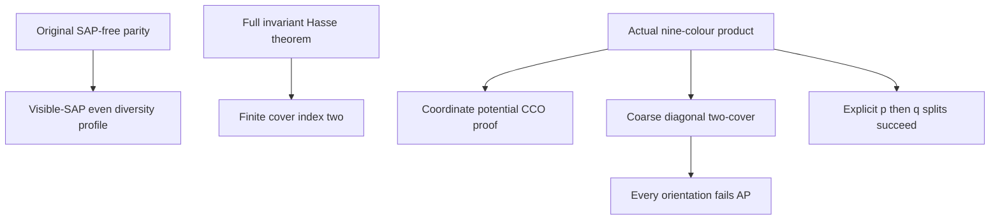

# SAP orbital parity, finite cover indices and an unsplittable diagonal two-cover

Generated from `module.json` by `tools/build_formalization_module.py`.

Source `490c3f36d85db5a0b3ced0598e6c431825254ec5`. **Human-expanded proof plan; no Lean code.**

Private B046: THREE selected Ramsey I results and ONE equation, eight definitions, 40 human claims and six tasks. Upgrade SAP-free original parity to nonempty STRONG even/odd profiles using visible SAP; reuse the full invariant Hasse theorem; give a self-contained actual nine-colour homogeneous triangle-defined SAP+HOM CCO example where EVERY orientation of a preselected coarse index-two cover destroys AP. Finer coordinate covers have explicit compatible successive splits. No later safe-splitting theorem, arbitrary quotient exact descent or generic Helly-to-CCO shortcut is used.

The human article remains unchanged. Additional proof details are in
[PROOF_NOTES.md](PROOF_NOTES.md); the cross-track policy is in
[the formalization guide](../README.md). Source hashes are checked before
the index is regenerated. Graph validation is not proof verification.

## Source premises

**A01: Current actual original homogeneous HOM CCO source.** M is homogeneous complete in a finite binary named-sorted language with finitely many nonempty transitive current unary sorts, same-sort symmetric orbitals and typed converses. Its actual finite age has semantic homomorphic CCO; visible SAP is the SEPARATE A05 premise used only for the STRONG upgrade. The parity and Hasse applications stay on ONE current original named sort. No abstract quotient SAP or terminal no-finite-cover hypothesis is assumed.

**A02: Finite-relative interval and actual atom.** For orbital parity, E<F are actual zero-definable invariant equivalences on the selected transitive sort, [F:E] is finite >1, and t is an occurring actual same-sort diversity orbital inside F minus E. For finite-cover-two, the interval is instead a COVER in the FULL invariant lattice; neither endpoint is required full exact.

**A03: Independent countable product model.** U,V,N are countably infinite pure sets, p,q range over F2, and M=U x V x F2 x F2 x N. Distinct points receive one of nine colours (alpha,beta) in {e0,e1,n}^2: alpha=e_(p+pprime) if u=uprime, otherwise n; beta is analogous for v,q. Logical equality is separate from the occurring irreflexive clone diversity atom (e0,e0). No global parity/Hasse/SAP theorem is assumed to prove this example.

**A04: Arbitrary orientation variable.** For the obstruction, P is ANY unary predicate choosing one of the two K-classes inside EACH X-class, where X fixes (u,v) and K additionally fixes p+q. P is constant on K-classes and has opposite bits on the two K-classes of an X-class. No definability, equivariance, regularity or homogeneity of P is assumed; its normal form h is derived.

**A05: Additional visible original SAP for the parity upgrade only.** The actual finite age of the current ORIGINAL named-sorted source has SAP. This premise is used to create distinct even-sheet endpoints and to apply the existing finite injectivisation API. It is NOT a premise of the finite invariant Hasse proof and NOT an assumption used to prove the independent nine-colour example.

## Imported theorem contracts

These are named provider obligations for the receiving Lean project,
not new axioms or claims of compiled imports.

| ID and source | Contract | Current provider status |
|---|---|---|
| I01: [`lem:ep-ap-orbital-parity`](../../sections/finite_relative_parity_exact_closure.tex#L18) | Original SAP-FREE parity gives bipartite t graph, stabilized positive RAW even/odd powers Y_t,O_t, with Y_t full exact, [Y_t union O_t:Y_t]=2 and O_t containing t. It does NOT assert Y_t>Id. | HUMAN_EXPANDED_NOT_LEAN |
| I02: [`lem:typed-injectivisation`](../../sections/typed_strong_domains.tex#L129) | Visible original SAP identifies diversity slices of positive represented word relations with STRONG simple-path profiles via finite injectivisation. Do not replace RAW Y_t itself by a diversity palette. | HUMAN_EXPANDED_NOT_LEAN |
| I03: [`thm:full-relative-Hasse`](../../sections/finite_relative_parity_exact_closure.tex#L59) | FULL invariant-equivalence covers of finite relative index have index two in an actual transitive symmetric HOM CCO source; every finite relative index is a power of two. This theorem is independent of SAP and does not require exact endpoints. | HUMAN_EXPANDED_NOT_LEAN |

## Definitions

| ID | Definition | Exact meaning | Source |
|---|---|---|---|
| D01 | RAW even equivalence and odd relation | Y_t is the stabilized equality-inclusive even walk relation; E_t=Y_t union O_t and Y_t^circ=Y_t minus Id. O_t is its disjoint odd sheet. | [source](../../sections/v27/06_legacy_finite_covers.tex#L19) |
| D02 | STRONG word endpoint support | Only distinct endpoints and distinct formal path vertices are retained by the STRONG profile. Positive RAW words may include diagonal outputs; injectivisation supplies exactly their diversity slice. | [source](../../sections/v27/06_legacy_finite_covers.tex#L19) |
| D03 | Full invariant cover index | A cover E<F has no intermediate FULL invariant equivalence. [F:E] counts E-blocks in one F-class and is independent of that class by transitivity. Equality E=F has index one. | [source](../../sections/v27/06_legacy_finite_covers.tex#L72) |
| D04 | Coordinate e/n constraint system | An e_i edge forces equal U-block and F2 difference i; an n edge forces different blocks, with no bit relation. The second coordinate has an independent identical system. | [source](../../sections/v27/06_legacy_finite_covers.tex#L90) |
| D05 | Original owner and clone atom | The owner of (u,v,p,q,n) is (u,v,p,q); a distinct pair has colour (e0,e0) iff its owners agree. Infinite N-fibres provide fresh vertices without changing any old colour. | [source](../../sections/v27/06_legacy_finite_covers.tex#L90) |
| D06 | Coarse diagonal cover | X fixes u and v; K fixes u,v,p+q. Diversity palettes X={e0,e1}^2 and K={(e0,e0),(e1,e1)} are supplemented by original logical equality to form full equivalences. | [source](../../sections/v27/06_legacy_finite_covers.tex#L90) |
| D07 | Orientation normal form | An arbitrary orientation has P(u,v,p,q,n)=p+q+h(u,v). The function h has no compatibility assumption across different U,V blocks. | [source](../../sections/v27/06_legacy_finite_covers.tex#L90) |
| D08 | Compatible finer coordinate splits | The explicit first label P1=p orients the first fine coordinate cover; add P2=q to orient the second. These global choices work together; no assertion that every arbitrary fine orientation works is needed. | [source](../../sections/v27/06_legacy_finite_covers.tex#L90) |

## Proof claims and direct dependencies

Every row has a human proof expansion. Each still needs an actual Lean
statement and proof. Logical Id in RAW relations is separate from clone diversity colour (e0,e0). The bad cover is full definable but not a box-shaped reachable profile. The counterexample quantifies over ALL functions h; fine split success is proved for explicit coordinate predicates, not every arbitrary fine orientation.

| ID and claim | Scope | Direct providers | Proof note |
|---|---|---|---|
| C01: Apply original SAP-free parity on the current real sort | original_parity | A01, A02, I01, D01 | N01 in [notes](PROOF_NOTES.md) |
| C02: Odd support is nonempty and diversity only | original_parity | C01, D01 | N01 in [notes](PROOF_NOTES.md) |
| C03: Visible SAP produces a nontrivial even diversity pair | strong_profiles | A01, A02, C01, A05 | N01 in [notes](PROOF_NOTES.md) |
| C04: Positive RAW even and odd words have STRONG diversity profiles | strong_profiles | A01, C01, C02, C03, I02, D02, A05 | N01 in [notes](PROOF_NOTES.md) |
| C05: Orbital parity source export with explicit RAW versus STRONG distinction | strong_profiles | C01, C02, C03, C04 | N01 in [notes](PROOF_NOTES.md) |
| C06: The SAP upgrade is not an AP-only conclusion | boundary | C01, C03, C05 | N01 in [notes](PROOF_NOTES.md) |
| C07: Apply the existing FULL invariant Hasse result | finite_Hasse | A01, A02, I03, D03 | N02 in [notes](PROOF_NOTES.md) |
| C08: Finite relative intervals have a finite saturated chain | finite_Hasse | A01, D03 | N02 in [notes](PROOF_NOTES.md) |
| C09: Multiply index-two covers to get every finite power-of-two index | finite_Hasse | C07, C08, I03 | N02 in [notes](PROOF_NOTES.md) |
| C10: Finite-cover source export adds no new finite-group input | finite_Hasse | C07, C09 | N02 in [notes](PROOF_NOTES.md) |
| C11: An index-two cover need not be a safe phase pivot | boundary | C10 | N02 in [notes](PROOF_NOTES.md) |
| C12: The product model is symmetric complete and all nine colours occur | example_structure | A03, D04, D05 | N03 in [notes](PROOF_NOTES.md) |
| C13: Finite old partial isomorphisms determine compatible coordinate maps | example_structure | A03, C12, D04, D05 | N03 in [notes](PROOF_NOTES.md) |
| C14: Extend coordinate maps and clone maps to prove homogeneity | example_structure | A03, C13 | N03 in [notes](PROOF_NOTES.md) |
| C15: Infinite clone fibres turn old AP alignment into actual SAP | example_structure | A03, C14, D05 | N03 in [notes](PROOF_NOTES.md) |
| C16: The single-coordinate triangle table is actual | example_structure | A03, D04, D05 | N03 in [notes](PROOF_NOTES.md) |
| C17: Locally permitted complete diagrams reconstruct one coordinate globally | example_structure | A03, C16, D04 | N03 in [notes](PROOF_NOTES.md) |
| C18: Two coordinate reconstructions plus fresh clones prove triangle-definedness | example_structure | A03, C12, C17, D05 | N03 in [notes](PROOF_NOTES.md) |
| C19: Infeasible signed e-cycles are detected by simple cycles | example_CCO | A03, D04 | N04 in [notes](PROOF_NOTES.md) |
| C20: An n edge cannot lie inside one e-component | example_CCO | A03, D04 | N04 in [notes](PROOF_NOTES.md) |
| C21: Solve one whole projected partial graph by block and bit potentials | example_CCO | A03, C19, C20, D04 | N04 in [notes](PROOF_NOTES.md) |
| C22: Independent coordinate potentials prove actual semantic HOM CCO | example_CCO | A03, C21, D05 | N04 in [notes](PROOF_NOTES.md) |
| C23: The actual positive strong products are coordinate products | example_CCO | A03, C16, D05 | N04 in [notes](PROOF_NOTES.md) |
| C24: Profile box Helly is a consistency check, not the CCO proof | boundary | C22, C23 | N04 in [notes](PROOF_NOTES.md) |
| C25: X and K are actual definable equivalences with relative index two | diagonal_orientation | A03, C12, D06 | N05 in [notes](PROOF_NOTES.md) |
| C26: There is no intermediate invariant equivalence in the diagonal interval | diagonal_orientation | A03, C14, C25 | N05 in [notes](PROOF_NOTES.md) |
| C27: The coarse diagonal palette is not a reachable box profile | diagonal_orientation | C23, C25 | N05 in [notes](PROOF_NOTES.md) |
| C28: Derive the normal form for EVERY orientation | diagonal_orientation | A03, A04, C25, D07 | N05 in [notes](PROOF_NOTES.md) |
| C29: Choose four blocks and the actual witness triangles | AP_obstruction | A03, C28 | N06 in [notes](PROOF_NOTES.md) |
| C30: The two marked base edges are isomorphic | AP_obstruction | C28, C29 | N06 in [notes](PROOF_NOTES.md) |
| C31: Their extensions force opposite marks | AP_obstruction | C28, C29 | N06 in [notes](PROOF_NOTES.md) |
| C32: An amalgam cannot identify the two extension points | AP_obstruction | C30, C31 | N06 in [notes](PROOF_NOTES.md) |
| C33: The two base paths constrain the cross colour | AP_obstruction | C16, C23, C30, C32 | N06 in [notes](PROOF_NOTES.md) |
| C34: The forced clone atom contradicts the orientation | AP_obstruction | A04, C25, C31, C32, C33 | N06 in [notes](PROOF_NOTES.md) |
| C35: The failure is universal over all choices of h | AP_obstruction | C28, C29, C30, C31, C32, C33, C34 | N06 in [notes](PROOF_NOTES.md) |
| C36: The two finer orbital coordinate intervals are actual covers | fine_splits | A03, C14, C26, D05, D08 | N07 in [notes](PROOF_NOTES.md) |
| C37: Explicit compatible orientations are p then q | fine_splits | A03, C36, D08 | N07 in [notes](PROOF_NOTES.md) |
| C38: The chosen finer unary expansions remain homogeneous and SAP | fine_splits | A03, C13, C14, C15, C37 | N07 in [notes](PROOF_NOTES.md) |
| C39: The chosen finer unary expansions also retain actual HOM CCO | fine_splits | A03, C17, C18, C20, C21, C22, C37 | N07 in [notes](PROOF_NOTES.md) |
| C40: The counterexample export and proof boundary | boundary | C12, C14, C15, C18, C22, C25, C26, C27, C28, C35, C36, C37, C38, C39 | N08 in [notes](PROOF_NOTES.md) |

The precise quantified contracts are in `module.json`. Provider-before-consumer
order (including definitions and source premises):

`A01 → A02 → A03 → A04 → A05 → D01 → D02 → D03 → D04 → D05 → D06 → D07 → D08 → I01 → I02 → I03 → C01 → C07 → C08 → C12 → C16 → C19 → C20 → C02 → C03 → C09 → C13 → C17 → C21 → C23 → C25 → C04 → C10 → C14 → C18 → C22 → C27 → C28 → C05 → C11 → C15 → C24 → C26 → C29 → C06 → C30 → C31 → C36 → C32 → C37 → C33 → C38 → C39 → C34 → C35 → C40`

This order is one valid linearization; it does not require unrelated
branches to be proved sequentially. The full DAG is the `depends_on`
relation in `module.json`.

## Main proof branches

This is a coarse view of the claim DAG. Edges go from provider to consumer.

Three selected results only; twelve later results in the same source file remain separate.
The diagonal K palette is not a reachable box profile.
Id collision and (e0,e0) diversity output are treated separately.
The example proof is independent of the parity/Hasse imports and uses no generic algebra-to-CCO shortcut.

## Article exports

| Existing source result | Sidecar proof claims |
|---|---|
| [`thm:orbital-parity`](../../sections/v27/06_legacy_finite_covers.tex#L19) | C05 |
| [`thm:finite-cover-two`](../../sections/v27/06_legacy_finite_covers.tex#L71) | C07, C09, C10 |
| [`prop:bad-diagonal-split`](../../sections/v27/06_legacy_finite_covers.tex#L89) | C40 |

Auxiliary source equations (not additional numbered results):

- [`eq:bad-diagonal-orientation`](../../sections/v27/06_legacy_finite_covers.tex#L139): C28

Full result coverage is asserted only for `source_result_files`.
Selected additional results: thm:orbital-parity, thm:finite-cover-two, prop:bad-diagonal-split.
Other results in their provider source files are not claimed covered.

## Internal implementation milestones

These tasks are proof milestones inside larger project assignments;
see the [peer-project allocation](../coordination/BOARD.md).

These are implementation tasks, not additional mathematical assumptions.

| Task | Earlier tasks | Acceptance |
|---|---|---|
| T01: Original parity and visible-SAP STRONG upgrade | — | Keep the selected original parity/Hasse and STRONG injectivisation APIs distinct. Retain full RAW Y versus identity-free profiles and use visible SAP only for the upgrade. Prove the actual product example directly by coordinate potentials and infinite clone freshness. Logical equality is separate from (e0,e0); opposite marks first forbid a cross-leg identification. The obstruction quantifies over every h, while successful fine orientations are the explicit compatible labels p then q. No later safe-splitting theorem is used. |
| T02: FULL invariant finite-cover indices | — | Keep the selected original parity/Hasse and STRONG injectivisation APIs distinct. Retain full RAW Y versus identity-free profiles and use visible SAP only for the upgrade. Prove the actual product example directly by coordinate potentials and infinite clone freshness. Logical equality is separate from (e0,e0); opposite marks first forbid a cross-leg identification. The obstruction quantifies over every h, while successful fine orientations are the explicit compatible labels p then q. No later safe-splitting theorem is used. |
| T03: Actual nine-colour homogeneous/SAP/triangle/CCO model | — | Keep the selected original parity/Hasse and STRONG injectivisation APIs distinct. Retain full RAW Y versus identity-free profiles and use visible SAP only for the upgrade. Prove the actual product example directly by coordinate potentials and infinite clone freshness. Logical equality is separate from (e0,e0); opposite marks first forbid a cross-leg identification. The obstruction quantifies over every h, while successful fine orientations are the explicit compatible labels p then q. No later safe-splitting theorem is used. |
| T04: Coarse cover, nonprofile boundary and arbitrary orientation | T03 | Keep the selected original parity/Hasse and STRONG injectivisation APIs distinct. Retain full RAW Y versus identity-free profiles and use visible SAP only for the upgrade. Prove the actual product example directly by coordinate potentials and infinite clone freshness. Logical equality is separate from (e0,e0); opposite marks first forbid a cross-leg identification. The obstruction quantifies over every h, while successful fine orientations are the explicit compatible labels p then q. No later safe-splitting theorem is used. |
| T05: Universal AP obstruction including equality escape | T04 | Keep the selected original parity/Hasse and STRONG injectivisation APIs distinct. Retain full RAW Y versus identity-free profiles and use visible SAP only for the upgrade. Prove the actual product example directly by coordinate potentials and infinite clone freshness. Logical equality is separate from (e0,e0); opposite marks first forbid a cross-leg identification. The obstruction quantifies over every h, while successful fine orientations are the explicit compatible labels p then q. No later safe-splitting theorem is used. |
| T06: Explicit finer split construction and acceptance | T03, T04, T05 | Keep the selected original parity/Hasse and STRONG injectivisation APIs distinct. Retain full RAW Y versus identity-free profiles and use visible SAP only for the upgrade. Prove the actual product example directly by coordinate potentials and infinite clone freshness. Logical equality is separate from (e0,e0); opposite marks first forbid a cross-leg identification. The obstruction quantifies over every h, while successful fine orientations are the explicit compatible labels p then q. No later safe-splitting theorem is used. |

## Finite controls

- **K01.** Actual finite-window coordinate/nine-colour strong products, all 16 rectangle values of h, AP path intersection and clone-orientation contradiction with Id collision separately excluded.
- **K02.** Independent bounded one-coordinate cycle-feasibility versus homomorphism oracle, complete triangle reconstruction and prescribed p/q constraint solving. Finite windows only, not unbounded CCO/SAP certification.

Run `python tools/check_orbital_cover_controls.py` from the manuscript directory.
The controls do not prove CCO or the general theorems.

## Return to the human articles

No required mathematical repair was found in this scoped pass. These
optional wording clarifications remain queued for a human article pass:

- **F01** ([source](../../sections/v27/06_legacy_finite_covers.tex#L160)): Ordinary AP may identify the two off-base new vertices. Opposite unary bits exclude this first; only then is their cross colour a diversity atom. The source multiplication argument implicitly uses this step. Insert one sentence excluding z0=z1 by their opposite P-values before calculating their cross diversity colour. Optionally replace the short CCO-by-Helly sentence by the direct independent coordinate-potential argument.

The machine ledger records caller effects and affected claims. The source
review used two independent model review passes and parent synthesis;
it is not independent human or formal certification.
