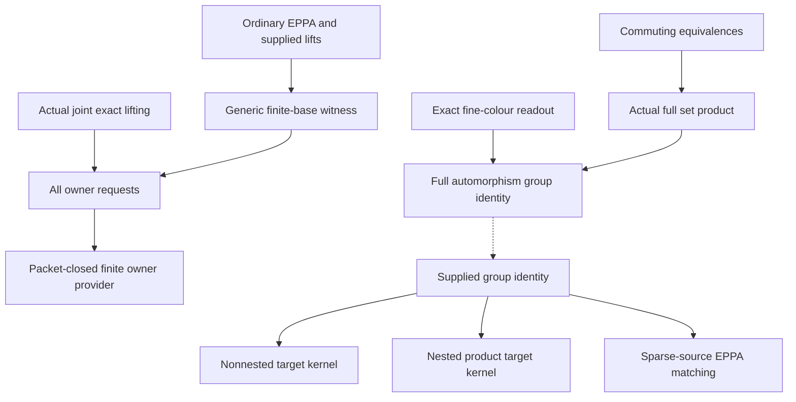

# Finite owner providers and full fine-coloured fibre-product actions

Generated from `module.json` by `tools/build_formalization_module.py`.

Source `490c3f36d85db5a0b3ced0598e6c431825254ec5`. **Human-expanded proof plan; no Lean code.**

Preparation for OTHER Lean projects. All three owner_master/01–03 results, both finite-base provider results and the selected prescribed-owner point lemma are expanded: six exports. The simultaneous owner master and rooted ACF induction remain separate consumers. Ordinary EPPA of the actual quotient source is an explicit conditional input, never a same-rank rooted ACF hypothesis.

The human article remains unchanged. Additional proof details are in
[PROOF_NOTES.md](PROOF_NOTES.md); the cross-track policy is in
[the formalization guide](../README.md). Source hashes are checked before
the index is regenerated. Graph validation is not proof verification.

## Source premises

**A01: Generic homogeneous relational source.** For the finite-base branch X is homogeneous in a finite relational language. Its invariant quotient pi:X->T has kernel equality and all quotient pair colours recognizable as unions of the old fine pair colours on every finite induced substructure. This recognizability, rather than mere ambient invariance, ensures that finite induced automorphisms descend.

**A02: Ordinary EPPA input.** Age(X), or Age(Q) in the actual owner-provider application, has ordinary EPPA. The witness is an age member and can be realized over the original finite set by homogeneity. No coherent EPPA or rooted ACF is supplied.

**A03: Symmetric original orbital framework.** The actual source is nonempty, transitive, homogeneous, one-sort, finite complete binary with symmetric same-sort orbitals, including logical equality. Invariant relations are unions of the finitely many actual orbitals, and original invariant endorelations commute. This elementary framework alone does not assume CCO, countability or SAP.

**A04: Homomorphic CCO for exact geometry.** The actual source satisfies semantic homomorphic CCO, and displayed owner/coordinate kernels are full RAW exact invariant equivalences. Used for actual exact joint lifting and fine-colour meet, not for elementary group-action arguments.

**A05: Countable actual source.** Countability is retained for the currently prepared actual joint lifting theorem. Finite-base restriction with supplied ambient lifts, packet projection, product colour readout and the abstract action results do not use countability.

**A06: Finite-base request data.** B is a finite induced quotient subset; A is finite and lies over B; finitely many compatible pairs (p,gamma), including empty-real requests if desired, are supplied. Each has one simultaneous ambient automorphism extending p and inducing gamma on EVERY b in B. This ambient-lift premise is not inferred from compatibility in an arbitrary quotient.

**A07: Actual owner-provider data.** pi:Q->O is an actual full exact quotient of the standing source. B is finite, nonempty, induced and closed under the greatest finite-class invariant equivalence F_O; finite A is contained in pi^-1(B). The complete canonical quotient pair colours are retained.

**A08: Actual finite product data.** E,J are actual full exact equivalences; K=E meet J, H=E join J. Finite induced D subset X/E and C subset X/J have the same induced image B subset X/H and both maps onto B are surjective. W is the FULL product D times_B C with its actual fine colours from X/K.

**A09: Abstract action input.** Finite quotient systems D->O,C->O and D->T are surjective; W is the FULL SET fibre product D times_O C with its canonical coordinate maps. All induced full automorphism action homomorphisms are specified, and restriction IDENTIFIES Aut(W) with the matching-pair fibre product. No fine-colour source realization, action-surjectivity, kernel-transitivity, point prescription or nesting between T and O is assumed in this core input.

**A10: Optional nested-target input.** Only for the second target, D->O factors through T, W_T=T times_O C is full and has its corresponding matching-pair automorphism identity. The canonical W->W_T is the displayed quotient map.

**A11: EPPA consumer input.** Finite induced A_W subset W has actual coordinate images A_D,A_C. D extends every partial automorphism of A_D. C extends every partial automorphism of A_C with EVERY prescribed compatible delta in Aut(O). Projection kernels and quotient pair colours are old fine-colour unions on the sparse source, so its partial maps descend.

**A12: Elementary finite mathematics.** Classical choices for finitely many requests, finite permutations and groups, elementary relational composition, orbit/stabilizer reasoning and finite products. No external EPPA theorem is proved or imported silently; ordinary EPPA is A02 or the explicitly stated finite consumer input A11.

**A13: First-factor prescribed T point input.** Aut(D)->Aut(T) is onto and its kernel acts transitively on each D->T fibre. Used for the nonnested and nested kernel branches, not for the independent EPPA consumer.

**A14: Second-factor prescribed owner point input.** For every x,y in C and EVERY delta in full Aut(O) carrying pi_C(x) to pi_C(y), there is h in Aut(C) inducing EXACTLY delta and sending x to y. Required for the nonnested target kernel branch, not for the nested target branch or independent EPPA clause.

**A15: Exact quotient for arbitrary finite-base requests.** pi:Q->O is an actual full exact quotient in the complete canonical actual orbital language. For the fixed-base corollary B is ANY finite induced owner subset and A is finite over B; B may be empty and need not be F_O-closed. Nonemptiness and packet closedness belong only to A07 for the later finite owner provider.

## Imported theorem contracts

These are named provider obligations for the receiving Lean project,
not new axioms or claims of compiled imports.

| ID and source | Contract | Current provider status |
|---|---|---|
| I01: [`lem:nested-mixed`](../../sections/exact_foundations/02_exact_quotient_orbital_geometry.tex#L144) | For Id<=E in the one-original-sort symmetric RAW algebra, Id;a;E=a;E=E;a;E, including the real diagonal. Thus the real/owner orbital depends only on the projected owner pair. | HUMAN_EXPANDED_NOT_LEAN |
| I02: [`thm:typed-joint-exact-lifting`](../../sections/exact_foundations/03_joint_exact_sort_lifting.tex#L1) | Every genuine finite partial isomorphism on the complete actual real/exact-sort orbital language is induced by ONE original ambient automorphism. The currently prepared provider retains countability. No global group section. | HUMAN_EXPANDED_NOT_LEAN |
| I03: [`lem:exact-quotient-colour-meet`](../../sections/exact_foundations/02_exact_quotient_orbital_geometry.tex#L12) | For full exact E,J and K=E meet J, (E;a;E) intersect (J;a;J)=K;a;K for EVERY original raw atom including equality. This recovers a fine quotient orbital from the two coordinate orbitals, but is not set-level tuple realization. | HUMAN_EXPANDED_NOT_LEAN |
| I04: [`lem:prescribed-action-point-lifting`](../../sections/typed_invariant_quotient_transport.tex#L185) | For an equivariant surjection from nonempty Y, a group map is onto with fibre-transitive kernel iff every compatible point pair admits every prescribed target group element. Nonempty is essential in the reverse implication. Already assigned as a shared B001 export; the elementary proof is recalled, not re-exported. | HUMAN_SUPPORT_PROOF_NOT_LEAN |
| I05: [`lem:packetinterval`](../../sections/finite_packets.tex#L56) | Reuse ONLY elementary finite_packets C03: finite-index coarsenings in the finite symmetric invariant-equivalence lattice are closed under finite joins, constructing Sigma(J); F=Sigma(Id) is greatest finite-class. No CCO, countability, exactness or full remaining packet-interval result is needed. | HUMAN_EXPANDED_NOT_LEAN |

## Definitions

| ID | Definition | Exact meaning | Source |
|---|---|---|---|
| D01 | Finite induced automorphisms and partial maps | A partial automorphism of a finite induced set is an induced isomorphism between two of its subsets, including the empty map. All relations, both binary directions and logical equality are respected. | [source](../../sections/exact_eppa_providers.tex#L11) |
| D02 | Recognizable actual quotient restriction | For finite C and its quotient image, quotient equality and every quotient pair colour are determined by old fine colours, including coincident quotient coordinates. Hence every induced automorphism, and every partial map on a source subset, preserves the relevant kernel and descends onto its actual projected domain. | [source](../../sections/exact_eppa_providers.tex#L7) |
| D03 | Compatible prescribed-owner request | (p,gamma) consists of an old partial automorphism and gamma in Aut(B), with pi(p(x))=gamma(pi(x)) for every domain point. The gamma-component is prescribed on ALL of B, not merely owners met by p. Ambient lift is an additional premise in the generic branch. | [source](../../sections/exact_eppa_providers.tex#L17) |
| D04 | Ordinary finite EPPA witness | A finite age member containing the given original finite structure, extending every one of its partial automorphisms; realize it as a finite induced actual subset over that structure using homogeneity. No coherent choice of the extensions. | [source](../../sections/exact_eppa_providers.tex#L9) |
| D05 | Greatest finite packet and full closure | F_Q is the largest finite-class Aut(Q)-invariant equivalence, not necessarily exact. F_Q[S] is the union of ENTIRE ambient F_Q-classes meeting S. F_O uses the full canonical owner-colour structure. | [source](../../sections/owner_master/01_ambient_owner_provider.tex#L18) |
| D06 | Packet-closed seed above all owners | A^+=F_Q[A union S], with S containing an actual representative of EVERY owner in nonempty B. Thus A^+ is nonempty, finite, full-packet closed and has image B. | [source](../../sections/owner_master/01_ambient_owner_provider.tex#L53) |
| D07 | Generated finite motion orbit | D0 is the finite-base witness; D1=F_Q[D0]. Choose one ambient extension of each selected Aut(D0), restrict to D1, let G0 be the finite generated permutation group, and set D=G0 A^+. No selection is a group homomorphism. | [source](../../sections/owner_master/01_ambient_owner_provider.tex#L131) |
| D08 | Prescribed point property | For every x,y and EVERY target automorphism gamma with gamma(pi x)=pi y, there is a domain automorphism inducing exactly gamma and sending x to y. For the orbit-seed transfer this property is first required on all compatible singleton pairs in A0; A0 meets every domain automorphism orbit. | [source](../../sections/rooted_mi/04_owner_point_and_finite_lift.tex#L2) |
| D09 | Full actual fibre product | W contains EVERY (d,c) whose actual owners agree, with induced fine colours from X/(E meet J). Quotient identification and fine-colour reconstruction are distinct assertions. | [source](../../sections/owner_master/02_full_fibreproduct_action.tex#L17) |
| D10 | Matching-pair automorphism group | Pairs (g,h) in Aut(D) times Aut(C) whose induced permutations on the entire common owner set agree. Multiplication and inverse are coordinatewise. The identification with Aut(W) must first be proved for actual fine colours or supplied explicitly. | [source](../../sections/owner_master/03_owner_kernels_prescribed_actions.tex#L11) |
| D11 | Two distinct target systems | For target T alone, no T->O map is needed. For W_T=T times_O C, D->O must factor through T and W_T needs its own full-product group identity. All quotient maps are surjective. | [source](../../sections/owner_master/03_owner_kernels_prescribed_actions.tex#L17) |
| D12 | Sparse source coordinate partial maps | For a partial f on any induced A_W, its projected domain is pi_D(dom f), not necessarily all A_D. Recognizable kernels make the map well-defined and injective; recognizable quotient pair colours make it a genuine induced partial automorphism. | [source](../../sections/owner_master/03_owner_kernels_prescribed_actions.tex#L71) |

## Proof claims and direct dependencies

Every row has a human proof expansion. Each still needs an actual Lean
statement and proof. Generic finite-base, actual exact-source realization and abstract product-action branches have separate premises. No coherent lifts, group section, owner-naming homogeneity or arbitrary cross-colour permutation is assumed.

| ID and claim | Scope | Direct providers | Proof note |
|---|---|---|---|
| C01: Induced quotient actions are honest homomorphisms | finite_base | D02, A12 | N01 in [notes](PROOF_NOTES.md) |
| C02: One finite EPPA host for all supplied ambient requests | finite_base | D01, D03, D04, A06 | N01 in [notes](PROOF_NOTES.md) |
| C03: Restrict the EPPA host above the entire fixed base | finite_base | C01, C02 | N01 in [notes](PROOF_NOTES.md) |
| C04: Compatibility gives a genuine complete joint map in the exact source | exact_lifting | D03, I01, A15 | N02 in [notes](PROOF_NOTES.md) |
| C05: Actual exact finite-base lifting | exact_lifting | C04, I02, C03 | N02 in [notes](PROOF_NOTES.md) |
| C06: Instantiate the prepared greatest finite packets | finite_packets | D05, A12, I05 | N03 in [notes](PROOF_NOTES.md) |
| C07: Projection of a finite packet stays in an owner packet | finite_packets | C06, D02, A07 | N03 in [notes](PROOF_NOTES.md) |
| C08: Nonempty packet-closed seed projects onto B | owner_provider | D06, C07 | N04 in [notes](PROOF_NOTES.md) |
| C09: All original partial and singleton requests share D0 | owner_provider | C08, C05 | N04 in [notes](PROOF_NOTES.md) |
| C10: Full-packet enlargement retains each chosen action | owner_provider | C09, C07, A03 | N04 in [notes](PROOF_NOTES.md) |
| C11: Finite orbit trimming preserves full packets and every request | owner_provider | D07, C10, C08 | N04 in [notes](PROOF_NOTES.md) |
| C12: Move any pair through an orbit-covering singleton seed | point_action | D08, A12 | N05 in [notes](PROOF_NOTES.md) |
| C13: Finite owner provider with exact point lifting and kernel | owner_provider | C11, C12, I04, A03 | N05 in [notes](PROOF_NOTES.md) |
| C14: Actual quotient gives the full set fibre product | fine_product | D09, A03, A12 | N06 in [notes](PROOF_NOTES.md) |
| C15: Full product projections descend to both factors | fine_product | C14, C01 | N06 in [notes](PROOF_NOTES.md) |
| C16: The two coordinate orbitals reconstruct one fine orbital | fine_product | C14, I03 | N07 in [notes](PROOF_NOTES.md) |
| C17: Natural full fine-coloured automorphism isomorphism | fine_product | C15, C16, D10 | N07 in [notes](PROOF_NOTES.md) |
| C18: Abstract matching-pair action is the only group input | abstract_kernel | A09, D10, D11, A12 | N08 in [notes](PROOF_NOTES.md) |
| C19: Prescribed point lifting to a nonnested target T | abstract_kernel | C18, I04, A13, A14 | N08 in [notes](PROOF_NOTES.md) |
| C20: Onto action and fibre-transitive kernel over T | abstract_kernel | C19, I04 | N08 in [notes](PROOF_NOTES.md) |
| C21: Lift prescribed points and the ENTIRE nested target automorphism | abstract_kernel | C18, A10, I04, A13 | N09 in [notes](PROOF_NOTES.md) |
| C22: Nested product quotient has onto action and fibre kernel | abstract_kernel | C21, I04 | N09 in [notes](PROOF_NOTES.md) |
| C23: Sparse original partial maps descend to genuine coordinate partial maps | eppa_product | D12, C01, A12 | N10 in [notes](PROOF_NOTES.md) |
| C24: Extend a sparse original partial map with its exact resulting owner action | eppa_product | C23, A09, A11 | N10 in [notes](PROOF_NOTES.md) |
| C25: Empty quotient systems are trivial separately | abstract_kernel | A09, A12 | N11 in [notes](PROOF_NOTES.md) |
| C26: Assembled full-product kernel and EPPA export | eppa_product | C20, C22, C24, C25 | N11 in [notes](PROOF_NOTES.md) |
| C27: Fullness is essential even when both projections are onto | examples | A12 | N12 in [notes](PROOF_NOTES.md) |
| C28: Fullness alone does not replace fine-colour reconstruction | examples | A12 | N12 in [notes](PROOF_NOTES.md) |
| C29: No section is needed but the C point premise is essential | examples | A12 | N12 in [notes](PROOF_NOTES.md) |
| C30: Source packet consequence respects the finite domain | point_action | C12, A03 | N05 in [notes](PROOF_NOTES.md) |

The precise quantified contracts are in `module.json`. Provider-before-consumer
order (including definitions and source premises):

`A01 → A02 → A03 → A04 → A05 → A06 → A07 → A08 → A09 → A10 → A11 → A12 → A13 → A14 → A15 → C25 → C27 → C28 → C29 → D01 → D02 → D04 → D05 → D08 → D09 → D10 → D11 → D12 → I01 → I02 → I03 → I04 → I05 → C01 → C06 → C12 → C14 → C18 → D03 → D06 → C02 → C04 → C07 → C15 → C16 → C19 → C21 → C23 → C30 → D07 → C03 → C08 → C17 → C20 → C22 → C24 → C05 → C26 → C09 → C10 → C11 → C13`

This order is one valid linearization; it does not require unrelated
branches to be proved sequentially. The full DAG is the `depends_on`
relation in `module.json`.

## Main proof branches

This is a coarse view of the claim DAG. Edges go from provider to consumer.

The abstract kernel/EPPA branch takes the group identity as input; it does not need the actual source construction or the finite owner provider to be reproved.
The provider branch uses conditional ordinary EPPA plus accepted actual joint exact lifting, not a rooted ACF induction hypothesis.
No argument imports finite-kernel width-two, owner-naming homogeneity, phase seeds, SAP or a group section.

## Article exports

| Existing source result | Sidecar proof claims |
|---|---|
| [`lem:finite-base`](../../sections/exact_eppa_providers.tex#L5) | C01, C02, C03 |
| [`cor:fixed-base`](../../sections/exact_eppa_providers.tex#L50) | C04, C05 |
| [`lem:acf-point-homogeneity`](../../sections/rooted_mi/04_owner_point_and_finite_lift.tex#L1) | C12, C30 |
| [`lem:acf-owner-provider`](../../sections/owner_master/01_ambient_owner_provider.tex#L28) | C06, C07, C08, C09, C10, C11, C12, C13 |
| [`lem:acf-fibreproduct-aut`](../../sections/owner_master/02_full_fibreproduct_action.tex#L1) | C14, C15, C16, C17 |
| [`lem:acf-fibreproduct-owner-kernels`](../../sections/owner_master/03_owner_kernels_prescribed_actions.tex#L1) | C18, C19, C20, C21, C22, C23, C24, C25, C26 |

Auxiliary source equations (not additional numbered results):

- [`eq:acf-fibreproduct-aut`](../../sections/owner_master/02_full_fibreproduct_action.tex#L28): C15, C16, C17
- [`eq:acf-fibreproduct-kernel-action`](../../sections/owner_master/03_owner_kernels_prescribed_actions.tex#L13): C18, C19, C21, C24

Full result coverage is asserted only for `source_result_files`.
Selected additional results: lem:acf-point-homogeneity.
Other results in their provider source files are not claimed covered.

## Internal implementation milestones

These tasks are proof milestones inside larger project assignments;
see the [peer-project allocation](../coordination/BOARD.md).

These are implementation tasks, not additional mathematical assumptions.

| Task | Earlier tasks | Acceptance |
|---|---|---|
| T01: Generic finite-base restriction and actual exact lifting | — | Prove generic EPPA restriction with supplied ambient lifts first; instantiate with the accepted actual joint-lifting provider, retaining countability only in that instance. |
| T02: Packet-closed finite owner witness and prescribed points | T01 | Construct the largest finite packets, list all empty/singleton requests, close and orbit-trim, and derive prescribed point and kernel properties. Ordinary EPPA remains an explicit input. |
| T03: Actual full fine-coloured product | T01 | Separate commuting-equivalence set realization, quotient descent, equality-inclusive exact readout and natural automorphism isomorphism; do not import owner provider or countability. |
| T04: Abstract nonnested/nested action and sparse EPPA consumers | T01 | With the actual group identity supplied, prove nonnested and nested point lifting, empty systems and sparse-source EPPA matching. This branch need not wait for T02/T03 proofs. |
| T05: Premise countercontrols and nonsplit positive example | — | Implement actual finite relation/action models and distinguish deliberately violated premises from source counterexamples. |

## Finite controls

- **R01.** Actual all-difference F2^3 automorphisms and full-product matching-pair equality, including diagonal coordinate colours.
- **R02.** Prescribed action and fibre kernel for nonnested T and nested W_T, plus genuinely empty systems.
- **R03.** Sparse original partial isometries, coordinate descent, ordinary first-factor extension and exact-owner second-factor extension.
- **R04.** Surjective but nonfull subset and extra unreconstructed fine relation both reject compatible coordinate pairs.
- **R05.** Nonsplit C4->C2 positive point lifting, and an onto owner action with missing fibre transitivity which fails the conclusion.
- **R06.** Generic finite-base restriction in the 48-automorphism finite pure-equivalence source; all eight original requests plus empty B and no-request cases.
- **R07.** All 512 seed-conjugation choices in the four-point wreath action preserve both selected point values and the exact owner component.
- **R08.** Six-point cyclic full-packet orbit trim; a one-point incomplete-packet seed demonstrates why the full seed closure is needed.

Run `python tools/check_owner_action_controls.py` from the manuscript directory.
The controls do not prove CCO or the general theorems.

## Return to the human articles

The scoped review found no required change to a numbered theorem conclusion. Record these proof/domain clarifications for the later human article pass; human TeX remains unchanged.

- **F01** ([source](../../sections/owner_master/01_ambient_owner_provider.tex#L22)): The projected finite packet is invariant under FULL Aut(O) because its saturated pullback is an old-orbital union, not because every full owner automorphism has a global lift. State this local colour-union invariance explicitly.
- **F02** ([source](../../sections/owner_master/01_ambient_owner_provider.tex#L57)): All compatible singleton and empty-real requests must be included before taking full-packet closure and the generated orbit. Chosen lifts need no coherence. Keep the full request list and D0/D1/D orbit construction together.
- **F03** ([source](../../sections/rooted_mi/04_owner_point_and_finite_lift.tex#L17)): The finite automorphism is defined only on D. Its packet consequence applies to subsets of D intersect F_Q[x]; the whole ambient packet is available when D is full-packet closed. Qualify the displayed packet consequence by its finite domain. This is a domain wording clarification.
- **F04** ([source](../../sections/owner_master/02_full_fibreproduct_action.tex#L42)): Finite automorphisms descend because BOTH quotient equality and quotient pair colours are recognizable old-colour unions, not merely because the kernel is preserved. Logical quotient diagonals remain in the exact readout. Make quotient-colour descent explicit alongside kernel descent.
- **F05** ([source](../../sections/owner_master/03_owner_kernels_prescribed_actions.tex#L17)): For target T, the actual O-action is chosen after lifting the prescribed T-motion and point pair; only the target T times_O C needs T->O and its own full-product identity. Retain the separate nonnested and nested action contracts in downstream M3 callers.
- **F06** ([source](../../sections/owner_master/03_owner_kernels_prescribed_actions.tex#L65)): The sparse-source EPPA argument uses an explicit full group identity and exact-owner EPPA in C, but no D->T fibre-transitivity input. It also requires recognizable quotient colours for partial-map descent. Optionally split this reusable EPPA clause from the stronger kernel clause.

The machine ledger records caller effects and affected claims. The source
review used two independent model review passes and parent synthesis;
it is not independent human or formal certification.
