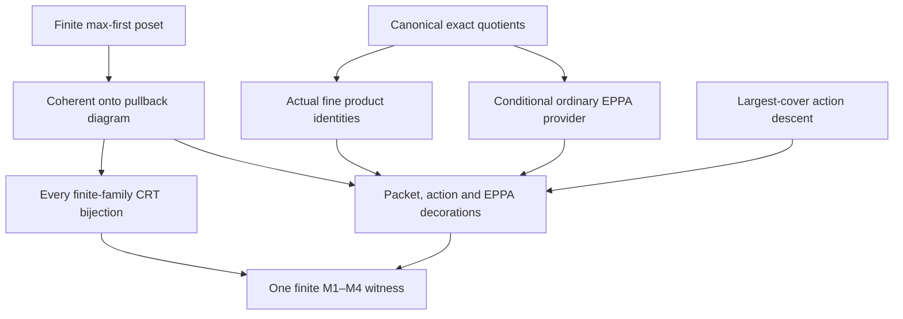

# Simultaneous finite exact-owner master and all-family compatibility

Generated from `module.json` by `tools/build_formalization_module.py`.

Source `490c3f36d85db5a0b3ced0598e6c431825254ec5`. **Human-expanded proof plan; no Lean code.**

Preparation for OTHER Lean projects. Complete expansion of the finite exact-quotient owner master, its M1–M4 invariant, canonical quotient maps and finite all-family CRT. The abstract upset-diagram proof is independent of source geometry. The actual master remains conditional on ordinary EPPA for EVERY actual exact quotient, including Id; no global/rooted EPPA conclusion is exported.

The human article remains unchanged. Additional proof details are in
[PROOF_NOTES.md](PROOF_NOTES.md); the cross-track policy is in
[the formalization guide](../README.md). Source hashes are checked before
the index is regenerated. Graph validation is not proof verification.

## Source premises

**A01: Finite poset.** P is a finite partially ordered set; its available indices are ALL upsets contained in the processed upset U, not only principal upsets or the processing chain. The empty poset is allowed.

**A02: Old coherent onto finite diagram with all-family CRT.** For every available old upset V, B_V is a nonempty finite set; every W subset V has an explicit onto restriction r_VW. Identities and composition commute. B_empty is a singleton. The natural map from B_unionVi to ALL pairwise-compatible tuples is bijective for every finite indexed family, including empty and repeated families.

**A03: One full local extension.** Choose p maximal in P minus U, put O={q:q>p} and Up=O union {p}. A nonempty finite local set D_p maps onto B_O. New B_V are FULL pullbacks B_(V minus p) times_(B_O) D_p; old data remain unchanged.

**A04: Elementary finite and group mathematics.** Classical finite choices, finite-poset maximal elements and induction, explicit Cartesian/pullback sets and maps, group homomorphisms and equivariant surjections. The abstract CRT and generic action descent are proved internally; no compactness or external representation theorem is left hidden.

**A05: Actual symmetric CCO source.** X is a nonempty transitive homogeneous one-sort finite complete symmetric binary source with equality-inclusive RAW relations and semantic homomorphic CCO. Exact equivalences are the actual full RAW exact invariant equivalences; their lattice is not the entire invariant-equivalence lattice. No SAP, NR2, safe palette, section or coherent EPPA is assumed.

**A06: Current countable provider scope.** X is countable. This is retained only through the existing actual quotient-source/joint-lifting/owner-provider route. Abstract diagrams, canonical double quotients, set-level CRT and finite group action transfer do not need it.

**A07: Ordinary EPPA for every exact quotient, including identity.** For EVERY original actual exact E, Age(X/E) has ordinary EPPA, including E=Id so the input explicitly includes Age(X). This is a conditional premise, not a theorem proved by the master or a same-rank rooted ACF assumption.

**A08: Recognizable finite group diagram and product identities.** All finite quotient kernels and quotient pair colours are recognizable fine-colour unions, and the induced full finite group maps commute. The full group identities for the largest and EVERY new product target are supplied. This core group-diagram premise alone assumes neither old M1/M3 nor any local point/partial-map extension.

**A09: Packet projection input.** For the conditional M2 step each ambient projection takes its entire finite packet into the finite packet of its image. Both finite factors are closed under entire ambient packets. The largest finite equivalence need not be exact. The actual source instance discharges this input using I07.

**A10: Generic nested canonical orbital quotients.** For the independent quotient-associativity lemma, a group G acts on a set X, and K<=H are G-invariant equivalences. Every canonical quotient language names ALL actual G-pair orbitals, including equality. No finiteness, transitivity, homogeneity, CCO, exactness or global surjectivity of quotient automorphism maps is presumed.

**A11: Original nonempty finite input.** A is a finite nonempty actual subset of X and A_V is its image in EVERY actual X_V. Finite witnesses must retain all A_V. These images may be sparse in the corresponding products; their partial maps need not descend from a partial map of original A.

**A12: Old M3 action input.** For every nested OLD pair, its full finite induced automorphism group map is onto with fibre-transitive kernel. Used for both largest-product target branches.

**A13: Local prescribed owner point input.** D_p has every prescribed owner point motion over B_O. Needed only for the nonnested OLD targets, not the nested new-product target or independent EPPA clause.

**A14: Old M1 and local prescribed partial-map input.** Old finite objects have ordinary EPPA for their exact A_V inputs. D_p extends EVERY partial automorphism of A_Up with EVERY prescribed compatible entire Aut(B_O) owner action. Used by the independent sparse EPPA product consumer, not by the pure point-kernel proof. For this independent consumer the finite sparse input A_V is GIVEN as an induced subset of its full product, with coordinate images exactly A_Vminus and A_Up. The actual source recursion proves this datum by C11.

**A15: Old actual source invariant.** For the actual one-stage instantiation, each OLD finite B_V is an actual induced subset of X_V, its maps are the canonical actual restrictions, it contains A_V and is closed under its ENTIRE ambient finite packet. No new local D_p is assumed in this OLD invariant.

**A16: Actual chosen local factor for the conditional product step.** For the conditional actual product/containment claims, D_p is a finite actual induced subset of X_Up, has owner image exactly B_O and contains A_Up. This factor data is an OUTPUT of C22 in the source recursion, not an extra hypothesis of the final master.

**A17: Supplied initial decorations for abstract assembly.** The conditional decorated-diagram recursion starts from a singleton object whose declared structure/ambient packet relation and input already satisfy M1, M2 and M3. The abstract set singleton alone does not prove ambient packet closure. In the actual source case C25 discharges these base decorations using X/Top being a singleton.

## Imported theorem contracts

These are named provider obligations for the receiving Lean project,
not new axioms or claims of compiled imports.

| ID and source | Contract | Current provider status |
|---|---|---|
| I01: [`lem:acf-exact-distributive`](../../sections/exact_lattice_crt.tex#L52) | The actual full exact-equivalence lattice is finite bounded distributive; reuse the internally expanded Birkhoff representation by nonzero join-irreducibles and actual compatible-quotient set CRT. Does not decompose the language into freely coloured factors. | HUMAN_EXPANDED_NOT_LEAN |
| I02: [`thm:exact-sorts-source`](../../sections/exact_foundations/03_joint_exact_sort_lifting.tex#L161) | Every original actual exact quotient is a standing homogeneous CCO source in its complete canonical old-group orbital language. Retain the currently prepared countability premise; do not infer an unrestricted global lift of full quotient automorphisms. | HUMAN_EXPANDED_NOT_LEAN |
| I03: [`lem:exact-descent`](../../sections/exact_gluing_geometry.tex#L25) | For original exact K<=H, H/K is full exact on X/K because H is K-saturated; quotient words retain logical identity kernels. Only the one-original-sort branch is used, with no mixed-sort TI shortcut. | HUMAN_EXPANDED_NOT_LEAN |
| I04: [`lem:acf-owner-provider`](../../sections/owner_master/01_ambient_owner_provider.tex#L28) | Given the current actual exact Q->O, ordinary EPPA of Q and finite nonempty F_O-closed B, produce finite full-F_Q-closed D over exactly B, containing its input, extending all prescribed compatible input maps and every prescribed owner point motion. This is conditional ordinary EPPA, not rooted ACF. | HUMAN_EXPANDED_NOT_LEAN |
| I05: [`lem:acf-fibreproduct-aut`](../../sections/owner_master/02_full_fibreproduct_action.tex#L1) | Reuse owner_action C14 ambient set-product realization, C16 equality-inclusive fine-colour reconstruction and C17 natural finite full-group identity (with recognizable quotient descent C15). For actual original exact E,J, X/(E meet J) is canonically the full fine-coloured product; its FULL finite induced factors over a common owner image have exactly the matching-pair full Aut group. These are separate supporting claims, not an inference from a group identity alone. | HUMAN_EXPANDED_NOT_LEAN |
| I06: [`lem:acf-fibreproduct-owner-kernels`](../../sections/owner_master/03_owner_kernels_prescribed_actions.tex#L1) | Reuse the pure group conclusions with an explicitly supplied full product/group identity: nonnested targets require both factor point properties; nested product targets need factorization and their own identity. The sparse EPPA clause needs its separate partial-map providers, not the point-kernel premises. | HUMAN_EXPANDED_NOT_LEAN |
| I07: [`lem:acf-owner-provider`](../../sections/owner_master/01_ambient_owner_provider.tex#L28) | In the symmetric finite canonical orbital framework with commuting invariant equivalences, reuse ONLY already expanded owner_action C06–C07/N03: greatest finite packets exist; for an actual quotient q, the FULL Aut(target)-invariant finite equivalence (F_source join ker q)/ker q has class q(F_source[x]) and is below F_target. Full-group invariance follows from named colour unions, not global lifts. The isolated support proof uses no ordinary EPPA, CCO or exactness of F. | HUMAN_SUPPORT_PROOF_NOT_LEAN |

## Definitions

| ID | Definition | Exact meaning | Source |
|---|---|---|---|
| D01 | Available upset indices | Up(U) is the family of all P-upsets V contained in processed upset U. All finite unions/intersections remain available. | [source](../../sections/owner_master/04_master_theorem.tex#L39) |
| D02 | Coherent finite quotient diagram | B_V with explicit r_VW for W subset V; identity, composition, surjectivity, nonempty finite carriers and singleton empty object are part of the invariant. | [source](../../sections/owner_master/04_master_theorem.tex#L53) |
| D03 | All-family finite compatibility | For a finite indexed list (V_i), compatibility means equality of the two images in every B_(V_i intersect V_j). The natural map from B_(union_i V_i) is required to be bijective. Empty product is one point. | [source](../../sections/owner_master/04_master_theorem.tex#L186) |
| D04 | Principal new step | p is maximal outside U; O=strict upper cone and Up=O union {p}. Each new V contains Up and Vminus=V minus {p} is an old upset with O subset Vminus. | [source](../../sections/owner_master/04_master_theorem.tex#L59) |
| D05 | Full pullback carrier and maps | New B_V is every compatible pair (b,x) from old B_Vminus and D_p. Canonical new maps either forget x or retain exactly the same x. | [source](../../sections/owner_master/04_master_theorem.tex#L82) |
| D06 | Exact-equivalence upset coordinates | Birkhoff sends an exact E to a downset d; for upset V put K_V=E_(P minus V), X_V=X/K_V, pi_V the actual quotient. The index order is reversed. | [source](../../sections/owner_master/04_master_theorem.tex#L42) |
| D07 | Canonical nested quotients | For K<=H, the relative equivalence on X/K is H/K. The canonical double quotient sends [[x]_K] to [x]_H; both carriers and complete actual orbital languages must be identified. | [source](../../sections/owner_master/04_master_theorem.tex#L45) |
| D08 | Original shadows | A_V=pi_V(A). New A_V is merely a sparse induced subset of its full product; coordinate images are exactly A_Vminus and A_Up. | [source](../../sections/owner_master/04_master_theorem.tex#L43) |
| D09 | The four decorations | M1 is EPPA for each actual A_V, M2 is closure under the ENTIRE ambient F_(X_V) packet, M3 uses full finite induced Aut groups and fibre-transitive kernels, M4 is the all-family bijection. | [source](../../sections/owner_master/04_master_theorem.tex#L55) |
| D10 | Largest new witness | L=B_U times_(B_O) D_p is B_(U union {p}); its canonical onto maps reach EVERY old or new available target, including old V not containing O. | [source](../../sections/owner_master/04_master_theorem.tex#L145) |
| D11 | Finite provider schedule | A max-first enumeration of the finite P invokes one local owner provider per element; the final witness is transported from X_P=X/Id canonically into original X. P empty uses no provider call. | [source](../../sections/owner_master/04_master_theorem.tex#L261) |

## Proof claims and direct dependencies

Every row has a human proof expansion. Each still needs an actual Lean
statement and proof. Abstract full pullbacks, actual fine-colour reconstruction, finite induced group actions and conditional ordinary EPPA retain separate quantified premises.

| ID and claim | Scope | Direct providers | Proof note |
|---|---|---|---|
| C01: Finite max-first schedule exists | finite_poset | A01, A04 | N01 in [notes](PROOF_NOTES.md) |
| C02: All old/new indices and principal intersections | finite_poset | C01, D04 | N01 in [notes](PROOF_NOTES.md) |
| C03: Generic canonical quotient associativity preserves full orbital colours | canonical_quotients | D07, A04 | N05 in [notes](PROOF_NOTES.md) |
| C04: Actual exact quotient diagram and exact relative kernels | actual_source | D06, C03, I02, I03 | N05 in [notes](PROOF_NOTES.md) |
| C05: Actual binary coordinates retain every fine colour | actual_source | C02, D06, I05 | N05 in [notes](PROOF_NOTES.md) |
| C06: Singleton initial system and empty-poset boundary | abstract_diagram | A01, A04 | N02 in [notes](PROOF_NOTES.md) |
| C07: One finite full pullback per new upset | abstract_diagram | D05, C02, A03, A04 | N02 in [notes](PROOF_NOTES.md) |
| C08: Every new restriction map is well-defined | abstract_diagram | C07, D02 | N03 in [notes](PROOF_NOTES.md) |
| C09: Identities and all nested composition squares commute | abstract_diagram | C08 | N03 in [notes](PROOF_NOTES.md) |
| C10: Every finite restriction map is onto | abstract_diagram | C08, C09, A03 | N03 in [notes](PROOF_NOTES.md) |
| C11: Every original projected input is retained | actual_source | C05, D08, C07, A15, A16 | N06 in [notes](PROOF_NOTES.md) |
| C12: A compatible new family gives an old compatible family | abstract_diagram | D03, C08, C09 | N04 in [notes](PROOF_NOTES.md) |
| C13: All new family members have one common local coordinate | abstract_diagram | C02, C08, D03 | N04 in [notes](PROOF_NOTES.md) |
| C14: All-family CRT extends, with existence and uniqueness | abstract_diagram | C12, C13, C07, C09, A02 | N04 in [notes](PROOF_NOTES.md) |
| C15: Full packet closure transfers through actual full products | packet_closure | A09, C07, A04 | N07 in [notes](PROOF_NOTES.md) |
| C16: Full finite group identities and all induced action maps | actual_source | C05, C10, I05, A15, A16 | N08 in [notes](PROOF_NOTES.md) |
| C17: Generic action property descends from a largest cover | finite_group_actions | A04 | N08 in [notes](PROOF_NOTES.md) |
| C18: Largest product reaches all old target actions without nesting | finite_group_actions | D10, A08, I06, C10, A12, A13 | N08 in [notes](PROOF_NOTES.md) |
| C19: Largest product reaches all new target actions | finite_group_actions | D10, A08, I06, C02, C10, A12 | N08 in [notes](PROOF_NOTES.md) |
| C20: Every nested pair satisfies M3 | finite_group_actions | C17, C18, C19, C09, A08 | N08 in [notes](PROOF_NOTES.md) |
| C21: Every new actual input projection has ordinary EPPA | eppa_consumer | D08, A08, I06, A14 | N09 in [notes](PROOF_NOTES.md) |
| C22: Actual local providers discharge each stage input | actual_source | C04, A07, A11, I04, A15, A02 | N06 in [notes](PROOF_NOTES.md) |
| C23: Finite decorated recursion preserves the entire invariant | master_assembly | C01, C06, C07, C09, C10, C14, C15, C20, C21, A17 | N10 in [notes](PROOF_NOTES.md) |
| C24: The final largest object gives exactly every quotient image | actual_source | C10, C11, D06, C03, C14 | N10 in [notes](PROOF_NOTES.md) |
| C25: Actual simultaneous finite exact-owner master | master_assembly | C22, C16, I07, C23, C24 | N10 in [notes](PROOF_NOTES.md) |
| C26: Finite diagram and missing-fullness controls | examples | A04 | N11 in [notes](PROOF_NOTES.md) |

The precise quantified contracts are in `module.json`. Provider-before-consumer
order (including definitions and source premises):

`A01 → A02 → A03 → A04 → A05 → A06 → A07 → A08 → A09 → A10 → A11 → A12 → A13 → A14 → A15 → A16 → A17 → C01 → C06 → C17 → C26 → D01 → D02 → D04 → D07 → D08 → D09 → I01 → I02 → I03 → I04 → I05 → I06 → I07 → C02 → C03 → C21 → D03 → D05 → D06 → D11 → C04 → C05 → C07 → D10 → C08 → C11 → C15 → C22 → C09 → C13 → C10 → C12 → C14 → C16 → C18 → C19 → C20 → C24 → C23 → C25`

This order is one valid linearization; it does not require unrelated
branches to be proved sequentially. The full DAG is the `depends_on`
relation in `module.json`.

## Main proof branches

This is a coarse view of the claim DAG. Edges go from provider to consumer.

The generic diagram/CRT proof needs no CCO, exactness, EPPA, countability, group action or SAP.
Actual fine colours and full finite group actions are separate from the set-level CRT.
The final master uses ordinary EPPA for all exact quotients including Id, never a rooted ACF hypothesis. Public promotion of this new package is coordinated separately from active live assignments.

## Article exports

| Existing source result | Sidecar proof claims |
|---|---|
| [`thm:acf-owner-master`](../../sections/owner_master/04_master_theorem.tex#L1) | C01, C02, C03, C04, C05, C06, C07, C08, C09, C10, C11, C12, C13, C14, C15, C16, C17, C18, C19, C20, C21, C22, C23, C24, C25 |

Auxiliary source equations (not additional numbered results):

- [`eq:acf-master-step`](../../sections/owner_master/04_master_theorem.tex#L69): C02, C05, C07

## Internal implementation milestones

These tasks are proof milestones inside larger project assignments;
see the [peer-project allocation](../coordination/BOARD.md).

These are implementation tasks, not additional mathematical assumptions.

| Task | Earlier tasks | Acceptance |
|---|---|---|
| T01: Finite upset indices and canonical quotient interfaces | — | Separate generic orbital quotient association, exact relative descent and countable standing-source inheritance; handle empty P and identity quotient canonically. |
| T02: Coherent full pullback diagrams and all-family CRT | T01 | Prove the maps, coherence and onto images before the CRT induction. Give a bijection for every finite indexed family, including repetitions and empty family. |
| T03: Finite packet, group and sparse EPPA decorations | T01, T02 | Reuse accepted owner providers/products and the generic largest-cover action lemma. Do not replace full Aut by an ambient image or sparse input by a full product. |
| T04: Finite assembly, exact source export and controls | T01, T02, T03 | Instantiate every callback without a rooted induction loop; verify final image equalities, exact-index M4 and independent finite countercontrols. |

## Finite controls

- **R01.** Finite posets and every descending processing order, canonical upset indices and all three projection cases.
- **R02.** Coherence, onto finite images and independent all-family compatible-tuple reconstruction with context-dependent local fibres.
- **R03.** Empty/repeated/incomparable indices, empty P, singleton empty object and principal-source identity cases.
- **R04.** Actual difference-coloured coordinate sources test finite group images and nonnested targets where provided by the control model.
- **R05.** Sparse parity/missing-fullness and nonsingleton-empty-object models isolate failed hypotheses without claiming a CCO counterexample.

Run `python tools/check_owner_master_controls.py` from the manuscript directory.
The controls do not prove CCO or the general theorems.

## Return to the human articles

No required source theorem conclusion repair was found in two scoped model reviews and parent synthesis. Queue these import/invariant clarifications for the later human article pass; human TeX remains unchanged.

- **F01** ([source](../../sections/owner_master/04_master_theorem.tex#L45)): Canonical coloured double quotients and exact relative kernels are genuine imports: same-sort descent and actual quotient source inheritance must precede the local provider. Cite the prepared exact descent/inheritance interfaces and retain current countability at their source use.
- **F02** ([source](../../sections/owner_master/04_master_theorem.tex#L53)): The induction needs explicit coherent ONTO carrier maps and all original A_V containment. M3 alone does not prove carrier surjectivity. State the strengthened diagram invariant; the three map cases prove it independently of M4.
- **F03** ([source](../../sections/owner_master/04_master_theorem.tex#L183)): All-family CRT needs the old all-family bijection and one shared principal coordinate; two-factor set CRT or surjective projections alone are insufficient. Keep forward compatibility, reconstruction and uniqueness, and mention empty/repeated indices.
- **F04** ([source](../../sections/owner_master/04_master_theorem.tex#L26)): Packet closure and full finite automorphism maps use recognizable actual quotient pair colours, not an assumed global lift of every quotient automorphism. Add the short named-colour-union justification in M2/M3.
- **F05** ([source](../../sections/owner_master/04_master_theorem.tex#L5)): The principal source can equal X itself, so ordinary EPPA of Id is an essential explicit input at this phase. Retain the conditional U-phase placement and do not use the master to prove the same input.

The machine ledger records caller effects and affected claims. The source
review used two independent model review passes and parent synthesis;
it is not independent human or formal certification.
