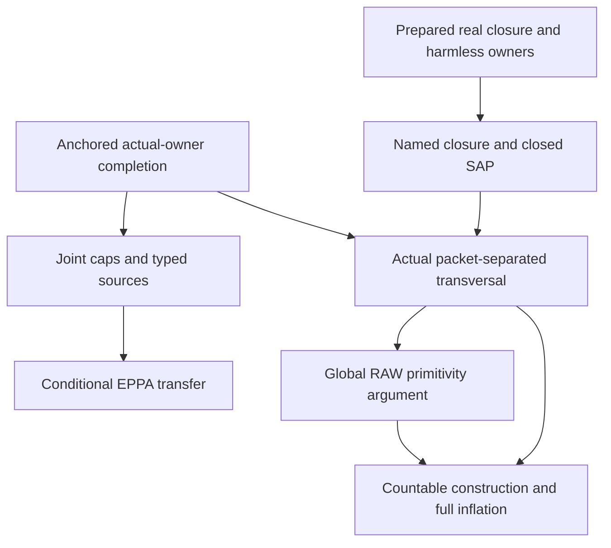

# Anchored owner completion and the full-owner primitive transversal

Generated from `module.json` by `tools/build_formalization_module.py`.

Source `490c3f36d85db5a0b3ced0598e6c431825254ec5`. **Human-expanded proof plan; no Lean code.**

Preparation for OTHER Lean projects. Expand actual anchored completion, joint caps, finite named-owner sources and CONDITIONAL EPPA transfer; then residual named-owner closure, closed SAP, packet separation, primitive transversal and full inflation. Countable extension/back-and-forth construction is internal, not an unproved Fraisse import. Full-real SAP appears ONLY in the optional generic anchored injectivity branches. No safe selector, HKN reservoir, normalized relative MI or global EPPA is proved.

The human article remains unchanged. Additional proof details are in
[PROOF_NOTES.md](PROOF_NOTES.md); the cross-track policy is in
[the formalization guide](../README.md). Source hashes are checked before
the index is regenerated. Graph validation is not proof verification.

## Source premises

**A01: Actual symmetric CCO source.** M is a nonempty COUNTABLE transitive homogeneous source in a FINITE complete symmetric binary language with actual equality-inclusive RAW orbitals and semantic homomorphic CCO. Retain the current RAW provider scope. No full-real SAP, EPPA, safe palette, NR2 or HKN theorem is assumed.

**A02: Actual general owner equivalence.** For the general owner-walk branch E is ANY actual invariant equivalence, including Id. Quotient points are actual E-classes and orbital caps are actual represented pullbacks E;a;E. All original invariant relations commute by symmetry. No reachability, infinitude or SAP is used by the saturated closed-walk assertion itself.

**A03: Reachable nonidentity owner for anchored completion.** For the generic anchored branch E>Id has a supplied POSITIVE represented atomic word; deleting equality letters leaves at least TWO diversity letters, since E is reflexive and not Id. Local raw-completion, edge-compatible assignment and complete-anchor data are quantified separately for each theorem/application. In the residual branch minimal-cut word exactness I10 CONSTRUCTS the required word; it is not a further unproved residual hypothesis.

**A04: Optional original SAP and infinite owner classes.** ONLY the optional injective generic anchored/typed-age clauses assume SAP of the ORIGINAL real age and infinite E-classes. Owner representatives can then be chosen outside each finite real base and the point being moved. Residual packet separation and transversal SAP use their own closed-base argument without this hypothesis.

**A05: Residual normalized one-direction source.** For the residual branch M is infinite and finite-exact-normalized. E is an actual inclusion-minimal infinite exact invariant equivalence and R_E=F, where F is the GREATEST finite-class invariant equivalence. G is the actual regular thin group supplied by normalization/thin providers, H=E meet F its owner stabilizer. B is a finite NONEMPTY G-invariant actual E-owner set and N_B=pi_E^{-1}(B), with EVERY B owner named individually. F need not be exact; G on owners need not be faithful.

**A06: Explicit conditional EPPA inputs.** ONLY the transfer theorem assumes ordinary EPPA of Age(M/E) and, for EVERY finite actual owner set B, Gamma_B-EPPA of the ACTUAL named-owner age with Gamma_B=FULL Aut(B), fixing every literal old fine colour. The latter means ONE common finite typed witness extending ALL compatible requests (including empty real domain) with their ENTIRE owner component. No current-rank ordinary EPPA follows without these inputs.

**A07: Independent countable-age construction.** For the generic limit construction K is any nonempty hereditary class of finite structures in a FINITE relational owner/colour signature, with countably many finite charts and JEP/AP. Use all finite embedding-extension requests, enumerated fairly, to construct an at-most-countable homogeneous structure with age K. SAP is not required for that generic construction; the actual transversal instance already has SAP and unbounded sizes.

**A08: Independent finite packet coordinates.** For the generic inflation identity G is a finite group acting freely and transitively on each real packet; origins give bijective coordinates t_g o_i. Actual owner labels are equivariant, fine cross matrices obey col(t_g o_i,t_h o_j)=(g+h)c_ij in the elementary abelian 2 instance. Distinct origins in distinct target packets give an injective map on full inflations. No infinite source, acl or amalgamation is asserted by this finite datum.

## Imported theorem contracts

These are named provider obligations for the receiving Lean project,
not new axioms or claims of compiled imports.

| ID and source | Contract | Current provider status |
|---|---|---|
| I01: [`thm:exact-sorts-source`](../../sections/exact_foundations/03_joint_exact_sort_lifting.tex#L161) | For EVERY supplied ACTUAL EXACT kernel J (including Id), reuse the RAW quotient-source triangle fullness and homogeneity in its complete old-group orbital language. Specializing to E requires an exactness proof; reachability A03 supplies one in C17. Typed owner realization is proved here by the anchored argument; it is not inferred from untyped triangles alone. | HUMAN_EXPANDED_NOT_LEAN |
| I02: [`lem:foundational-orbital-pullback`](../../sections/typed_invariant_quotient_transport.tex#L216) | Already assigned with shared B001: the pullback of the old-group orbital of an actual quotient pair is kernel;old atom;kernel. The argument is an elementary equivariant quotient action law, independent of source SAP/CCO. | HUMAN_SUPPORT_PROOF_NOT_LEAN |
| I03: [`lem:nested-mixed`](../../sections/exact_foundations/02_exact_quotient_orbital_geometry.tex#L144) | For Id<=E, every real/E-owner mixed pair orbital depends only on the projected E-owner pair, including diagonal incidences. This validates a real partial map together with the ENTIRE prescribed B owner action. Used in the separate residual homogeneity branch, not the orbit proof of acl_N. | HUMAN_EXPANDED_NOT_LEAN |
| I04: [`thm:joint-exact`](../../sections/exact_foundations/03_joint_exact_sort_lifting.tex#L127) | Every genuine finite joint real/exact-owner partial isomorphism extends to ONE original automorphism, retaining current countability. No global lifting section or coherent choice of automorphisms. | HUMAN_EXPANDED_NOT_LEAN |
| I05: [`cor:rh-acl-bounded-character`](../../sections/real_hull/06_minimal_infinite_directions_acl.tex#L85) | For an infinite actual source with ONE minimal infinite invariant direction, acl_M(A)=F[A] for every finite real A, including the empty convention; acl(a)=F[a]. Harmless owner parameters are supplied separately. | HUMAN_EXPANDED_NOT_LEAN |
| I06: [`lem:acf-harmless-owners`](../../sections/harmless_exact_owners.tex#L8) | An invariant owner kernel is harmless iff it contains ALL minimal infinite directions; simultaneously naming any finite family of such actual classes leaves real acl unchanged. Kernels need not be exact and no normalization/S hypothesis is used by this imported criterion. | HUMAN_EXPANDED_NOT_LEAN |
| I07: [`lem:acf-unsafe-concentration`](../../sections/rooted_acf_geometry.tex#L87) | Reuse ONLY structural support C12: in a normalized source distinct minimal infinite E,E_prime have exact meet Id and E_prime<=R_E. Despite the source export name, this support uses NO strong safe palette or unsafe-clique argument. | HUMAN_EXPANDED_NOT_LEAN |
| I08: [`lem:finite-action-avoidance`](../../sections/finite_orbit_avoidance.tex#L6) | For any group action, a finite moving set whose points have infinite orbits can be moved simultaneously away from any finite forbidden set. Includes empty moving/forbidden sets; the finite-coset-cover proof is prepared internally, or use a compatible proved library API. | HUMAN_EXPANDED_NOT_LEAN |
| I09: [`lem:thin-bottom`](../../sections/finite_packets.tex#L339) | Given thin F the literal maps t_g are central original automorphisms, form an elementary abelian 2-group and act regularly on full real packets. They fix raw fine names under diagonal translation and obey the full cross-matrix law. Owner stabilizers may be nontrivial. | HUMAN_EXPANDED_NOT_LEAN |
| I10: [`prop:minimalcut`](../../sections/finite_packets.tex#L102) | Every minimal infinite invariant equivalence equals its nonidentity exact canonical packet core, hence has a represented POSITIVE atomic word. This supplies the reachable owner word for residual uses of the general anchored theorem. | HUMAN_EXPANDED_NOT_LEAN |
| I11: [`lem:finite-exact-normalization-geometric`](../../sections/finite_packets.tex#L246) | No nonidentity finite-class exact equivalence implies all F-atoms thin. Thin F alone does not imply finite-exact normalization and is never substituted for it. | HUMAN_EXPANDED_NOT_LEAN |

## Definitions

| ID | Definition | Exact meaning | Source |
|---|---|---|---|
| D01 | Reachable owner word | E is evaluated by a positive represented RAW word, with identity letters deleted for private paths; E>Id ensures a nonempty diversity word remains. | [source](../../sections/anchored_relative_completion.tex#L62) |
| D02 | Partial raw diagram and protected complete anchor | Distinct formal vertices carry at most one specified diversity atom on each pair; absent edges impose no condition. A is complete and embedded by j, never an arbitrary sparse protected diagram. In each anchored application supply a raw homomorphism of P, a D03 edge-compatible lambda and the complete-anchor embedding j with pi j=lambda on A. | [source](../../sections/anchored_relative_completion.tex#L16) |
| D03 | Actual owner assignment and orbital cap | lambda maps formal vertices to actual E-classes and is edge-compatible iff each a-edge has its assigned owner pair in E;a;E. Equal owners do not identify vertices. | [source](../../sections/anchored_relative_completion.tex#L18) |
| D04 | Complete anchor T and private E paths | T is the actual complete induced diagram on j(A) plus one representative of every owner used by lambda; it intersects P exactly on A. Each x outside A gets one private E-word path to its owner representative. | [source](../../sections/anchored_relative_completion.tex#L87) |
| D05 | Homomorphic and injective cap spectra | D_xy is the raw colour spectrum over all homomorphic completions; Id is treated by identifying formal vertices and proving lambda descends. The injective variant uses diversity atoms and optional A04. | [source](../../sections/anchored_relative_completion.tex#L157) |
| D06 | Prescribed language-action requests | Gamma_B=FULL Aut(B) permutes owner predicate names and fixes ALL literal raw binary colours. A request (p,gamma) includes the entire gamma even when dom p is empty. | [source](../../sections/anchored_relative_completion.tex#L301) |
| D07 | Residual full-owner source | N_B=pi_E^{-1}(B), EVERY owner in B named pointwise, with finite full real packets F and actual translations G; H=E meet F is the stabilizer of an owner under G. | [source](../../sections/owner_transversal_direct.tex#L11) |
| D08 | Orbit comparison for named-owner closure | Aut(M/A,B) means all finite named actual E-classes fixed individually. Its restriction is a subgroup of Aut(N_B/A); infinite restriction orbits suffice to exclude algebraicity without first proving N_B homogeneous. | [source](../../sections/owner_transversal_direct.tex#L57) |
| D09 | Full-packet closed finite spans | C=F[C] is a union of whole finite packets, equivalently the residual real closure later proved. Abstract embeddings are aligned in N_B by named-owner homogeneity before avoidance. | [source](../../sections/owner_transversal_direct.tex#L140) |
| D10 | Literal partial packet diagram | P is a finite disjoint union of whole regular G-packets with total t_g and unique actual owner labels. A pair of packets is either unrecorded or carries its complete fine non-F matrix. | [source](../../sections/hkn_packet_reservoir.tex#L86) |
| D11 | Collision potential | Count unordered distinct formal packets whose current images are the SAME actual F-packet. Protected complete packet bases have no internal collision. | [source](../../sections/hkn_packet_reservoir.tex#L126) |
| D12 | Actual origin transversal age | Ucal_B consists of finite owner-typed origin diagrams realized in N_B in pairwise DISTINCT F-packets. P_st=L_st minus F consists only of diversity colours even at repeated owner labels. | [source](../../sections/owner_transversal_direct.tex#L162) |
| D13 | Primitive-sort support and thin stabilizer | For a possible proper nonempty same-owner diversity support D closed under strong triangle products, H_D={g in H:gD=D}; its original RAW extension is Id union {t_g:g in H_D} union D. | [source](../../sections/owner_transversal_direct.tex#L225) |
| D14 | Full packet inflation | Infl(U) has points (u,g), owner g own(u), internal regular G colours and cross colour (g+h)col(u,v). A packet origin must be chosen in accordance with a supplied embedding, not merely its owner label. | [source](../../sections/owner_transversal_direct.tex#L174) |
| D15 | Fair countable extension requests | Enumerate finite charts in K and all finite embedding-extension requests fairly over the growing chain. The union realizes every finite extension request; homogeneity follows by ordinary alternating back-and-forth. | [source](../../sections/owner_transversal_direct.tex#L211) |

## Proof claims and direct dependencies

Every row has a human proof expansion. Each still needs an actual Lean
statement and proof. General anchored, optional raw-SAP, residual closed-packet and generic countable-age branches have separate hypotheses.

| ID and claim | Scope | Direct providers | Proof note |
|---|---|---|---|
| C01: Represented RAW symmetric algebra and actual caps | actual_source | A01, A02, I02 | N02 in [notes](PROOF_NOTES.md) |
| C02: Saturated closed owner walk forces the real diagonal | actual_source | C01, D03 | N02 in [notes](PROOF_NOTES.md) |
| C03: Positive expansion of closed owner walks | actual_source | C02 | N02 in [notes](PROOF_NOTES.md) |
| C04: Align a raw completion and its complete protected anchor | actual_source | A01, D02, D04 | N03 in [notes](PROOF_NOTES.md) |
| C05: Build one simple augmented diagram with private owner paths | actual_source | D04 | N03 in [notes](PROOF_NOTES.md) |
| C06: Classify and realize every specified augmented simple cycle | actual_source | C03, C04, C05 | N03 in [notes](PROOF_NOTES.md) |
| C07: Anchored completion with the entire prescribed owner assignment | actual_source | C06, A01 | N03 in [notes](PROOF_NOTES.md) |
| C08: Optional raw-SAP infinite orbit even after finitely many owner names | actual_source | A01, A04, A02 | N04 in [notes](PROOF_NOTES.md) |
| C09: Optional anchored injectivity by moving one formal image | actual_source | C07, C08 | N04 in [notes](PROOF_NOTES.md) |
| C10: One unspecified diversity edge has exactly the capped spectrum | actual_source | D05, C07 | N05 in [notes](PROOF_NOTES.md) |
| C11: Equality in a homomorphic cap is treated by a quotient diagram | actual_source | C10 | N05 in [notes](PROOF_NOTES.md) |
| C12: Joint owner caps are equivalent to cycles of the WHOLE augmented diagram | actual_source | C07, A01 | N05 in [notes](PROOF_NOTES.md) |
| C13: Extend any compatible real map with an entire finite owner permutation | actual_source | C07, D06, I02 | N06 in [notes](PROOF_NOTES.md) |
| C14: Generic named-owner homogeneity and AP | actual_source | C13 | N06 in [notes](PROOF_NOTES.md) |
| C15: Generic named-owner age is triangle-defined and semantic typed CCO | actual_source | C07, I01, A01 | N06 in [notes](PROOF_NOTES.md) |
| C16: Optional named-owner SAP from actual raw SAP | actual_source | C09, A04 | N06 in [notes](PROOF_NOTES.md) |
| C17: Real partial maps induce quotient partial maps with recognizable colours | actual_source | A01, A02, I01, I02, A03 | N07 in [notes](PROOF_NOTES.md) |
| C18: Conditional transfer uses ONE common language-action witness | actual_source | C17, D06, A06 | N07 in [notes](PROOF_NOTES.md) |
| C19: Residual cut makes E the unique minimal infinite direction | actual_source | A01, A05, I07 | N08 in [notes](PROOF_NOTES.md) |
| C20: Absolute unary real closure in the residual source | actual_source | C19, I05 | N08 in [notes](PROOF_NOTES.md) |
| C21: Naming the actual E-owners is harmless | actual_source | C19, C20, I06 | N08 in [notes](PROOF_NOTES.md) |
| C22: Restriction orbits prove acl_N without new homogeneity | actual_source | C21, D08, I09, I11 | N08 in [notes](PROOF_NOTES.md) |
| C23: Definable full-packet closure stays inside the named union | actual_source | C22, I09, I11 | N08 in [notes](PROOF_NOTES.md) |
| C24: Separate residual homogeneity and actual pure owner action | actual_source | A01, A05, I03, I04, I09, I11 | N09 in [notes](PROOF_NOTES.md) |
| C25: Finite avoidance over a full-packet closed owner base | actual_source | C22, I08 | N10 in [notes](PROOF_NOTES.md) |
| C26: Residual full-packet closed SAP without raw SAP | actual_source | C23, C24, C25 | N10 in [notes](PROOF_NOTES.md) |
| C27: Packetwise images really are entire actual packets | actual_source | D10, I09, I11 | N11 in [notes](PROOF_NOTES.md) |
| C28: One collision repair preserves every record and protected value | actual_source | C27, C25 | N11 in [notes](PROOF_NOTES.md) |
| C29: Finite packet-collision termination and injective completion | actual_source | C28, D11 | N11 in [notes](PROOF_NOTES.md) |
| C30: Generic origin coordinates lift every specified matrix | generic_finite | A08, D14 | N14 in [notes](PROOF_NOTES.md) |
| C31: Raw and anchored completion for transversal diagrams | actual_source | A01, A05, D12, I10, C07 | N12 in [notes](PROOF_NOTES.md) |
| C32: Separate origin collisions using only displayed neighbours | actual_source | C31, C22, C23 | N12 in [notes](PROOF_NOTES.md) |
| C33: Injective packet-separated transversal completions | actual_source | C32 | N12 in [notes](PROOF_NOTES.md) |
| C34: Triangle-defined actual transversal age and literal pair palettes | actual_source | I01, I10, C07, C32, D12 | N12 in [notes](PROOF_NOTES.md) |
| C35: Hereditary JEP/SAP for the actual transversal | actual_source | C26, C30, C34 | N12 in [notes](PROOF_NOTES.md) |
| C36: Every nontrivial invariant equivalence gives a strong-closed diversity support | actual_source | C34, C35, D13 | N13 in [notes](PROOF_NOTES.md) |
| C37: Overlapping thin translates force full D stability | actual_source | C36, I09 | N13 in [notes](PROOF_NOTES.md) |
| C38: The stabilizer H_D is a subgroup with correct mixed products | actual_source | C37 | N13 in [notes](PROOF_NOTES.md) |
| C39: The extension Id union thin H_D union D is a global RAW equivalence | actual_source | C38, I09, A01 | N13 in [notes](PROOF_NOTES.md) |
| C40: This global equivalence has infinite classes from transversal SAP | actual_source | C39, C35 | N13 in [notes](PROOF_NOTES.md) |
| C41: Minimality of E proves primitivity of every owner sort | actual_source | C40, A05 | N13 in [notes](PROOF_NOTES.md) |
| C42: Enumerate finite charts and all finite extension requirements | countable_age | A07, D15 | N14 in [notes](PROOF_NOTES.md) |
| C43: Internal countable homogeneous limit from the extension property | countable_age | C42 | N14 in [notes](PROOF_NOTES.md) |
| C44: The actual transversal and its packet inflation have the right finite ages | actual_source | C43, C35, C34, C30, D14, I09 | N14 in [notes](PROOF_NOTES.md) |
| C45: Phase-aligned origin choices prove inflated closed extension | actual_source | C44, C43, C30 | N14 in [notes](PROOF_NOTES.md) |
| C46: Closed back-and-forth identifies full inflation with N_B | actual_source | C45, C24, C23 | N14 in [notes](PROOF_NOTES.md) |
| C47: Finite diagnostics do not certify the actual source theorems | diagnostic | A08 | N01 in [notes](PROOF_NOTES.md) |

The precise quantified contracts are in `module.json`. Provider-before-consumer
order (including definitions and source premises):

`A01 → A02 → A03 → A04 → A05 → A06 → A07 → A08 → I08 → C08 → C47 → D01 → D06 → D07 → D14 → D15 → I01 → I02 → I03 → I04 → I05 → I06 → I07 → I09 → I10 → I11 → C01 → C17 → C19 → C24 → C30 → C42 → D03 → D08 → D09 → D10 → D12 → C02 → C18 → C20 → C27 → C43 → D02 → D11 → D13 → C03 → C21 → D04 → D05 → C04 → C05 → C22 → C06 → C23 → C25 → C07 → C26 → C28 → C09 → C10 → C12 → C13 → C15 → C29 → C31 → C11 → C14 → C16 → C32 → C33 → C34 → C35 → C36 → C44 → C37 → C45 → C38 → C46 → C39 → C40 → C41`

This order is one valid linearization; it does not require unrelated
branches to be proved sequentially. The full DAG is the `depends_on`
relation in `module.json`.

## Main proof branches

This is a coarse view of the claim DAG. Edges go from provider to consumer.

The residual closed-packet branch never uses the optional full-real-SAP anchored injectivity theorem. Closure is proved before new named-owner homogeneity; the latter aligns abstract amalgamation spans. The countable construction is an internal generic branch, not an opaque external Fraisse obligation. Conditional EPPA transfer retains both assumed provider hypotheses.

## Article exports

| Existing source result | Sidecar proof claims |
|---|---|
| [`lem:anchored-closed-walk`](../../sections/anchored_relative_completion.tex#L28) | C01, C02, C03 |
| [`thm:anchored-relative`](../../sections/anchored_relative_completion.tex#L60) | C04, C05, C06, C07, C08, C09 |
| [`cor:relative-cap`](../../sections/anchored_relative_completion.tex#L156) | C10, C11, C09 |
| [`prop:joint-owner-caps`](../../sections/anchored_relative_completion.tex#L187) | C12, C09 |
| [`prop:anchored-typed-source`](../../sections/anchored_relative_completion.tex#L253) | C13, C14, C15, C16 |
| [`thm:relative-transfer`](../../sections/anchored_relative_completion.tex#L319) | C17, C18 |
| [`thm:relative-real-closure`](../../sections/owner_transversal_direct.tex#L16) | C19, C20, C21, C22, C23, C24 |
| [`lem:relative-finite-avoidance`](../../sections/owner_transversal_direct.tex#L119) | C25 |
| [`cor:relative-closed-sap`](../../sections/owner_transversal_direct.tex#L139) | C26 |
| [`thm:joint-transversal`](../../sections/owner_transversal_direct.tex#L159) | C24, C31, C32, C33, C34, C35, C36, C37, C38, C39, C40, C41, C42, C43, C44, C45, C46 |
| [`lem:packet-collision`](../../sections/hkn_packet_reservoir.tex#L85) | C27, C28, C29 |
| [`lem:packet-origins`](../../sections/hkn_packet_reservoir.tex#L133) | C30, C34, C24, C46 |

Auxiliary source equations (not additional numbered results):

- [`eq:full-owner-acl`](../../sections/owner_transversal_direct.tex#L19): C20, C21, C22, C23
- [`eq:full-owner-inflation`](../../sections/owner_transversal_direct.tex#L174): C30, C44, C45, C46
- [`eq:packet-matrix`](../../sections/hkn_packet_reservoir.tex#L139): C30

Full result coverage is asserted only for `source_result_files`.
Selected additional results: lem:packet-collision, lem:packet-origins.
Other results in their provider source files are not claimed covered.

## Internal implementation milestones

These tasks are proof milestones inside larger project assignments;
see the [peer-project allocation](../coordination/BOARD.md).

These are implementation tasks, not additional mathematical assumptions.

| Task | Earlier tasks | Acceptance |
|---|---|---|
| T01: Reachable owners and protected anchored completion | — | Prove represented saturation, classify ALL augmented simple cycles and preserve a COMPLETE protected base. Optional raw-SAP injectivity is a separate branch and fixes only displayed neighbours during one-image repairs. |
| T02: Caps, actual named-owner source and conditional transfer | T01 | Handle Id spectra by an identified quotient diagram with descending lambda; joint caps use cycles of the whole augmented graph. Preserve ENTIRE prescribed owner actions, actual quotient recognizability and the explicit conditional EPPA inputs. |
| T03: Residual named closure and full-packet closed SAP | — | Reuse prepared absolute unary closure and harmless owners. Compute acl_N by restriction orbits before proving new N homogeneity. Validate mixed pairs before joint lifting; align abstract closed spans before avoidance. No full-real SAP, safety or selector input. |
| T04: Packet collision, actual transversal CCO and strong amalgamation | T01, T03 | Preserve total packet functions and all non-F records while decreasing the full packet collision count. Fixed complete bases and unrecorded collisions are distinct. The reachable owner word comes from the prepared minimal-cut theorem. Prove actual typed age, CCO, triangle fullness and SAP without invoking optional raw SAP. |
| T05: Primitive named owner sorts from original RAW relations | T04 | Prove H_D stability and ALL thin/nonthin raw-product cases, then use original transitivity for GLOBAL invariance/transitivity. Infinite classes follow from actual transversal SAP duplication, not full-real SAP or an unproved embedding of an infinite transversal. |
| T06: Countable construction and phase-aligned full inflation | T04, T05 | Build the generic countable extension/back-and-forth theorem internally or reuse an equivalent proved library API. Choose old origins by real point preimages of target zero coordinates; owner labels alone do not determine the phase. Prove full-packet age equality and closed back-and-forth with N_B, retaining unary functions and all literal fine colours. |

## Finite controls

- **K01.** Finite G/H packet actions test regular real translations, nonfaithful owner stabilizers, full fine-matrix inflation and origin changes.
- **K02.** Literal partial packet maps exercise protected-base collision repairs that modify only one formal packet, preserve recorded matrices and do not fix an unrecorded collision target.
- **K03.** Finite individual-versus-joint owner caps include equality identification and the four-cycle obstruction; finite controls are not infinite source or CCO certifications.

Run `python tools/check_owner_transversal_controls.py` from the manuscript directory.
The controls do not prove CCO or the general theorems.

## Return to the human articles

No required mathematical repair was found in this scoped pass. These
optional wording clarifications remain queued for a human article pass:

- **F01** ([source](../../sections/anchored_relative_completion.tex#L61)): The no-private-path cycle case uses ONE union homomorphism on P union_A T. Optional SAP orbit arguments choose each owner representative outside C union {v}. Keep these choices explicit in the later human proof; no source signature change is currently needed.
- **F02** ([source](../../sections/anchored_relative_completion.tex#L157)): Equality in a homomorphic single-edge cap needs a quotient formal diagram and a descending owner assignment. Joint capped spectra require ALL raw cycles, not a product of individual caps. Retain the equality convention and joint-cap warning; add details only to formalization notes.
- **F03** ([source](../../sections/owner_transversal_direct.tex#L19)): Restriction-orbit closure computation precedes and does not assume the NEW named-owner homogeneity proof. Abstract closed SAP subsequently uses that homogeneity to align embeddings. Preserve the existing separation of these proof steps when editing the human text.
- **F04** ([source](../../sections/owner_transversal_direct.tex#L174)): A supplied full-packet embedding requires OLD origins chosen as real preimages of target coordinate-zero points. Arbitrary choices inferred only from owner labels fail with stabilizers. A countable extension/back-and-forth construction expands the Fraisse sentence. Add a short phase-aligned origin sentence to the human proof; keep the generic limit construction in formalization notes.
- **F05** ([source](../../sections/hkn_packet_reservoir.tex#L134)): The induced source-base isomorphism is the specified coordinate map; an ambient automorphism extending it is not asserted unique. If revising this sentence, replace unique named-owner isomorphism by the prescribed named-owner base isomorphism.
- **F06** ([source](../../sections/anchored_relative_completion.tex#L61)): An injective map of a sparse partial diagram is an injective record-preserving completion; it need not reflect the absence of unspecified edges, as a literal embedding of the incomplete relational structure would. Say injective colour-preserving completion in the optional clause when distinguishing it from HKN homomorphism-embeddings.

The machine ledger records caller effects and affected claims. The source
review used two independent model review passes and parent synthesis;
it is not independent human or formal certification.
