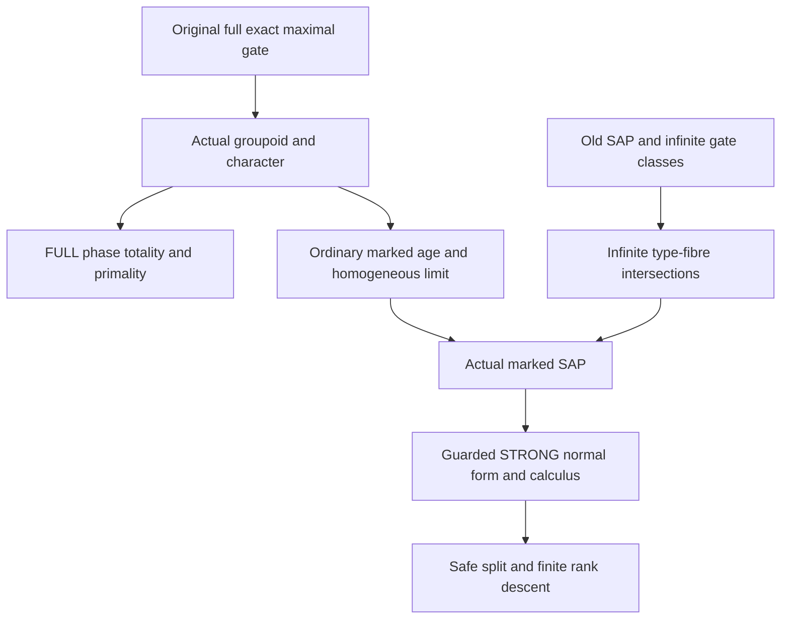

# Actual SAP-preserving character splits, RAW/STRONG boundaries and finite terminalisation

Generated from `module.json` by `tools/build_formalization_module.py`.

Source `490c3f36d85db5a0b3ced0598e6c431825254ec5`. **Human-expanded proof plan; no Lean code.**

Private B047: TEN selected remaining pair-level Ramsey I results and FIVE equations. Keep STRONG nonempty saturation separate from FULL represented closure/gates/primality. The actual maximal-character split has SAP by a direct infinite-type-fibre intersection argument using old SAP and infinite gate classes, applied to the homogeneous legal marked age; B044 AP is not relabelled SAP. Only afterwards identify lifted STRONG profiles and apply actual STRONG calculus. An extra old-SAP no-orthogonal-equivalences argument proves actual STRONG phase primality despite a possible RAW identity. The phase-sufficiency source is qualified to its standing ACTUAL character/FULL triangle context; a generic three-property abstract-sector theorem is not asserted. No later full-language theorem or new axiom/provider is used.

The human article remains unchanged. Additional proof details are in
[PROOF_NOTES.md](PROOF_NOTES.md); the cross-track policy is in
[the formalization guide](../README.md). Source hashes are checked before
the index is regenerated. Graph validation is not proof verification.

## Source premises

**A01: Actual current old homogeneous source.** M is a countable homogeneous complete finite relational binary structure on finitely many inhabited named transitive current sorts, with symmetric same-sort atoms and correctly typed converses. Every named atom is an actual full-Aut pair orbital. Its age has semantic HOM CCO. Full represented products include logical identities; no identity is a diversity edge.

**A02: Additional visible original SAP.** The actual finite old age has SAP. Therefore its pointwise stabilizer has infinite orbits off any finite real base, by existing injectivisation support. This is used to show all active gate classes and every nonempty old-type/gate-class intersection are infinite. It is not inferred for an arbitrary quotient.

**A03: Actual FULL old triangle age.** The old age is exactly the complete finite networks whose actual unary/pair types and triangles are allowed, with no additional higher obstruction. This standing source context is essential when identifying the marked age with the FULL lifted triangle class. Empty/singleton/pair cases retain actual admissibility.

**A04: Actual maximal exact character instance.** Choose an original finite-relative-index interval and its reachable parity layer, then a maximal full exact complement K_*>=Y. Reach its actual quotient-functional bridge groupoid. The character sends its nonidentity transported odd involutions to one. Active vertex labels are constant on their original K_s-classes and satisfy all rigid-arrow equations; inactive sorts have fixed bit zero. All canonical interpretations and markings are actual, not an arbitrary table sector.

**A05: Independent STRONG saturation context.** For the isolated saturation theorem take nonempty STRONG exact gate palettes and finite STRONG exact domains D_i with NONEMPTY common intersection, in the original actual SAP+HOM CCO STRONG calculus. Products use three distinct formal vertices, and no adjoined equality atom. This theorem is not substituted for the RAW saturation API.

**A06: Standard actual homogeneous relational age convention.** Finite marked objects are actual old-age complete induced diagrams with legal unary bits, and their homogeneous Fraisse limit is constructed only after ordinary AP/JEP/HP. No arbitrary global seed marking is assumed homogeneous. All functions in the hereditary SAP criterion specialization are absent, hence closure(A)=A. Finite-language realized one-point qf types over finite real A are definable, and old invariant equivalences are finite unions of named atoms plus equality.

## Imported theorem contracts

These are named provider obligations for the receiving Lean project,
not new axioms or claims of compiled imports.

| ID and source | Contract | Current provider status |
|---|---|---|
| I01: [`lem:typed-exact-products`](../../sections/typed_strong_domains.tex#L311) | Nonempty STRONG exact convolution and nonempty-meet distributivity in an actual visible-SAP source. Only the STRONG saturation theorem uses this API. | HUMAN_EXPANDED_NOT_LEAN |
| I02: [`lem:full-typed-exact-saturation`](../../sections/exact_foundations/01_full_raw_exact_helly.tex#L230) | FULL equality-inclusive original exact saturation over a finite meet whose result is NONEMPTY, including whole equivalence kernels. | HUMAN_EXPANDED_NOT_LEAN |
| I03: [`lem:ep-relative-K-closure`](../../sections/finite_relative_parity_exact_closure.tex#L91) | Original full exact K-bisaturated closure separation. For a quotient identity pull back to WHOLE original K, not old Id. | HUMAN_EXPANDED_NOT_LEAN |
| I04: [`thm:orbital-parity`](../../sections/v27/06_legacy_finite_covers.tex#L19) | Visible original SAP parity provides Y>Id with nonempty STRONG diversity sheet, while Y and O remain full represented positive-word relations. | HUMAN_EXPANDED_NOT_LEAN |
| I05: [`thm:foundational-maximal-parity-gate`](../../sections/finite_relative_parity_exact_closure.tex#L147) | Maximal original complement and t;t=K, [K join X:K]=2; every ORIGINAL full exact equivalence above K contains t. Quotient dominance uses inverse images only. | HUMAN_EXPANDED_NOT_LEAN |
| I06: [`thm:foundational-rigid-groupoid`](../../sections/rigid_exact_groupoid_foundations.tex#L27) | Actual finite connected groupoid, unique reached kernel per original sort, elementary abelian isotropy, functional quotient bridges and free quotient-point action. | HUMAN_EXPANDED_NOT_LEAN |
| I07: [`lem:foundational-rigid-gate-transport`](../../sections/rigid_exact_groupoid_foundations.tex#L84) | Original gate conjugation and dominant transported involution; no arbitrary mixed old-to-quotient exact descent. | HUMAN_EXPANDED_NOT_LEAN |
| I08: [`thm:foundational-rigid-character`](../../sections/rigid_exact_groupoid_foundations.tex#L298) | Actual character, free-action seeds, rigid/nonrigid old orbital classification, chi(t_s)=1 and reduct-surjective legal markings. | HUMAN_EXPANDED_NOT_LEAN |
| I09: [`lem:foundational-rigid-factor`](../../sections/rigid_exact_groupoid_foundations.tex#L264) | Nonempty represented exact inputs whose product lies inside one bridge factor through compatible bridges, constructing the intermediate reached kernel. | HUMAN_EXPANDED_NOT_LEAN |
| I10: [`lem:ep-ap-TP`](../../sections/ep_safe_ap_character_completion.tex#L101) | FULL represented totality and phase-mask primality in the SAME actual original maximal-character construction. It is not STRONG phase primality after deleting Id. | HUMAN_EXPANDED_NOT_LEAN |
| I11: [`thm:ep-ap-marked-completion`](../../sections/ep_safe_ap_character_completion.tex#L376) | Actual legal marked finite age with AP/JEP, finite realization, reasonableness, precompactness, homogeneous marked Fraisse limit, unchanged old reduct and HOM CCO. This does NOT provide SAP. | HUMAN_EXPANDED_NOT_LEAN |
| I12: [`lem:typed-injectivisation`](../../sections/typed_strong_domains.tex#L129) | In ANY actual homogeneous relational SAP source: old off-base point orbits are infinite, and positive STRONG profiles equal full represented word profiles restricted to distinct endpoints. Instantiate again at the new source only AFTER its SAP is independently proved. | HUMAN_EXPANDED_NOT_LEAN |
| I13: [`lem:unary-homogeneous-sap-criterion`](../../sections/finite_orbit_avoidance.tex#L107) | Infinite full-Aut orbits outside each finite closed base imply SAP of the whole hereditary age. Specialize to a homogeneous relational structure with NO functions, so all finite sets are closed. No hidden point-generated-only criterion substituted. | HUMAN_EXPANDED_NOT_LEAN |
| I14: [`lem:exact-character-rank-drop`](../../sections/ep_safe_ap_character_completion.tex#L542) | Conditional whole homogeneous unary-expanded binary age rank lemma: both children nonempty, one realized old diversity colour absent inside both; sum_a 3^k_a strictly decreases. | HUMAN_EXPANDED_NOT_LEAN |
| I15: [`lem:typed-set-pasch`](../../sections/typed_strong_domains.tex#L48) | Actual homogeneous SAP source STRONG associativity/Peircean laws, instantiated at the newly proved SAP source only after its construction. | HUMAN_EXPANDED_NOT_LEAN |
| I16: [`lem:typed-helly`](../../sections/typed_strong_domains.tex#L251) | Actual homogeneous SAP+HOM CCO source has positive STRONG profile 2-Helly; instantiate only after actual marked SAP and CCO are established. | HUMAN_EXPANDED_NOT_LEAN |

**I11 internal proof support:** C21 in `ap_character`. Use ONLY the proved strict ancestor C21 of selected completion C36: full represented path normal form in the SAME actual character instance. This is not a STRONG theorem, a new source export or an assumption of new SAP.

These are separately extracted proved support claims, not additional
numbered exports or consequences of the named theorem statement.

## Definitions

| ID | Definition | Exact meaning | Source |
|---|---|---|---|
| D01 | Two distinct product conventions | FULL RAW composition is actual represented composition including Id; STRONG multiplication uses distinct formal triangle vertices and diversity outputs. Even in SAP one must guard endpoint inequality before comparison. | [source](../../sections/v27/06_legacy_finite_covers.tex#L201) |
| D02 | Nonempty STRONG exact saturation | For strong palettes K_a^circ,K_b^circ put Sat(D)=K_a^circ*D*K_b^circ, with all three factors nonempty exact and the finite D-meet nonempty. | [source](../../sections/v27/06_legacy_finite_covers.tex#L201) |
| D03 | Whole represented closure base | A full exact same-sort relation containing identity has increasing positive powers stabilizing to an exact equivalence. A quotient identity is the whole original kernel K under inverse image. | [source](../../sections/v27/06_legacy_finite_covers.tex#L246) |
| D04 | Maximal original complement | Y<X is the realized parity layer, K_* is inclusion-maximal exact with Y<=K_* and K_* intersect X=Y, and t_*=K_*;O;K_*. | [source](../../sections/v27/06_legacy_finite_covers.tex#L307) |
| D05 | Actual active gate classes | K_s is the original reached full equivalence. Each active label lambda_s is constant on a whole K_s-class; rigid-arrow equations relate these quotient values. | [source](../../sections/v27/06_legacy_finite_covers.tex#L356) |
| D06 | Endpoint mask | At active endpoints allowed old atoms are correct-character rigid arrows plus every nonrigid atom; with an inactive endpoint the whole typed palette is allowed. Id is allowed only at the same sort with equal bits. | [source](../../sections/v27/06_legacy_finite_covers.tex#L356) |
| D07 | Old finite-base one-point fibre | For finite real A and x outside A, S=Aut(M/A).x is the definable realized complete one-point qf fibre, including inequalities to every point of A. | [source](../../sections/v27/06_legacy_finite_covers.tex#L486) |
| D08 | The actual legal marked age | Finite objects are actual old-age complete diagrams with locally legal marks, equivalently restrictions of some actual global orbit-seed marking. Its homogeneous marked source is the Fraisse limit, not an arbitrary seed marking. | [source](../../sections/v27/06_legacy_finite_covers.tex#L486) |
| D09 | Guarded lifted STRONG normal form | For a nonempty legal lifted diversity word w with old STRONG profile P_w, the new STRONG profile is P_w intersect the actual two-endpoint-bit mask. This is obtained by guarding the full normal form after SAP. | [source](../../sections/v27/06_legacy_finite_covers.tex#L486) |
| D10 | Whole-expanded orbital rank | k_a counts current full-Aut nonidentity same-sort pair orbitals. Whole-expanded homogeneity identifies each such orbital with an occurring old binary colour in a fixed child sort. | [source](../../sections/v27/06_legacy_finite_covers.tex#L575) |
| D11 | Terminal integer potential | Phi=sum_a 3^(k_a); each active parent is replaced by two nonempty children with at most k_a-1 old colours, giving strict decrease. | [source](../../sections/v27/06_legacy_finite_covers.tex#L575) |
| D12 | Actual-context sufficiency contract | The source sufficiency lemma is prepared in its standing actual maximal-character/FULL triangle setting. The bare trio reduct-surjective/T/EPP is not asserted to characterize an arbitrary abstract marked subclass. | [source](../../sections/v27/06_legacy_finite_covers.tex#L486) |

## Proof claims and direct dependencies

Every row has a human proof expansion. Each still needs an actual Lean
statement and proof. Logical old Id is separate from whole K and its diversity slice. A RAW profile may have extra Id; deleting it does not by itself transfer phase primality. Prove actual SAP independently, then use old/new injectivisation for STRONG normal form.

| ID and claim | Scope | Direct providers | Proof note |
|---|---|---|---|
| C01: Distribute the left STRONG gate over a nonempty meet | strong_saturation | A05, I01, D02 | N01 in [notes](PROOF_NOTES.md) |
| C02: Distribute the right STRONG gate over the resulting meet | strong_saturation | C01, I01 | N01 in [notes](PROOF_NOTES.md) |
| C03: STRONG saturation source export has no RAW identity | strong_saturation | C02, D01 | N01 in [notes](PROOF_NOTES.md) |
| C04: Own-identity represented closure separation | represented_closure | A01, I03, D03 | N02 in [notes](PROOF_NOTES.md) |
| C05: A quotient identity pulls back to the WHOLE kernel | represented_closure | I03, D03 | N02 in [notes](PROOF_NOTES.md) |
| C06: Visible original parity supplies a nontrivial even gate | gate | A01, A02, I04, D04 | N03 in [notes](PROOF_NOTES.md) |
| C07: Choose the actual maximal full exact complement | gate | A01, A04, C06, I05 | N03 in [notes](PROOF_NOTES.md) |
| C08: Reach the finite actual rigid bridge groupoid | gate | C07, I06 | N03 in [notes](PROOF_NOTES.md) |
| C09: Transport the dominant involution without mixed descent | gate | C07, C08, I07 | N03 in [notes](PROOF_NOTES.md) |
| C10: The character is additive and detects each odd involution | phase | C08, C09, I08 | N03 in [notes](PROOF_NOTES.md) |
| C11: Actual free-action seeds give global labels | phase | A04, C10, I08, D05 | N03 in [notes](PROOF_NOTES.md) |
| C12: Rigid and nonrigid atoms have exactly their stated phase freedoms | phase | C11, I08, D06 | N03 in [notes](PROOF_NOTES.md) |
| C13: Inactive sorts and logical identity keep their actual labels | phase | C12, D01, D06 | N03 in [notes](PROOF_NOTES.md) |
| C14: Represented rigid-product factorisation | phase | C08, I09 | N03 in [notes](PROOF_NOTES.md) |
| C15: FULL phase totality uses the actual maximal gate | full_primality | C09, C12, C14, I10 | N04 in [notes](PROOF_NOTES.md) |
| C16: Totality here is FULL, not yet a STRONG SAP argument | boundary | C13, C15 | N04 in [notes](PROOF_NOTES.md) |
| C17: FULL EPP is the contrapositive of the proved mask primality | full_primality | C12, I10 | N04 in [notes](PROOF_NOTES.md) |
| C18: The full primality proof uses RAW nonempty saturation | full_primality | C09, C17, I02, I10 | N04 in [notes](PROOF_NOTES.md) |
| C19: Translate a full bridge to WHOLE K and separate closures | full_primality | C05, C09, C18, I02, I03 | N04 in [notes](PROOF_NOTES.md) |
| C20: FULL EPP source scope and empty family | full_primality | C10, C12, C17 | N04 in [notes](PROOF_NOTES.md) |
| C21: RAW EPP is not automatically inherited by diversity slices | boundary | D01, C03, C18, C20 | N08 in [notes](PROOF_NOTES.md) |
| C22: Old SAP excludes real algebraicity outside finite bases | actual_SAP | A01, A02, I12, A06 | N05 in [notes](PROOF_NOTES.md) |
| C23: The source gate has infinite real classes | actual_SAP | C06, C07, C22 | N05 in [notes](PROOF_NOTES.md) |
| C24: No reached gate is original equality | actual_SAP | C08, C22, C23 | N05 in [notes](PROOF_NOTES.md) |
| C25: All reached gate classes are infinite | actual_SAP | C22, C24 | N05 in [notes](PROOF_NOTES.md) |
| C26: One-point old fibres over finite real bases are definable | actual_SAP | A01, A06, D07 | N05 in [notes](PROOF_NOTES.md) |
| C27: A type fibre meets its active gate class infinitely | actual_SAP | C22, C25, C26 | N05 in [notes](PROOF_NOTES.md) |
| C28: Infinitely many points retain the same expanded one-point type | actual_SAP | C11, C13, C22, C26, C27 | N05 in [notes](PROOF_NOTES.md) |
| C29: Construct the actual homogeneous marked source using AP only | actual_SAP | A01, A04, A06, C12, I11, D08 | N05 in [notes](PROOF_NOTES.md) |
| C30: Transport arbitrarily many same-type witnesses into H | actual_SAP | C28, C29, I11 | N05 in [notes](PROOF_NOTES.md) |
| C31: Every off-base H orbit is infinite | actual_SAP | C29, C30 | N05 in [notes](PROOF_NOTES.md) |
| C32: The actual marked relational age has SAP | actual_SAP | A06, C29, C31, I13 | N05 in [notes](PROOF_NOTES.md) |
| C33: The SAP proof is independent of lifted STRONG sufficiency | boundary | C22, C27, C29, C32 | N05 in [notes](PROOF_NOTES.md) |
| C34: Identify the marked age with its FULL lifted triangle class | lifted_strong | A03, C12, C29, I11 | N06 in [notes](PROOF_NOTES.md) |
| C35: The actual new full path product has the full normal form | lifted_strong | C12, C29, C34, I10, I11 | N06 in [notes](PROOF_NOTES.md) |
| C36: Guard both actual path products AFTER SAP | lifted_strong | A02, C32, C35, I12, D09 | N06 in [notes](PROOF_NOTES.md) |
| C37: All legal lifted STRONG forks have diversity outputs | lifted_strong | C29, C32 | N06 in [notes](PROOF_NOTES.md) |
| C38: STRONG associativity and Peirce are actual new-source laws | lifted_strong | C29, C32, C34, I15 | N06 in [notes](PROOF_NOTES.md) |
| C39: Lifted positive STRONG profiles are two-Helly | lifted_strong | C29, C32, I11, I16 | N06 in [notes](PROOF_NOTES.md) |
| C40: Actual-context phase sufficiency export | lifted_strong | C32, C34, C36, C37, C38, C39, D12, C59 | N06 in [notes](PROOF_NOTES.md) |
| C41: The split orients its actual parity layer | split | C06, C07, C10, C11 | N07 in [notes](PROOF_NOTES.md) |
| C42: Every active parent has both nonempty children | split | C09, C10, C11, C29 | N07 in [notes](PROOF_NOTES.md) |
| C43: The actual safe split preserves the structural source class | split | C29, C32, C34, C40, C41, C42, I11 | N07 in [notes](PROOF_NOTES.md) |
| C44: Whole expanded homogeneity identifies current pair orbitals | terminal | C29, C43, D10 | N07 in [notes](PROOF_NOTES.md) |
| C45: A realised phase-one colour is lost inside each active child | terminal | C10, C42, C44 | N07 in [notes](PROOF_NOTES.md) |
| C46: The conditional integer rank lemma is discharged | terminal | C42, C44, C45, I14, D11 | N07 in [notes](PROOF_NOTES.md) |
| C47: Reapply the same theorem at the CURRENT source | terminal | C06, C07, C43 | N07 in [notes](PROOF_NOTES.md) |
| C48: Finite descent rules out an infinite splitting sequence | terminal | C46, C47, D11 | N07 in [notes](PROOF_NOTES.md) |
| C49: A terminal source has no finite relative cover | terminal | C47, C48 | N07 in [notes](PROOF_NOTES.md) |
| C50: Finite unary composition preserves the original reduct and finite expansion | terminal | C43, C48 | N07 in [notes](PROOF_NOTES.md) |
| C51: Finite-cover elimination source export | terminal | C43, C47, C48, C49, C50 | N07 in [notes](PROOF_NOTES.md) |
| C52: Keep the represented and strong source qualifications explicit | boundary | C03, C05, C20, C21, C33, C40, C59 | N08 in [notes](PROOF_NOTES.md) |
| C53: Finite diagnostics cannot certify infinite gate intersections | boundary | C27, C32, C36, C51 | N08 in [notes](PROOF_NOTES.md) |
| C54: Empty bases and small diagrams are included | boundary | C25, C27, C28, C31, C34 | N08 in [notes](PROOF_NOTES.md) |
| C55: Old SAP forbids two nontrivial orthogonal real equivalences | full_primality | A01, A02, A06, C22 | N04B in [notes](PROOF_NOTES.md) |
| C56: Lift a finite STRONG word family to RAW before taking its meet | full_primality | A02, C20, I12 | N04B in [notes](PROOF_NOTES.md) |
| C57: A nonempty phase-one diversity meet cannot hide an extra RAW identity | full_primality | C11, C24, C55, C56, I03 | N04B in [notes](PROOF_NOTES.md) |
| C58: Every other phase case transfers full EPP safely | full_primality | C13, C20, C56, C57 | N04B in [notes](PROOF_NOTES.md) |
| C59: Actual STRONG phase-primality with the extra SAP bridge | full_primality | C08, C10, C25, C55, C56, C57, C58 | N04B in [notes](PROOF_NOTES.md) |

The precise quantified contracts are in `module.json`. Provider-before-consumer
order (including definitions and source premises):

`A01 → A02 → A03 → A04 → A05 → A06 → D01 → D02 → D03 → D04 → D05 → D06 → D07 → D08 → D09 → D10 → D11 → D12 → I01 → I02 → I03 → I04 → I05 → I06 → I07 → I08 → I09 → I10 → I11 → I12 → I13 → I14 → I15 → I16 → C01 → C04 → C05 → C06 → C22 → C26 → C02 → C07 → C55 → C03 → C08 → C23 → C09 → C14 → C24 → C10 → C25 → C11 → C27 → C12 → C41 → C13 → C15 → C17 → C29 → C16 → C18 → C20 → C28 → C34 → C42 → C19 → C21 → C30 → C35 → C56 → C31 → C57 → C32 → C54 → C58 → C33 → C36 → C37 → C38 → C39 → C59 → C40 → C43 → C52 → C44 → C47 → C45 → C46 → C48 → C49 → C50 → C51 → C53`

This order is one valid linearization; it does not require unrelated
branches to be proved sequentially. The full DAG is the `depends_on`
relation in `module.json`.

## Main proof branches

This is a coarse view of the claim DAG. Edges go from provider to consumer.

Ten selected results and five equations; the two final full-language/detour results remain outside this package.
The new actual SAP argument closes the RAW/STRONG boundary without assuming strong primality after deleting Id.
The source typed-EPP crossreference is corrected locally to the full RAW saturation provider.
No arbitrary global seed marking is assumed homogeneous; use the homogeneous legal marked age.
Phase sufficiency is qualified to its standing actual/full-triangle context, not a generic abstract marked subclass.
Actual STRONG EPP is proved with an additional original-SAP bridge: two nontrivial invariant equivalences cannot meet in Id, ruling out a hidden RAW identity in a phase-one strong meet.

## Article exports

| Existing source result | Sidecar proof claims |
|---|---|
| [`lem:exact-saturation-intersection`](../../sections/v27/06_legacy_finite_covers.tex#L200) | C03 |
| [`thm:closure-separation`](../../sections/v27/06_legacy_finite_covers.tex#L245) | C04, C05 |
| [`prop:rigid-bridge-groupoid`](../../sections/v27/06_legacy_finite_covers.tex#L306) | C08, C09 |
| [`prop:groupoid-phase`](../../sections/v27/06_legacy_finite_covers.tex#L355) | C10, C11, C12 |
| [`lem:rigid-product-factorisation`](../../sections/v27/06_legacy_finite_covers.tex#L396) | C14 |
| [`lem:phase-totality`](../../sections/v27/06_legacy_finite_covers.tex#L418) | C15, C16, C37 |
| [`thm:typed-epp`](../../sections/v27/06_legacy_finite_covers.tex#L445) | C20, C59 |
| [`lem:phase-primality-sufficiency`](../../sections/v27/06_legacy_finite_covers.tex#L485) | C36, C38, C39, C40 |
| [`thm:safe-exact-split`](../../sections/v27/06_legacy_finite_covers.tex#L548) | C41, C43 |
| [`thm:finite-cover-elimination`](../../sections/v27/06_legacy_finite_covers.tex#L574) | C51 |

Auxiliary source equations (not additional numbered results):

- [`eq:max-exact`](../../sections/v27/06_legacy_finite_covers.tex#L277): C07
- [`eq:groupoid-character`](../../sections/v27/06_legacy_finite_covers.tex#L352): C10
- [`eq:quotient-phase`](../../sections/v27/06_legacy_finite_covers.tex#L363): C11
- [`eq:epp-hyp`](../../sections/v27/06_legacy_finite_covers.tex#L451): C20, C59
- [`eq:lifted-profile-normal-form`](../../sections/v27/06_legacy_finite_covers.tex#L493): C36

Full result coverage is asserted only for `source_result_files`.
Selected additional results: lem:exact-saturation-intersection, thm:closure-separation, prop:rigid-bridge-groupoid, prop:groupoid-phase, lem:rigid-product-factorisation, lem:phase-totality, thm:typed-epp, lem:phase-primality-sufficiency, thm:safe-exact-split, thm:finite-cover-elimination.
Other results in their provider source files are not claimed covered.

## Internal implementation milestones

These tasks are proof milestones inside larger project assignments;
see the [peer-project allocation](../coordination/BOARD.md).

These are implementation tasks, not additional mathematical assumptions.

| Task | Earlier tasks | Acceptance |
|---|---|---|
| T01: Separate STRONG saturation and FULL closure geometry | — | Keep RAW and STRONG APIs distinct. Apply RAW C10, not STRONG saturation, to full represented EPP. Prove infinite active original K classes and infinite old-type intersections from original SAP, then actual marked SAP via the hereditary relational orbit criterion. Do not assume arbitrary global seed homogeneity. Only AFTER new SAP instantiate injectivisation/STRONG laws. Sufficiency export retains actual maximal-character/FULL triangle context; bare abstract three-property generalization is not accepted. Source frozen; no later full-language theorem or new axiom. |
| T02: Actual parity gate, groupoid, character and represented factorisation | — | Keep RAW and STRONG APIs distinct. Apply RAW C10, not STRONG saturation, to full represented EPP. Prove infinite active original K classes and infinite old-type intersections from original SAP, then actual marked SAP via the hereditary relational orbit criterion. Do not assume arbitrary global seed homogeneity. Only AFTER new SAP instantiate injectivisation/STRONG laws. Sufficiency export retains actual maximal-character/FULL triangle context; bare abstract three-property generalization is not accepted. Source frozen; no later full-language theorem or new axiom. |
| T03: FULL totality and correctly scoped phase primality | T02, T04, T01 | Keep RAW and STRONG APIs distinct. Apply RAW C10, not STRONG saturation, to full represented EPP. Prove infinite active original K classes and infinite old-type intersections from original SAP, then actual marked SAP via the hereditary relational orbit criterion. Do not assume arbitrary global seed homogeneity. Only AFTER new SAP instantiate injectivisation/STRONG laws. Sufficiency export retains actual maximal-character/FULL triangle context; bare abstract three-property generalization is not accepted. Source frozen; no later full-language theorem or new axiom. |
| T04: Independent actual SAP via infinite type/gate intersections | T02 | Keep RAW and STRONG APIs distinct. Apply RAW C10, not STRONG saturation, to full represented EPP. Prove infinite active original K classes and infinite old-type intersections from original SAP, then actual marked SAP via the hereditary relational orbit criterion. Do not assume arbitrary global seed homogeneity. Only AFTER new SAP instantiate injectivisation/STRONG laws. Sufficiency export retains actual maximal-character/FULL triangle context; bare abstract three-property generalization is not accepted. Source frozen; no later full-language theorem or new axiom. |
| T05: Guarded STRONG normal form and actual lifted algebra | T03, T04 | Keep RAW and STRONG APIs distinct. Apply RAW C10, not STRONG saturation, to full represented EPP. Prove infinite active original K classes and infinite old-type intersections from original SAP, then actual marked SAP via the hereditary relational orbit criterion. Do not assume arbitrary global seed homogeneity. Only AFTER new SAP instantiate injectivisation/STRONG laws. Sufficiency export retains actual maximal-character/FULL triangle context; bare abstract three-property generalization is not accepted. Source frozen; no later full-language theorem or new axiom. |
| T06: Actual safe split and genuine nonempty children | T05 | Keep RAW and STRONG APIs distinct. Apply RAW C10, not STRONG saturation, to full represented EPP. Prove infinite active original K classes and infinite old-type intersections from original SAP, then actual marked SAP via the hereditary relational orbit criterion. Do not assume arbitrary global seed homogeneity. Only AFTER new SAP instantiate injectivisation/STRONG laws. Sufficiency export retains actual maximal-character/FULL triangle context; bare abstract three-property generalization is not accepted. Source frozen; no later full-language theorem or new axiom. |
| T07: Whole-expanded orbital rank and finite iteration | T06 | Keep RAW and STRONG APIs distinct. Apply RAW C10, not STRONG saturation, to full represented EPP. Prove infinite active original K classes and infinite old-type intersections from original SAP, then actual marked SAP via the hereditary relational orbit criterion. Do not assume arbitrary global seed homogeneity. Only AFTER new SAP instantiate injectivisation/STRONG laws. Sufficiency export retains actual maximal-character/FULL triangle context; bare abstract three-property generalization is not accepted. Source frozen; no later full-language theorem or new axiom. |
| T08: Source reference/context qualifications and empty/finite limits | T01, T02, T03, T04, T05, T06, T07 | Keep RAW and STRONG APIs distinct. Apply RAW C10, not STRONG saturation, to full represented EPP. Prove infinite active original K classes and infinite old-type intersections from original SAP, then actual marked SAP via the hereditary relational orbit criterion. Do not assume arbitrary global seed homogeneity. Only AFTER new SAP instantiate injectivisation/STRONG laws. Sufficiency export retains actual maximal-character/FULL triangle context; bare abstract three-property generalization is not accepted. Source frozen; no later full-language theorem or new axiom. |

## Finite controls

- **K01.** Actual finite-window RAW versus STRONG multiplication, saturation and identity cells; complete labelled pair/triangle and word support checks.
- **K02.** Finite marked clone amalgams, same-type/gate-class witnesses and rank decrease; no infinite or general SAP/CCO certificate.

Run `python tools/check_pair_safe_split_controls.py` from the manuscript directory.
The controls do not prove CCO or the general theorems.

## Return to the human articles

No required mathematical repair was found in this scoped pass. These
optional wording clarifications remain queued for a human article pass:

- **F01** ([source](../../sections/v27/06_legacy_finite_covers.tex#L457)): The typed-EPP argument saturates FULL represented profiles and uses a whole quotient identity; its cited lemma now explicitly states a STRONG diversity theorem. Deleting Id is not a proof that full EPP transfers to STRONG profiles. Use the FULL RAW nonempty saturation theorem lem:full-typed-exact-saturation in the full represented EPP proof. Keep the STRONG saturation theorem separate, and do not delete Id to infer strong EPP. Insert C55-C59: under original SAP, nontrivial invariant equivalences cannot meet in Id; relative-Id closure separation excludes the extra-diagonal phase-one meet and justifies the STRONG transfer.
- **F02** ([source](../../sections/v27/06_legacy_finite_covers.tex#L487)): The three displayed sector properties alone do not state the standing ACTUAL maximal-character/FULL triangle context. The actual source split has SAP by a direct old-SAP infinite-type/gate-class argument; only then should lifted STRONG normal form and calculus be read out. A concrete generic-sector counterexample is an infinite pure old set with a unary predicate P selecting exactly THREE points. The unary expansion is homogeneous, its age is reduct-surjective and all typed three-vertex forks are realizable; one-colour profile/EPP laws can be taken vacuous. Yet the age omits the four-P clique and fails SAP over a two-P base. Thus FULL/actual-character context is mathematically essential. State actual character/FULL old triangle context explicitly. Insert the infinite S intersect K[x] SAP proof, construct the homogeneous legal marked source, and apply old/new SAP injectivisation afterwards. A generic abstract sector criterion requires its own full-table proof and is not asserted here.

The machine ledger records caller effects and affected claims. The source
review used two independent model review passes and parent synthesis;
it is not independent human or formal certification.
