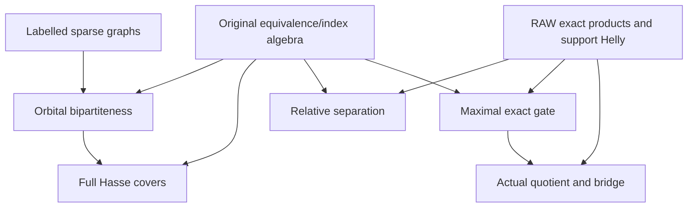

# Sparse graphs, original parity/Hasse and exact gate separation

Generated from `module.json` by `tools/build_formalization_module.py`.

Source `490c3f36d85db5a0b3ced0598e6c431825254ec5`. **Human-expanded proof plan; no Lean code.**

Preparation for OTHER Lean projects. Seven source results: the full labelled sparse-graph proof, original SAP-free finite Hasse indices, independent relative exact separation and maximal exact gates. No Lean code.

The human article remains unchanged. Additional proof details are in
[PROOF_NOTES.md](PROOF_NOTES.md); the cross-track policy is in
[the formalization guide](../README.md). Source hashes are checked before
the index is regenerated. Graph validation is not proof verification.

## Source premises

**A01: Actual original source.** One inhabited transitive homogeneous complete finite symmetric binary source, with actual represented orbitals and semantic homomorphic CCO. No SAP, primitivity, NR2 or countability is used. Subclaims state when only elementary orbital algebra suffices.

**A02: Finite combinatorial foundation.** Ordinary classical finite graph/probability reasoning, real exp/log inequalities and Archimedean integer choice. The lower-tail bound and sparse graph theorem are proved here, not imported as Erdős or Chernoff axioms.

## Imported theorem contracts

These are named provider obligations for the receiving Lean project,
not new axioms or claims of compiled imports.

| ID and source | Contract | Current provider status |
|---|---|---|
| I01: [`lem:exact-product`](../../sections/exact_foundations/01_full_raw_exact_helly.tex#L284) | Nonempty original equality-inclusive exact relations are product-closed and 2-Helly. In particular three pairwise-intersecting exact supports intersect. Heterogeneous ball Helly is not needed by this module. | HUMAN_EXPANDED_NOT_LEAN |

## Definitions

| ID | Definition | Exact meaning | Source |
|---|---|---|---|
| D01 | Finite independent edge labels | For positive q,r,g and n>c=128rq log(q+1), independent unordered pairs carry 0 with probability 1-c/n and each positive label with probability c/(nr). | [source](../../sections/sparse_labelled_graphs.tex#L20) |
| D02 | Robust colouring-label counts | X(kappa,h) counts monochromatic pairs with the label h of their common vertex colour; mu is its expectation. | [source](../../sections/sparse_labelled_graphs.tex#L24) |
| D03 | Original symmetric orbital source | One inhabited original transitive homogeneous finite complete symmetric binary source; finitely many actual pair orbitals including logical Id. The only direct semantic CCO application in this module is orbital bipartiteness; the separately imported RAW exact calculus has its own CCO proof. No SAP or countability is used. | [source](../../sections/finite_relative_parity_exact_closure.tex#L8) |
| D04 | Full invariant lattice and relative index | All actual invariant equivalences, ordered by inclusion. [F:E] counts E-classes in any F-class, uniformly by transitivity. Endpoints need not be exact. | [source](../../sections/finite_relative_parity_exact_closure.tex#L20) |
| D05 | RAW walk parity | Y_c, O_c are the even- and odd-walk relations of an old diversity atom; X_c is connectivity. Length zero is allowed in Y, with a later positive even-word representation. | [source](../../sections/finite_relative_parity_exact_closure.tex#L22) |
| D06 | Original full exact relation | A nonempty relation expressible as a finite intersection of actual atomic word profiles; empty restrictions give Top, empty word Id. Nonempty refers to the evaluated result. ExEq is only the exact part of the full lattice. | [source](../../sections/finite_relative_parity_exact_closure.tex#L13) |
| D07 | K-relative powers and closure | For exact equivalence K and symmetric exact K-bisaturated A containing K, A^[0]=K and A^[n]=A^n for n>0; stable power is <A>. | [source](../../sections/finite_relative_parity_exact_closure.tex#L105) |
| D08 | Two-sheet source data | Invariant Y<X of relative index two; Y and O=X\Y exact, but X need not be exact. | [source](../../sections/finite_relative_parity_exact_closure.tex#L149) |
| D09 | Maximal exact gate candidate | Inclusion-maximal exact equivalence K with Y<=K and K meet X=Y; F=K join X and t=K;O;K. | [source](../../sections/finite_relative_parity_exact_closure.tex#L154) |
| D10 | Actual quotient and bridge | Let K be an actual full exact invariant equivalence. Use the original action on M/K with all actual quotient orbitals. A bridge R at K is nonempty, invariant and full exact and satisfies K;R=R and R;R^converse=K; quotient-object identity is K. | [source](../../sections/rigid_exact_groupoid_foundations.tex#L15) |

## Proof claims and direct dependencies

Every row has a human proof expansion. Each still needs an actual Lean
statement and proof. Hasse has no exact-Helly import; closure separation and maximal gates are independent consumers of RAW exact calculus.

| ID and claim | Scope | Direct providers | Proof note |
|---|---|---|---|
| C01: Colouring counts and mean | finite_graphs | D02 | N01 in [notes](PROOF_NOTES.md) |
| C02: Elementary exponential lower tail | finite_graphs | C01 | N02 in [notes](PROOF_NOTES.md) |
| C03: Finite union and short cycles | finite_graphs | C02 | N02 in [notes](PROOF_NOTES.md) |
| C04: Deletion and labelled sparsity | finite_graphs | C03 | N03 in [notes](PROOF_NOTES.md) |
| C05: High chromatic girth and connected extraction | finite_graphs | C04 | N03 in [notes](PROOF_NOTES.md) |
| C06: Original elementary RAW algebra | original_raw | D04 | N04 in [notes](PROOF_NOTES.md) |
| C07: Transposition with class bijection | original_raw | C06 | N04 in [notes](PROOF_NOTES.md) |
| C08: Index-two covers and finite chain indices | original_raw | C06, C07 | N04 in [notes](PROOF_NOTES.md) |
| C09: Cycle homomorphism templates | original_cco | D03 | N05 in [notes](PROOF_NOTES.md) |
| C10: Finite-relative orbital bipartiteness | original_cco | C05, C09, D04 | N05 in [notes](PROOF_NOTES.md) |
| C11: Positive even and odd profile stabilization | original_cco | C06, C10, D05 | N05 in [notes](PROOF_NOTES.md) |
| C12: Index-two connectivity seed | original_cco | C11, C08 | N05 in [notes](PROOF_NOTES.md) |
| C13: Full finite-index Hasse cover induction | original_cco | C12, C07, C08 | N06 in [notes](PROOF_NOTES.md) |
| C14: All finite relative indices are powers of two | original_cco | C13, C08 | N06 in [notes](PROOF_NOTES.md) |
| C15: Stable K-relative exact closures | exact_supports | D07, C06, I01 | N07 in [notes](PROOF_NOTES.md) |
| C16: Least positive exponents and atom | exact_supports | C15 | N07 in [notes](PROOF_NOTES.md) |
| C17: Minimality exclusion | exact_supports | C16, C06 | N07 in [notes](PROOF_NOTES.md) |
| C18: Outer-saturated three-domain obstruction | exact_supports | C17, I01 | N08 in [notes](PROOF_NOTES.md) |
| C19: Relative closure separation | exact_supports | C18, I01 | N08 in [notes](PROOF_NOTES.md) |
| C20: Identity separation | exact_supports | C19 | N08 in [notes](PROOF_NOTES.md) |
| C21: Two-sheet complement geometry | exact_gate | D08, C07, C08 | N09 in [notes](PROOF_NOTES.md) |
| C22: Finite maximal exact candidate | exact_gate | D09, C06 | N09 in [notes](PROOF_NOTES.md) |
| C23: Exact gate and quotient involution | exact_gate | C21, C22, I01 | N09 in [notes](PROOF_NOTES.md) |
| C24: Original exact dominance | exact_gate | C22, C23 | N09 in [notes](PROOF_NOTES.md) |
| C25: Actual quotient exact pullback | quotient_gate | D10, C06, I01 | N10 in [notes](PROOF_NOTES.md) |
| C26: Quotient dominance and nonidentity bridge | quotient_gate | C23, C24, C25 | N10 in [notes](PROOF_NOTES.md) |

The precise quantified contracts are in `module.json`. Provider-before-consumer
order (including definitions and source premises):

`A01 → A02 → I01 → D01 → D03 → C09 → D02 → D04 → D05 → D06 → C01 → C06 → D07 → D08 → D10 → C02 → C07 → C15 → C25 → D09 → C03 → C08 → C16 → C22 → C04 → C17 → C21 → C05 → C18 → C23 → C10 → C19 → C24 → C11 → C20 → C26 → C12 → C13 → C14`

This order is one valid linearization; it does not require unrelated
branches to be proved sequentially. The full DAG is the `depends_on`
relation in `module.json`.

## Main proof branches

This is a coarse view of the claim DAG. Edges go from provider to consumer.

Hasse has no exact-Helly input. Relative separation is not an input to maximal gates.
The rigid-character theorem consumes the bridge; it is not a provider.

## Article exports

| Existing source result | Sidecar proof claims |
|---|---|
| [`lem:sparse-labelled-graph`](../../sections/sparse_labelled_graphs.tex#L7) | C01, C02, C03, C04 |
| [`cor:high-girth-high-chromatic`](../../sections/sparse_labelled_graphs.tex#L68) | C05 |
| [`lem:ep-ap-orbital-parity`](../../sections/finite_relative_parity_exact_closure.tex#L18) | C09, C10, C11, C12 |
| [`thm:full-relative-Hasse`](../../sections/finite_relative_parity_exact_closure.tex#L59) | C13, C14 |
| [`lem:ep-relative-K-closure`](../../sections/finite_relative_parity_exact_closure.tex#L91) | C15, C16, C17, C18, C19 |
| [`cor:foundations-identity-separation`](../../sections/finite_relative_parity_exact_closure.tex#L139) | C20 |
| [`thm:foundational-maximal-parity-gate`](../../sections/finite_relative_parity_exact_closure.tex#L147) | C21, C22, C23, C24, C25, C26 |

## Internal implementation milestones

These tasks are proof milestones inside larger project assignments;
see the [peer-project allocation](../coordination/BOARD.md).

These are implementation tasks, not additional mathematical assumptions.

| Task | Earlier tasks | Acceptance |
|---|---|---|
| T01: Robust labelled sparse graphs | — | Prove the finite probability construction, explicit sufficient n bounds, bounded deletion and the connected one-label graph provider. |
| T02: Original equivalence/index geometry | — | Prove original commutation, full-lattice transposition, the actual quotient-class bijection and finite relative index multiplication. |
| T03: Orbital parity and full Hasse | T01, T02 | Prove bipartiteness using homomorphic CCO, positive parity profiles and cover-height induction in the full invariant lattice. |
| T04: Relative exact separation | T02 | Use RAW exact products/three-set Helly; retain K as zeroth power and outer-factor saturation. |
| T05: Original maximal exact gate | T02 | Prove gate equations and dominance for all original exact Z>K, without exactness of X or separation/Hasse imports. |
| T06: Quotient/bridge consumer | T02, T05 | Prove actual quotient word pullback and dominant quotient involution; no general exact descent or rigid-character input. |

## Finite controls

- **R01.** F2^3 full invariant subspace lattice: all finite relative indices, covers, class-bijection transpositions and a nondistributive M3 interval.
- **R02.** Triangle-free four-chromatic Mycielski C5 graph defeats finite K3 while every cycle maps to K3; missing CCO must not pass unnoticed.
- **R03.** Actual F2² translation supports show closure separation fails without exactness of the two supports A,B.
- **R04.** Two three-point sheets: nontrivial exact K, t²=K, three real successors per point, but a two-point quotient involution. This is an algebra control, not a CCO assertion.
- **R05.** Explicit sparse-graph n inequalities at q=r=1 and further small parameter values; even folds and odd-cycle backtrack lengths.

Run `python tools/check_parity_hasse_controls.py` from the manuscript directory.
The controls do not prove CCO or the general theorems.

## Return to the human articles

No required mathematical repair was found in this scoped pass. These
optional wording clarifications remain queued for a human article pass:

- **F01** ([source](../../sections/finite_relative_parity_exact_closure.tex#L33)): Connectedness is recovered by taking a high-chromatic component of the internal one-label sparse graph provider. Cite cor:high-girth-high-chromatic and optionally state connected-component extraction.
- **F02** ([source](../../sections/finite_relative_parity_exact_closure.tex#L75)): Numerical relative index preservation uses the actual class bijection, not modularity alone. Optionally mention the quotient-class bijection when stating the transposition.
- **F03** ([source](../../sections/finite_relative_parity_exact_closure.tex#L198)): The proof wording refers to t as a graph; the theorem correctly states that t/K is the graph. On original real points t can be nonfunctional. Write its quotient is a fixed-point-free involution graph.
- **F04** ([source](../../sections/finite_relative_parity_exact_closure.tex#L105)): Relative powers at exponent zero must remain K in the m=1 or n=1 cases. No necessary article edit; keep expanded boundary cases only in proof notes.

The machine ledger records caller effects and affected claims. The source
review used two independent model review passes and parent synthesis;
it is not independent human or formal certification.
