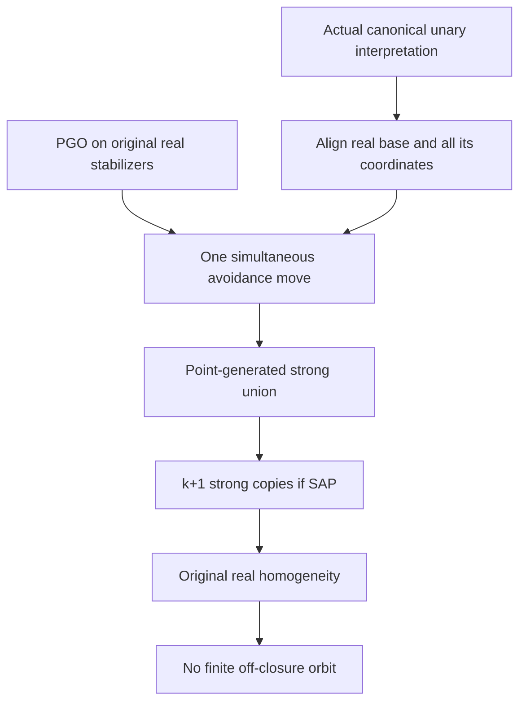

# Point-generated canonical unary SAP and off-closure coordinate orbits

Generated from `module.json` by `tools/build_formalization_module.py`.

Source `490c3f36d85db5a0b3ced0598e6c431825254ec5`. **Human-expanded proof plan; no Lean code.**

Private B043: ONE selected Foundations I result and its PGO equation, six definitions, 26 human claims and four tasks. The category consists of finite COMPLETE INDUCED POINT-GENERATED objects over full point-generated bases in an ACTUAL canonical unary interpreted expansion of the homogeneous real source. It is not the hereditary category allowing orphan hidden bases. Old real homogeneity and equivariance replace any assumption that the whole hidden structure is homogeneous. No CCO, symmetry, exact multiplication, countability or new external published provider is required.

The human article remains unchanged. Additional proof details are in
[PROOF_NOTES.md](PROOF_NOTES.md); the cross-track policy is in
[the formalization guide](../README.md). Source hashes are checked before
the index is regenerated. Graph validation is not proof verification.

## Source premises

**A01: Actual homogeneous real source.** M is a homogeneous complete structure on its ORIGINAL named real sorts; homogeneity means every finite induced original partial isomorphism extends to FULL Aut(M). The interpreted expansion retains these real sorts with their full original induced structure and sort-preserving embeddings. No cardinality/countability, CCO, symmetry or exact-domain premise is assumed.

**A02: Actual canonical unary interpretation.** Mhat is an ACTUAL canonical equivariant interpreted expansion of M. Every g in Aut(M) induces an automorphism of Mhat which commutes with the named typed unary coordinate maps. All hidden relations are canonical interpretations in M and embeddings of the actual induced objects preserve and reflect them. Every expanded vertex is a named well-sorted unary-term value of some real point, with identity terms retaining real generators.

**A03: Finite full closures without nullary generators.** For every finite real D, Dhat is its FULL closure under all named typed unary maps and finite compositions, INCLUDING identity terms, and is finite. There are no additional nullary generators or maps with two or more inputs. Relation symbols do not create generated vertices.

**A04: Actual induced point-generated category.** Objects are finite COMPLETE INDUCED substructures of Mhat generated by finite real sets, or induced-isomorphic copies thereof; arrows are sort-preserving induced embeddings preserving all named maps and the complete real reduct. Every target therefore embeds into actual Mhat by definition. Bases in SAP are FULL point-generated objects, including empty. No SAP over arbitrary orphan closed bases is asserted.

## Imported theorem contracts

These are named provider obligations for the receiving Lean project,
not new axioms or claims of compiled imports.

| ID and source | Contract | Current provider status |
|---|---|---|
| I01: [`lem:finite-action-avoidance`](../../sections/finite_orbit_avoidance.tex#L6) | For ANY group action, finite moving set S with every orbit infinite, and finite forbidden Z, there is ONE g sending ALL S outside Z. Reuse ONLY the elementary coset-cover proof; empty S/Z and nonfaithful actions are allowed. No topology, CCO, real closure, owner geometry or EPPA premise is imported. | HUMAN_EXPANDED_NOT_LEAN |

**I01 internal proof support:** C01, C02 in `acl_owner_geometry`. C01 proves the abstract virtual-containment preorder and C02 proves the finite coset-cover lemma; they are strict proved ancestors of C03, which converts forbidden action incidences into transporter cosets and yields simultaneous avoidance. Extract their abstract group/action hypotheses only, never CCO/owner branches.

These are separately extracted proved support claims, not additional
numbered exports or consequences of the named theorem statement.

## Definitions

| ID | Definition | Exact meaning | Source |
|---|---|---|---|
| D01 | Full point-generated unary closure | Dhat=union over x in D of all well-sorted named unary-term values of x, including x itself. With no nullary generators, emptyhat is empty and (P union Q)hat=Phat union Qhat. | [source](../../sections/finite_orbit_avoidance.tex#L34) |
| D02 | Induced real generator map | An induced embedding of a point-generated object restricts to an induced embedding of its real generators. Its value on each tau(x) is forced to be tau(image(x)). This determines its entire map and permits a real homogeneity alignment to align every base coordinate. | [source](../../sections/finite_orbit_avoidance.tex#L34) |
| D03 | Original real-base action | G_D=FULL Aut(M/D) acts on the actual disjoint expanded carrier via the canonical interpretation. For every u its orbit uses this SAME action; it is not silently replaced by Aut(Mhat/Dhat) or an unrelated subgroup. | [source](../../sections/finite_orbit_avoidance.tex#L34) |
| D04 | PGO condition | For every finite REAL D and every expanded u outside Dhat, the actual G_D orbit of u is infinite. Term values in Dhat are fixed. PGO is the conditional antecedent in the forward implication, not assumed when proving it from SAP. | [source](../../sections/finite_orbit_avoidance.tex#L34) |
| D05 | Point-generated strong amalgam | For any induced span Dhat to P1hat,P2hat, a point-generated target and induced leg embeddings form a strong amalgam when their images meet EXACTLY in the displayed base image. Relations between opposite legs are induced from an actual host; no free relational amalgam is requested. | [source](../../sections/finite_orbit_avoidance.tex#L34) |
| D06 | Repeated strong copies over one base | Iterate binary point-generated SAP to produce n induced copies of a finite point-generated P over ONE fixed full Dhat in a finite point-generated target, with every pair of copies intersecting only in the common base. Later embeddings preserve all earlier distinctness. | [source](../../sections/finite_orbit_avoidance.tex#L34) |

## Proof claims and direct dependencies

Every row has a human proof expansion. Each still needs an actual Lean
Keep the real source and actual interpreted expansion, full induced embeddings, one-source unary term values including identities, and full point-generated bases visible throughout. Separate this category from arbitrary closed hidden bases.

| ID and claim | Scope | Direct providers | Proof note |
|---|---|---|---|
| C01: Unary generation commutes with unions | actual_unary | A03, D01 | N01 in [notes](PROOF_NOTES.md) |
| C02: Identity terms and the empty closure | actual_unary | A02, A03, D01 | N01 in [notes](PROOF_NOTES.md) |
| C03: The real pointwise stabilizer fixes its entire full closure | actual_unary | A02, D01, D03 | N01 in [notes](PROOF_NOTES.md) |
| C04: Real source homogeneity aligns the full interpreted base | point_generated_category | A01, A02, A04, D02 | N01 in [notes](PROOF_NOTES.md) |
| C05: After alignment the common base is a literal point-generated closure | point_generated_category | C04, D05 | N02 in [notes](PROOF_NOTES.md) |
| C06: Every off-base point of the moving factor has an infinite orbit under PGO | forward_avoidance | A03, D04, C05 | N02 in [notes](PROOF_NOTES.md) |
| C07: One common stabilizer automorphism separates all extra coordinates | forward_avoidance | I01, C06, D03 | N02 in [notes](PROOF_NOTES.md) |
| C08: The factor intersection is exactly the common full base | forward_avoidance | C03, C05, C07 | N02 in [notes](PROOF_NOTES.md) |
| C09: The induced union is again a finite point-generated object | forward_avoidance | A02, A03, A04, C01, C07 | N02 in [notes](PROOF_NOTES.md) |
| C10: Both inclusions into the induced union are induced embeddings | forward_avoidance | A02, A04, C09 | N02 in [notes](PROOF_NOTES.md) |
| C11: PGO implies point-generated SAP | forward_avoidance | C02, C08, C09, C10, D05 | N02 in [notes](PROOF_NOTES.md) |
| C12: A finite off-closure orbit has positive finite size | reverse_copies | D01, D03, D05 | N03 in [notes](PROOF_NOTES.md) |
| C13: One real source packages the offending coordinate into a finite object | reverse_copies | A03, A04, C02, C12 | N03 in [notes](PROOF_NOTES.md) |
| C14: Iterated SAP makes arbitrarily many copies over the SAME base | reverse_copies | C13, D05, D06 | N03 in [notes](PROOF_NOTES.md) |
| C15: The k+1 copied offending coordinates are pairwise distinct | reverse_copies | C12, C14 | N03 in [notes](PROOF_NOTES.md) |
| C16: The finite target embeds in the actual interpreted structure | reverse_copies | A04, C14, C15 | N03 in [notes](PROOF_NOTES.md) |
| C17: Original homogeneity aligns the embedded real base with literal D | reverse_copies | A01, A02, C04, C16 | N03 in [notes](PROOF_NOTES.md) |
| C18: Each copied real generator has the same complete real type over D | reverse_copies | A01, A04, C13, C17 | N03 in [notes](PROOF_NOTES.md) |
| C19: Original homogeneity supplies original stabilizer automorphisms | reverse_copies | A01, D03, C18 | N03 in [notes](PROOF_NOTES.md) |
| C20: All copied coordinates belong to the same original orbit | reverse_copies | A02, C13, C15, C19 | N03 in [notes](PROOF_NOTES.md) |
| C21: Point-generated SAP implies PGO | reverse_copies | C12, C20 | N03 in [notes](PROOF_NOTES.md) |
| C22: Selected source theorem and PGO equation | point_generated_category | C11, C21 | N04 in [notes](PROOF_NOTES.md) |
| C23: A named bijection with unnamed inverse separates the two categories | boundary | C22 | N04 in [notes](PROOF_NOTES.md) |
| C24: The unary requirement excludes mixed-generator values | boundary | C01, C09 | N04 in [notes](PROOF_NOTES.md) |
| C25: No cardinality or unrelated structural hypothesis is imported | boundary | I01, C11, C21 | N04 in [notes](PROOF_NOTES.md) |
| C26: Nullary generators and noncanonical expansions require separate contracts | boundary | A01, A02, A03, C02, C04, C19 | N04 in [notes](PROOF_NOTES.md) |

The precise quantified contracts are in `module.json`. Provider-before-consumer
order (including definitions and source premises):

`A01 → A02 → A03 → A04 → I01 → D01 → D03 → D05 → C01 → C02 → C03 → C12 → D02 → D04 → D06 → C04 → C13 → C05 → C14 → C06 → C15 → C07 → C16 → C08 → C09 → C17 → C10 → C18 → C24 → C11 → C19 → C20 → C26 → C21 → C22 → C25 → C23`

This order is one valid linearization; it does not require unrelated
branches to be proved sequentially. The full DAG is the `depends_on`
relation in `module.json`.

## Main proof branches

This is a coarse view of the claim DAG. Edges go from provider to consumer.

Only the point-generated full-base category is in scope; the named-bijection example separates hereditary SAP.
Forward uses finite avoidance; reverse uses no avoidance or PGO hypothesis.
Identity terms retain real generators and original induced homogeneity supplies all automorphisms.

## Article exports

| Existing source result | Sidecar proof claims |
|---|---|
| [`lem:typed-point-generated-sap-criterion`](../../sections/finite_orbit_avoidance.tex#L33) | C11, C21, C22 |

Auxiliary source equations (not additional numbered results):

- [`eq:typed-point-generated-sap-criterion`](../../sections/finite_orbit_avoidance.tex#L51): C22

Full result coverage is asserted only for `source_result_files`.
Selected additional results: lem:typed-point-generated-sap-criterion.
Other results in their provider source files are not claimed covered.

## Internal implementation milestones

These tasks are proof milestones inside larger project assignments;
see the [peer-project allocation](../coordination/BOARD.md).

These are implementation tasks, not additional mathematical assumptions.

| Task | Earlier tasks | Acceptance |
|---|---|---|
| T01: Actual unary interpretation and induced base alignment | — | Retain actual canonical unary expansion and induced point-generated category, original FULL Aut(M/D) and full bases. Prove forward via ONE avoidance move and unary induced union, reverse via k+1 SAP copies over ONE base and original real homogeneity. Do not import PGO into the reverse or infer hereditary orphan-base SAP. Controls are bounded diagnostics, not a Lean/infinite-orbit certificate. |
| T02: One stabilizer move constructs point-generated strong amalgams | T01 | Retain actual canonical unary expansion and induced point-generated category, original FULL Aut(M/D) and full bases. Prove forward via ONE avoidance move and unary induced union, reverse via k+1 SAP copies over ONE base and original real homogeneity. Do not import PGO into the reverse or infer hereditary orphan-base SAP. Controls are bounded diagnostics, not a Lean/infinite-orbit certificate. |
| T03: Finite orbit contradiction from repeated strong copies | T01 | Retain actual canonical unary expansion and induced point-generated category, original FULL Aut(M/D) and full bases. Prove forward via ONE avoidance move and unary induced union, reverse via k+1 SAP copies over ONE base and original real homogeneity. Do not import PGO into the reverse or infer hereditary orphan-base SAP. Controls are bounded diagnostics, not a Lean/infinite-orbit certificate. |
| T04: Assemble criterion and category boundaries | T01, T02, T03 | Retain actual canonical unary expansion and induced point-generated category, original FULL Aut(M/D) and full bases. Prove forward via ONE avoidance move and unary induced union, reverse via k+1 SAP copies over ONE base and original real homogeneity. Do not import PGO into the reverse or infer hereditary orphan-base SAP. Controls are bounded diagnostics, not a Lean/infinite-orbit certificate. |

## Finite controls

- **K01.** Bounded named-bijection closures, all small point-generated base spans, induced injections, exact intersections and hereditary orphan-base obstruction.
- **K02.** Bounded repeated-copy distinctness and pigeonhole orbit counts, typed unary union/equivariance and a mixed binary generator boundary; no infinite orbit or general SAP theorem certified.

Run `python tools/check_point_generated_sap_controls.py` from the manuscript directory.
The controls do not prove CCO or the general theorems.

## Return to the human articles

No required mathematical repair was found in this scoped pass. These
optional wording clarifications remain queued for a human article pass:

- **F01** ([source](../../sections/finite_orbit_avoidance.tex#L36)): The real source sorts and their complete original induced structure are retained in the interpreted expansion; identity terms retain real generators. Thus an induced base embedding restricts to an original real partial isomorphism and real homogeneity aligns the entire unary-generated base. Optionally state the retained-real-reduct and identity-term conventions explicitly near the definition of the actual canonical point-generated category; add the named-bijection/unnamed-inverse orphan example to explain why the hereditary assertion is separate.

The machine ledger records caller effects and affected claims. The source
review used two independent model review passes and parent synthesis;
it is not independent human or formal certification.
