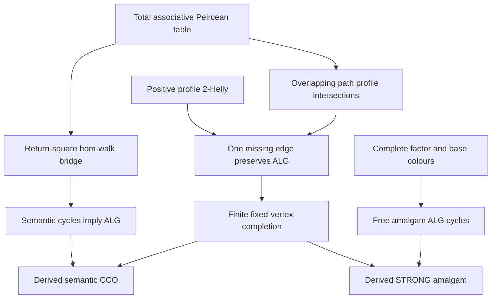

# Positive profile Helly to fixed-vertex completion and strong amalgamation

Generated from `module.json` by `tools/build_formalization_module.py`.

Source `490c3f36d85db5a0b3ced0598e6c431825254ec5`. **Human-expanded proof plan; no Lean code.**

Private B033: ONE Foundations III converse result. From an abstract finite typed nonempty-total associative Peircean triangle table and positive-profile 2-Helly, build a completion on the SAME finite formal vertex set, first under an ALGEBRAIC simple-cycle invariant. A direct guarded hom-walk/return-square argument translates semantic hom-cycle inputs, even with nonadjacent collisions, without assumed SAP/CCO. The full complete table class then gives semantic CCO and strong amalgamation of complete factors. Source optional distinct atomic-fork premise is preserved and locally realized under the intended nonempty totality/full-class interpretation. ALL palettes needed by input/amalgam pairs are nonempty; incompatible sort-cooccurrence restrictions are outside this fully supported typed statement. No actual homogeneous source, exactness, countability, EPPA or HKN is imported.

The human article remains unchanged. Additional proof details are in
[PROOF_NOTES.md](PROOF_NOTES.md); the cross-track policy is in
[the formalization guide](../README.md). Source hashes are checked before
the index is regenerated. Graph validation is not proof verification.

## Source premises

**A01: Finite fully supported typed diversity palettes.** There are finitely many named sorts and finite NONEMPTY diversity palettes L_ij for EVERY pair of sorts that can occur together in an input or free amalgam, including repeated sorts. In this fully supported theorem all named pairs are permitted. Converse bijects L_ij with L_ji and is involutive; same-sort atoms are symmetric. Equality is not a diversity atom. Incompatible-sort languages require a separate cooccurrence gate and are not silently covered.

**A02: Nonempty-total associative Peircean triangle table.** A typed allowed-triangle predicate, invariant under vertex permutations with appropriate converses, defines A*B as the union of allowed atomic outputs. EVERY composable pair of atoms has a NONEMPTY output; this is strong totality, not merely a Boolean operation allowed to return empty. Products are associative on typed menus and satisfy typed Peirce. Monotonicity, union extension and converse reversal follow from the table definition. No source amalgamation property is assumed.

**A03: FULL triangle-defined complete class.** K is EXACTLY ALL finite complete typed atomic networks admitted by the table, with distinct formal vertices, actual converse labels and every distinct-vertex triangle legal. Empty/singleton/two-vertex allowed networks are included. There are no additional forbidden configurations, occupancy bounds, higher-arity conditions or selected proper subclasses. A homomorphism preserves sort and specified diversity labels, so adjacent vertices cannot collide; nonadjacent vertices may.

**A04: Finite positive-profile 2-Helly.** For EVERY endpoint sort pair, every finite NONEMPTY family of profiles of positive typed diversity words with pairwise nonempty intersections has a common atom. Duplicate profiles are allowed. The empty path family is handled by choosing from the nonempty endpoint palette, not by inventing a zero-length strong word.

**A05: Finite partial constructor input.** G has a finite fixed formal vertex set with named sorts and at most ONE specified old diversity atom on each unordered distinct pair, with typed converse on its reverse. Unspecified pairs remain unconstrained. The algorithm is universally quantified over such G. No cycle feasibility or global CCO/SAP is part of this data.

**A06: Optional complete factor span.** For the SAP branch only, two finite complete K-networks L,R have embeddings of the same complete induced base B. Use abstract copies identified EXACTLY on B, disjoint outside B. Every new cross pair has a permitted nonempty palette by A01. Neither SAP nor an ambient homogeneous extension is assumed.

**A07: Optional source distinct-fork premise.** For the source-scoped SAP clause retain the requirement that each needed pair of atomic edges incident at one vertex is realizable on THREE DISTINCT vertices. In the intended nonempty-total table/FULL-class setting C35 constructs this directly; it is never an assumption of the completion/CCO branch.

## Definitions

| ID | Definition | Exact meaning | Source |
|---|---|---|---|
| D01 | Positive typed profiles | A positive word is a NONEMPTY finite composable sequence of diversity atoms. Prof(w) is its associative menu product, with singleton profile for length one. Every result retains its ordered endpoint sort tags. No identity atom or zero-length STRONG profile is adjoined. | [source](../../sections/profile_completion_from_helly.tex#L3) |
| D02 | Converse and set Peirce | Reverse a positive word and converse its letters. For menus A:i->j,B:j->k,C:i->k, (A*B) intersects C iff A intersects C*bar(B), iff B intersects bar(A)*C. These are existential consequences of atomic triangle symmetry. | [source](../../sections/profile_completion_from_helly.tex#L3) |
| D03 | Allowed finite network walk | A homomorphic word walk is a sequence of points in one complete allowed N, with each successive edge bearing the prescribed diversity atom. Consecutive points differ but other occurrences may collide. All triangle statements concern actual DISTINCT points only. | [source](../../sections/profile_completion_from_helly.tex#L3) |
| D04 | BOUND semantic cycle input predicate | CycleHom(G) says EVERY specified SIMPLE cycle of the current finite G has a homomorphism into SOME complete K-network, possibly different per cycle. This is a BOUND condition of the eventual implication, not a free assumption of global CCO. Nonadjacent cycle vertices may have the same image. | [source](../../sections/profile_completion_from_helly.tex#L3) |
| D05 | ALGEBRAIC simple-cycle compatibility | For a specified simple cycle, one closing edge colour belongs to the profile of the oppositely oriented complementary positive path. C07-C08 show independence of the closing edge and equivalence with intersecting profiles of any two positive arcs with the same ordered terminals. ALG(G) means this for every specified simple cycle. It is NOT recursive completeability in K. | [source](../../sections/profile_completion_from_helly.tex#L3) |
| D06 | Finite simple path family for ANY distinct endpoint pair | For ANY distinct x,y, whether xy is recorded OR unrecorded, list ALL positive SIMPLE specified x->y paths on the current fixed vertex set; each has length at most |V|-1. Retain their positive profiles, possibly repeated. The list is finite. An empty list means no specified path and has its own palette-choice branch. | [source](../../sections/profile_completion_from_helly.tex#L3) |
| D07 | Fixed-vertex completion state and measure | A state has EXACTLY the original formal vertex set, named sorts and specified edge colours extended so far. The invariant is ALG(G); measure is the number of still-unrecorded unordered distinct pairs. A step chooses one such pair, assigns one atom and its converse, and never identifies vertices. | [source](../../sections/profile_completion_from_helly.tex#L3) |
| D08 | Free partial strong amalgam | The A06 abstract disjoint-outside-B union records all old L and R colours, which agree on the WHOLE complete B. Only off-base cross pairs are unrecorded. Factor embeddings are literal inclusions and induce intersection exactly B. | [source](../../sections/profile_completion_from_helly.tex#L3) |
| D09 | Mixed simple-cycle base visits | Cut a mixed specified simple cycle at EVERY visit to B. The k base vertices are distinct, k>=2; every intervening positive segment lies in one factor and has no internal B vertex. k=2 contracts to a digon and is handled as two same-terminal paths, not a simple two-cycle. | [source](../../sections/profile_completion_from_helly.tex#L3) |
| D10 | Universal algebraic completer contract | For EVERY finite partial G, ALG(G) implies existence of a complete K-network on the SAME formal vertices extending EVERY recorded edge. This is a constructor conclusion proved by C21, not an assumed profile-realization or SAP law. | [source](../../sections/profile_completion_from_helly.tex#L3) |

## Proof claims and direct dependencies

Every row has a human proof expansion. Each still needs an actual Lean
statement and proof. Assumed table laws and profile Helly are separate from the derived algebraic-cycle constructor and derived CCO/SAP; no desired conclusion is a provider premise.

| ID and claim | Scope | Direct providers | Proof note |
|---|---|---|---|
| C01: All positive profiles are nonempty | table_algebra | D01, A02 | N01 in [notes](PROOF_NOTES.md) |
| C02: Set Peirce holds with the exact typed converses | table_algebra | D02 | N01 in [notes](PROOF_NOTES.md) |
| C03: Return-square absorption for every output atom | table_algebra | A01, A02, C02 | N01 in [notes](PROOF_NOTES.md) |
| C04: A positive closed hom-walk contains a return square | semantic_bridge | D03, C01 | N02 in [notes](PROOF_NOTES.md) |
| C05: Guarded readout of colliding positive hom-walks | semantic_bridge | D03, C02, C03, C04 | N02 in [notes](PROOF_NOTES.md) |
| C06: Actual complete-network cycles give closing-edge algebra | semantic_bridge | C05, A03 | N02 in [notes](PROOF_NOTES.md) |
| C07: Closing-edge compatibility rotates around a cycle | table_algebra | C02, C01, D05 | N03 in [notes](PROOF_NOTES.md) |
| C08: Any two positive arcs have intersecting profiles | table_algebra | C07, C02, D05 | N03 in [notes](PROOF_NOTES.md) |
| C09: Semantic hom-cycle inputs establish ALG without SAP | semantic_bridge | D04, C05, C06, C07 | N02 in [notes](PROOF_NOTES.md) |
| C10: Every current path restriction is a finite nonempty profile | path_intersections | D06, C01 | N04 in [notes](PROOF_NOTES.md) |
| C11: Equal geometric paths have a common nonempty profile | path_intersections | C10, A05 | N04 in [notes](PROOF_NOTES.md) |
| C12: Distinct internally disjoint paths form one specified cycle | path_intersections | C10, C11, D05, C08 | N04 in [notes](PROOF_NOTES.md) |
| C13: Splitting at any common vertex strictly decreases induction | path_intersections | D06 | N04 in [notes](PROOF_NOTES.md) |
| C14: Common prefix and suffix atoms combine in both profiles | path_intersections | C13, A02, C01 | N04 in [notes](PROOF_NOTES.md) |
| C15: ALG makes all current simple path profiles pairwise intersect | path_intersections | C11, C12, C13, C14 | N04 in [notes](PROOF_NOTES.md) |
| C16: Profile Helly chooses one colour for every old path | fixed_vertex_fill | C10, C15, A04 | N05 in [notes](PROOF_NOTES.md) |
| C17: Disconnected missing endpoints use only nonempty palette | fixed_vertex_fill | D06, A01 | N05 in [notes](PROOF_NOTES.md) |
| C18: One-edge extension preserves ONLY the algebraic invariant | fixed_vertex_fill | C16, C17, C07, C08, D07 | N05 in [notes](PROOF_NOTES.md) |
| C19: Missing-pair induction terminates on the same vertices | fixed_vertex_fill | C18, D07 | N05 in [notes](PROOF_NOTES.md) |
| C20: Terminal algebraic triangles are exactly table legality | fixed_vertex_fill | C19, C07, A03 | N05 in [notes](PROOF_NOTES.md) |
| C21: Universal ALG fixed-vertex completion constructor | fixed_vertex_fill | C18, C19, C20, D10 | N05 in [notes](PROOF_NOTES.md) |
| C22: Homomorphic cycle feasibility implies a fixed-vertex completion | semantic_CCO_conclusion | C09, C21 | N05 in [notes](PROOF_NOTES.md) |
| C23: Any homomorphic completion restricts to each cycle | semantic_CCO_conclusion | D04, A03 | N05 in [notes](PROOF_NOTES.md) |
| C24: Source-scoped semantic CCO converse | semantic_CCO_conclusion | C22, C23 | N05 in [notes](PROOF_NOTES.md) |
| C25: Construct the exact free partial amalgam | free_amalgam | D08, A06 | N06 in [notes](PROOF_NOTES.md) |
| C26: Cycles contained in one factor are algebraically compatible | free_amalgam | C25, C05, C06 | N06 in [notes](PROOF_NOTES.md) |
| C27: Every genuinely mixed simple cycle has at least two base visits | free_amalgam | C25, D09 | N06 in [notes](PROOF_NOTES.md) |
| C28: Each positive factor segment contains its actual base-edge colour | free_amalgam | C27, C05, A06 | N06 in [notes](PROOF_NOTES.md) |
| C29: Exactly two base visits are a digon case | free_amalgam | C28, C08 | N06 in [notes](PROOF_NOTES.md) |
| C30: At least three base visits contract and expand algebraically | free_amalgam | C28, C06, C07, C08, A02 | N06 in [notes](PROOF_NOTES.md) |
| C31: Empty and singleton common bases create no mixed simple cycle | free_amalgam | C26, C27 | N06 in [notes](PROOF_NOTES.md) |
| C32: ALL specified cycles of the free partial amalgam satisfy ALG | free_amalgam | C26, C27, C28, C29, C30, C31 | N06 in [notes](PROOF_NOTES.md) |
| C33: Generic ALG completion gives a STRONG amalgam | free_amalgam | C21, C25, C32 | N06 in [notes](PROOF_NOTES.md) |
| C34: Source SAP clause under its stated fork condition | SAP_conclusion | C33, A07 | N07 in [notes](PROOF_NOTES.md) |
| C35: Required forks are locally supplied by nonempty totality | table_algebra | A01, A02, A03, D02 | N07 in [notes](PROOF_NOTES.md) |
| C36: One converse source export with its explicit boundaries | SAP_conclusion | C24, C34, C35 | N07 in [notes](PROOF_NOTES.md) |
| C37: Small vertex sets and empty path families are explicit | boundary | C17, C21, A01, A03 | N05 in [notes](PROOF_NOTES.md) |

The precise quantified contracts are in `module.json`. Provider-before-consumer
order (including definitions and source premises):

`A01 → A02 → A03 → A04 → A05 → A06 → A07 → D01 → D02 → D03 → D04 → D08 → C01 → C02 → C23 → C25 → C35 → D05 → D06 → D09 → C03 → C04 → C07 → C10 → C13 → C17 → C27 → D07 → C05 → C08 → C11 → C14 → D10 → C06 → C12 → C28 → C09 → C15 → C26 → C29 → C30 → C16 → C31 → C18 → C32 → C19 → C20 → C21 → C22 → C33 → C37 → C24 → C34 → C36`

This order is one valid linearization; it does not require unrelated
branches to be proved sequentially. The full DAG is the `depends_on`
relation in `module.json`.

## Main proof branches

This is a coarse view of the claim DAG. Edges go from provider to consumer.

No mathematical provider imports or desired CCO/SAP axioms are used. The table algebra and 2-Helly property are the input conditions.
The semantic-cycle input is a BOUND per-graph predicate. Guarded readout handles collisions without assuming SAP.
ALG compatibility, not recursive semantic completeability, is maintained during edge filling. Triangle legality and FULL class membership are used only at termination.
Every simple path family is finite; overlapping paths may have common vertices in opposite orders.
Two base visits form a digon after contraction and need the common literal base-edge colour; they are not a specified simple 2-cycle.
All new cross-sort palettes must be nonempty. Strong totality and FULL class locally provide the source optional forks.

## Article exports

| Existing source result | Sidecar proof claims |
|---|---|
| [`lem:helly-to-cco`](../../sections/profile_completion_from_helly.tex#L3) | C24, C34, C36 |

## Internal implementation milestones

These tasks are proof milestones inside larger project assignments;
see the [peer-project allocation](../coordination/BOARD.md).

These are implementation tasks, not additional mathematical assumptions.

| Task | Earlier tasks | Acceptance |
|---|---|---|
| T01: Pure table laws and colliding hom-walk bridge | — | Implement the actual finite typed table laws, positive profiles and ALG cycle invariant. Derive guarded hom-walk readout with return-square absorption before using possibly colliding semantic cycle maps. The one-edge step must preserve ALG and the SAME vertices without invoking final CCO/SAP. Handle crossed shared-path order, digon base contraction, empty bases and all nonempty palette gates. |
| T02: Finite path family and overlap induction | T01 | Implement the actual finite typed table laws, positive profiles and ALG cycle invariant. Derive guarded hom-walk readout with return-square absorption before using possibly colliding semantic cycle maps. The one-edge step must preserve ALG and the SAME vertices without invoking final CCO/SAP. Handle crossed shared-path order, digon base contraction, empty bases and all nonempty palette gates. |
| T03: Helly one-edge preservation and finite completion | T01, T02 | Implement the actual finite typed table laws, positive profiles and ALG cycle invariant. Derive guarded hom-walk readout with return-square absorption before using possibly colliding semantic cycle maps. The one-edge step must preserve ALG and the SAME vertices without invoking final CCO/SAP. Handle crossed shared-path order, digon base contraction, empty bases and all nonempty palette gates. |
| T04: Derived semantic CCO without an assumed completion oracle | T01, T02, T03 | Implement the actual finite typed table laws, positive profiles and ALG cycle invariant. Derive guarded hom-walk readout with return-square absorption before using possibly colliding semantic cycle maps. The one-edge step must preserve ALG and the SAME vertices without invoking final CCO/SAP. Handle crossed shared-path order, digon base contraction, empty bases and all nonempty palette gates. |
| T05: Free-amalgam cycles and the two-base digon | T01 | Implement the actual finite typed table laws, positive profiles and ALG cycle invariant. Derive guarded hom-walk readout with return-square absorption before using possibly colliding semantic cycle maps. The one-edge step must preserve ALG and the SAME vertices without invoking final CCO/SAP. Handle crossed shared-path order, digon base contraction, empty bases and all nonempty palette gates. |
| T06: Fixed-vertex strong amalgam, forks and source conclusion | T01, T02, T03, T04, T05 | Implement the actual finite typed table laws, positive profiles and ALG cycle invariant. Derive guarded hom-walk readout with return-square absorption before using possibly colliding semantic cycle maps. The one-edge step must preserve ALG and the SAME vertices without invoking final CCO/SAP. Handle crossed shared-path order, digon base contraction, empty bases and all nonempty palette gates. |

## Finite controls

- **K01.** Bounded finite symmetric Peircean triangle tables, nonempty totality, associativity and positive-profile Helly; compare exact complete extensions with ALG cycles and fixed-vertex filling.
- **K02.** Hom-cycle collisions, return absorption, common-path order, finite missing-pair measure, base digons and full-class/palette negative controls. Finite searches are diagnostics, not an all-size completion or SAP theorem.

Run `python tools/check_profile_helly_controls.py` from the manuscript directory.
The controls do not prove CCO or the general theorems.

## Return to the human articles

No required mathematical repair was found in this scoped pass. These
optional wording clarifications remain queued for a human article pass:

- **F01** ([source](../../sections/profile_completion_from_helly.tex#L15)): A semantic cycle homomorphism may identify nonadjacent path terminals, so its STRONG profile intersection cannot be read off by an unproved injectivity assumption. Return-square absorption and a guarded hom-walk length induction give the required bridge without SAP. Insert the positive hom-walk readout lemma and its typed absorption calculation before the first cycle/profile use.
- **F02** ([source](../../sections/profile_completion_from_helly.tex#L23)): During edge filling, membership in a path profile proves ALG cycle compatibility, not yet full K-completeability. Assuming semantic new-cycle completion at this stage would be circular. State ALG as the explicit induction invariant and use FULL triangle-defined membership only for the final complete network.
- **F03** ([source](../../sections/profile_completion_from_helly.tex#L32)): Contracting a mixed simple cycle with EXACTLY two base vertices yields a digon, not a simple cycle in the base. Strong totality must mean nonempty outputs, and every new cross pair needs a nonempty permitted palette. Split the k=2 common-base-edge argument from k>=3 cycle contraction, and clarify nonempty totality/full sort support. The optional fork premise is locally supplied in this intended setting.

The machine ledger records caller effects and affected claims. The source
review used two independent model review passes and parent synthesis;
it is not independent human or formal certification.
