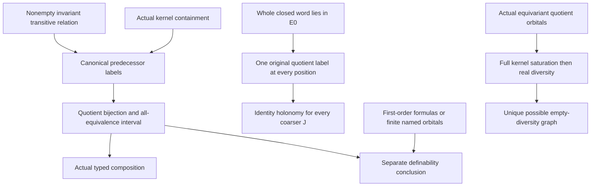

# Invariant typed quotient transport, canonical return and actual orbital pullbacks

Generated from `module.json` by `tools/build_formalization_module.py`.

Source `490c3f36d85db5a0b3ced0598e6c431825254ec5`. **Human-expanded proof plan; no Lean code.**

Private B040: FOUR Foundations I results, TWO equations, twelve definitions, 50 human claims and eight tasks, with no mathematical imports or external providers. Expand invariant typed quotient transport and canonical identity holonomy, then prescribed-action point lifting and full equality-inclusive orbital pullbacks. The last TWO source results document ALREADY SHARED B001 support; this preparation does NOT reallocate their receiving implementation/API or rewire existing consumers. Generic group-action algebra yields invariant equivalences; first-order DEFINABILITY is separately discharged by given formulas or the intended finite named orbital source context. No CCO, SAP, RAW exactness, strong diversity word or group section is required.

The human article remains unchanged. Additional proof details are in
[PROOF_NOTES.md](PROOF_NOTES.md); the cross-track policy is in
[the formalization guide](../README.md). Source hashes are checked before
the index is regenerated. Graph validation is not proof verification.

## Source premises

**A01: Actual transitive typed group action.** G acts on nonempty named original sorts. For each transport relation R:a->b both endpoint actions are transitive and R is a NONEMPTY G-invariant actual binary relation. E is a G-invariant equivalence on a. Sorts may repeat, but compositions use their actual typed carriers. Actions need not be faithful. No topology, homogeneity, countability, CCO, SAP or exactness is assumed for the invariant algebra.

**A02: Actual transport kernel condition.** R;R-converse is contained in E. Composition is left-to-right EXISTENTIAL relational composition, includes equality witnesses, and is not a restricted diversity product. Logical Id_a differs from universal relation 1_a.

**A03: Separate first-order definability gate.** ONLY for first-order definability claims, the relations and base equivalences used have given parameter-free first-order definitions in the ambient original structure. In the intended original finite complete atomic homogeneous source, G is the FULL original automorphism group and all finitely many G-pair-orbitals on the relevant named sorts are named, so EVERY invariant binary relation/equivalence is a finite union of named orbitals and this gate is discharged. The generic arbitrary-G action branch yields invariant objects only; invariance alone is not first-order definability, and naming full-Aut orbitals does not define arbitrary proper-subgroup invariant refinements.

**A04: Second composable transport with its own kernel condition.** For composition R:a->b and S:b->c use the LITERAL intermediate equivalence F=R-converse;E;R, with S nonempty invariant between transitive sorts and S;S-converse contained in F. No unrelated quotient chart, conjugate intermediate kernel or mixed-sort commutativity may replace this actual F.

**A05: Nonempty closed typed word contained in one base equivalence.** P1,...,Pn is a finite word of NONEMPTY invariant actual composable relations between transitive named original sorts, n>=1, returning to the SAME original sort a0. E0 is an invariant equivalence there and the actual whole product P1;...;Pn is contained in E0. Definability of E0/Pi for the source definability conclusion is supplied separately by A03. Repeated intermediate sorts are allowed; they are not identified by an arbitrary chart.

**A06: Independent equivariant point-lifting data.** K acts on NONEMPTY Y, Gamma acts on B, rho:K->Gamma is a homomorphism, and pi:Y->B is an ONTO map satisfying pi(ky)=rho(k) pi(y). Neither action is assumed faithful or transitive, rho is not initially assumed onto, and no group-homomorphic section is assumed. Surjectivity and kernel-fibre transitivity occur as one conditional side of the equivalence, not permanent premises.

**A07: Independent actual orbital pullback data.** G acts transitively on nonempty root sorts A,B, which are either LITERALLY THE SAME carrier/sort or disjoint. tau:A->Q and sigma:B->R are equivariant SURJECTIONS to G-sets, with actual kernels J,K. Theta is ONE nonempty G-orbital on Q times R, not an arbitrary union. Output sorts may differ even when roots are the same; quotient actions need not be faithful. No homogeneity/SAP/CCO/exactness is supplied.

## Definitions

| ID | Definition | Exact meaning | Source |
|---|---|---|---|
| D01 | Typed equality-inclusive composition | R;S={(x,z):exists y, xRy and ySz}; R-converse reverses coordinates. Id_a is logical equality and 1_a=a times a is universal. Serial means every source has a successor, co-serial every target has a predecessor. | [source](../../sections/typed_invariant_quotient_transport.tex#L15) |
| D02 | All invariant equivalence intervals | InvEq(a) is the lattice of ALL G-invariant equivalences on a, ordered by inclusion. [E,1_a] is the full upper interval, not only FULL RAW exact or named coordinate kernels. | [source](../../sections/typed_invariant_quotient_transport.tex#L15) |
| D03 | Canonical predecessor-class labelling | For a relation satisfying the transport kernel condition, lambda_(R,E)(y) is the E-class of ANY R-predecessor of y. Its definition is conditional on that kernel proof, supplied by A02 in the first source lemma and derived in C16/C20 for return prefixes/factors. Transitivity/nonemptiness supplies predecessors and all labels. | [source](../../sections/typed_invariant_quotient_transport.tex#L15) |
| D04 | Induced quotient transport orientation | E^R=R-converse;E;R. The label induces bar-lambda:b/E^R->a/E; define q_(R,E)=(bar-lambda)^-1:a/E->b/E^R. This fixes its actual orientation and equivariance. | [source](../../sections/typed_invariant_quotient_transport.tex#L15) |
| D05 | Covers and proper meet-irreducibility | A cover H<Hprime has no invariant equivalence strictly between. A proper meet-irreducible H!=1 satisfies H=L meet N => H=L or H=N. For H>=E all possible larger factors also lie in the upper interval. | [source](../../sections/typed_invariant_quotient_transport.tex#L15) |
| D06 | Composable actual quotient transports | For R and S in A04 use F=E^R, then transport F along S. The composite R;S is an actual represented relation; q_S comp q_R compares the SAME intermediate quotient b/F. | [source](../../sections/typed_invariant_quotient_transport.tex#L15) |
| D07 | Prefix/suffix labels of one closed word | R0=Id_a0, Ri=P1;...;Pi, Si=P(i+1);...;Pn and Sn=Id_a0. Label a point y in position i by the E0-class of an Ri-predecessor; a suffix witness proves uniqueness. All positions use ONE original quotient a0/E0. | [source](../../sections/typed_invariant_quotient_transport.tex#L84) |
| D08 | Canonical prefix and coarser kernels | Ei=ker(lambda_i)=Ri-converse;E0;Ri. For ANY invariant J>=E0 compose every label with the canonical a0/E0->a0/J projection; Ji=Ri-converse;J;Ri. The coarser J need not be named, exact or definable. | [source](../../sections/typed_invariant_quotient_transport.tex#L84) |
| D09 | Every compatible prescribed point move | For x,y in Y and gamma in Gamma satisfying gamma pi(x)=pi(y), request ONE k with rho(k)=gamma and kx=y. Quantification is over every compatible gamma, including action-kernel elements; compatibility alone cannot erase nonfaithful group elements. | [source](../../sections/typed_invariant_quotient_transport.tex#L186) |
| D10 | Full orbital pullback and root witness | P_Theta={(x,y):(tau(x),sigma(y)) in Theta}. Pick any (x0,y0) in it and let O=G.(x0,y0), the FULL root orbital, possibly the real diagonal. J=ker(tau),K=ker(sigma). | [source](../../sections/typed_invariant_quotient_transport.tex#L217) |
| D11 | Root diversity restricted only after saturation | D_(A,B)={(x,y):x!=y}. For disjoint roots it is the whole product; for same roots it removes the logical diagonal. Compute P_Theta=J;O;K first, THEN intersect D; never prefilter O by diversity. | [source](../../sections/typed_invariant_quotient_transport.tex#L217) |
| D12 | Same-root graph across possibly different outputs | For A=B let Graph_(tau,sigma)={(tau(x),sigma(x)):x in A}. This is the output orbital of a same-root pair by transitivity. It need not be output equality when Q and R are different sorts or different bijective coordinate copies. | [source](../../sections/typed_invariant_quotient_transport.tex#L217) |

## Proof claims and direct dependencies

Every row has a human proof expansion. Each still needs an actual Lean
statement and proof. Keep invariant versus definable equivalences distinct, use literal typed RAW relational composition and canonical quotient labels, and saturate full root orbitals BEFORE restricting to real diversity. Existing shared B001 API ownership stays unchanged.

| ID and claim | Scope | Direct providers | Proof note |
|---|---|---|---|
| C01: A nonempty invariant relation on transitive endpoints is serial and co-serial | transport | A01, D01 | N01 in [notes](PROOF_NOTES.md) |
| C02: All predecessors of one target have the same E-class | transport | D03, C01 | N01 in [notes](PROOF_NOTES.md) |
| C03: Canonical predecessor labelling is equivariant and onto | transport | A01, C01, C02 | N01 in [notes](PROOF_NOTES.md) |
| C04: The transported equivalence is literally the label kernel | transport | D04, C02, C03 | N01 in [notes](PROOF_NOTES.md) |
| C05: The induced quotient transport is an equivariant bijection | transport | C03, C04, D04 | N01 in [notes](PROOF_NOTES.md) |
| C06: Upper invariant equivalences are exactly quotient equivalences | lattice | D02, D05 | N02 in [notes](PROOF_NOTES.md) |
| C07: Relational transport gives the full interval order isomorphism | lattice | C01, C04, C05, C06, D02 | N02 in [notes](PROOF_NOTES.md) |
| C08: Transport preserves lattice operations, covers and global meet-irreducibles | lattice | C07, D05 | N02 in [notes](PROOF_NOTES.md) |
| C09: Two actual kernel hypotheses give the composite kernel hypothesis | composition | A02, A04, D06, C01, C04 | N02 in [notes](PROOF_NOTES.md) |
| C10: Composite transported kernels agree literally | composition | A04, D01, D06, C04 | N02 in [notes](PROOF_NOTES.md) |
| C11: Canonical quotient bijections compose in the stated order | composition | C01, C05, C09, C10 | N02 in [notes](PROOF_NOTES.md) |
| C12: The transported interval is not restricted to named exact kernels | boundary | C07, C08, C11 | N08 in [notes](PROOF_NOTES.md) |
| C13: Definability follows from formulas or the intended finite orbital language | definability | A03, C04 | N04 in [notes](PROOF_NOTES.md) |
| C14: Typed quotient-transport source export with explicit definability scope | transport | A02, C05, C07, C08, C11, C13 | N04 in [notes](PROOF_NOTES.md) |
| C15: All word prefixes and suffixes are serial and co-serial | canonical_return | A01, A05, D07, C01 | N03 in [notes](PROOF_NOTES.md) |
| C16: A common suffix makes each prefix label independent of predecessor | canonical_return | A05, C15, D07 | N03 in [notes](PROOF_NOTES.md) |
| C17: Every position has one equivariant onto labelling by the original quotient | canonical_return | A01, C15, C16, D07 | N03 in [notes](PROOF_NOTES.md) |
| C18: Prefix transport kernels are exactly the canonical label kernels | canonical_return | C04, C05, C16, C17, D08 | N03 in [notes](PROOF_NOTES.md) |
| C19: Every edge preserves the same canonical original quotient label | canonical_return | C15, C16, C17 | N03 in [notes](PROOF_NOTES.md) |
| C20: Each factor has the exact adjacent transported kernel | canonical_return | C15, C18, C19 | N03 in [notes](PROOF_NOTES.md) |
| C21: Each edge bijection is the canonical label conjugation | canonical_return | C05, C17, C18, C19, C20 | N03 in [notes](PROOF_NOTES.md) |
| C22: Start and end labels are the SAME original quotient map | canonical_return | A05, C16, C17, C18 | N03 in [notes](PROOF_NOTES.md) |
| C23: The entire closed word has identity holonomy | canonical_return | C21, C22 | N03 in [notes](PROOF_NOTES.md) |
| C24: One construction handles EVERY invariant coarser J simultaneously | canonical_return | C17, C19, C21, C22, C23, D08 | N03 in [notes](PROOF_NOTES.md) |
| C25: Definability of canonical return kernels uses only finite formulas | definability | A03, C18, C24 | N04 in [notes](PROOF_NOTES.md) |
| C26: Canonical return and identity holonomy source export | canonical_return | C18, C20, C21, C23, C24, C25 | N04 in [notes](PROOF_NOTES.md) |
| C27: Conditional epimorphism gives a preliminary prescribed group lift | point_lifting | A06, D09 | N05 in [notes](PROOF_NOTES.md) |
| C28: A kernel correction gives the exact prescribed point and group action | point_lifting | C27 | N05 in [notes](PROOF_NOTES.md) |
| C29: Every compatible prescribed move forces rho to be onto | point_lifting | A06, D09 | N05 in [notes](PROOF_NOTES.md) |
| C30: Taking identity gamma forces kernel transitivity on each fibre | point_lifting | A06, D09 | N05 in [notes](PROOF_NOTES.md) |
| C31: Prescribed-action point lifting source export | point_lifting | C28, C29, C30 | N05 in [notes](PROOF_NOTES.md) |
| C32: A nonsplit nonfaithful finite example satisfies point lifting | boundary | C31 | N08 in [notes](PROOF_NOTES.md) |
| C33: The full output-orbital pullback is nonempty and invariant | orbital_pullback | A07, D10 | N06 in [notes](PROOF_NOTES.md) |
| C34: One output-pair group move proves containment in J;O;K | orbital_pullback | A07, C33, D10 | N06 in [notes](PROOF_NOTES.md) |
| C35: Changing root representatives preserves the output orbital | orbital_pullback | A07, D10, C33, C34 | N06 in [notes](PROOF_NOTES.md) |
| C36: Every root orbital maps into exactly one output orbital | orbital_pullback | A07, C33, C35 | N06 in [notes](PROOF_NOTES.md) |
| C37: Nonempty diversity pullbacks partition both real diversity and its orbitals | orbital_pullback | C35, C36, D11 | N06 in [notes](PROOF_NOTES.md) |
| C38: Empty diversity pullback forces the same root sort and a diagonal witness | diversity_exception | A07, C33, D11 | N07 in [notes](PROOF_NOTES.md) |
| C39: The first kernel must be identity in the empty-diversity case | diversity_exception | A07, C35, C38 | N07 in [notes](PROOF_NOTES.md) |
| C40: The second kernel must also be identity | diversity_exception | A07, C38, C39 | N07 in [notes](PROOF_NOTES.md) |
| C41: The exceptional output orbital is precisely the same-root graph | diversity_exception | A07, C38, C40, D12 | N07 in [notes](PROOF_NOTES.md) |
| C42: Conversely two bijective coordinates give only the real diagonal | diversity_exception | A07, D10, D11, D12 | N07 in [notes](PROOF_NOTES.md) |
| C43: There is at most one empty-diversity output orbital | diversity_exception | C38, C39, C40, C41, C42 | N07 in [notes](PROOF_NOTES.md) |
| C44: Orbital pullback and real-diagonal source export | orbital_pullback | C35, C37, C43 | N07 in [notes](PROOF_NOTES.md) |
| C45: Generic invariance alone does not imply first-order definability | boundary | D01, D02, C04 | N08 in [notes](PROOF_NOTES.md) |
| C46: Nonempty/transitive endpoints and the kernel condition have concrete roles | boundary | D01, D03, C01, C02 | N08 in [notes](PROOF_NOTES.md) |
| C47: Closed-word containment and canonical charts protect identity holonomy | boundary | C21, C22, C23 | N08 in [notes](PROOF_NOTES.md) |
| C48: Saturating only diversity root orbitals can erase genuine pullbacks | boundary | C35, C37, D11 | N08 in [notes](PROOF_NOTES.md) |
| C49: The point-lift reverse direction needs nonemptiness and surjectivity | boundary | A06, D09, C29, C30 | N08 in [notes](PROOF_NOTES.md) |
| C50: No noncollapse, exactness or new shared implementation allocation follows | boundary | C12, C24, C31, C44 | N08 in [notes](PROOF_NOTES.md) |

The precise quantified contracts are in `module.json`. Provider-before-consumer
order (including definitions and source premises):

`A01 → A02 → A03 → A04 → A05 → A06 → A07 → D01 → C01 → D02 → D03 → D07 → D09 → D10 → D12 → C02 → C15 → C27 → C29 → C30 → C33 → D04 → D05 → D08 → D11 → C03 → C06 → C16 → C28 → C34 → C38 → C42 → C46 → C49 → D06 → C04 → C17 → C31 → C35 → C05 → C09 → C10 → C13 → C19 → C32 → C36 → C39 → C45 → C07 → C11 → C18 → C37 → C40 → C08 → C20 → C22 → C41 → C48 → C12 → C14 → C21 → C43 → C23 → C44 → C24 → C47 → C25 → C50 → C26`

This order is one valid linearization; it does not require unrelated
branches to be proved sequentially. The full DAG is the `depends_on`
relation in `module.json`.

## Main proof branches

This is a coarse view of the claim DAG. Edges go from provider to consumer.

Core transport and return algebra is independent of first-order definability, CCO, SAP and FULL RAW exactness.
The source finite named orbital context discharges the separate first-order definability gate.
All returns use one original quotient labelling; no independent charts or groupoid section is selected.
The two action lemmas are existing shared B001 support, now expanded; allocation and consumers are unchanged.
Five existing HN/HKN receiving bindings and their build-cache plan remain unchanged.

## Article exports

| Existing source result | Sidecar proof claims |
|---|---|
| [`lem:typed-quotient-transport`](../../sections/typed_invariant_quotient_transport.tex#L15) | C05, C08, C11, C13, C14 |
| [`lem:foundational-typed-return-holonomy`](../../sections/typed_invariant_quotient_transport.tex#L84) | C18, C21, C23, C24, C25, C26 |
| [`lem:prescribed-action-point-lifting`](../../sections/typed_invariant_quotient_transport.tex#L185) | C28, C29, C30, C31 |
| [`lem:foundational-orbital-pullback`](../../sections/typed_invariant_quotient_transport.tex#L216) | C35, C37, C43, C44 |

Auxiliary source equations (not additional numbered results):

- [`eq:typed-transport-kernel`](../../sections/typed_invariant_quotient_transport.tex#L19): C02
- [`eq:typed-transport-lattice`](../../sections/typed_invariant_quotient_transport.tex#L35): C07, C08

## Internal implementation milestones

These tasks are proof milestones inside larger project assignments;
see the [peer-project allocation](../coordination/BOARD.md).

These are implementation tasks, not additional mathematical assumptions.

| Task | Earlier tasks | Acceptance |
|---|---|---|
| T01: Canonical predecessor labels and quotient bijection | — | Keep actual typed equality-inclusive relations, invariant/definable distinction and one canonical original quotient labelling. Prove both composition kernel conditions and all coarser return maps. Saturate full root orbitals before diversity restriction; include exact different-output-sort diagonal exception. Point lifting prescribes group ELEMENTS, needs no section/faithfulness. Last two exports document existing shared B001 API without reallocating receiving implementation or rewiring consumers. |
| T02: Full interval lattice and actual composition | T01 | Keep actual typed equality-inclusive relations, invariant/definable distinction and one canonical original quotient labelling. Prove both composition kernel conditions and all coarser return maps. Saturate full root orbitals before diversity restriction; include exact different-output-sort diagonal exception. Point lifting prescribes group ELEMENTS, needs no section/faithfulness. Last two exports document existing shared B001 API without reallocating receiving implementation or rewiring consumers. |
| T03: Canonical prefix/suffix return and all coarsenings | T01 | Keep actual typed equality-inclusive relations, invariant/definable distinction and one canonical original quotient labelling. Prove both composition kernel conditions and all coarser return maps. Saturate full root orbitals before diversity restriction; include exact different-output-sort diagonal exception. Point lifting prescribes group ELEMENTS, needs no section/faithfulness. Last two exports document existing shared B001 API without reallocating receiving implementation or rewiring consumers. |
| T04: First-order definability and source transport exports | T01, T02 | Keep actual typed equality-inclusive relations, invariant/definable distinction and one canonical original quotient labelling. Prove both composition kernel conditions and all coarser return maps. Saturate full root orbitals before diversity restriction; include exact different-output-sort diagonal exception. Point lifting prescribes group ELEMENTS, needs no section/faithfulness. Last two exports document existing shared B001 API without reallocating receiving implementation or rewiring consumers. |
| T05: Return definability and source export | T01, T03 | Keep actual typed equality-inclusive relations, invariant/definable distinction and one canonical original quotient labelling. Prove both composition kernel conditions and all coarser return maps. Saturate full root orbitals before diversity restriction; include exact different-output-sort diagonal exception. Point lifting prescribes group ELEMENTS, needs no section/faithfulness. Last two exports document existing shared B001 API without reallocating receiving implementation or rewiring consumers. |
| T06: Expand shared B001 prescribed-action lifting support | — | Keep actual typed equality-inclusive relations, invariant/definable distinction and one canonical original quotient labelling. Prove both composition kernel conditions and all coarser return maps. Saturate full root orbitals before diversity restriction; include exact different-output-sort diagonal exception. Point lifting prescribes group ELEMENTS, needs no section/faithfulness. Last two exports document existing shared B001 API without reallocating receiving implementation or rewiring consumers. |
| T07: Expand shared B001 orbital saturation and exact diversity exception | — | Keep actual typed equality-inclusive relations, invariant/definable distinction and one canonical original quotient labelling. Prove both composition kernel conditions and all coarser return maps. Saturate full root orbitals before diversity restriction; include exact different-output-sort diagonal exception. Point lifting prescribes group ELEMENTS, needs no section/faithfulness. Last two exports document existing shared B001 API without reallocating receiving implementation or rewiring consumers. |
| T08: Scope, ownership and negative diagnostics | T01, T02, T03, T04, T05, T06, T07 | Keep actual typed equality-inclusive relations, invariant/definable distinction and one canonical original quotient labelling. Prove both composition kernel conditions and all coarser return maps. Saturate full root orbitals before diversity restriction; include exact different-output-sort diagonal exception. Point lifting prescribes group ELEMENTS, needs no section/faithfulness. Last two exports document existing shared B001 API without reallocating receiving implementation or rewiring consumers. |

## Finite controls

- **K01.** Finite actual transitive-action relations, quotient labels, full invariant interval lattice operations, composable transports and canonical closed returns/coarser kernels.
- **K02.** Prescribed group-element lifting including nonsplit/nonfaithful examples, full orbital kernel saturation, exact diversity exception and boundary failures. Finite diagnostics do not certify general theorem/Lean implementation.

Run `python tools/check_quotient_transport_controls.py` from the manuscript directory.
The controls do not prove CCO or the general theorems.

## Return to the human articles

No required mathematical repair was found in this scoped pass. These
optional wording clarifications remain queued for a human article pass:

- **F01** ([source](../../sections/typed_invariant_quotient_transport.tex#L26)): Invariant group-action algebra alone proves invariant equivalences, not first-order definability. The intended finite named orbital source makes R/E and finite composites definable. State the finite named orbital definability context explicitly, or say invariant in the generic abstract statement and add the definability conclusion when the inputs have formulas.
- **F02** ([source](../../sections/typed_invariant_quotient_transport.tex#L232)): Saturation is equality-inclusive. A diagonal witness can saturate to nonempty diversity, and off-diagonal saturation can reintroduce diagonal pairs. The empty-diversity exception is the same-root graph even across different output sorts. Keep full root orbital O in J;O;K and restrict to diversity only afterwards; explicitly retain the same-root graph exception independently of output-sort equality.

The machine ledger records caller effects and affected claims. The source
review used two independent model review passes and parent synthesis;
it is not independent human or formal certification.
