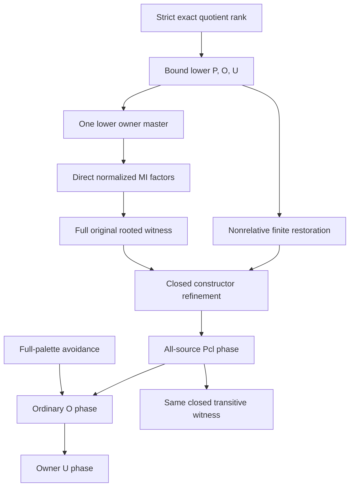

# Strict quotient rank, closed rooted witnesses and phased ordinary EPPA

Generated from `module.json` by `tools/build_formalization_module.py`.

Source `490c3f36d85db5a0b3ced0598e6c431825254ec5`. **Human-expanded proof plan; no Lean code.**

Private B030: five final EPPA-article results and three rank-step equations. Expand the conditional rank constructor, full-palette closed-strong amalgamation, the well-founded P/O/U assembly and its CLOSED-witness refinement. Lower-rank P/O/U are explicitly bound antecedents, discharged by the global induction, never new mathematical axioms. The original rank lemma needs only plain lower P; closed lower P is needed solely by the separate closedness refinement. The global theorem remains a SOURCE-RELATIVE CANDIDATE inheriting the B028 safe-selector/reservoir/decoder contracts and B027 published-HKN/local-CCO-adapter obligations. No compiled Lean, global certification or coherent EPPA is asserted.

The human article remains unchanged. Additional proof details are in
[PROOF_NOTES.md](PROOF_NOTES.md); the cross-track policy is in
[the formalization guide](../README.md). Source hashes are checked before
the index is regenerated. Graph validation is not proof verification.

## Source premises

**A01: Actual homogeneous original one-sort source.** M is nonempty transitive countable homogeneous in a FINITE complete named symmetric binary language of actual equality-inclusive pair orbitals. Invariant endorelations commute. Real finite induced partial maps preserve all original colours. AP/JEP are retained as standing age hypotheses; no raw SAP, EPPA, owner master or safe palette is assumed.

**A02: Semantic homomorphic CCO and prepared construction boundary.** M has semantic homomorphic CCO. Actual full-exact quotient source inheritance and prepared local CCO constructions are used with their stated hypotheses. This is not an assumption that their receiving Lean encodings or the global source-relative candidate theorem have been independently certified.

**A03: Given absolutely closed strong-safe palette.** S is a GIVEN set of original diversity atom names strongly amalgamating EVERY finite absolutely acl_M-closed induced span. The resulting amalgam need not itself be closed. This premise is discharged by full-palette construction when ordinary EPPA is derived.

**A04: Original nonempty finite input.** A0 is a finite NONEMPTY set of original real points of M. Empty-input ordinary EPPA is dealt with separately by its empty witness; the closed/transitive corollary has nonempty input.

## Imported theorem contracts

These are named provider obligations for the receiving Lean project,
not new axioms or claims of compiled imports.

| ID and source | Contract | Current provider status |
|---|---|---|
| I01: [`thm:exact-sorts-source`](../../sections/exact_foundations/03_joint_exact_sort_lifting.tex#L161) | Actual full exact quotients inherit the standing named homogeneous/CCO source. At Id this includes the original triangle-defined source conclusion. Quotient full automorphism groups need not be images of the original group. | HUMAN_EXPANDED_NOT_LEAN |
| I02: [`lem:finite-action-avoidance`](../../sections/finite_orbit_avoidance.tex#L6) | For a group acting on points with infinite relevant orbits, one element moves a finite set away from a finite forbidden set. Finite unions of cosets of infinite-index stabilizers cannot cover the group; the Neumann argument is already expanded by this provider. No topology, oligomorphy or new external theorem is needed. | HUMAN_EXPANDED_NOT_LEAN |
| I03: [`lem:finite-exact-normalization-geometric`](../../sections/finite_packets.tex#L246) | Finite exact reduction terminates by loss of diversity orbitals and the terminal greatest finite equivalence has thin atoms. Absence of nonidentity finite exact kernels is the normalization condition; thinness is not its converse. | HUMAN_EXPANDED_NOT_LEAN |
| I04: [`prop:minimalcut`](../../sections/finite_packets.tex#L102) | Every minimal infinite invariant equivalence is full exact and its actual quotient is standing. The original greatest finite equivalence F need not itself be exact. | HUMAN_EXPANDED_NOT_LEAN |
| I05: [`lem:acf-hat-normalised`](../../sections/maximal_cores/01_maximal_hat_normalisation.tex#L44) | For INFINITE finite-exact-normalized M and ALL minimal infinite E_i, maximal exact hatC_i yields Q_i with no nonidentity finite exact kernels, unique minimal infinite direction, finite bottom F_i and absolute unary acl=F_i[-]. | HUMAN_EXPANDED_NOT_LEAN |
| I06: [`cor:acf-hat-factors`](../../sections/maximal_cores/05_joint_owner_minima.tex#L140) | For INFINITE finite-exact-normalized M with r>=2, the full family of maximal hats has meet Id; Hstar>Id and H_i join H_j=J_ij. Under GIVEN strong closed S the full-support factor palettes S_i are strong closed-safe and every unsafe clique has at most one nonsingle-packet projection. Closure pulls back coordinatewise. | HUMAN_EXPANDED_NOT_LEAN |
| I07: [`lem:acf-relative-mi-normal`](../../sections/rooted_mi/03_normalised_relative_mi.tex#L1) | Under its principal original source, normalization, GIVEN strong closed-safe S, ordinary EPPA ONLY in Q/E and the finite full-owner B hypotheses, B028 constructs ONE finite F-closed D with exact B image, all prescribed compatible requests and rooted unsafe transport. Its displayed local owner/selector/reservoir/decoder context is constructed, not added as an unexplained input. Published HKN encoding bridges remain pending. | HUMAN_EXPANDED_NOT_LEAN |
| I08: [`thm:acf-owner-master`](../../sections/owner_master/04_master_theorem.tex#L1) | For X with ordinary EPPA in EVERY actual exact quotient INCLUDING X, construct ONE full finite B with M1 EPPA, M2 packet closure, M3 full action maps onto with fibre-transitive kernels, and M4 actual full compatible-tuple carrier. This is a conditional construction, not an ordinary EPPA premise for current M. | HUMAN_EXPANDED_NOT_LEAN |
| I09: [`lem:acf-multi-owner-point-homogeneity`](../../sections/rooted_main/01_joint_owner_homogeneity.tex#L11) | Meet-Id actual exact C_i, JOG, actual FULL owner tuple carrier and finite onto factors with whole-owner actions give an original fine-coloured W, onto projections and its full joint automorphism group. With separate owner/source partial-extension premises the independent EPPA branch extends every original p. | HUMAN_EXPANDED_NOT_LEAN |
| I10: [`lem:acf-finite-exact-closed-preimages`](../../sections/maximal_cores/01_maximal_hat_normalisation.tex#L210) | For actual exact kernels with finite-class meet and finite absolutely closed coordinate targets, the inverse intersection is finite and absolutely closed. The exact target closure identity is imported separately in I15. | HUMAN_EXPANDED_NOT_LEAN |
| I11: [`lem:acf-finite-lift`](../../sections/rooted_mi/04_owner_point_and_finite_lift.tex#L34) | Use ONLY closure C06, full-matrix strong closed-safe descent C10 and ordinary whole-preimage rooted reconstruction C18. Internal C13 states D is closed IFF the supplied quotient witness is closed. No stronger relative owner H, complete owner-cover B or onto/kernel premise is imported into rank restoration. | HUMAN_EXPANDED_NOT_LEAN |
| I12: [`lem:acf-point-homogeneity`](../../sections/rooted_mi/04_owner_point_and_finite_lift.tex#L1) | A finite witness extending every compatible original source request over an orbit-covering nonempty A0 has point homogeneity with a prescribed entire B action, hence transports whole finite packets. No action section is supplied. | HUMAN_EXPANDED_NOT_LEAN |
| I13: [`lem:prescribed-action-point-lifting`](../../sections/typed_invariant_quotient_transport.tex#L185) | For an equivariant onto point map, a surjective homomorphism with fibre-transitive kernel lifts a prescribed target group element AND a compatible point motion. Choose one lift then one kernel correction. This is shared B001 support, not an extra B018 export. | HUMAN_SUPPORT_PROOF_NOT_LEAN |
| I14: [`lem:exact-product`](../../sections/exact_foundations/01_full_raw_exact_helly.tex#L284) | Actual RAW exact relations are composition-closed; commuting exact equivalences have full exact join E;H. Finite-class joins remain finite-class by the finite product bound. | HUMAN_EXPANDED_NOT_LEAN |
| I15: [`eq:acf-closure-pullback`](../../sections/rooted_acf_geometry.tex#L287) | acl_M(A)=intersection_i pi_i^-1(acl_(M/C_i)(pi_i A)) for actual exact kernels with finite-class meet; repeated and identity quotient sorts are merged canonically. | HUMAN_EXPANDED_NOT_LEAN |

**I06 internal proof support:** C26 in `mi_geometry`. Extract the explicitly proved internal support with its original hypotheses; it is not an additional numbered theorem export.

These are separately extracted proved support claims, not additional
numbered exports or consequences of the named theorem statement.

**I11 internal proof support:** C13 in `finite_lift`. Extract the explicitly proved internal support with its original hypotheses; it is not an additional numbered theorem export.

These are separately extracted proved support claims, not additional
numbered exports or consequences of the named theorem statement.

## Definitions

| ID | Definition | Exact meaning | Source |
|---|---|---|---|
| D01 | Finite diversity rank | mu(X) counts its ACTUAL named diversity pair orbitals, excluding genuine equality. Quotient atoms group old atoms; no equality of original and quotient full automorphism groups is assumed. | [source](../../sections/rooted_main/02_rank_relative_rooted_induction.tex#L2) |
| D02 | Plain rooted witness predicate | P(X,S,A,W) means ONE finite induced W contains acl_X(A), extends EVERY partial automorphism of A, and transports EVERY nonempty S-unsafe Z and EVERY selected z into acl_X(A) with z literally in A. Closedness of W is not part of this predicate. | [source](../../sections/rooted_main/02_rank_relative_rooted_induction.tex#L2) |
| D03 | Universal phases and closed refinement | P_n quantifies the rooted predicate over ALL standing rank-n sources, admissible S and nonempty finite inputs; Pcl_n strengthens the chosen witness by acl_X(W)=W. O_n is ordinary EPPA for every such source; U_n is actual master EXISTENCE: for EVERY finite nonempty input there EXISTS ONE B satisfying M1-M4, with all EPPA antecedents already discharged in that phase. The conditional implication is only I08, not U_n. These are predicates to prove, not assumptions. | [source](../../sections/unified_induction.tex#L27) |
| D04 | Bound lower-rank hypothesis schema | Lower(M) abbreviates the universally quantified P/O/U conclusions for EVERY STRICT actual exact quotient M/E with E>Id. It occurs as the BOUND ANTECEDENT of the rank constructor. It is not a free/global axiom; the strong induction discharges it. Identity and current-rank factors are excluded. | [source](../../sections/rooted_main/02_rank_relative_rooted_induction.tex#L2) |
| D05 | Absolute real closure | acl_X(A) is finite-orbit algebraic closure under FULL Aut(X/A). Finite homogeneous relational sources have finite real acl of finite A; closed means equality acl_X(A)=A. Packet closedness equals absolute real closedness only in the proved one-direction factors. | [source](../../sections/rooted_main/02_rank_relative_rooted_induction.tex#L2) |
| D06 | Full diversity palette | Full(X) consists of all ORIGINAL diversity atom names. Equality is never a diversity colour; a singleton unsafe clique is vacuously unsafe for EVERY S. | [source](../../sections/unified_induction.tex#L6) |
| D07 | Exhaustive normalization alternatives | For infinite M either a nonidentity finite-class full exact kernel exists, or M is finite-exact-normalized. In the latter enumerate ALL minimal infinite invariant equivalences E_1,...,E_r; r>=1 since Top is infinite-class. | [source](../../sections/rooted_main/02_rank_relative_rooted_induction.tex#L2) |
| D08 | Canonical maximal exact coordinates | For r>=2, C_i=hatC_i is the MAXIMAL exact kernel below R_Ei; Q_i=M/C_i and F_i=R_Ei/C_i. For r>=2 each C_i contains E_j>Id for j!=i. No recursive global theorem for Q_i is used: the direct B028 constructor suffices. | [source](../../sections/rooted_main/02_rank_relative_rooted_induction.tex#L2) |
| D09 | Actual common owner cuts | J_ij=C_i join C_j; H_i=meet_(j!=i)J_ij; Hstar=meet_(i<j)J_ij. Omega=M/Hstar. All are actual full exact kernels, not arbitrary finite quotient charts. | [source](../../sections/rooted_main/02_rank_relative_rooted_induction.tex#L2) |
| D10 | One full original finite carrier | W is the set of ALL compatible tuples in product D_i, compatibility in EVERY actual J_ij quotient; use the canonical fine-coloured actual M identification. Its owner carrier must be the WHOLE fixed lower-rank B_Omega, not a sparse subset. | [source](../../sections/rooted_main/02_rank_relative_rooted_induction.tex#L2) |
| D11 | Bound closed lower refinement | LowerClosed(M) means FOR EVERY strict quotient, admissible palette and nonempty finite input there EXISTS a CLOSED rooted witness. It does not assert arbitrary plain witnesses are closed. It is a bound antecedent ONLY for the closed constructor refinement, not the original rank lemma. Global induction proves Pcl_n, so this refinement becomes available without adding a hypothesis to the global source theorem. | [source](../../sections/rooted_main/02_rank_relative_rooted_induction.tex#L2) |
| D12 | Entire owner actions and duplicate actual sorts | Gamma=FULL Aut(B_Omega), rho_i acts on ALL B_i. A coordinate alpha_i must induce exactly rho_i(gamma) on its ENTIRE owner image. Repeated actual quotient sorts carry the same maps; Id and Top receive their canonical identifications. | [source](../../sections/rooted_main/02_rank_relative_rooted_induction.tex#L2) |
| D13 | Lexicographic proof order | Use (mu,phase), with Pcl=0, O=1, U=2. Pcl at n uses only completed phases at smaller ranks; O_n uses Pcl_n; U_n uses O_m with m<=n. This is a well-founded order on natural pairs with finite phase. | [source](../../sections/unified_induction.tex#L27) |

## Proof claims and direct dependencies

Every row has a human proof expansion. Each still needs an actual Lean
statement and proof. Pure orbit avoidance, strict rank descent, bound lower-rank assumptions, ordinary finite restoration and the stronger closed constructor have distinct branches.

| ID and claim | Scope | Direct providers | Proof note |
|---|---|---|---|
| C01: Strict quotient diversity decrease | rank_measure | D01, A01 | N01 in [notes](PROOF_NOTES.md) |
| C02: Finite source and zero-rank boundaries | rank_step | A01, A04, D05 | N01 in [notes](PROOF_NOTES.md) |
| C03: Original triangle-defined source is available | rank_step | A01, A02, I01 | N01 in [notes](PROOF_NOTES.md) |
| C04: Off-base stabilizer orbits are infinite | closed_safe_palette | A01, D05 | N02 in [notes](PROOF_NOTES.md) |
| C05: One base-fixing motion separates the whole right factor | closed_safe_palette | C04, I02 | N02 in [notes](PROOF_NOTES.md) |
| C06: Full diversity strongly amalgamates closed spans | closed_safe_palette | C05, D06 | N02 in [notes](PROOF_NOTES.md) |
| C07: Finite exact branch has a legitimate kernel | rank_step | D07, I14, I03 | N03 in [notes](PROOF_NOTES.md) |
| C08: Normalized directions are exhaustive and exact | rank_step | D07, I04 | N03 in [notes](PROOF_NOTES.md) |
| C09: One-direction direct rooted closed witness | rank_step | C08, C01, I01, D04, I07, A03, A04 | N03 in [notes](PROOF_NOTES.md) |
| C10: All maximal-hat factors have the required geometry | rank_step | D08, C08, I05, I06 | N04 in [notes](PROOF_NOTES.md) |
| C11: Full safe factor palettes and exceptional projection | rank_step | C10, I06, A03 | N04 in [notes](PROOF_NOTES.md) |
| C12: Strict joint owner and actual join gate | rank_step | D09, I06, C01, I01 | N04 in [notes](PROOF_NOTES.md) |
| C13: ONE lower-rank full owner master | rank_step | C12, D04, I08, A04, D12 | N04 in [notes](PROOF_NOTES.md) |
| C14: M4 supplies exactly the full compatible owner carrier | rank_step | C13, C12 | N04 in [notes](PROOF_NOTES.md) |
| C15: Finite owners are closed EPPA and orbit-covering | rank_step | C13, A04 | N04 in [notes](PROOF_NOTES.md) |
| C16: Each relative coarse cut contains its fine direction | rank_step | C10, D09, I06 | N04 in [notes](PROOF_NOTES.md) |
| C17: Every fine-owner EPPA input is strictly lower | rank_step | C16, C08, C01, I01, D04 | N04 in [notes](PROOF_NOTES.md) |
| C18: Construct ONE full closed witness in each factor | rank_step | C10, C11, C15, C16, C17, I07 | N05 in [notes](PROOF_NOTES.md) |
| C19: Prescribed component point and packet transport | rank_step | C18, C15, I12 | N05 in [notes](PROOF_NOTES.md) |
| C20: Full original W and its genuine automorphisms | rank_step | D10, C10, C12, C14, C18, C19, I09 | N05 in [notes](PROOF_NOTES.md) |
| C21: Whole real target is exactly the compatible closure product | rank_step | C20, C10, I15, A04 | N05 in [notes](PROOF_NOTES.md) |
| C22: All original partial maps extend in W | rank_step | C13, C18, C20, I09 | N05 in [notes](PROOF_NOTES.md) |
| C23: Exceptional projection remains genuinely unsafe | rank_step | C11, C20, D06 | N06 in [notes](PROOF_NOTES.md) |
| C24: Exceptional transport selects ONE original target | rank_step | C23, C18, A04, D12 | N06 in [notes](PROOF_NOTES.md) |
| C25: One full master action corrects the joint root | rank_step | C24, C13, I13, D12 | N06 in [notes](PROOF_NOTES.md) |
| C26: Other packets and exceptional factor glue simultaneously | rank_step | C25, C19, C24, C20, C21 | N06 in [notes](PROOF_NOTES.md) |
| C27: Normalized rank constructor under plain lower hypotheses | rank_step | C09, C21, C22, C26, D04 | N06 in [notes](PROOF_NOTES.md) |
| C28: Finite kernel safe quotient stays in lower scope | rank_step | C07, C01, I01, I11, A03 | N07 in [notes](PROOF_NOTES.md) |
| C29: Lower plain P restores one ordinary rooted witness | rank_step | C28, D04, I11, A04 | N07 in [notes](PROOF_NOTES.md) |
| C30: Original conditional rank lemma | rank_step | C02, C27, C29 | N07 in [notes](PROOF_NOTES.md) |
| C31: Normalized outputs already are absolutely closed | closed_refinement | C09, C10, C18, C20, I10 | N08 in [notes](PROOF_NOTES.md) |
| C32: Closedness through finite exact restoration | closed_refinement | C28, D11, I11 | N08 in [notes](PROOF_NOTES.md) |
| C33: Strengthened conditional closed rank constructor | closed_refinement | C30, C02, C31, C32, D11 | N08 in [notes](PROOF_NOTES.md) |
| C34: Proof schedule is well founded | phased_induction | D13, C01 | N09 in [notes](PROOF_NOTES.md) |
| C35: P phase discharges both lower schemas | phased_induction | C34, C33, C02, I01 | N09 in [notes](PROOF_NOTES.md) |
| C36: O phase uses the proved full palette | phased_induction | C06, C35 | N09 in [notes](PROOF_NOTES.md) |
| C37: U phase uses ordinary EPPA of every exact quotient | phased_induction | C36, C01, I01, I08, D13 | N09 in [notes](PROOF_NOTES.md) |
| C38: All ranks give the source-relative rooted candidate | candidate_global | C35, C36, C37 | N09 in [notes](PROOF_NOTES.md) |
| C39: Ordinary EPPA with its inherited boundary | candidate_global | C06, C38 | N10 in [notes](PROOF_NOTES.md) |
| C40: Global chosen witnesses are closed | closed_refinement | C38, C35, C37 | N10 in [notes](PROOF_NOTES.md) |
| C41: Singleton transport gives vertex transitivity | single_sort_transitivity | C38, A01, D06, A04 | N10 in [notes](PROOF_NOTES.md) |
| C42: Same witness is closed and vertex-transitive | candidate_global | C40, C41 | N10 in [notes](PROOF_NOTES.md) |

The precise quantified contracts are in `module.json`. Provider-before-consumer
order (including definitions and source premises):

`A01 → A02 → A03 → A04 → I13 → D01 → D02 → D05 → D06 → D07 → I01 → I02 → I03 → I04 → I05 → I06 → I07 → I08 → I09 → I10 → I11 → I12 → I14 → I15 → C01 → C02 → C03 → C04 → C07 → C08 → D03 → D08 → C05 → C10 → C28 → D04 → D09 → D13 → C06 → C09 → C11 → C12 → C16 → C29 → C34 → D10 → D11 → D12 → C13 → C17 → C32 → C14 → C15 → C18 → C19 → C20 → C21 → C22 → C23 → C31 → C24 → C25 → C26 → C27 → C30 → C33 → C35 → C36 → C37 → C38 → C39 → C40 → C41 → C42`

This order is one valid linearization; it does not require unrelated
branches to be proved sequentially. The full DAG is the `depends_on`
relation in `module.json`.

## Main proof branches

This is a coarse view of the claim DAG. Edges go from provider to consumer.

Lower and LowerClosed are bound antecedents discharged by the all-source strong induction, not extra global axioms.
Direct B028 is allowed at current factor rank; its sole ordinary EPPA input is a STRICT fine-owner quotient.
Finite restoration imports only B029 ordinary closure/safety/reconstruction and its closedness support; stronger relative owner cover assumptions are excluded.
The global P phase is strengthened to choose closed witnesses. No hidden same-rank U_n is permitted.
Preparation of all EPPA source results is not a global certification: B028 construction audits and both external HKN CCO encoding bridges remain explicit.

## Article exports

| Existing source result | Sidecar proof claims |
|---|---|
| [`lem:acf-rank-step`](../../sections/rooted_main/02_rank_relative_rooted_induction.tex#L1) | C30 |
| [`lem:acf-full-palette`](../../sections/unified_induction.tex#L5) | C04, C05, C06 |
| [`thm:main-rooted-acf`](../../sections/unified_induction.tex#L26) | C34, C35, C36, C37, C38 |
| [`thm:main-ordinary-eppa`](../../sections/unified_induction.tex#L84) | C39 |
| [`cor:acf-closed-transitive`](../../sections/unified_induction.tex#L96) | C40, C41, C42 |

Auxiliary source equations (not additional numbered results):

- [`eq:acf-main`](../../sections/rooted_main/02_rank_relative_rooted_induction.tex#L25): C30
- [`eq:acf-owner-joins`](../../sections/rooted_main/02_rank_relative_rooted_induction.tex#L86): C12
- [`eq:acf-target-product`](../../sections/rooted_main/02_rank_relative_rooted_induction.tex#L240): C21

## Internal implementation milestones

These tasks are proof milestones inside larger project assignments;
see the [peer-project allocation](../coordination/BOARD.md).

These are implementation tasks, not additional mathematical assumptions.

| Task | Earlier tasks | Acceptance |
|---|---|---|
| T01: Rank and full-palette elementary foundations | — | Implement the exact bound-antecedent and branch-scoped statements using the prepared provider signatures. Explicitly discharge strict rank at each recursive call, preserve entire owner actions and original selected roots, and close Pcl/O/U without current-rank feedback. Keep the source-relative candidate and unbound HKN-to-CCO encoding status visible. |
| T02: Exhaustive factors and one lower owner master | T01 | Implement the exact bound-antecedent and branch-scoped statements using the prepared provider signatures. Explicitly discharge strict rank at each recursive call, preserve entire owner actions and original selected roots, and close Pcl/O/U without current-rank feedback. Keep the source-relative candidate and unbound HKN-to-CCO encoding status visible. |
| T03: One factor family and original finite carrier | T01, T02 | Implement the exact bound-antecedent and branch-scoped statements using the prepared provider signatures. Explicitly discharge strict rank at each recursive call, preserve entire owner actions and original selected roots, and close Pcl/O/U without current-rank feedback. Keep the source-relative candidate and unbound HKN-to-CCO encoding status visible. |
| T04: Simultaneous exceptional rooted transport | T01, T02, T03 | Implement the exact bound-antecedent and branch-scoped statements using the prepared provider signatures. Explicitly discharge strict rank at each recursive call, preserve entire owner actions and original selected roots, and close Pcl/O/U without current-rank feedback. Keep the source-relative candidate and unbound HKN-to-CCO encoding status visible. |
| T05: Ordinary finite restoration and plain rank theorem | T01, T02, T03, T04 | Implement the exact bound-antecedent and branch-scoped statements using the prepared provider signatures. Explicitly discharge strict rank at each recursive call, preserve entire owner actions and original selected roots, and close Pcl/O/U without current-rank feedback. Keep the source-relative candidate and unbound HKN-to-CCO encoding status visible. |
| T06: Closed constructor strengthening | T01, T02, T03, T04, T05 | Implement the exact bound-antecedent and branch-scoped statements using the prepared provider signatures. Explicitly discharge strict rank at each recursive call, preserve entire owner actions and original selected roots, and close Pcl/O/U without current-rank feedback. Keep the source-relative candidate and unbound HKN-to-CCO encoding status visible. |
| T07: Well-founded all-source phase assembly | T01, T02, T03, T04, T05, T06 | Implement the exact bound-antecedent and branch-scoped statements using the prepared provider signatures. Explicitly discharge strict rank at each recursive call, preserve entire owner actions and original selected roots, and close Pcl/O/U without current-rank feedback. Keep the source-relative candidate and unbound HKN-to-CCO encoding status visible. |
| T08: Closedness and singleton transitivity of same witness | T01, T02, T03, T04, T05, T06, T07 | Implement the exact bound-antecedent and branch-scoped statements using the prepared provider signatures. Explicitly discharge strict rank at each recursive call, preserve entire owner actions and original selected roots, and close Pcl/O/U without current-rank feedback. Keep the source-relative candidate and unbound HKN-to-CCO encoding status visible. |

## Finite controls

- **K01.** Bounded finite actual orbital quotient partitions, strict diversity loss and phase-edge order; these are diagnostics, not the infinite-source induction proof.
- **K02.** Full compatible tuple, one shared owner/root action and closure-refinement negative controls; finite corner deletion must not be mistaken for fullness.

Run `python tools/check_rank_induction_controls.py` from the manuscript directory.
The controls do not prove CCO or the general theorems.

## Return to the human articles

No required mathematical repair was found in this scoped pass. These
optional wording clarifications remain queued for a human article pass:

- **F01** ([source](../../sections/unified_induction.tex#L110)): The displayed plain rooted P only contains acl(A0); that does not ensure that a quotient witness chosen during finite exact restoration is closed. The final closedness corollary needs the induction to retain a closed-witness constructor invariant. Explicitly strengthen P_n to Pcl_n in the phased construction, or carry a simultaneous closedness refinement. Preserve the original plain conditional rank lemma under its weaker lower hypotheses.
- **F02** ([source](../../sections/rooted_main/02_rank_relative_rooted_induction.tex#L323)): The rank-restoration branch needs only ANY actual nonidentity finite exact kernel and the lower P theorem, not a same-rank master or an extra finite-owner cover. Normality of the quotient is unnecessary for that particular recursive application. Keep the source greatest finite exact K choice if desired, but state the precise nonrelative B029 consumer and the independent strict-rank gate.

The machine ledger records caller effects and affected claims. The source
review used two independent model review passes and parent synthesis;
it is not independent human or formal certification.
