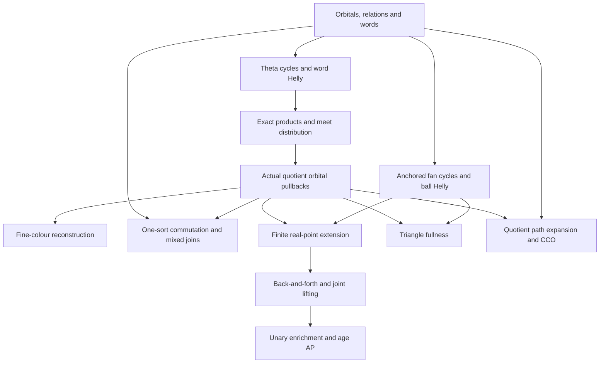

# RAW exact calculus and joint quotient lifting

Generated from `module.json` by `tools/build_formalization_module.py`.

Source `490c3f36d85db5a0b3ced0598e6c431825254ec5`. **Human-expanded proof plan; no Lean code.**

A bounded Foundations I module, not the whole foundations or any application. One-original-sort specializations are marked explicitly. No Lean code or compiled provider imports.

The human article remains unchanged. Additional proof details are in
[PROOF_NOTES.md](PROOF_NOTES.md); the cross-track policy is in
[the formalization guide](../README.md). Source hashes are checked before
the index is regenerated. Graph validation is not proof verification.

## Source premises

**A01: Original represented typed CCO source.** Source homogeneity, named original-sort transitivity, finite complete binary language and semantic homomorphic CCO are explicit premises, not consequences of the sidecar graph. Standard classical finite/countable reasoning is used. No external EPPA, Ramsey, factorization-forest or coset-cover theorem is imported.

## Definitions

| ID | Definition | Exact meaning | Source |
|---|---|---|---|
| D01 | Typed source | Finite named inhabited sorts; countable total universe; finite complete binary relational language; homogeneous original source and transitive original sorts; symmetric same-sort diversity and converse-paired cross-sort atoms; typed semantic homomorphic CCO. No SAP or infinitude assumption. | [source](../../sections/exact_foundations/01_full_raw_exact_helly.tex#L29) |
| D02 | Invariant represented relation and atom | A typed relation is an actual subset of N_i × N_j. Invariant means preserved by every original automorphism. An atom is one actual ordered-pair orbit, including logical Id_i on loop sorts. | [source](../../sections/exact_foundations/01_full_raw_exact_helly.tex#L6) |
| D03 | Represented composition and converse | (R;S)(x,z) iff ∃y, R(x,y) ∧ S(y,z); Rᵒᵖ(y,x) iff R(x,y). Witnesses may repeat endpoints. Top_ij=N_i×N_j. | [source](../../sections/exact_foundations/01_full_raw_exact_helly.tex#L7) |
| D04 | Typed word and profile | A finite typed composable atomic word evaluates to its actual walk endpoint relation. The empty word exists only at one sort and evaluates to logical Id. | [source](../../sections/exact_foundations/01_full_raw_exact_helly.tex#L20) |
| D05 | Exact presentation and nonempty exact relation | A finite list of same-endpoint typed words evaluates to the intersection of their profiles. Empty list evaluates to typed Top. A nonempty exact relation includes a proof that this evaluation is nonempty; meet closure requires nonempty RESULT. | [source](../../sections/exact_foundations/01_full_raw_exact_helly.tex#L22) |
| D06 | Typed partial diagram and CCO | A finite simple typed graph with one specified diversity atom per specified edge. Cycle tests are homomorphisms of each specified simple cycle. CCO supplies a homomorphism of the whole diagram; unspecified pairs may collapse. | [source](../../main.tex#L161) |
| D07 | Exact ball | For D:u→t and b∈N_t, B_D(b)={z∈N_u : D(z,b)}. A family may repeat the same centre value under different constraints. | [source](../../sections/exact_foundations/01_full_raw_exact_helly.tex#L57) |
| D08 | Actual quotient family | For each original sort s choose finitely many actual invariant full exact equivalences J, including Id_s. Sorts N_s/J are tagged actual quotient carriers; N_s/Id_s is identified with N_s. | [source](../../sections/exact_foundations/03_joint_exact_sort_lifting.tex#L5) |
| D09 | Full quotient orbital language | Name every actual Aut(N) ordered-pair orbit between chosen quotient sorts. Logical equality remains logical, and each same-sort diagonal is retained in pair-orbit bookkeeping. | [source](../../sections/exact_foundations/03_joint_exact_sort_lifting.tex#L10) |
| D10 | Finite joint partial isomorphism | A sort-preserving injective finite partial map of the tagged displayed sorts preserving all their binary orbitals; domains need not include real representatives of displayed classes. | [source](../../sections/exact_foundations/03_joint_exact_sort_lifting.tex#L18) |
| D11 | Actual equivariant unary enrichment | A finite family of actual unary functions between already displayed sorts satisfying τ(gq)=gτ(q) for every original g∈Aut(N). The source corollary uses finite functionally closed domains. | [source](../../sections/exact_foundations/03_joint_exact_sort_lifting.tex#L79) |

## Proof claims and direct dependencies

Every row has a human proof expansion. Each still needs an actual Lean
statement and proof. The one-original-sort qualifier is substantive.

| ID and claim | Scope | Direct providers | Proof note |
|---|---|---|---|
| C01: Orbital uniformity and seriality | typed | D02 | N01 in [notes](PROOF_NOTES.md) |
| C02: Typed relation algebra and top | typed | D03, C01 | N01 in [notes](PROOF_NOTES.md) |
| C03: Atomic typed Peirce | typed | C01, C02 | N01 in [notes](PROOF_NOTES.md) |
| C04: Original symmetric commutation and equivalence joins | one_original_sort | C01, C02 | N01 in [notes](PROOF_NOTES.md) |
| C05: Word evaluation and equality normalization | typed | D04, C02 | N02 in [notes](PROOF_NOTES.md) |
| C06: Theta construction and cycle witnesses | typed | D06, C01, C05 | N03 in [notes](PROOF_NOTES.md) |
| C07: Word-profile Helly | typed | C06, D01 | N03 in [notes](PROOF_NOTES.md) |
| C08: Exact Helly and presentation closure | typed | D05, C05, C07 | N03 in [notes](PROOF_NOTES.md) |
| C09: Exact convolution | typed | C01, C02, C03, C05, C07 | N04 in [notes](PROOF_NOTES.md) |
| C10: Nonempty-result meet distribution and saturation | typed | C08, C09 | N04 in [notes](PROOF_NOTES.md) |
| C11: Ball pair criterion | typed | D07, C02 | N05 in [notes](PROOF_NOTES.md) |
| C12: Anchored fan construction and cycle witnesses | typed | D06, D07, C01, C05 | N05 in [notes](PROOF_NOTES.md) |
| C13: Heterogeneous exact-ball Helly | typed | C12, C01, D01 | N05 in [notes](PROOF_NOTES.md) |
| C14: Actual quotient orbital pullback and saturation | typed | D08, D09, C01, C02, C09 | N06 in [notes](PROOF_NOTES.md) |
| C15: Fine-colour reconstruction | one_original_sort | C04, C10, C14 | N06 in [notes](PROOF_NOTES.md) |
| C16: Mixed join reduction | one_original_sort | C04, C14 | N06 in [notes](PROOF_NOTES.md) |
| C17: Nested mixed reduction | one_original_sort | C16 | N06 in [notes](PROOF_NOTES.md) |
| C18: Representative-independent cycle expansion | one_original_sort | C05, C14 | N10 in [notes](PROOF_NOTES.md) |
| C19: Real-to-quotient request relation | typed | C14, D10 | N07 in [notes](PROOF_NOTES.md) |
| C20: Finite joint one-real-point extension | typed | C19, C13, C01, D10 | N07 in [notes](PROOF_NOTES.md) |
| C21: Back-and-forth with quotient anchors | typed | C20, C14, D01 | N08 in [notes](PROOF_NOTES.md) |
| C22: Equivariant unary enrichment | typed | C21, D11 | N08 in [notes](PROOF_NOTES.md) |
| C23: One-sort joint specialization | one_original_sort | C21 | N08 in [notes](PROOF_NOTES.md) |
| C24: Triangle fullness of actual exact quotient age | one_original_sort | C14, C11, C13 | N09 in [notes](PROOF_NOTES.md) |
| C25: AP of actual quotient age | one_original_sort | C23 | N09 in [notes](PROOF_NOTES.md) |
| C26: Private-path quotient cycle classification | one_original_sort | C05, C14, D06 | N10 in [notes](PROOF_NOTES.md) |
| C27: Semantic CCO of actual quotient age | one_original_sort | C18, C26, D01 | N10 in [notes](PROOF_NOTES.md) |
| C28: Inherited single-quotient source properties | one_original_sort | C14, C23, C24, C25, C27 | N09 in [notes](PROOF_NOTES.md) |

The precise quantified contracts are in `module.json`. Provider-before-consumer
order (including definitions and source premises):

`A01 → D01 → D02 → C01 → D03 → D06 → C02 → D04 → C03 → C04 → C05 → D05 → C06 → D07 → D08 → C07 → C11 → C12 → D09 → C08 → C09 → C13 → D10 → C10 → C14 → D11 → C15 → C16 → C18 → C19 → C24 → C26 → C17 → C20 → C27 → C21 → C22 → C23 → C25 → C28`

This order is one valid linearization; it does not require unrelated
branches to be proved sequentially. The full DAG is the `depends_on`
relation in `module.json`.

## Main proof branches

This is a coarse view of the claim DAG. Edges go from provider to consumer.

Colour reconstruction is not an input to lifting. Mixed-join algebra
does not require joint homogeneity. Quotient CCO uses original CCO and
the path expansion, independently of quotient AP.

## Article exports

| Existing source result | Sidecar proof claims |
|---|---|
| [`thm:full-typed-exact-balls`](../../sections/exact_foundations/01_full_raw_exact_helly.tex#L27) | C07, C08, C09, C10, C11, C13 |
| [`lem:full-typed-exact-saturation`](../../sections/exact_foundations/01_full_raw_exact_helly.tex#L230) | C10 |
| [`lem:exact-product`](../../sections/exact_foundations/01_full_raw_exact_helly.tex#L284) | C07, C08, C09, C10 |
| [`lem:exact-balls`](../../sections/exact_foundations/01_full_raw_exact_helly.tex#L311) | C11, C13 |
| [`lem:exact-quotient-colour-meet`](../../sections/exact_foundations/02_exact_quotient_orbital_geometry.tex#L12) | C15 |
| [`lem:exact-cycle-lift`](../../sections/exact_foundations/02_exact_quotient_orbital_geometry.tex#L50) | C18 |
| [`lem:acf-mixed-exact-join`](../../sections/exact_foundations/02_exact_quotient_orbital_geometry.tex#L95) | C16 |
| [`lem:nested-mixed`](../../sections/exact_foundations/02_exact_quotient_orbital_geometry.tex#L144) | C17 |
| [`thm:typed-joint-exact-lifting`](../../sections/exact_foundations/03_joint_exact_sort_lifting.tex#L1) | C21 |
| [`cor:typed-joint-exact-equivariant-unary`](../../sections/exact_foundations/03_joint_exact_sort_lifting.tex#L76) | C22 |
| [`thm:joint-exact`](../../sections/exact_foundations/03_joint_exact_sort_lifting.tex#L127) | C23 |
| [`thm:exact-sorts-source`](../../sections/exact_foundations/03_joint_exact_sort_lifting.tex#L161) | C24, C25, C27, C28 |

## Internal implementation milestones

These tasks are proof milestones inside larger project assignments;
see the [peer-project allocation](../coordination/BOARD.md).

These are implementation tasks, not additional mathematical assumptions.

| Task | Earlier tasks | Acceptance |
|---|---|---|
| T01: Represented relations and typed words | — | Choose and compile typed carriers, invariant pair relations, atom-support correspondence and exact presentations. |
| T02: Finite private-path combinatorics | T01 | Implement simple finite graph paths with private interiors, duplicate direct-edge merging and generic theta/fan/cycle classification templates. Quotient instantiations belong to T06. |
| T03: RAW exact calculus | T01, T02 | Formalize semantic CCO uses and nonempty-result distribution; do not take Helly as an extra source axiom. |
| T04: Actual quotient orbital geometry | T01, T03 | Implement actual quotient actions and orbital pullbacks; prove colour reconstruction and mixed joins independently of joint homogeneity. |
| T05: Joint finite-map lifting | T03, T04 | Implement the finite joint extension and countable back-and-forth with the persistent quotient anchors. |
| T06: Quotient-age inheritance | T02, T03, T04, T05 | Assemble triangle fullness, AP and semantic CCO, retaining their separate proof routes. |

## Finite controls

- **R01.** Represented four-point F2² translation source: exact product closure, nonempty-result meet distribution, exact-menu Helly and exact-ball Helly.
- **R02.** Invariant nonexact three-ball counterexample; empty-result saturation counterexample; invalid nonempty-indexed meet closure.
- **R03.** Two tagged copies of a three-point set: typed converse orientation and heterogeneous ball criterion. An algebra control, not a CCO assertion.
- **R04.** Three nonexact line quotients of the F2² translation source admit a joint binary orbital automorphism with no ambient original lift.
- **R05.** Finite 3×3 grid: exact coordinate equivalences are represented squares, and their pair orbitals reconstruct the fine colour. No CCO assertion about this finite grid.

Run `python tools/check_raw_exact_controls.py` from the manuscript directory.
The controls do not prove CCO or the general theorems.

## Return to the human articles

No required mathematical repair was found in this scoped pass. These
optional wording clarifications remain queued for a human article pass:

- **F01** ([source](../../sections/exact_foundations/01_full_raw_exact_helly.tex#L47)): Read nonempty meets as meets with nonempty result, not merely a nonempty index set. Replace by closed under meets with nonempty intersection if the surrounding notation does not already make this explicit.
- **F02** ([source](../../sections/exact_foundations/03_joint_exact_sort_lifting.tex#L177)): Propagation from one witnessed representative pair to an entire quotient pair orbit uses invariance together with saturation. Both hold for the product. Optionally add invariant before saturated in the triangle-fullness proof.
- **F03** ([source](../../sections/exact_foundations/03_joint_exact_sort_lifting.tex#L170)): Legal finite complete typed diagrams must include legal subdiagrams on at most three vertices, covering 0/1/2-vertex boundary cases. State the at-most-three-vertices convention once in the human setting if needed.

The machine ledger records caller effects and affected claims. The source
review used two independent model review passes and parent synthesis;
it is not independent human or formal certification.
