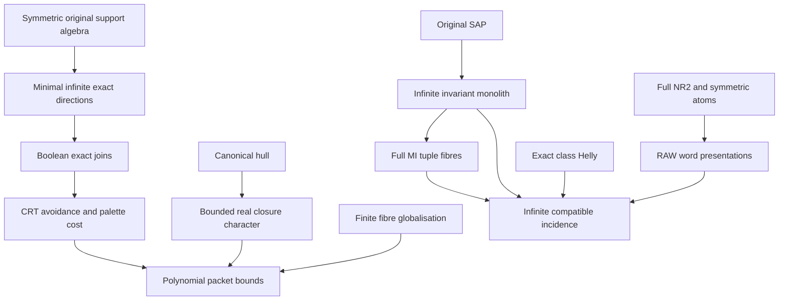

# Real algebraic closure bounds, SAP monolith and terminal original incidence

Generated from `module.json` by `tools/build_formalization_module.py`.

Source `490c3f36d85db5a0b3ced0598e6c431825254ec5`. **Human-expanded proof plan; no Lean code.**

Preparation for OTHER Lean projects. Full real_hull/06 and /07 yield six numbered results; two selected terminal-word results bring the export total to eight. The coordinate and phase examples are expanded separately. No mathematical Lean implementation or new allocation is made. The palette-cost proof uses prepared CRT/class Helly instead of Neumann.

The human article remains unchanged. Additional proof details are in
[PROOF_NOTES.md](PROOF_NOTES.md); the cross-track policy is in
[the formalization guide](../README.md). Source hashes are checked before
the index is regenerated. Graph validation is not proof verification.

## Source premises

**A01: Elementary original source.** Fix one inhabited named original real sort a in a possibly many-sorted ultrahomogeneous finite complete binary relational source. G is Aut of the WHOLE ambient source and acts transitively on a. The finite same-sort palette consists of actual G-pair orbitals, with logical equality separate. Relations and equivalences below are G-invariant on a. Finite induced same-sort partial isomorphisms extend ambiently by homogeneity; no extension of an arbitrary full automorphism of the sort reduct is assumed. The one-sort article is the special case.

**A02: Symmetric original pair orbitals.** For the symmetric branches every same-sort original G-pair orbital on the fixed a is symmetric. This gives commutation of invariant endorelations, without SAP or CCO.

**A03: AP and original semantic homomorphic CCO.** The original age has AP and finite partial diversity diagrams satisfy semantic homomorphic CCO. Use the exact named providers with these hypotheses; no arbitrary imaginary inheritance is assumed.

**A04: Age strong amalgamation.** The actual original age has SAP over complete induced finite bases. This is independent of symmetry and CCO.

**A05: Full-lattice no relative index two.** Optional terminal condition on the FULL lattice of G-invariant equivalences on the fixed named sort a: no relative-index-two interval. The stronger source no proper finite-index interval implies it. Never replace this full lattice by an exact sublattice or replace G by an unproved automorphism extension.

**A06: Elementary combinatorics and orbit definitions.** Classical finite sets/cardinals, finite lattice maximality and finite pigeonhole; natural-number coordinate models and permutations. Algebraicity is finite pointwise-stabilizer orbit, identified with finite-formula algebraicity by the finite complete binary one-point formula. No Neumann or infinite Ramsey input is imported.

## Imported theorem contracts

These are named provider obligations for the receiving Lean project,
not new axioms or claims of compiled imports.

| ID and source | Contract | Current provider status |
|---|---|---|
| I01: [`thm:rh-hull`](../../sections/real_hull/05_even_walk_canonical_hull.tex#L27) | A finite actual one-point orbit over a finite real base lies in a finite canonical intersection of original Gamma classes; conversely any such finite intersection contains the orbit. Empty base and on-base equality are handled separately. | HUMAN_EXPANDED_NOT_LEAN |
| I02: [`thm:rh-globalise`](../../sections/real_hull/02_global_finite_fibre_fixer.tex#L286) | A finite realised complete one-point fibre is one whole class of an original finite-class invariant equivalence. Uniqueness of internal lifts is only inside the relevant interval. | HUMAN_EXPANDED_NOT_LEAN |
| I03: [`cor:rh-class-2power`](../../sections/real_hull/03_invariant_class_packets.tex#L314) | An original invariant class with f internal diversity atoms, if finite, has size a power of two at most 2^f. | HUMAN_EXPANDED_NOT_LEAN |
| I04: [`lem:rh-evenwalk`](../../sections/real_hull/05_even_walk_canonical_hull.tex#L8) | Even connectivity of one symmetric diversity atom is represented by one positive even atomic word; it is Gamma(a) when a is looped. | HUMAN_EXPANDED_NOT_LEAN |
| I05: [`lem:acf-exact-distributive`](../../sections/exact_lattice_crt.tex#L52) | The actual FULL RAW exact original equivalences form a finite distributive sublattice of the full invariant-equivalence lattice. Meets and joins agree with the full lattice; F need not belong to this sublattice. | HUMAN_EXPANDED_NOT_LEAN |
| I06: [`thm:full-typed-exact-balls`](../../sections/exact_foundations/01_full_raw_exact_helly.tex#L27) | Finite pairwise-intersecting actual FULL RAW exact balls on one original sort have a common original real point. Different centres are allowed; no SAP is required. | HUMAN_EXPANDED_NOT_LEAN |
| I07: [`lem:cco-triangle-fullness`](../../sections/triangle_fullness.tex#L2) | Under age AP and original semantic homomorphic CCO, every finite complete triangle-legal original diagram belongs to the age. | HUMAN_SUPPORT_PROOF_NOT_LEAN |

## Definitions

| ID | Definition | Exact meaning | Source |
|---|---|---|---|
| D01 | Full original invariant lattice | All actual G-invariant equivalences on the fixed original sort a, ordered by relation inclusion; finitely many since each is a union of finitely many actual G-pair orbitals. Top and Id are actual universal relation and equality on a. | [source](../../sections/real_hull/07_sap_mi_intersection_geometry.tex#L10) |
| D02 | Greatest finite-class packet F | F is the greatest full invariant equivalence whose real classes are finite, constructed in C02. It is not assumed RAW exact. f and d_infty count atom NAMES inside and outside F. | [source](../../sections/real_hull/06_minimal_infinite_directions_acl.tex#L3) |
| D03 | Minimal infinite directions | The distinct inclusion-minimal full invariant equivalences with infinite classes; r is their finite count. Empty list exactly when the transitive source is finite. | [source](../../sections/real_hull/06_minimal_infinite_directions_acl.tex#L1) |
| D04 | Exact finite-class join Kfin | Join of all finite-class FULL RAW exact original equivalences, including Id; constructed inside the exact sublattice. It is at most F and equality is not presumed. | [source](../../sections/real_hull/06_minimal_infinite_directions_acl.tex#L26) |
| D05 | Boolean direction joins | A_S=Kfin join all E_i for i in S; A_empty=Kfin. All these belong to the actual exact sublattice. | [source](../../sections/real_hull/06_minimal_infinite_directions_acl.tex#L36) |
| D06 | Real algebraic and definable closure | For a finite real base A in a, acl_a(A) is the union of finite G_A-orbits on a and dcl_a(A) the fixed-point set. The finite complete one-point formula and ambient homogeneity identify these with ambient formula algebraicity/definability on this sort. No arbitrary sort-reduct automorphism lift is assumed. | [source](../../sections/real_hull/06_minimal_infinite_directions_acl.tex#L93) |
| D07 | Original Gamma connectivity | Gamma(p) is the full invariant equivalence generated by actual symmetric atom p, not automatically RAW word-exact. | [source](../../sections/real_hull/06_minimal_infinite_directions_acl.tex#L105) |
| D08 | Finite closure polynomial | For infinite M, n=|A|, c is the uniform finite size of F-classes, f the number of internal atoms and d_infty the number outside F. | [source](../../sections/real_hull/06_minimal_infinite_directions_acl.tex#L162) |
| D09 | SAP monolith | For infinite SAP M, the meet of all nonidentity full original invariant equivalences, including Top. Its nontriviality is proved, not assumed. | [source](../../sections/real_hull/07_sap_mi_intersection_geometry.tex#L11) |
| D10 | Proper nonidentity full MI family | All proper meet-irreducibles in the full lattice except real Id, even when Id is meet-irreducible. Empty meet is Top. No distributivity is implicit. | [source](../../sections/real_hull/07_sap_mi_intersection_geometry.tex#L81) |
| D11 | Actual quotient tuple map | Phi(x) is the tuple of actual equivalence classes of x for all named proper nonidentity MI kernels. Only realised tuples are claimed to have fibres before a separate compatibility theorem. | [source](../../sections/real_hull/07_sap_mi_intersection_geometry.tex#L95) |
| D12 | Terminal RAW atomic words | Empty atomic word represents actual Id; positive words are actual represented relation products including identity outputs. No STRONG identity atom is introduced. | [source](../../sections/terminal_invariant_raw_exact.tex#L25) |
| D13 | Coordinate and phase sources | N^r with nonempty difference-support atoms; N^2 times F2 with two equality flags and phase difference. Finite snapshots are controls, not infinite SAP/CCO certificates. | [source](../../sections/real_hull/06_minimal_infinite_directions_acl.tex#L230) |

## Proof claims and direct dependencies

Every row has a human proof expansion. Each still needs an actual Lean
statement and proof. SAP monolith/MI geometry does not require symmetry or CCO; terminal words require symmetry and full NR2 but no SAP or CCO.

| ID and claim | Scope | Direct providers | Proof note |
|---|---|---|---|
| C01: Finite full lattice and symmetric permutability | symmetric_elementary | D01, A02 | N01 in [notes](PROOF_NOTES.md) |
| C02: Existence of greatest finite packet | symmetric_elementary | C01, D02 | N01 in [notes](PROOF_NOTES.md) |
| C03: Minimal infinite directions are word exact | ap_cco | C01, D03, D07, A06, I04, I07 | N01 in [notes](PROOF_NOTES.md) |
| C04: Finite exact bottom Kfin | exact_lattice | C01, C02, D04, I05 | N01 in [notes](PROOF_NOTES.md) |
| C05: Boolean direction intersection identities | exact_lattice | C03, C04, D05, I05 | N02 in [notes](PROOF_NOTES.md) |
| C06: Every Boolean facet has infinite relative index | exact_lattice | C05 | N02 in [notes](PROOF_NOTES.md) |
| C07: Facet-class CRT avoidance of nonexact F | exact_lattice | C06, C02, I06 | N02 in [notes](PROOF_NOTES.md) |
| C08: Distinct outside-F atom for every nonempty subset | exact_lattice | C07, C05 | N02 in [notes](PROOF_NOTES.md) |
| C09: Exact real algebraicity criterion | real_closure | D06, D03, D07, C01, I01 | N03 in [notes](PROOF_NOTES.md) |
| C10: Bounded character with all boundary cases | real_closure | C09 | N03 in [notes](PROOF_NOTES.md) |
| C11: Singleton closure and rank one | real_closure | C09, C02, C10 | N03 in [notes](PROOF_NOTES.md) |
| C12: Finite actual one-point fibres are bounded by c | real_closure | I02, C02 | N04 in [notes](PROOF_NOTES.md) |
| C13: Packet size bound | real_closure | C02, I03, D08 | N04 in [notes](PROOF_NOTES.md) |
| C14: Polynomial algebraic closure bound | real_closure | C10, C12, C13, C08 | N04 in [notes](PROOF_NOTES.md) |
| C15: Whole finite packets and packet count | real_closure | C14, C02 | N04 in [notes](PROOF_NOTES.md) |
| C16: Real acl=dcl when F is identity | real_closure | C12, D06 | N04 in [notes](PROOF_NOTES.md) |
| C17: Coordinate source satisfies the original hypotheses | examples | D13, A06 | N05 in [notes](PROOF_NOTES.md) |
| C18: Coordinate directions and sharp closure exponent | examples | C17 | N05 in [notes](PROOF_NOTES.md) |
| C19: SAP gives infinite off-base stabilizer orbits | sap_elementary | A01, A04, D06 | N06 in [notes](PROOF_NOTES.md) |
| C20: Two nonidentity equivalences have infinite meet classes | sap_elementary | C19, D01 | N06 in [notes](PROOF_NOTES.md) |
| C21: Unique infinite SAP monolith and trivial real acl | sap_elementary | C20, C19, D09 | N06 in [notes](PROOF_NOTES.md) |
| C22: Finite-lattice MI reconstruction without distributivity | finite_lattice | A06 | N07 in [notes](PROOF_NOTES.md) |
| C23: Full nonidentity MI meet equals monolith | sap_elementary | C21, C22, D10, D11 | N07 in [notes](PROOF_NOTES.md) |
| C24: Tuple stabilizer is transitive on its infinite real fibre | sap_elementary | C23, A01 | N07 in [notes](PROOF_NOTES.md) |
| C25: No full index two implies nonbipartite atomic components | terminal_elementary | C01, D12 | N08 in [notes](PROOF_NOTES.md) |
| C26: Uniform positive atomic powers | terminal_elementary | C25, C01, A06 | N08 in [notes](PROOF_NOTES.md) |
| C27: All full original equivalences are one RAW word | terminal_elementary | C26, C01 | N08 in [notes](PROOF_NOTES.md) |
| C28: Terminal full lattice is distributive under CCO | terminal_cco | C27, I05 | N09 in [notes](PROOF_NOTES.md) |
| C29: Pairwise exact classes have one infinite common class | sap_exact_helly | I06, C20, C21 | N09 in [notes](PROOF_NOTES.md) |
| C30: Terminal upgrade to all nonidentity classes | sap_exact_helly | C29, C27 | N09 in [notes](PROOF_NOTES.md) |
| C31: Full MI compatibility iff realised, with infinite fibres | sap_exact_helly | C30, C23, C24 | N09 in [notes](PROOF_NOTES.md) |
| C32: Cartesian phase source is homogeneous AP and CCO | examples | A06 | N10 in [notes](PROOF_NOTES.md) |
| C33: Phase corners exceed packet closure | examples | C32 | N10 in [notes](PROOF_NOTES.md) |
| C34: Phase packet need not be RAW exact | examples | C32 | N10 in [notes](PROOF_NOTES.md) |

The precise quantified contracts are in `module.json`. Provider-before-consumer
order (including definitions and source premises):

`A01 → A02 → A03 → A04 → A05 → A06 → C22 → C32 → D01 → D06 → D07 → D13 → I01 → I02 → I03 → I04 → I05 → I06 → I07 → C01 → C17 → C19 → C33 → C34 → D02 → D03 → D04 → D09 → D10 → D12 → C02 → C03 → C09 → C18 → C20 → C25 → D05 → D08 → D11 → C04 → C10 → C12 → C13 → C21 → C26 → C05 → C11 → C16 → C23 → C27 → C29 → C06 → C24 → C28 → C30 → C07 → C31 → C08 → C14 → C15`

This order is one valid linearization; it does not require unrelated
branches to be proved sequentially. The full DAG is the `depends_on`
relation in `module.json`.

## Main proof branches

This is a coarse view of the claim DAG. Edges go from provider to consumer.

F need not be exact; only Kfin and Boolean direction joins use exact distributivity.
The SAP/MI branch and coordinate examples are independent of the closure/CRT branch.
Finite-lattice MI reconstruction does not use distributivity. No new Neumann or infinite Ramsey dependency is imported.

## Article exports

| Existing source result | Sidecar proof claims |
|---|---|
| [`lem:rh-direction-palette-bound`](../../sections/real_hull/06_minimal_infinite_directions_acl.tex#L1) | C01, C02, C03, C04, C05, C06, C07, C08 |
| [`cor:rh-acl-bounded-character`](../../sections/real_hull/06_minimal_infinite_directions_acl.tex#L85) | C09, C10, C11, C08 |
| [`cor:rh-acl-polynomial-growth`](../../sections/real_hull/06_minimal_infinite_directions_acl.tex#L157) | C12, C13, C14, C15, C16 |
| [`lem:rh-sap-invariant-monolith`](../../sections/real_hull/07_sap_mi_intersection_geometry.tex#L1) | C19, C20, C21 |
| [`cor:rh-sap-mi-joint-real-fibre`](../../sections/real_hull/07_sap_mi_intersection_geometry.tex#L73) | C22, C23, C24 |
| [`cor:rh-sap-infinite-exact-helly`](../../sections/real_hull/07_sap_mi_intersection_geometry.tex#L158) | C29, C30, C31 |
| [`lem:typed-all-invariant-equivalences-raw-word`](../../sections/terminal_invariant_raw_exact.tex#L5) | C25, C26, C27 |
| [`lem:typed-terminal-all-equivalences-exact`](../../sections/terminal_invariant_raw_exact.tex#L87) | C27, C28 |

Full result coverage is asserted only for `source_result_files`.
Selected additional results: lem:typed-all-invariant-equivalences-raw-word, lem:typed-terminal-all-equivalences-exact.
Other results in their provider source files are not claimed covered.

## Internal implementation milestones

These tasks are proof milestones inside larger project assignments;
see the [peer-project allocation](../coordination/BOARD.md).

These are implementation tasks, not additional mathematical assumptions.

| Task | Earlier tasks | Acceptance |
|---|---|---|
| T01: Minimal infinite cuts, Boolean directions and palette cost | — | Implement the exact quantified contracts and source mappings; preserve the dependency firewalls and all empty/finite/identity boundaries. |
| T02: Real closure character and polynomial packet bounds | T01 | Implement the exact quantified contracts and source mappings; preserve the dependency firewalls and all empty/finite/identity boundaries. |
| T03: SAP monolith and full-lattice MI incidence | — | Implement the exact quantified contracts and source mappings; preserve the dependency firewalls and all empty/finite/identity boundaries. |
| T04: CCO-free terminal words and full distributivity | T01 | Implement the exact quantified contracts and source mappings; preserve the dependency firewalls and all empty/finite/identity boundaries. |
| T05: Infinite exact Helly and terminal MI compatibility | T03, T04 | Implement the exact quantified contracts and source mappings; preserve the dependency firewalls and all empty/finite/identity boundaries. |
| T06: Independent coordinate and Cartesian phase sources | — | Implement the exact quantified contracts and source mappings; preserve the dependency firewalls and all empty/finite/identity boundaries. |

## Finite controls

- **R01.** Coordinate support equivalences, sharp n^r closures and the polynomial bound.
- **R02.** Actual phase-product atom algebra, finite packets and two-coordinate corners.
- **R03.** Full finite lattice monolith/MI reconstruction, including primitive empty lists.
- **R04.** Coordinate class compatibility and facet avoidance with finite forbidden sets.
- **R05.** Actual F3² direction-colour algebra: no index-two interval and all invariant equivalences are RAW words, but the full invariant lattice is nondistributive. No CCO is claimed.

Run `python tools/check_real_closure_controls.py` from the manuscript directory.
The controls do not prove CCO or the general theorems.

## Return to the human articles

No required mathematical repair was found in this scoped pass. These
optional wording clarifications remain queued for a human article pass:

- **F01** ([source](../../sections/real_hull/06_minimal_infinite_directions_acl.tex#L69)): Palette cost has a proof using the prepared exact class Helly, with one facet class avoiding the finite F-class. No Neumann theorem is needed for this result. Use the CRT proof or retain it as an alternative; F remains potentially nonexact.
- **F02** ([source](../../sections/real_hull/06_minimal_infinite_directions_acl.tex#L33)): Minimal infinite exactness needs only a looped atom in the infinite class, triangle fullness and its even-word connectivity, not the full packet/minimal-cut quotient theorem. State this selected elementary route to avoid importing later quotient geometry.
- **F03** ([source](../../sections/real_hull/07_sap_mi_intersection_geometry.tex#L40)): Arbitrarily large finite amalgams must yield points in one fixed class, using base alignment and transitivity. Align each amalgam back to the fixed anchor, or invoke uniform class size before inferring infinite classes.
- **F04** ([source](../../sections/real_hull/07_sap_mi_intersection_geometry.tex#L114)): Full MI reconstruction uses finite maximal separation, without distributivity. The full-lattice family excludes real Id. Keep this elementary theorem distinct from distributive MI-primality.
- **F05** ([source](../../sections/terminal_invariant_raw_exact.tex#L18)): Terminal word presentations are CCO/SAP-free, but full lattice distributivity and class Helly require CCO exact geometry. Keep separate providers and full original NR2; never infer hidden SAP from real incidence.

The machine ledger records caller effects and affected claims. The source
review used two independent model review passes and parent synthesis;
it is not independent human or formal certification.
