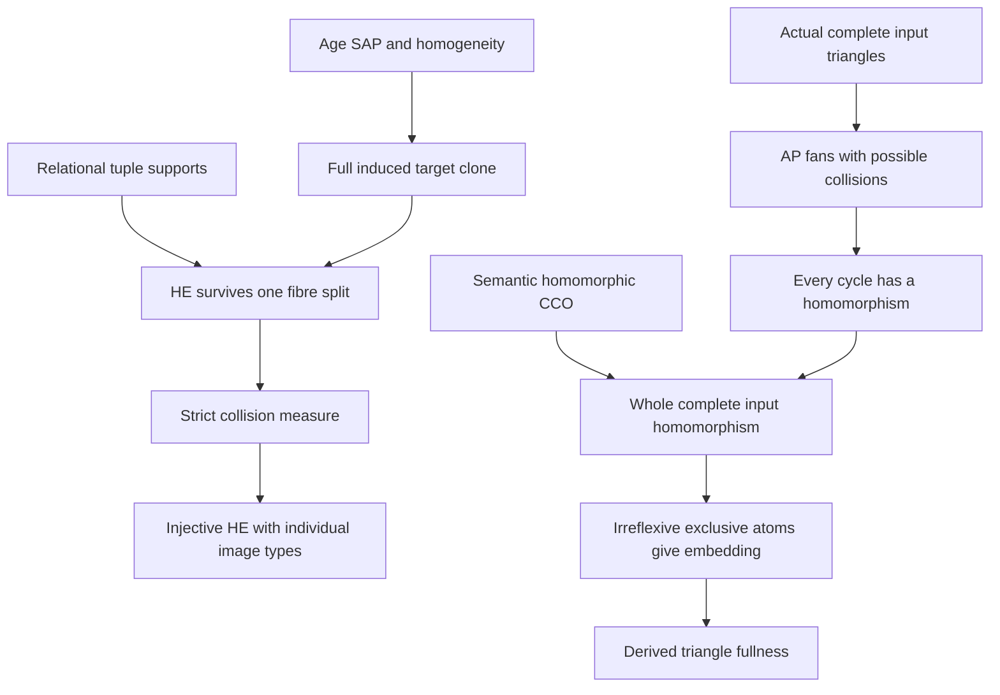

# Relational SAP collision unfolding and AP+CCO triangle fullness

Generated from `module.json` by `tools/build_formalization_module.py`.

Source `490c3f36d85db5a0b3ced0598e6c431825254ec5`. **Human-expanded proof plan; no Lean code.**

Private B038: TWO Foundations I helpers, no equations/imports/external theorem nodes. In a countable homogeneous PURELY RELATIONAL U with age SAP, unfold a finite HE source map into an injection, retaining the induced type of EACH distinguished IMAGE separately. The relational signature need not be finite; every symbol has finite arity. Independently, derive triangle fullness for COMPLETE atomic binary diagrams from heredity, AP and semantic HOMOMORPHIC CCO using actual star chords and possibly colliding AP fans. The triangle proof uses neither SAP, homogeneity/countability, collision unfolding nor an assumed FULL triangle class. Ancillary external-provider build-cache guidance is engineering handoff material, not a mathematical premise or a configured public CI change.

The human article remains unchanged. Additional proof details are in
[PROOF_NOTES.md](PROOF_NOTES.md); the cross-track policy is in
[the formalization guide](../README.md). Source hashes are checked before
the index is regenerated. Graph validation is not proof verification.

## Source premises

**A01: Finite partial PURELY RELATIONAL source and given HE.** A is a finite partial relational structure and h:A->U is a homomorphism-embedding (HE), preserving positive tuples and embedding every induced irreducible source piece. The signature may have ARBITRARILY MANY finite-arity relation symbols, including unary sort predicates and nullary relations, but NO functions. Irreducibility forbids a nontrivial free amalgam of proper induced substructures; empty bases are allowed.

**A02: Homogeneous target and strong age amalgamation.** U is a countable homogeneous relational structure and its isomorphism-closed age has SAP. Every finite age member embeds into U, and every finite induced isomorphism inside U extends to an automorphism. No CCO, binary-language restriction, exactness or functional closure is assumed in this branch.

**A03: Distinguished source factors with injective restrictions.** A fixed finite family S_i of distinguished COMPLETE induced source substructures has h restricted to each S_i injective. Retain the source completeness premise; the proof uses this injectivity to preserve the FULL induced type of the TARGET IMAGE h(S_i), not a false assertion that h was already a source-factor embedding.

**A04: Hereditary complete atomic binary setting.** For the independent triangle branch, K is an isomorphism-closed hereditary class of finite COMPLETE atomic binary-coloured diagrams. Every ordered distinct pair has exactly one named irreflexive diversity atom, with correct converses and typed unary tags when present; unary types are complete/exclusive. Equality is the logical diagonal, never a diversity atom. There are no arbitrary extra relational predicates outside this complete atomic code and no functions. No finite palette assumption is needed by the argument. K is NOT assumed to be the FULL triangle-defined class.

**A05: Ordinary AP for the triangle branch.** The complete atomic class K has AP over actual complete induced spans. Off-base vertices may be identified. No SAP, homogeneous target or collision-unfolding oracle is assumed here.

**A06: Semantic HOMOMORPHIC CCO.** A finite partial atomic diagram with locally allowed types/pairs has a colour-preserving homomorphism into a K member whenever each of its specified simple cycles has such a homomorphic realization. Nonadjacent vertices may collide. In particular this implication applies to the complete input once its actual cycles have been verified. This is an INPUT, not the desired triangle-fullness conclusion.

**A07: COMPLETE input with genuine small age diagrams.** A is a finite COMPLETE atomic input and EVERY induced substructure on at most three vertices belongs to K, including its realized unary tags and complete edge colours. The <=3 premise handles the small input cases directly. It is stronger than mere legality of fully displayed triangles in a partial diagram.

## Definitions

| ID | Definition | Exact meaning | Source |
|---|---|---|---|
| D01 | Relation-tuple support and relational irreducibility | For a displayed positive tuple take the induced structure on its DISTINCT entries. A free split must put that whole tuple in one factor, so this support is irreducible. Repeated occurrences do not produce new vertices; nullary truth is unchanged by all vertex maps. | [source](../../sections/foundational_sap_collision_unfolding.tex#L5) |
| D02 | HE versus globally induced embedding | A HE is a positive homomorphism embedding every induced irreducible source piece. Injective HE does not require global relation reflection on a reducible partial input. Distinct-entry tuple supports will ensure GLOBAL positive preservation during a clone step. | [source](../../sections/foundational_sap_collision_unfolding.tex#L5) |
| D03 | Finite complete target image and collision fibre | At a current map h let B be the FULL induced target structure on h(A), not the partial source image diagram. For v in B let F_v={x:h(x)=v}. A collision means |F_v|>=2. | [source](../../sections/foundational_sap_collision_unfolding.tex#L5) |
| D04 | Distinguished IMAGE type invariant | For each marked source S_i retain injectivity of h|S_i and the full induced isomorphism type of h(S_i) in U. The invariant is separate for each i, without preserving their joint image union or literal old positions. | [source](../../sections/foundational_sap_collision_unfolding.tex#L5) |
| D05 | Induced replacement clone | A clone g_v:B->Bprime fixes B minus {v}, sends v to fresh vprime outside B and is an induced isomorphism onto Bprime=(B minus {v}) union {vprime}, preserving ALL relations/negative data and repeated-coordinate instances. | [source](../../sections/foundational_sap_collision_unfolding.tex#L5) |
| D06 | Finite collision measure | mu(h) is the number of unordered distinct source pairs with equal images, equivalently sum_v choose(|F_v|,2). It is a natural number, zero exactly for injective maps. | [source](../../sections/foundational_sap_collision_unfolding.tex#L5) |
| D07 | Complete atomic code embedding test | A colour homomorphism preserves the unique atom on every specified ordered distinct pair, converse labels and complete unary type tags. On complete inputs, irreflexivity gives injection and target atom exclusivity then gives reflection, including false off-diagonal atoms and diagonals. | [source](../../sections/triangle_fullness.tex#L3) |
| D08 | Specified cycle feasibility | A specified simple m-cycle, m>=3, retains its actual oriented edge colours from A and their converses. It need only have a homomorphism into some finite K member, possibly a different host per cycle. Its unrecorded other chords impose no constraints. | [source](../../sections/triangle_fullness.tex#L3) |
| D09 | Partial star fan invariant | For cycle v0,...,v(m-1), F_i on v0,...,v(i+1) records ONLY star edges v0-vj and consecutive path edges vj-v(j+1), with their actual A colours/converses. A state carries a colour homomorphism F_i->H_i in K; it does NOT record every other A pair. | [source](../../sections/triangle_fullness.tex#L3) |
| D10 | AP gluing along the actual complete edge | For incoming T_i={v0,vi,v(i+1)}, i>=2, the current fan is F_(i-1) in host H_(i-1). Its shared complete edge is v0-vi; the fan map there is an induced embedding by D07. AP amalgamates H_(i-1) and T_i along this exact edge and supplies the next F_i map. | [source](../../sections/triangle_fullness.tex#L3) |

## Proof claims and direct dependencies

Every row has a human proof expansion. Each still needs an actual Lean
The relational injectivization branch and complete atomic triangle-fullness branch have independent assumptions. Collision output is an INJECTIVE HE, not necessarily globally induced; distinguished IMAGE types do not assert source-factor embeddings or joint-union preservation. AP fans keep only their recorded star/path edges, allowing identifications until complete-input homomorphic CCO gives global injectivity.

| ID and claim | Scope | Direct providers | Proof note |
|---|---|---|---|
| C01: Every positive tuple has an irreducible distinct-entry support | relational_supports | D01 | N01 in [notes](PROOF_NOTES.md) |
| C02: HE irreducibles contain at most one point of a collision fibre | relational_supports | A01, D02, D03, C01 | N01 in [notes](PROOF_NOTES.md) |
| C03: Distinguished factors also contain at most one fibre point | relational_supports | A03, D04, D03 | N01 in [notes](PROOF_NOTES.md) |
| C04: Use the full finite target image as an age object | clone_construction | A01, A02, D03 | N02 in [notes](PROOF_NOTES.md) |
| C05: Deleting the collision value gives an actual relational base | clone_construction | C04, A01 | N02 in [notes](PROOF_NOTES.md) |
| C06: SAP gives two copies differing outside the whole base | clone_construction | C04, C05, A02 | N02 in [notes](PROOF_NOTES.md) |
| C07: Embed the finite amalgam and align the first copy with old B | clone_construction | C06, A02 | N02 in [notes](PROOF_NOTES.md) |
| C08: The second copy is a full induced replacement clone | clone_construction | C05, C07, D05 | N02 in [notes](PROOF_NOTES.md) |
| C09: Split one current fibre without changing any other source images | homomorphism_and_images | C08, D03 | N03 in [notes](PROOF_NOTES.md) |
| C10: The split is a GLOBAL positive homomorphism | homomorphism_and_images | C01, C02, C08, C09 | N03 in [notes](PROOF_NOTES.md) |
| C11: The split still embeds every irreducible source piece | homomorphism_and_images | C02, C08, C09, C10, D02 | N03 in [notes](PROOF_NOTES.md) |
| C12: Every distinguished IMAGE type and its injectivity survive | homomorphism_and_images | C03, C08, C09, D04 | N03 in [notes](PROOF_NOTES.md) |
| C13: The collision measure decreases by exactly t times r-minus-t | termination | C09, D06 | N03 in [notes](PROOF_NOTES.md) |
| C14: Finite iteration yields an injective HE with all image invariants | termination | C04, C05, C06, C07, C08, C09, C10, C11, C12, C13, D06 | N03 in [notes](PROOF_NOTES.md) |
| C15: Relational collision-unfolding source export | termination | C14 | N03 in [notes](PROOF_NOTES.md) |
| C16: Empty sources, already injective maps and arbitrary signatures | termination | A01, A02, C14, D06 | N03 in [notes](PROOF_NOTES.md) |
| C17: Every fan triangle and shared complete edge is genuinely in K | AP_fans | A04, A07 | N04 in [notes](PROOF_NOTES.md) |
| C18: Start with the first actual triangle and the partial fan invariant | AP_fans | C17, D09 | N04 in [notes](PROOF_NOTES.md) |
| C19: The old fan map embeds the complete shared edge | AP_fans | C18, A04, D07 | N04 in [notes](PROOF_NOTES.md) |
| C20: AP glues the next actual triangle over that pinned edge | AP_fans | C17, C19, A05, D10 | N04 in [notes](PROOF_NOTES.md) |
| C21: Compose all old fan images and append the new triangle vertex | AP_fans | C18, C20 | N04 in [notes](PROOF_NOTES.md) |
| C22: Induct finitely through the fan and recover the closing cycle edge | AP_fans | C18, C19, C20, C21 | N04 in [notes](PROOF_NOTES.md) |
| C23: Every specified simple cycle is homomorphically feasible | AP_fans | C17, C18, C19, C20, C21, C22 | N04 in [notes](PROOF_NOTES.md) |
| C24: Semantic HOM CCO gives one whole-input homomorphism | triangle_fullness | C23, A06, A07, D08 | N05 in [notes](PROOF_NOTES.md) |
| C25: Completeness and irreflexive diversity force global injectivity | atomic_reflection | C24, A04, A07, D07 | N05 in [notes](PROOF_NOTES.md) |
| C26: Unique complete atoms give full induced reflection | atomic_reflection | C24, C25, A04, D07 | N05 in [notes](PROOF_NOTES.md) |
| C27: Heredity gives membership of the complete source A | triangle_fullness | C25, C26, A04 | N05 in [notes](PROOF_NOTES.md) |
| C28: The at-most-three-point premise handles all small input cases | triangle_fullness | A07 | N05 in [notes](PROOF_NOTES.md) |
| C29: AP plus semantic homomorphic CCO derives triangle fullness | triangle_fullness | C27, C28 | N05 in [notes](PROOF_NOTES.md) |
| C30: AP without SAP does not guarantee relational collision unfolding | boundary | D02, C15 | N06 in [notes](PROOF_NOTES.md) |
| C31: An injective HE can still fail global inducedness | boundary | D02, C15 | N06 in [notes](PROOF_NOTES.md) |
| C32: Separate distinguished image types do not determine their joint union | boundary | D04, C12, C15 | N06 in [notes](PROOF_NOTES.md) |
| C33: AP and legal triples without CCO do not imply fullness | boundary | C23, C29 | N06 in [notes](PROOF_NOTES.md) |
| C34: Partial displayed-triangle legality is weaker than the input premise | boundary | C17, C29 | N06 in [notes](PROOF_NOTES.md) |
| C35: Deleting a target point need not be an actual functional base | boundary | C05, C15 | N06 in [notes](PROOF_NOTES.md) |

The precise quantified contracts are in `module.json`. Provider-before-consumer
order (including definitions and source premises):

`A01 → A02 → A03 → A04 → A05 → A06 → A07 → C17 → C28 → D01 → D02 → D03 → D04 → D05 → D07 → D08 → D09 → D10 → C01 → C03 → C04 → C18 → D06 → C02 → C05 → C19 → C06 → C20 → C07 → C21 → C08 → C22 → C09 → C23 → C10 → C12 → C13 → C24 → C11 → C25 → C14 → C26 → C15 → C16 → C27 → C29 → C30 → C31 → C32 → C35 → C33 → C34`

This order is one valid linearization; it does not require unrelated
branches to be proved sequentially. The full DAG is the `depends_on`
relation in `module.json`.

## Main proof branches

This is a coarse view of the claim DAG. Edges go from provider to consumer.

No mathematical provider imports or external theorem nodes are added; the five existing HN/HKN receiving binding records are unchanged.
The collision signature may be infinite; finite vertex supports and full induced maps suffice. No functions occur in that branch.
Distinguished source injectivity preserves each target IMAGE type, not source reflection, a joint-union diagram or all literal images.
Triangle fullness is derived from AP and semantic HOM CCO. Do not import an assumed FULL triangle class from another module.
Fan homomorphisms may collide at nonadjacent vertices; global injection follows only for the final COMPLETE input.
External-provider build-cache guidance is included in the handoff but configures no public CI and introduces no mathematical premise.

## Article exports

| Existing source result | Sidecar proof claims |
|---|---|
| [`lem:collision-unfolding`](../../sections/foundational_sap_collision_unfolding.tex#L5) | C14, C15 |
| [`lem:cco-triangle-fullness`](../../sections/triangle_fullness.tex#L2) | C27, C28, C29 |

## Internal implementation milestones

These tasks are proof milestones inside larger project assignments;
see the [peer-project allocation](../coordination/BOARD.md).

These are implementation tasks, not additional mathematical assumptions.

| Task | Earlier tasks | Acceptance |
|---|---|---|
| T01: Positive tuple supports and image invariants | — | Keep the two branches independent. Collision unfolding is pure relational and preserves distinguished IMAGE types; prove global positive preservation via ALL tuple supports and exact t(r-t) measure. Triangle fans use actual complete chords but ONLY record star/path edges; AP may identify nonadjacent vertices. Invoke semantic CCO only after all cycles, then derive injection/reflection from COMPLETE atomic input. Do not assume B033 FULL class, add SAP to the triangle branch or make a partial-triangle completion claim. |
| T02: Strong target clones and literal homogeneity alignment | — | Keep the two branches independent. Collision unfolding is pure relational and preserves distinguished IMAGE types; prove global positive preservation via ALL tuple supports and exact t(r-t) measure. Triangle fans use actual complete chords but ONLY record star/path edges; AP may identify nonadjacent vertices. Invoke semantic CCO only after all cycles, then derive injection/reflection from COMPLETE atomic input. Do not assume B033 FULL class, add SAP to the triangle branch or make a partial-triangle completion claim. |
| T03: Global HE preservation and strict collision termination | T01, T02 | Keep the two branches independent. Collision unfolding is pure relational and preserves distinguished IMAGE types; prove global positive preservation via ALL tuple supports and exact t(r-t) measure. Triangle fans use actual complete chords but ONLY record star/path edges; AP may identify nonadjacent vertices. Invoke semantic CCO only after all cycles, then derive injection/reflection from COMPLETE atomic input. Do not assume B033 FULL class, add SAP to the triangle branch or make a partial-triangle completion claim. |
| T04: Actual AP fans and homomorphic cycle feasibility | — | Keep the two branches independent. Collision unfolding is pure relational and preserves distinguished IMAGE types; prove global positive preservation via ALL tuple supports and exact t(r-t) measure. Triangle fans use actual complete chords but ONLY record star/path edges; AP may identify nonadjacent vertices. Invoke semantic CCO only after all cycles, then derive injection/reflection from COMPLETE atomic input. Do not assume B033 FULL class, add SAP to the triangle branch or make a partial-triangle completion claim. |
| T05: Semantic CCO and complete atomic reflection | T04 | Keep the two branches independent. Collision unfolding is pure relational and preserves distinguished IMAGE types; prove global positive preservation via ALL tuple supports and exact t(r-t) measure. Triangle fans use actual complete chords but ONLY record star/path edges; AP may identify nonadjacent vertices. Invoke semantic CCO only after all cycles, then derive injection/reflection from COMPLETE atomic input. Do not assume B033 FULL class, add SAP to the triangle branch or make a partial-triangle completion claim. |
| T06: Scope and counterexample diagnostics | T01, T02, T03, T04, T05 | Keep the two branches independent. Collision unfolding is pure relational and preserves distinguished IMAGE types; prove global positive preservation via ALL tuple supports and exact t(r-t) measure. Triangle fans use actual complete chords but ONLY record star/path edges; AP may identify nonadjacent vertices. Invoke semantic CCO only after all cycles, then derive injection/reflection from COMPLETE atomic input. Do not assume B033 FULL class, add SAP to the triangle branch or make a partial-triangle completion claim. |

## Finite controls

- **K01.** Actual bounded relational maps, tuple supports and full induced clone diagrams, distinguished image invariants and exact collision-measure descent, including higher-arity/repeated-coordinate tuples.
- **K02.** Ordinary AP fans with collisions, complete-colour injection/reflection, and matching/no-SAP, missing-CCO and partial-triangle negative controls. Finite models are diagnostics, not an unbounded homogeneous SAP/CCO theorem.

Run `python tools/check_relational_completion_controls.py` from the manuscript directory.
The controls do not prove CCO or the general theorems.

## Return to the human articles

No required mathematical repair was found in this scoped pass. These
optional wording clarifications remain queued for a human article pass:

- **F01** ([source](../../sections/foundational_sap_collision_unfolding.tex#L42)): Embedding every irreducible piece alone should be accompanied by explicit GLOBAL homomorphism preservation. Every positive relation tuple has an irreducible distinct-entry support, so at most one distinct point of the split fibre occurs; repeated occurrences move together. Add the arbitrary-arity tuple-support sentence, the literal first-copy alignment and the exact collision drop t(r-t). Clarify preservation of each IMAGE type rather than source reflection or a joint-union type.
- **F02** ([source](../../sections/triangle_fullness.tex#L13)): The AP induction maintains a homomorphism of a PARTIAL star/path fan, not the full induced A on its current vertices. Its pinned complete edge embeds because of atomic irreflexivity/exclusivity, but the incoming point may identify with an old nonneighbor. State the partial fan invariant and compose the old fan map through every AP host embedding. Separate all-cycle feasibility, semantic CCO, and complete-input injection/reflection.

The machine ledger records caller effects and affected claims. The source
review used two independent model review passes and parent synthesis;
it is not independent human or formal certification.
