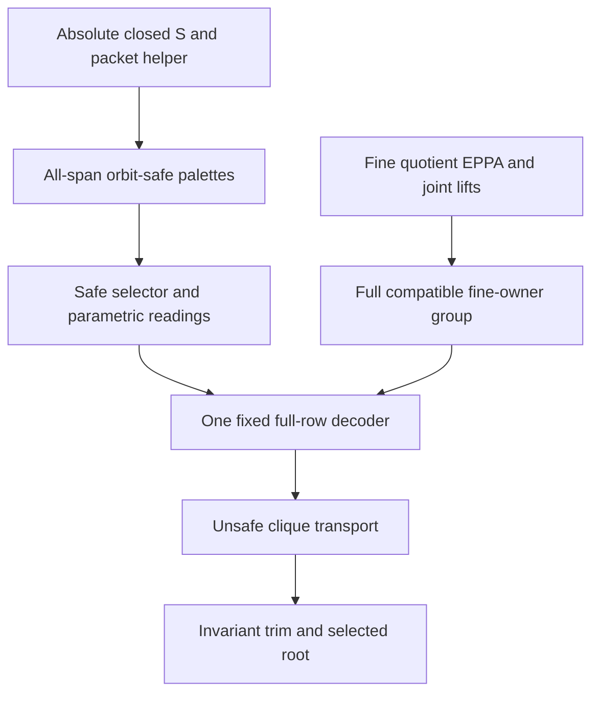

# Orbit-safe matrices and one normalized relative rooted MI witness

Generated from `module.json` by `tools/build_formalization_module.py`.

Source `490c3f36d85db5a0b3ced0598e6c431825254ec5`. **Human-expanded proof plan; no Lean code.**

Candidate private B028: four orbit-safe packet lemmas, unsafe multi-packet transport and the normalized relative MI construction. The local parametric moving-reading proof applies to ANY h with the explicit original-family axioms and is then instantiated with the augmented safe selector restricted to original H. Ordinary EPPA is assumed ONLY for Age(Q/E); no EPPA of Q, same-rank owner master, raw SAP, group section or global rooted theorem is imported. B027 retains its published-HKN/pending local Lean-adapter qualification.

The human article remains unchanged. Additional proof details are in
[PROOF_NOTES.md](PROOF_NOTES.md); the cross-track policy is in
[the formalization guide](../README.md). Source hashes are checked before
the index is regenerated. Graph validation is not proof verification.

## Source premises

**A01: Actual symmetric-original homogeneous source.** Q is nonempty transitive homogeneous in a FINITE complete symmetric binary language with actual equality-inclusive RAW orbitals and commutation of invariant endorelations. No SAP of the original real age, NR2, EPPA or safety is part of this premise.

**A02: Original semantic homomorphic CCO.** Q has semantic homomorphic CCO. Actual owner/coordinate equivalences used for RAW joint lifting are FULL RAW EXACT; inheritance and exactness are retained explicitly. This does not imply a completed global EPPA theorem.

**A03: Infinite normalized one-direction source and exact coarse owner.** Q is infinite with NO nonidentity finite-class full exact invariant equivalence and exactly ONE minimal infinite equivalence E in the FULL invariant lattice. Its actual exactness is derived from minimalcut; F=F_Q is the greatest finite-class invariant equivalence and need not itself be exact or Id. H is an ACTUAL FULL RAW EXACT invariant equivalence with E<=H; H=E or Top is allowed. R_E=F, thinness and absolute unary closure are derived, not substituted assumptions.

**A04: Given original strong absolute closed-S amalgamation.** S_Q is a GIVEN set of ORIGINAL diversity atom names strongly amalgamating every finite ABSOLUTELY real-acl_Q-closed complete induced span, including empty base. S_Q is not assumed invariant under unilateral thin translations. No nonempty typed orbit-safe palette or all-span transversal safe amalgamation is assumed before it is proved.

**A05: Ordinary EPPA ONLY in the fine quotient.** Age(Q/E) has ordinary EPPA. This is the sole age-level EPPA premise in B028. It is applied to the fine owner source X=Q/E, never to Q or a same-rank rooted/owner-master theorem.

**A06: Current actual RAW-provider countability.** Countability is retained where the currently prepared actual RAW/joint exact quotient providers are instantiated. Pure finite regular-action, selector-parameter, row correction and orbit-trim calculations do not independently use countability.

**A07: Original finite input, entire coarse witness and requests.** A0 subset Q is finite NONEMPTY. B subset Q/H is finite induced, contains pi_H(A0), is an ordinary EPPA witness for that projection, has Gamma_B*pi_H(A0)=B for Gamma_B=FULL Aut(B), and is closed under the greatest finite-class equivalence of the actual quotient Q/H. A request (p,gamma) is any original-language partial automorphism p:A0->A0 with gamma in Gamma_B and pi_H(p(x))=gamma pi_H(x) for every domain point. Retain EVERY (empty,gamma).

**A08: Local displayed full-owner packet context.** For the standalone orbit-safe/interface statements, U is a finite NONEMPTY G-closed actual E-owner set, N_U its entire real preimage, G the actual elementary abelian thin group REGULAR on real F-packets, and Gamma a supplied group of genuine U automorphisms with compatible pure owner lifts. Its owner action may be nonfree/nonfaithful; Gamma commutes with G and contains diagonal thin owners when readings are used. B025 supplies actual named homogeneity/closed SAP and primitive triangle-defined transversal with inflation. These displayed local data are CONSTRUCTED at C24-C30 for the final MI application, not new principal hypotheses of that construction.

## Imported theorem contracts

These are named provider obligations for the receiving Lean project,
not new axioms or claims of compiled imports.

| ID and source | Contract | Current provider status |
|---|---|---|
| I01: [`thm:joint-exact`](../../sections/exact_foundations/03_joint_exact_sort_lifting.tex#L127) | Every genuine finite joint real/full-exact-owner partial isomorphism extends to ONE original automorphism. Check the ENTIRE supplied coarse/fine owner set and all mixed pairs before applying this contract; no lifting section is inferred. | HUMAN_EXPANDED_NOT_LEAN |
| I02: [`lem:nested-mixed`](../../sections/exact_foundations/02_exact_quotient_orbital_geometry.tex#L144) | For actual nested exact kernels including Id, mixed real/quotient and fine/coarse orbitals factor through the common owner projection. This makes p union gamma on its finite real domain and ENTIRE B a joint partial isomorphism once compatibility is checked. | HUMAN_EXPANDED_NOT_LEAN |
| I03: [`lem:finite-base`](../../sections/exact_eppa_providers.tex#L5) | For an actual homogeneous fine source X->T, supplied finite ambient lifts for all requests and ordinary EPPA of Age(X), obtain ONE finite induced fine witness over the ENTIRE fixed B, retaining each exact coarse gamma. In C26 X is Q/E: this does not import EPPA of Q. | HUMAN_EXPANDED_NOT_LEAN |
| I04: [`lem:acf-owner-provider`](../../sections/owner_master/01_ambient_owner_provider.tex#L28) | Select ONLY C07: for kernel H, (F_Q join H)/H is finite-class and invariant under FULL Aut(Q/H), hence below its greatest finite-class equivalence. Thus finite-class-closed B contains every coarse owner reached by original F_Q/G saturation. The other EPPA-dependent owner-provider claims are NOT selected. | HUMAN_EXPANDED_NOT_LEAN |
| I05: [`lem:finite-exact-normalization-geometric`](../../sections/finite_packets.tex#L246) | Absence of nonidentity finite-class exact kernels implies all F-atoms thin. Do not use the false converse. | HUMAN_EXPANDED_NOT_LEAN |
| I06: [`lem:thin-bottom`](../../sections/finite_packets.tex#L339) | G is finite elementary abelian, regular on actual F-packets and central under ORIGINAL automorphisms. Actual full matrices satisfy col(t_g x,t_h y)=(g+h)col(x,y). The induced owner action may be nonfaithful. | HUMAN_EXPANDED_NOT_LEAN |
| I07: [`cor:rh-acl-bounded-character`](../../sections/real_hull/06_minimal_infinite_directions_acl.tex#L85) | In the infinite ONE-direction source, acl_Q(A)=F[A] for every finite real A, including empty A. This absolute statement is required before original closed-S is applied; relative acl_N alone does not suffice. | HUMAN_EXPANDED_NOT_LEAN |
| I08: [`lem:global-correspondence`](../../sections/global_correspondence.tex#L16) | Select structural C10: if R_E!=F, there is infinite nonidentity exact C with E meet C=Id. Uniqueness of minimal infinite E rules this out; no EPPA or S input. | HUMAN_EXPANDED_NOT_LEAN |
| I09: [`thm:relative-real-closure`](../../sections/owner_transversal_direct.tex#L16) | For residual finite G-closed U, actual acl_N(X)=F[X], whole packets are closed, and every compatible owner action has an original lift fixing literal fine names/functions. Retain B025 source scope. | HUMAN_EXPANDED_NOT_LEAN |
| I10: [`cor:relative-closed-sap`](../../sections/owner_transversal_direct.tex#L139) | Strongly place finite complete full-packet factors over a complete closed packet base in N_U, then align their actual embedded base by named-owner homogeneity. Original raw SAP is not assumed. | HUMAN_EXPANDED_NOT_LEAN |
| I11: [`thm:joint-transversal`](../../sections/owner_transversal_direct.tex#L159) | Actual primitive triangle-defined SAP/CCO owner source and its inflation identify finite origin diagrams with actual full-packet diagrams in N_U. Select C34 for actual age membership and C44-C46 for full inflation/alignment; no arbitrary triangle table is substituted. | HUMAN_EXPANDED_NOT_LEAN |
| I12: [`lem:augmented-safe-algebra`](../../sections/safe_trace_selector.tex#L242) | Once C07 proves all-span strong S^G and C08 its covariance, instantiate B026 C27 on S^G to obtain ONE joint augmented selector h_(S^G). Its restriction to ORIGINAL H satisfies the explicit D10 axioms. It is not identified with B026's separately chosen C24 original selector. | HUMAN_EXPANDED_NOT_LEAN |
| I13: [`prop:moving-readings`](../../sections/owner_covariant_readings.tex#L250) | Reuse the prepared C34-C39 proof, not a silently generalized theorem statement: LOCAL B028 C10-C12 prove its conclusion for ANY supplied h with D10 axioms, then C13/C17 instantiate h_(S^G)|H. Existing B026 exports and constructor remain unchanged. | HUMAN_EXPANDED_NOT_LEAN |
| I14: [`lem:safe-global-completion`](../../sections/safe_trace_selector.tex#L645) | Given one injective origin certificate and all-span strong S^G, obtain one safe same-vertex certificate, ORIGINAL exact greatest-PC survivors, and actual canonical safe completion. A fixed family, not per-request completions; C07 supplies the palette premise. | HUMAN_EXPANDED_NOT_LEAN |
| I15: [`thm:completable-reservoir`](../../sections/hkn_packet_reservoir.tex#L39) | From fixed complete full-packet Aplus and ALL specified/empty Gamma requests, obtain one faithful structural B0 with regular packets, complete-or-missing matrices, exact requested components and an existential injective completion fixing Aplus. Published HKN providers and PENDING local CCO Lean adapters remain explicit in B027; no second valued HKN or invariant certificate is supplied. | HUMAN_EXPANDED_NOT_LEAN |
| I16: [`thm:R07-relative-eppa`](../../sections/full_rows_pc_decoder.tex#L95) | Reuse fixed actual packet universe/PC/colouring and universal correction-matrix lift, with the locally supplied reading axioms and injective origin certificate. All source extensions and clique transports act on the SAME decoder. Existing explicit constructor inputs are discharged by B026/B027 and local C07-C17. | HUMAN_EXPANDED_NOT_LEAN |
| I17: [`lem:acf-recorded-row-zeroing`](../../sections/rooted_mi/01_packet_zeroing_and_multipacket_root.tex#L26) | For one selected actual row per index of a recorded structural clique, every structural map admits ONE legal correction zeroing ALL selected full rows simultaneously. It need not also extend an unrelated source request. | HUMAN_EXPANDED_NOT_LEAN |
| I18: [`lem:acf-invariant-packet-orbit-trim`](../../sections/rooted_mi/02_packet_orbit_trim_and_owner_language.tex#L1) | For global G<=K preserving actual packets, D=union_beta beta(F[A0]) is finite induced full-F-closed and K-invariant. A single packet subset, or any clique already transported into F[A0], has its selected root moved into A0 by ONE global thin translation. Exact coarse owner image is K*pi_H(F[A0]). | HUMAN_EXPANDED_NOT_LEAN |
| I19: [`lem:acf-full-owner-language-faithfulness`](../../sections/rooted_mi/02_packet_orbit_trim_and_owner_language.tex#L50) | When D0 realizes all fine U, forgetting owner component is an isomorphism onto the semilinear IMAGE K, not FULL Aut(D0). ALL empty fine-owner requests give K->Gamma_tilde onto; compose with Gamma_tilde->Gamma_B. Fine support may be lost only AFTER invariant trim. | HUMAN_EXPANDED_NOT_LEAN |
| I20: [`lem:R07-global-diagonal-thin`](../../sections/full_rows_pc_decoder.tex#L594) | The actual GLOBAL G acts on the fixed R07 decoder, keeps each actual packet setwise and preserves effective row readings. No independent packet translations are assumed. | HUMAN_EXPANDED_NOT_LEAN |
| I21: [`prop:minimalcut`](../../sections/finite_packets.tex#L102) | The unique minimal infinite FULL invariant E is a nonidentity actual exact kernel and inherits the actual quotient-source API. The elementary finite-index identity is not substituted for quotient inheritance. | HUMAN_EXPANDED_NOT_LEAN |
| I22: [`thm:exact-sorts-source`](../../sections/exact_foundations/03_joint_exact_sort_lifting.tex#L161) | For ACTUAL full exact E and H, quotient sorts retain homogeneity/actual orbitals and required source inheritance. Used before applying finite-base in X=Q/E. | HUMAN_EXPANDED_NOT_LEAN |

## Definitions

| ID | Definition | Exact meaning | Source |
|---|---|---|---|
| D01 | Actual fine and coarse owners | An E-owner is an actual class [x]_E; H-owners are [x]_H, with E<=H. Retain full canonical actual quotient colours and mixed orbitals, including logical equality. | [source](../../sections/rooted_mi/03_normalised_relative_mi.tex#L2) |
| D02 | Normalized one-direction geometry | F=F_Q may be nonexact; E is the UNIQUE minimal infinite FULL direction, not a selected subset of minima. Normalization implies thin F; absolute unary closure and R_E=F are derived at C24. | [source](../../sections/rooted_mi/03_normalised_relative_mi.tex#L2) |
| D03 | Displayed fine owner set and projection | For the local statements U is finite nonempty G-closed actual E-owners and N_U=pi_E^{-1}(U), with projection pi:U->B whenever coarse data are supplied. Local statements are quantified over any such displayed input; final construction produces U in C26-C29. | [source](../../sections/orbit_safe_packet_completion.tex#L22) |
| D04 | Full compatible fine-owner group | Gamma_tilde consists of EVERY alpha in FULL Aut(U) inducing some gamma in FULL Aut(B) on ENTIRE U. Since U->B is onto, gamma is unique. This is not merely the group generated by selected request extensions. | [source](../../sections/rooted_mi/03_normalised_relative_mi.tex#L2) |
| D05 | Regular real packets and full matrices | A full packet Pi=F[x]={t_g x:g in G} has |G| DISTINCT real vertices, while its owner map g->gs may have nontrivial stabilizers. Full distinct-packet matrices are (g+h)a. H continues to denote the coarse equivalence, not a new stabilizer symbol. | [source](../../sections/orbit_safe_packet_completion.tex#L35) |
| D06 | Orbit-safe palettes | For a in P_st, a in S^G_st iff g a in ORIGINAL S_Q for EVERY g in G. This is equivalent to safety of the ENTIRE G-by-G matrix, and g=0 gives S^G subset S_Q. Nonemptiness is derived, not assumed. | [source](../../sections/orbit_safe_packet_completion.tex#L22) |
| D07 | Inflated absolute closed anchored span | Inflate every transversal vertex to a full real packet. Add helper T meeting all fine owners. The common base C=F[A] union T and factors F[L] union T,F[R] union T are complete original-Q structures and ABSOLUTELY closed via acl_Q=F[-]. Their images must be aligned on the WHOLE complete C before preserving actual owners is asserted. | [source](../../sections/orbit_safe_packet_completion.tex#L112) |
| D08 | Compatible finite source request | (p,gamma), with p an ORIGINAL fine-colour partial automorphism of A0 and gamma in Gamma_B, is compatible iff pi_H p=gamma pi_H on its domain. Empty p retains EVERY prescribed gamma. Entire B is part of the joint-lifting input. | [source](../../sections/rooted_mi/03_normalised_relative_mi.tex#L2) |
| D09 | Augmented orbit-safe family | For original strong exact H_st, K_st=H_st union {D intersect S^G_st: D in H_st and trace nonempty}. h_(S^G) is supplied by B026 only AFTER all-span S^G/covariance are proved. Its original-H restriction need not equal any separately chosen ordinary selector. | [source](../../sections/orbit_safe_packet_completion.tex#L178) |
| D10 | PARAMETRIC original-family selector axioms | For ANY displayed original-family h: nonempty conservative singleton outputs, typed converse, survivor heredity on original exact submenus, all three PC coordinates and pure-Gamma covariance. These are LOCAL per-instance input axioms, not a new assumed global selector or an extension of an existing B026 export signature. Actual exact algebra and endpoint switching are supplied by the displayed owner source. | [source](../../sections/orbit_safe_packet_completion.tex#L178) |
| D11 | Moved-type readings of the supplied h | For ANY h satisfying D10 set h^u_st(D)=u h_(us),t(uD). The moved first owner type is essential. Thin diagonal owner action lies in Gamma. Local C10-C12 prove switching/independent rectangles parametrically before using safe h. | [source](../../sections/orbit_safe_packet_completion.tex#L287) |
| D12 | One fixed actual R07 packet world | Given ONE finite structural B0 and full-row universe W={(i,f,z):f in G^I,z in G}, ACTUAL packets are p=(i,f), not i. A supplied injective origin certificate permits one greatest original PC family D_pq and one decoder. Recorded structural pairs i!=j give singleton c_ij; same-index different-row packets are holes. Later map/correction choices cannot change this world. This local input is constructed at C33-C35. | [source](../../sections/orbit_safe_packet_completion.tex#L178) |
| D13 | Safe all-owner padding | Aplus is one finite complete full-packet source extending the ACTUAL old F[A0], meeting every fine U, with EVERY matrix involving any padding packet original-S-safe, including padding-to-original and padding-to-padding pairs. Realizations are aligned over old complete packets. For C19-C23, the FIXED B0 of D12 is precisely the chosen I15 faithful structural reservoir over THIS Aplus, and THIS Aplus is its literal zero-row source in that SAME fixed decoder. | [source](../../sections/rooted_mi/01_packet_zeroing_and_multipacket_root.tex#L69) |
| D14 | Unsafe cliques and selected roots | A nonempty finite Z is unsafe if EVERY pair of distinct points has original colour outside S_Q; singleton Z is allowed. Multi-packet transport handles at least two ACTUAL packets only; selected-root correction and single-packet cases belong later to invariant trim. | [source](../../sections/rooted_mi/01_packet_zeroing_and_multipacket_root.tex#L69) |
| D15 | Underlying semilinear IMAGE group K | K is the image in vertex permutations of Aut_Gamma_tilde(D0), preserving every literal original fine colour. Before trimming all U occur in zero-row Aplus, so owner components are recoverable on K. K is not asserted to be FULL Aut(D0). | [source](../../sections/rooted_mi/03_normalised_relative_mi.tex#L2) |
| D16 | Invariant full-packet trim | D=union_{beta in K} beta(F[A0]) inside the SINGLE actual D0. It preserves coarse owner support exactly B through K->Gamma_B and the given orbit condition, but may omit some fine U labels. Only the coarse owner action is required to remain exact after restriction. | [source](../../sections/rooted_mi/03_normalised_relative_mi.tex#L2) |

## Proof claims and direct dependencies

Every row has a human proof expansion. Each still needs an actual Lean
statement and proof. Pure finite action, actual absolute/named closure, strong closed-S input, supplied fixed decoder and lower-quotient EPPA have distinct dependency branches.

| ID and claim | Scope | Direct providers | Proof note |
|---|---|---|---|
| C01: Whole packet owner orbit and stabilizer multiplicities | finite_regular_action | D05 | N02 in [notes](PROOF_NOTES.md) |
| C02: One full packet per owner orbit covers U | finite_regular_action | C01, D03 | N02 in [notes](PROOF_NOTES.md) |
| C03: Helper disjoint from the prescribed actual old set | actual_closed_source | C02, I10, I09 | N02 in [notes](PROOF_NOTES.md) |
| C04: Preplace an arbitrary inflated typed span strongly | absolute_closed_S | D07, I10, I09, I11 | N03 in [notes](PROOF_NOTES.md) |
| C05: All-owner anchored factors are ABSOLUTELY closed | absolute_closed_S | C04, C03, I07 | N03 in [notes](PROOF_NOTES.md) |
| C06: Original-language S amalgam aligned on the WHOLE base | absolute_closed_S | C05, A04, A01 | N03 in [notes](PROOF_NOTES.md) |
| C07: Whole real packets yield all-span strong S^G and nonemptiness | absolute_closed_S | C06, I06, I11, D06 | N03 in [notes](PROOF_NOTES.md) |
| C08: Orbit-safe translation, converse and pure-owner laws | absolute_closed_S | D06, I06, A08 | N03 in [notes](PROOF_NOTES.md) |
| C09: Instantiate one augmented safe selector and restrict it | fixed_safe_decoder | C07, C08, I12, D09 | N04 in [notes](PROOF_NOTES.md) |
| C10: LOCAL parametric moved-reading laws | parametric_finite_readings | D10, D11, I13 | N04 in [notes](PROOF_NOTES.md) |
| C11: LOCAL parametric bilateral support | parametric_finite_readings | C10, I13 | N04 in [notes](PROOF_NOTES.md) |
| C12: LOCAL parametric fully independent rectangles | parametric_finite_readings | C11, C10 | N04 in [notes](PROOF_NOTES.md) |
| C13: All safe moving readings preserve S^G | fixed_safe_decoder | C09, C08, C10 | N04 in [notes](PROOF_NOTES.md) |
| C14: One safe certificate and one terminal PC family on actual packets | fixed_safe_decoder | D12, C07, I14 | N05 in [notes](PROOF_NOTES.md) |
| C15: Every recorded structural matrix stays literal | fixed_safe_decoder | C14, C10 | N05 in [notes](PROOF_NOTES.md) |
| C16: All actual hole matrices are safe for all rows and shifts | fixed_safe_decoder | C14, C13, C08 | N05 in [notes](PROOF_NOTES.md) |
| C17: One legal fixed decoder with universal structural lifts | fixed_safe_decoder | C09, C12, C14, C15, C16, I16 | N05 in [notes](PROOF_NOTES.md) |
| C18: Safe moving readings preserve every missing full matrix | fixed_safe_decoder | C13, C17 | N05 in [notes](PROOF_NOTES.md) |
| C19: Unsafe multi-packet clique has one row per recorded index | unsafe_clique_transport | D14, C16 | N06 in [notes](PROOF_NOTES.md) |
| C20: Whole touched structural packet clique is irreducible | unsafe_clique_transport | C19, D12 | N06 in [notes](PROOF_NOTES.md) |
| C21: One faithful structural map enters the padded source | unsafe_clique_transport | C20, I15, D13 | N06 in [notes](PROOF_NOTES.md) |
| C22: One legal full-row correction transports all selected packets | unsafe_clique_transport | C21, I17, C17 | N06 in [notes](PROOF_NOTES.md) |
| C23: Safety excludes every padding packet after transport | unsafe_clique_transport | C22, D13 | N06 in [notes](PROOF_NOTES.md) |
| C24: Derive the residual/absolute-closure/thin inputs | normalized_source_geometry | A03, I21, I08, I07, I05, I06 | N07 in [notes](PROOF_NOTES.md) |
| C25: Actual ambient lifts of the entire finite request list | normalized_source_geometry | D08, C24, I01, I02 | N07 in [notes](PROOF_NOTES.md) |
| C26: Finite-base EPPA is applied only to X=Q/E | lower_quotient_EPPA | C25, I22, I03, A05, A07 | N07 in [notes](PROOF_NOTES.md) |
| C27: G-saturation stays exactly over the coarse B | lower_quotient_EPPA | C26, I04, I06, A07 | N07 in [notes](PROOF_NOTES.md) |
| C28: Selected U1 extensions lift across G-saturation | lower_quotient_EPPA | C27, I01, I02, I06 | N07 in [notes](PROOF_NOTES.md) |
| C29: FULL Gamma_tilde is onto and commutes with G | lower_quotient_EPPA | C28, I01, I02, I06, D04 | N07 in [notes](PROOF_NOTES.md) |
| C30: Construct the actual finite-owner source BEFORE local safe inputs | lower_quotient_EPPA | C24, C27, C29, I09, I10, I11 | N08 in [notes](PROOF_NOTES.md) |
| C31: Safe padding realizes all fine U over the old real set | normalized_relative_MI | C30, C07, C08, I11, I09, D13 | N08 in [notes](PROOF_NOTES.md) |
| C32: Re-lift p with its ENTIRE selected fine-owner component | normalized_relative_MI | C31, C28, I01, I02 | N08 in [notes](PROOF_NOTES.md) |
| C33: One faithful structural reservoir for ALL requests | normalized_relative_MI | C32, C29, I15 | N08 in [notes](PROOF_NOTES.md) |
| C34: One complete full-row decoder before request-specific choices | normalized_relative_MI | C33, C09, C17, I16 | N08 in [notes](PROOF_NOTES.md) |
| C35: Actual N_U realization aligned over complete Aplus | normalized_relative_MI | C34, I11, I09 | N08 in [notes](PROOF_NOTES.md) |
| C36: Semilinear group identifies with its IMAGE K, onto all owners | normalized_relative_MI | C35, I19, C29, C33, D15 | N09 in [notes](PROOF_NOTES.md) |
| C37: The same decoder contains the GLOBAL thin G | normalized_relative_MI | C35, I20, D15 | N09 in [notes](PROOF_NOTES.md) |
| C38: Invariant trim retains exactly all coarse B owners | normalized_relative_MI | C36, C37, I18, D16, A07 | N09 in [notes](PROOF_NOTES.md) |
| C39: Every source request restricts with its exact coarse component | normalized_relative_MI | C38, C32, C33, I16 | N09 in [notes](PROOF_NOTES.md) |
| C40: Single-packet selected-root transport | normalized_relative_MI | C38, I18, C37 | N09 in [notes](PROOF_NOTES.md) |
| C41: Multi-packet unsafe transport then one global root correction | normalized_relative_MI | C38, C23, C37, I18 | N09 in [notes](PROOF_NOTES.md) |
| C42: One normalized relative rooted MI witness | normalized_relative_MI | C38, C39, C40, C41 | N09 in [notes](PROOF_NOTES.md) |

The precise quantified contracts are in `module.json`. Provider-before-consumer
order (including definitions and source premises):

`A01 → A02 → A03 → A04 → A05 → A06 → A07 → A08 → I17 → I18 → I19 → I20 → D01 → D02 → D05 → I01 → I02 → I03 → I04 → I05 → I06 → I07 → I08 → I09 → I10 → I11 → I12 → I13 → I14 → I15 → I16 → I21 → I22 → C01 → C24 → D03 → D06 → D07 → D08 → D12 → D14 → C02 → C04 → C08 → C25 → D04 → D09 → D10 → D13 → C03 → C26 → D11 → D15 → C05 → C10 → C27 → D16 → C06 → C11 → C28 → C07 → C12 → C29 → C09 → C14 → C30 → C13 → C15 → C31 → C16 → C32 → C17 → C19 → C33 → C18 → C20 → C34 → C21 → C35 → C22 → C36 → C37 → C23 → C38 → C39 → C40 → C41 → C42`

This order is one valid linearization; it does not require unrelated
branches to be proved sequentially. The full DAG is the `depends_on`
relation in `module.json`.

## Main proof branches

This is a coarse view of the claim DAG. Edges go from provider to consumer.

Local constructor proof only. Principal normalized-source inputs build the displayed fine-owner context before applying the standalone safe/interface lemmas. B027 HKN existence is reused with its named external theorems; the remaining finite exact/rank/P-O-U assembly is outside B028.

## Article exports

| Existing source result | Sidecar proof claims |
|---|---|
| [`lem:orbit-safe-owner-helper`](../../sections/orbit_safe_packet_completion.tex#L34) | C01, C02, C03 |
| [`lem:orbit-safe-strong`](../../sections/orbit_safe_packet_completion.tex#L111) | C04, C05, C06, C07, C08 |
| [`lem:orbit-safe-all-row-interface`](../../sections/orbit_safe_packet_completion.tex#L177) | C09, C10, C11, C12, C14, C15, C16, C17 |
| [`lem:orbit-safe-readings`](../../sections/orbit_safe_packet_completion.tex#L286) | C13, C18 |
| [`lem:acf-multipacket-rooted-transport`](../../sections/rooted_mi/01_packet_zeroing_and_multipacket_root.tex#L68) | C19, C20, C21, C22, C23 |
| [`lem:acf-relative-mi-normal`](../../sections/rooted_mi/03_normalised_relative_mi.tex#L1) | C24, C25, C26, C27, C28, C29, C30, C31, C32, C33, C34, C35, C36, C37, C38, C39, C40, C41, C42 |

Auxiliary source equations (not additional numbered results):

- [`eq:orbit-safe-owner-helper`](../../sections/orbit_safe_packet_completion.tex#L49): C01

Full result coverage is asserted only for `source_result_files`.
Selected additional results: lem:acf-multipacket-rooted-transport.
Other results in their provider source files are not claimed covered.

## Internal implementation milestones

These tasks are proof milestones inside larger project assignments;
see the [peer-project allocation](../coordination/BOARD.md).

These are implementation tasks, not additional mathematical assumptions.

| Task | Earlier tasks | Acceptance |
|---|---|---|
| T01: Regular owner helpers and anchored orbit-safe amalgamation | — | Implement the exact quantified local claims, import actual prepared providers and discharge every local instance. Preserve absolute anchored-base alignment, parametric h extraction, ONE decoder before all corrections, and ONLY lower-quotient ordinary EPPA. Regular owner helpers and anchored orbit-safe amalgamation. |
| T02: Parametric safe reading extraction | T01 | Implement the exact quantified local claims, import actual prepared providers and discharge every local instance. Preserve absolute anchored-base alignment, parametric h extraction, ONE decoder before all corrections, and ONLY lower-quotient ordinary EPPA. Parametric safe reading extraction. |
| T03: One fixed all-row safe decoder | T01, T02 | Implement the exact quantified local claims, import actual prepared providers and discharge every local instance. Preserve absolute anchored-base alignment, parametric h extraction, ONE decoder before all corrections, and ONLY lower-quotient ordinary EPPA. One fixed all-row safe decoder. |
| T04: Unsafe multipacket clique transport | T03 | Implement the exact quantified local claims, import actual prepared providers and discharge every local instance. Preserve absolute anchored-base alignment, parametric h extraction, ONE decoder before all corrections, and ONLY lower-quotient ordinary EPPA. Unsafe multipacket clique transport. |
| T05: Normalized fine-owner provider | — | Implement the exact quantified local claims, import actual prepared providers and discharge every local instance. Preserve absolute anchored-base alignment, parametric h extraction, ONE decoder before all corrections, and ONLY lower-quotient ordinary EPPA. Normalized fine-owner provider. |
| T06: Padding and one actual fixed decoded structure | T01, T02, T03, T05 | Implement the exact quantified local claims, import actual prepared providers and discharge every local instance. Preserve absolute anchored-base alignment, parametric h extraction, ONE decoder before all corrections, and ONLY lower-quotient ordinary EPPA. Padding and one actual fixed decoded structure. |
| T07: Image-group trim, exact coarse extensions and selected roots | T04, T06 | Implement the exact quantified local claims, import actual prepared providers and discharge every local instance. Preserve absolute anchored-base alignment, parametric h extraction, ONE decoder before all corrections, and ONLY lower-quotient ordinary EPPA. Image-group trim, exact coarse extensions and selected roots. |

## Finite controls

- **K01.** Bounded regular real/possibly nonfree owner action, helper multiplicities and full-matrix orbit-safety diagnostics.
- **K02.** Bounded actual-row/index and unsafe-padding transport/trim scope controls; these do not establish infinite-source amalgamation, HKN or EPPA.

Run `python tools/check_relative_mi_controls.py` from the manuscript directory.
The controls do not prove CCO or the general theorems.

## Return to the human articles

No required mathematical repair was found in this scoped pass. These
optional wording clarifications remain queued for a human article pass:

- **F01** ([source](../../sections/orbit_safe_packet_completion.tex#L148)): After original-language strong-S amalgamation, helper anchors initially form only an abstract image. Align the ENTIRE complete anchored common base to its prescribed actual copy by Q homogeneity before declaring fine E-owner labels fixed. No theorem repair: retain this explicit realization/normalization step in the receiving proof notes.
- **F02** ([source](../../sections/orbit_safe_packet_completion.tex#L274)): B026's named moving-reading export was stated for its selected ordinary h. Local C10-C12 extract the proof parametrically from exactly the D10 axioms and instantiate the DIFFERENT safe h_(S^G)|H; no equality of selectors or silent B026 API change is used. No theorem repair; retain the local parametric extraction/instantiation in the receiving contract.
- **F03** ([source](../../sections/rooted_mi/03_normalised_relative_mi.tex#L151)): Recoverability of semilinear owner components is onto IMAGE K before trim; after trim only FULL COARSE B support is guaranteed. Fine U support can be lost, while exact prescribed coarse actions remain meaningful. No source change: retain the image/fine-versus-coarse qualification explicitly.

The machine ledger records caller effects and affected claims. The source
review used two independent model review passes and parent synthesis;
it is not independent human or formal certification.
