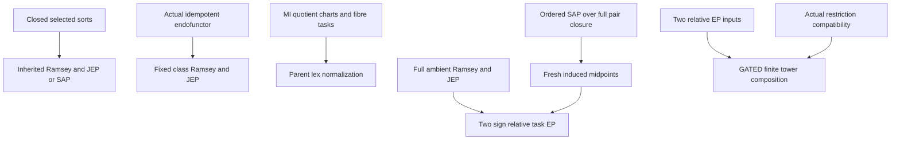

# Ramsey inheritance, fibre-order normalization and reset-midpoint EP

Generated from `module.json` by `tools/build_formalization_module.py`.

Source `490c3f36d85db5a0b3ced0598e6c431825254ec5`. **Human-expanded proof plan; no Lean code.**

Private B036: SIX Foundations III results, with the composition export explicitly GATED. Expand closed-sort Ramsey/JEP/SAP inheritance, universe-preserving idempotent functor Ramsey/JEP inheritance, synchronized FIBRE-task parent-lex normalization, the two-sign relative reset-midpoint EP criterion and the closed ordered-SAP fresh-midpoint provider. Relative EP composition is proved with explicit restriction/pullback compatibility A14, automatic for the intended relation/order-only tower retaining all unary functions. The displayed broader function-adding composition hypotheses with EP quantifiers alone have a JEP counterexample; that reading is NOT certified. The counterexample is not reasonable at its top expansion, so no claim that it refutes a reasonable added-function variant is made. No CCO, EPPA or external Ramsey provider is imported.

The human article remains unchanged. Additional proof details are in
[PROOF_NOTES.md](PROOF_NOTES.md); the cross-track policy is in
[the formalization guide](../README.md). Source hashes are checked before
the index is regenerated. Graph validation is not proof verification.

## Source premises

**A01: Hereditary induced-structure conventions.** Each result uses its stated isomorphism-closed hereditary finite-structure class with induced embeddings, which preserve/reflect all relations and function domains and preserve defined values. Generic functorial normalization allows any fixed signature; unary-function restrictions are imposed only in the relevant other branches. Empty structures/sorts and induced nullary relation truth, if present, are retained.

**A02: Supplied full ambient embedding Ramsey property.** For the sort-restriction, generic normalizer and reset criterion branches, their respective full class R is Ramsey for ALL embeddings. For X,Y and k>=1 there is C with C -> (Y)^X_k. This is a conditional input; no external Ramsey theorem is proved or called.

**A03: Unary-closed selected named sorts.** For the sort-restriction branch, R has finitely many disjoint named sorts, arbitrary relations and unary partial functions with domains fixed by input sorts. A selected collection I has no unary function from an I-sort to an outside sort. Its restriction retains the FULL induced language, with other sorts empty, including any nullary truth.

**A04: Optional joint embedding input.** The relevant ambient R has JEP when its inheritance clause or reset EP uses it. No disjointness of the two pattern images is required for the reset proof.

**A05: Optional strong amalgamation input for sort restriction.** ONLY the SAP-inheritance clause assumes ambient R has SAP. This is not an input of the reset EP criterion or generic functorial-normalization lemma.

**A06: Actual universe-preserving idempotent endofunctor.** For generic normalization, N is an endofunctor of the hereditary R category of INDUCED embeddings. N(A) has exactly A universe, N(f) is the SAME vertex map for every embedding, and N squared equals N as structures. These conditions include legal normalized objects/maps; arbitrary objectwise reassignment of orders is not enough.

**A07: Actual distributive MI quotients and transition semantics.** For hierarchical normalization, proper represented MI quotient sorts come from finite distributive equivalence lattices on named original sorts. Upward quotient maps give their actual coarser coordinates. Named transition bijections and inverses transport cuts and upper quotient intervals and commute with upward maps; this is actual quotient-transition semantics, not bare arbitrary permutations. Finite hidden objects are closed under these unary maps. No CCO or specific lattice/transition theorem is imported.

**A08: Fixed task data and trivial holonomy.** Fix global sort priority, per-J strict coarser MI coordinate priorities and one representative of each transition orbit of cuts J<Jplus. Closed transition holonomy is identity. Initial within-sort orders are arbitrary total orders. Synchronization means FIBRE orders inside each Jplus class transported from the representative. Priority lists need not be transition-equivariant; whole-sort transition monotonicity is NOT an asserted output.

**A09: One-task relative ordering expansion.** For reset EP, R is hereditary Ramsey with JEP, with finite unary closures and sort-fixed function domains when functions occur. Its reducts U1->U0 are reasonable precompact reduct-surjective and every U1 object has a full R lift. Their ONLY difference is one designated within-fibre linear-order task and functorial relational codes; all old functions/domains remain fixed. Reversing ALL designated fibres and recomputing task codes is legal over the SAME U0 data. Earlier tasks stay fixed.

**A10: Old reset relation and COMPLETE POINTED edge-closure type.** Designated fibres and symmetric m are named or qf-definable in U0. m joins distinct points in one fibre. Every reference-oriented m edge has ONE complete expanded induced unary-generated type with TWO MARKED ENDPOINTS, first preceding second, denoted H_m when an edge exists. This includes every fine relation, function domain/value, order and equality code; every such edge admits a root-preserving isomorphism from H_m.

**A11: Induced fresh-midpoint schema.** For every full ordered A in R and every selected same-fibre comparison u<v, there is an INDUCED extension in R with a fresh same-fibre z, u<z<v and u m z m v, preserving the entire earlier expansion. Iteration is over a fixed finite list of source comparisons, not all recursively introduced pairs.

**A12: Separate closed ordered-SAP midpoint provider.** For the fresh-midpoint lemma H is hereditary unary-closed with SAP and H^o is an ordered SAP expansion. Orders extend freely across the actual closed base, including placing a new same-fibre z between prescribed u<v. For each pair there is a finite permitted closed witness T with z OUTSIDE its actual pair closure and two m edges. Its complete unexpanded POINTED pair-closure type agrees with the existing actual pair closure. These hypotheses supply an ordered lift T^o over that entire base.

**A13: Displayed relative-EP composition data.** For composition take hereditary finite relational/unary-functional ages K2->K1->K0 with reduct-surjective maps, and EP quantifiers for K2/K1 and K1/K0: forall expanded A exists unexpanded host forall allowed expansions an embedding exists. The displayed lemma does not separately list reasonableness. If the surrounding definition of EP presupposes it, retain that convention; the counterexample below refutes only the displayed quantifier hypotheses without it.

**A14: EXPLICIT composition restriction/pullback gate.** For EVERY allowed C2 and EVERY K1-induced f:B1->C2|K1, its image is closed under ALL added K2 functions and the inherited restriction/pullback is a legal K2 expansion of EXACTLY B1. Under heredity actual expanded functional closedness suffices. This is AUTOMATIC for relation/order-only expansions retaining the complete unary-function signature/domains. This safe proof gate is stated explicitly; it is not claimed to follow from reduct-surjectivity or EP quantifiers alone. For a finite tower require it at each successive level.

## Definitions

| ID | Definition | Exact meaning | Source |
|---|---|---|---|
| D01 | Full-language sort restriction | C|I has exactly C points in selected sorts, all other sorts empty, and all induced relation/domain/value data including nullary truth. It is an actual object, not a reduct discarding symbols. | [source](../../sections/reset_midpoint_order_ep.tex#L14) |
| D02 | Embedding Ramsey arrow | C -> (B)^A_k colors ALL induced embeddings A->C and asks for g:B->C constant on g composed Emb(A,B). The input object and any distinguished reference vertices remain fixed. | [source](../../sections/reset_midpoint_order_ep.tex#L14) |
| D03 | Full fixed-object category | R_N consists of ALL A in R with strict N(A)=A. Its morphisms are all induced R embeddings between those objects. The normalized host is N(C), not a chosen arbitrary subclass. | [source](../../sections/reset_midpoint_order_ep.tex#L70) |
| D04 | MI parent key | For a represented MI J with unique cover Jplus, key_J(x) is the fixed-priority tuple of ALL strict coarser proper MI coordinate values of the J-point x. An empty tuple, when Jplus is top, is a constant key. | [source](../../sections/reset_midpoint_order_ep.tex#L100) |
| D05 | Representative fibre task | Restrict the initial order on the chosen representative J-sort to each Jplus fibre, then transport those fibre orders along named transition charts to every equivalent cut. Inverse terms keep chart points inside each closed object. | [source](../../sections/reset_midpoint_order_ep.tex#L100) |
| D06 | Recursive parent-lex order | Process strict coarser MI coordinates first. Compare J-points lexicographically by their already ordered full parent keys, and for equal keys use the synchronized fibre task. Across sort symbols use the fixed sort priority. | [source](../../sections/reset_midpoint_order_ep.tex#L100) |
| D07 | One relative task reversal | Reverse the fibre orders of ONE selected cut-task orbit, keeping all other independent task inputs and earlier/coarser tasks. Recompute later derived lex comparisons by the same fixed rule. This is not an independent later host-specific priority choice. | [source](../../sections/reset_midpoint_order_ep.tex#L100) |
| D08 | Pointed ordered reset-edge template | H_m is a chosen actual expanded edge closure with marked endpoints p<q and p m q. Root-preserving isomorphisms realize every oriented reset edge; its entire closure is generated by those endpoints. The marks are reference positions, not a new assumption that the ambient Ramsey language names them. | [source](../../sections/reset_midpoint_order_ep.tex#L213) |
| D09 | Finite midpoint obligations | For a stored finite source pattern enumerate only its original distinct same-fibre comparisons. Store one fresh midpoint per such comparison via induced extension, preserving old roots/functions/orders/codes after every step. | [source](../../sections/reset_midpoint_order_ep.tex#L213) |
| D10 | Two-sign coloring of all template embeddings | For e:H_m->C, color + when the competitor task puts e(p) before e(q), and - otherwise. Old m/fibre data ensure the comparison exists; injectivity excludes equality. The competitor need not retain other final R order tasks. | [source](../../sections/reset_midpoint_order_ep.tex#L213) |
| D11 | Actual ordered pair-closure amalgam span | P=closure{u,v} is the WHOLE induced unary-generated ordered substructure of the existing A^o. Identify it with the witness pair closure by its complete pointed type, choose T^o extending the inherited P^o, then amalgamate ordered sides strongly over P^o. | [source](../../sections/reset_midpoint_order_ep.tex#L334) |
| D12 | EP quantifier and legal pullback | Relative EP is forall A2 exists B1 forall expansions B2 exists embedding A2->B2. Composite proof first fixes B1,C0, then handles arbitrary C2. Pulling C2 back along f:B1->C1 requires the actual expanded restriction gate A14. | [source](../../sections/reset_midpoint_order_ep.tex#L378) |

## Proof claims and direct dependencies

Every row has a human proof expansion. Each still needs an actual Lean
Independent conditional inheritance/provider arguments are kept separate. Full ambient Ramsey is an INPUT only where used; intermediate reducts are not assumed Ramsey. Synchronization concerns orders INSIDE cut fibres, not monotonicity of entire quotient sorts under arbitrary coordinate priorities. Composition retains the explicit restriction gate and the source convention ambiguity.

| ID and claim | Scope | Direct providers | Proof note |
|---|---|---|---|
| C01: The selected sort part is an actual closed induced substructure | sort_restriction | D01 | N01 in [notes](PROOF_NOTES.md) |
| C02: All-I objects already belong to the ambient hereditary class | sort_restriction | C01, A01 | N01 in [notes](PROOF_NOTES.md) |
| C03: Embedding sets agree on literal vertex maps | sort_restriction | C01, C02 | N01 in [notes](PROOF_NOTES.md) |
| C04: Restrict the ambient Ramsey witness | sort_restriction | C02, C03, A02, D02 | N01 in [notes](PROOF_NOTES.md) |
| C05: The restricted class is hereditary | sort_restriction | C01, C02, A01 | N01 in [notes](PROOF_NOTES.md) |
| C06: Optional JEP and SAP survive the same restriction | sort_restriction | C01, C02, A04, A05 | N01 in [notes](PROOF_NOTES.md) |
| C07: Fixed objects are hereditary by inducedness on the same image | idempotent_functor | A01, A06, D03 | N02 in [notes](PROOF_NOTES.md) |
| C08: A normalized host is an actual fixed object | idempotent_functor | A06, D03 | N02 in [notes](PROOF_NOTES.md) |
| C09: Pull a coloring back without requiring surjectivity | idempotent_functor | A06, D03 | N02 in [notes](PROOF_NOTES.md) |
| C10: Functorial composition gives a normalized monochromatic copy | idempotent_functor | C09, A02, A06 | N02 in [notes](PROOF_NOTES.md) |
| C11: The full fixed class is Ramsey for embeddings | idempotent_functor | C07, C08, C10 | N02 in [notes](PROOF_NOTES.md) |
| C12: Optional JEP normalizes a joint host | idempotent_functor | C08, A04, A06 | N02 in [notes](PROOF_NOTES.md) |
| C13: All strict coarser MI coordinates meet to the unique cover | fibre_normalization | D04, A07 | N03 in [notes](PROOF_NOTES.md) |
| C14: Representative charts exist inside every closed object | fibre_normalization | A07, D05 | N03 in [notes](PROOF_NOTES.md) |
| C15: Transport is path-independent on pointed quotient fibres | fibre_normalization | C14, A07, A08 | N03 in [notes](PROOF_NOTES.md) |
| C16: Transported local orders are genuine synchronized fibre tasks | fibre_normalization | C14, C15, D05 | N03 in [notes](PROOF_NOTES.md) |
| C17: Coarser tasks precede finer tasks without an orbit cycle | fibre_normalization | A07, A08 | N03 in [notes](PROOF_NOTES.md) |
| C18: Recursive lex keys and fibre tie-breakers give total sort orders | fibre_normalization | C13, C16, C17, D06 | N03 in [notes](PROOF_NOTES.md) |
| C19: Every old ordered embedding remains an induced normalized embedding | fibre_normalization | C14, C15, C16, C18, A01 | N03 in [notes](PROOF_NOTES.md) |
| C20: Normalization is idempotent | fibre_normalization | C16, C18, C19 | N03 in [notes](PROOF_NOTES.md) |
| C21: Its image is exactly the synchronized fibre-task parent-lex class | fibre_normalization | C18, C20, D06 | N03 in [notes](PROOF_NOTES.md) |
| C22: Reverse one task orbit while preserving every earlier task | fibre_normalization | C15, C17, D07 | N03 in [notes](PROOF_NOTES.md) |
| C23: Later lex comparisons recompute functorially | fibre_normalization | C18, C19, C22 | N03 in [notes](PROOF_NOTES.md) |
| C24: Hierarchical normalization and relative task independence | fibre_normalization | C18, C19, C20, C21, C22, C23 | N03 in [notes](PROOF_NOTES.md) |
| C25: A source with no nontrivial fibre comparisons has trivial task EP | reset_EP | A09 | N04 in [notes](PROOF_NOTES.md) |
| C26: Store legal positive and reversed source patterns | reset_EP | A09 | N04 in [notes](PROOF_NOTES.md) |
| C27: Complete a fixed finite list of midpoint obligations | reset_EP | C26, A11, D09 | N04 in [notes](PROOF_NOTES.md) |
| C28: JEP combines the two extended patterns | reset_EP | C27, A04 | N04 in [notes](PROOF_NOTES.md) |
| C29: The pointed edge template is an actual ambient object | reset_EP | C27, A10, A01, D08 | N04 in [notes](PROOF_NOTES.md) |
| C30: Choose full ambient Ramsey host and fix its U0 reduct | reset_EP | C28, C29, A02, D02, A09 | N04 in [notes](PROOF_NOTES.md) |
| C31: Every template embedding has a well-defined competitor sign | reset_EP | C30, A09, A10, D10 | N04 in [notes](PROOF_NOTES.md) |
| C32: Homogeneity covers every needed oriented edge via its whole closure | reset_EP | C29, C31, A10 | N04 in [notes](PROOF_NOTES.md) |
| C33: Uniform positive edges force every stored comparison | reset_EP | C27, C32 | N04 in [notes](PROOF_NOTES.md) |
| C34: Uniform negative edges force the reverse of every stored comparison | reset_EP | C27, C32 | N04 in [notes](PROOF_NOTES.md) |
| C35: The positive stored roots yield A1 in a positive competitor | reset_EP | C26, C28, C33, A09 | N04 in [notes](PROOF_NOTES.md) |
| C36: The negative stored roots undo the legal reversal | reset_EP | C26, C28, C34, A09 | N04 in [notes](PROOF_NOTES.md) |
| C37: A fixed old host works for every competing task expansion | reset_EP | C25, C30, C31, C32, C35, C36 | N04 in [notes](PROOF_NOTES.md) |
| C38: Single-task reset-midpoint EP with its full-provider firewall | reset_EP | C37, A09, A10, A11 | N04 in [notes](PROOF_NOTES.md) |
| C39: Identify the WHOLE actual ordered pair closure | fresh_midpoints | A12, D11 | N05 in [notes](PROOF_NOTES.md) |
| C40: Order the witness over that exact base and prescribed interval | fresh_midpoints | C39, A12 | N05 in [notes](PROOF_NOTES.md) |
| C41: Apply ordered SAP over the actual closed base | fresh_midpoints | C39, C40, A12 | N05 in [notes](PROOF_NOTES.md) |
| C42: Strong intersection makes the midpoint fresh over all of A | fresh_midpoints | C40, C41 | N05 in [notes](PROOF_NOTES.md) |
| C43: Finite repetition gives distinct fresh midpoints preserving placements | fresh_midpoints | C39, C40, C41, C42 | N05 in [notes](PROOF_NOTES.md) |
| C44: Closed ordered-SAP provider supplies the induced midpoint schema | fresh_midpoints | C39, C40, C41, C42, C43 | N05 in [notes](PROOF_NOTES.md) |
| C45: First relative EP fixes an intermediate expanded host | gated_EP_composition | A13, D12 | N06 in [notes](PROOF_NOTES.md) |
| C46: Second relative EP fixes a base host before the final competitor | gated_EP_composition | C45, A13 | N06 in [notes](PROOF_NOTES.md) |
| C47: An arbitrary final expansion supplies an intermediate embedding | gated_EP_composition | C46, A13 | N06 in [notes](PROOF_NOTES.md) |
| C48: The EXPLICIT restriction gate gives a legal B2 pullback | gated_EP_composition | C47, A14, A01 | N06 in [notes](PROOF_NOTES.md) |
| C49: Compose the top witness embedding with the actual expanded image | gated_EP_composition | C45, C48 | N06 in [notes](PROOF_NOTES.md) |
| C50: Relative EP composes UNDER the recorded restriction gate | gated_EP_composition | C46, C47, C48, C49, A14 | N06 in [notes](PROOF_NOTES.md) |
| C51: Finite chains compose when restriction compatibility persists | gated_EP_composition | C50, A13, A14 | N06 in [notes](PROOF_NOTES.md) |
| C52: Arbitrary parent priorities do not force global transition monotonicity | boundary | C13, C16, C24 | N07 in [notes](PROOF_NOTES.md) |
| C53: Full pair closure and freshness are substantive provider conditions | boundary | C39, C42, C44 | N07 in [notes](PROOF_NOTES.md) |
| C54: Displayed function-adding EP composition has a JEP counterexample | boundary | A13 | N07 in [notes](PROOF_NOTES.md) |
| C55: The quantifier and pointed-edge scope are explicit | boundary | C29, C32, C37, C50 | N07 in [notes](PROOF_NOTES.md) |

The precise quantified contracts are in `module.json`. Provider-before-consumer
order (including definitions and source premises):

`A01 → A02 → A03 → A04 → A05 → A06 → A07 → A08 → A09 → A10 → A11 → A12 → A13 → A14 → C17 → C25 → C26 → C54 → D01 → D02 → D03 → D04 → D05 → D08 → D09 → D11 → D12 → C01 → C07 → C08 → C09 → C13 → C14 → C27 → C39 → C45 → D06 → D10 → C02 → C10 → C12 → C15 → C28 → C29 → C40 → C46 → D07 → C03 → C05 → C06 → C11 → C16 → C22 → C30 → C41 → C47 → C04 → C18 → C31 → C42 → C48 → C19 → C32 → C43 → C49 → C20 → C23 → C33 → C34 → C44 → C50 → C21 → C35 → C36 → C51 → C53 → C24 → C37 → C38 → C52 → C55`

This order is one valid linearization; it does not require unrelated
branches to be proved sequentially. The full DAG is the `depends_on`
relation in `module.json`.

## Main proof branches

This is a coarse view of the claim DAG. Edges go from provider to consumer.

Six conditional results are prepared, with the composition export explicitly restricted by A14; there are no mathematical provider imports.
Sort restriction preserves the actual full induced language, including any nullary truth. Generic normalization requires an actual endofunctor and does not assert SAP inheritance.
Hierarchical synchronization is of within-parent fibre task orders; arbitrary parent priorities need not make whole-sort transitions monotone.
Reset EP uses full ambient Ramsey, never assumes the intermediate classes Ramsey, and needs a COMPLETE POINTED expanded edge closure.
Fresh midpoints require an ordered witness over the whole actual pair closure and ordered SAP; bare m;m reachability does not imply freshness.
The literal displayed function-adding composition hypotheses have a hereditary JEP counterexample. Its top expansion is not reasonable, so the reasonable variant is not refuted. The intended relation/order-only tower meets A14.

## Article exports

| Existing source result | Sidecar proof claims |
|---|---|
| [`lem:foundational-ramsey-sort-restriction`](../../sections/reset_midpoint_order_ep.tex#L13) | C04, C05, C06 |
| [`lem:foundational-ramsey-normalization`](../../sections/reset_midpoint_order_ep.tex#L69) | C07, C11, C12 |
| [`lem:foundational-hierarchical-order-normalization`](../../sections/reset_midpoint_order_ep.tex#L99) | C24 |
| [`thm:abstract-reset-order-EP`](../../sections/reset_midpoint_order_ep.tex#L212) | C37, C38 |
| [`lem:abstract-fresh-reset-midpoint`](../../sections/reset_midpoint_order_ep.tex#L333) | C44 |
| [`lem:foundational-relative-EP-composition`](../../sections/reset_midpoint_order_ep.tex#L377) | C50, C51 |

## Internal implementation milestones

These tasks are proof milestones inside larger project assignments;
see the [peer-project allocation](../coordination/BOARD.md).

These are implementation tasks, not additional mathematical assumptions.

| Task | Earlier tasks | Acceptance |
|---|---|---|
| T01: Closed-sort inherited embeddings and Ramsey/JEP/SAP | — | Retain exact branch hypotheses and full induced function domains. Hierarchical synchronization is within cut fibres; global transition monotonicity is not assumed. Reset EP colors ALL embeddings of the COMPLETE POINTED edge closure, covers only original finite midpoint obligations and fixes its old host first. Ordered SAP uses the whole actual pair closure and proves freshness outside the entire host. Composition exports MUST include A14; do not prove the false displayed unrestricted function-adding reading or claim the counterexample is reasonable. |
| T02: Idempotent endofunctor fixed class and Ramsey pullback | — | Retain exact branch hypotheses and full induced function domains. Hierarchical synchronization is within cut fibres; global transition monotonicity is not assumed. Reset EP colors ALL embeddings of the COMPLETE POINTED edge closure, covers only original finite midpoint obligations and fixes its old host first. Ordered SAP uses the whole actual pair closure and proves freshness outside the entire host. Composition exports MUST include A14; do not prove the false displayed unrestricted function-adding reading or claim the counterexample is reasonable. |
| T03: MI parent keys, coherent fibre tasks and normalization | — | Retain exact branch hypotheses and full induced function domains. Hierarchical synchronization is within cut fibres; global transition monotonicity is not assumed. Reset EP colors ALL embeddings of the COMPLETE POINTED edge closure, covers only original finite midpoint obligations and fixes its old host first. Ordered SAP uses the whole actual pair closure and proves freshness outside the entire host. Composition exports MUST include A14; do not prove the false displayed unrestricted function-adding reading or claim the counterexample is reasonable. |
| T04: Fixed-host two-sign reset-midpoint EP | — | Retain exact branch hypotheses and full induced function domains. Hierarchical synchronization is within cut fibres; global transition monotonicity is not assumed. Reset EP colors ALL embeddings of the COMPLETE POINTED edge closure, covers only original finite midpoint obligations and fixes its old host first. Ordered SAP uses the whole actual pair closure and proves freshness outside the entire host. Composition exports MUST include A14; do not prove the false displayed unrestricted function-adding reading or claim the counterexample is reasonable. |
| T05: Actual pair closure and ordered-SAP fresh midpoint provider | — | Retain exact branch hypotheses and full induced function domains. Hierarchical synchronization is within cut fibres; global transition monotonicity is not assumed. Reset EP colors ALL embeddings of the COMPLETE POINTED edge closure, covers only original finite midpoint obligations and fixes its old host first. Ordered SAP uses the whole actual pair closure and proves freshness outside the entire host. Composition exports MUST include A14; do not prove the false displayed unrestricted function-adding reading or claim the counterexample is reasonable. |
| T06: Restriction-compatible relative EP composition | — | Retain exact branch hypotheses and full induced function domains. Hierarchical synchronization is within cut fibres; global transition monotonicity is not assumed. Reset EP colors ALL embeddings of the COMPLETE POINTED edge closure, covers only original finite midpoint obligations and fixes its old host first. Ordered SAP uses the whole actual pair closure and proves freshness outside the entire host. Composition exports MUST include A14; do not prove the false displayed unrestricted function-adding reading or claim the counterexample is reasonable. |
| T07: Scope and counterexample diagnostics | T01, T02, T03, T04, T05, T06 | Retain exact branch hypotheses and full induced function domains. Hierarchical synchronization is within cut fibres; global transition monotonicity is not assumed. Reset EP colors ALL embeddings of the COMPLETE POINTED edge closure, covers only original finite midpoint obligations and fixes its old host first. Ordered SAP uses the whole actual pair closure and proves freshness outside the entire host. Composition exports MUST include A14; do not prove the false displayed unrestricted function-adding reading or claim the counterexample is reasonable. |

## Finite controls

- **K01.** Bounded closed-sort restrictions, actual normalizing maps/embedding-color pullback, distributive MI parent keys, synchronized fibre task orders, idempotence and reversal.
- **K02.** Two-sign midpoint transitivity and fresh closed amalgams; full pair closure, arbitrary-priority transition and nested-equivalence function-adding EP composition boundaries. Finite diagnostics do not certify general Ramsey/EP or Lean theorems.

Run `python tools/check_reset_order_controls.py` from the manuscript directory.
The controls do not prove CCO or the general theorems.

## Return to the human articles

No required mathematical repair was found in this scoped pass. These
optional wording clarifications remain queued for a human article pass:

- **F01** ([source](../../sections/reset_midpoint_order_ep.tex#L175)): The construction synchronizes WITHIN-PARENT FIBRE task orders. Arbitrary per-J parent-key priorities do not imply global transition monotonicity of whole quotient sorts; the downstream task definition uses the fibre interpretation. Replace all orders by all fibre task orders and spell out that actual transitions commute with upward quotient maps and transport cuts/upper intervals. State priority equivariance only if an additional global-monotonicity theorem is intended.
- **F02** ([source](../../sections/reset_midpoint_order_ep.tex#L237)): The reset-edge template needs the COMPLETE POINTED expanded generated type; same unpointed closure type or two-root reduct is insufficient. Sources without any nontrivial fibre comparison use a trivial witness, while nontrivial sources supply an actual edge template by midpoint extension. Name both distinguished endpoints in the type convention, add the vacuous-comparison branch and state that only the original finite comparison list is iterated. For the provider order T over the entire actual P before ordered SAP.
- **F03** ([source](../../sections/reset_midpoint_order_ep.tex#L407)): For added unary functions an arbitrary intermediate induced image need not be expanded-closed, so the displayed composition proof cannot invoke heredity there. A hereditary JEP nested-equivalence/successor counterexample refutes the displayed EP quantifier hypotheses without reasonableness. That top expansion is not reasonable; the example does not settle a reasonable added-function variant. State that the tower retains the full function signature and adds only relations/orders, or add the explicit actual restriction/pullback compatibility A14. If EP is intended to carry extra standing reasonableness conventions, state them and supply a separate valid general-function proof rather than the unsupported restriction.

The machine ledger records caller effects and affected claims. The source
review used two independent model review passes and parent synthesis;
it is not independent human or formal certification.
