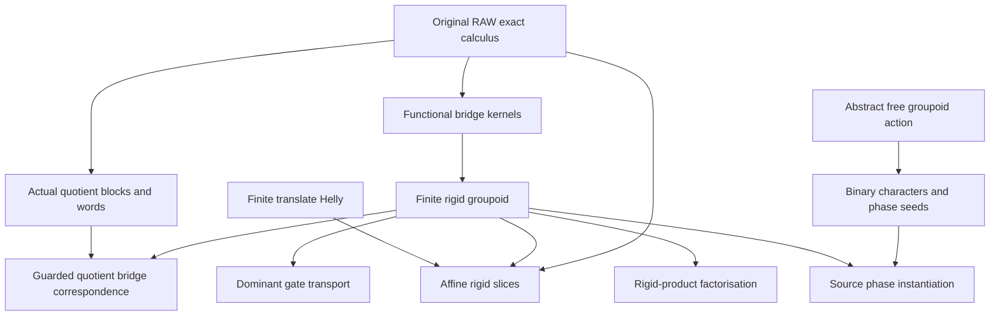

# Actual exact bridges, rigid groupoids and finite phase seeds

Generated from `module.json` by `tools/build_formalization_module.py`.

Source `490c3f36d85db5a0b3ced0598e6c431825254ec5`. **Human-expanded proof plan; no Lean code.**

Preparation for OTHER Lean projects. Seven full rigid-groupoid results plus the explicitly selected simultaneous-block and affine-translate-Helly providers give nine numbered exports and four auxiliary equations. Remaining results in the two provider files, owner masters and finite-fibre kernel projections are outside this module.

The human article remains unchanged. Additional proof details are in
[PROOF_NOTES.md](PROOF_NOTES.md); the cross-track policy is in
[the formalization guide](../README.md). Source hashes are checked before
the index is regenerated. Graph validation is not proof verification.

## Source premises

**A01: Actual typed orbital framework.** Finitely many named inhabited individually transitive original sorts of one ambient action G, with finite actual pair-orbital palettes, same-sort symmetry and typed converse. Products are represented relational composition, including real equality. Atoms include logical equality only on loop sorts; never mixed-sort commutation.

**A02: Standing original RAW exact provider.** For source instantiation use the standing countable homogeneous complete finite typed binary semantic-homomorphic-CCO source of I01, with its actual orbitals and full identity-inclusive word-exact menus. No SAP, NR2, finite-index parity pivot or preferred phase is assumed. Elementary action and abstract finite-group claims do not consume this premise.

**A03: Elementary finite groups and choices.** Finite sets, elementary abelian 2-groups, finite subgroup/affine-subspace maximality, F2-linear characters and classical choice of one seed per point-action orbit. No compactness or finite-owner projection theorem is imported.

**A04: Abstract free finite connected groupoid action.** Given a finite connected groupoid with a free action on disjoint nonempty object point sets. For the seed/marking lemmas a fixed functor chi to F2 is supplied as data D11, without any distinguished t* or exponent-two requirement. C09–C11 discharge this structural input for the source instance C31; it is not a new source axiom.

**A05: Exact projected gates for quotient bridge correspondence.** For the bridge descent/lift theorem, E_a<=K_a and E_b<=K_b are original FULL RAW exact kernels and the projected K_a/E_a,K_b/E_b are FULL RAW exact in the quotient represented algebra. This is explicit extra information; upward exact word pullback alone does not imply it.

**A06: Original dominant involution.** For dominant transport, a chosen nonidentity source isotropy t* is contained in every ORIGINAL full exact invariant equivalence strictly above K*. This is not dominance among all arbitrary quotient-invariant equivalences.

**A07: Nonzero elementary-abelian source isotropy for character construction.** Only for C24–C26 and their source character instance, the root isotropy is finite elementary abelian and a distinguished NONIDENTITY t* is supplied. The seed-extension theorem C30 needs only the free groupoid action and an already given character, not this extra premise.

## Imported theorem contracts

These are named provider obligations for the receiving Lean project,
not new axioms or claims of compiled imports.

| ID and source | Contract | Current provider status |
|---|---|---|
| I01: [`thm:full-typed-exact-balls`](../../sections/exact_foundations/01_full_raw_exact_helly.tex#L27) | Original FULL equality-inclusive RAW word/menu and exact-ball 2-Helly, exact convolution, converse and guarded meet closure. Nonempty invariant factors have nonempty compatible products. This is not STRONG diversity calculus. The quotient instance is established in C02–C05, not assumed from reverse descent. | HUMAN_EXPANDED_NOT_LEAN |
| I02: [`lem:foundational-orbital-pullback`](../../sections/typed_invariant_quotient_transport.tex#L216) | For actual equivariant quotient maps, the inverse image of one quotient pair orbital is E_s;old atom;E_t. The quotient pair orbitals are those of the ORIGINAL ambient group action. No quotient automorphism section or CCO is needed for this elementary group-action statement. | HUMAN_SUPPORT_PROOF_NOT_LEAN |

## Definitions

| ID | Definition | Exact meaning | Source |
|---|---|---|---|
| D01 | FULL RAW exact relation | A nonempty finite intersection of actual typed atomic-word profiles; empty restriction family is Top, whereas the empty loop word is real Id. | [source](../../sections/rigid_exact_groupoid_foundations.tex#L10) |
| D02 | Actual simultaneous quotient block | For exact E_s on each original named sort, Q_s=M_s/E_s with quotient pair orbitals under the old action G. Block of atom a is E_s;a;E_t and object equality pulls back to E_s. | [source](../../sections/simultaneous_typed_exact_quotients.tex#L43) |
| D03 | Full exact functional bridge | R:a->b is nonempty original full exact, K_a;R=R and R;R^converse=K_a. Its target is K_b=R^converse;R; object identity is K_a, not necessarily real equality. | [source](../../sections/rigid_exact_groupoid_foundations.tex#L19) |
| D04 | Actual quotient bijection | A bridge induces an equivariant total bijection M_a/K_a -> M_b/K_b. Relations upstairs are whole kernel rectangles, not chosen point representatives. | [source](../../sections/rigid_exact_groupoid_foundations.tex#L37) |
| D05 | Generated rigid groupoid | Starting from one object (a*,K*), close under all bridge arrows, converse and composition. A reached sort has one path-independent kernel; identities are the object kernels. | [source](../../sections/rigid_exact_groupoid_foundations.tex#L29) |
| D06 | Isotropy and hom-set torsors | Same-object arrows form a finite group; each nonempty a->b hom-set is acted on freely and transitively by either endpoint isotropy group. Distinct arrows never agree on one quotient point. | [source](../../sections/rigid_exact_groupoid_foundations.tex#L39) |
| D07 | Dominant original involution | Nonidentity source isotropy t* lies in every original full exact invariant equivalence Z*>K*. Transport uses R^converse;t*;R. | [source](../../sections/rigid_exact_groupoid_foundations.tex#L89) |
| D08 | Projected exact gates | Under A05, quotient K-bars are assumed exact. Saturated old relations correspond to quotient relations, but arbitrary old exactness is not declared to descend. | [source](../../sections/rigid_exact_groupoid_foundations.tex#L162) |
| D09 | Rigid affine slice | Nonempty exact bisaturated D supported on the union of arrows in a nonempty hom-set; dS means a UNION of represented graphs over subgroup S, not one original atom. | [source](../../sections/rigid_exact_groupoid_foundations.tex#L241) |
| D10 | Product inside one rigid bridge | A:a->b and B:b->c are nonempty original full exact with AB contained in one bridge R:a->c. The intermediate gate is constructed, not arbitrarily prescribed. | [source](../../sections/rigid_exact_groupoid_foundations.tex#L267) |
| D11 | Groupoid character | A GIVEN functor chi from the abstract groupoid to the one-object additive group F2. Under the additional A07 premise C24–C25 construct one with chi(t*)=1. No distinguished involution is needed to state a fixed character or its seed law. | [source](../../sections/rigid_exact_groupoid_foundations.tex#L305) |
| D12 | Global phase marking | A bit lambda on the disjoint union of reached quotient point sets satisfying lambda(Rq)=lambda(q)+chi(R). Free action permits one initial bit for each action orbit. | [source](../../sections/rigid_exact_groupoid_foundations.tex#L312) |
| D13 | Finite prescribed phase seeds | For finite F of actual quotient points and epsilon:F->F2, compatibility means epsilon(r)=epsilon(q)+chi(R) for every same-action-orbit pair with Rq=r. | [source](../../sections/rigid_exact_groupoid_foundations.tex#L354) |

## Proof claims and direct dependencies

Every row has a human proof expansion. Each still needs an actual Lean
statement and proof. Groupoid object identity is its kernel, typed projected gates retain explicit exactness, and free phase seeds do not establish hidden SAP or moving-owner finite projection.

| ID and claim | Scope | Direct providers | Proof note |
|---|---|---|---|
| C01: Elementary actual seriality and same-sort symmetry | elementary | A01 | N01 in [notes](PROOF_NOTES.md) |
| C02: Actual exact quotient orbital blocks | typed_quotient | D02, C01, I01, I02 | N00 in [notes](PROOF_NOTES.md) |
| C03: Saturated quotient relation algebra | typed_quotient | C02 | N00 in [notes](PROOF_NOTES.md) |
| C04: Upward FULL exact word pullback | typed_quotient | C03, I01 | N00 in [notes](PROOF_NOTES.md) |
| C05: Quotient word Helly and exact convolution | typed_quotient | C04, C01, I01 | N00 in [notes](PROOF_NOTES.md) |
| C06: Bridge target kernel and saturation | exact_bridge | D03, C01, I01 | N01 in [notes](PROOF_NOTES.md) |
| C07: Bridge gives an actual equivariant quotient bijection | exact_bridge | C06, D04 | N01 in [notes](PROOF_NOTES.md) |
| C08: Target kernel is independent of the path | exact_bridge | C06, C01 | N02 in [notes](PROOF_NOTES.md) |
| C09: Finite connected groupoid closure | exact_bridge | C06, C08, I01, D05 | N02 in [notes](PROOF_NOTES.md) |
| C10: Elementary abelian isotropy | exact_bridge | C09, C01, A03 | N02 in [notes](PROOF_NOTES.md) |
| C11: Torsors and free actual point action | exact_bridge | C07, C09, C10 | N02 in [notes](PROOF_NOTES.md) |
| C12: Conjugation is an exact-equivalence interval isomorphism | dominant_gate | C09, I01 | N03 in [notes](PROOF_NOTES.md) |
| C13: Dominant involution transports independently of bridge | dominant_gate | C10, C11, C12, D07 | N03 in [notes](PROOF_NOTES.md) |
| C14: Dominance on exact quotient equivalences uses only pullback | dominant_gate | C13, C04 | N03 in [notes](PROOF_NOTES.md) |
| C15: Functional bridge has a one-atom rectangular presentation | quotient_bridge | C07, C02, D02 | N04 in [notes](PROOF_NOTES.md) |
| C16: Bridge descends exactly when projected gates are supplied exact | quotient_bridge | C15, C03, C05, A05 | N04 in [notes](PROOF_NOTES.md) |
| C17: Quotient exact bridge lifts by inverse image | quotient_bridge | C04, C03, D08 | N04 in [notes](PROOF_NOTES.md) |
| C18: Exact bridge correspondence is a groupoid isomorphism | quotient_bridge | C16, C17, C03 | N04 in [notes](PROOF_NOTES.md) |
| C19: Finite translate-Helly subset is an affine coset | finite_combinatorics | A03 | N05 in [notes](PROOF_NOTES.md) |
| C20: Bisaturated invariant rigid slice contains whole arrows | affine_slice | D09, C07, C11 | N05 in [notes](PROOF_NOTES.md) |
| C21: Exact rigid slices are affine exact subgroup cosets | affine_slice | C20, C19, I01 | N05 in [notes](PROOF_NOTES.md) |
| C22: First factor rigidification | factorisation | D10, C01, C06, I01 | N06 in [notes](PROOF_NOTES.md) |
| C23: Second factor fills its containing bridge | factorisation | C22, C09, C08, C01 | N06 in [notes](PROOF_NOTES.md) |
| C24: Linear character detects a nonzero involution | abstract_phase | A04, A07, A03 | N07 in [notes](PROOF_NOTES.md) |
| C25: Extend the character to the connected groupoid | abstract_phase | C24 | N07 in [notes](PROOF_NOTES.md) |
| C26: Transported involutions have character one | abstract_phase | C25, A04 | N07 in [notes](PROOF_NOTES.md) |
| C27: Global phase markings from free action orbit seeds | abstract_phase | A04, A03, D12 | N07 in [notes](PROOF_NOTES.md) |
| C28: Pointwise rigid and nonrigid phase alternatives | abstract_phase | C27, A04 | N07 in [notes](PROOF_NOTES.md) |
| C29: Finite restrictions of global markings | abstract_phase | C27, C28 | N07 in [notes](PROOF_NOTES.md) |
| C30: Finite seed extension iff pairwise free-orbit equations | abstract_phase | C27, D13 | N08 in [notes](PROOF_NOTES.md) |
| C31: Instantiate phase construction on the actual rigid groupoid | source_phase_instance | C09, C10, C11, C24, C25, C26, C27, C28, C29, C30 | N08 in [notes](PROOF_NOTES.md) |

The precise quantified contracts are in `module.json`. Provider-before-consumer
order (including definitions and source premises):

`A01 → A02 → A03 → A04 → A05 → A06 → A07 → C01 → C19 → C24 → D01 → D11 → I01 → I02 → C25 → D02 → D03 → D12 → C02 → C06 → C26 → C27 → D04 → D05 → D08 → D10 → D13 → C03 → C07 → C08 → C22 → C28 → C30 → D06 → D07 → D09 → C04 → C09 → C15 → C29 → C05 → C10 → C12 → C17 → C23 → C11 → C16 → C13 → C18 → C20 → C31 → C14 → C21`

This order is one valid linearization; it does not require unrelated
branches to be proved sequentially. The full DAG is the `depends_on`
relation in `module.json`.

## Main proof branches

This is a coarse view of the claim DAG. Edges go from provider to consumer.

No SAP, NR2, Hasse pivot or preferred phase is imported.
Typed quotient bridge descent requires the projected gates themselves to be exact.
Abstract phase/finite seed arguments use no CCO; the source instance supplies the free action.

## Article exports

| Existing source result | Sidecar proof claims |
|---|---|
| [`lem:typed-simultaneous-blocks`](../../sections/simultaneous_typed_exact_quotients.tex#L38) | C02, C03, C04, C05 |
| [`thm:foundational-rigid-groupoid`](../../sections/rigid_exact_groupoid_foundations.tex#L27) | C06, C07, C08, C09, C10, C11 |
| [`lem:foundational-rigid-gate-transport`](../../sections/rigid_exact_groupoid_foundations.tex#L84) | C12, C13, C14 |
| [`lem:foundational-rigid-quotient-bridge`](../../sections/rigid_exact_groupoid_foundations.tex#L154) | C15, C16, C17, C18 |
| [`lem:foundational-affine-translate-helly`](../../sections/finite_packet_kernel_constraints.tex#L34) | C19 |
| [`lem:foundational-rigid-affine`](../../sections/rigid_exact_groupoid_foundations.tex#L233) | C20, C21 |
| [`lem:foundational-rigid-factor`](../../sections/rigid_exact_groupoid_foundations.tex#L264) | C22, C23 |
| [`thm:foundational-rigid-character`](../../sections/rigid_exact_groupoid_foundations.tex#L298) | C24, C25, C26, C27, C28, C29, C31 |
| [`lem:foundational-finite-phase-extension`](../../sections/rigid_exact_groupoid_foundations.tex#L348) | C30 |

Auxiliary source equations (not additional numbered results):

- [`eq:exact-bridge`](../../sections/rigid_exact_groupoid_foundations.tex#L20): C06
- [`eq:foundational-phase-seed-test`](../../sections/rigid_exact_groupoid_foundations.tex#L366): C30
- [`eq:typed-exact-block`](../../sections/simultaneous_typed_exact_quotients.tex#L44): C02
- [`eq:typed-exact-quotient-product`](../../sections/simultaneous_typed_exact_quotients.tex#L59): C03

Full result coverage is asserted only for `source_result_files`.
Selected additional results: lem:typed-simultaneous-blocks, lem:foundational-affine-translate-helly.
Other results in their provider source files are not claimed covered.

## Internal implementation milestones

These tasks are proof milestones inside larger project assignments;
see the [peer-project allocation](../coordination/BOARD.md).

These are implementation tasks, not additional mathematical assumptions.

| Task | Earlier tasks | Acceptance |
|---|---|---|
| T01: Actual typed quotient blocks and exact calculus | — | Implement the precise actual-relation/groupoid contracts and export mapping. Keep object equality distinct from real Id, quotient projected exactness explicit, and abstract phase construction independent of source/owner projection claims. |
| T02: Bridge kernels and finite rigid groupoid | T01 | Implement the precise actual-relation/groupoid contracts and export mapping. Keep object equality distinct from real Id, quotient projected exactness explicit, and abstract phase construction independent of source/owner projection claims. |
| T03: Dominant involution and guarded quotient correspondence | T01, T02 | Implement the precise actual-relation/groupoid contracts and export mapping. Keep object equality distinct from real Id, quotient projected exactness explicit, and abstract phase construction independent of source/owner projection claims. |
| T04: Affine slices and rigid-product factorisation | T01, T02 | Implement the precise actual-relation/groupoid contracts and export mapping. Keep object equality distinct from real Id, quotient projected exactness explicit, and abstract phase construction independent of source/owner projection claims. |
| T05: Abstract characters and finite phase seeds | — | Implement the precise actual-relation/groupoid contracts and export mapping. Keep object equality distinct from real Id, quotient projected exactness explicit, and abstract phase construction independent of source/owner projection claims. |
| T06: Actual source phase instantiation | T02, T05 | Implement the precise actual-relation/groupoid contracts and export mapping. Keep object equality distinct from real Id, quotient projected exactness explicit, and abstract phase construction independent of source/owner projection claims. |

## Finite controls

- **R01.** Actual kernel rectangles, quotient bijections, bridge composition and torsor/freeness.
- **R02.** Affine translate-Helly sets in small F2-spaces and exact-slice support boundaries.
- **R03.** Product factorisation and quotient bridge transport as actual relation laws, with exactness assumptions kept explicit.
- **R04.** Groupoid characters, independent orbit seeds and finite prescribed-bit compatibility.

Run `python tools/check_rigid_groupoid_controls.py` from the manuscript directory.
The controls do not prove CCO or the general theorems.

## Return to the human articles

No required mathematical repair was found in this scoped pass. These
optional wording clarifications remain queued for a human article pass:

- **F01** ([source](../../sections/rigid_exact_groupoid_foundations.tex#L22)): Object identity is its quotient kernel, possibly larger than real identity; target kernel uniqueness uses only SAME-SORT symmetry. Keep object equality and logical equality visibly distinct.
- **F02** ([source](../../sections/rigid_exact_groupoid_foundations.tex#L180)): Exactness of projected endpoint gates is an explicit premise for typed quotient bridge exactness; it is not reverse typed descent. Retain that premise and the bridge-specific one-atom rectangle argument.
- **F03** ([source](../../sections/rigid_exact_groupoid_foundations.tex#L251)): Affine slice Helly concerns old exact relation intersections and whole quotient-arrow supports, not arbitrary subsets of points. State the whole-arrow step and finite translate-Helly lemma before the coset deduction.
- **F04** ([source](../../sections/rigid_exact_groupoid_foundations.tex#L286)): Product factorisation constructs its intermediate gate from R1, rather than taking an arbitrary named kernel. Retain this construction and only afterwards use target-kernel uniqueness.
- **F05** ([source](../../sections/rigid_exact_groupoid_foundations.tex#L318)): Phase seeds control a free finite groupoid action. They do not establish AP, SAP, CCO or finite moving-owner kernel projections. Keep those later obligations explicitly separate in the human phase-marking section.

The machine ledger records caller effects and affected claims. The source
review used two independent model review passes and parent synthesis;
it is not independent human or formal certification.
