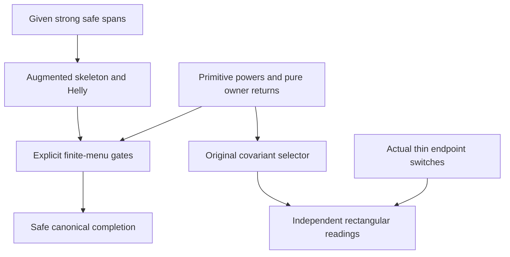

# Augmented safe selectors and independent rectangular readings

Generated from `module.json` by `tools/build_formalization_module.py`.

Source `490c3f36d85db5a0b3ced0598e6c431825254ec5`. **Human-expanded proof plan; no Lean code.**

B026 prepares all six safe-trace results, all four pure-owner/readings results and ONLY locality-absorb/locality-positive. The finite-menu gate proof is explicitly extracted and instantiated on augmented traces; original and augmented exact families remain distinct. Given strong S-amalgamation, actual age membership and endpoint actions are explicit. No reservoir, locality-bound, normalized MI or global EPPA theorem is exported.

The human article remains unchanged. Additional proof details are in
[PROOF_NOTES.md](PROOF_NOTES.md); the cross-track policy is in
[the formalization guide](../README.md). Source hashes are checked before
the index is regenerated. Graph validation is not proof verification.

## Source premises

**A01: Actual homogeneous symmetric-original typed SAP source.** Finite nonempty diversity palettes P_st on finitely many inhabited owner sorts, interpreted in an actual homogeneous binary source whose finite age has SAP. Literal old fine names come from a symmetric ORIGINAL structure: typed converse reverses owner tags and fixes every underlying name. Equality is never a diversity atom; triangle formal vertices remain distinct even for repeated sorts. Semantic CCO, primitivity and triangle-defined age membership are supplied separately only where used.

**A02: GIVEN all-span strong safe amalgamation.** For the safe branch only, S_st is nonempty, typed converse-compatible and pure-Gamma-covariant, and strongly S-amalgamates EVERY finite COMPLETE typed span, including empty base. This is supplied before recolouring/selectors and is not inferred from their completion conclusion.

**A03: Finite pure owner language action.** Gamma is a finite group acting on owner tags, fixing every literal original fine-colour name, preserving legal typed triangles, converse, products and original exact menus. BOTH Gamma and typed converse fix the underlying old names. No free or faithful action, atom permutations, independent pairwise selector choices or lifting section is assumed.

**A04: Actual central thin endpoint transport.** For moving readings, G is finite elementary abelian of exponent two. A switch at an endpoint acts bijectively on owners and literal colours, preserves the complete legal triangle table and original exact menus. Vertex switches (r,q,p) send (a,b,c) to ((r+q)a,(q+p)b,(r+p)c). Diagonal owner action rho(G) lies in Gamma and commutes with Gamma; rho may be nonfaithful. These are actual B025 inflation/thin-bottom data, not a new action on arbitrary safe matrices.

**A05: Additional typed semantic homomorphic CCO.** For original exact-menu/PC and their consumers, every finite specified typed diversity diagram whose specified simple cycles map homomorphically to the actual source itself maps there. SAP injectivization remains a separate source argument; neither primitive-loop fullness nor arbitrary-subset absorption uses CCO.

**A06: Additional primitive individual sorts.** For loop saturation and no-positive-return, every named individual sort of the actual source has no proper nontrivial invariant equivalence. The interpreted relation Delta_t union J may be used here, with no equality colour added to strong composition.

**A07: Actual triangle-defined age bridge.** For the canonical same-vertex completion conclusion, every finite complete owner-typed fine colouring whose triangles are legal belongs to the actual source age. B025 C34 supplies this bridge in the concrete full-owner instance. It is not assumed for an arbitrary age merely because its triangles are legal.

## Imported theorem contracts

These are named provider obligations for the receiving Lean project,
not new axioms or claims of compiled imports.

| ID and source | Contract | Current provider status |
|---|---|---|
| I01: [`lem:typed-set-pasch`](../../sections/typed_strong_domains.tex#L48) | Reuse associative arbitrary-subset products, nonempty compatible products, full-palette absorption and Set-Pasch. No CCO or NR2 is used by this support. | HUMAN_EXPANDED_NOT_LEAN |
| I02: [`lem:typed-injectivisation`](../../sections/typed_strong_domains.tex#L129) | Positive word profiles are realized by individually injective actual paths over a prescribed complete root edge; auxiliary witnesses can be glued without treating equality as diversity. | HUMAN_EXPANDED_NOT_LEAN |
| I03: [`lem:typed-helly`](../../sections/typed_strong_domains.tex#L251) | Finite pairwise-intersecting ORIGINAL strong exact menus have nonempty common intersection; singleton and genuine full Top cases included. | HUMAN_EXPANDED_NOT_LEAN |
| I04: [`lem:typed-exact-products`](../../sections/typed_strong_domains.tex#L311) | Original exact singleton/product/converse/nonempty-meet closure and distribution ONLY at a NONEMPTY evaluated meet. Atomic Boolean Peirce is separately reused from the proved support, not strengthened theorem conclusion. | HUMAN_EXPANDED_NOT_LEAN |
| I05: [`lem:typed-PC-fixedpoint-exact`](../../sections/typed_pc_fixedpoint.tex#L92) | Nonempty final greatest-PC domains are ORIGINAL exact. Reuse finite greatestness/certificate survival as explicit proved support. | HUMAN_EXPANDED_NOT_LEAN |
| I06: [`lem:typed-strong-cycle-completion`](../../sections/typed_strong_domains.tex#L187) | Source CCO plus SAP gives injective completion from realizable specified cycles, with complete-base preservation. The alternative actual-age membership proof uses B025 triangle-definedness. | HUMAN_EXPANDED_NOT_LEAN |
| I07: [`lem:typed-bilateral`](../../sections/typed_hereditary_selectors.tex#L72) | Original-H bilateral support proof is reused only as a template. C19 proves its finite-K version on explicit K axioms; safe traces are never declared original exact. | HUMAN_EXPANDED_NOT_LEAN |
| I08: [`lem:typed-all-PC`](../../sections/typed_hereditary_selectors.tex#L113) | Original-H gate nonemptiness and all-PC proof, plus separately selected supported-fork and supported-restriction proofs. C18-C21 explicitly prove the K instance. | HUMAN_EXPANDED_NOT_LEAN |
| I09: [`lem:typed-gate-image`](../../sections/typed_hereditary_selectors.tex#L207) | Idempotence, fixed-image/downwardness, hereditary composition and strict contraction proof is explicitly repeated on K in C22. | HUMAN_EXPANDED_NOT_LEAN |
| I10: [`lem:typed-pure-action-gate-engine`](../../sections/typed_hereditary_selectors.tex#L333) | ORIGINAL-H joint singleton engine with explicit parallel generated-family separation premise. C17 discharges it; C23 separately repeats minimal-seed visibility for K. | HUMAN_EXPANDED_NOT_LEAN |
| I11: [`thm:joint-transversal`](../../sections/owner_transversal_direct.tex#L159) | Under the existing B025 standing normalized actual-source/finite G-closed owner hypotheses, reuse named-owner homogeneity/pure Gamma, triangle-defined actual origin age, typed SAP, primitivity and phase-aligned full inflation. Countability belongs to this actual source construction; no global raw-SAP option or ordinary EPPA premise is added. This concrete provider supplies the A01/A05/A06/A07 source properties and pure owner action under its unchanged normalized-source hypotheses. | HUMAN_EXPANDED_NOT_LEAN |
| I12: [`lem:thin-bottom`](../../sections/finite_packets.tex#L339) | Central elementary abelian G and literal law col(t_g x,t_h y)=(g+h)col(x,y); actual owner stabilizers may be nontrivial. Use distinct real packets for independent endpoint transport. | HUMAN_EXPANDED_NOT_LEAN |

**I04 internal proof support:** C01 in `strong_selectors`. Extract the existing standalone Boolean triangle-definition proof C01 (ancestor of selected C08), retaining actual typed triangle premises; it is not inferred as a new conclusion of C08.

These are separately extracted proved support claims, not additional
conclusions of the named exported theorem.

**I05 internal proof support:** C10 in `strong_selectors`. Extract the finite monotone iteration and completion-survivor induction C10, a proved ancestor of selected C13; keep original PC initialization and all three-coordinate semantics.

These are separately extracted proved support claims, not additional
conclusions of the named exported theorem.

**I08 internal proof support:** C03, C16 in `strong_selectors`. Extract proved ancestors C03 (actual SAP-supported-fork duplication, arbitrary subsets) and C16 (original supported-menu restriction proof). Transport the latter explicitly under K closure/distribution; do not select them as direct exports or assert safe traces belong to original H.

These are separately extracted proved support claims, not additional
conclusions of the named exported theorem.

**I10 internal proof support:** C25 in `strong_selectors`. Extract the existing minimum viable seed/visibility proof C25, a proved ancestor of selected C26. Its finite-family argument is repeated for K; no original-H quantified theorem is instantiated outside its domain.

These are separately extracted proved support claims, not additional
conclusions of the named exported theorem.

## Definitions

| ID | Definition | Exact meaning | Source |
|---|---|---|---|
| D01 | Typed actual diversity menus | P_st consists of realized literal non-F fine atoms on distinct owner-typed vertices; a menu carries ordered tags even if its underlying raw-colour subset agrees with another menu. | [source](../../sections/finite_locality.tex#L16) |
| D02 | Original exact family and all-coordinate PC | H_st comprises nonempty finite meets of positive typed atomic word profiles; empty restriction list is genuine diversity Top. PC(D_st,A_tu,P_su) means P subset D*A, D subset P*bar A, A subset bar D*P. | [source](../../sections/typed_strong_domains.tex#L312) |
| D03 | Given safe palette and complete spans | S satisfies A02 for all finite complete typed spans. Strongness keeps the two off-base vertices distinct even over empty base. | [source](../../sections/safe_trace_selector.tex#L17) |
| D04 | Augmented family K | K_st=H_st union {D intersect S_st: D in H_st, D intersect S_st nonempty}. These are evaluated subsets, not original exact menus by fiat; exclude empty evaluated sets. | [source](../../sections/safe_trace_selector.tex#L243) |
| D05 | Skeleton and trace flag | X=D_X intersect S^epsilon with D_X original exact, epsilon in {0,1}, S^0=P_st, S^1=S_st and X nonempty. Presentations need not be unique; S^0 is a full palette, not an equality menu. | [source](../../sections/safe_trace_selector.tex#L92) |
| D06 | Arbitrary loop subsets and strong powers | For nonempty W subset P_tt, W^n is the n-fold positive STRONG product; no exactness/profile premise. m=|P_tt| and m0=max_t m. Actual diagonal is only added when interpreting an invariant equivalence. | [source](../../sections/finite_locality.tex#L44) |
| D07 | Pure owner action and literal-name converse | Gamma relabels owner tags, fixes literal names, and commutes with typed converse. Its stabilizers may be nontrivial; same-sort symmetry alone would not imply literal cross-sort converse invariance. | [source](../../sections/owner_covariant_readings.tex#L47) |
| D08 | Generated tagged families and positive provenance | For a finite typed menu family Q (original H or augmented K), F_Gamma(C) closes C under all compatible Q-products, converse and Gamma. A generation path records absent/present outside multipliers in L*(gamma X)^epsilon*R; absent means identity ACTION only. | [source](../../sections/owner_covariant_readings.tex#L47) |
| D09 | Abstract finite-menu gate instance | Q is a finite typed subfamily of actual palettes containing all singletons and Top, closed under converse, products and NONEMPTY meets, with 2-Helly and NONEMPTY-result product/meet distribution. A current J is Q-downward/converse/Gamma closed with all singletons. A filter F is closed under all Q-multipliers, converse and Gamma and is relatively visible on J. Gate G(D)=D intersect all parallel F menus meeting D, empty active list leaving D unchanged. These are per-instance algebraic hypotheses; Q need not be original H. The ambient Q itself is Gamma-invariant: Gamma bijects Q_st onto Q_gamma(s),gamma(t), preserving products and converse; generation therefore remains within Q. | [source](../../sections/typed_hereditary_selectors.tex#L45) |
| D10 | Joint hereditary selector | Conservative singleton-valued map on a tagged family, compatible with converse, preserving all three PC inclusions and survivor heredity E subset D and h(D) in E implies h(E)=h(D). Pure owner covariance is h_gamma(s),gamma(t)(D)=h_st(D). | [source](../../sections/typed_hereditary_selectors.tex#L20) |
| D11 | Safe retraction on ALL K | T(D)=D intersect S when that trace is nonempty, otherwise T(D)=D, for EVERY D in K, including already traced menus. | [source](../../sections/safe_trace_selector.tex#L243) |
| D12 | Actual thin switches | For g in G, g sends D_st to (gD)_(gs),t and also (gD)_s,(gt); the owner action need not be faithful. Independent vertex switches preserve typed triangle tables; diagonal G fixes literal colours. | [source](../../sections/owner_covariant_readings.tex#L243) |
| D13 | Moved-type reading | h^g_st(D)=g h_(gs),t(gD) on ORIGINAL exact D. The moved input type is essential. g is its own inverse. | [source](../../sections/owner_covariant_readings.tex#L243) |
| D14 | Finite recorded diagram and greatest PC | Finite formal vertices with owner tags and at most one literal diversity record on each unordered pair, coherent under converse. Records initialize singleton domains and holes Top; all distinct-third-vertex PC updates have a canonical greatest fixed refinement. An injective actual completion is an explicit premise of the safe consumer. | [source](../../sections/safe_trace_selector.tex#L646) |

## Proof claims and direct dependencies

Every row has a human proof expansion. Each still needs an actual Lean
statement and proof. Primitive saturation, pure owner covariance, supplied strong-S spans and actual thin endpoint transport have separate dependency branches.

| ID and claim | Scope | Direct providers | Proof note |
|---|---|---|---|
| C01: Arbitrary-subset full absorption | SAP | D01, I01 | N02 in [notes](PROOF_NOTES.md) |
| C02: Symmetric loop duplication | SAP | D06, I01 | N02 in [notes](PROOF_NOTES.md) |
| C03: Increasing even loop powers | SAP | C02, I01 | N02 in [notes](PROOF_NOTES.md) |
| C04: Actual equivalence and primitivity | SAP_primitive | C03, A01, A06 | N02 in [notes](PROOF_NOTES.md) |
| C05: Uniform arbitrary-subset loop fullness | SAP_primitive | C01, C03, C04 | N02 in [notes](PROOF_NOTES.md) |
| C06: One-edge same-vertex safe recolouring | strong_S | D03 | N03 in [notes](PROOF_NOTES.md) |
| C07: Long witness presentation of nonsingleton exact menus | SAP_CCO | D02, I02, I04 | N03 in [notes](PROOF_NOTES.md) |
| C08: Safe traces and unsafe singleton exception | SAP_CCO_strong_S | C06, C07 | N03 in [notes](PROOF_NOTES.md) |
| C09: Arbitrary-multiplier trace identity | SAP_CCO_strong_S | C06, C07, C08, I04 | N03 in [notes](PROOF_NOTES.md) |
| C10: Two-trace augmented products | SAP_CCO_strong_S | D05, C09, I04 | N03 in [notes](PROOF_NOTES.md) |
| C11: Augmented meet and nonempty distribution | SAP_CCO_strong_S | C10, I04 | N03 in [notes](PROOF_NOTES.md) |
| C12: Augmented converse and owner covariance | SAP_CCO_strong_S | D04, C10, C11, A03 | N03 in [notes](PROOF_NOTES.md) |
| C13: Augmented finite 2-Helly | SAP_CCO_strong_S | C06, C07, C11, I03 | N04 in [notes](PROOF_NOTES.md) |
| C14: Typed positive-provenance return normal form | primitive_pure_owner | D08, I01 | N06 in [notes](PROOF_NOTES.md) |
| C15: Uniform full return transformation | primitive_pure_owner | C14, C05, C01 | N06 in [notes](PROOF_NOTES.md) |
| C16: No positive return through proper menus | primitive_pure_owner | C15, C01 | N06 in [notes](PROOF_NOTES.md) |
| C17: Parallel generated-family separation | primitive_pure_owner | C16, D07 | N06 in [notes](PROOF_NOTES.md) |
| C18: Finite-K gate well-definedness and heredity | finite_menu_algebra | D09, I08 | N05 in [notes](PROOF_NOTES.md) |
| C19: Finite-K bilateral support | finite_menu_algebra | C18, I07 | N05 in [notes](PROOF_NOTES.md) |
| C20: Augmented/current supported restrictions | finite_menu_algebra | C19, I08, I04 | N05 in [notes](PROOF_NOTES.md) |
| C21: All three PC coordinates for finite-K gates | finite_menu_algebra | C20, C19, I04 | N05 in [notes](PROOF_NOTES.md) |
| C22: Finite-K gate fixed image and composition | finite_menu_algebra | C18, C21, I09 | N05 in [notes](PROOF_NOTES.md) |
| C23: Minimal viable seed is visible | primitive_pure_owner | D09, C17, I10 | N07 in [notes](PROOF_NOTES.md) |
| C24: ORIGINAL pure-owner covariant HS | primitive_pure_owner | D10, I10, C17 | N09 in [notes](PROOF_NOTES.md) |
| C25: Augmented pure-owner HS by explicit transport | SAP_CCO_strong_S | C12, C13, C18, C19, C20, C21, C22, C23 | N07 in [notes](PROOF_NOTES.md) |
| C26: Safe T on the entire augmented family | SAP_CCO_strong_S | D11, C09, C12 | N07 in [notes](PROOF_NOTES.md) |
| C27: One joint safe augmented selector | SAP_CCO_strong_S | C25, C26 | N07 in [notes](PROOF_NOTES.md) |
| C28: Each proper covariant gate removes an orbit | SAP_CCO_strong_S | C22, C25 | N07 in [notes](PROOF_NOTES.md) |
| C29: Finite orbit gate bound | SAP_CCO_strong_S | C26, C28 | N07 in [notes](PROOF_NOTES.md) |
| C30: Nonfree pure action is harmless | SAP_CCO_strong_S | C17, C28, A03 | N07 in [notes](PROOF_NOTES.md) |
| C31: Existential safe completion certificate | strong_S | D14, C06 | N08 in [notes](PROOF_NOTES.md) |
| C32: Greatest original PC retains safe survivors | SAP_CCO_strong_S | C31, I05 | N08 in [notes](PROOF_NOTES.md) |
| C33: Canonical pure-owner equivariant safe completion | SAP_CCO_strong_S | C32, C27, I06, A07 | N08 in [notes](PROOF_NOTES.md) |
| C34: Supplied endpoint transport of original exact menus | finite_thin_action | D12, I04, A04 | N09 in [notes](PROOF_NOTES.md) |
| C35: Conservation, heredity, converse and pure covariance of readings | finite_thin_action | D13, C24, C34, A04 | N09 in [notes](PROOF_NOTES.md) |
| C36: Moved-type switching identity | finite_thin_action | C35, A04 | N09 in [notes](PROOF_NOTES.md) |
| C37: Bilateral original refinement and independent support | finite_thin_action | C24, C34, C35, I04, I08 | N09 in [notes](PROOF_NOTES.md) |
| C38: Fixed selected third colour and hereditary restrictions | finite_thin_action | C37, C35, I04 | N09 in [notes](PROOF_NOTES.md) |
| C39: Fully independent rectangular legal triangle | finite_thin_action | C38, C37 | N09 in [notes](PROOF_NOTES.md) |
| C40: Actual owner-transversal specialization | actual_source_instance | I11, I12, C24, C35, C39 | N09 in [notes](PROOF_NOTES.md) |

The precise quantified contracts are in `module.json`. Provider-before-consumer
order (including definitions and source premises):

`A01 → A02 → A03 → A04 → A05 → A06 → A07 → I11 → I12 → D01 → I01 → I02 → I03 → I04 → I05 → I06 → I07 → I08 → I09 → I10 → C01 → D02 → D03 → D06 → D07 → D12 → D14 → C02 → C06 → C07 → C34 → D04 → D08 → D10 → C03 → C08 → C14 → C31 → D05 → D09 → D11 → D13 → C04 → C09 → C18 → C32 → C05 → C10 → C19 → C11 → C15 → C20 → C12 → C13 → C16 → C21 → C17 → C22 → C26 → C23 → C24 → C25 → C35 → C27 → C28 → C36 → C37 → C29 → C30 → C33 → C38 → C39 → C40`

This order is one valid linearization; it does not require unrelated
branches to be proved sequentially. The full DAG is the `depends_on`
relation in `module.json`.

## Main proof branches

This is a coarse view of the claim DAG. Edges go from provider to consumer.

Source proof DAG only. The original/readings branch has no strong-S, safe-completion, reservoir, normalized-MI or ordinary-EPPA dependency. The construction of S and full interpacket orbit safety remain external to this unit.

## Article exports

| Existing source result | Sidecar proof claims |
|---|---|
| [`lem:locality-absorb`](../../sections/finite_locality.tex#L15) | C01 |
| [`lem:locality-positive`](../../sections/finite_locality.tex#L43) | C02, C03, C04, C05 |
| [`lem:one-edge-safe-recolour`](../../sections/safe_trace_selector.tex#L16) | C06 |
| [`lem:safe-trace-product`](../../sections/safe_trace_selector.tex#L39) | C07, C08, C09 |
| [`lem:augmented-safe-skeleton-calculus`](../../sections/safe_trace_selector.tex#L91) | C10, C11 |
| [`lem:augmented-safe-algebra`](../../sections/safe_trace_selector.tex#L242) | C12, C13, C16, C17, C18, C19, C20, C21, C22, C23, C25, C26, C27 |
| [`cor:augmented-gamma-orbit-gate-bound`](../../sections/safe_trace_selector.tex#L469) | C28, C29, C30 |
| [`lem:safe-global-completion`](../../sections/safe_trace_selector.tex#L645) | C31, C32, C33 |
| [`lem:covariant-loop-full`](../../sections/owner_covariant_readings.tex#L19) | C01, C05 |
| [`lem:covariant-no-return`](../../sections/owner_covariant_readings.tex#L46) | C14, C15, C16, C17 |
| [`thm:covariant-HS`](../../sections/owner_covariant_readings.tex#L199) | C24 |
| [`prop:moving-readings`](../../sections/owner_covariant_readings.tex#L250) | C34, C35, C36, C37, C38, C39, C40 |

Auxiliary source equations (not additional numbered results):

- [`eq:augmented-skeleton-product`](../../sections/safe_trace_selector.tex#L125): C10
- [`eq:augmented-skeleton-meet`](../../sections/safe_trace_selector.tex#L134): C11
- [`eq:augmented-skeleton-distrib`](../../sections/safe_trace_selector.tex#L149): C11
- [`eq:covariant-HS`](../../sections/owner_covariant_readings.tex#L204): C24
- [`eq:shifted-reading`](../../sections/owner_covariant_readings.tex#L243): C34, C35
- [`eq:reading-switch`](../../sections/owner_covariant_readings.tex#L255): C36
- [`eq:reading-bilateral`](../../sections/owner_covariant_readings.tex#L294): C37
- [`eq:reading-rectangular`](../../sections/owner_covariant_readings.tex#L262): C38, C39

Full result coverage is asserted only for `source_result_files`.
Selected additional results: lem:locality-absorb, lem:locality-positive.
Other results in their provider source files are not claimed covered.

## Internal implementation milestones

These tasks are proof milestones inside larger project assignments;
see the [peer-project allocation](../coordination/BOARD.md).

These are implementation tasks, not additional mathematical assumptions.

| Task | Earlier tasks | Acceptance |
|---|---|---|
| T01: Uniform primitive arbitrary-subset powers | — | Compile the exact quantified claims, discharge all listed actual-source providers and import public declarations into the Lean root; preserve explicit scope and meaningful consumer. Uniform primitive arbitrary-subset powers. |
| T02: Safe trace and augmented skeleton/Helly | — | Compile the exact quantified claims, discharge all listed actual-source providers and import public declarations into the Lean root; preserve explicit scope and meaningful consumer. Safe trace and augmented skeleton/Helly. |
| T03: Typed return and original covariant selector | T01 | Compile the exact quantified claims, discharge all listed actual-source providers and import public declarations into the Lean root; preserve explicit scope and meaningful consumer. Typed return and original covariant selector. |
| T04: Explicit finite-menu gate transport | — | Compile the exact quantified claims, discharge all listed actual-source providers and import public declarations into the Lean root; preserve explicit scope and meaningful consumer. Explicit finite-menu gate transport. |
| T05: Augmented safe selector and orbit bound | T02, T03, T04 | Compile the exact quantified claims, discharge all listed actual-source providers and import public declarations into the Lean root; preserve explicit scope and meaningful consumer. Augmented safe selector and orbit bound. |
| T06: Safe certificate and canonical completion | T02, T05 | Compile the exact quantified claims, discharge all listed actual-source providers and import public declarations into the Lean root; preserve explicit scope and meaningful consumer. Safe certificate and canonical completion. |
| T07: Independent rectangular readings | T03 | Compile the exact quantified claims, discharge all listed actual-source providers and import public declarations into the Lean root; preserve explicit scope and meaningful consumer. Independent rectangular readings. |

## Finite controls

- **K01.** Bounded represented menu/loop controls include arbitrary NONEXACT subsets and reject empty-meet distribution; diagnostic only.
- **K02.** Moved endpoint types, independent G^3 readings and nonfaithful owner actions; pure atom-swap/directed-converse obstructions remain negative scope controls.
- **K03.** Finite safe retraction, all-coordinate PC and same-vertex one-edge recolouring in the explicit four-colour table. The script does not certify the general gate construction, canonical completion or infinite source hypotheses.

Run `python tools/check_safe_readings_controls.py` from the manuscript directory.
The controls do not prove CCO or the general theorems.

## Return to the human articles

No required mathematical repair was found in this scoped pass. These
optional wording clarifications remain queued for a human article pass:

- **F01** ([source](../../sections/safe_trace_selector.tex#L243)): Original gate theorem statements quantify ORIGINAL H. The K finite-menu extraction and nonempty supported restrictions are now proved explicitly in notes, with support selected separately from direct exports. None required in the current actual source scope; preserve this extra proof expansion in sidecar notes.
- **F02** ([source](../../sections/safe_trace_selector.tex#L646)): A legal complete triangle colouring belongs to the actual U_B age by the existing B025 C34 bridge, or by a separate all-cycle CCO/SAP argument. Bare triangle legality in an arbitrary age is insufficient. None required: make the existing actual-source age bridge explicit in the receiving contract.

The machine ledger records caller effects and affected claims. The source
review used two independent model review passes and parent synthesis;
it is not independent human or formal certification.
