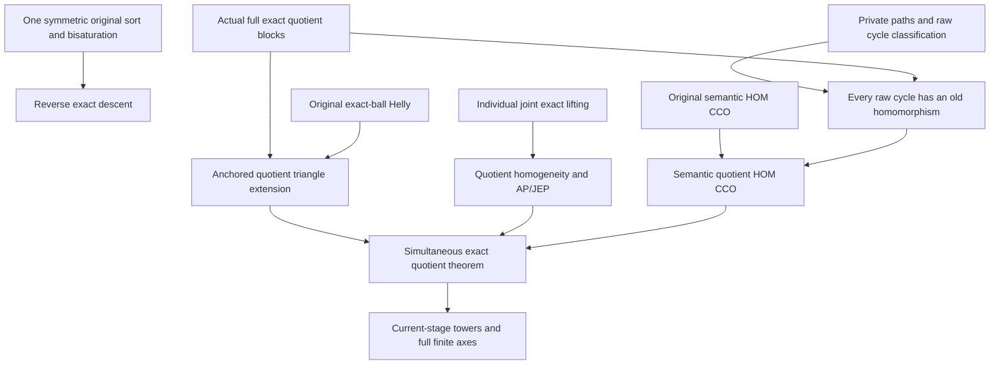

# Simultaneous full exact quotients: one-sort descent, private paths, CCO and towers

Generated from `module.json` by `tools/build_formalization_module.py`.

Source `490c3f36d85db5a0b3ced0598e6c431825254ec5`. **Human-expanded proof plan; no Lean code.**

Private B041: FIVE SELECTED new Foundations I results, ONE new equation, fourteen definitions, 60 human claims and eight tasks. The three other results and TQ1-TQ4 in the same source file are ALREADY prepared in rigid_groupoid/finite_kernel and remain imports, not duplicate coverage. Prove reverse exact descent ONLY for ONE original symmetric sort, abstract private-path cycle decomposition, simultaneous quotient triangle fullness/homogeneity/AP/JEP and semantic homomorphic CCO, exact quotient towers and full-Aut finite entire-axis application. The quotient CCO proof uses original CCO directly and does not consume quotient homogeneity/AP or a FullWord criterion. No SAP, global automorphism-lifting section, independent mixed-word descent, current owner-kernel binding or new external theorem is asserted.

The human article remains unchanged. Additional proof details are in
[PROOF_NOTES.md](PROOF_NOTES.md); the cross-track policy is in
[the formalization guide](../README.md). Source hashes are checked before
the index is regenerated. Graph validation is not proof verification.

## Source premises

**A01: Actual original typed semantic homomorphic CCO source.** M is COUNTABLE HOMOGENEOUS in a FINITE complete atomic binary language with finitely many named nonempty original transitive sorts. G=Aut(M) is the actual original full automorphism group. Same-sort orbitals are symmetric, cross-sort orbitals have typed converses and need not commute. Semantic HOMOMORPHIC simple-cycle CCO is supplied for original finite partial diversity diagrams. No original SAP or extra triangle-fullness hypothesis is supplied. Quotients and word profiles are actual represented objects.

**A02: Independent FULL exact equivalences and actual quotient signature.** For EVERY named original sort s choose an arbitrary independent G-invariant FULL equality-inclusive exact equivalence E_s, allowing Id_s and top. Q_s=M_s/E_s; Q is their tagged union, naming ALL actual pair orbitals of the induced ORIGINAL G-action, with same-sort equality logical. Exact means a nonempty finite intersection of actual atomic-word profiles; empty restriction list is typed top, empty loop word is real Id. No reverse mixed-sort exact descent or group section is assumed.

**A03: ONE-original-sort reverse descent request.** ONLY for the reverse-descent branch, the original source has ONE transitive sort and ALL its old binary orbitals are symmetric. E is its full exact invariant equivalence and D is a NONEMPTY old full exact invariant relation with literal E;D;E=D. D may be top with an empty defining list; a defining word may be the empty equality word. This premise is not used by quotient towers or the multi-original-sort theorem.

**A04: Independent finite private-path graph data.** G0 is a finite SIMPLE partially coloured typed graph with diversity atoms on specified unordered edges and typed converse orientation. Replace each edge by finitely many formal individually simple paths with pairwise PRIVATE internal vertices, distinct marked endpoints, and only local genuine equality contractions. Every surviving path has positive length; coincident length-one paths over one marked pair have the SAME colour and are merged. Zero paths above an edge are allowed; there is no resulting zero-length path or artificial parallel-edge 2-cycle.

**A05: Arbitrary anchored one-point quotient request.** In the anchored-extension proof, take an ACTUAL finite complete quotient base of pairwise distinct C_j, a requested new sort u and one actual quotient pair orbital to each centre. Every indicated triangle is realized in Q, with consistent unary sorts/converses and same-sort requested diversity for a NEW distinct vertex. This is an arbitrary conditional extension request, not an additional global triangle-fullness assumption.

**A06: Arbitrary semantic quotient CCO request.** In the CCO proof, take any finite partially specified quotient atomic DIVERSITY diagram whose EVERY specified simple cycle has a homomorphism into Q. A homomorphism may identify nonadjacent formal vertices. The whole diagram completion is the conclusion. Different raw-cycle witnesses need not use globally coherent quotient images or real representatives.

**A07: Current-stage exact quotient tower data.** For towers, each subsequent stage quotients the CURRENT named original sorts by arbitrary full exact invariant equivalences in its CURRENT equality-inclusive represented algebra. They need not be images of independently chosen exact relations from the initial source. Pullback to earlier sources is the safe direction. Every stage is finite in number and all same-sort/cross-sort names remain typed.

**A08: Entire finite named quotient axes.** Choose any finite selection of named sorts whose ENTIRE quotient sets Q_s are finite, including the empty selection. Use Gamma=FULL Aut(Q) and R_s=Aut(Q restricted to the whole Q_s), with actual pair-image subgroups. These are whole named finite sorts, not finite fibres over moving owners, not an arbitrary earlier subgroup image, and not a pointwise coarse-owner kernel.

**A09: Optional elementary-abelian intrinsic coordinate groups.** ONLY for the linear/rank subbranch each intrinsic R_s in A08 is abstractly an elementary abelian 2-group V_s=F2^(d_s). Dimensions and pair quotient spaces are finite. Do not infer this group structure from the quotient theorem; it is an explicit conditional extra premise for that consequence.

## Imported theorem contracts

These are named provider obligations for the receiving Lean project,
not new axioms or claims of compiled imports.

| ID and source | Contract | Current provider status |
|---|---|---|
| I01: [`lem:full-typed-exact-saturation`](../../sections/exact_foundations/01_full_raw_exact_helly.tex#L230) | For exact E,H and NONEMPTY exact meet D=intersection P_alpha, E;D;H=intersection(E;P_alpha;H), with empty list interpreted as typed top. Keep the nonempty-result guard; no arbitrary Boolean meet distribution is imported. | HUMAN_EXPANDED_NOT_LEAN |
| I02: [`lem:typed-simultaneous-blocks`](../../sections/simultaneous_typed_exact_quotients.tex#L38) | E_s;a;E_t are actual inverse images of quotient ORIGINAL-G pair orbitals, nonempty full exact and endpoint saturated. Blocks partition old atoms; quotient equality pulls back to E_s and same-sort diversity blocks are disjoint E_s. This selected block result is sufficient for the main quotient CCO construction; no quotient FullWord/Helly theorem is imported there. | HUMAN_EXPANDED_NOT_LEAN |
| I03: [`lem:typed-simultaneous-blocks`](../../sections/simultaneous_typed_exact_quotients.tex#L38) | Inverse image preserves intersections/converse and actual relational composition: insert the actual intermediate E_t then remove it using endpoint saturation. The empty quotient word pulls back to E_s, not old Id. Use in one-sort descent/tower algebra, not as a substitute for a globally coherent choice of representatives. | HUMAN_EXPANDED_NOT_LEAN |
| I04: [`lem:typed-simultaneous-blocks`](../../sections/simultaneous_typed_exact_quotients.tex#L38) | Every quotient word/menu, including empty word and top empty list, pulls back to an old full exact relation. This is quotient exact => original exact; it does NOT infer arbitrary original exact => quotient exact under independent mixed kernels. Used by towers, not by the main quotient CCO proof. | HUMAN_EXPANDED_NOT_LEAN |
| I05: [`thm:full-typed-exact-balls`](../../sections/exact_foundations/01_full_raw_exact_helly.tex#L27) | For one target original sort and arbitrary actual original centre sorts, a finite pairwise-intersecting family of nonempty full exact balls has a common point, including empty/singleton families. The centres may be arbitrary chosen representatives; endpoint saturation, not representative compatibility, provides pairwise witnesses. | HUMAN_EXPANDED_NOT_LEAN |
| I06: [`thm:typed-joint-exact-lifting`](../../sections/exact_foundations/03_joint_exact_sort_lifting.tex#L1) | Include each Id_s and chosen E_s in the joint structure. EVERY finite partial isomorphism on the EXACT SAME displayed real/quotient vertices is induced by ONE original automorphism. No arbitrary real representatives are added, no original fine colours between them are presumed, and no functorial group section is supplied. | HUMAN_EXPANDED_NOT_LEAN |
| I07: [`lem:typed-finite-entire-axis-projection`](../../sections/simultaneous_typed_exact_quotients.tex#L497) | For a HOMOGENEOUS relational structure of arity<=2 and ENTIRE finite named sorts, the full automorphism group projects onto each intrinsic axis group and its finite coordinate image is exactly the set satisfying all actual pair-image constraints. Empty/singleton selections are included. Not a theorem about a pointwise owner kernel. | HUMAN_EXPANDED_NOT_LEAN |
| I08: [`cor:typed-finite-linear-goursat`](../../sections/simultaneous_typed_exact_quotients.tex#L543) | Under elementary-abelian intrinsic groups and the full homogeneous entire-axis setting, actual pair images have surjective linear quotient-coordinate presentations; the actual finite image is ker Phi and has size 2^(sum dimensions-rank Phi). This counts the coordinate IMAGE, not full possibly infinite Gamma. Flatness C20 is not imported because the new source corollary asks only projection/rank. | HUMAN_EXPANDED_NOT_LEAN |

## Definitions

| ID | Definition | Exact meaning | Source |
|---|---|---|---|
| D01 | FULL word/menu conventions | An actual typed atomic-word profile is a relational product; the empty loop word is old Id. A nonempty full exact menu is a finite intersection; empty list is typed top. A quotient empty word pulls back to its old E_s rather than Id. | [source](../../sections/simultaneous_typed_exact_quotients.tex#L142) |
| D02 | Actual pure simultaneous quotient | Q_s consists of ACTUAL E_s-classes, tagged by named original sort, and Q names the ORIGINAL-G pair orbitals. Their inverse-image blocks are those of I02; no coherent real representatives are chosen. | [source](../../sections/simultaneous_typed_exact_quotients.tex#L313) |
| D03 | One-sort E-bisaturated descent datum | D=E;D;E is old nonempty full exact in the ONE original symmetric sort, so its quotient image D/E is a well-defined actual quotient relation. This additional saturation is a premise, not automatic for arbitrary D. | [source](../../sections/simultaneous_typed_exact_quotients.tex#L142) |
| D04 | Exact finite word presentation | Choose D=intersection_alpha P_alpha with each P_alpha a nonempty represented atomic word; the finite list may be empty. Nonempty D witnesses every restriction and all their required nonempty meet results. | [source](../../sections/simultaneous_typed_exact_quotients.tex#L142) |
| D05 | Marked private-path expansion | Marked vertices are those of G0. Every internal formal vertex lies in exactly one individually simple path, with specified degree two; its endpoints are distinct marked vertices. The resulting raw graph is simple after direct-edge merging. | [source](../../sections/simultaneous_typed_exact_quotients.tex#L261) |
| D06 | Genuine equality contraction | Contract a named logical identity letter within its own typed path; never identify distinct marked endpoints or private vertices of different paths. In the abstract lemma the input excludes a zero-length reduced path; the main quotient application derives that exclusion. | [source](../../sections/simultaneous_typed_exact_quotients.tex#L261) |
| D07 | Anchored actual quotient base | A one-point request over C1,...,Cn uses the existing ACTUAL quotient classes, not merely an isomorphic base copy. Choose arbitrary real b_j in each class and old block D_j for the requested orbital. | [source](../../sections/simultaneous_typed_exact_quotients.tex#L313) |
| D08 | Exact-ball intersection request | B_(D_j)(b_j)={z in M_u:(z,b_j) in D_j}. Its target sort is fixed, centre sorts can differ. Arbitrarily fixed b_j are retained throughout; saturation will align all pairwise triangle witnesses to them. | [source](../../sections/simultaneous_typed_exact_quotients.tex#L313) |
| D09 | Pure quotient map as a joint partial map | View a finite pure-Q partial isomorphism in the larger joint structure with each Id_s and E_s, retaining EXACTLY its displayed quotient vertices and their actual old-G orbitals. Add no unconstrained original representatives or fine real pair colours. | [source](../../sections/simultaneous_typed_exact_quotients.tex#L313) |
| D10 | Raw word expansion of a quotient CCO request | For each specified quotient edge, let D be its old exact pullback block and choose a finite word presentation. Attach a private path for each reduced word, with all marked vertices retained even when a top block has zero restrictions/paths. | [source](../../sections/simultaneous_typed_exact_quotients.tex#L313) |
| D11 | Witnesses local to ONE raw simple cycle | For a two-path cycle choose one actual quotient pair; for a projected base cycle choose ONE homomorphism of that ENTIRE quotient cycle. Within this raw cycle choose ONE old representative per marked variable. Distinct marked variables may have equal images; choices may differ across different raw cycles. | [source](../../sections/simultaneous_typed_exact_quotients.tex#L313) |
| D12 | Total pulled-back tower kernel | A next-stage equivalence F_s on M_s/E_s pulls back to H_s on original M_s, with E_s<=H_s. The canonical bijection sends an iterated class [[x]_(E_s)]_(F_s) to [x]_(H_s), equivalently unions its E_s-classes. Nested class sets are not literally equal before this identification. | [source](../../sections/simultaneous_typed_exact_quotients.tex#L442) |
| D13 | Finite typed diversity rank | Count all named typed diversity atom orbitals consistently, either directed pairs or paired converse names with fixed convention. Quotient atoms are unions of prior atoms: no splitting; one nonidentity same-sort atom becomes equality under any strict kernel, giving a strict total decrease. | [source](../../sections/simultaneous_typed_exact_quotients.tex#L442) |
| D14 | Intrinsic full-Aut finite coordinate image | For entire finite quotient sorts let Gamma=Aut(Q) and R_s=Aut(Q|Q_s). The actual image on finitely many such axes is finite even if Gamma is infinite; pair images and, conditionally, linear check map Phi describe that image. | [source](../../sections/simultaneous_typed_exact_quotients.tex#L594) |

## Proof claims and direct dependencies

Every row has a human proof expansion. Each still needs an actual Lean
statement and proof. Preserve old equality versus quotient equality versus unrestricted top, original full exactness versus quotient exactness, actual old-group orbitals versus full quotient automorphisms, and canonical class flattening rather than literal equality of nested classes.

| ID and claim | Scope | Direct providers | Proof note |
|---|---|---|---|
| C01: One-original-sort invariants commute by symmetry and converse | one_original_sort_descent | A01, A03 | N01 in [notes](PROOF_NOTES.md) |
| C02: Nonempty exact D supplies a valid finite presentation including top | one_original_sort_descent | A03, D03, D04 | N01 in [notes](PROOF_NOTES.md) |
| C03: Guarded exact distribution saturates each defining word | one_original_sort_descent | A03, C02, I01 | N01 in [notes](PROOF_NOTES.md) |
| C04: Symmetry and idempotence split a saturated old word into blocks | one_original_sort_descent | C01, D01, C03 | N01 in [notes](PROOF_NOTES.md) |
| C05: Each saturated old atom is one ACTUAL quotient atom pullback | one_original_sort_descent | A03, I02, D02 | N01 in [notes](PROOF_NOTES.md) |
| C06: A saturated defining word is a quotient WORD-profile pullback | one_original_sort_descent | C04, C05, I03 | N01 in [notes](PROOF_NOTES.md) |
| C07: Intersecting the quotient words gives full exact D/E | one_original_sort_descent | C02, C03, C05, C06 | N01 in [notes](PROOF_NOTES.md) |
| C08: An exact equivalence K above E descends as an exact equivalence | one_original_sort_descent | A03, C07 | N01 in [notes](PROOF_NOTES.md) |
| C09: One-original-sort exact-descent source export | one_original_sort_descent | C07, C08 | N01 in [notes](PROOF_NOTES.md) |
| C10: Top, real equality and quotient equality are three distinct conventions | boundary | D01, C02, C04, C06 | N01 in [notes](PROOF_NOTES.md) |
| C11: Private-path normalization retains the graph hypotheses | private_graph | A04, D05, D06 | N02 in [notes](PROOF_NOTES.md) |
| C12: A raw cycle traverses a private path all the way to a marked endpoint | private_graph | D05, C11 | N02 in [notes](PROOF_NOTES.md) |
| C13: A raw simple cycle visits at least two marked vertices | private_graph | C12, D05 | N02 in [notes](PROOF_NOTES.md) |
| C14: Two marked vertices mean two paths above ONE base edge | private_graph | A04, C12, C13 | N02 in [notes](PROOF_NOTES.md) |
| C15: At least three marked vertices project to a SIMPLE base cycle | private_graph | A04, C12, C13 | N02 in [notes](PROOF_NOTES.md) |
| C16: Direct-edge merging prevents fake parallel cycles | private_graph | C11, C14, C15 | N02 in [notes](PROOF_NOTES.md) |
| C17: Private word-path cycle-decomposition source export | private_graph | C12, C13, C14, C15, C16 | N02 in [notes](PROOF_NOTES.md) |
| C18: A top pullback may legitimately contribute ZERO private paths | quotient_CCO | A06, I02, D10 | N04 in [notes](PROOF_NOTES.md) |
| C19: Quotient colours are actual original-group orbitals with saturated exact blocks | anchored_extension | A01, A02, I02, D02 | N03 in [notes](PROOF_NOTES.md) |
| C20: Zero and one anchored centre require no capacity assumption | anchored_extension | A01, A05, C19, D07 | N03 in [notes](PROOF_NOTES.md) |
| C21: Each allowed triangle aligns with the actual quotient centre pair | anchored_extension | A05, C19, D07 | N03 in [notes](PROOF_NOTES.md) |
| C22: Endpoint saturation makes the exact balls pairwise intersect | anchored_extension | C21, I02, D08 | N03 in [notes](PROOF_NOTES.md) |
| C23: Heterogeneous exact-ball Helly gives ONE common old point | anchored_extension | C19, C20, C22, I05 | N03 in [notes](PROOF_NOTES.md) |
| C24: Same-sort diversity forces the new quotient class to be fresh | anchored_extension | I02, C23 | N03 in [notes](PROOF_NOTES.md) |
| C25: The one-point extension is anchored over the EXACT old quotient base | anchored_extension | C20, C23, C24 | N03 in [notes](PROOF_NOTES.md) |
| C26: Induction gives quotient triangle fullness | anchored_extension | C20, C25 | N03 in [notes](PROOF_NOTES.md) |
| C27: A pure quotient partial isomorphism is joint on the SAME displayed vertices | joint_homogeneity | A01, A02, D09 | N03 in [notes](PROOF_NOTES.md) |
| C28: Individual joint lifting gives quotient homogeneity and age AP/JEP | joint_homogeneity | A01, C27, I06, D02 | N03 in [notes](PROOF_NOTES.md) |
| C29: Every specified quotient edge has a nonempty exact old pullback presentation | quotient_CCO | A06, I02, D10 | N04 in [notes](PROOF_NOTES.md) |
| C30: Reduced equality-only words are impossible for quotient diversity edges | quotient_CCO | A01, A02, C18, C29, I02, D01 | N04 in [notes](PROOF_NOTES.md) |
| C31: Duplicate direct old paths have the same atom and can be merged | quotient_CCO | C29, C30, A01 | N04 in [notes](PROOF_NOTES.md) |
| C32: The expanded old diagram satisfies the private-path graph hypotheses | quotient_CCO | C18, C29, C30, C31, D10 | N04 in [notes](PROOF_NOTES.md) |
| C33: Every raw simple cycle has one of the two controlled projections | quotient_CCO | C17, C32 | N04 in [notes](PROOF_NOTES.md) |
| C34: Choose ONE compatible quotient witness for each whole raw cycle | quotient_CCO | A06, C29, C33, D11 | N04 in [notes](PROOF_NOTES.md) |
| C35: Arbitrary old representatives of that cycle satisfy every traversed word | quotient_CCO | I02, C29, C34, D11 | N04 in [notes](PROOF_NOTES.md) |
| C36: Independent private word witnesses realize each old raw cycle homomorphically | quotient_CCO | C33, C34, C35 | N04 in [notes](PROOF_NOTES.md) |
| C37: Original semantic CCO gives a homomorphism of the ENTIRE expanded diagram | quotient_CCO | A01, C32, C36 | N04 in [notes](PROOF_NOTES.md) |
| C38: The whole homomorphism recovers every exact endpoint block | quotient_CCO | C18, C29, C31, C37 | N04 in [notes](PROOF_NOTES.md) |
| C39: Projecting marked images proves semantic HOM quotient CCO | quotient_CCO | C37, C38, D02 | N04 in [notes](PROOF_NOTES.md) |
| C40: Simultaneous full exact quotient theorem source export | quotient_CCO | C19, C26, C28, C39 | N04 in [notes](PROOF_NOTES.md) |
| C41: Every quotient stage retains the exact source hypotheses | quotient_towers | A01, A02, C40, I02 | N05 in [notes](PROOF_NOTES.md) |
| C42: The theorem can be applied again at each CURRENT stage | quotient_towers | A07, C40, C41 | N05 in [notes](PROOF_NOTES.md) |
| C43: Pulling the next-stage kernel back gives exact original H above E | quotient_towers | A07, I04, D12 | N05 in [notes](PROOF_NOTES.md) |
| C44: Nested quotient classes flatten by a canonical bijection | quotient_towers | C43, D12 | N05 in [notes](PROOF_NOTES.md) |
| C45: Double saturation gives the direct old atomic blocks | quotient_towers | C43, I02, I03 | N05 in [notes](PROOF_NOTES.md) |
| C46: Class flattening is a complete typed atomic structure isomorphism | quotient_towers | C44, C45 | N05 in [notes](PROOF_NOTES.md) |
| C47: Every finite tower flattens to one simultaneous exact quotient | quotient_towers | A07, C42, C43, C46 | N05 in [notes](PROOF_NOTES.md) |
| C48: Any nonidentity current kernel strictly lowers total typed diversity rank | quotient_towers | A01, A02, I02, D13, C41 | N05 in [notes](PROOF_NOTES.md) |
| C49: Exact quotient-tower source export | quotient_towers | C42, C47, C48 | N05 in [notes](PROOF_NOTES.md) |
| C50: The new quotient meets the whole-finite-axis provider hypotheses | entire_finite_axes | A08, C40, D14 | N06 in [notes](PROOF_NOTES.md) |
| C51: Actual full-Aut finite coordinate images satisfy strong projection | entire_finite_axes | C50, I07 | N06 in [notes](PROOF_NOTES.md) |
| C52: Conditional elementary-abelian pair images have linear Goursat presentations | entire_finite_axes | A09, C50, C51, I08 | N06 in [notes](PROOF_NOTES.md) |
| C53: The finite coordinate IMAGE is a linear kernel with rank-nullity count | entire_finite_axes | C51, C52, I08 | N06 in [notes](PROOF_NOTES.md) |
| C54: Finite entire-axis-after-quotient source export | entire_finite_axes | C50, C51, C53 | N06 in [notes](PROOF_NOTES.md) |
| C55: Mixed XOR word projection can strictly enlarge a word without refuting all exact descent | boundary | A01, A02, I03 | N07 in [notes](PROOF_NOTES.md) |
| C56: The two-sort phase owner-kernel control does not contradict entire-axis projection | boundary | C40, C51, C54 | N07 in [notes](PROOF_NOTES.md) |
| C57: A pure quotient partial map never requires arbitrary fine representatives | boundary | C27, C28 | N07 in [notes](PROOF_NOTES.md) |
| C58: Quotient homogeneity and HOM CCO do not add SAP or a group section | boundary | C24, C28, C39, C40 | N07 in [notes](PROOF_NOTES.md) |
| C59: Safe upward pullback and one-sort reverse descent have different scopes | boundary | I04, C09, C43, C47, C55 | N07 in [notes](PROOF_NOTES.md) |
| C60: Formal private vertices, actual real images and nested class sets must stay distinct | boundary | C17, C24, C36, C44 | N07 in [notes](PROOF_NOTES.md) |

The precise quantified contracts are in `module.json`. Provider-before-consumer
order (including definitions and source premises):

`A01 → A02 → A03 → A04 → A05 → A06 → A07 → A08 → A09 → C01 → D01 → D02 → D05 → D13 → D14 → I01 → I02 → I03 → I04 → I05 → I06 → I07 → I08 → C05 → C19 → C55 → D03 → D04 → D06 → D07 → D09 → D10 → D12 → C02 → C11 → C18 → C20 → C21 → C27 → C29 → C43 → D08 → D11 → C03 → C12 → C22 → C28 → C30 → C44 → C45 → C04 → C13 → C23 → C31 → C46 → C57 → C06 → C14 → C15 → C24 → C32 → C07 → C10 → C16 → C25 → C08 → C17 → C26 → C09 → C33 → C34 → C35 → C36 → C37 → C60 → C38 → C39 → C40 → C41 → C50 → C58 → C42 → C48 → C51 → C47 → C52 → C49 → C53 → C59 → C54 → C56`

This order is one valid linearization; it does not require unrelated
branches to be proved sequentially. The full DAG is the `depends_on`
relation in `module.json`.

## Main proof branches

This is a coarse view of the claim DAG. Edges go from provider to consumer.

Only five new results and one equation are counted; blocks/general entire-axis/linear Goursat results remain existing provider exports.
Quotient CCO is independent of the newly proved quotient triangle fullness, homogeneity and AP.
Top has no word restrictions; old Id and quotient equality have distinct pullbacks.
Independent mixed word projection may enlarge a word even when its endpoint relation still descends atomically.
Nested quotient classes flatten canonically; tower exactness uses safe upward pullback only.
All five existing external HN/HKN receiving bindings, provider-cache guidance and prior source qualifications are unchanged.

## Article exports

| Existing source result | Sidecar proof claims |
|---|---|
| [`lem:one-original-sort-exact-descent`](../../sections/simultaneous_typed_exact_quotients.tex#L141) | C07, C08, C09 |
| [`lem:typed-private-path-cycle`](../../sections/simultaneous_typed_exact_quotients.tex#L260) | C14, C15, C16, C17 |
| [`thm:typed-simultaneous-exact-quotients`](../../sections/simultaneous_typed_exact_quotients.tex#L312) | C26, C28, C39, C40 |
| [`cor:typed-exact-quotient-towers`](../../sections/simultaneous_typed_exact_quotients.tex#L441) | C42, C47, C48, C49 |
| [`cor:typed-exact-finite-axis-goursat`](../../sections/simultaneous_typed_exact_quotients.tex#L593) | C51, C53, C54 |

Auxiliary source equations (not additional numbered results):

- [`eq:one-sort-exact-descent`](../../sections/simultaneous_typed_exact_quotients.tex#L176): C03, C07

Full result coverage is asserted only for `source_result_files`.
Selected additional results: lem:one-original-sort-exact-descent, lem:typed-private-path-cycle, thm:typed-simultaneous-exact-quotients, cor:typed-exact-quotient-towers, cor:typed-exact-finite-axis-goursat.
Other results in their provider source files are not claimed covered.

## Internal implementation milestones

These tasks are proof milestones inside larger project assignments;
see the [peer-project allocation](../coordination/BOARD.md).

These are implementation tasks, not additional mathematical assumptions.

| Task | Earlier tasks | Acceptance |
|---|---|---|
| T01: One-original-sort exact descent | — | Keep source scopes and exact selected provider claims. Reverse descent is ONE-sort only. Private cycles are pure finite graph combinatorics. QCCO uses original CCO independently of quotient AP/homogeneity or FullWord. Handle top with zero restrictions and equality contraction without zero-length paths. Towers use upward exact pullback and canonical class flattening. Finite-axis groups are FULL Aut(Q) on ENTIRE named finite sorts, not owner kernels. No SAP/group section/global certificate. |
| T02: Abstract private word-path cycle decomposition | — | Keep source scopes and exact selected provider claims. Reverse descent is ONE-sort only. Private cycles are pure finite graph combinatorics. QCCO uses original CCO independently of quotient AP/homogeneity or FullWord. Handle top with zero restrictions and equality contraction without zero-length paths. Towers use upward exact pullback and canonical class flattening. Finite-axis groups are FULL Aut(Q) on ENTIRE named finite sorts, not owner kernels. No SAP/group section/global certificate. |
| T03: Anchored quotient triangles and individual joint homogeneity | — | Keep source scopes and exact selected provider claims. Reverse descent is ONE-sort only. Private cycles are pure finite graph combinatorics. QCCO uses original CCO independently of quotient AP/homogeneity or FullWord. Handle top with zero restrictions and equality contraction without zero-length paths. Towers use upward exact pullback and canonical class flattening. Finite-axis groups are FULL Aut(Q) on ENTIRE named finite sorts, not owner kernels. No SAP/group section/global certificate. |
| T04: Semantic quotient CCO via old private word paths | T02 | Keep source scopes and exact selected provider claims. Reverse descent is ONE-sort only. Private cycles are pure finite graph combinatorics. QCCO uses original CCO independently of quotient AP/homogeneity or FullWord. Handle top with zero restrictions and equality contraction without zero-length paths. Towers use upward exact pullback and canonical class flattening. Finite-axis groups are FULL Aut(Q) on ENTIRE named finite sorts, not owner kernels. No SAP/group section/global certificate. |
| T05: Assemble simultaneous quotient source theorem | T03, T04 | Keep source scopes and exact selected provider claims. Reverse descent is ONE-sort only. Private cycles are pure finite graph combinatorics. QCCO uses original CCO independently of quotient AP/homogeneity or FullWord. Handle top with zero restrictions and equality contraction without zero-length paths. Towers use upward exact pullback and canonical class flattening. Finite-axis groups are FULL Aut(Q) on ENTIRE named finite sorts, not owner kernels. No SAP/group section/global certificate. |
| T06: Current-stage exact towers, canonical flattening and rank loss | T05 | Keep source scopes and exact selected provider claims. Reverse descent is ONE-sort only. Private cycles are pure finite graph combinatorics. QCCO uses original CCO independently of quotient AP/homogeneity or FullWord. Handle top with zero restrictions and equality contraction without zero-length paths. Towers use upward exact pullback and canonical class flattening. Finite-axis groups are FULL Aut(Q) on ENTIRE named finite sorts, not owner kernels. No SAP/group section/global certificate. |
| T07: Full-Aut entire finite-axis application | T05 | Keep source scopes and exact selected provider claims. Reverse descent is ONE-sort only. Private cycles are pure finite graph combinatorics. QCCO uses original CCO independently of quotient AP/homogeneity or FullWord. Handle top with zero restrictions and equality contraction without zero-length paths. Towers use upward exact pullback and canonical class flattening. Finite-axis groups are FULL Aut(Q) on ENTIRE named finite sorts, not owner kernels. No SAP/group section/global certificate. |
| T08: Scope and negative-control diagnostics | T01, T02, T03, T04, T05, T06, T07 | Keep source scopes and exact selected provider claims. Reverse descent is ONE-sort only. Private cycles are pure finite graph combinatorics. QCCO uses original CCO independently of quotient AP/homogeneity or FullWord. Handle top with zero restrictions and equality contraction without zero-length paths. Towers use upward exact pullback and canonical class flattening. Finite-axis groups are FULL Aut(Q) on ENTIRE named finite sorts, not owner kernels. No SAP/group section/global certificate. |

## Finite controls

- **K01.** Actual finite XOR/clone quotient blocks/products, one-sort exact descent, mixed factorwise word failure, canonical two-stage tower classes/atomic blocks and strict rank loss.
- **K02.** Enumerated private-path simple cycles after equality contraction/direct-edge merging; entire finite named-axis full group projection and separate proper-subgroup/owner-kernel firewalls. No infinite homogeneous CCO/SAP or Lean certification.

Run `python tools/check_simultaneous_quotients_controls.py` from the manuscript directory.
The controls do not prove CCO or the general theorems.

## Return to the human articles

No required mathematical repair was found in this scoped pass. These
optional wording clarifications remain queued for a human article pass:

- **F01** ([source](../../sections/simultaneous_typed_exact_quotients.tex#L399)): A nonempty pullback block may be typed top with an empty restriction presentation. That edge contributes no paths while its marked vertices remain. This is a vacuous endpoint condition, not a zero-length equality path. Add the top/zero-path sentence; separately show an actual chosen restriction cannot reduce entirely to equality for a quotient diversity edge, and justify duplicate one-edge colours from nonempty block membership.
- **F02** ([source](../../sections/simultaneous_typed_exact_quotients.tex#L477)): An iterated class is a set of earlier classes, whereas a direct class is a set of original points. They are canonically bijective by union/[[x]]->[x], not literally identical sets until this identification. Replace the literal identical-underlying-sets wording by the canonical class-flattening identification and retain the direct block calculation H_s;a;H_t.

The machine ledger records caller effects and affected claims. The source
review used two independent model review passes and parent synthesis;
it is not independent human or formal certification.
