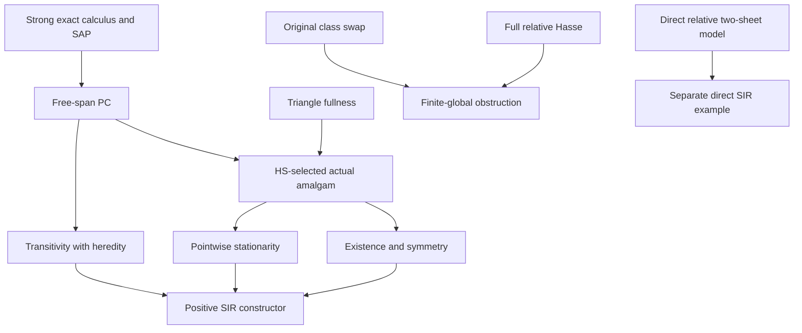

# SIR: selected amalgams and original-language boundary results

Generated from `module.json` by `tools/build_formalization_module.py`.

Source `490c3f36d85db5a0b3ced0598e6c431825254ec5`. **Human-expanded proof plan; no Lean code.**

Preparation for OTHER Lean projects, covering all eight SIR results. The positive conditional constructor, source instantiation, negative finite-global theorem and direct relative example have separate interfaces. No Lean code is created here.

The human article remains unchanged. Additional proof details are in
[PROOF_NOTES.md](PROOF_NOTES.md); the cross-track policy is in
[the formalization guide](../README.md). Source hashes are checked before
the index is regenerated. Graph validation is not proof verification.

## Source premises

**A01: Positive source and conditional-interface interpretation.** Actual homogeneous complete finite binary RELATIONAL source on finitely many inhabited, individually transitive named sorts; same-sort diversity atoms are symmetric and cross-sort atoms have correctly typed converses. Its actual age has SAP. The conditional constructor additionally takes explicit parameters in A04. For C14 ONLY add semantic CCO and FULL sortwise NR2 to derive those parameters via I01–I03; no countability is used by the constructor.

**A02: Separate negative original one-sort setting.** Actual one-sort transitive homogeneous complete finite named symmetric diversity language with logical equality, and semantic CCO for the Hasse application. Invariant equivalences are original and 0-definable via finite orbitals. No sheet names, SAP or quotient CCO is assumed.

**A03: Direct relative example setting.** Uniform countable carrier ℕ×Bool×ℕ with only the old diversity atoms e,d,n named. Parent and sheet coordinates are construction data, not language names; this branch violates NR2.

**A04: Explicit conditional constructor parameters.** For C02–C13, SUPPLY an original strong exact calculus with its laws, one joint hereditary all-PC selector h on that system, and triangle fullness of the actual age. These are parameters of the conditional theorem, not new source axioms. C14 discharges them using the actual source theorems I01–I03.

## Imported theorem contracts

These are named provider obligations for the receiving Lean project,
not new axioms or claims of compiled imports.

| ID and source | Contract | Current provider status |
|---|---|---|
| I01: [`lem:typed-exact-products`](../../sections/typed_strong_domains.tex#L311) | Original tagged strong exact menus contain all singleton atoms and Top, are closed under converse, compatible products and meets with NONEMPTY RESULT. Use actual triangle semantics, SAP associativity/monotonicity and Top absorption from the same strong algebra. No RAW identity. Composition by every nonempty exact factor distributes over finite exact meets with NONEMPTY EVALUATION. | HUMAN_EXPANDED_NOT_LEAN |
| I02: [`thm:typed-HS`](../../sections/typed_hereditary_selectors.tex#L407) | One conservative converse-compatible original joint selector preserving ALL THREE PC coordinates and survivor heredity. NR2/CCO are used to produce this provider, not repeated premises of the conditional SIR constructor. | HUMAN_EXPANDED_NOT_LEAN |
| I03: [`lem:cco-triangle-fullness`](../../sections/triangle_fullness.tex#L2) | An actual finite complete binary diagram whose induced subdiagrams on at most three vertices lie in a hereditary AP+semantic-CCO age lies in that age. The same fan proof preserves named sorts. The source snapshot and short support proof are included. | HUMAN_SUPPORT_PROOF_NOT_LEAN |
| I04: [`thm:full-relative-Hasse`](../../sections/finite_relative_parity_exact_closure.tex#L59) | In the actual original one-sort transitive homogeneous finite complete symmetric binary CCO source, every finite-relative-index cover in the FULL invariant-equivalence lattice has index two. SAP and exactness are not required. Its proof is a separate upstream obligation, not expanded here. Consequently every finite relative index is a power of two. | EXPLICIT_UPSTREAM_NOT_EXPANDED |

## Definitions

| ID | Definition | Exact meaning | Source |
|---|---|---|---|
| D01 | SIR and pointwise finite types | Invariant ternary relation on finite real sets, including empty base, satisfying symmetry, existence of independent copies, restriction/base monotonicity, both transitivity directions and stationarity for prescribed finite isomorphisms fixing named parameters pointwise. | [source](../../sections/stationary_independence_scope.tex#L5) |
| D02 | Base normalization and disjoint span | For arbitrary A,B,C evaluate (A∪C,B∪C,C). Their intersection is exactly C iff A∩B⊆C. A formal span has disjoint copies outside its displayed common base. | [source](../../sections/stationary_independence_from_HS.tex#L269) |
| D03 | Base-path menu | For distinct cross endpoints a,b outside C, D_C(a,b)=⋂c∈C({col(a,c)}*{col(c,b)}); C=∅ gives the typed diversity Top. | [source](../../sections/stationary_independence_from_HS.tex#L95) |
| D04 | Selected amalgam | Keep the two input induced structures and put col(a,b)=h(D_C(a,b)) on each cross pair of their literal disjoint union over C, for one joint selector h. | [source](../../sections/stationary_independence_from_HS.tex#L210) |
| D05 | Selected independence | A↓^h_C B iff A∩B⊆C and all cross atoms on A\C × B\C equal h(D_C); normalize sides by adjoining C. | [source](../../sections/stationary_independence_from_HS.tex#L281) |
| D06 | Onto-base span embedding | Factor embeddings agree on C and their common base map takes C ONTO the entire designated target base C′. Factor embeddings may add other vertices. This is the naturality scope, not arbitrary base enlargement. | [source](../../sections/stationary_independence_from_HS.tex#L224) |
| D07 | Full invariant-equivalence intervals | All actual Aut(M)-invariant equivalences ordered by inclusion. A finite-index E gives a finite interval [E,Top]; invariant relations are 0-definable in the standing finite atomic source. | [source](../../sections/stationary_independence_scope.tex#L84) |
| D08 | Uniform relative-two-sheet source | U=ℕ×{0,1}×ℕ, F equal parent coordinate, E equal parent and sheet, only diversity e=E\Id, d=F\E, n=Top\F named. No parent/sheet constants or unary names. | [source](../../sections/stationary_independence_scope.tex#L108) |
| D09 | Relative-parent independence | Disjointness outside C and no F-class disjoint from C meets both A\C and B\C. Finite represented parents may exhibit at most two sheets. | [source](../../sections/stationary_independence_scope.tex#L145) |
| D10 | Global class-swap obstruction data | Invariant two-class E; finite B meeting both classes; σ∈Aut(M) preserves B setwise and swaps the classes. Singleton existence, invariance and empty-base stationarity contradict these data. | [source](../../sections/stationary_independence_scope.tex#L32) |
| D11 | Supplied exact-calculus interface | Conditional parameter: tagged original exact families with singletons and Top, converse, nonempty-result meets, associative monotone actual strong product, Top absorption and nonempty exact meet-distribution. Its actual source provider is I01, applied only in C14. | [source](../../sections/typed_strong_domains.tex#L313) |
| D12 | Supplied joint-selector interface | Conditional parameter: one h on the supplied exact system, conservative, converse-compatible, preserving all PC coordinates and survivor heredity. Its actual source provider is I02, applied only in C14. | [source](../../sections/typed_hereditary_selectors.tex#L34) |
| D13 | Supplied triangle-fullness interface | Conditional parameter: each finite complete typed diagram with all induced subdiagrams on at most three vertices in the actual age itself belongs to that age. I03 proves this parameter under AP+CCO for C14. | [source](../../sections/triangle_fullness.tex#L6) |

## Proof claims and direct dependencies

Every row has a human proof expansion. Each still needs an actual Lean
statement and proof in a receiving project. Positive provider instantiation, negative Hasse import and direct relative model must remain separate.

| ID and claim | Scope | Direct providers | Proof note |
|---|---|---|---|
| C01: Normalize overlaps before strong menus | finite_sets | D02 | N01 in [notes](PROOF_NOTES.md) |
| C02: Base-path exactness and nonemptiness | positive_conditional | C01, D03, A01, D11 | N02 in [notes](PROOF_NOTES.md) |
| C03: All-coordinate free-span PC | positive_conditional | C02, D11 | N02 in [notes](PROOF_NOTES.md) |
| C04: Selected amalgam and precise naturality | positive_conditional | C03, D04, D06, D12, D13 | N03 in [notes](PROOF_NOTES.md) |
| C05: Automorphism invariance and symmetry | positive_conditional | D05, C01, D12 | N05 in [notes](PROOF_NOTES.md) |
| C06: Existence over a fixed real copy | positive_conditional | C04, A01 | N05 in [notes](PROOF_NOTES.md) |
| C07: Restriction monotonicity | positive_conditional | D05 | N05 in [notes](PROOF_NOTES.md) |
| C08: Base enlargement identity | finite_sets | D03, C01 | N06 in [notes](PROOF_NOTES.md) |
| C09: Forward transitivity by actual survivors | positive_conditional | C08, C07, D12, D11 | N06 in [notes](PROOF_NOTES.md) |
| C10: Reverse hypotheses give original-base disjointness | finite_sets | C01, D05 | N07 in [notes](PROOF_NOTES.md) |
| C11: Reverse transitivity by PC and heredity | positive_conditional | C10, C03, C08, D12, D11 | N07 in [notes](PROOF_NOTES.md) |
| C12: Stationarity for each prescribed finite map | positive_conditional | C01, D05, A01, D12 | N08 in [notes](PROOF_NOTES.md) |
| C13: Conditional selected-amalgam SIR | positive_conditional | C05, C06, C07, C09, C11, C12 | N08 in [notes](PROOF_NOTES.md) |
| C14: Source headline instantiation | positive_source | A01, I01, I02, I03, C13 | N08 in [notes](PROOF_NOTES.md) |
| C15: Obtain the standing global class swap | negative_one_sort | D10, A02 | N09 in [notes](PROOF_NOTES.md) |
| C16: Two-class original-language obstruction | negative_one_sort | C15, D01 | N09 in [notes](PROOF_NOTES.md) |
| C17: Finite global interval and original definability | negative_one_sort | D07, A02 | N09 in [notes](PROOF_NOTES.md) |
| C18: Local full relative Hasse corollary | negative_one_sort | I04 | N09 in [notes](PROOF_NOTES.md) |
| C19: Finite global quotient obstruction | negative_one_sort | C17, C18, C16 | N09 in [notes](PROOF_NOTES.md) |
| C20: Direct two-sheet actual source, homogeneity and SAP | relative_two_sheet | D08 | N10 in [notes](PROOF_NOTES.md) |
| C21: Direct signed-component CCO | relative_two_sheet | C20 | N10 in [notes](PROOF_NOTES.md) |
| C22: Direct independence basic properties and existence | relative_two_sheet | D09, C20 | N11 in [notes](PROOF_NOTES.md) |
| C23: Direct parent-based monotonicity and transitivity | relative_two_sheet | C22 | N11 in [notes](PROOF_NOTES.md) |
| C24: Direct pointwise stationarity | relative_two_sheet | C20, C22 | N11 in [notes](PROOF_NOTES.md) |
| C25: Positive relative-index-two SIR example | relative_two_sheet | C21, C22, C23, C24 | N11 in [notes](PROOF_NOTES.md) |

The precise quantified contracts are in `module.json`. Provider-before-consumer
order (including definitions and source premises):

`A01 → A02 → A03 → A04 → D01 → I01 → I02 → I03 → I04 → C18 → D02 → D07 → D08 → D10 → D11 → D13 → C01 → C15 → C17 → C20 → D03 → D06 → D09 → D12 → C02 → C08 → C16 → C21 → C22 → D04 → C03 → C19 → C23 → C24 → D05 → C04 → C05 → C07 → C10 → C12 → C25 → C06 → C09 → C11 → C13 → C14`

This order is one valid linearization; it does not require unrelated
branches to be proved sequentially. The full DAG is the `depends_on`
relation in `module.json`.

## Main proof branches

This is a coarse view of the claim DAG. Edges go from provider to consumer.

The conditional positive constructor needs no NR2/CCO beyond its supplied interfaces.
The negative branch retains an explicit unexpanded Hasse provider.
The direct relative example violates NR2 and uses its own SIR proof.

## Article exports

| Existing source result | Sidecar proof claims |
|---|---|
| [`thm:sir-no-finite-cover`](../../sections/stationary_independence_from_HS.tex#L7) | C14 |
| [`lem:sir-free-span-PC`](../../sections/stationary_independence_from_HS.tex#L114) | C02, C03 |
| [`prop:sir-HS-amalgam`](../../sections/stationary_independence_from_HS.tex#L208) | C04 |
| [`thm:sir-HS-positive`](../../sections/stationary_independence_from_HS.tex#L287) | C13 |
| [`lem:sir-global-two`](../../sections/stationary_independence_scope.tex#L22) | C16 |
| [`lem:sir-Hasse-two`](../../sections/stationary_independence_scope.tex#L56) | C18 |
| [`thm:sir-finite-global-no`](../../sections/stationary_independence_scope.tex#L71) | C19 |
| [`prop:sir-relative-positive`](../../sections/stationary_independence_scope.tex#L99) | C25 |

## Internal implementation milestones

These tasks are proof milestones inside larger project assignments;
see the [peer-project allocation](../coordination/BOARD.md).

These are implementation tasks, not additional mathematical assumptions.

| Task | Earlier tasks | Acceptance |
|---|---|---|
| T01: Finite sets and free-span exact PC | — | Choose finite-set/embedding types and prove normalized overlap obligations, exact menus and all-coordinate free-span PC against the supplied D11 exact-calculus interface. Apply actual source provider I01 only in C14. |
| T02: Selected amalgam and basic independence | T01 | Use supplied HS and triangle-fullness interfaces; prove onto-base naturality and existence over a fixed actual copy. |
| T03: Both transitivity directions | T01, T02 | Formalize base splitting, overlap normalization, every surviving constraint and both uses of heredity. Include empty-base cases. |
| T04: Pointwise stationarity and source instantiation | T02, T03 | Prove the prescribed-map stationarity theorem and conditional SIR constructor first; instantiate only after the actual source providers are proved. |
| T05: Original-language negative branch | — | Prove the class-swap obstruction, finite interval and definability. Keep Hasse as an explicit provider until proved; no unnamed sheets or quotient substitutions. |
| T06: Direct relative-two-sheet example | — | Implement the uniform countable model, finite age/SAP, signed-cycle CCO and direct SIR. Do not invoke NR2 or HS. |

## Finite controls

- **R01.** Finite ultrametric selected menus and all finite-set overlaps: symmetry, restriction, both transitivity directions and base normalization.
- **R02.** Selected disjoint-span amalgams and pointwise stationarity for prescribed finite maps, including empty bases.
- **R03.** Concrete relative-two-sheet model: direct parent-based transitivity and stationarity; no NR2/HS invocation.
- **R04.** Ultrametric larger-base counterexample: cross3 over empty base changes to cross1 over a new base point. Naturality requires an onto-base map.
- **R05.** Global two-sheet swap distinguishes types over a POINTWISE named pair although the pair is preserved setwise.

Run `python tools/check_sir_controls.py` from the manuscript directory.
The controls do not prove CCO or the general theorems.

## Return to the human articles

No required mathematical repair was found in this scoped pass. These
optional wording clarifications remain queued for a human article pass:

- **F01** ([source](../../sections/stationary_independence_from_HS.tex#L224)): Naturality is valid when the base map is ONTO the entire designated target base. A nonsurjective base map can change the selected colour, even for ultrametrics. Clarify the phrase embeddings of the entire span by explicitly requiring its base map to be onto; retain the existing warning about base enlargement.
- **F02** ([source](../../sections/stationary_independence_scope.tex#L24)): The isolated global-two lemma uses identical singleton diagrams/transitivity from the standing irreflexive-colour source. Arbitrary symmetric binary diagonal sheet predicates do not supply its swap. State the standing transitivity/singleton premise explicitly when detaching the lemma; alternatively export the abstract class-swap obstruction.
- **F03** ([source](../../sections/stationary_independence_from_HS.tex#L465)): Stationarity fixes named parameters pointwise and the proof extends each prescribed finite base-fixing map. Setwise parameter preservation is insufficient. Optionally state the stronger prescribed-map formulation in the formalization-facing interface, leaving the human type notation concise.

The machine ledger records caller effects and affected claims. The source
review used two independent model review passes and parent synthesis;
it is not independent human or formal certification.
