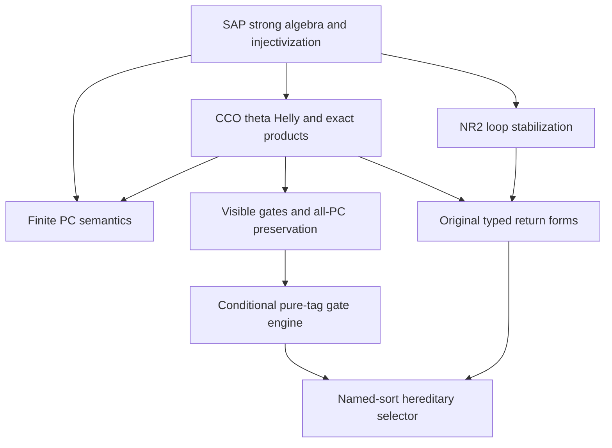

# STRONG exact calculus, finite PC and hereditary selectors

Generated from `module.json` by `tools/build_formalization_module.py`.

Source `490c3f36d85db5a0b3ced0598e6c431825254ec5`. **Human-expanded proof plan; no Lean code.**

Bounded Foundations III module ending at named-sort HS. SIR, safe augmented EPPA readings and terminal pure-power applications remain separate. The RAW exact module is not a theorem prerequisite.

The human article remains unchanged. Additional proof details are in
[PROOF_NOTES.md](PROOF_NOTES.md); the cross-track policy is in
[the formalization guide](../README.md). Source hashes are checked before
the index is regenerated. Graph validation is not proof verification.

## Source premises

**A01: Actual homogeneous named-sorted SAP source.** Finite complete binary relational language on finite inhabited named transitive sorts, symmetric loop diversity atoms and correctly typed converses; actual homogeneous source whose finite age has SAP. Logical equality is separate. Triangle-definedness, countability and primitivity are unnecessary for the local arguments.

**A02: Additional semantic homomorphic CCO.** For the CCO branches only, every finite specified typed diversity diagram whose specified simple cycles map homomorphically to the actual source itself maps homomorphically there.

**A03: Additional FULL original sortwise NR2.** For the loop-stabilization/no-return and unconditional HS route, each named original sort has no relative-index-two interval in its FULL invariant equivalence lattice.

## Definitions

| ID | Definition | Exact meaning | Source |
|---|---|---|---|
| D01 | Actual named-sorted SAP source | An actual homogeneous complete finite binary RELATIONAL source on finitely many inhabited transitive named sorts. Same-sort diversity atoms are symmetric; cross-sort atoms have typed converses. Its actual finite age has SAP. | [source](../../sections/typed_strong_domains.tex#L17) |
| D02 | Diversity palettes and strong triangles | L_ij is the finite nonempty set of actual atoms on DISTINCT vertices of types i,j. Logical equality is never an element of L_ii. Every legal triangle uses three distinct real vertices. | [source](../../sections/typed_strong_domains.tex#L7) |
| D03 | Boolean strong product | A*B is the set of output diversity atoms of actual legal typed triangles with inputs in A,B. Empty Boolean subsets are allowed temporarily but are not exact menus. | [source](../../sections/typed_strong_domains.tex#L26) |
| D04 | Positive word profile | A nonempty composable atomic diversity word evaluates by strong products. Its formal path vertices are distinct. Absent multipliers later mean identity ACTIONS, not empty-word menus. | [source](../../sections/typed_strong_domains.tex#L84) |
| D05 | Original strong exact family | Nonempty evaluated finite intersections of positive word profiles; the empty restriction list gives diversity Top. Discard adjoined Top restrictions before choosing actual defining words. Menus remain tagged by ordered endpoints. | [source](../../sections/typed_strong_domains.tex#L91) |
| D06 | All-coordinate PC | For A:i→j, B:j→k, C:i→k, PC means C⊆A*B, A⊆C*B̄, B⊆Ā*C. Menu variables and sorts may repeat, but root vertices are distinct. | [source](../../sections/typed_strong_domains.tex#L370) |
| D07 | Finite PC iteration | On ordered DISTINCT vertex pairs initialize specified diversity edges to singletons and unrecorded pairs to typed Top. Repeatedly intersect with all strong two-step products through distinct third vertices; Boolean zero may occur. | [source](../../sections/typed_pc_fixedpoint.tex#L18) |
| D08 | Joint pruning, exact contraction and HS | Pruning outputs nonempty subsets, is conservative, converse-compatible and preserves all PC triples. Survivor heredity means E⊆D and E∩R(D)≠∅ imply R(E)=E∩R(D). An exact contraction stays in original H; HS outputs atomic singletons. | [source](../../sections/typed_hereditary_selectors.tex#L21) |
| D09 | Current family | A tagged converse-closed subfamily J of ORIGINAL H, containing every atomic singleton and downward closed among original nonempty exact submenus. No multiplication closure is assumed. | [source](../../sections/typed_hereditary_selectors.tex#L46) |
| D10 | Visible filter and gate | A tagged original exact family F closed under converse and left/right multiplication by arbitrary original exact menus. Visibility: parallel F-menus meeting a current D intersect each other. G(D)=D intersect all F-menus meeting D. Empty active list leaves D fixed. | [source](../../sections/typed_hereditary_selectors.tex#L51) |
| D11 | Full original sortwise NR2 | No named original sort admits invariant equivalences R<S with exactly two R-classes in one S-class. These are ALL actual invariant equivalences, not just exact ones. | [source](../../sections/typed_hereditary_selectors.tex#L12) |
| D12 | Generated families and pure tag action | F(C) closes a seed under original multiplication and converse. A finite pure tag group Λ fixes literal fine-colour names and transports sort signatures, legal triangles, converse, original exact menus and multiplication. F_Λ(C) also closes under Λ. Conditional no-return is: for every C and parallel A,B∈F_Λ(C), F_Λ(A)=F_Λ(B) implies A=B. It is not inferred for an arbitrary nontrivial action. | [source](../../sections/typed_hereditary_selectors.tex#L335) |

## Proof claims and direct dependencies

Every row has a human proof expansion. Each still needs an actual Lean
statement and proof. Scope records whether SAP, CCO and full sortwise NR2 are used; the pure-tag engine retains its explicit no-return premise.

| ID and claim | Scope | Direct providers | Proof note |
|---|---|---|---|
| C01: Boolean triangle algebra | finite_boolean | D03 | N03 in [notes](PROOF_NOTES.md) |
| C02: SAP strong algebra and Set-Pasch | SAP | C01, A01 | N03 in [notes](PROOF_NOTES.md) |
| C03: Supported-fork duplication | SAP | C02 | N03 in [notes](PROOF_NOTES.md) |
| C04: Infinite stabilizer orbits | SAP | D01 | N02 in [notes](PROOF_NOTES.md) |
| C05: Injectivization and guarded word equivalence | SAP | C04, C02, D04 | N02 in [notes](PROOF_NOTES.md) |
| C06: Strong cycle completion with fixed complete base | SAP+CCO | C05, A02 | N04 in [notes](PROOF_NOTES.md) |
| C07: Theta Helly and exact endpoint semantics | SAP+CCO | D05, C02, C05, C06 | N04 in [notes](PROOF_NOTES.md) |
| C08: Exact strong convolution and distribution | SAP+CCO | C01, C02, C07 | N05 in [notes](PROOF_NOTES.md) |
| C09: Three-root exact occurrence iff PC | SAP+CCO | D06, C06, C07 | N05 in [notes](PROOF_NOTES.md) |
| C10: Finite PC greatestness and survivor induction | finite_boolean | D07, C01 | N06 in [notes](PROOF_NOTES.md) |
| C11: Stable support propagates along simple paths | SAP | C10, C02 | N06 in [notes](PROOF_NOTES.md) |
| C12: PC simple-path formula | SAP+CCO | C11, C06, C10, C05 | N06 in [notes](PROOF_NOTES.md) |
| C13: Canonical exact PC domains and triples | SAP+CCO | C10, C12, C07, C08, C09 | N07 in [notes](PROOF_NOTES.md) |
| C14: Visible gate basic properties | SAP+CCO | D08, D09, D10, C07 | N08 in [notes](PROOF_NOTES.md) |
| C15: Bilateral support preservation | SAP+CCO | C14, C08, C01 | N09 in [notes](PROOF_NOTES.md) |
| C16: Supported restricted menus for each surviving atom | SAP+CCO | C15, C14, C03, C08, D06 | N09 in [notes](PROOF_NOTES.md) |
| C17: All three PC coordinates survive a gate | SAP+CCO | C16, C15, C01 | N09 in [notes](PROOF_NOTES.md) |
| C18: Gate image, composition and strict measure | SAP+CCO | C14, C17 | N10 in [notes](PROOF_NOTES.md) |
| C19: Stable even and odd loop powers | SAP | C03, C02 | N11 in [notes](PROOF_NOTES.md) |
| C20: Disjoint parity gives a full invariant index-two interval | SAP+NR2 | C19, D11, C02 | N11 in [notes](PROOF_NOTES.md) |
| C21: Consecutive loop-power stabilization | SAP+NR2 | C20 | N11 in [notes](PROOF_NOTES.md) |
| C22: Generated-family normal forms | SAP+CCO | D12, C02, C08 | N12 in [notes](PROOF_NOTES.md) |
| C23: Parallel return transformations | SAP+CCO | C22, C02 | N12 in [notes](PROOF_NOTES.md) |
| C24: Parallel no-return under NR2 | SAP+CCO+NR2 | C23, C21 | N12 in [notes](PROOF_NOTES.md) |
| C25: Minimal viable generated family is visible | conditional_pure_action | D12, D09, C08 | N13 in [notes](PROOF_NOTES.md) |
| C26: Finite pure-tag gate engine | conditional_pure_action | C25, C18, C08 | N13 in [notes](PROOF_NOTES.md) |
| C27: Joint hereditary selector for named sorts | SAP+CCO+NR2 | C26, C24 | N13 in [notes](PROOF_NOTES.md) |

The precise quantified contracts are in `module.json`. Provider-before-consumer
order (including definitions and source premises):

`A01 → A02 → A03 → D01 → C04 → D02 → D11 → D03 → C01 → D04 → D07 → C02 → C10 → D05 → C03 → C05 → C11 → D06 → D09 → C06 → C19 → D08 → D10 → C07 → C12 → C20 → D12 → C08 → C09 → C14 → C21 → C13 → C15 → C22 → C25 → C16 → C23 → C17 → C24 → C18 → C26 → C27`

This order is one valid linearization; it does not require unrelated
branches to be proved sequentially. The full DAG is the `depends_on`
relation in `module.json`.

## Main proof branches

This is a coarse view of the claim DAG. Edges go from provider to consumer.

The finite PC formula is a separate export and is not needed to prove the gate engine.
The engine is conditional on its generated no-return premise for a nontrivial pure action.
Full sortwise NR2 supplies no-return for the trivial action used by the final HS theorem.

## Article exports

| Existing source result | Sidecar proof claims |
|---|---|
| [`lem:typed-set-pasch`](../../sections/typed_strong_domains.tex#L48) | C02 |
| [`lem:typed-injectivisation`](../../sections/typed_strong_domains.tex#L129) | C04, C05 |
| [`lem:typed-strong-cycle-completion`](../../sections/typed_strong_domains.tex#L187) | C06 |
| [`lem:typed-helly`](../../sections/typed_strong_domains.tex#L251) | C07 |
| [`lem:typed-exact-products`](../../sections/typed_strong_domains.tex#L311) | C08 |
| [`lem:typed-triple-occurrence`](../../sections/typed_strong_domains.tex#L389) | C09 |
| [`lem:typed-PC-walk-formula`](../../sections/typed_pc_fixedpoint.tex#L33) | C12 |
| [`lem:typed-PC-fixedpoint-exact`](../../sections/typed_pc_fixedpoint.tex#L92) | C13 |
| [`lem:typed-bilateral`](../../sections/typed_hereditary_selectors.tex#L72) | C15 |
| [`lem:typed-all-PC`](../../sections/typed_hereditary_selectors.tex#L113) | C14, C17 |
| [`lem:typed-gate-image`](../../sections/typed_hereditary_selectors.tex#L207) | C18 |
| [`lem:typed-loop-stable`](../../sections/typed_hereditary_selectors.tex#L238) | C21 |
| [`lem:typed-no-return`](../../sections/typed_hereditary_selectors.tex#L282) | C24 |
| [`lem:typed-pure-action-gate-engine`](../../sections/typed_hereditary_selectors.tex#L333) | C26 |
| [`thm:typed-HS`](../../sections/typed_hereditary_selectors.tex#L407) | C27 |

## Internal implementation milestones

These tasks are proof milestones inside larger project assignments;
see the [peer-project allocation](../coordination/BOARD.md).

These are implementation tasks, not additional mathematical assumptions.

| Task | Earlier tasks | Acceptance |
|---|---|---|
| T01: Strong algebra and SAP injectivization | — | Compile typed diversity products and prove SAP gluing, stabilizer orbit infinitude, injectivization and the guarded positive-word equivalence. |
| T02: Strong CCO and exact menus | T01 | Prove private-theta and three-root graph classifications, exact Helly/convolution and full survivor semantics. |
| T03: Finite PC semantics | T01, T02 | Implement finite Boolean iteration, greatest stable refinement, completion-survivor induction and exact simple-path semantics. |
| T04: Visible gate calculus | T01, T02 | Prove gate basic properties BEFORE bilateral preservation, then all-PC, image and composition on successive original exact current families. |
| T05: NR2 and original no-return | T01, T02 | Implement stable power thresholds and actual invariant equivalences of relative index two; prove typed normal forms and no-return. |
| T06: Descending gate engine and HS | T04, T05 | Implement minimum viable seed and finite strict descent; keep nontrivial pure-action no-return conditional, and discharge it for the trivial action. |

## Finite controls

- **R01.** F2² translation AP+CCO source without SAP: strong product can be empty/nonassociative, and represented positive walks need not be injective.
- **R02.** Three-level ultrametric palette with two named sorts: exact products, all-coordinate PC, pure-tag visible gates, image/heredity and finite selector descent.
- **R03.** A two-block equivalence palette has alternating loop powers and no PC-preserving selector on Top; NR2 is necessary here.
- **R04.** Swapping literal colours of a free two-colour palette admits no invariant singleton choice on Top; pure-tag scope cannot be replaced by arbitrary colour covariance.
- **R05.** Exhaust all 4096 four-vertex partial diagrams in a three-level ultrametric palette: PC fixed survivors equal actual completion survivors and all simple-path intersections.

Run `python tools/check_strong_selector_controls.py` from the manuscript directory.
The controls do not prove CCO or the general theorems.

## Return to the human articles

No required mathematical repair was found in this scoped pass. These
optional wording clarifications remain queued for a human article pass:

- **F01** ([source](../../sections/typed_strong_domains.tex#L90)): Top is adjoined to the profile family even when it has no positive-word presentation. Optionally say to discard Top restrictions before choosing one positive word for each profile.
- **F02** ([source](../../sections/typed_strong_domains.tex#L323)): Nonempty exact meet means nonempty evaluated intersection, not just a nonempty indexing set. Use meet with nonempty intersection if the convention needs reiterating.
- **F03** ([source](../../sections/typed_hereditary_selectors.tex#L91)): Bilateral support uses nonempty exactness of the gate, proved independently in the opening part of the next lemma. Optionally move that short well-definedness observation before bilateral support, without adding a new numbered theorem.

The machine ledger records caller effects and affected claims. The source
review used two independent model review passes and parent synthesis;
it is not independent human or formal certification.
