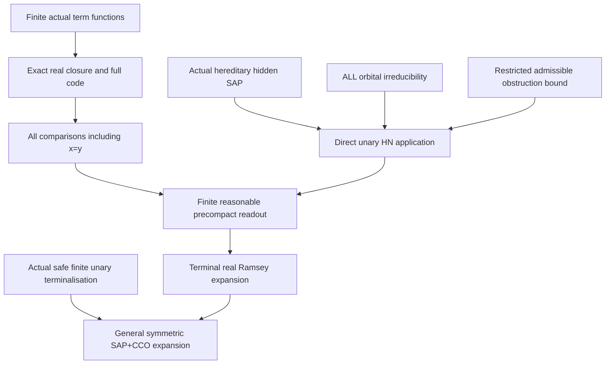

# Actual terminal hidden HN application, full order readout and general SAP Ramsey transfer

Generated from `module.json` by `tools/build_formalization_module.py`.

Source `490c3f36d85db5a0b3ced0598e6c431825254ec5`. **Human-expanded proof plan; no Lean code.**

Private B059: all THREE source17 lemmas and TWO source18 theorems, two equations, ten definitions, 52 human claims and seven tasks. Literal real-root closure and finite root cofinality are separate from Ramsey transfer. All term-order comparisons INCLUDING same-real-root diagonals give the exact finite full code, unique hidden embedding extensions, precompactness and reasonableness. Actual complete hidden pair orbitals make every completed member irreducible without E*. Existing direct unary HN transfer is instantiated with actual hereditary SAP and unary-admissible bounded obstructions, retaining its three published receiving bindings. General symmetric SAP+CCO Ramsey follows through the actual finite safe terminalisation, with its FULL-sector qualifications. No expansion-property or coherent-EPPA conclusion is made. The B058 factorisation-forest binding remains separate and pending; no external theorem is duplicated here.

The human article remains unchanged. Additional proof details are in
[PROOF_NOTES.md](PROOF_NOTES.md); the cross-track policy is in
[the formalization guide](../README.md). Source hashes are checked before
the index is regenerated. Graph validation is not proof verification.

## Source premises

**A01: Bound homogeneous binary source instance.** For the terminal lemmas, M is countable homogeneous in a finite complete binary language with finitely many nonempty individually transitive named original sorts, symmetric same-sort atoms and actual typed pair orbitals. Old unary/pair/equality type is the full original two-point orbit, including repeated-root tuples.

**A02: Literal finite actual MI-only hidden signature.** H is the ACTUAL interpretation containing real sorts and proper nonidentity represented MI quotient sorts, all actual pair orbitals/cylinders, and actual equivariant unary projections, upward maps and quotient transitions/inverses. Every proper vertex has an onto real projection. No quotient-to-real nonidentity map and no nullary vertex generator. Completed members are finite induced unary-closed substructures. All hidden functions are total on prescribed source sorts and undefined off-sort in the one-sorted HN encoding.

**A03: Original visible SAP.** The original finite age has SAP, including empty bases, hence every proper nonidentity invariant quotient class has infinitely many actual real representatives. This does not itself imply hidden SAP; the actual hidden SAP provider is imported separately.

**A04: Terminal original CCO and FULL infinite covers.** For the terminal theorem instance, original semantic homomorphic CCO holds and every strict cover in each FULL original invariant-equivalence lattice has infinite relative index, INCLUDING Top covers. This is the standing sortwise infinite-cover branch, not merely a condition on already represented MI cuts. B058 bounded obstruction and B055 hidden SAP providers retain it.

**A05: Conditional ordered hidden Ramsey input for readout only.** For the readout lemma Ramsey implication only, the hereditary ordered hidden envelope with ALL global strict linear orders is assumed Ramsey. This is discharged in the terminal theorem by the direct HN application; no expansion property is included.

**A06: Bound general symmetric SAP+CCO source.** For the final general theorem, the input is an actual homogeneous FULL triangle-defined complete finite symmetric binary SAP+homomorphic-CCO age. It need NOT already have infinite covers. The original general instance is distinct from A01-A04 terminal parameters; I13 produces the terminal source on which the parameterized C39 theorem is instantiated.

## Imported theorem contracts

These are named provider obligations for the receiving Lean project,
not new axioms or claims of compiled imports.

| ID and source | Contract | Current provider status |
|---|---|---|
| I01: [`lem:typed-unary-closure-bound`](../../sections/v27/10_typed_unary_terms_return.tex#L66) | Actual/unary-admissible singleton closures have size<=m_typ. Proved ancestor C12 separately provides finitely many actual unary term FUNCTIONS per hidden source sort, not a bound on syntax. | HUMAN_EXPANDED_NOT_LEAN |
| I02: [`lem:typed-coordinate-normal-form`](../../sections/v27/10_typed_unary_terms_return.tex#L149) | Each actual real-source term is its real identity or a proper quotient projection followed by a named bijection/identity, with exact original kernel. No nonidentity real-valued quotient term occurs in this literal signature. | HUMAN_EXPANDED_NOT_LEAN |
| I03: [`lem:foundational-root-cover-cofinal`](../../sections/full_code_tuple_ep_transfer.tex#L129) | In an actual unary ambient with finite normal forms and real root coverage, every finite hidden member embeds into a finite full-root-generated support; use the literal inclusion into H to obtain actual induced containment. This needs no SAP/Ramsey or automorphism section. | HUMAN_EXPANDED_NOT_LEAN |
| I04: [`lem:foundational-full-code-embeddings`](../../sections/full_code_tuple_ep_transfer.tex#L52) | ALL same-root/cross-root equality, relation, domain/value and order codes reconstruct an actual generated support uniquely OVER MARKED roots and give the natural bijection of visible-code embeddings with hidden generated-support embeddings. | HUMAN_EXPANDED_NOT_LEAN |
| I05: [`thm:ramsey-tuple-readout`](../../sections/full_code_tuple_ep_transfer.tex#L103) | A hereditary ordered hidden Ramsey class transfers its arrows to the finite full-code visible root class by the exact embedding bijection. Hidden Ramsey hosts may have orphans; neither EP nor cofinal enlargement is needed. | HUMAN_EXPANDED_NOT_LEAN |
| I06: [`lem:typed-unary-binary-irreducibility`](../../sections/unary_hn_transfer.tex#L11) | A completed finite unary structure whose every distinct pair is joined by a positive binary tuple or named unary reachability is irreducible in the ORIGINAL language. No universal E* relation is required. | HUMAN_EXPANDED_NOT_LEAN |
| I07: [`lem:typed-cylinder-realisation`](../../sections/v27/07_typed_raw_strong_transition.tex#L913) | Complete actual semantic cylinders partition compatible distinct hidden pairs with a proper quotient endpoint. A proper quotient position has its actual representative spectrum, not an arbitrary selected subpalette. | HUMAN_EXPANDED_NOT_LEAN |
| I08: [`lem:rh-sap-invariant-monolith`](../../sections/real_hull/07_sap_mi_intersection_geometry.tex#L1) | Original SAP gives infinite nonidentity invariant classes and infinite real off-base orbits. Use only the class-infinity part for distinct proper endpoint representatives. | HUMAN_EXPANDED_NOT_LEAN |
| I09: [`thm:typed-hidden-sap`](../../sections/v27/13_actual_hidden_sap_readings.tex#L1) | The ACTUAL binary MI-only hidden envelope is homogeneous and its ENTIRE hereditary finite unary-closed age has SAP, including orphan-only/empty bases, through full exact lifting and prior real-frame orbit transfer. | HUMAN_EXPANDED_NOT_LEAN |
| I10: [`cor:typed-bounded-hidden`](../../sections/v27/16_old_idempotent_forest.tex#L747) | There is a uniform N for noncompletable UNARY-ADMISSIBLE finite closed partial actual hidden sources, with a noncompletable induced unary-closed substructure of size<=N. The restriction is essential; B058 factorisation-forest published receiving binding remains pending. | HUMAN_EXPANDED_NOT_LEAN |
| I11: [`thm:typed-direct-irreducible-unary-HN`](../../sections/unary_hn_transfer.tex#L155) | For a finite typed unary hereditary SAP class of ACTUAL irreducible completed members, a uniform obstruction bound restricted to actual completed one-generated diagrams gives Definition2.8 local finiteness with max(1,N) and ordered Ramsey. Reuse its three exact published HN inputs; no duplicate external provider. | HUMAN_EXPANDED_NOT_LEAN |
| I12: [`lem:hn-irreducible-forces-unary-admissible`](../../sections/binary_unary_irreducible_local_cover.tex#L224) | Actual induced functional subobjects reflect domains of already-defined unary functions. If every irreducible belongs to the completed class, each one-generated closure is itself an actual member and all intended functions are total, even when the ambient HN candidate initially allows partial unary maps. | HUMAN_EXPANDED_NOT_LEAN |
| I13: [`thm:finite-cover-elimination`](../../sections/v27/06_legacy_finite_covers.tex#L574) | From the actual FULL triangle-defined symmetric SAP+CCO source, the proved maximal-character safe split iterates finitely to a finite reasonable reduct-surjective precompact UNARY terminal expansion preserving SAP/CCO and actual full current orbitals. This retains B047 actual/FULL-sector and EPP proof qualifications. | HUMAN_EXPANDED_NOT_LEAN |

**I01 internal proof support:** C12 in `unary_terms_return`. Use strict proved ancestor C12 to choose finite representative lists of ALL actual real-source term functions and close their compositions. A finite image at one point is not substituted for this function theorem. This supplies the finite relational order language and root-cover normal forms.

These are separately extracted proved support claims, not additional
numbered exports or consequences of the named theorem statement.

**I11 internal proof support:** C22, C34, C37, C38 in `unary_hn`. Use strict proved ancestors C22/C34 for the raw one-sorted candidate typing adapter and uniform HN local-finiteness conclusion, and C37/C38 for irreducible-membership forcing actual one-generated admissibility before applying the restricted bound. These are already proved parts of the selected direct theorem; no hidden-source bound is assumed beyond I10.

These are separately extracted proved support claims, not additional
numbered exports or consequences of the named theorem statement.

## Definitions

| ID | Definition | Exact meaning | Source |
|---|---|---|---|
| D01 | Literal original real-root set | A finite real D consists of length-one valid roots with named sort tags; identity terms retain them, and only proper quotient values can be added by nonidentity terms. | [source](../../sections/v27/17_hidden_hn_terminal_readout.tex#L4) |
| D02 | Actual root cover | Every finite actual closed hidden B is covered by its real part and one real preimage for each proper quotient vertex; D is their finite union in the same actual H. | [source](../../sections/v27/17_hidden_hn_terminal_readout.tex#L4) |
| D03 | Finite term-function list | T_a contains one representative syntax for each actual well-sorted real-source unary term function, including real identity. Function composition is represented by another member of the finite list. | [source](../../sections/v27/17_hidden_hn_terminal_readout.tex#L55) |
| D04 | Presentation quotient | T_A={(x,tau):x in A,tau in T_sort(x)}; identify two presentations iff their actual hidden values agree. Their quotient Q_A canonically identifies with cl_H(A). | [source](../../sections/v27/17_hidden_hn_terminal_readout.tex#L55) |
| D05 | Complete order comparison code | For all ordered real sort/term pairs, C_tau,sigma(x,y) iff tau(x)<sigma(y), INCLUDING x=y. Compatibility means a strict total order descends to Q_A. | [source](../../sections/v27/17_hidden_hn_terminal_readout.tex#L55) |
| D06 | Actual completed hidden age | K contains precisely all finite induced unary-closed H substructures, including orphan-only members, and all their isomorphic copies. K^< allows every global strict linear order. | [source](../../sections/v27/17_hidden_hn_terminal_readout.tex#L250) |
| D07 | HN admissible source and cutoff | The geometric N-bound applies only when each induced one-generated closure is an ACTUAL completed K member. HN Definition2.8 tests EVERY expanded irreducible as an actual K^< member and every actual induced subobject of size<=n=max(1,N) for completion. | [source](../../sections/v27/18_unary_hn_transfer.tex#L2) |
| D08 | Readout of an arbitrary hidden host | N(H0) is the original real-sort portion of a finite ordered hidden host H0 with its full actual term code. Its generated support is a closed induced subobject; orphan vertices outside that support are allowed. | [source](../../sections/v27/17_hidden_hn_terminal_readout.tex#L55) |
| D09 | Finite unary terminalisation | The final general proof applies I13 to the original A06 source and obtains a different finite-sorted terminal source Mprime. Terminal A01-A04 are then discharged for Mprime, not assumed for the original source. | [source](../../sections/v27/18_unary_hn_transfer.tex#L54) |
| D10 | Diagonal order diagnostic | A one-sort real singleton x with one MI quotient has two distinct hidden values x and F_E(x). Its two hidden orders have the same off-diagonal real comparison data; C_id,F_E(x,x) distinguishes them. | [source](../../sections/v27/17_hidden_hn_terminal_readout.tex#L55) |

## Proof claims and direct dependencies

Every row has a human proof expansion. Each still needs an actual Lean
statement and proof. Actual finite hidden members may contain orphans. Linear orders are arbitrary global strict orders on hidden vertices. Original real-root term comparisons include x=y and may hold on their diagonal. The binary theorem does not remove inherited higher-support gates.

| ID and claim | Scope | Direct providers | Proof note |
|---|---|---|---|
| C01: No new real vertex can be generated by a nonidentity term | cofinal | A02, I02, D01 | N01 in [notes](PROOF_NOTES.md) |
| C02: Exact real part of the point-generated closure | cofinal | A02, C01 | N01 in [notes](PROOF_NOTES.md) |
| C03: A finite actual hidden member has a finite real generating cover | cofinal | A02, D02 | N01 in [notes](PROOF_NOTES.md) |
| C04: The covering closure is finite and induced in the SAME ambient | cofinal | A02, I01, C03 | N01 in [notes](PROOF_NOTES.md) |
| C05: Discharge the general root-cover cofinality provider | cofinal | I01, I03, C03, C04 | N01 in [notes](PROOF_NOTES.md) |
| C06: Any order extends along finite induced containment | cofinal | C04 | N01 in [notes](PROOF_NOTES.md) |
| C07: Root cofinality is independent of orphan SAP and Ramsey | cofinal | C05, C06 | N01 in [notes](PROOF_NOTES.md) |
| C08: Exact real-root closure and point-generated cofinality export | cofinal | C02, C04, C05, C06 | N01 in [notes](PROOF_NOTES.md) |
| C09: Choose finitely many actual real-source term functions | readout | A02, I01, D03 | N02 in [notes](PROOF_NOTES.md) |
| C10: Old pair type determines every non-order hidden code | readout | A01, A02, C09 | N02 in [notes](PROOF_NOTES.md) |
| C11: Function codes reduce to literal term equalities | readout | A02, C09, C10 | N02 in [notes](PROOF_NOTES.md) |
| C12: The presentation quotient reconstructs exactly the generated hidden support | readout | I04, C09, C10, C11, D04 | N02 in [notes](PROOF_NOTES.md) |
| C13: The full order is exactly its compatible comparison list | readout | C12, D05 | N03 in [notes](PROOF_NOTES.md) |
| C14: Visible readout embeddings extend by the actual term formula | readout | I04, C10, C11, C12, C13 | N03 in [notes](PROOF_NOTES.md) |
| C15: The extension is unique and hidden embeddings restrict correctly | readout | C02, C14 | N03 in [notes](PROOF_NOTES.md) |
| C16: Same-root comparisons cannot be deleted | readout | D10 | N03 in [notes](PROOF_NOTES.md) |
| C17: The expansion is finite relational and precompact | readout | I01, C09, C13 | N03 in [notes](PROOF_NOTES.md) |
| C18: Reasonableness follows from actual unexpanded hidden embeddings | readout | I04, C06, C10, C12, C13 | N03 in [notes](PROOF_NOTES.md) |
| C19: Every arbitrary finite hidden host has an allowed real code | readout | A02, C12, C13, D08 | N03 in [notes](PROOF_NOTES.md) |
| C20: Length-one real roots have quantifier-free compatibility | readout | A01, A02, C10, C11, D01 | N03 in [notes](PROOF_NOTES.md) |
| C21: Discharge the Ramsey tuple-readout application | readout | A05, I05, C14, C15, C19, C20 | N03 in [notes](PROOF_NOTES.md) |
| C22: The readout theorem retains all four separate conclusions | readout | C12, C13, C14, C15, C16, C17, C18, C21 | N03 in [notes](PROOF_NOTES.md) |
| C23: Finite ordered-real full-code source export | readout | C22 | N03 in [notes](PROOF_NOTES.md) |
| C24: Distinct real vertices have a positive old joining atom | irreducible | A01, A02 | N04 in [notes](PROOF_NOTES.md) |
| C25: Proper quotient endpoints have distinct actual real representatives | irreducible | A03, I08, A02 | N04 in [notes](PROOF_NOTES.md) |
| C26: Every remaining distinct hidden pair has a complete positive cylinder | irreducible | A02, I07, C25 | N04 in [notes](PROOF_NOTES.md) |
| C27: Actual pair coverage discharges the original irreducibility schema | irreducible | I06, C24, C26, D06 | N04 in [notes](PROOF_NOTES.md) |
| C28: Actual completed hidden irreducibility source export | irreducible | C27 | N04 in [notes](PROOF_NOTES.md) |
| C29: The actual hidden class meets hereditary and finite-language inputs | terminal_hn | A02, D06 | N05 in [notes](PROOF_NOTES.md) |
| C30: Hereditary SAP is supplied for the SAME whole hidden age | terminal_hn | A01, A02, A03, A04, I09, C29 | N05 in [notes](PROOF_NOTES.md) |
| C31: Actual completed irreducibility supplies the direct HN class hypothesis | terminal_hn | C28, C29, C30 | N05 in [notes](PROOF_NOTES.md) |
| C32: The bounded-obstruction hypothesis is used only on admissible sources | terminal_hn | A01, A02, A03, A04, I10, D07 | N05 in [notes](PROOF_NOTES.md) |
| C33: HN irreducible-membership enforces the required unary admissibility | terminal_hn | I11, I12, C29, C31, C32 | N05 in [notes](PROOF_NOTES.md) |
| C34: The larger raw ambient typing adapter remains in force | terminal_hn | I11, C29, C33 | N05 in [notes](PROOF_NOTES.md) |
| C35: Uniform HN local finiteness is the proved direct implication | terminal_hn | I11, C31, C32, C33, C34, D07 | N05 in [notes](PROOF_NOTES.md) |
| C36: Apply the existing direct HN theorem without duplicate published inputs | terminal_hn | I11, C29, C30, C31, C32, C33, C34, C35 | N05 in [notes](PROOF_NOTES.md) |
| C37: Instantiate the conditional real readout with the proved hidden Ramsey class | terminal_hn | C23, C36 | N05 in [notes](PROOF_NOTES.md) |
| C38: Terminal conclusion retains finite relational precompact reasonableness | terminal_hn | C17, C18, C37 | N05 in [notes](PROOF_NOTES.md) |
| C39: Terminal typed Ramsey source export | terminal_hn | C36, C37, C38 | N05 in [notes](PROOF_NOTES.md) |
| C40: The safe terminalisation theorem applies to the general actual source | general_transfer | A06, I13, D09 | N06 in [notes](PROOF_NOTES.md) |
| C41: Discharge the terminal theorem on the NEW source | general_transfer | C40, D09 | N06 in [notes](PROOF_NOTES.md) |
| C42: Apply the parameterized terminal result at Mprime | general_transfer | C39, C41 | N06 in [notes](PROOF_NOTES.md) |
| C43: Finite relational composition remains precompact and reasonable | general_transfer | C40, C42 | N06 in [notes](PROOF_NOTES.md) |
| C44: The composite class has the required Ramsey arrows | general_transfer | C42, C43 | N06 in [notes](PROOF_NOTES.md) |
| C45: General symmetric SAP+CCO Ramsey source export | general_transfer | C40, C41, C42, C43, C44 | N06 in [notes](PROOF_NOTES.md) |
| C46: A quotient-to-real selector would invalidate exact real-root closure | boundary | D01 | N07 in [notes](PROOF_NOTES.md) |
| C47: Orphans do not obstruct actual readout Ramsey transfer | boundary | C08, C19, C21 | N07 in [notes](PROOF_NOTES.md) |
| C48: Selected cylinder reducts can lose original irreducibility | boundary | C28 | N07 in [notes](PROOF_NOTES.md) |
| C49: The geometry supplies a substantive obstruction bound | boundary | I10, C32 | N07 in [notes](PROOF_NOTES.md) |
| C50: Published bindings are reused with their representation contracts | boundary | I10, I11, C35, C36 | N07 in [notes](PROOF_NOTES.md) |
| C51: The three output properties are not conflated | boundary | C23, C39, C45 | N07 in [notes](PROOF_NOTES.md) |
| C52: Finite diagnostics test code fidelity and order scope only | boundary | C08, C23, C28, C39, C45 | N07 in [notes](PROOF_NOTES.md) |

The precise quantified contracts are in `module.json`. Provider-before-consumer
order (including definitions and source premises):

`A01 → A02 → A03 → A04 → A05 → A06 → D01 → D02 → D03 → D04 → D05 → D06 → D07 → D08 → D09 → D10 → I01 → I02 → I03 → I04 → I05 → I06 → I07 → I08 → I09 → I10 → I11 → I12 → I13 → C01 → C03 → C09 → C16 → C24 → C25 → C29 → C32 → C40 → C46 → C02 → C04 → C10 → C26 → C30 → C41 → C49 → C05 → C06 → C11 → C27 → C07 → C08 → C12 → C20 → C28 → C13 → C31 → C48 → C14 → C17 → C18 → C19 → C33 → C15 → C34 → C21 → C35 → C22 → C36 → C47 → C23 → C50 → C37 → C38 → C39 → C42 → C43 → C44 → C45 → C51 → C52`

This order is one valid linearization; it does not require unrelated
branches to be proved sequentially. The full DAG is the `depends_on`
relation in `module.json`.

## Main proof branches

This is a coarse view of the claim DAG. Edges go from provider to consumer.

Five final Ramsey II results and two equations. No external theorem is duplicated; three HN obligations are inherited from B037 and factorisation forests from B058.
Same-real-root order comparisons are substantive even with one MI quotient and one real root.
Actual irreducible-member and unary-admissibility conditions are discharged before the existing direct HN theorem is used.
Final general theorem applies the parameterized terminal theorem to a NEW finite-sorted safe expansion; no original terminality or expansion property is assumed.

## Article exports

| Existing source result | Sidecar proof claims |
|---|---|
| [`lem:typed-real-root-closure-cofinal`](../../sections/v27/17_hidden_hn_terminal_readout.tex#L3) | C08 |
| [`lem:typed-finite-ordered-real-readout`](../../sections/v27/17_hidden_hn_terminal_readout.tex#L54) | C23 |
| [`lem:typed-terminal-hidden-irreducible`](../../sections/v27/17_hidden_hn_terminal_readout.tex#L249) | C28 |
| [`thm:internal-ramsey-terminal`](../../sections/v27/18_unary_hn_transfer.tex#L1) | C39 |
| [`thm:internal-v27-general-ramsey`](../../sections/v27/18_unary_hn_transfer.tex#L53) | C45 |

Auxiliary source equations (not additional numbered results):

- [`eq:typed-real-root-closure`](../../sections/v27/17_hidden_hn_terminal_readout.tex#L16): C02
- [`eq:typed-ordered-real-readout`](../../sections/v27/17_hidden_hn_terminal_readout.tex#L67): C13

## Internal implementation milestones

These tasks are proof milestones inside larger project assignments;
see the [peer-project allocation](../coordination/BOARD.md).

These are implementation tasks, not additional mathematical assumptions.

| Task | Earlier tasks | Acceptance |
|---|---|---|
| T01: Exact real-root closure and finite actual cofinality | — | Keep literal no-quotient-to-real signature, actual finite term FUNCTIONS and ALL same-root/cross-root code comparisons. Complete old unary/pair/equality types determine non-order codes. Discharge hereditary hidden SAP, actual completed irreducibility and the unary-admissible geometric N-bound before applying the existing direct HN theorem; raw one-sorted typing/partial-domain adapters remain. Reuse its published HN bindings without duplication and retain separate B058 forest binding. Apply terminal theorem to the NEW safely terminalised source, not by assuming original terminality. No EP/coherent-EPPA assertion. |
| T02: Complete finite non-order term code | — | Keep literal no-quotient-to-real signature, actual finite term FUNCTIONS and ALL same-root/cross-root code comparisons. Complete old unary/pair/equality types determine non-order codes. Discharge hereditary hidden SAP, actual completed irreducibility and the unary-admissible geometric N-bound before applying the existing direct HN theorem; raw one-sorted typing/partial-domain adapters remain. Reuse its published HN bindings without duplication and retain separate B058 forest binding. Apply terminal theorem to the NEW safely terminalised source, not by assuming original terminality. No EP/coherent-EPPA assertion. |
| T03: Full order readout, embeddings and conditional Ramsey | T01, T02 | Keep literal no-quotient-to-real signature, actual finite term FUNCTIONS and ALL same-root/cross-root code comparisons. Complete old unary/pair/equality types determine non-order codes. Discharge hereditary hidden SAP, actual completed irreducibility and the unary-admissible geometric N-bound before applying the existing direct HN theorem; raw one-sorted typing/partial-domain adapters remain. Reuse its published HN bindings without duplication and retain separate B058 forest binding. Apply terminal theorem to the NEW safely terminalised source, not by assuming original terminality. No EP/coherent-EPPA assertion. |
| T04: Actual hidden irreducibility without E* | — | Keep literal no-quotient-to-real signature, actual finite term FUNCTIONS and ALL same-root/cross-root code comparisons. Complete old unary/pair/equality types determine non-order codes. Discharge hereditary hidden SAP, actual completed irreducibility and the unary-admissible geometric N-bound before applying the existing direct HN theorem; raw one-sorted typing/partial-domain adapters remain. Reuse its published HN bindings without duplication and retain separate B058 forest binding. Apply terminal theorem to the NEW safely terminalised source, not by assuming original terminality. No EP/coherent-EPPA assertion. |
| T05: Discharge actual direct HN and terminal arrow | T03, T04 | Keep literal no-quotient-to-real signature, actual finite term FUNCTIONS and ALL same-root/cross-root code comparisons. Complete old unary/pair/equality types determine non-order codes. Discharge hereditary hidden SAP, actual completed irreducibility and the unary-admissible geometric N-bound before applying the existing direct HN theorem; raw one-sorted typing/partial-domain adapters remain. Reuse its published HN bindings without duplication and retain separate B058 forest binding. Apply terminal theorem to the NEW safely terminalised source, not by assuming original terminality. No EP/coherent-EPPA assertion. |
| T06: Safe finite terminalisation and general Ramsey transfer | T05 | Keep literal no-quotient-to-real signature, actual finite term FUNCTIONS and ALL same-root/cross-root code comparisons. Complete old unary/pair/equality types determine non-order codes. Discharge hereditary hidden SAP, actual completed irreducibility and the unary-admissible geometric N-bound before applying the existing direct HN theorem; raw one-sorted typing/partial-domain adapters remain. Reuse its published HN bindings without duplication and retain separate B058 forest binding. Apply terminal theorem to the NEW safely terminalised source, not by assuming original terminality. No EP/coherent-EPPA assertion. |
| T07: Signature, diagonal and receiving boundaries | T01, T02, T03, T04, T05, T06 | Keep literal no-quotient-to-real signature, actual finite term FUNCTIONS and ALL same-root/cross-root code comparisons. Complete old unary/pair/equality types determine non-order codes. Discharge hereditary hidden SAP, actual completed irreducibility and the unary-admissible geometric N-bound before applying the existing direct HN theorem; raw one-sorted typing/partial-domain adapters remain. Reuse its published HN bindings without duplication and retain separate B058 forest binding. Apply terminal theorem to the NEW safely terminalised source, not by assuming original terminality. No EP/coherent-EPPA assertion. |

## Finite controls

- **K01.** Actual one-MI finite windows test term quotient reconstruction, literal root cover/cofinality, complete real/hidden embedding correspondence and all finite order extension choices, retaining diagonal comparisons.
- **K02.** Actual complete pair-covered hidden members are irreducible under closed free-amalgam tests; raw partial-domain one-generated controls distinguish actual K membership from mere totality/closedness. Finite diagnostics certify no Ramsey/HN/forest or geometric N theorem.

Run `python tools/check_terminal_hidden_hn_controls.py` from the manuscript directory.
The controls do not prove CCO or the general theorems.

## Return to the human articles

No required mathematical repair was found in this scoped pass. These
optional wording clarifications remain queued for a human article pass:

- **F01** ([source](../../sections/v27/18_unary_hn_transfer.tex#L5)): The terminal application uses the standing FULL infinite-cover premise, including covers whose upper endpoint is Top; the compressed phrase proper cover should retain that convention explicitly. Repeat including covers with universal upper endpoint in the terminal theorem statement, matching ass:standing and the actual providers.
- **F02** ([source](../../sections/v27/17_hidden_hn_terminal_readout.tex#L56)): Finite singleton closures do not alone state a finite set of term functions; the proved B052 C12 ancestor supplies that exact function theorem in this transitive actual setting. Reference the explicit finite-function normal-form argument when choosing T_a; retain the diagonal comparison tuples.

The machine ledger records caller effects and affected claims. The source
review used two independent model review passes and parent synthesis;
it is not independent human or formal certification.
