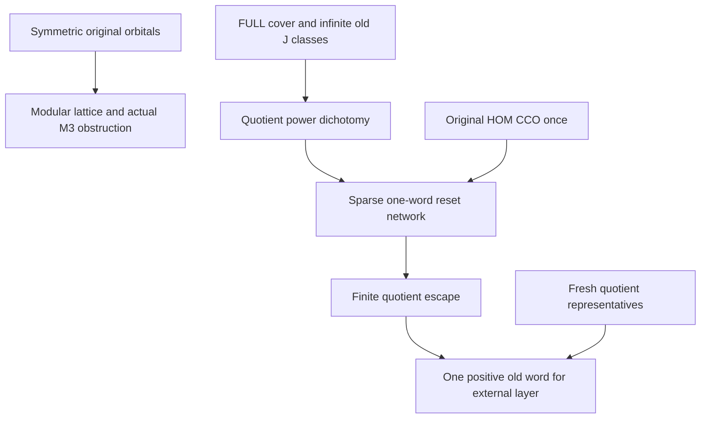

# Modular invariant lattices, quotient powers, reset and positive cover layers

Generated from `module.json` by `tools/build_formalization_module.py`.

Source `490c3f36d85db5a0b3ced0598e6c431825254ec5`. **Human-expanded proof plan; no Lean code.**

Private B050: ELEVEN selected Ramsey I results (all nine terminal/reset results plus two independent quotient-semigroup/cover-layer results from the next source). Twelve definitions, 68 human claims, twelve auxiliary equations and nine tasks. Same-sort RAW commutation/modularity need no CCO/SAP; modular M3 extraction is expanded locally. Actual RAW word M3 yields an original CCO obstruction without SAP. Full quotient-cover powers use local non-index-two and SAP only. Reset and positive external layer use one global original CCO completion and internally proved narrow same-cut saturation, with no import from B049 and hence no module cycle.

The human article remains unchanged. Additional proof details are in
[PROOF_NOTES.md](PROOF_NOTES.md); the cross-track policy is in
[the formalization guide](../README.md). Source hashes are checked before
the index is regenerated. Graph validation is not proof verification.

## Source premises

**A01: Independent actual symmetric homogeneous sort.** One nonempty transitive original sort a of a homogeneous complete binary source with finitely many actual occurring SAME-SORT symmetric diversity pair orbitals, and logical diagonal. All invariance is under the FULL automorphism group G of the whole original named-sorted source, not a larger induced reduct group. Other named sorts and typed converses may exist.

**A02: Additional visible original SAP only where used.** The actual finite old age has SAP, giving infinite off-base original real stabilizer orbits and arbitrary fresh representatives in any nontrivial original invariant-equivalence class. No CCO follows from this premise.

**A03: Additional original semantic HOM CCO only where used.** Every finite old typed diversity partial diagram with individually homomorphic specified simple cycles has a homomorphism of the WHOLE diagram into the actual original source. Different cycle witnesses need not agree. Nonadjacent vertices may collide before separate SAP injectivisation.

**A04: Independent generic original SAP quotient.** For generic Phi lifting, use any actual homogeneous complete binary source on an inhabited transitive original real sort, with visible SAP and an actual invariant equivalence J>Id; Q=M_a/J uses the induced ambient old automorphism action. Symmetry, a FULL cover, NR2, CCO and exactness are NOT assumed for the quotient-semigroup theorem. In later cover applications these hypotheses are supplied by the standing original source and nonzero J.

**A05: Optional terminal specialization.** For the terminal corollaries the FULL invariant-equivalence lattice on the original sort has no relative-index-two interval (the source terminal no-finite-index condition is stronger). I02 then supplies actual RAW atomic words for ALL original invariant equivalences without CCO/SAP. The represented exact lattice and FULL invariant lattice therefore coincide; do not assume distributivity to prove the M3 diagnostic.

**A06: Explicit positivity for original reset/layer theorems.** For the original reset, J^circ and K^circ have single positive OLD atomic-word STRONG endpoint presentations and [K:J]!=2. For the external-layer theorem only J^circ positivity is required; the index-two case is allowed and K^circ positivity for the other case is DERIVED from quotient powers. Word interiors may visit arbitrary old named sorts.

**A07: Separate theta-cycle guard input.** For the independent cycle guard, K>Id is an actual invariant equivalence; nonempty positive STRONG menus T_i lie in K^circ and T_i^n=K^circ for all n>=N. Given private finite theta presentations, every atomic branch profile CONTAINS its assigned menu. A SIMPLE graph with r edge labels has girth>r(N-1)+1; bare top spokes specify no edge and are omitted. No global CCO premise is needed for this cycle-by-cycle assertion.

**A08: Independent exact M3 relation/word instance.** For the M3 obstruction E1,E2,E3 are actual invariant equivalences with common pairwise meet L, pairwise join H, L<E_i<H, and each E_i has one ACTUAL equality-inclusive RAW old atomic word. These are original relations, not formal lattice points. No SAP, NR2 or CCO is assumed for constructing the obstruction.

**A09: Local FULL invariant cover for graph arguments.** In the symmetric original source A01 with original SAP A02, Id<J<K is a COVER in the FULL original invariant-equivalence lattice. All quotient relations use the OLD ambient G-action. An external complete quotient orbital has full original diversity preimage T in K minus J, not a fine subset. This additional premise is not part of the generic Phi theorem.

## Imported theorem contracts

These are named provider obligations for the receiving Lean project,
not new axioms or claims of compiled imports.

| ID and source | Contract | Current provider status |
|---|---|---|
| I01: [`lem:collision-unfolding`](../../sections/foundational_sap_collision_unfolding.tex#L5) | In a pure binary atomic partial diagram every irreducible is a complete clique, and preserved irreflexive exclusive atoms make its colour map an induced embedding. Thus original SAP collision-unfolding applies. To pin two distinct old endpoints, retain their actual complete pair as a distinguished factor, preserve its image type, then align back by old pair homogeneity. No Set-Pasch theorem is imported. If the selected proof API uses a countable homogeneous realization, apply it to the countable Fraisse limit of the same finite SAP age; its finite output embeds into the actual original source, and original finite homogeneity aligns the pinned endpoint pair. Thus no extra countability assumption on the original source is needed. | HUMAN_EXPANDED_NOT_LEAN |
| I02: [`lem:typed-all-invariant-equivalences-raw-word`](../../sections/terminal_invariant_raw_exact.tex#L5) | CCO- and SAP-free actual RAW word representation for every invariant equivalence under FULL original NR2. Exclude C28 distributivity; M3 diagnostic must not import its desired contradiction. | HUMAN_EXPANDED_NOT_LEAN |
| I03: [`lem:sparse-labelled-graph`](../../sections/sparse_labelled_graphs.tex#L7) | Internal finite sparse labelled graph: for a specified finite vertex-colour palette and r edge labels, some ONE vertex colour has a monochromatic edge of EVERY label, with arbitrarily large finite girth. No CCO source input. | HUMAN_EXPANDED_NOT_LEAN |

## Definitions

| ID | Definition | Exact meaning | Source |
|---|---|---|---|
| D01 | Actual RAW same-sort multiplication | P;Q means actual relational composition including equal endpoints and any repeated intermediate point. Each invariant same-sort relation is a union of symmetric full G-pair orbitals. | [source](../../sections/v27/08_typed_terminal_reset_equivalences.tex#L8) |
| D02 | Full invariant lattice | All original invariant equivalences on a, ordered by inclusion. Their meet is intersection; after commutation their join is represented product. Exactness is not part of this definition. | [source](../../sections/v27/08_typed_terminal_reset_equivalences.tex#L49) |
| D03 | Normalized modular diamond | For a,b,c in a modular lattice put l=(a meet b) join (a meet c) join (b meet c), h=(a join b) meet (a join c) meet (b join c), and a_hat=(a join l) meet h, cyclically. | [source](../../sections/v27/08_typed_terminal_reset_equivalences.tex#L207) |
| D04 | Private M3 word diagram | Attach private word paths from root z to actual centre x for E1,E2 and to actual centre y for E3, retaining the complete fine pair xy. No root equality or arbitrary simultaneous ball realization is assumed. | [source](../../sections/v27/08_typed_terminal_reset_equivalences.tex#L98) |
| D05 | Original diversity quotient pullback | Phi(R) consists of distinct old endpoints whose J-classes satisfy quotient R. In particular Phi(Delta_Q)=J^circ, a NONEMPTY diversity palette when J>Id, not logical real identity. | [source](../../sections/v27/09_typed_equivalence_and_profiles.tex#L255) |
| D06 | Complete external quotient orbitals | C_i are the finitely many old G-orbitals in (K/J) minus quotient diagonal, and T_i=Phi(C_i). They partition K minus J and are full original preimages. | [source](../../sections/v27/08_typed_terminal_reset_equivalences.tex#L259) |
| D07 | Uniform quotient walk threshold | Choose one pair per finite quotient G-orbital inside K/J; equivariance transports its eventual walk threshold, and the maximum is uniform over ALL pairs, including quotient diagonal. | [source](../../sections/v27/08_typed_terminal_reset_equivalences.tex#L259) |
| D08 | Narrow same-cut saturation support | For old atom t and nonzero J on one original sort, (J;t;J)^circ=J^circ*{t}*J^circ. This special helper is proved HERE only for reset/layer support, not exported as the general B049 typed-saturation result. | [source](../../sections/v27/08_typed_terminal_reset_equivalences.tex#L668) |
| D09 | Private menu theta | Each branch is a positive old atomic path, interiors disjoint. Its spectrum contains the prescribed menu. A bare top presentation specifies no spoke; otherwise all specified branches are retained. | [source](../../sections/v27/08_typed_terminal_reset_equivalences.tex#L443) |
| D10 | Original reset skeleton | One positive J-saturated T_i word replaces each labelled graph edge; one positive K^circ word joins a fresh centre to each graph root. All intermediate vertices are private and may use other original sorts. | [source](../../sections/v27/08_typed_terminal_reset_equivalences.tex#L668) |
| D11 | Finite quotient escape states | States are nonempty old G-invariant quotient relations R subset K/J with R disjoint from reset orbital M0. They may contain the quotient diagonal and need not be complete orbitals. Each has one positive old-word pullback. | [source](../../sections/v27/09_typed_equivalence_and_profiles.tex#L309) |
| D12 | Terminal full-versus-represented identification | FULL NR2 gives actual RAW words for all original invariant equivalences by I02; only then is an exact cover known to be a FULL cover. Original SAP converts nonzero RAW-word diversity slices to positive STRONG profiles. | [source](../../sections/v27/08_typed_terminal_reset_equivalences.tex#L882) |

## Proof claims and direct dependencies

Every row has a human proof expansion. Each still needs an actual Lean
statement and proof. Keep actual quotient diagonal separate from original STRONG diversity. FULL invariant covers, actual old ambient group orbitals, nonzero J and finite quotient-orbital uniformity are explicit. No arbitrary quotient CCO or hidden SAP. Only same-sort relations commute.

| ID and claim | Scope | Direct providers | Proof note |
|---|---|---|---|
| C01: Same-sort invariant RAW relations commute | commutation | A01, D01 | N01 in [notes](PROOF_NOTES.md) |
| C02: Commuting equivalences have represented-product joins | modularity | C01, D02 | N01 in [notes](PROOF_NOTES.md) |
| C03: The full original invariant lattice is modular | modularity | C02 | N01 in [notes](PROOF_NOTES.md) |
| C04: Normalize any modular nondistributivity witness | modularity | C03, D03 | N02 in [notes](PROOF_NOTES.md) |
| C05: Failure of distributivity gives an actual M3 sublattice | modularity | C04 | N02 in [notes](PROOF_NOTES.md) |
| C06: The M3 class triple is pairwise intersecting with empty total meet | M3 | A01, A08, C02 | N02 in [notes](PROOF_NOTES.md) |
| C07: Private original word paths make every simple cycle feasible | M3 | C06, D04 | N02 in [notes](PROOF_NOTES.md) |
| C08: The whole original diagram has no homomorphism | M3 | C06, C07 | N02 in [notes](PROOF_NOTES.md) |
| C09: NR2 plus nondistributivity diagnoses nonCCO | M3 | A05, C03, C05, C08, I02 | N02 in [notes](PROOF_NOTES.md) |
| C10: Nonzero original J-classes are infinite under SAP | quotient_lift | A04 | N03 in [notes](PROOF_NOTES.md) |
| C11: Phi is injective and preserves Boolean intersections/unions | quotient_lift | C10, D05 | N03 in [notes](PROOF_NOTES.md) |
| C12: Exact strong quotient composition uses fresh representatives | quotient_lift | C10, C11, D05 | N03 in [notes](PROOF_NOTES.md) |
| C13: A complete external quotient graph connects exactly K/J classes | cover_powers | A01, A04, D06, A09 | N04 in [notes](PROOF_NOTES.md) |
| C14: Bipartiteness of a component is exactly the local index-two case | cover_powers | C13 | N04 in [notes](PROOF_NOTES.md) |
| C15: Index two yields alternating STRONG old powers | cover_powers | C12, C14 | N04 in [notes](PROOF_NOTES.md) |
| C16: Nonbipartite components have walks of every sufficiently large length | cover_powers | C13, C14 | N04 in [notes](PROOF_NOTES.md) |
| C17: Finite OLD quotient orbitals make one global threshold | cover_powers | A01, C16, D07 | N04 in [notes](PROOF_NOTES.md) |
| C18: Original STRONG powers follow with fixed fine endpoints | cover_powers | C10, C12, C17 | N04 in [notes](PROOF_NOTES.md) |
| C19: CCO-free full-cover quotient-power dichotomy export | cover_powers | C15, C18 | N04 in [notes](PROOF_NOTES.md) |
| C20: Terminal relative powers use RAW exactness only to identify the cover | relative_powers | A05, A02, A03, C19, I02 | N04 in [notes](PROOF_NOTES.md) |
| C21: Narrow same-cut saturation can be proved internally | saturation_support | A01, A02, C10, D08 | N05 in [notes](PROOF_NOTES.md) |
| C22: The narrow helper gives a genuine STRONG path | saturation_support | C21, I01 | N05 in [notes](PROOF_NOTES.md) |
| C23: Complete quotient orbitals have positive word pullbacks | saturation_support | A06, C11, C22, D06 | N05 in [notes](PROOF_NOTES.md) |
| C24: A nonzero equivalence diversity palette absorbs every nonempty subpalette | cycle_guard | A01, A02 | N06 in [notes](PROOF_NOTES.md) |
| C25: Actual same-sort STRONG positive products commute and associate | cycle_guard | A01, A02, C01, I01 | N06 in [notes](PROOF_NOTES.md) |
| C26: Cycles inside one theta gadget are feasible | cycle_guard | A07, A01, A02, I01, D09 | N06 in [notes](PROOF_NOTES.md) |
| C27: All other theta cycles contract to simple root-skeleton cycles | cycle_guard | A07, C26, D09 | N06 in [notes](PROOF_NOTES.md) |
| C28: Centre cycles have a common closing spoke output | cycle_guard | C24, C25, C27 | N06 in [notes](PROOF_NOTES.md) |
| C29: Long graph cycles retain enough copies of one label after closing | cycle_guard | A07, C24, C25, C27 | N06 in [notes](PROOF_NOTES.md) |
| C30: Cycle guard is only individual feasibility | cycle_guard | C26, C28, C29, I01 | N06 in [notes](PROOF_NOTES.md) |
| C31: Choose positive words and common cover-power threshold for reset | reset | A06, C19, C23 | N07 in [notes](PROOF_NOTES.md) |
| C32: Choose the labelled sparse graph and private one-word skeleton | reset | C31, I03, D10 | N07 in [notes](PROOF_NOTES.md) |
| C33: Every reset-network cycle is old homomorphic | reset | C24, C25, C31, C32 | N07 in [notes](PROOF_NOTES.md) |
| C34: ONE original CCO completion then SAP separates the whole network | reset | A03, C32, C33, I01 | N07 in [notes](PROOF_NOTES.md) |
| C35: One fine centre colour hits every external cylinder in a square | reset | C34, I03 | N07 in [notes](PROOF_NOTES.md) |
| C36: Choose the complete quotient orbital of d and its saturated square | reset | C12, C22, C23, C25, C35 | N07 in [notes](PROOF_NOTES.md) |
| C37: The square contains all external complete cylinders | reset | C11, C35, C36 | N07 in [notes](PROOF_NOTES.md) |
| C38: The square also contains the whole nonempty J diversity slice | reset | A02, C10, C22, C36, I01 | N07 in [notes](PROOF_NOTES.md) |
| C39: The reset square is K in RAW and K diversity in STRONG | reset | C37, C38, I01 | N07 in [notes](PROOF_NOTES.md) |
| C40: Original one-word-path reset export | reset | C31, C32, C33, C34, C35, C36, C37, C38, C39 | N07 in [notes](PROOF_NOTES.md) |
| C41: Terminal typed reset is a specialization of the original reset | relative_powers | A05, A02, A03, C40, I01, I02 | N09 in [notes](PROOF_NOTES.md) |
| C42: External layer with one complete orbital is already positive | layer | A06, C23 | N08 in [notes](PROOF_NOTES.md) |
| C43: For at least two orbitals derive a complete quotient reset | layer | C11, C12, C19, C23, C40, C42 | N08 in [notes](PROOF_NOTES.md) |
| C44: Quotient invariant relations commute, are symmetric and serial | layer | A01, A04, D06 | N08 in [notes](PROOF_NOTES.md) |
| C45: A nonempty product of external quotient orbitals cannot lie in diagonal | layer | C13, C43, C44 | N08 in [notes](PROOF_NOTES.md) |
| C46: Every non-diagonal invariant quotient subrelation has eventual full powers | layer | C13, C14, C16, C17, C43, C44 | N08 in [notes](PROOF_NOTES.md) |
| C47: Set up the contradiction family P_C=M0;C | layer | C43, C44 | N08 in [notes](PROOF_NOTES.md) |
| C48: The family intersection is exactly the reset orbital | layer | C47 | N08 in [notes](PROOF_NOTES.md) |
| C49: A positive escape state cannot meet all P_C | layer | A03, C11, C12, C23, C48, D11, I01 | N08 in [notes](PROOF_NOTES.md) |
| C50: Escape transitions preserve the positive state class | layer | C44, C49 | N08 in [notes](PROOF_NOTES.md) |
| C51: A finite repeated state produces a nonempty external loop word | layer | A01, C23, C50 | N08 in [notes](PROOF_NOTES.md) |
| C52: No-return and eventual full powers contradict a repeated escape state | layer | C44, C45, C46, C51 | N08 in [notes](PROOF_NOTES.md) |
| C53: Two distinct quotient orbitals multiply to the whole external layer | layer | C12, C23, C42, C52 | N08 in [notes](PROOF_NOTES.md) |
| C54: The two standalone source09 exports precede B049 first-hit interpolation | boundary | C12, C22, C53 | N10 in [notes](PROOF_NOTES.md) |
| C55: M3 obstruction permits finite non-SAP sources | boundary | C08, C09 | N10 in [notes](PROOF_NOTES.md) |
| C56: The full-cover graph hypothesis cannot be weakened to arbitrary upper equivalence | boundary | C14 | N10 in [notes](PROOF_NOTES.md) |
| C57: Nonzero J is essential for STRONG quotient-diagonal returns | boundary | C10, C11, C12 | N10 in [notes](PROOF_NOTES.md) |
| C58: Complete semantic cylinders are full original preimages | boundary | C11, C18, C23 | N10 in [notes](PROOF_NOTES.md) |
| C59: Bare top spokes create no specified edges | boundary | C26, C32 | N10 in [notes](PROOF_NOTES.md) |
| C60: Finite word interiors may use arbitrary named sorts | boundary | C25, C32, C33 | N10 in [notes](PROOF_NOTES.md) |
| C61: Finite diagnostics do not establish infinite freshness or source CCO | boundary | C09, C19, C30, C40, C53 | N10 in [notes](PROOF_NOTES.md) |
| C62: The source exact M3 word paths require genuine positive reduced words | M3 | A08, C07 | N02 in [notes](PROOF_NOTES.md) |
| C63: Modular median extraction needs no finite lattice enumeration oracle | modularity | C04, C05 | N02 in [notes](PROOF_NOTES.md) |
| C64: RAW diagonal in the final reset is separately justified | boundary | C39 | N09 in [notes](PROOF_NOTES.md) |
| C65: Index-two cover is allowed in the positive-layer theorem | layer | C15, C23, C42, C53 | N08 in [notes](PROOF_NOTES.md) |
| C66: No CCO is used inside quotient power arguments | boundary | C19 | N10 in [notes](PROOF_NOTES.md) |
| C67: No distributivity is assumed for the nondistributive diagnostic | boundary | C03, C05, C08, C09 | N10 in [notes](PROOF_NOTES.md) |
| C68: Terminal source status and provider bindings remain explicit | boundary | C20, C41, C54, C61 | N10 in [notes](PROOF_NOTES.md) |

The precise quantified contracts are in `module.json`. Provider-before-consumer
order (including definitions and source premises):

`A01 → A02 → A03 → A04 → A05 → A06 → A07 → A08 → A09 → D01 → D02 → D03 → D04 → D05 → D06 → D07 → D08 → D09 → D10 → D11 → D12 → I01 → I02 → I03 → C01 → C10 → C13 → C24 → C26 → C44 → C02 → C11 → C14 → C21 → C25 → C27 → C03 → C06 → C12 → C16 → C22 → C28 → C29 → C56 → C04 → C07 → C15 → C17 → C23 → C30 → C57 → C05 → C08 → C18 → C42 → C62 → C09 → C19 → C58 → C63 → C20 → C31 → C55 → C66 → C67 → C32 → C33 → C59 → C34 → C60 → C35 → C36 → C37 → C38 → C39 → C40 → C64 → C41 → C43 → C45 → C46 → C47 → C48 → C49 → C50 → C51 → C52 → C53 → C54 → C61 → C65 → C68`

This order is one valid linearization; it does not require unrelated
branches to be proved sequentially. The full DAG is the `depends_on`
relation in `module.json`.

## Main proof branches

This is a coarse view of the claim DAG. Edges go from provider to consumer.

All nine source08 results and two selected source09 results are prepared; no other source09 result is counted.
The original M3 obstruction is RAW and needs no SAP; modular M3 extraction is proved explicitly.
Power dichotomy is CCO-free and needs only LOCAL full-cover index not two.
Narrow same-J saturation is internal support, preventing a package cycle with B049 generic typed saturation.
Layer reachability includes the index-two case and requires only J positive; K positivity is derived when needed.

## Article exports

| Existing source result | Sidecar proof claims |
|---|---|
| [`lem:typed-symmetric-orbital-commutation`](../../sections/v27/08_typed_terminal_reset_equivalences.tex#L7) | C01 |
| [`lem:typed-invariant-equivalence-modularity`](../../sections/v27/08_typed_terminal_reset_equivalences.tex#L48) | C03 |
| [`lem:typed-exact-m3-cco-obstruction`](../../sections/v27/08_typed_terminal_reset_equivalences.tex#L97) | C08 |
| [`cor:typed-terminal-nondistributive-noncco`](../../sections/v27/08_typed_terminal_reset_equivalences.tex#L206) | C09 |
| [`lem:typed-quotient-full-cover-powers`](../../sections/v27/08_typed_terminal_reset_equivalences.tex#L258) | C19 |
| [`lem:typed-relative-pure-power`](../../sections/v27/08_typed_terminal_reset_equivalences.tex#L398) | C20 |
| [`lem:typed-relative-reset-cycle-guard`](../../sections/v27/08_typed_terminal_reset_equivalences.tex#L442) | C30 |
| [`thm:typed-original-full-cover-reset-single-path`](../../sections/v27/08_typed_terminal_reset_equivalences.tex#L667) | C40 |
| [`thm:typed-relative-reset`](../../sections/v27/08_typed_terminal_reset_equivalences.tex#L881) | C41 |
| [`lem:typed-quotient-strong-semigroup`](../../sections/v27/09_typed_equivalence_and_profiles.tex#L254) | C11, C12 |
| [`thm:typed-original-full-cover-layer-word`](../../sections/v27/09_typed_equivalence_and_profiles.tex#L308) | C53 |

Auxiliary source equations (not additional numbered results):

- [`eq:typed-invariant-modularity`](../../sections/v27/08_typed_terminal_reset_equivalences.tex#L61): C03
- [`eq:typed-quotient-full-cover-powers`](../../sections/v27/08_typed_terminal_reset_equivalences.tex#L278): C19
- [`eq:typed-relative-pure-power`](../../sections/v27/08_typed_terminal_reset_equivalences.tex#L412): C20
- [`eq:typed-original-full-cover-reset`](../../sections/v27/08_typed_terminal_reset_equivalences.tex#L688): C39, C40
- [`eq:typed-old-reset-absorption`](../../sections/v27/08_typed_terminal_reset_equivalences.tex#L730): C24
- [`eq:typed-old-reset-triangle`](../../sections/v27/08_typed_terminal_reset_equivalences.tex#L817): C35
- [`eq:typed-relative-reset`](../../sections/v27/08_typed_terminal_reset_equivalences.tex#L890): C41
- [`eq:typed-relative-reset-raw`](../../sections/v27/08_typed_terminal_reset_equivalences.tex#L896): C41, C64
- [`eq:typed-quotient-strong-semigroup`](../../sections/v27/09_typed_equivalence_and_profiles.tex#L271): C12
- [`eq:typed-original-full-cover-layer-word`](../../sections/v27/09_typed_equivalence_and_profiles.tex#L324): C53
- [`eq:typed-old-cover-quotient-powers`](../../sections/v27/09_typed_equivalence_and_profiles.tex#L414): C46
- [`eq:typed-old-cover-intersection`](../../sections/v27/09_typed_equivalence_and_profiles.tex#L430): C48

Full result coverage is asserted only for `source_result_files`.
Selected additional results: lem:typed-quotient-strong-semigroup, thm:typed-original-full-cover-layer-word.
Other results in their provider source files are not claimed covered.

## Internal implementation milestones

These tasks are proof milestones inside larger project assignments;
see the [peer-project allocation](../coordination/BOARD.md).

These are implementation tasks, not additional mathematical assumptions.

| Task | Earlier tasks | Acceptance |
|---|---|---|
| T01: Actual commutation, modularity and internal diamond normalization | — | Use the FULL original invariant cover and ambient old G quotient orbitals. Keep quotient diagonal Phi(Delta)=Jdiv separate from old Id. No SAP/CCO in modularity or RAW-word M3 diagnostic; no CCO/NR2/exactness inside full-cover graph powers. Reset uses one actual global CCO completion then original SAP injectivisation. The positive-layer escape handles non-complete states possibly containing quotient diagonal. No import from B049, invented theta exactness, mixed-sort commutation or hidden SAP. |
| T02: Original RAW-word M3 obstruction and NR2 diagnostic | T01 | Use the FULL original invariant cover and ambient old G quotient orbitals. Keep quotient diagonal Phi(Delta)=Jdiv separate from old Id. No SAP/CCO in modularity or RAW-word M3 diagnostic; no CCO/NR2/exactness inside full-cover graph powers. Reset uses one actual global CCO completion then original SAP injectivisation. The positive-layer escape handles non-complete states possibly containing quotient diagonal. No import from B049, invented theta exactness, mixed-sort commutation or hidden SAP. |
| T03: Fresh-representative quotient semigroup and full-cover powers | — | Use the FULL original invariant cover and ambient old G quotient orbitals. Keep quotient diagonal Phi(Delta)=Jdiv separate from old Id. No SAP/CCO in modularity or RAW-word M3 diagnostic; no CCO/NR2/exactness inside full-cover graph powers. Reset uses one actual global CCO completion then original SAP injectivisation. The positive-layer escape handles non-complete states possibly containing quotient diagonal. No import from B049, invented theta exactness, mixed-sort commutation or hidden SAP. |
| T04: Independent narrow same-cut saturation and positive orbital words | T01, T03 | Use the FULL original invariant cover and ambient old G quotient orbitals. Keep quotient diagonal Phi(Delta)=Jdiv separate from old Id. No SAP/CCO in modularity or RAW-word M3 diagnostic; no CCO/NR2/exactness inside full-cover graph powers. Reset uses one actual global CCO completion then original SAP injectivisation. The positive-layer escape handles non-complete states possibly containing quotient diagonal. No import from B049, invented theta exactness, mixed-sort commutation or hidden SAP. |
| T05: Individual theta-cycle guard | T04 | Use the FULL original invariant cover and ambient old G quotient orbitals. Keep quotient diagonal Phi(Delta)=Jdiv separate from old Id. No SAP/CCO in modularity or RAW-word M3 diagnostic; no CCO/NR2/exactness inside full-cover graph powers. Reset uses one actual global CCO completion then original SAP injectivisation. The positive-layer escape handles non-complete states possibly containing quotient diagonal. No import from B049, invented theta exactness, mixed-sort commutation or hidden SAP. |
| T06: One global CCO network, sparse graph reset and terminal specialization | T04, T05 | Use the FULL original invariant cover and ambient old G quotient orbitals. Keep quotient diagonal Phi(Delta)=Jdiv separate from old Id. No SAP/CCO in modularity or RAW-word M3 diagnostic; no CCO/NR2/exactness inside full-cover graph powers. Reset uses one actual global CCO completion then original SAP injectivisation. The positive-layer escape handles non-complete states possibly containing quotient diagonal. No import from B049, invented theta exactness, mixed-sort commutation or hidden SAP. |
| T07: Finite quotient escape and positive external cover layer | T03, T06 | Use the FULL original invariant cover and ambient old G quotient orbitals. Keep quotient diagonal Phi(Delta)=Jdiv separate from old Id. No SAP/CCO in modularity or RAW-word M3 diagnostic; no CCO/NR2/exactness inside full-cover graph powers. Reset uses one actual global CCO completion then original SAP injectivisation. The positive-layer escape handles non-complete states possibly containing quotient diagonal. No import from B049, invented theta exactness, mixed-sort commutation or hidden SAP. |
| T08: Acyclic provider contract for B049 | T07 | Use the FULL original invariant cover and ambient old G quotient orbitals. Keep quotient diagonal Phi(Delta)=Jdiv separate from old Id. No SAP/CCO in modularity or RAW-word M3 diagnostic; no CCO/NR2/exactness inside full-cover graph powers. Reset uses one actual global CCO completion then original SAP injectivisation. The positive-layer escape handles non-complete states possibly containing quotient diagonal. No import from B049, invented theta exactness, mixed-sort commutation or hidden SAP. |
| T09: Finite controls and source boundaries | T01, T02, T03, T04, T05, T06, T07, T08 | Use the FULL original invariant cover and ambient old G quotient orbitals. Keep quotient diagonal Phi(Delta)=Jdiv separate from old Id. No SAP/CCO in modularity or RAW-word M3 diagnostic; no CCO/NR2/exactness inside full-cover graph powers. Reset uses one actual global CCO completion then original SAP injectivisation. The positive-layer escape handles non-complete states possibly containing quotient diagonal. No import from B049, invented theta exactness, mixed-sort commutation or hidden SAP. |

## Finite controls

- **K01.** Finite actual symmetric groups/subspaces, modular median normalization and explicit nonSAP M3 original atomic network; no general theorem certificate.
- **K02.** Bounded quotient walks, clone representatives, reset/positive layer products and finite escape states, with local index-two/full-cover/nonzero guards.

Run `python tools/check_terminal_lattice_controls.py` from the manuscript directory.
The controls do not prove CCO or the general theorems.

## Return to the human articles

No required mathematical repair was found in this scoped pass. These
optional wording clarifications remain queued for a human article pass:

- **F01** ([source](../../sections/v27/08_typed_terminal_reset_equivalences.tex#L207)): The modular nondistributive criterion can be discharged internally by explicit median normalization instead of leaving an unstated lattice theorem input. Optionally insert l/h/normalized-three-elements calculation. Keep all E_i actual RAW word relations and allow homomorphic private-path witnesses.
- **F02** ([source](../../sections/v27/09_typed_equivalence_and_profiles.tex#L484)): Escape states need not be complete orbitals and may contain the true quotient diagonal. Their positive old pullbacks, rather than off-diagonality, justify the Helly step. Retain this state invariant explicitly and choose a finite successor rule before taking a repeated state; use no-return only for the external loop word W.

The machine ledger records caller effects and affected claims. The source
review used two independent model review passes and parent synthesis;
it is not independent human or formal certification.
