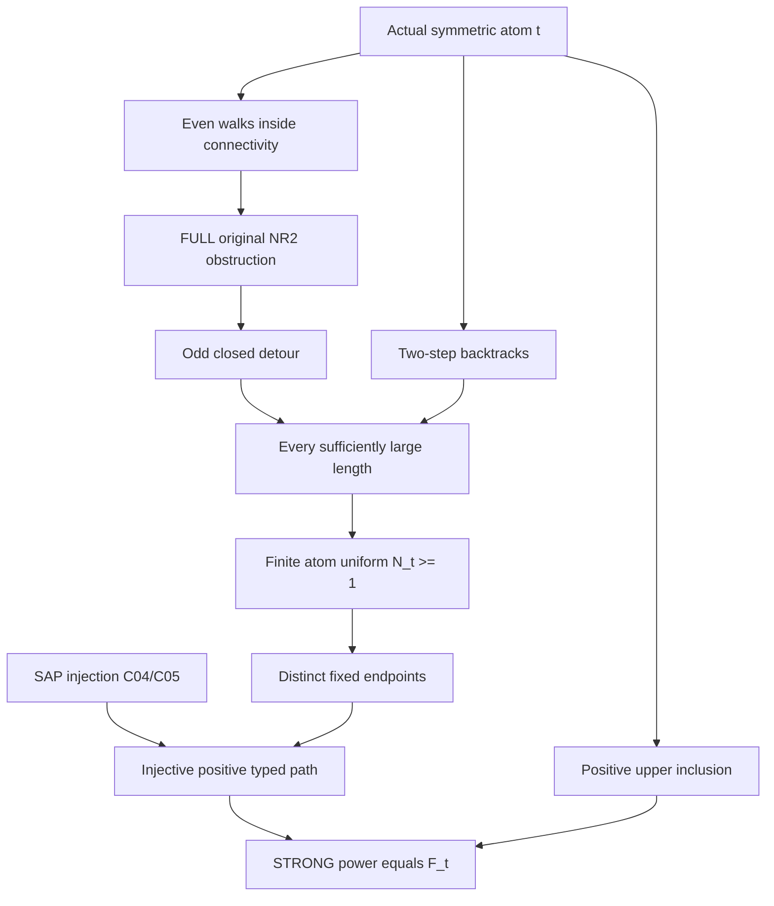

# CCO-free positive STRONG pure powers on one original named sort

Generated from `module.json` by `tools/build_formalization_module.py`.

Source `490c3f36d85db5a0b3ced0598e6c431825254ec5`. **Human-expanded proof plan; no Lean code.**

Private B032: exactly ONE Foundations III result and its TPP equation. Expand actual orbital graph connectivity/parity, FULL original sortwise NR2, a uniform positive long-walk threshold and the SAP conversion to an injective typed positive path fixing BOTH distinct endpoints. Graph/RAW walk existence uses no SAP; pure STRONG output uses SAP but no semantic CCO, primitivity, countability, exactness or distributivity. Equality and length-zero walks are proof tools only, never STRONG menu entries or a zeroth STRONG power. Finite complete means finite named language/palettes, not a finite real carrier.

The human article remains unchanged. Additional proof details are in
[PROOF_NOTES.md](PROOF_NOTES.md); the cross-track policy is in
[the formalization guide](../README.md). Source hashes are checked before
the index is regenerated. Graph validation is not proof verification.

## Source premises

**A01: Actual finite-language typed symmetric homogeneous source.** U is a homogeneous complete BINARY relational source on finitely many inhabited named transitive sorts, with finite actual pair-orbital palettes and correctly typed converses. Same-sort diversity atoms are symmetric and irreflexive. G is FULL Aut of the WHOLE original typed source acting on the fixed sort, not a substituted automorphism group of its reduct. Real carriers need not be finite.

**A02: Optional visible strong amalgamation.** Only for STRONG profile/injective-path realization, the actual finite induced typed age of U has SAP. The SAP and homogeneity provider derives infinite stabilizer orbits and fixes the designated already-injective endpoint images.

**A03: Full original sortwise no relative index two.** On the fixed named sort a, the FULL lattice of G-invariant equivalences has no interval R<C with exactly TWO R-classes inside each C-class. Neither restriction to an exact sublattice nor exclusion only of a global two-class quotient is sufficient.

**A04: Actual same-sort diversity atom.** Fix one original named sort a and an ACTUAL nonempty same-sort diversity atom t on it. Its graph has an edge. The source theorem quantifies over such t; if the same-sort diversity palette is empty the assertion is vacuous.

## Imported theorem contracts

These are named provider obligations for the receiving Lean project,
not new axioms or claims of compiled imports.

| ID and source | Contract | Current provider status |
|---|---|---|
| I01: [`lem:typed-injectivisation`](../../sections/typed_strong_domains.tex#L129) | Select strong_selectors C04/C05: a finite partial diversity diagram homomorphism becomes injective, preserving an already-injective designated vertex set and avoiding a finite forbidden set outside it. Positive STRONG word profiles equal represented endpoints guarded to DISTINCT real points. Actual ancestors use only the SAP source premise, not its separate CCO/NR2 assumptions. | HUMAN_EXPANDED_NOT_LEAN |
| I02: [`lem:typed-all-invariant-equivalences-raw-word`](../../sections/terminal_invariant_raw_exact.tex#L5) | Select ONLY real_closure C25/C26: FULL original NR2 excludes bipartite atomic components; one uniform threshold gives all sufficiently long represented walks within connectivity, including optional equal-endpoint walks. Actual ancestors use ambient action, symmetry, NR2 and elementary finite math, with NO SAP, CCO, countability or further imports. C27 all-equivalence presentations and C28 CCO distributivity are NOT imported. | HUMAN_EXPANDED_NOT_LEAN |

## Definitions

| ID | Definition | Exact meaning | Source |
|---|---|---|---|
| D01 | Actual orbital graph and ambient action | The t-graph has vertex carrier U_a and undirected edges t(x,y). Every g in G preserves edges. Connectedness and parity are defined by FINITE graph walks, not by an assumed completion of arbitrary diagrams. | [source](../../sections/terminal_strong_powers.tex#L7) |
| D02 | Connectivity C and even-walk Y | C(x,y) means some finite t-walk x->y; Y(x,y) means one of EVEN length. Length zero is allowed in these RAW graph equivalences to supply reflexivity. Always Y<=C. Neither is assumed exact. | [source](../../sections/terminal_strong_powers.tex#L7) |
| D03 | Original diversity connectivity palette F_t | F_t consists of the original same-sort DIVERSITY atoms c whose actual pairs are C-related. C is G-invariant, so membership is uniform over each actual pair orbital. Equality is omitted; t belongs to F_t. | [source](../../sections/terminal_strong_powers.tex#L7) |
| D04 | Positive STRONG powers only | P_t(1)={t}; P_t(n+1)=P_t(n)*{t}, with literal legal diversity triangles and every index n>=1. There is NO P_t(0) menu. Under SAP the standard associativity/path semantics matches every positive word bracketing. Without SAP this displayed left-associated recursion still defines the upper-bound branch. | [source](../../sections/terminal_strong_powers.tex#L7) |
| D05 | Full relative-index obstruction | The even-walk Y is an invariant equivalence inside C; if all t-components are bipartite and contain edges then [C:Y]=2 EXACTLY. This is an interval in the FULL original G-invariant lattice even when C is proper and Y is nonexact. | [source](../../sections/terminal_strong_powers.tex#L7) |
| D06 | Opposite-parity walk lengths | For connected distinct x,y choose a walk P of length l>=1 and an odd closed walk at x of length m>=3. P and the closed detour followed by P have lengths l and l+m. Two-edge x-neighbour-x walks prepend increments of two. | [source](../../sections/terminal_strong_powers.tex#L7) |
| D07 | One uniform positive threshold | For one actual representative ordered pair of every c in finite NONEMPTY F_t choose N_c=l_c+m_c. Set N_t=max_c N_c>=1. The choices depend on t/source, not on a later pair or length. | [source](../../sections/terminal_strong_powers.tex#L7) |
| D08 | Finite formal positive path with fixed endpoints | For n>=1 let V=Fin(n+1), all formal vertex sorts a and all successive edge labels literal t. Different occurrences are distinct FORMAL vertices even when a represented walk repeats real points. S={0,n} has distinct formal vertices and distinct real images x!=y. | [source](../../sections/terminal_strong_powers.tex#L7) |

## Proof claims and direct dependencies

Every row has a human proof expansion. Each still needs an actual Lean
statement and proof. Actual full-lattice parity obstruction, finite atom uniformization, distinct endpoint guards and SAP injectivization have separate premises.

| ID and claim | Scope | Direct providers | Proof note |
|---|---|---|---|
| C01: Every vertex has a genuine t-neighbour | orbital_graph | D01, A01, A04 | N01 in [notes](PROOF_NOTES.md) |
| C02: Actual invariant connectivity and components | orbital_graph | D02, C01, A01 | N01 in [notes](PROOF_NOTES.md) |
| C03: Even walks give a full original invariant equivalence | orbital_graph | D02, C02 | N01 in [notes](PROOF_NOTES.md) |
| C04: Bipartiteness of one component forces it in all | orbital_graph | C02, A01 | N02 in [notes](PROOF_NOTES.md) |
| C05: Bipartite components create an EXACT index-two interval | full_NR2 | C03, C04, C01, D05 | N02 in [notes](PROOF_NOTES.md) |
| C06: FULL NR2 excludes every bipartite component | full_NR2 | C05, A03, I02 | N02 in [notes](PROOF_NOTES.md) |
| C07: There is a finite odd closed walk at each chosen root | long_walks | C06, C01 | N03 in [notes](PROOF_NOTES.md) |
| C08: A two-step backtrack pads by exactly two | long_walks | C01 | N03 in [notes](PROOF_NOTES.md) |
| C09: One connected distinct pair has opposite-parity base walks | long_walks | C02, C07, D06 | N03 in [notes](PROOF_NOTES.md) |
| C10: Every length above the pair threshold is realized | long_walks | C08, C09 | N03 in [notes](PROOF_NOTES.md) |
| C11: The finite connectivity palette has actual distinct representatives | long_walks | D03, C02, A01 | N03 in [notes](PROOF_NOTES.md) |
| C12: Finite atom choices give ONE positive threshold for t | long_walks | C10, C11, D07, I02 | N03 in [notes](PROOF_NOTES.md) |
| C13: Ambient pair-orbital transport gives every real c-pair | long_walks | C12, A01 | N03 in [notes](PROOF_NOTES.md) |
| C14: A represented walk is a homomorphism on separate occurrences | positive_guard | C13, D08 | N04 in [notes](PROOF_NOTES.md) |
| C15: The designated endpoint restriction is injective | positive_guard | C14, D08 | N04 in [notes](PROOF_NOTES.md) |
| C16: SAP removes all collisions while fixing BOTH endpoints | SAP_injectivity | C15, I01 | N04 in [notes](PROOF_NOTES.md) |
| C17: Every connected diversity atom lies in the strong pure power | pure_power | C16, I01 | N04 in [notes](PROOF_NOTES.md) |
| C18: Every positive strong power stays inside connectivity | pure_power | D04, D03, C02 | N05 in [notes](PROOF_NOTES.md) |
| C19: All sufficiently large positive STRONG powers equal F_t | pure_power | C17, C18, C12 | N05 in [notes](PROOF_NOTES.md) |
| C20: Empty palette, true equality and finite-carrier boundaries | boundary | C01, C11, D04 | N06 in [notes](PROOF_NOTES.md) |
| C21: Exact scoped source theorem without CCO | pure_power | C19, C20 | N06 in [notes](PROOF_NOTES.md) |

The precise quantified contracts are in `module.json`. Provider-before-consumer
order (including definitions and source premises):

`A01 → A02 → A03 → A04 → D01 → D04 → D08 → I01 → I02 → C01 → D02 → D06 → C02 → C08 → D03 → D05 → C03 → C04 → C11 → C18 → D07 → C05 → C20 → C06 → C07 → C09 → C10 → C12 → C13 → C14 → C15 → C16 → C17 → C19 → C21`

This order is one valid linearization; it does not require unrelated
branches to be proved sequentially. The full DAG is the `depends_on`
relation in `module.json`.

## Main proof branches

This is a coarse view of the claim DAG. Edges go from provider to consumer.

All invariance uses Aut of the WHOLE original typed source on the fixed named sort, not a changed reduct group.
The parity interval lies in the FULL invariant lattice and may lie under proper connectivity; exact-sublattice or merely global two-class exclusions are insufficient.
Odd closed walks and backtracks supply represented path homomorphisms. Only after the endpoint diversity guard is SAP injection applied.
No CCO, countability or distributivity enters either selected provider ancestry. Equality is not a STRONG atom and no zeroth STRONG power is defined.
Finite diagnostic graphs test the represented/parity branch; they do not pretend to satisfy infinite SAP injection for all path lengths.

## Article exports

| Existing source result | Sidecar proof claims |
|---|---|
| [`lem:typed-terminal-pure-power`](../../sections/terminal_strong_powers.tex#L6) | C19, C21 |

Auxiliary source equations (not additional numbered results):

- [`eq:typed-terminal-pure-power`](../../sections/terminal_strong_powers.tex#L19): C19

## Internal implementation milestones

These tasks are proof milestones inside larger project assignments;
see the [peer-project allocation](../coordination/BOARD.md).

These are implementation tasks, not additional mathematical assumptions.

| Task | Earlier tasks | Acceptance |
|---|---|---|
| T01: Actual parity equivalences and full NR2 obstruction | — | Implement the exact ambient-group FULL invariant parity obstruction, finite positive threshold, both fixed literal distinct endpoints and all n>=N_t. Graph lemmas and upper inclusion must remain independent of SAP. Use only selected C25/C26 and C04/C05; do not inherit CCO or a zeroth strong identity. Include repeated named sort a on all formal occurrences. |
| T02: Constructive walks and finite atom threshold | T01 | Implement the exact ambient-group FULL invariant parity obstruction, finite positive threshold, both fixed literal distinct endpoints and all n>=N_t. Graph lemmas and upper inclusion must remain independent of SAP. Use only selected C25/C26 and C04/C05; do not inherit CCO or a zeroth strong identity. Include repeated named sort a on all formal occurrences. |
| T03: Positive fixed-root formal path and SAP injection | T01, T02 | Implement the exact ambient-group FULL invariant parity obstruction, finite positive threshold, both fixed literal distinct endpoints and all n>=N_t. Graph lemmas and upper inclusion must remain independent of SAP. Use only selected C25/C26 and C04/C05; do not inherit CCO or a zeroth strong identity. Include repeated named sort a on all formal occurrences. |
| T04: Positive upper inclusion and exact pure-power identity | T01, T02, T03 | Implement the exact ambient-group FULL invariant parity obstruction, finite positive threshold, both fixed literal distinct endpoints and all n>=N_t. Graph lemmas and upper inclusion must remain independent of SAP. Use only selected C25/C26 and C04/C05; do not inherit CCO or a zeroth strong identity. Include repeated named sort a on all formal occurrences. |
| T05: Boundary guards and standalone receiving theorem | T01, T02, T03, T04 | Implement the exact ambient-group FULL invariant parity obstruction, finite positive threshold, both fixed literal distinct endpoints and all n>=N_t. Graph lemmas and upper inclusion must remain independent of SAP. Use only selected C25/C26 and C04/C05; do not inherit CCO or a zeroth strong identity. Include repeated named sort a on all formal occurrences. |

## Finite controls

- **K01.** Independent bounded graph/permutation computations of represented exact-length walks, even-walk components, actual relative-index-two obstruction and eventual connectedness; bipartite negative controls.
- **K02.** Positive-length/distinct-terminal guards and finite-size injection distinctions. No finite graph is asserted to provide arbitrarily long injective paths or certify SAP/CCO/NR2 of an infinite source.

Run `python tools/check_terminal_power_controls.py` from the manuscript directory.
The controls do not prove CCO or the general theorems.

## Return to the human articles

No required mathematical repair was found in this scoped pass. These
optional wording clarifications remain queued for a human article pass:

- **F01** ([source](../../sections/terminal_strong_powers.tex#L37)): The finite atomic threshold must be positive and uniform before varying the actual pair or length. Opposite-parity walks of lengths l and l+m, with m odd, yield N_c=l+m; the finite nonempty F_t gives N_t=max N_c>=1. Give the explicit per-atom opposite-parity threshold and finite maximum, then state pair-orbital transport for the ambient typed group.
- **F02** ([source](../../sections/terminal_strong_powers.tex#L46)): The SAP call is on separate formal path occurrences with designated S={0,n}, n>=1, whose literal endpoint images are DISTINCT. Diagonal closed-walk gadgets are removed by the diversity guard; finite means language/palette, not a finite real carrier. State the formal path and fixed endpoints explicitly and keep n=0 outside the strong menu notation.

The machine ledger records caller effects and affected claims. The source
review used two independent model review passes and parent synthesis;
it is not independent human or formal certification.
