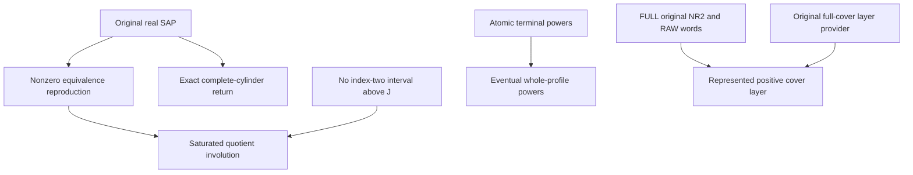

# Terminal same-sort profile reproduction, no-return and complete-cylinder tests

Generated from `module.json` by `tools/build_formalization_module.py`.

Source `490c3f36d85db5a0b3ced0598e6c431825254ec5`. **Human-expanded proof plan; no Lean code.**

Private B051: FIVE remaining source09 results and FOUR equations, seven definitions, 32 human claims and five tasks. Original SAP alone proves equivalence reproduction and complete external-cylinder return; no-return needs only the relevant index-two exclusion and profile powers need full original NR2, not CCO. Terminal represented cover-layer reachability separately uses earlier RAW word representability and the positive FULL cover layer provider. No hidden/quotient SAP or arbitrary incomplete-cylinder return is inferred.

The human article remains unchanged. Additional proof details are in
[PROOF_NOTES.md](PROOF_NOTES.md); the cross-track policy is in
[the formalization guide](../README.md). Source hashes are checked before
the index is regenerated. Graph validation is not proof verification.

## Source premises

**A01: Actual homogeneous finite typed original source.** M is homogeneous complete in a finite binary relational language with finitely many nonempty transitive named original sorts, symmetric actual same-sort diversity atoms and paired typed converses. All invariant same-sort relations are unions of finitely many old full-Aut pair orbitals. Logical Id is separate from diversity; words have actual old typed edges.

**A02: Visible original SAP.** The original finite age has SAP. Every nonzero invariant equivalence J>Id has infinite classes; finite diversity homomorphisms/word walks admit injective replacements with an already distinct endpoint pair pinned. No quotient/hidden SAP is assumed.

**A03: Local no-index-two-above-J premise.** For the no-return theorem at a fixed nonzero J, there is NO original invariant equivalence H>J with [H:J]=2. The standing terminal FULL NR2 hypothesis implies this, but the local no-return argument needs only this cut-specific exclusion. J may be Top, when the condition is vacuous.

**A04: FULL original NR2 for profile powers and terminal wrappers.** On the chosen original named sort, the FULL invariant-equivalence lattice has no relative-index-two interval. This is not merely a condition on represented exact equivalences. Finite old orbitals and actual SAP are retained; semantic CCO is unnecessary for the profile-power argument.

**A05: Complete external quotient cylinders.** For the return test J>Id and T,S are NONEMPTY full old diversity pullbacks of INDIVIDUAL complete Aut(M)-orbitals on (M_a/J)^2, both disjoint from J. They are J-bisaturated and symmetric. Completeness excludes arbitrary unions; neither CCO, NR2, MI nor exactness is assumed.

**A06: Terminal represented cover-layer instance.** For the represented wrapper, the actual source also has semantic HOM CCO, and J is a nonzero represented proper FULL exact MI with represented exact cover K. Full original NR2 in A04 identifies the full invariant and represented lattices via I05. The source09 positive external-layer theorem I06 is used only after this identification and positivity of J^circ are discharged.

## Imported theorem contracts

These are named provider obligations for the receiving Lean project,
not new axioms or claims of compiled imports.

| ID and source | Contract | Current provider status |
|---|---|---|
| I01: [`lem:typed-raw-strong-saturation`](../../sections/v27/07_typed_raw_strong_transition.tex#L25) | For nonzero original exterior kernels, diversity of full RAW saturation equals the STRONG exterior palette product; identity exteriors are omitted. Use the atom-union extension and RAW reflexivity to put an arbitrary old P INSIDE J^circ*P*J^circ. This inclusion does not follow from equivalence reproduction unless P is already inside J. | HUMAN_EXPANDED_NOT_LEAN |
| I02: [`lem:typed-symmetric-orbital-commutation`](../../sections/v27/08_typed_terminal_reset_equivalences.tex#L7) | Actual invariant RAW same-sort relations commute by endpoint swap. No mixed-sort relation reordering is asserted. | HUMAN_EXPANDED_NOT_LEAN |
| I03: [`lem:typed-quotient-strong-semigroup`](../../sections/v27/09_typed_equivalence_and_profiles.tex#L254) | At actual J>Id, Phi is injective, preserves meets/unions, sends Delta to NONEMPTY J^circ and preserves actual quotient products by choosing distinct old representatives. No quotient SAP/CCO is assumed. | HUMAN_EXPANDED_NOT_LEAN |
| I04: [`lem:typed-terminal-pure-power`](../../sections/terminal_strong_powers.tex#L6) | Under original FULL NR2 and old SAP each atomic same-sort t has eventually constant positive STRONG powers equal to its connectedness palette. The support is selected only at C19/C21; no CCO or arbitrary quotient version is imported. | HUMAN_EXPANDED_NOT_LEAN |
| I05: [`lem:typed-all-invariant-equivalences-raw-word`](../../sections/terminal_invariant_raw_exact.tex#L5) | FULL original NR2 gives one actual equality-inclusive RAW atomic word for every invariant equivalence, without CCO. Use only for identifying the represented MI/cover with FULL invariance and obtaining positive diversity words via old SAP. | HUMAN_EXPANDED_NOT_LEAN |
| I06: [`thm:typed-original-full-cover-layer-word`](../../sections/v27/09_typed_equivalence_and_profiles.tex#L308) | At a local FULL original cover Id<J<K with J^circ one positive old word, the external layer K minus J has ONE positive OLD word, including the index-two case. The represented terminal wrapper separately discharges the FULL cover/positivity prerequisites. | HUMAN_EXPANDED_NOT_LEAN |

**I01 internal proof support:** C01 in `transition_closure`. Use the strict proved ancestor transition_closure C01 for purely relational binary word injectivisation with the endpoint fine pair type preserved and then aligned. It adds no theorem export and no exact-domain/Set-Pasch premise; it is used for general old profile walk readout.

These are separately extracted proved support claims, not additional
numbered exports or consequences of the named theorem statement.

## Definitions

| ID | Definition | Exact meaning | Source |
|---|---|---|---|
| D01 | Full equivalence and nonempty diversity | For nonzero original E>Id, E^circ=E minus Id is its occurring same-sort diversity palette. Id is never inserted as an edge; E may be Top. | [source](../../sections/v27/09_typed_equivalence_and_profiles.tex#L2) |
| D02 | Nonempty old profile menus | P,Q,W are nonempty SAME-ENDPOINT-SORT invariant diversity menus. For the printed statements they are positive typed old word profiles; private word interiors can use other named original sorts, in their actual order. | [source](../../sections/v27/09_typed_equivalence_and_profiles.tex#L36) |
| D03 | J-saturation and quotient pullback | For P define Phat=J^circ*P*J^circ=(J;P;J)^circ=Phi(Pbar). Quotient Delta lifts to J^circ, not real Id. RAW reflexivity gives P subset Phat even if P is not contained in J. | [source](../../sections/v27/09_typed_equivalence_and_profiles.tex#L36) |
| D04 | Same equivariant involution | A symmetric serial quotient relation with one neighbour at each point is the graph of an equivariant involution. Under a transitive quotient action it is either identity everywhere or fixed-point-free everywhere. | [source](../../sections/v27/09_typed_equivalence_and_profiles.tex#L36) |
| D05 | Connectedness palette of W | C_W is actual same-sort graph connectedness for the symmetric W relation, using zero/reverse/concatenated walks; F_W=C_W minus Id is a nonempty old diversity palette. | [source](../../sections/v27/09_typed_equivalence_and_profiles.tex#L147) |
| D06 | Complete J-semantic cylinder | A cylinder is the FULL old diversity preimage of one quotient pair orbital. A nonempty arbitrary union of such cylinders is generally not complete and need not obey the exact return test. | [source](../../sections/v27/09_typed_equivalence_and_profiles.tex#L193) |
| D07 | Represented versus FULL cover | J,K denote actual equivalences including equality. Represented exact MI/cover can be treated as FULL original MI/cover only after I05 under A04; positive J^circ words additionally use old SAP. | [source](../../sections/v27/09_typed_equivalence_and_profiles.tex#L523) |

## Proof claims and direct dependencies

Every row has a human proof expansion. Each still needs an actual Lean
statement and proof. J denotes the full original equivalence, J^circ its nonempty diversity palette. Quotient diagonal is lifted to J^circ only for J>Id. Original same-sort products commute; mixed word interiors keep actual typed order. Terminal/source representation gates and complete cylinder hypotheses remain separate.

| ID and claim | Scope | Direct providers | Proof note |
|---|---|---|---|
| C01: Old invariant menus are symmetric serial actual relations | word_semantics | A01, I02 | N01 in [notes](PROOF_NOTES.md) |
| C02: A nonzero old class has arbitrarily many distinct points | reproduction | A01, A02, D01 | N01 in [notes](PROOF_NOTES.md) |
| C03: Reproduction uses a genuine three-point old SAP fork | reproduction | A01, A02, D01 | N01 in [notes](PROOF_NOTES.md) |
| C04: Equivalence reproduction and idempotence source export | reproduction | C03 | N01 in [notes](PROOF_NOTES.md) |
| C05: Actual RAW walk products read out as positive STRONG words | word_semantics | A01, A02, I01, I02, D02 | N02 in [notes](PROOF_NOTES.md) |
| C06: Saturation contains P by RAW reflexivity, not reproduction | no_return | A01, A02, I01, I03, C01, D03 | N02 in [notes](PROOF_NOTES.md) |
| C07: A product inside J forces the quotient product inside Delta | no_return | C01, C02, C05, C06, I03 | N02 in [notes](PROOF_NOTES.md) |
| C08: Serial symmetric relations with product in Delta define one involution | no_return | C06, C07, D04 | N02 in [notes](PROOF_NOTES.md) |
| C09: A nonidentity quotient involution yields an original index-two interval | no_return | C08, A01 | N02 in [notes](PROOF_NOTES.md) |
| C10: Local index-two exclusion forces the identity quotient map | no_return | A03, C06, C08, C09 | N02 in [notes](PROOF_NOTES.md) |
| C11: Finite positive products inherit no-return without identity factors | no_return | A02, C05, C10 | N02 in [notes](PROOF_NOTES.md) |
| C12: Typed no-return export retains the FULL/local terminal distinction | no_return | C10, C11 | N02 in [notes](PROOF_NOTES.md) |
| C13: An atom inside W forces every W-component to be nonbipartite | profile_powers | A01, A02, A04, I04, D05 | N03 in [notes](PROOF_NOTES.md) |
| C14: Every connected pair has all sufficiently long W-walks | profile_powers | C01, C13 | N03 in [notes](PROOF_NOTES.md) |
| C15: Finite original orbitals give ONE profile threshold | profile_powers | A01, C13, C14, D05 | N03 in [notes](PROOF_NOTES.md) |
| C16: Expand W-steps before pinned injectivisation | profile_powers | C05, C15, I01, D02 | N03 in [notes](PROOF_NOTES.md) |
| C17: Reverse containment and idempotence are actual connectivity | profile_powers | C04, C05, C16, D05 | N03 in [notes](PROOF_NOTES.md) |
| C18: Profile pure-power source export is CCO-free | profile_powers | C13, C14, C15, C16, C17 | N03 in [notes](PROOF_NOTES.md) |
| C19: A complete external cylinder is a whole quotient orbital pullback | cylinder_return | A01, A02, A05, D06 | N04 in [notes](PROOF_NOTES.md) |
| C20: A two-edge return inside J forces complete cylinders equal | cylinder_return | A01, C19 | N04 in [notes](PROOF_NOTES.md) |
| C21: Equal complete cylinders have a genuine diversity J-return | cylinder_return | C02, C19, A05 | N04 in [notes](PROOF_NOTES.md) |
| C22: Exact complete-cylinder return export | cylinder_return | C20, C21 | N04 in [notes](PROOF_NOTES.md) |
| C23: Terminal RAW representation identifies FULL and exact lattice cuts | represented_layer | A04, A06, I05, D07 | N05 in [notes](PROOF_NOTES.md) |
| C24: Nonzero J has a positive STRONG word before layer selection | represented_layer | A02, A06, C05, C23, I01 | N05 in [notes](PROOF_NOTES.md) |
| C25: The earlier FULL-cover provider yields the represented layer | represented_layer | A06, C23, C24, I06 | N05 in [notes](PROOF_NOTES.md) |
| C26: No-return fails at an index-two quotient even with original SAP | boundary |  | N06 in [notes](PROOF_NOTES.md) |
| C27: Incomplete saturated unions invalidate the exact return equivalence | boundary |  | N06 in [notes](PROOF_NOTES.md) |
| C28: A zero cut cannot supply a diversity quotient diagonal | boundary | D01, D03 | N06 in [notes](PROOF_NOTES.md) |
| C29: Finite windows do not prove unbounded strong powers | boundary | C18 | N06 in [notes](PROOF_NOTES.md) |
| C30: Three different terminal strengths remain separated | boundary | C04, C12, C18, C22, C25 | N06 in [notes](PROOF_NOTES.md) |
| C31: Original typed word interiors never license mixed commutation | boundary | C01, C05, D02 | N06 in [notes](PROOF_NOTES.md) |
| C32: Finite diagnostics and existing source gates remain | boundary | C25, C26, C27, C29, C30 | N06 in [notes](PROOF_NOTES.md) |

The precise quantified contracts are in `module.json`. Provider-before-consumer
order (including definitions and source premises):

`A01 → A02 → A03 → A04 → A05 → A06 → C26 → C27 → D01 → D02 → D03 → D04 → D05 → D06 → D07 → I01 → I02 → I03 → I04 → I05 → I06 → C01 → C02 → C03 → C05 → C13 → C19 → C23 → C28 → C04 → C06 → C14 → C20 → C21 → C24 → C31 → C07 → C15 → C22 → C25 → C08 → C16 → C09 → C17 → C10 → C18 → C11 → C29 → C12 → C30 → C32`

This order is one valid linearization; it does not require unrelated
branches to be proved sequentially. The full DAG is the `depends_on`
relation in `module.json`.

## Main proof branches

This is a coarse view of the claim DAG. Edges go from provider to consumer.

Five remaining source09 results and four equations; the quotient-semigroup and original layer theorem were already prepared by B050.
No-return/profiles have CCO-free proofs under their actual NR2 premises; the represented layer wrapper retains source CCO through its provider.
Arbitrary P lies in its J-saturation by RAW reflexivity, not by reproduction which assumes P is already inside J.
Complete quotient cylinder hypotheses are essential and have an explicit unequal-union counterexample.

## Article exports

| Existing source result | Sidecar proof claims |
|---|---|
| [`lem:typed-equivalence-reproduction`](../../sections/v27/09_typed_equivalence_and_profiles.tex#L1) | C04 |
| [`lem:typed-terminal-no-return`](../../sections/v27/09_typed_equivalence_and_profiles.tex#L35) | C12 |
| [`lem:typed-profile-pure-power`](../../sections/v27/09_typed_equivalence_and_profiles.tex#L146) | C18 |
| [`lem:typed-complete-J-cylinder-return`](../../sections/v27/09_typed_equivalence_and_profiles.tex#L192) | C22 |
| [`thm:typed-cover-layer-reachable`](../../sections/v27/09_typed_equivalence_and_profiles.tex#L522) | C25 |

Auxiliary source equations (not additional numbered results):

- [`eq:typed-equivalence-reproduction`](../../sections/v27/09_typed_equivalence_and_profiles.tex#L10): C04
- [`eq:typed-no-return`](../../sections/v27/09_typed_equivalence_and_profiles.tex#L47): C12
- [`eq:typed-profile-pure-power`](../../sections/v27/09_typed_equivalence_and_profiles.tex#L157): C18
- [`eq:typed-complete-J-cylinder-return`](../../sections/v27/09_typed_equivalence_and_profiles.tex#L205): C22

Full result coverage is asserted only for `source_result_files`.
Selected additional results: lem:typed-equivalence-reproduction, lem:typed-terminal-no-return, lem:typed-profile-pure-power, lem:typed-complete-J-cylinder-return, thm:typed-cover-layer-reachable.
Other results in their provider source files are not claimed covered.

## Internal implementation milestones

These tasks are proof milestones inside larger project assignments;
see the [peer-project allocation](../coordination/BOARD.md).

These are implementation tasks, not additional mathematical assumptions.

| Task | Earlier tasks | Acceptance |
|---|---|---|
| T01: Original reproduction and positive-word semantics | — | Keep full J separate from J^circ and quotient Delta. Saturation contains arbitrary P by RAW reflexivity, not equivalence reproduction whose premise P subset J would be circular. No-return uses a genuine index-two quotient involution contradiction. Expand each W-step to its fixed atomic word before pinning all formal vertices. Complete external quotient orbitals, not arbitrary unions, are required for the exact return test. Discharge represented/full cover and J-word positivity separately for the terminal layer. |
| T02: Local quotient-involution no-return | T01 | Keep full J separate from J^circ and quotient Delta. Saturation contains arbitrary P by RAW reflexivity, not equivalence reproduction whose premise P subset J would be circular. No-return uses a genuine index-two quotient involution contradiction. Expand each W-step to its fixed atomic word before pinning all formal vertices. Complete external quotient orbitals, not arbitrary unions, are required for the exact return test. Discharge represented/full cover and J-word positivity separately for the terminal layer. |
| T03: Eventual old same-sort profile powers | T01 | Keep full J separate from J^circ and quotient Delta. Saturation contains arbitrary P by RAW reflexivity, not equivalence reproduction whose premise P subset J would be circular. No-return uses a genuine index-two quotient involution contradiction. Expand each W-step to its fixed atomic word before pinning all formal vertices. Complete external quotient orbitals, not arbitrary unions, are required for the exact return test. Discharge represented/full cover and J-word positivity separately for the terminal layer. |
| T04: Complete cylinder return test | T01 | Keep full J separate from J^circ and quotient Delta. Saturation contains arbitrary P by RAW reflexivity, not equivalence reproduction whose premise P subset J would be circular. No-return uses a genuine index-two quotient involution contradiction. Expand each W-step to its fixed atomic word before pinning all formal vertices. Complete external quotient orbitals, not arbitrary unions, are required for the exact return test. Discharge represented/full cover and J-word positivity separately for the terminal layer. |
| T05: Represented positive cover layer and boundaries | T02, T03, T04 | Keep full J separate from J^circ and quotient Delta. Saturation contains arbitrary P by RAW reflexivity, not equivalence reproduction whose premise P subset J would be circular. No-return uses a genuine index-two quotient involution contradiction. Expand each W-step to its fixed atomic word before pinning all formal vertices. Complete external quotient orbitals, not arbitrary unions, are required for the exact return test. Discharge represented/full cover and J-word positivity separately for the terminal layer. |

## Finite controls

- **K01.** Actual finite clone-window equivalence reproduction, bounded profile powers and quotient-involution no-return cases, with explicit local index-two counterexample.
- **K02.** Complete-cylinder returns versus unequal saturated-union return; represented local layer witnesses and old/quotient diagonal distinctions. Finite windows are not certified as unbounded SAP/CCO sources.

Run `python tools/check_terminal_profile_controls.py` from the manuscript directory.
The controls do not prove CCO or the general theorems.

## Return to the human articles

No required mathematical repair was found in this scoped pass. These
optional wording clarifications remain queued for a human article pass:

- **F01** ([source](../../sections/v27/09_typed_equivalence_and_profiles.tex#L136)): The final inclusion P subset J^circ*P*J^circ in no-return is not a consequence of equivalence reproduction, whose premise would already require P subset J. It follows directly from full RAW reflexivity and the separately proved RAW/STRONG saturation identity. Replace the reproduction justification at that inclusion by Id subset J plus lem:typed-raw-strong-saturation. The no-return/profile-power statements can also note their proofs are CCO-free under the recorded NR2 hypotheses.

The machine ledger records caller effects and affected claims. The source
review used two independent model review passes and parent synthesis;
it is not independent human or formal certification.
