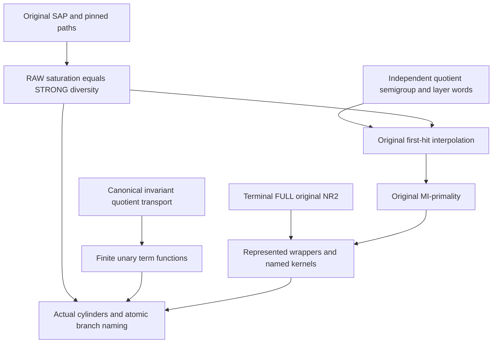

# Original RAW/STRONG saturation, cover interpolation and finite quotient-transition closure

Generated from `module.json` by `tools/build_formalization_module.py`.

Source `490c3f36d85db5a0b3ced0598e6c431825254ec5`. **Human-expanded proof plan; no Lean code.**

Private B049: TWELVE source07 results, fifteen auxiliary equations, twelve definitions, 62 claims and eight tasks. Separate SAP-only pinned RAW/STRONG saturation from CCO first-hit/MI-primality and terminal represented wrappers. Quotient transport/normal forms use actual invariant RAW relations; representation and no-real-collapse are separately discharged. Two source09 positive quotient-semigroup/cover-layer providers are selected from terminal_lattice with no reverse dependency on this module. No hidden SAP or arbitrary mixed-sort commutation is assumed.

The human article remains unchanged. Additional proof details are in
[PROOF_NOTES.md](PROOF_NOTES.md); the cross-track policy is in
[the formalization guide](../README.md). Source hashes are checked before
the index is regenerated. Graph validation is not proof verification.

## Source premises

**A01: Actual finite named-sorted symmetric binary source.** M is homogeneous complete in a finite binary relational language with finitely many nonempty individually transitive named original sorts. Distinct pairs have actual occurring irreflexive canonical diversity atoms; same-sort atoms are symmetric, mixed-sort atoms have typed converses. All invariant binary relations are finite unions of original full-Aut pair orbitals, with logical equality separately named.

**A02: Visible original SAP.** The finite ACTUAL old age has SAP. Complete old factors and fixed endpoint pair diagrams are induced. Nontrivial invariant equivalence means >Id, so its actual classes are infinite by repeated SAP. No SAP is inferred for a quotient or hidden age.

**A03: Additional semantic HOM CCO.** Only the original positive-word Helly, first-hit and primality branches assume every finite old typed diversity partial graph with all specified simple cycles homomorphic into M has a whole homomorphism. Nonadjacent vertices may collide before old SAP injectivisation.

**A04: Independent positive FULL cover for original interpolation.** On ONE original sort a, Id<J<K are FULL invariant equivalences; J is meet-irreducible and K its UNIQUE FULL cover. J^circ and K^circ each have one genuinely positive OLD STRONG atomic word presentation. P is a nonempty positive typed a-a old word profile, whose interiors may use any named old sorts. This is an explicit local cover premise, not terminality or a represented-exact-lattice assumption.

**A05: Terminal FULL NR2 only for represented wrappers and namedness.** For represented typed interpolation/prime and finite named quotient membership, every current original named sort has no index-two interval in its FULL invariant-equivalence lattice. The separate real_closure theorem then makes every original invariant equivalence an actual FULL RAW atomic word relation. This is NOT assumed for original local-cover interpolation or generic transport/saturation.

**A06: Actual quotient transport data.** For transport R:a->b use a NONEMPTY actual invariant RAW relation and invariant proper E on a with R;R^op subset E. For composition S:b->c its literal middle kernel is F=R^op;E;R and S;S^op subset F. Generic transport claims do not by themselves require SAP/CCO/NR2 or exactness; no unrelated quotient chart is substituted.

**A07: Actual represented coordinate language.** Proper quotient objects B_(a,J) are indexed by represented proper meet-irreducibles on old sorts, with real sort a as equality coordinate only. Include upward maps, nonidentity-free quotient transitions and their canonical inverses/compositions as specified by actual transports. Distinct syntax may denote the SAME unary function. All hidden sorts and carrier objects are actual interpreted quotient classes. The finite original tuple-type naming is definitional and changes no embeddings.

## Imported theorem contracts

These are named provider obligations for the receiving Lean project,
not new axioms or claims of compiled imports.

| ID and source | Contract | Current provider status |
|---|---|---|
| I01: [`lem:collision-unfolding`](../../sections/foundational_sap_collision_unfolding.tex#L5) | Pure RELATIONAL original SAP injectivisation of homomorphism-embeddings, preserving designated COMPLETE factor image types. For binary atomic partial graphs any homomorphism is a HE on complete irreducible cliques. Pin a complete endpoint pair by preserving its full image type and then aligning by old two-point homogeneity; no Set-Pasch theorem is used. If the selected proof API uses a countable homogeneous realization, apply it to the countable Fraisse limit of the same finite SAP age; its finite output embeds into the actual original source, and original finite homogeneity aligns the pinned endpoint pair. Thus no extra countability assumption on the original source is needed. | HUMAN_EXPANDED_NOT_LEAN |
| I02: [`lem:typed-PC-fixedpoint-exact`](../../sections/typed_pc_fixedpoint.tex#L92) | Existing typed STRONG nonempty exact PC domains equal finite positive-profile meets, including empty-family diversity Top; support-consistent triples are realized. Use ONLY in exact-domain and represented-wrapper branches, not original first-hit/primality. | HUMAN_EXPANDED_NOT_LEAN |
| I03: [`lem:typed-quotient-transport`](../../sections/typed_invariant_quotient_transport.tex#L15) | Actual invariant quotient labels/bijections, full upper-interval transport, canonical composition and separately discharged first-order definability in the finite named orbital source. This alone supplies no named RAW exactness or SAP noncollapse. | HUMAN_EXPANDED_NOT_LEAN |
| I04: [`lem:typed-all-invariant-equivalences-raw-word`](../../sections/terminal_invariant_raw_exact.tex#L5) | Under original FULL NR2, every invariant same-sort equivalence has one original equality-inclusive RAW word presentation, CCO-free. For a nonzero equivalence old SAP gives a positive STRONG diversity presentation; used only for represented wrappers/namedness. | HUMAN_EXPANDED_NOT_LEAN |
| I05: [`lem:typed-quotient-strong-semigroup`](../../sections/v27/09_typed_equivalence_and_profiles.tex#L254) | For J>Id, diversity pullback Phi of actual quotient invariant relations is injective and preserves finite meets/unions; actual quotient composition lifts EXACTLY to STRONG products by fresh representatives of the infinite old J-classes. This is the source09 standalone theorem, not an assumption of quotient CCO. | HUMAN_EXPANDED_NOT_LEAN |
| I06: [`thm:typed-original-full-cover-layer-word`](../../sections/v27/09_typed_equivalence_and_profiles.tex#L308) | At a local FULL original cover Id<J<K with J^circ one positive word, U=K minus J itself has ONE positive OLD STRONG word. Index-two is allowed; no global NR2 or typed hidden geometry is needed. This earlier selected source09 proof has no dependency on the present first-hit/interpolation/cylinder results. | HUMAN_EXPANDED_NOT_LEAN |

## Definitions

| ID | Definition | Exact meaning | Source |
|---|---|---|---|
| D01 | RAW versus STRONG factors | RAW composition uses actual existential witnesses and includes logical Id. A STRONG positive word uses diversity edges and distinct formal vertices. E^circ=E minus Id, and an identity-only exterior equivalence is OMITTED, not represented by an empty factor. | [source](../../sections/v27/07_typed_raw_strong_transition.tex#L26) |
| D02 | Nonzero equivalence class | Nonzero means E>Id, not merely nonempty. Every such E-class has a different mate at every point by source transitivity. | [source](../../sections/v27/07_typed_raw_strong_transition.tex#L26) |
| D03 | Positive path and theta presentations | One positive word is an old typed path with finitely many formal positions. Parallel private word paths with common roots form a theta graph; equal direct one-edge paths are deduplicated. No diagonal is specified as a diversity edge. | [source](../../sections/v27/07_typed_raw_strong_transition.tex#L255) |
| D04 | Exact PC domain | A nonempty STRONG fixed-point PC pair menu; I02 identifies these with finite nonempty intersections of positive profile menus, with empty intersection the full diversity palette. | [source](../../sections/v27/07_typed_raw_strong_transition.tex#L223) |
| D05 | Quotient diversity pullback | For J>Id on a and quotient relation V on a/J, Phi(V) consists of distinct old endpoints whose J-classes lie in V. In particular Phi(Delta)=J^circ, which is NONEMPTY, unlike old logical Id. | [source](../../sections/v27/07_typed_raw_strong_transition.tex#L255) |
| D06 | First-hit saturation | S=J^circ*P*J^circ is a positive OLD word profile and equals Phi(Sbar) for a full quotient invariant relation Sbar containing the quotient diagonal when P meets J^circ. | [source](../../sections/v27/07_typed_raw_strong_transition.tex#L255) |
| D07 | Canonical quotient labelling | For R;R^op subset E, lambda_(R,E)(y) is the unique E-class of any R-predecessor. F=ker lambda=R^op;E;R and q_(R,E) is the inverse induced quotient bijection. | [source](../../sections/v27/07_typed_raw_strong_transition.tex#L573) |
| D08 | Finite invariant relation family | Rel^(ab) is the finite set of nonempty unions of actual old a-b pair orbitals, including Id when a=b. Products are actual RAW invariant relations, again in the appropriate finite family. | [source](../../sections/v27/07_typed_raw_strong_transition.tex#L661) |
| D09 | Upward quotient map | u_(E,H) sends an E-class to its H-class for E<=H on one literal old sort. Its canonical source-side pullback through q_R is H0 in the FULL upper interval, not an arbitrary chart. | [source](../../sections/v27/07_typed_raw_strong_transition.tex#L661) |
| D10 | Unary normal function | After rewriting all upward maps toward the source, a coordinate term is one initial real projection/upward map followed by at most one canonical q_(T,E), or identity, with T an actual old relation. Functions, not term strings, are counted. | [source](../../sections/v27/07_typed_raw_strong_transition.tex#L661) |
| D11 | Representative cylinder | Cyl_(J,K)(t) is the distinct-old-endpoint spectrum of actual J,K-classes with a t representative. Nonzero exterior kernels use E^circ; equality-coordinate exteriors are omitted. Hidden quotient equality remains a separate logical test. | [source](../../sections/v27/07_typed_raw_strong_transition.tex#L914) |
| D12 | Whole branch versus one atom | For nonempty invariant identity-free P and atom t subset P, the equality claimed is lambda_t=lambda_P, hence quotient kernels/maps agree; no equality P=t of fine old relations is asserted. | [source](../../sections/v27/07_typed_raw_strong_transition.tex#L1054) |

## Proof claims and direct dependencies

Every row has a human proof expansion. Each still needs an actual Lean
statement and proof. Logical Id is a full diagonal, never a STRONG diversity factor. Nonzero equivalence means >Id. Exact named quotient membership needs terminal full NR2 in addition to generic invariant transport. Positive-word Helly is expanded directly from private paths and old SAP/CCO, not imported from Set-Pasch/exact-domain calculus.

| ID and claim | Scope | Direct providers | Proof note |
|---|---|---|---|
| C01: Binary atomic homomorphisms admit pinned SAP injectivisation | saturation | A01, A02, I01 | N01 in [notes](PROOF_NOTES.md) |
| C02: Nonzero old equivalence classes are infinite | saturation | A01, A02, D02 | N01 in [notes](PROOF_NOTES.md) |
| C03: Replace an equal left RAW exterior step using an anchor | saturation | C02, A02, D01 | N01 in [notes](PROOF_NOTES.md) |
| C04: Replace an equal right step without cloning a base point | saturation | C02, C03, A02 | N01 in [notes](PROOF_NOTES.md) |
| C05: Pinned injectivisation proves the three-factor RAW/STRONG identity | saturation | C01, C03, C04 | N01 in [notes](PROOF_NOTES.md) |
| C06: The two-factor join identity handles all three middle-witness cases | saturation | A02, C02, D01 | N01 in [notes](PROOF_NOTES.md) |
| C07: Symmetric invariant equivalences commute and their product is their join | saturation | A01, C06 | N01 in [notes](PROOF_NOTES.md) |
| C08: Identity exterior kernels must be omitted | identity | C05, D01 | N01 in [notes](PROOF_NOTES.md) |
| C09: Typed exact-domain theorem is a precisely reused STRONG provider | exact_domains | A01, A02, A03, I02, D04 | N02 in [notes](PROOF_NOTES.md) |
| C10: Positive-word 2-Helly has a direct old CCO/SAP proof | positive_Helly | A01, A02, A03, I01, C01, D03 | N02 in [notes](PROOF_NOTES.md) |
| C11: Only two independent quotient-word prerequisites are selected | first_hit | A01, A02, A03, A04, I05, I06, D05 | N03 in [notes](PROOF_NOTES.md) |
| C12: Saturation gives a positive original pullback with quotient diagonal | first_hit | A04, C05, I05, D05, D06 | N03 in [notes](PROOF_NOTES.md) |
| C13: The assumed missing cover layer survives saturation | first_hit | C12, A04 | N03 in [notes](PROOF_NOTES.md) |
| C14: Unique FULL cover forces a first positive power to enter the layer | first_hit | C13, A01, A04 | N03 in [notes](PROOF_NOTES.md) |
| C15: The first-hit A,T menus have complementary K/J intersections | first_hit | C13, C14, A04 | N03 in [notes](PROOF_NOTES.md) |
| C16: An actual quotient triangle gives nonempty Abar intersect Tbar | first_hit | C14, C15, A01 | N03 in [notes](PROOF_NOTES.md) |
| C17: All three first-hit pullbacks are single positive OLD profiles | first_hit | C11, C12, C15, C16, I05, I06, A04 | N03 in [notes](PROOF_NOTES.md) |
| C18: Positive-word Helly contradicts the assumed missed cover layer | first_hit | C10, C17 | N03 in [notes](PROOF_NOTES.md) |
| C19: Represented typed cover interpolation discharges the terminal gates | first_hit | A05, I04, C01, C18 | N04 in [notes](PROOF_NOTES.md) |
| C20: Original MI-primality treats empty defining families separately | prime | A04, D04 | N04 in [notes](PROOF_NOTES.md) |
| C21: Interpolate every defining profile and apply Helly twice | prime | C10, C18, C20, I06 | N04 in [notes](PROOF_NOTES.md) |
| C22: Original exact-prime export needs no typed product calculus | prime | C20, C21 | N04 in [notes](PROOF_NOTES.md) |
| C23: Typed prime intersection is the represented terminal wrapper | prime | A05, I04, I02, C01, C09, C20, C22 | N04 in [notes](PROOF_NOTES.md) |
| C24: Nonempty invariant typed relations are serial and coserial | transport | A01, D08 | N05 in [notes](PROOF_NOTES.md) |
| C25: Generic transport gives canonical labels, proper quotient and full intervals | transport | A01, A06, I03, C24, D07 | N05 in [notes](PROOF_NOTES.md) |
| C26: Properness transfers by the actual quotient bijection | transport | C25, A06 | N05 in [notes](PROOF_NOTES.md) |
| C27: Visible SAP forces any total definable real function to be identity | real_SAP | A01, A02 | N05 in [notes](PROOF_NOTES.md) |
| C28: A nonidentity source equivalence cannot transport to equality | real_SAP | A02, A06, C25, C26, C27 | N05 in [notes](PROOF_NOTES.md) |
| C29: RR-converse=Id is functionality in the CONVERSE direction | real_SAP | C24, C27, A01, A02 | N05 in [notes](PROOF_NOTES.md) |
| C30: No-real-algebraic-transition source export | real_SAP | C26, C28, C29 | N05 in [notes](PROOF_NOTES.md) |
| C31: An identity-containing relation must lie inside its base equivalence | identity | A01, A06, D01 | N06 in [notes](PROOF_NOTES.md) |
| C32: Identity-containing transport is the EXISTING quotient identity | identity | C31, C25 | N06 in [notes](PROOF_NOTES.md) |
| C33: Composite RAW transport has the needed kernel bound | normal_forms | A06, C24, C25 | N06 in [notes](PROOF_NOTES.md) |
| C34: Kernels and canonical maps compose literally | normal_forms | A06, C25, C33, I03 | N06 in [notes](PROOF_NOTES.md) |
| C35: Move an upward map to the source by full interval transport | normal_forms | A06, C25, I03, D09 | N06 in [notes](PROOF_NOTES.md) |
| C36: Proper MI transfers in the FULL invariant lattice | normal_forms | C25, C35, I03 | N06 in [notes](PROOF_NOTES.md) |
| C37: Represented named membership is a SEPARATE terminal step | normal_forms | A05, I04, C28, C36, A07 | N06 in [notes](PROOF_NOTES.md) |
| C38: Transition-only composites have one actual old relation | normal_forms | C24, C32, C33, C34, D08 | N06 in [notes](PROOF_NOTES.md) |
| C39: Upward rewrite leaves finitely many unary term FUNCTIONS | normal_forms | A07, C35, C37, C38, D10 | N06 in [notes](PROOF_NOTES.md) |
| C40: Composition normal-form export includes the closed identity case | normal_forms | C32, C33, C34, C35, C36, C37, C38, C39 | N06 in [notes](PROOF_NOTES.md) |
| C41: RAW saturation is the complete old spectrum of a quotient pair | cylinders | A01, A07, D11 | N07 in [notes](PROOF_NOTES.md) |
| C42: The four STRONG cylinder cases agree with the actual spectrum | cylinders | C05, C08, C41, D11 | N07 in [notes](PROOF_NOTES.md) |
| C43: Hidden cylinder relations partition compatible distinct vertex pairs | cylinders | C41, C42, A07 | N07 in [notes](PROOF_NOTES.md) |
| C44: Any atom inside a quotient-functional relation has the same lambda | atomic_branch | A06, C24, C25 | N08 in [notes](PROOF_NOTES.md) |
| C45: Atomic and whole transports have identical actual kernels and maps | atomic_branch | C25, C44, D12 | N08 in [notes](PROOF_NOTES.md) |
| C46: A matched quotient graph is one complete actual old-action orbital | cylinders | A01, C24, C45 | N08 in [notes](PROOF_NOTES.md) |
| C47: The quotient graph has one cylinder independent of t in R | cylinders | C05, C28, C41, C45, C46 | N08 in [notes](PROOF_NOTES.md) |
| C48: Terminal positive kernels make graph cylinders genuinely reachable | cylinders | A05, I04, C01, C37, C47 | N08 in [notes](PROOF_NOTES.md) |
| C49: The graph test uses old representatives and a separate hidden diagonal | cylinders | C02, C43, C46, C47 | N08 in [notes](PROOF_NOTES.md) |
| C50: A whole strong branch has the map of ANY chosen atomic subbranch | atomic_branch | A01, A06, C24, C25, C44, C45, D12 | N08 in [notes](PROOF_NOTES.md) |
| C51: A proper MI branch target is already a named proper MI coordinate | atomic_branch | A05, A07, I04, C28, C36, C37, C50 | N08 in [notes](PROOF_NOTES.md) |
| C52: Finite transition closure creates no new visible real point | boundary | C28, C29, C39, A07 | N08 in [notes](PROOF_NOTES.md) |
| C53: The original first-hit/primality proof has a strict dependency firewall | boundary | C10, C11, C18, C22 | N09 in [notes](PROOF_NOTES.md) |
| C54: SAP cannot be replaced by AP for saturation exteriors | boundary | D01 | N09 in [notes](PROOF_NOTES.md) |
| C55: An identity exterior is not an empty STRONG menu | boundary | C08 | N09 in [notes](PROOF_NOTES.md) |
| C56: Generic interval transport does not create exact/named quotient objects | boundary | C25, C36, C37 | N09 in [notes](PROOF_NOTES.md) |
| C57: Same-sort commutation is not a mixed-sort word reordering rule | boundary | C07, C14, C34 | N09 in [notes](PROOF_NOTES.md) |
| C58: Function identities survive arbitrary term syntax | boundary | C32, C39, C40 | N09 in [notes](PROOF_NOTES.md) |
| C59: Canonical old tuple-type enrichment is definitional | boundary | A01, A07 | N09 in [notes](PROOF_NOTES.md) |
| C60: Empty bases and singleton old diagrams require actual admissibility | boundary | A01, D01, D04 | N09 in [notes](PROOF_NOTES.md) |
| C61: Terminal wrappers retain FULL original invariance | boundary | A05, I04, C19, C23, C37 | N09 in [notes](PROOF_NOTES.md) |
| C62: Bounded controls are not unbounded quotient/CCO proof certificates | boundary | C18, C23, C40, C43, C49, C51, C52 | N09 in [notes](PROOF_NOTES.md) |

The precise quantified contracts are in `module.json`. Provider-before-consumer
order (including definitions and source premises):

`A01 → A02 → A03 → A04 → A05 → A06 → A07 → D01 → D02 → D03 → D04 → D05 → D06 → D07 → D08 → D09 → D10 → D11 → D12 → I01 → I02 → I03 → I04 → I05 → I06 → C01 → C02 → C09 → C11 → C20 → C24 → C27 → C31 → C41 → C54 → C59 → C60 → C03 → C06 → C10 → C25 → C29 → C04 → C07 → C26 → C32 → C33 → C35 → C44 → C05 → C28 → C34 → C36 → C45 → C08 → C12 → C30 → C37 → C38 → C46 → C50 → C13 → C39 → C42 → C47 → C51 → C55 → C56 → C14 → C40 → C43 → C48 → C52 → C15 → C49 → C57 → C58 → C16 → C17 → C18 → C19 → C21 → C22 → C23 → C53 → C61 → C62`

This order is one valid linearization; it does not require unrelated
branches to be proved sequentially. The full DAG is the `depends_on`
relation in `module.json`.

## Main proof branches

This is a coarse view of the claim DAG. Edges go from provider to consumer.

Twelve source07 results and fifteen equations; source09 prerequisites are imported, not reallocated.
First-hit/interpolation and original primality use only original positive paths/CCO/SAP, with no typed exact product formula or Set-Pasch provider.
Generic transport, SAP noncollapse and terminal exact/named representation are three separate proof layers.
Equality exteriors are omitted; hidden quotient equality and old real diversity are not the same relation.

## Article exports

| Existing source result | Sidecar proof claims |
|---|---|
| [`lem:typed-raw-strong-saturation`](../../sections/v27/07_typed_raw_strong_transition.tex#L25) | C05, C07, C08 |
| [`lem:typed-exact-domain-calculus`](../../sections/v27/07_typed_raw_strong_transition.tex#L222) | C09 |
| [`lem:typed-original-full-cover-interpolation`](../../sections/v27/07_typed_raw_strong_transition.tex#L254) | C18 |
| [`lem:typed-cover-interpolation`](../../sections/v27/07_typed_raw_strong_transition.tex#L388) | C19 |
| [`lem:typed-original-strong-exact-prime`](../../sections/v27/07_typed_raw_strong_transition.tex#L427) | C22 |
| [`lem:typed-prime-intersection`](../../sections/v27/07_typed_raw_strong_transition.tex#L520) | C23 |
| [`lem:no-real-algebraic-transition`](../../sections/v27/07_typed_raw_strong_transition.tex#L572) | C30 |
| [`lem:typed-identity-transport-redundant`](../../sections/v27/07_typed_raw_strong_transition.tex#L618) | C32 |
| [`lem:typed-transition-composition-normal-form`](../../sections/v27/07_typed_raw_strong_transition.tex#L660) | C40 |
| [`lem:typed-cylinder-realisation`](../../sections/v27/07_typed_raw_strong_transition.tex#L913) | C42, C43 |
| [`lem:typed-transition-cylinder`](../../sections/v27/07_typed_raw_strong_transition.tex#L961) | C47, C48, C49 |
| [`lem:typed-branch-atomic-transport`](../../sections/v27/07_typed_raw_strong_transition.tex#L1053) | C50, C51 |

Auxiliary source equations (not additional numbered results):

- [`eq:typed-raw-strong-saturation`](../../sections/v27/07_typed_raw_strong_transition.tex#L41): C05
- [`eq:typed-equivalence-join-strong`](../../sections/v27/07_typed_raw_strong_transition.tex#L50): C07
- [`eq:typed-exact-domains`](../../sections/v27/07_typed_raw_strong_transition.tex#L230): C09
- [`eq:typed-original-full-cover-interpolation`](../../sections/v27/07_typed_raw_strong_transition.tex#L277): C18
- [`eq:typed-old-interpolation-S`](../../sections/v27/07_typed_raw_strong_transition.tex#L303): C13
- [`eq:typed-old-interpolation-AT`](../../sections/v27/07_typed_raw_strong_transition.tex#L328): C15
- [`eq:typed-old-interpolation-peirce`](../../sections/v27/07_typed_raw_strong_transition.tex#L345): C16
- [`eq:typed-original-strong-exact-prime`](../../sections/v27/07_typed_raw_strong_transition.tex#L449): C22
- [`eq:typed-identity-transport`](../../sections/v27/07_typed_raw_strong_transition.tex#L629): C32
- [`eq:typed-transition-composition`](../../sections/v27/07_typed_raw_strong_transition.tex#L682): C34
- [`eq:typed-upward-interchange`](../../sections/v27/07_typed_raw_strong_transition.tex#L695): C35
- [`eq:typed-transition-function`](../../sections/v27/07_typed_raw_strong_transition.tex#L851): C37, C52
- [`eq:typed-cylinder`](../../sections/v27/07_typed_raw_strong_transition.tex#L910): C42
- [`eq:typed-transition-cylinder`](../../sections/v27/07_typed_raw_strong_transition.tex#L971): C47
- [`eq:typed-atomic-transport`](../../sections/v27/07_typed_raw_strong_transition.tex#L1067): C50

## Internal implementation milestones

These tasks are proof milestones inside larger project assignments;
see the [peer-project allocation](../coordination/BOARD.md).

These are implementation tasks, not additional mathematical assumptions.

| Task | Earlier tasks | Acceptance |
|---|---|---|
| T01: Pinned original RAW/STRONG saturation | — | Keep RAW equality and STRONG diversity separate; every SAP duplication base excludes the point copied, and original endpoint type stays pinned. First-hit/prime use direct positive-word Helly and source09 standalone providers, never terminal/exact-domain shortcuts. Generic transport provides invariant maps only; add original visible SAP for no-real-collapse and terminal FULL NR2 for named RAW exact membership. Count actual unary functions, not syntax. Whole-branch and atomic maps agree without equating fine relations or assuming quotient/hidden SAP. |
| T02: Exact PC domains and independent positive-word Helly | T01 | Keep RAW equality and STRONG diversity separate; every SAP duplication base excludes the point copied, and original endpoint type stays pinned. First-hit/prime use direct positive-word Helly and source09 standalone providers, never terminal/exact-domain shortcuts. Generic transport provides invariant maps only; add original visible SAP for no-real-collapse and terminal FULL NR2 for named RAW exact membership. Count actual unary functions, not syntax. Whole-branch and atomic maps agree without equating fine relations or assuming quotient/hidden SAP. |
| T03: Original first-hit interpolation with selected quotient-word inputs | T01, T02 | Keep RAW equality and STRONG diversity separate; every SAP duplication base excludes the point copied, and original endpoint type stays pinned. First-hit/prime use direct positive-word Helly and source09 standalone providers, never terminal/exact-domain shortcuts. Generic transport provides invariant maps only; add original visible SAP for no-real-collapse and terminal FULL NR2 for named RAW exact membership. Count actual unary functions, not syntax. Whole-branch and atomic maps agree without equating fine relations or assuming quotient/hidden SAP. |
| T04: Original and represented MI-primality | T03 | Keep RAW equality and STRONG diversity separate; every SAP duplication base excludes the point copied, and original endpoint type stays pinned. First-hit/prime use direct positive-word Helly and source09 standalone providers, never terminal/exact-domain shortcuts. Generic transport provides invariant maps only; add original visible SAP for no-real-collapse and terminal FULL NR2 for named RAW exact membership. Count actual unary functions, not syntax. Whole-branch and atomic maps agree without equating fine relations or assuming quotient/hidden SAP. |
| T05: Generic quotient labels and SAP real noncollapse | — | Keep RAW equality and STRONG diversity separate; every SAP duplication base excludes the point copied, and original endpoint type stays pinned. First-hit/prime use direct positive-word Helly and source09 standalone providers, never terminal/exact-domain shortcuts. Generic transport provides invariant maps only; add original visible SAP for no-real-collapse and terminal FULL NR2 for named RAW exact membership. Count actual unary functions, not syntax. Whole-branch and atomic maps agree without equating fine relations or assuming quotient/hidden SAP. |
| T06: Identity transport, composition and finite term functions | T05 | Keep RAW equality and STRONG diversity separate; every SAP duplication base excludes the point copied, and original endpoint type stays pinned. First-hit/prime use direct positive-word Helly and source09 standalone providers, never terminal/exact-domain shortcuts. Generic transport provides invariant maps only; add original visible SAP for no-real-collapse and terminal FULL NR2 for named RAW exact membership. Count actual unary functions, not syntax. Whole-branch and atomic maps agree without equating fine relations or assuming quotient/hidden SAP. |
| T07: Cylinder partitions and named atomic branch maps | T01, T05, T06 | Keep RAW equality and STRONG diversity separate; every SAP duplication base excludes the point copied, and original endpoint type stays pinned. First-hit/prime use direct positive-word Helly and source09 standalone providers, never terminal/exact-domain shortcuts. Generic transport provides invariant maps only; add original visible SAP for no-real-collapse and terminal FULL NR2 for named RAW exact membership. Count actual unary functions, not syntax. Whole-branch and atomic maps agree without equating fine relations or assuming quotient/hidden SAP. |
| T08: Source gates, boundaries and bounded diagnostics | T01, T02, T03, T04, T05, T06, T07 | Keep RAW equality and STRONG diversity separate; every SAP duplication base excludes the point copied, and original endpoint type stays pinned. First-hit/prime use direct positive-word Helly and source09 standalone providers, never terminal/exact-domain shortcuts. Generic transport provides invariant maps only; add original visible SAP for no-real-collapse and terminal FULL NR2 for named RAW exact membership. Count actual unary functions, not syntax. Whole-branch and atomic maps agree without equating fine relations or assuming quotient/hidden SAP. |

## Finite controls

- **K01.** Bounded finite clone-window RAW/STRONG saturation, all middle-witness cases, exact menu examples and explicit AP-not-SAP/identity-omission guards.
- **K02.** Actual invariant quotient labels, identity/composition/upward maps, finite normal term-function closure, cylinder partitions and atomic/whole-branch equivalence; no infinite theorem certification.

Run `python tools/check_transition_closure_controls.py` from the manuscript directory.
The controls do not prove CCO or the general theorems.

## Return to the human articles

No required mathematical repair was found in this scoped pass. These
optional wording clarifications remain queued for a human article pass:

- **F01** ([source](../../sections/v27/07_typed_raw_strong_transition.tex#L26)): The endpoint-collision RAW saturation argument needs complete duplication bases that exclude the copied point. The two-factor proof separately treats a middle witness equal to either endpoint, never cloning a point already in the base. Keep the explicit anchor and three-middle-case proof; state that identity exterior kernels are omitted and not replaced by empty STRONG factors. Add a direct pinned injectivisation proof contract preserving the endpoint fine atom.
- **F02** ([source](../../sections/v27/07_typed_raw_strong_transition.tex#L661)): Generic invariant interval transport does not prove RAW exactness or membership in the named coordinate language. Standing terminal FULL NR2 supplies this separately, and visible SAP excludes equality targets. Repeat the separate terminal representation gate at the normal-form/namedness application, while keeping generic map composition independent of it. State that finite normal forms count functions, not all term strings.

The machine ledger records caller effects and affected claims. The source
review used two independent model review passes and parent synthesis;
it is not independent human or formal certification.
